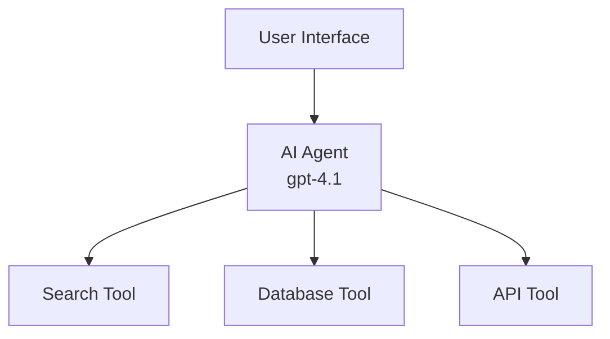
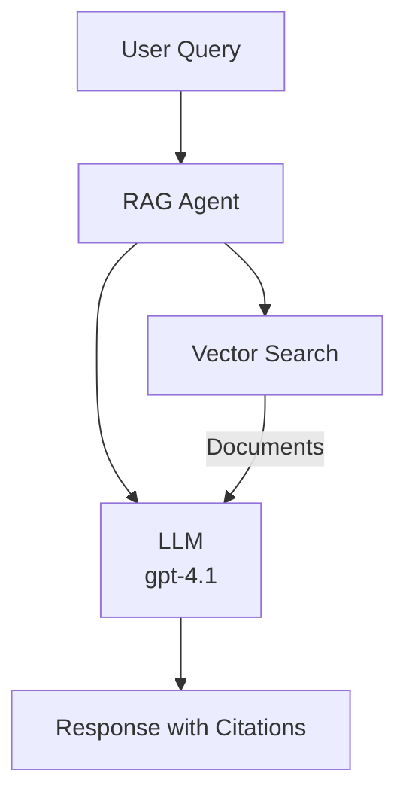
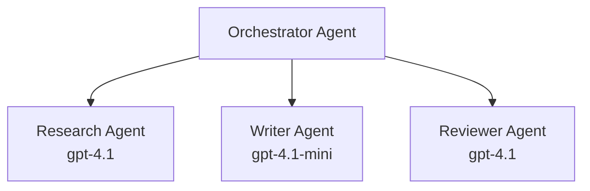

# AI Agendid Azure Developer CLI-ga

**Peatüki navigeerimine:**
- **📚 Kursuse koduleht**: [AZD algajatele](../../README.md)
- **📖 Käesolev peatükk**: Peatükk 2 - AI-esmane arendus
- **⬅️ Eelmine**: [Microsoft Foundry integratsioon](microsoft-foundry-integration.md)
- **➡️ Järgmine**: [AI mudeli juurutamine](ai-model-deployment.md)
- **🚀 Edasijõudnutele**: [Mitmeagendi lahendused](../../examples/retail-scenario.md)

---

## Sissejuhatus

AI agendid on autonoomsed programmid, mis suudavad tajuda oma keskkonda, teha otsuseid ja võtta samme konkreetsete eesmärkide saavutamiseks. Erinevalt lihtsatest vestlusbotidest, mis vastavad sisendile, saavad agendid:

- **Kasutada tööriistu** - Kutsuda API-sid, otsida andmebaase, käivitada koodi
- **Plaani teha ja põhjendada** - Jagada keerulised ülesanded sammudeks
- **Õppida kontekstist** - Säilitada mälu ja kohandada käitumist
- **Teha koostööd** - Töötada teiste agentidega (mitmeagentide süsteemid)

See juhend näitab, kuidas juurutada AI agente Azure’i kasutades Azure Developer CLI-d (azd).

Vestluse konteksti kasutamine ei ole mudeli koolitus: püsivat mälu, juurdepääsu kontrolli ja säilitust peab rakendus ise rakendama/konfigureerima.

> **Väljalaskekontroll (2026-11-04):** CLI näited kontrolliti `azd` `1.37.2`, `azure.ai.agents` `1.0.0-beta.23` ja `azure.ai.evaluations` `1.0.0-beta.2` dokumentatsiooni/allika vastu, mitte otse elava Azure’i keskkonnas. Kasutage kombineeritud töövoo jaoks `azd >= 1.37.0`. Vaadake enne varasemate projektide uuendamist [hiljutisi muudatusi ja parandusi](../chapter-08-production/production-ai-practices.md#recent-release-changes-and-fixes).

## Õpieesmärgid

Selle juhendi läbimisel õpite:
- Mõistma, mis on AI agendid ja kuidas nad erinevad vestlusbotidest
- Kasutama eelnevalt ehitatud AI agendi malle AZD-ga
- Konfigureerima Foundry agente kohandatud agentide jaoks
- Rakendama põhilisi agentide mustreid (tööriistade kasutamine, RAG, mitmeagent)
- Jälgima ja siluma juurutatud agente

## Õpitulemused

Juhendi lõpetamisel oskad:
- Juurutada AI agentrakendusi Azure’i ühe käsuga
- Konfigureerida agentide tööriistu ja võimekusi
- Rakendada otsingu-põhise täiendava generatsiooni (RAG) agentidega
- Kavandada mitmeagendi arhitektuure keeruliste töövoogude jaoks
- Tuvastada ja lahendada levinud agentide juurutamise probleeme

---

## 🤖 Mis teeb agendi erinevaks vestlusbotist?

| Omadus | Vestlusbot | AI Agent |
|---------|---------|----------|
| **Käitumine** | Vastab sisenditele | Võtab autonoomseid samme |
| **Tööriistad** | Võib kasutada päringuid või tööriistu | Tavaliselt kasutab tööriistu eesmärgipärases tsüklis |
| **Mälu** | Rakendusele sõltuv | Püsiv mälu ainult kui selgesõnaliselt rakendatud |
| **Planeerimine** | Ühe vastusega | Mitmesammuline põhjendus |
| **Koostöö** | Üksik üksus | Võib töötada koos teiste agentidega |

### Lihtne Võrdlus

- **Vestlusbot** = Abivalmis inimene infolauas vastamas küsimustele
- **AI Agent** = Isiklik assistent, kes saab helistada, broneerida kohtumisi ja täita ülesandeid sinu eest

---

## 🚀 Kiire algus: juuruta oma esimene agent

Vali üks variant **uus tühjas töökataloogis**. Jooksva kohaletoimetamise `.` initsialiseerib seal; ilma konkreetse sihtkohata võib AZD luua alamkausta malle nimega ega muuda su shelli kataloogi. Hoia eri mallid/keskkonnad eraldi kataloogides.

Alljärgnevad ajad/kulud on illustratiivsed, mitte valideeritud hinnapakkumised. Kontrolli iga näite praeguseid eeltingimusi, hindu, mudeli kvotasid ja valikulisi teenuseid enne juurutamist.

### Variant 1: Foundry agentide mall (Soovitatav)

```bash
# Initialize the AI agents template
azd init --template get-started-with-ai-agents .

# Deploy to Azure
azd up
```

**Mida juurutatakse:** Näite praegune infrastruktuur ja valitud valikud määravad mudeli, tööriistad, hostimise ja jälgimisressursid. Tutvu selle README-ga ja `infra/` enne varustamist; ära eelda, et iga agentide mall sisaldab otsingut või veebi liidest.

**Aeg:** ~15-20 minutit
**Kulu:** ~$100-150/kuu (arendus)

### Variant 2: Loovkirjutamise agentide Promptyga

```bash
# Initialize the Prompty-based agent template
azd init --template https://github.com/Azure-Samples/contoso-creative-writer .

# Deploy to Azure
azd up
```

**Mida juurutatakse:** FastAPI/Prompty mitmeagendi kirjutamise näide kasutades Azure OpenAI, Bing Groundingut ja Azure AI otsingut. Varasem `agent-openai-python-prompty` hoidla suunab siia; see ei ole minimaalne Azure Functions ilmadeagentide mall. Järgi selle praegust README-d hostimise, mudeli kvota ja Bing Groundingu eeltingimuste saamiseks.

**Aeg:** ~10-15 minutit
**Kulu:** ~$50-100/kuu (arendus)

### Variant 3: RAG vestlusagent

```bash
# Initialize RAG chat template
azd init --template azure-search-openai-demo .

# Deploy to Azure
azd up
```

**Mida juurutatakse:**
- ✅ Microsoft Foundry mudelid
- ✅ Azure AI otsing näidata andmetega
- ✅ Dokumentide töötlemise torujuhe
- ✅ Vestluse liides viidetega

**Aeg:** ~15-25 minutit
**Kulu:** ~$80-150/kuu (arendus)

### Variant 4: AZD AI Agent algus (projekti malli eelvaade)

Kasuta `azd ai agent init` interaktiivselt või võta üle praegune `azure.yaml` agendi projekt kas kasutades `--template`/`-t`. Vana `--manifest`/`-m` valik on katkestatud alias, mitte teisendaja pärandmanifestide jaoks.

```bash
# Install the AI agents extension
azd extension install azure.ai.agents

# Optional: verify the installed preview version
azd extension show azure.ai.agents

# Initialize from a current agent project template (supply your template path)
azd ai agent init --template ./templates/support-agent/azure.yaml

# Deploy to Azure
azd up

# Test the deployed agent (shows latency + time-to-first-byte)
azd ai agent invoke
```

**Millal kasutada `azd ai agent init` vs `azd init --template`:**

| Lähenemine | Sobib kõige paremini | Kuidas töötab |
|----------|----------|------|
| `azd init --template` | Töötava näidiskõrvalrakendusega alustamine | Kloonib täieliku malli hoidla koos koodi ja infrastruktuuriga |
| `azd ai agent init --template` | Praeguse Foundry agendi projekti kasutamine | Kasutab `azure.yaml` projekti dokumenti ja selle definitsioone |

> **Nõuanne:** Kasuta `azd init --template` õppimisel (Variante 1-3 eespool). Kasuta `azd ai agent init` Foundry agendi töövoo jaoks. Agentide otsese definitsiooni lisamiseks olemasolevale projektile vaata [initsialiseerimise ja migratsiooni juhiseid](../chapter-08-production/production-ai-practices.md#initializing-agent-projects-with-azd-ai-agent-init).

Pärast `azd up` testi kasutamiseks `azd ai agent invoke`, eraldi `azure.ai.evaluations` laiendus (`azd ai eval init`, `generate` ja `run start`) kvaliteedi mõõtmiseks ja `azd ai agent optimize` selle parandamiseks uue hindamiskonfiguratsiooni kasutamisega. Agentide beta.22 asendas pärandhindamise töövoo ja muutis optimeerimise `--config` vormi. Vaata [hindamise migratsiooni](../chapter-08-production/production-ai-practices.md#evaluation-migration-and-quality-checks) ja [optimeerimise migratsiooni](../chapter-08-production/production-ai-practices.md#optimization-configuration-migration) enne vanemate näidete uuesti kasutamist.

---

## 🏗️ Agendi arhitektuuri mustrid

### Muster 1: Üksik agent tööriistadega

Kõige lihtsam agendi muster – üks agent, kes saab kasutada mitut tööriista.



**Sobib kõige paremini:**
- Klienditoe botid
- Uurimisassistendid
- Andmeanalüüsi agendid

**Seotud rakenduse näide:** `azure-search-openai-demo` demonstreerib RAG-i, mitte üldist suvalist tööriistadega agentide tsüklit.

### Muster 2: RAG agent (otsingu täiendusega generatsioon)

Agent, kes otsib asjakohaseid dokumente enne vastuste genereerimist.



**Sobib kõige paremini:**
- Ettevõtte teadmistebaasid
- Dokumentide küsimuste ja vastuste süsteemid
- Vastavuse ja juriidilised uuringud

**AZD mall:** `azure-search-openai-demo`

### Muster 3: Mitme-agendi süsteem

Mitmed spetsialiseeritud agendid teevad koostööd keeruliste ülesannete täitmiseks.



**Sobib kõige paremini:**
- Keerukas sisuloome
- Mitmesammulised töövood
- Ülesanded, mis vajavad erinevat erialast pädevust

**Lisaks:** [Mitme-agendi koordineerimise mustrid](../chapter-06-pre-deployment/coordination-patterns.md)

---

## ⚙️ Agendi tööriistade konfigureerimine

Agendid muutuvad võimsaks, kui nad saavad kasutada tööriistu. Siin on, kuidas tavapäraseid tööriistu konfigureerida:

### Tööriistade konfigureerimine Foundry agentides

See **klassikaline agentide teenuse SDK lõik** on suunatud `azure-ai-projects==1.0.0` ja `azure-ai-agents==1.1.0` kasutades `azure-identity`. See ei ole uuem versiooniga agentide/Responses API, mida kasutavad mõned tänased Foundry mallid, ega `azure.ai.agents` AZD laiendus (teine pakett). Ära sega neid API põlvkondi. Sea `PROJECT_ENDPOINT` klassikalisse Foundry projekti lõpp-punkti ja `MODEL_DEPLOYMENT_NAME` olemasoleva toetatud mudeli juurutamisse; autentimiseks kasuta kohapeal `az login` ja anna vajalikud projekti õigused.

```python
# agent_config.py
import os
from azure.ai.projects import AIProjectClient
from azure.ai.agents.models import FunctionTool
from azure.identity import DefaultAzureCredential

def search_knowledge_base(query: str) -> str:
    """Search the demonstration knowledge base.

    :param query: Search text.
    :return: Matching demonstration information.
    """
    # Local fixture only, not a production search implementation.
    return "Demo policy: returns are accepted within 30 days."

project_client = AIProjectClient(
    endpoint=os.environ["PROJECT_ENDPOINT"],
    credential=DefaultAzureCredential(),
)
search_tool = FunctionTool(functions={search_knowledge_base})
project_client.agents.enable_auto_function_calls(search_tool)
agent = project_client.agents.create_agent(
    model=os.environ["MODEL_DEPLOYMENT_NAME"],
    name="Support Agent",
    instructions="Use search_knowledge_base for policy questions. Label results as demo data.",
    tools=search_tool.definitions,
)
```

Funktsiooni skeemi registreerimine ei käivita Pythonit teenuses. Selles SDK-s käitab `enable_auto_function_calls` koos `agents.runs.create_and_process(...)` registreeritud tagasikutsed sinu kliendiprotsessis. Vaata [väljastatud SDK näidet](https://github.com/Azure/azure-sdk-for-python/blob/azure-ai-agents_1.1.0/sdk/ai/azure-ai-agents/samples/agents_tools/sample_agents_auto_function_call.py). Sulge klient ja kustuta näidiste agendid/teemad, kui valmis.

### Keskkonna konfigureerimine

Järgmised nimed on **illustratiivsed kohandatud malli sisendid**, mitte sisseehitatud AZD lülitid. Esmalt juhenda iga väärtus läbi `infra/main.parameters.json`, infrastruktuuri ja rakenduse koodi. Ainult `azd env set` ei muuda agendi tööriistu või juhiseid.

```bash
# Set up agent-specific environment variables
azd env set AZURE_OPENAI_MODEL "gpt-4.1"
azd env set AGENT_INSTRUCTIONS "You are a helpful assistant..."
azd env set ENABLE_CODE_INTERPRETER "true"
azd env set ENABLE_FILE_SEARCH "true"

# Apply wired infrastructure and application changes
azd up
```

---

## 📊 Agentide jälgimine

### Application Insights integratsioon

Kui valitud mall varustab Application Insights ja konfigureerib instrumendid:

```bash
# Open monitoring dashboard
azd monitor --overview

# Open the Application Insights logs view (not a streaming log tail)
azd monitor --logs

# View live metrics
azd monitor --live
```

### Põhimõõdikud, mida jälgida

| Mõõdik | Kirjeldus | Eesmärk |
|--------|-------------|--------|
| Vastuse viivitus | Aeg vastuse genereerimiseks | < 5 sekundit |
| Tokenite kasutus | Tokeneid päringu kohta | Jälgi kulusid |
| Tööriista kutse õnnestumise määr | Edukas tööriista täitmine % | > 95% |
| Veamäär | Ebaõnnestunud agentide päringud | < 1% |
| Kasutaja rahulolu | Tagasiside hinnangud | > 4.0/5.0 |

### Kohandatud logimine agentidele

```python
import os
from azure.monitor.opentelemetry import configure_azure_monitor
from opentelemetry import trace

# Configure Azure Monitor with OpenTelemetry
configure_azure_monitor(
    connection_string=os.environ["APPLICATIONINSIGHTS_CONNECTION_STRING"]
)

tracer = trace.get_tracer(__name__)

def log_agent_interaction(user_query, agent_response, tools_used, latency_ms):
    with tracer.start_as_current_span("agent_interaction") as span:
        span.set_attributes({
            "query_length": len(user_query),  # Do not log raw prompts or personal data
            "response_length": len(agent_response),
            "tools_used": tools_used,
            "latency_ms": latency_ms
        })
```

> **Märkus:** Installi nõutav pakett: `pip install azure-monitor-opentelemetry`. See toob kaasa OpenTelemetry sõltuvused; importi nimi ei ole nõue installida paketti nimega `opentelemetry`.

---

## 💰 Kulu kaalutlused

### Hinnangulised kuukulud mustrite kaupa

Need on illustratiivsed planeerimisvahemikud, mitte hinnapakkumised või kulupiirid. Piirkond, mudeli tokenid, otsingu/arvutus SKU-d, tööriista sessioonid, salvestus ja liiklus võivad neist kõrgemad olla. Kontrolli näite kulujuhiseid ja Azure’i hindu enne `azd up`.

| Muster | Arenduskeskkond | Tootmine |
|---------|-----------------|------------|
| Üksik agent | $50-100 | $200-500 |
| RAG agent | $80-150 | $300-800 |
| Mitme-agent (2-3 agenti) | $150-300 | $500-1,500 |
| Ettevõtte mitme-agent | $300-500 | $1,500-5,000+ |

### Kulude optimeerimise nõuanded

1. **Kasuta gpt-4.1-mini lihtsate ülesannete jaoks** (ainult kui mall seda sisendit tarbib)
   ```bash
   azd env set AZURE_OPENAI_MODEL "gpt-4.1-mini"
   ```

2. **Rakenda turvaline korduvpäringute vahemällu salvestamine.** Sisalda rentniku/kasutaja autoriseerimine, mudeli juurutus, juhised ja päringu versioon vahemälu võtmesse; määra aegumine. Ära jaga privaatseid vestluste vastuseid protsessi-laia ainult-päringu vahemällu. SDK agentobjektil puudub üldine `agent.run()` meetod.

3. **Sea tokenite piirangud jooksult**
   ```python
   # Set max_completion_tokens when running the agent, not during creation
   run = project_client.agents.runs.create_and_process(
       thread_id=thread.id,
       agent_id=agent.id,
       max_completion_tokens=1000  # Budget across the run; may finish as incomplete
   )
   ```

4. **Skaala sobivad Container Appid nulli, kui neid ei kasutata**
   ```bash
   # Custom-template input: must map to template.scale.minReplicas
   azd env set MIN_REPLICAS "0"
   ```
   Rakenda infrastruktuuri muudatus `azd provision` või `azd up` abil. Nullini skaleerimine vajab sobivat käivitajat ja ei peata otsingut, salvestust ega mudeli/tööriista kulusid.

---

## 🔧 Agentide tõrkeotsing

### Levinumad probleemid ja lahendused

<details>
<summary><strong>❌ Agent ei vasta tööriistakutseile</strong></summary>

```bash
# Inspect the application deployment (not the agent's registered tools)
azd show

# Verify OpenAI deployment
az cognitiveservices account deployment list \
  --name $AZURE_OPENAI_NAME \
  --resource-group $RG_NAME

# Check agent logs
azd monitor --logs
```

**Levinud põhjused:**
- Tööriista funktsiooni signatuuri sobimatus
- Puuduvad vajalikud õigused
- API lõpp-punkt pole ligipääsetav
</details>

<details>
<summary><strong>❌ Agentide vastused aeglased</strong></summary>

```bash
# Check Application Insights for bottlenecks
azd monitor --live

# Consider using a faster model
azd env set AZURE_OPENAI_MODEL "gpt-4.1-mini"
azd up
```

**Optimeerimise nõuanded:**
- Kasuta voogedastust
- Rakenda vastuste vahemällu salvestamine
- Vähenda konteksti akna suurust
</details>

<details>
<summary><strong>❌ Agent tagastab vale või väljamõeldud teavet</strong></summary>

```python
# Improve with better system prompts
instructions = """
You are a helpful assistant. IMPORTANT:
- Only answer based on provided context
- If you don't know, say "I don't know"
- Always cite your sources
- Never make up information
"""

# Use these instructions in the agent definition.
# For classic file search, first upload/index documents in a vector store,
# then use FileSearchTool(vector_store_ids=[...]) and pass both its
# .definitions and .resources when creating the agent.
```
Juhised ja otsing vähendavad riski; ükski ei taga faktipõhiseid vastuseid. Hindamiseks võrdle faktiliste vastustega tegelikke ja väljaspool ulatust küsimusi.
</details>

<details>
<summary><strong>❌ Tokeni limiidi ületamise vead</strong></summary>

```python
# Implement context window management
def truncate_context(messages, max_tokens=8000, model="gpt-4.1"):
    """Approximate content-only budget for objects with .content strings."""
    import tiktoken
    encoding = tiktoken.encoding_for_model(model)
    total_tokens = 0
    truncated = []
    
    for msg in reversed(messages):
        msg_tokens = len(encoding.encode(msg.content))
        if total_tokens + msg_tokens > max_tokens:
            break
        truncated.insert(0, msg)
        total_tokens += msg_tokens
    
    return truncated
```
See abimees välistab rolli/tööriista skeemid, süsteemi juhised, pildi tokenid ja protokolli üleliigse kihi. Broneeri ruumi nende jaoks ja lõpuleviimiseks; ära jaga tööriistakutse/tulemuse paare ega viska ära vajalikke süsteemi juhiseid. Installeeri `tiktoken` eraldi. See ei ole üldine kontekstiakna valideerija.
</details>

---

## 🎓 Praktilised harjutused

### Harjutus 1: Juuruta põhiagent (20 minutit)

**Eesmärk:** Juuruta oma esimene AI agent kasutades AZD-d

```bash
# Step 1: Initialize template
azd init --template get-started-with-ai-agents .

# Step 2: Login to Azure
azd auth login
# If you work across tenants, add --tenant-id <tenant-id>

# Step 3: Deploy
azd up

# Step 4: Test the agent
# Expected output after deployment:
#   Deployment Complete!
#   Endpoint: https://<app-name>.<region>.azurecontainerapps.io
# Open the URL shown in the output and try asking a question

# Step 5: View monitoring
azd monitor --overview

# Step 6: Clean up
azd down --force --purge
```

**Õnnestumise kriteeriumid:**
- [ ] Agent vastab küsimustele
- [ ] Juurdepääs jälgimisarmatuurile `azd monitor` kaudu
- [ ] Ressursid on edukalt puhastatud

### Harjutus 2: Lisa kohandatud tööriist (30 minutit)

**Eesmärk:** Laiendada agenti kohandatud tööriistaga

**Alguspunkt:** Kasuta klassikalist SDK klienti [tööriistade konfigureerimise](#tool-configuration-in-foundry-agents) juhendist, mitte suvalist malli teisest SDK põlvkonnast.

1. Lisa see deterministlik testvarustus `agent_config.py`:
   ```python
   def get_weather(location: str) -> str:
       """Return demonstration weather, not live conditions.

       :param location: City name.
       :return: A clearly labelled fixture.
       """
       print(f"TOOL_CALLED: {location}")
       return f"Demo weather in {location}: Sunny, 72°F (fixture, not live)"
   ```
2. Asenda otsingutööriista registreerimis- ja loomiskodeerimisplokk järgneva vastu:
   ```python
   weather_tool = FunctionTool(functions={get_weather})
   project_client.agents.enable_auto_function_calls(weather_tool)
   agent = project_client.agents.create_agent(
       model=os.environ["MODEL_DEPLOYMENT_NAME"],
       name="Weather Agent",
       instructions="Call get_weather for weather questions; explain that it returns demo data.",
       tools=weather_tool.definitions,
   )
   thread = project_client.agents.threads.create()
   try:
       project_client.agents.messages.create(
           thread_id=thread.id, role="user", content="Use get_weather for Seattle."
       )
       run = project_client.agents.runs.create_and_process(
           thread_id=thread.id, agent_id=agent.id
       )
       if run.status != "completed":
           raise RuntimeError(f"Run status: {run.status}; error: {run.last_error}")
       for message in project_client.agents.messages.list(thread_id=thread.id):
           for text in message.text_messages:
               print(text.text.value)
   finally:
       project_client.agents.threads.delete(thread.id)
       project_client.agents.delete_agent(agent.id)
       project_client.close()
   ```
3. Käivita lokaalselt (see kutsub olemasolevat Azure projekti ja tekitab mudeli tasusid):
   ```bash
   python agent_config.py
   # Expected: TOOL_CALLED: Seattle, then a completed answer labelled demo data.
   ```

**Edukuse kriteeriumid:**
- [ ] Agent tunneb ära ilmaga seotud päringud
- [ ] Tööriist kutsutakse õigesti
- [ ] Vastus sisaldab ilmaga seotud teavet

### Harjutus 3: Ehita RAG agent (45 minutit)

**Eesmärk:** Loo agent, mis vastab küsimustele sinu dokumentide põhjal

```bash
# Step 1: Deploy RAG template
azd init --template azure-search-openai-demo .
azd up

# Step 2: Upload your documents
# For the sample's local ingestion path, place supported files in data/.
# Run from the sample root after following its Python environment setup:
./scripts/prepdocs.sh
# Windows PowerShell equivalent: .\\scripts\\prepdocs.ps1

# Step 3: Test with domain-specific questions
# Open the web app URL from the azd up output
# Ask questions about your uploaded documents
# Responses should include citation references like [doc.pdf]
```

**Edukuse kriteeriumid:**
- [ ] Agent vastab üleslaaditud dokumentidest
- [ ] Vastustes on viited
- [ ] Piiriüleste küsimustega tegeletakse ilma toetamatute väideteta (ei garanteeri kõigi tulevaste küsimuste kohta)

Kui `USE_CLOUD_INGESTION=true`, kasuta selle näite pilvepõhist andmete sissetoomise/üleslaadimise töövoogu; lokaalne mähis vahele jätab teadlikult andmete sissetoomise. Pärast testimist käivita `azd down` RAG keskkonnas ning vaata üle kustutatavad ressursid.

---

## 📚 Järgmised sammud

Nüüd, kui mõistad AI agente, avasta need arenenud teemad:

| Teema | Kirjeldus | Link |
|-------|-------------|------|
| **Mitmeagendilised süsteemid** | Ehita süsteeme mitme koostööagendiga | [Jaemüügi mitmeagendi näide](../../examples/retail-scenario.md) |
| **Koordineerimismustrid** | Õpi orkestreerimise ja suhtlemismustreid | [Koordineerimismustrid](../chapter-06-pre-deployment/coordination-patterns.md) |
| **Tootmisesse juurutamine** | Ettevõttevalmidus agentide juurutamiseks | [Tootmise AI tavad](../chapter-08-production/production-ai-practices.md) |
| **Agendi hindamine** | Testi ja hinda agendi jõudlust | [AI tõrkeotsing](../chapter-07-troubleshooting/ai-troubleshooting.md) |
| **AI töötuba labor** | Praktika: tee oma AI-lahendus AZD-valmis | [AI töötuba labor](ai-workshop-lab.md) |

---

## 📖 Lisamaterjalid

### Ametlik dokumentatsioon
- [Microsoft Foundry Agent Service](https://learn.microsoft.com/azure/ai-services/agents/)
- [Microsoft Foundry Agent Service kiire algus](https://learn.microsoft.com/azure/ai-services/agents/quickstart)
- [Semantic Kernel Agent Framework](https://learn.microsoft.com/semantic-kernel/)

### AZD mallid agentidele
- [Alusta AI agentidega](https://github.com/Azure-Samples/get-started-with-ai-agents)
- [Loovkirjutamise agendid Promptyga](https://github.com/Azure-Samples/contoso-creative-writer)
- [Azure Search OpenAI demo](https://github.com/Azure-Samples/azure-search-openai-demo)

### Kogukonna ressursid
- [Awesome AZD - agentide mallid](https://azure.github.io/awesome-azd/?tags=ai-agents)
- [Azure AI Discord](https://discord.gg/microsoft-azure)
- [Microsoft Foundry Discord](https://discord.gg/nTYy5BXMWG)

### Agendi oskused sinu redaktori jaoks
- [**Microsoft Azure Agent Skills**](https://skills.sh/microsoft/github-copilot-for-azure) - Paigalda taaskasutatavad AI agendi oskused Azure arenduseks GitHub Copilotis, Cursoris või mis tahes toetatud agendis. Sisaldab oskusi [Azure AI](https://skills.sh/microsoft/github-copilot-for-azure/azure-ai), [Microsoft Foundry](https://skills.sh/microsoft/github-copilot-for-azure/microsoft-foundry), [juurutus](https://skills.sh/microsoft/github-copilot-for-azure/azure-deploy) ja [diagnoosid](https://skills.sh/microsoft/github-copilot-for-azure/azure-diagnostics) jaoks:
  ```bash
  npx skills add microsoft/github-copilot-for-azure
  ```

---

**Navigeerimine**
- **Eelmine õppetükk**: [Microsoft Foundry integratsioon](microsoft-foundry-integration.md)
- **Järgmine õppetükk**: [AI mudeli juurutamine](ai-model-deployment.md)

---

<!-- CO-OP TRANSLATOR DISCLAIMER START -->
**Lahtiütlus**:
See dokument on tõlgitud kasutades AI tõlketeenust [Co-op Translator](https://github.com/Azure/co-op-translator). Kuigi me püüdleme täpsuse poole, palun pange tähele, et automatiseeritud tõlgetes võib esineda vigu või ebatäpsusi. Originaaldokument selle emakeeles tuleks pidada autoriteetseks allikaks. Olulise teabe puhul soovitatakse kasutada professionaalset inimtõlget. Me ei vastuta selle tõlkega seotud eksimustest või valesti mõistmistest.
<!-- CO-OP TRANSLATOR DISCLAIMER END -->