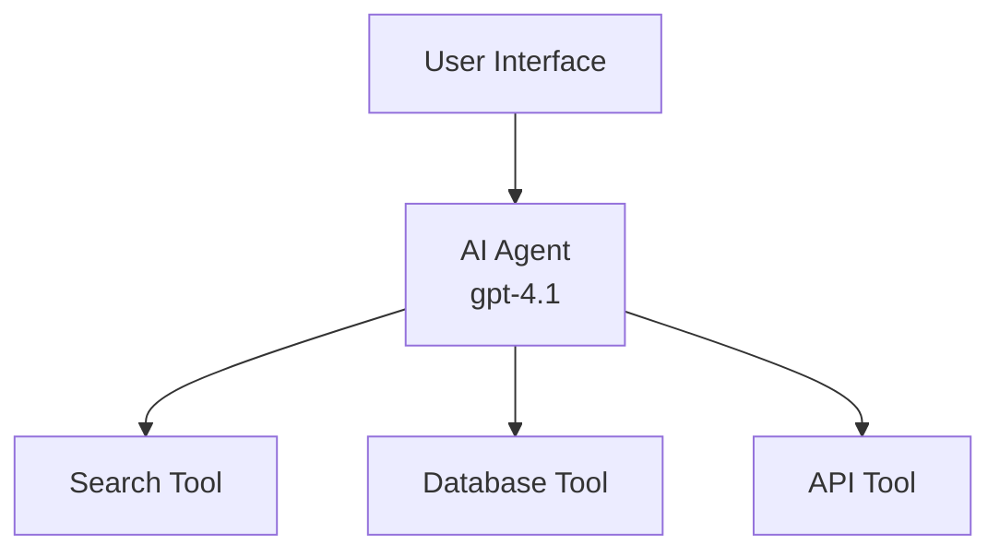
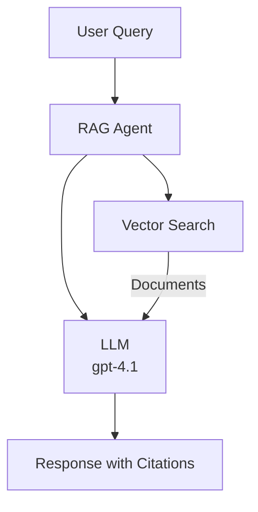
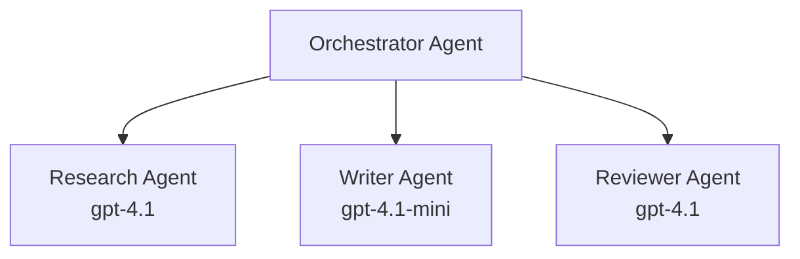

# Tehisintellekti agendid Azure Developer CLI-ga

**Peatüki navigeerimine:**
- **📚 Kursuse avaleht**: [AZD algajatele](../../README.md)
- **📖 Praegune peatükk**: Peatükk 2 - AI-esimene arendus
- **⬅️ Eelmine**: [Microsoft Foundry integratsioon](microsoft-foundry-integration.md)
- **➡️ Järgmine**: [AI mudeli juurutamine](ai-model-deployment.md)
- **🚀 Täiustatud**: [Mitmeagendi lahendused](../../examples/retail-scenario.md)

---

## Sissejuhatus

AI agendid on autonoomsed programmid, mis suudavad tajuda oma keskkonda, teha otsuseid ja võtta meetmeid kindlate eesmärkide saavutamiseks. Erinevalt lihtsatest chatbotidest, mis vastavad küsimustele, võivad agendid:

- **Kasutada tööriistu** – Kutsuda API-sid, otsida andmebaase, käivitada koodi
- **Plaanitada ja põhjendada** – Jagada keerulisi ülesandeid sammudeks
- **Õppida kontekstist** – Säilitada mälu ja kohandada käitumist
- **Töötada koos** – Tegutseda koos teiste agentidega (mitmeagendiga süsteemid)

See juhend näitab, kuidas juurutada AI agente Azure’i kasutades Azure Developer CLI-d (azd).

Vestluse konteksti kasutamine ei ole mudeli koolitus: püsiva mälu, juurdepääsukontrolli ja säilituse peab rakendama või seadistama rakendus.

> **Foundry GA uuendus (2026-11-09):** Installige üldsusele kättesaadav `microsoft.foundry` 1.0 komplekt koos `azd >= 1.37.0`. Hindamised paigaldatakse eraldi; valikulised eelvaate funktsioonid ja allpool olev klassikaline SDK fragment ei kuulu komplekti avaldamisega GA-sse. See juhend põhineb [GA teadaandel](https://devblogs.microsoft.com/azure-sdk/microsoft-foundry-azure-developer-cli-ga/) ja dokumentatsioonil, mitte reaalajas Azure juurutusel.

## Õpieesmärgid

Selle juhendi lõpetamisel:
- Mõistate, mis on AI agendid ja kuidas nad erinevad chatbotidest
- Juurutate eelnevalt ehitatud AI agendi malle kasutades AZD-d
- Seadistate Foundry agente kohandatud agentide jaoks
- Rakendate põhilisi agendi mustreid (tööriistade kasutamine, RAG, mitmeagent)
- Jälgite ja silute juurutatud agente

## Õpitulemused

Pärast juhendi lõppu oskate:
- Juurutada AI agendi rakendusi Azure’i ühe käsuga
- Seadistada agendi tööriistu ja võimeid
- Rakendada andmepõhist vastuste loomist (RAG) agentidega
- Kujundada mitmeagendi arhitektuure keeruliste töövoogude jaoks
- Lahendada tavalisi agendi juurutamise probleeme

---

## 🤖 Mis teeb agendi erinevaks chatbotist?

| Omadus | Chatbot | AI agent |
|---------|---------|----------|
| **Käitumine** | Vastab päringutele | Võtab autonoomseid samme |
| **Tööriistad** | Võib kasutada otsingut või tööriistu | Tavaliselt kasutab tööriistu eesmärgistatud tsüklis |
| **Mälu** | Rakendusele sõltuv | Püsiv mälu ainult juhul, kui see on selgelt rakendatud |
| **Planeerimine** | Üksik vastus | Mitmesammuline mõtlemine |
| **Koostöö** | Üksik üksus | Saab töötada koos teiste agentidega |

### Lihtne analoogia

- **Chatbot** = Üks abivalmis inimene teabepunktis küsimustele vastamas
- **AI agent** = Isiklik assistent, kes suudab helistada, broneerida kohtumisi ja täita ülesandeid teie eest

---

## 🚀 Kiire algus: Juuriuta oma esimene agent

Vali üks variant **uus tühjaks töökataloogis**. Järgmine `.` algatab sinna; ilma selge sihtkohata võib jooksvalt AZD luua malli nimega alamkausta ega muuda teie shelli kataloogi. Hoia eraldi mallid/keskkonnad eraldi kataloogides.

Allolevad aeg/kulu näited on illustratiivsed, mitte kinnitatud hinnapakkumised. Kontrolli iga näidise praeguseid tingimusi, hinnaid, mudeli kvoote ja valikulisi teenuseid enne juurutamist.

### Variant 1: Foundry agentide mall (Soovitatav)

```bash
# Initialize the AI agents template
azd init --template get-started-with-ai-agents .

# Deploy to Azure
azd up
```

**Mis juurutatakse:** Näidise praegune infrastruktuur ja valitud valikud määravad mudeli, tööriistad, majutuse ja jälgimisressursid. Vaata läbi selle README ja `infra/` enne ressursside loomist; ära eelda, et iga agendi mall sisaldab otsingut või veebiliidest.

**Aeg:** ~15-20 minutit
**Kulu:** ~$100-150/kuus (arendus)

### Variant 2: Loovkirjutamise agendid koos Prompty-ga

```bash
# Initialize the Prompty-based agent template
azd init --template https://github.com/Azure-Samples/contoso-creative-writer .

# Deploy to Azure
azd up
```

**Mis juurutatakse:** FastAPI/Prompty mitmeagendi kirjutamisnäidis, kasutades Azure OpenAI, Bing Grounding ja Azure AI Search. Varasem `agent-openai-python-prompty` hoidla suunab siia; see ei ole minimaalne Azure Functions ilmagentide mall. Järgi selle praegust README-d majutuse, mudeli kvoodi ja Bing Grounding’i eeltingimuste kohta.

**Aeg:** ~10-15 minutit
**Kulu:** ~$50-100/kuus (arendus)

### Variant 3: RAG Chat Agent

```bash
# Initialize RAG chat template
azd init --template azure-search-openai-demo .

# Deploy to Azure
azd up
```

**Mis juurutatakse:**
- ✅ Microsoft Foundry mudelid
- ✅ Azure AI Search näidisandmetega
- ✅ Dokumentide töötlemise torujuhtme
- ✅ Vestluse liides viidetega

**Aeg:** ~15-25 minutit
**Kulu:** ~$80-150/kuus (arendus)

### Variant 4: Majutatud agent GA Foundry komplektiga

Kasuta [täielikku majutatud agendi juhendit](microsoft-foundry-integration.md#hosted-agent-walkthrough-ga) põhjaliku Python Agent Framework Responses API näidise jaoks. See koodi juurutamise tee vajab Python 3.13+, praegust uv, Foundry õigusi ja piirkondlikku mudeli kvooti. Autentige lokaalsed SDK kõned eraldi Azure CLI mandaadi abil.

```bash
azd auth login
azd ext install microsoft.foundry
```

Tühjas kataloogis algata näidis:

```text
azd ai agent init --template https://github.com/microsoft-foundry/foundry-samples/blob/main/samples/python/hosted-agents/agent-framework/responses/01-basic/azure.yaml --deploy-mode code --src .
```

Vali uus või olemasolev projekt, vaata `azure.yaml` üle ja käivita `azd provision`. Ava Agent Inspector kasutades `azd ai agent run` ja teises terminaliaknas samas kataloogis käivita `azd ai agent invoke --local "Explain how this agent is hosted."`. Pärast lokaalset kontrolli võrdle juurutatud vastust käsuga `azd deploy` ja `azd ai agent invoke "Explain how this agent is hosted."`. Foundry ehitab üles laaditud lähtekoodi kaugserveris; kohalik konteineri ehitus ei ole vajalik.

**Millal kasutada `azd ai agent init` vs `azd init --template`:**

| Lähenemine | Parim kasutusala | Kuidas töötab |
|----------|-----------------|--------------|
| `azd init --template` | Töötava näidisarenduse alustamine | Kopeerib terve malli hoidla koos koodi ja infrastruktuuriga |
| `azd ai agent init --template` | Olemasoleva Foundry agendi projekti kasutuselevõtt | Kasutab `azure.yaml` projektdokumenti ja selle definitsioone |

> **Nipp:** Valikud 1-3 algavad täismahus rakenduse mallidest; variant 4 õpetab GA majutatud agendi töövoogu. Ükski initsialiseerimiskäsk ei teisalda automaatselt vanu agendi manifeste. Otsese agendi definitsiooni lisamiseks olemasolevasse projekti vaata [initsialiseerimise ja migreerimise juhendit](../chapter-08-production/production-ai-practices.md#initializing-agent-projects-with-azd-ai-agent-init).

Paigalda `azure.ai.evaluations` eraldi, et genereerida ja vaadata testandmeid/kriteeriume, seadistada hindamine ning käivitada see `azd ai eval` abil. Optimeerimiseks saab taaskasutada sobivaid hindamisi; vaata kandidaate enne, kui ühe laialdaselt juurutad. Järgi [hindamisprotsessi](../chapter-08-production/production-ai-practices.md#evaluation-migration-and-quality-checks) ja [opitseerimise migreerimist](../chapter-08-production/production-ai-practices.md#optimization-configuration-migration) enne vanade näidiste taaskasutust. Puhastussammuna jäävad taaskasutatud Foundry projekti ressursid alles pärast `azd down`; uue projekti ressursigrupp kustutatakse. Vaata [juhend puhastamiseks](microsoft-foundry-integration.md#7-clean-up-deliberately).

---

## 🏗️ Agendi arhitektuuri mustrid

### Muster 1: Üksikagent koos tööriistadega

Lihtsaim agendi muster – üks agent, kes saab kasutada mitut tööriista.



**Parim kasutusala:**
- Klienditoe botid
- Uurimisassistendid
- Andmeanalüüsi agendid

**Seotud rakenduse näidis:** `azure-search-openai-demo` demonstreerib RAG-i, mitte üldist suvalise tööriistaga agendi tsüklit.

### Muster 2: RAG Agent (andmeotsinguga rikastatud generatsioon)

Agent, kes otsib asjakohased dokumendid enne vastuste genereerimist.



**Parim kasutusala:**
- Ettevõtte teadmistebaasid
- Dokumentide küsimuste ja vastuste süsteemid
- Vastavus- ja õiguslik uurimistöö

**AZD mall:** `azure-search-openai-demo`

### Muster 3: Mitmeagendiga süsteem

Mitmed spetsialiseerunud agendid töötavad koos keerukate ülesannete lahendamisel.



**Parim kasutusala:**
- Keerukas sisuloome
- Mitmesammulised töövood
- Ülesanded, mis vajavad erinevat ekspertiisi

**Lisateave:** [Mitmeagendilise koordineerimise mustrid](../chapter-06-pre-deployment/coordination-patterns.md)

---

## ⚙️ Agentide tööriistade seadistamine

Agendid muutuvad võimsaks, kui nad saavad tööriistu kasutada. Siin on, kuidas seadistada tavalisi tööriistu:

### Tööriistade seadistamine Foundry agentides

See **klassikaline Agent Service SDK fragment** on suunatud `azure-ai-projects==1.0.0` ja `azure-ai-agents==1.1.0` poole koos `azure-identity`-ga. See ei ole mõnede praeguste Foundry mallide uus versiooniga agentide / Responses API ega `azure.ai.agents` AZD laiendus (sellest erinev pakett). Ära sega neid API põlvkondi. Sea `PROJECT_ENDPOINT` klassikale Foundry projekti sihtkohale ja `MODEL_DEPLOYMENT_NAME` toetatud mudeli juurutamisele; autentimine toimub lokaalselt `az login` abil ja projekti õigused antakse.

```python
# agent_config.py
import os
from azure.ai.projects import AIProjectClient
from azure.ai.agents.models import FunctionTool
from azure.identity import DefaultAzureCredential

def search_knowledge_base(query: str) -> str:
    """Search the demonstration knowledge base.

    :param query: Search text.
    :return: Matching demonstration information.
    """
    # Local fixture only, not a production search implementation.
    return "Demo policy: returns are accepted within 30 days."

project_client = AIProjectClient(
    endpoint=os.environ["PROJECT_ENDPOINT"],
    credential=DefaultAzureCredential(),
)
search_tool = FunctionTool(functions={search_knowledge_base})
project_client.agents.enable_auto_function_calls(search_tool)
agent = project_client.agents.create_agent(
    model=os.environ["MODEL_DEPLOYMENT_NAME"],
    name="Support Agent",
    instructions="Use search_knowledge_base for policy questions. Label results as demo data.",
    tools=search_tool.definitions,
)
```

Funktsiooniskeemi registreerimine ei käivita Pythoni teenusel. Selles SDK-s jooksutab `enable_auto_function_calls` koos `agents.runs.create_and_process(...)` registreeritud tagasikutsed sinu kliendi protsessis. Vaata [vabastatud SDK näidet](https://github.com/Azure/azure-sdk-for-python/blob/azure-ai-agents_1.1.0/sdk/ai/azure-ai-agents/samples/agents_tools/sample_agents_auto_function_call.py). Sulge klient ja eemalda näidisagentid/teemad, kui oled lõpetanud.

### Keskkonna seadistamine

Järgmised nimed on **illustratiivsed kohandatud mallisisendid**, mitte sisseehitatud AZD lülitid. Kõik väärtused juhitakse läbi `infra/main.parameters.json`, infrastruktuuri ja rakenduse koodi. `azd env set` iseenesest ei muuda agendi tööriistu ega juhiseid.

```bash
# Set up agent-specific environment variables
azd env set AZURE_OPENAI_MODEL "gpt-4.1"
azd env set AGENT_INSTRUCTIONS "You are a helpful assistant..."
azd env set ENABLE_CODE_INTERPRETER "true"
azd env set ENABLE_FILE_SEARCH "true"

# Apply wired infrastructure and application changes
azd up
```

---

## 📊 Agentide jälgimine

### Application Insights integreerimine

Kui sinu valitud mall seab üles Application Insightsi ja konfigureerib instrumentatsiooni:

```bash
# Open monitoring dashboard
azd monitor --overview

# Open the Application Insights logs view (not a streaming log tail)
azd monitor --logs

# View live metrics
azd monitor --live
```

### Olulised jälgitavad mõõdikud

| Mõõdik | Kirjeldus | Eesmärk |
|--------|-----------|---------|
| Vastuse latentsus | Vastuse genereerimise aeg | < 5 sekundit |
| Tokeni kasutus | Tokenid päringu kohta | Jälgi kulu |
| Tööriista kõnede õnnestumise määr | Edukate tööriistakäskude protsent | > 95% |
| Vea määr | Ebaõnnestunud agendi päringud | < 1% |
| Kasutaja rahulolu | Tagasiside hinnangud | > 4.0/5.0 |

### Kohandatud logimine agentidele

```python
import os
from azure.monitor.opentelemetry import configure_azure_monitor
from opentelemetry import trace

# Configure Azure Monitor with OpenTelemetry
configure_azure_monitor(
    connection_string=os.environ["APPLICATIONINSIGHTS_CONNECTION_STRING"]
)

tracer = trace.get_tracer(__name__)

def log_agent_interaction(user_query, agent_response, tools_used, latency_ms):
    with tracer.start_as_current_span("agent_interaction") as span:
        span.set_attributes({
            "query_length": len(user_query),  # Do not log raw prompts or personal data
            "response_length": len(agent_response),
            "tools_used": tools_used,
            "latency_ms": latency_ms
        })
```

> **Märkus:** Paigalda vajalik pakett: `pip install azure-monitor-opentelemetry`. See toob kaasa OpenTelemetry sõltuvused; impordi nimede ruum ei ole paketi nimega `opentelemetry` paigaldamiseks nõutud.

---

## 💰 Kulude kaalutlused

### Hinnangulised igakuised kulud mustri kaupa

Need on illustratiivsed plaanivahemikud, mitte pakkumised ega kulupiirid. Regioon, mudeli tokenid, Search/arvutus SKU-d, tööriista sessioonid, salvestus ja liiklus võivad neid ületada. Kontrolli näidise kulujuhiseid ja Azure hindu enne `azd up`.

| Muster | Arenduskeskkond | Tootmine |
|---------|-----------------|------------|
| Üksik agent | $50-100 | $200-500 |
| RAG agent | $80-150 | $300-800 |
| Mitmeagent (2-3 agenti) | $150-300 | $500-1,500 |
| Ettevõtte mitmeagent | $300-500 | $1,500-5,000+ |

### Kulu optimeerimise nipid

1. **Kasuta gpt-4.1-mini lihtsate ülesannete jaoks** (kui su mall seda sisendit tarbib)
   ```bash
   azd env set AZURE_OPENAI_MODEL "gpt-4.1-mini"
   ```

2. **Rakenda piiratud vahemälu turvaliste korduvate päringute jaoks.** Lisa rentniku/kasutaja volitused, mudeli juurutus, juhised ja väljaotsingu versioon vahemälu võtmesse; sea aegumistähtaeg. Ära jaga privaatseid vestluse vastuseid protsessipõhises päringute vahemälus. SDK agendi objekte ei ole üldist `agent.run()` meetodit.

3. **Sea tokenite piirang jooksu kohta**
   ```python
   # Set max_completion_tokens when running the agent, not during creation
   run = project_client.agents.runs.create_and_process(
       thread_id=thread.id,
       agent_id=agent.id,
       max_completion_tokens=1000  # Budget across the run; may finish as incomplete
   )
   ```

4. **Skaleeri sobivad Container Apps nullini, kui mitte kasutusel**
   ```bash
   # Custom-template input: must map to template.scale.minReplicas
   azd env set MIN_REPLICAS "0"
   ```
   Rakenda infrastruktuuri muutus `azd provision` või `azd up` abil. Nullini skaleerimine vajab sobivat päästikut ja ei peata Searchi, salvestust ega mudeli/tööriista kulusid.

---

## 🔧 Agentide veaotsing

### Levinud probleemid ja lahendused

<details>
<summary><strong>❌ Agent ei reageeri tööriistakõnedele</strong></summary>

```bash
# Inspect the application deployment (not the agent's registered tools)
azd show

# Verify OpenAI deployment
az cognitiveservices account deployment list \
  --name $AZURE_OPENAI_NAME \
  --resource-group $RG_NAME

# Check agent logs
azd monitor --logs
```

**Tavalised põhjused:**
- Tööriista funktsiooni signatuuri sobimatus
- Puuduvad vajalikud õigused
- API lõpp-punkti puudumine või kättesaamatus
</details>

<details>
<summary><strong>❌ Agentide vastuste pikk latentsusaeg</strong></summary>

```bash
# Check Application Insights for bottlenecks
azd monitor --live

# Consider using a faster model
azd env set AZURE_OPENAI_MODEL "gpt-4.1-mini"
azd up
```

**Optimeerimise nipid:**
- Kasuta voogedastust vastustes
- Rakenda vastuste vahemälu
- Vähenda konteksti akna suurust
</details>

<details>
<summary><strong>❌ Agent tagastab ebatäpseid või fantaseeritud andmeid</strong></summary>

```python
# Improve with better system prompts
instructions = """
You are a helpful assistant. IMPORTANT:
- Only answer based on provided context
- If you don't know, say "I don't know"
- Always cite your sources
- Never make up information
"""

# Use these instructions in the agent definition.
# For classic file search, first upload/index documents in a vector store,
# then use FileSearchTool(vector_store_ids=[...]) and pass both its
# .definitions and .resources when creating the agent.
```
Juhised ja otsing vähendavad riski; kumbki ei garanteeri faktilisi vastuseid. Hinda maa-aluseid ja väljaspool ulatust olevaid küsimusi tuntud vastuste suhtes.
</details>

<details>
<summary><strong>❌ Tokeni piiri ületamise vead</strong></summary>

```python
# Implement context window management
def truncate_context(messages, max_tokens=8000, model="gpt-4.1"):
    """Approximate content-only budget for objects with .content strings."""
    import tiktoken
    encoding = tiktoken.encoding_for_model(model)
    total_tokens = 0
    truncated = []
    
    for msg in reversed(messages):
        msg_tokens = len(encoding.encode(msg.content))
        if total_tokens + msg_tokens > max_tokens:
            break
        truncated.insert(0, msg)
        total_tokens += msg_tokens
    
    return truncated
```
See abivahend välistab rolli/tööriista skeemid, süsteemijuhised, pildi tokenid ja protokolli ülekoormuse. Jäta ruumi nendele ja täiendusele; ära jaga tööriista kõne/tulemuse paare ega viska vajadusel süsteemijuhiseid minema. Paigalda `tiktoken` eraldi. See ei ole üldine konteksti akna valideerija.
</details>

---

## 🎓 Praktilised harjutused

### Harjutus 1: Lihtsa agendi juurutamine (20 minutit)

**Eesmärk:** Juuri oma esimene AI agent kasutades AZD-d

```bash
# Step 1: Initialize template
azd init --template get-started-with-ai-agents .

# Step 2: Login to Azure
azd auth login
# If you work across tenants, add --tenant-id <tenant-id>

# Step 3: Deploy
azd up

# Step 4: Test the agent
# Expected output after deployment:
#   Deployment Complete!
#   Endpoint: https://<app-name>.<region>.azurecontainerapps.io
# Open the URL shown in the output and try asking a question

# Step 5: View monitoring
azd monitor --overview

# Step 6: Review the listed resources and confirm cleanup
azd down
```

**Õnnestumiskriteeriumid:**
- [ ] Agent vastab küsimustele
- [ ] Juurdepääs monitooringu armatuurlaudadele kaudu `azd monitor`
- [ ] Ressursid puhastati edukalt

### Harjutus 2: Lisa kohandatud tööriist (30 minutit)

**Eesmärk:** Laiendada agenti kohandatud tööriistaga

**Alguspunkt:** Kasuta klassikalist SDK klienti [Tööriista konfiguratsioonist](#tool-configuration-in-foundry-agents), mitte suvalist šablooni erineva SDK generatsiooniga.

1. Lisa see deterministlik fikstur `agent_config.py`:
   ```python
   def get_weather(location: str) -> str:
       """Return demonstration weather, not live conditions.

       :param location: City name.
       :return: A clearly labelled fixture.
       """
       print(f"TOOL_CALLED: {location}")
       return f"Demo weather in {location}: Sunny, 72°F (fixture, not live)"
   ```
2. Asenda otsingutööriista registreerimise ja loomise plokk järgmisega:
   ```python
   weather_tool = FunctionTool(functions={get_weather})
   project_client.agents.enable_auto_function_calls(weather_tool)
   agent = project_client.agents.create_agent(
       model=os.environ["MODEL_DEPLOYMENT_NAME"],
       name="Weather Agent",
       instructions="Call get_weather for weather questions; explain that it returns demo data.",
       tools=weather_tool.definitions,
   )
   thread = project_client.agents.threads.create()
   try:
       project_client.agents.messages.create(
           thread_id=thread.id, role="user", content="Use get_weather for Seattle."
       )
       run = project_client.agents.runs.create_and_process(
           thread_id=thread.id, agent_id=agent.id
       )
       if run.status != "completed":
           raise RuntimeError(f"Run status: {run.status}; error: {run.last_error}")
       for message in project_client.agents.messages.list(thread_id=thread.id):
           for text in message.text_messages:
               print(text.text.value)
   finally:
       project_client.agents.threads.delete(thread.id)
       project_client.agents.delete_agent(agent.id)
       project_client.close()
   ```
3. Käivita lokaalselt (see kutsub olemasolevat Azure projekti ja tekitab mudelite tasusid):
   ```bash
   python agent_config.py
   # Expected: TOOL_CALLED: Seattle, then a completed answer labelled demo data.
   ```

**Õnnestumiskriteeriumid:**
- [ ] Agent tunneb ära ilma puudutavad päringud
- [ ] Tööriist kutsutakse korrektselt
- [ ] Vastus sisaldab ilmastikuinfot

### Harjutus 3: Ehita RAG agent (45 minutit)

**Eesmärk:** Loo agent, mis vastab küsimustele sinu dokumentidest

```bash
# Step 1: Deploy RAG template
azd init --template azure-search-openai-demo .
azd up

# Step 2: Upload your documents
# For the sample's local ingestion path, place supported files in data/.
# Run from the sample root after following its Python environment setup:
./scripts/prepdocs.sh
# Windows PowerShell equivalent: .\\scripts\\prepdocs.ps1

# Step 3: Test with domain-specific questions
# Open the web app URL from the azd up output
# Ask questions about your uploaded documents
# Responses should include citation references like [doc.pdf]
```

**Õnnestumiskriteeriumid:**
- [ ] Agent vastab üleslaaditud dokumentide põhjal
- [ ] Vastustes on viited
- [ ] Oskusest väljaspool olevate testküsimustega toimetulek ilma toetamatute väideteta (ei taga tulevaste küsimuste korral alati)

Kui `USE_CLOUD_INGESTION=true`, kasuta selle näite pilve andmete vastuvõtu/üleslaadimise töövoogu; lokaalne mähis jätab andmete vastuvõtu teadlikult vahele. Pärast testimist käivita `azd down` RAG keskkonnas ja vaata kustutatavaid ressursse.

---

## 📚 Järgmised sammud

Nüüd, kui sa mõistad AI-agente, tutvu nende täiustatud teemadega:

| Teema | Kirjeldus | Link |
|-------|-------------|------|
| **Mitme Agendi Süsteemid** | Ehita süsteeme, kus on mitu koostööd tegev agenti | [Jaekaubanduse mitme agendi näide](../../examples/retail-scenario.md) |
| **Koordineerimismustrid** | Õpi orkestreerimise ja kommunikatsiooni mustreid | [Koordineerimismustrid](../chapter-06-pre-deployment/coordination-patterns.md) |
| **Tootmisse juurutamine** | Ettevõttevalmis agendi juurutamine | [Tootmise AI tavad](../chapter-08-production/production-ai-practices.md) |
| **Agendi hindamine** | Testi ja hinda agendi jõudlust | [AI tõrkeotsing](../chapter-07-troubleshooting/ai-troubleshooting.md) |
| **AI töötoa labor** | Praktika: tee oma AI lahendus AZD-valmis | [AI töötoa labor](ai-workshop-lab.md) |

---

## 📖 Täiendavad ressursid

### Ametlik dokumentatsioon
- [Microsoft Foundry Agendi teenus](https://learn.microsoft.com/azure/ai-services/agents/)
- [Microsoft Foundry Agendi teenuse kiire algus](https://learn.microsoft.com/azure/ai-services/agents/quickstart)
- [Semantiline tuuma agendi raamistik](https://learn.microsoft.com/semantic-kernel/)

### AZD šabloonid agentidele
- [Alustamine AI agentidega](https://github.com/Azure-Samples/get-started-with-ai-agents)
- [Loovkirjutamise agentide kasutamine Promptyga](https://github.com/Azure-Samples/contoso-creative-writer)
- [Azure Search OpenAI demo](https://github.com/Azure-Samples/azure-search-openai-demo)

### Kogukonna ressursid
- [Vinge AZD - agenidi šabloonid](https://azure.github.io/awesome-azd/?tags=ai-agents)
- [Azure AI Discord](https://discord.gg/microsoft-azure)
- [Microsoft Foundry Discord](https://discord.gg/nTYy5BXMWG)

### Agendi oskused sinu tekstiredaktorile
- [**Microsoft Azure agendi oskused**](https://skills.sh/microsoft/github-copilot-for-azure) - Paigalda taaskasutatavad AI agendi oskused Azure arendamiseks GitHub Copiloti, Curso või mõne toetatud agendi jaoks. Sisaldab oskusi [Azure AI](https://skills.sh/microsoft/github-copilot-for-azure/azure-ai), [Microsoft Foundry](https://skills.sh/microsoft/github-copilot-for-azure/microsoft-foundry), [juurutamise](https://skills.sh/microsoft/github-copilot-for-azure/azure-deploy) ja [diagnostika](https://skills.sh/microsoft/github-copilot-for-azure/azure-diagnostics) jaoks:
  ```bash
  npx skills add microsoft/github-copilot-for-azure
  ```

---

**Navigeerimine**
- **Eelmine õppetund**: [Microsoft Foundry integratsioon](microsoft-foundry-integration.md)
- **Järgmine õppetund**: [AI mudeli juurutamine](ai-model-deployment.md)

---

<!-- CO-OP TRANSLATOR DISCLAIMER START -->
**Lahtiütlus**:
See dokument on tõlgitud kasutades AI tõlketeenust [Co-op Translator](https://github.com/Azure/co-op-translator). Kuigi me püüdleme täpsuse poole, palun pange tähele, et automatiseeritud tõlgetes võib esineda vigu või ebatäpsusi. Originaaldokument selle emakeeles tuleks pidada autoriteetseks allikaks. Olulise teabe puhul soovitatakse kasutada professionaalset inimtõlget. Me ei vastuta selle tõlkega seotud eksimustest või valesti mõistmistest.
<!-- CO-OP TRANSLATOR DISCLAIMER END -->