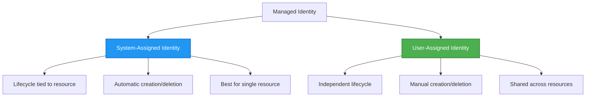

# Autentimismustrid ja hallatud identiteet

⏱️ **Hinnanguline aeg**: 45-60 minutit lugemist; järeltöötluseks ja harjutusteks eralda lisaaega | 💰 **Kulude mõju**: Identiteet/RBAC on tasuta; kasutusele võetud arvutus, salvestusruum ja Key Vault on tasustatavad | ⭐ **Kompleksus**: Keskmine

> Vaadatud üle alates `azd 1.37.2` (november 2026). See õppetund sisaldab **illustreerivaid integratsioonilõike, mitte täielikku allalaaditavat `secure-app` malli**. Loo viidatud failid, paku vastav infrastruktuur ja asenda kohatäited enne kasutuselevõttu. Ülevaatamisel ei loodud ühtegi Azure’i ressurssi.

**📚 Õppeteekond:**
- ← Eelmine: [Konfiguratsiooni juhtimine](configuration.md) - Keskkonnamuutujate ja saladuste haldamine
- 🎯 **Sa oled siin**: Autentimine ja turvalisus (hallatud identiteet, Key Vault, turvalised mustrid)
- → Järgmine: [Infrastruktuur koodina](../chapter-04-infrastructure/README.md) - Ressursside loomine ja kasutuselevõtt
- 🏠 [Kursuse ava](../../README.md)

---

## Mida sa õpid

Selle tunni lõpetades saad:
- Mõista Azure’i autentimismustreid (võtmed, ühendusstringid, hallatud identiteet)
- Rakendada **hallatud identiteeti** paroolivabaks autentimiseks
- Turvaliselt säilitada saladusi **Azure Key Vault** integratsiooniga
- Seadistada **rollipõhist juurdepääsukontrolli (RBAC)** AZD väljalasete jaoks
- Rakendada turvalisuse parimaid tavasid Container Appsid ja Azure teenuseid kasutades
- Migrateerida võtmepõhisest autentimisest identiteedipõhisele autentimisele

## Miks hallatud identiteet on oluline

### Probleem: Traditsiooniline autentimine

**Enne hallatud identiteeti:**
```javascript
// ❌ SECURITY RISK: Hardcoded secrets in code
const connectionString = "Server=mydb.database.windows.net;User=admin;Password=P@ssw0rd123";
const storageKey = "xK7mN9pQ2wR5tY8uI0oP3aS6dF1gH4jK...";
const cosmosKey = "C2x7B9n4M1p8Q5w3E6r0T2y5U8i1O4p7...";
```

**Probleemid:**
- 🔴 **Avalikustatud saladused** koodis, konfiguratsioonifailides, keskkonnamuutujates
- 🔴 **Tunnuste pööramine** nõuab koodi muutmist ja uuesti juurutamist
- 🔴 **Auditööd** - kes ja millal juurdepääsu sai?
- 🔴 **Laialivalgumine** - saladused hajutatud mitmel süsteemil
- 🔴 **Vastavusriskid** - ei läbi turvaauditeid

### Lahendus: Hallatud identiteet

**Pärast hallatud identiteeti:**
```javascript
// ✅ SECURE: No secrets in code
const credential = new DefaultAzureCredential();
const client = new BlobServiceClient(
  "https://mystorageaccount.blob.core.windows.net",
  credential  // Azure automatically handles authentication
);
```

**Eelised:**
- ✅ **Null saladusi** koodis ega konfiguratsioonis
- ✅ **Automaatne pööramine** - haldab Azure
- ✅ **Täielik auditiriba** Microsoft Entra ID logides
- ✅ **Keskne turvalisus** - haldur Azure portaali kaudu
- ✅ **Vastavusse valmis** - vastab turvastandarditele

**Analoogia**: Traditsiooniline autentimine on nagu mitme füüsilise võtmega uste avamine. Hallatud identiteet on nagu turvakaart, mis annab automaatselt ligipääsu sõltuvalt sellest, kes sa oled – võtmeid pole vaja kaotada, kopeerida ega pöörata.

---

## Arhitektuuri ülevaade

### Autentimisvoog hallatud identiteediga

```mermaid
sequenceDiagram
    participant App as Your Application<br/>(Container App)
    participant MI as Managed Identity<br/>(Microsoft Entra ID)
    participant KV as Key Vault
    participant Storage as Azure Storage
    participant DB as Azure SQL
    
    App->>MI: Request access token<br/>(automatic)
    MI->>MI: Verify identity<br/>(no password needed)
    MI-->>App: Return token for requested audience<br/>(lifetime varies)
    
    App->>KV: Get secret<br/>(using token)
    KV->>KV: Check RBAC permissions
    KV-->>App: Return secret value
    
    App->>Storage: Upload blob<br/>(using token)
    Storage->>Storage: Check RBAC permissions
    Storage-->>App: Success
    
    App->>DB: Query data<br/>(using token)
    DB->>DB: Check SQL permissions
    DB-->>App: Return results
    
    Note over App,DB: Request a separate token for each service audience;<br/>SDK credentials handle caching and renewal
```

### Hallatud identiteetide tüübid



| Funktsioon | Süsteemi poolt määratud | Kasutaja poolt määratud |
|---------|----------------|---------------|
| **Elutsükkel** | seotud ressursiga | iseseisev |
| **Loomine** | automaatne koos ressursiga | käsitsi loomine |
| **Kustutamine** | kustutatakse koos ressursiga | püsib peale ressursi kustutamist |
| **Jagamine** | ainult üks ressurss | mitu ressurssi |
| **Kasutusjuhtum** | lihtsad stsenaariumid | keerulised mitme ressursi stsenaariumid |
| **Malli valik** | määratletud infrastruktuuris | määratletud infrastruktuuris |

---

## Eeldused

### Vajalikud tööriistad

Tuleb juba omada nende tööriistade paigaldust eelmistest tundidest:

```bash
# Verify Azure Developer CLI
azd version
# ✅ Expected: azd version 1.0.0 or higher

# Verify Azure CLI
az --version
# ✅ Expected: azure-cli 2.50.0 or higher
```

### Azure’i nõuded

- Aktiivne Azure tellimus
- Õigused:
  - Hallatud identiteetide loomine
  - RBAC rollide määramine
  - Key Vault ressursside loomine
  - Container Appside juurutamine

### Teadmiste eeldused

Tuleb olla läbitud:
- [Paigaldusjuhend](../chapter-01-foundation/installation.md) - AZD seadistus
- [AZD Põhitõed](../chapter-01-foundation/azd-basics.md) - Põhikontseptsioonid
- [Konfiguratsiooni juhtimine](configuration.md) - Keskkonnamuutujad

---

## Tund 1: Autentimismustrite mõistmine

### Muster 1: Ühendusstringid (Vanamoodne – väldi)

**Kuidas töötab:**
```bash
# Connection string contains credentials
STORAGE_CONNECTION_STRING="DefaultEndpointsProtocol=https;AccountName=myaccount;AccountKey=xK7mN9pQ2wR5..."
COSMOS_CONNECTION_STRING="AccountEndpoint=https://myaccount.documents.azure.com:443/;AccountKey=C2x7..."
SQL_CONNECTION_STRING="Server=myserver.database.windows.net;User=admin;Password=P@ssw0rd..."
```

**Probleemid:**
- ❌ Saladused on nähtavad keskkonnamuutujates
- ❌ Logitakse juurutussüsteemides
- ❌ Raske on pöörata
- ❌ Puudub ligipääsu auditiriba

**Millal kasutada:** Kui sihiteenus nõuab võtme-põhist autentimist. Eelista identiteeti, kus see on toetatud; muidu salvesta võtmed turvaliselt ja pöörake neid ka tootmiskeskkonnas.

---

### Muster 2: Key Vault viited (Parem)

**Kuidas töötab:**
**Osalised Bicepi lõigud:** vajalikud vaulti väljad, Container App identiteet ja selle `configuration.secrets` kirje on välja jäetud. `secretRef` nimetab Container Appi saladust; see **ei ole iseenesest** Key Vaulti URI. Key Vaulti kasutamiseks defineeri see nimetatud saladus koos `keyVaultUrl` ja autoriseeritud `identity`-ga.

```bicep
// Store secret in Key Vault
resource keyVault 'Microsoft.KeyVault/vaults@2023-02-01' = {
  name: 'mykv'
  properties: {
    enableRbacAuthorization: true
  }
}

// Reference in Container App
env: [
  {
    name: 'STORAGE_KEY'
    secretRef: 'storage-key'  // References Key Vault
  }
]
```

**Eelised:**
- ✅ Saladused hoitakse turvaliselt Key Vaultis
- ✅ Keskne saladuste haldamine
- ✅ Pööramine ilma koodi muutusteta

**Piirangud:**
- ⚠️ Endiselt kasutatakse võtmeid/paroolid
- ⚠️ Tuleb hallata Key Vaulti ligipääsu

**Millal kasutada:** Üleminekustrateegia ühendusstringidelt hallatud identiteedile.

---

### Muster 3: Hallatud identiteet (Parim tava)

**Kuidas töötab:**
**Osaline Bicep:** ühenda identiteetiplokk täielikuks Container App'iks ja lisa `storageAccount` ning rollimääraja. Rollijagamine vajab ka deterministlikku `name`.

```bicep
// Enable managed identity
resource containerApp 'Microsoft.App/containerApps@2023-05-01' = {
  name: 'myapp'
  identity: {
    type: 'SystemAssigned'  // Automatically creates identity
  }
}

// Grant permissions
resource roleAssignment 'Microsoft.Authorization/roleAssignments@2022-04-01' = {
  name: guid(storageAccount.id, containerApp.id, storageBlobDataContributorRole)
  scope: storageAccount
  properties: {
    roleDefinitionId: storageBlobDataContributorRole
    principalId: containerApp.identity.principalId
    principalType: 'ServicePrincipal'
  }
}
```

**Rakenduse kood:**
```javascript
// No secrets needed!
const { DefaultAzureCredential } = require('@azure/identity');
const { BlobServiceClient } = require('@azure/storage-blob');

const credential = new DefaultAzureCredential();
const blobServiceClient = new BlobServiceClient(
  'https://mystorageaccount.blob.core.windows.net',
  credential
);
```

**Eelised:**
- ✅ Null saladusi koodis/konfiguratsioonis
- ✅ Automaatne tunnuste pööramine
- ✅ Täielik auditiriba
- ✅ RBAC-põhised õigused
- ✅ Vastavusse valmis

**Millal kasutada:** Eelistada Azure’i majutatud rakendustele, mis kasutavad Microsoft Entra autentimist toetavaid teenuseid.

---

### Muster 4: Teenuse volikirjad (CI/CD ja automatiseerimine)

Hallatud identiteet on kullastandard *Azure sees jooksvatele ressurssidele*. Aga mis juhtub asjadega, mis töötavad **väljas** Azure’ist – näiteks CI/CD töövoog build-agentil või skript sinu sülearvutil, mis ei saa kasutada sinu interaktiivset sisselogimist? Siin tuleb mängu **teenuse volikiri**: inimene mitteidentiteet koos oma volitustega, millega automatiseeritud protsess saab sisse logida.

**Kuidas töötab:**

Loo teenuse volikiri ressursigrupile (vähemõiguste põhimõte):

```bash
az ad sp create-for-rbac \
  --name "myapp-cicd" \
  --role contributor \
  --scopes "/subscriptions/<sub-id>/resourceGroups/<rg-name>"
```

See kuvab kliendi ID, kliendi saladuse ja rentniku ID. azd saab nendega mitteinteraktiivselt sisse logida:

```bash
azd auth login \
  --client-id "<appId>" \
  --client-secret "<password>" \
  --tenant-id "<tenant>"
```

**Eelista federeeritud volitusi (OIDC) saladustele.** Liikuva kliendi saladuse asemel konfigureeri federeeritud volitus, et töövoog vahetaks lühiajalist tokenit – saladust ei tohi lekitada ega pöörata:

```bash
azd auth login \
  --client-id "<appId>" \
  --federated-credential-provider "github" \
  --tenant-id "<tenant>"
```

> `azd pipeline config` seadistab selle sinu eest automaatselt. Vaata CI/CD juhendeid [8. peatükis](../chapter-08-production/production-ai-practices.md).

**Eelised:**
- ✅ Töötab Azure’i väljaspool (build-agentid, kohalikud keskkonnad, teised pilved)
- ✅ Võib olla piiratud ühe ressursigrupiga ja ühe rolliga
- ✅ Federeeritud (OIDC) variandil pole salvestatud saladust

**Kompromissid:**
- ⚠️ Saladusele tuginev variant vajab hoolikat hoiustamist ja pööramist
- ⚠️ Lekkinud saladus annab kõik, mida teenuse volikiri suudab teha – hoia õigused kitsas ulatuses

**Millal kasutada:** CI/CD töövood ja automatiseerimine, mis ei saa kasutada hallatud identiteeti. Eelistada alati **federeeritud/OIDC** varianti kliendisaladuse asemel ning hallatud identiteeti selle töökoormuse puhul, mis jookseb Azure sees.

**Volituste turvaline hoidmine:**
- Ära kunagi salvesta saladusi koodi – kasuta töövoo saladustehoidlat (GitHub Actions secrets, Azure DevOps muutujagrupid või Key Vault).
- Piira teenuse volikirja õigused kõige väiksemaks vajalikuks rolliks ja ressursigrupiks.
- Sea aegumisaeg ja pööra regulaarselt, või eemalda saladus täielikult OIDC abil.

---

## Tund 2: Hallatud identiteedi rakendamine AZD-ga

### Samm-sammuline rakendusjuhis

Järgnevad lõigud näitavad, kuidas integreerida hallatud identiteet Container Appsi projekti. Need ei ole **käed-külge startpakett**: Storage moodul, täielik hallatud keskkonna/registreerimisinfrastruktuur, Dockerfile ja parameetrite failid ei ole kõigil siin esitatud. Alusta töötava Container Apps malliga ning integreeri need mustrid, hoides alles selle registreerimise seadistuse ja teenuse märgendid.

### Projekti struktuur

```
secure-app/
├── azure.yaml                 # AZD configuration
├── infra/
│   ├── main.bicep            # Main infrastructure
│   ├── core/
│   │   ├── identity.bicep    # Managed identity setup
│   │   ├── keyvault.bicep    # Key Vault configuration
│   │   └── storage.bicep     # Storage with RBAC
│   └── app/
│       └── container-app.bicep
└── src/
    ├── app.js                # Application code
    ├── package.json
    └── Dockerfile
```

### 1. Seadista AZD (azure.yaml)

```yaml
name: secure-app
metadata:
  template: secure-app@1.0.0

services:
  api:
    project: ./src
    language: js
    host: containerapp

# Managed identity must be enabled in the infrastructure, not by this YAML.
```

### 2. Infrastruktuur: Luba hallatud identiteet

**Fail: `infra/main.bicep`**

```bicep
targetScope = 'subscription'

param environmentName string
param location string = 'eastus'
param containerAppsEnvironmentId string
param containerImage string

var tags = { 'azd-env-name': environmentName }

// Resource group
resource rg 'Microsoft.Resources/resourceGroups@2021-04-01' = {
  name: 'rg-${environmentName}'
  location: location
  tags: tags
}

// Storage Account
module storage './core/storage.bicep' = {
  name: 'storage'
  scope: rg
  params: {
    name: 'st${uniqueString(rg.id)}'
    location: location
    tags: tags
  }
}

// Key Vault
module keyVault './core/keyvault.bicep' = {
  name: 'keyvault'
  scope: rg
  params: {
    name: 'kv-${uniqueString(rg.id)}'
    location: location
    tags: tags
  }
}

// Container App with Managed Identity
module containerApp './app/container-app.bicep' = {
  name: 'container-app'
  scope: rg
  params: {
    name: 'ca-${environmentName}'
    location: location
    tags: tags
    storageAccountName: storage.outputs.name
    keyVaultName: keyVault.outputs.name
    containerAppsEnvironmentId: containerAppsEnvironmentId
    containerImage: containerImage
  }
}

// Grant Container App access to Storage
module storageRoleAssignment './core/role-assignment.bicep' = {
  name: 'storage-role'
  scope: rg
  params: {
    principalId: containerApp.outputs.identityPrincipalId
    roleDefinitionId: 'ba92f5b4-2d11-453d-a403-e96b0029c9fe'  // Storage Blob Data Contributor
    targetResourceType: 'storage'
    targetResourceName: storage.outputs.name
  }
}

// Grant Container App access to Key Vault
module kvRoleAssignment './core/role-assignment.bicep' = {
  name: 'kv-role'
  scope: rg
  params: {
    principalId: containerApp.outputs.identityPrincipalId
    roleDefinitionId: '4633458b-17de-408a-b874-0445c86b69e6'  // Key Vault Secrets User
    targetResourceType: 'keyvault'
    targetResourceName: keyVault.outputs.name
  }
}

// Outputs
output AZURE_STORAGE_ACCOUNT_NAME string = storage.outputs.name
output AZURE_KEY_VAULT_NAME string = keyVault.outputs.name
output APP_URL string = containerApp.outputs.url
```

### 3. Container App süsteemi määratud identiteediga

**Fail: `infra/app/container-app.bicep`**

```bicep
param name string
param location string
param tags object = {}
param storageAccountName string
param keyVaultName string
param containerAppsEnvironmentId string
param containerImage string

resource containerApp 'Microsoft.App/containerApps@2023-05-01' = {
  name: name
  location: location
  tags: union(tags, { 'azd-service-name': 'api' })
  identity: {
    type: 'SystemAssigned'  // 🔑 Enable managed identity
  }
  properties: {
    managedEnvironmentId: containerAppsEnvironmentId
    configuration: {
      ingress: {
        external: true
        targetPort: 3000
      }
    }
    template: {
      containers: [
        {
          name: 'api'
          image: containerImage // Must exist; configure registry credentials for private images
          resources: {
            cpu: json('0.5')
            memory: '1Gi'
          }
          env: [
            {
              name: 'AZURE_STORAGE_ACCOUNT_NAME'
              value: storageAccountName
            }
            {
              name: 'AZURE_KEY_VAULT_NAME'
              value: keyVaultName
            }
            // 🔑 No secrets - managed identity handles authentication!
          ]
        }
      ]
    }
  }
}

// Output the identity for RBAC assignments
output identityPrincipalId string = containerApp.identity.principalId
output id string = containerApp.id
output url string = 'https://${containerApp.properties.configuration.ingress.fqdn}'
```

### 4. RBAC rollimoodul

**Fail: `infra/core/role-assignment.bicep`**

```bicep
param principalId string
param roleDefinitionId string  // Azure built-in role ID
@allowed(['storage', 'keyvault'])
param targetResourceType string
param targetResourceName string

// Typed existing resources give Bicep a valid resource scope, not a string ID.
resource storageTarget 'Microsoft.Storage/storageAccounts@2023-01-01' existing = {
  name: targetResourceName
}
resource vaultTarget 'Microsoft.KeyVault/vaults@2023-02-01' existing = {
  name: targetResourceName
}

resource storageAssignment 'Microsoft.Authorization/roleAssignments@2022-04-01' = if (targetResourceType == 'storage') {
  name: guid(storageTarget.id, principalId, roleDefinitionId)
  scope: storageTarget
  properties: {
    roleDefinitionId: subscriptionResourceId('Microsoft.Authorization/roleDefinitions', roleDefinitionId)
    principalId: principalId
    principalType: 'ServicePrincipal'
  }
}

resource vaultAssignment 'Microsoft.Authorization/roleAssignments@2022-04-01' = if (targetResourceType == 'keyvault') {
  name: guid(vaultTarget.id, principalId, roleDefinitionId)
  scope: vaultTarget
  properties: {
    roleDefinitionId: subscriptionResourceId('Microsoft.Authorization/roleDefinitions', roleDefinitionId)
    principalId: principalId
    principalType: 'ServicePrincipal'
  }
}

// This module assigns at the target resource scope, not the whole resource group.
```

### 5. Rakenduse kood hallatud identiteediga

**Fail: `src/app.js`**

```javascript
const express = require('express');
const { DefaultAzureCredential } = require('@azure/identity');
const { BlobServiceClient } = require('@azure/storage-blob');
const { SecretClient } = require('@azure/keyvault-secrets');

const app = express();
const PORT = process.env.PORT || 3000;

// 🔑 Initialize credential (works automatically with managed identity)
const credential = new DefaultAzureCredential();

// Azure Storage setup
const storageAccountName = process.env.AZURE_STORAGE_ACCOUNT_NAME;
const blobServiceClient = new BlobServiceClient(
  `https://${storageAccountName}.blob.core.windows.net`,
  credential  // No keys needed!
);

// Key Vault setup
const keyVaultName = process.env.AZURE_KEY_VAULT_NAME;
const secretClient = new SecretClient(
  `https://${keyVaultName}.vault.azure.net`,
  credential  // No keys needed!
);

// Health check
app.get('/health', (req, res) => {
  res.json({ status: 'healthy', authentication: 'managed-identity' });
});

// Upload file to blob storage
app.post('/upload', async (req, res) => {
  try {
    const containerClient = blobServiceClient.getContainerClient('uploads');
    await containerClient.createIfNotExists();
    
    const blobName = `file-${Date.now()}.txt`;
    const blockBlobClient = containerClient.getBlockBlobClient(blobName);
    
    const content = 'Hello from managed identity!';
    await blockBlobClient.upload(content, Buffer.byteLength(content));
    
    res.json({
      success: true,
      blobName: blobName,
      message: 'File uploaded using managed identity!'
    });
  } catch (error) {
    console.error('Upload error:', error);
    res.status(500).json({ error: error.message });
  }
});

// Get secret from Key Vault
app.get('/secret/:name', async (req, res) => {
  try {
    const secretName = req.params.name;
    const secret = await secretClient.getSecret(secretName);
    
    res.json({
      name: secretName,
      retrieved: secret.value !== undefined, // Never return the secret value to callers
      message: 'Secret retrieved using managed identity!'
    });
  } catch (error) {
    console.error('Secret error:', error);
    res.status(500).json({ error: error.message });
  }
});

// List blob containers (demonstrates read access)
app.get('/containers', async (req, res) => {
  try {
    const containers = [];
    for await (const container of blobServiceClient.listContainers()) {
      containers.push(container.name);
    }
    
    res.json({
      containers: containers,
      count: containers.length,
      message: 'Containers listed using managed identity!'
    });
  } catch (error) {
    console.error('List error:', error);
    res.status(500).json({ error: error.message });
  }
});

app.listen(PORT, () => {
  console.log(`Secure API listening on port ${PORT}`);
  console.log('Authentication: Managed Identity (passwordless)');
});
```

**Fail: `src/package.json`**

```json
{
  "name": "secure-app",
  "version": "1.0.0",
  "dependencies": {
    "express": "^4.18.2",
    "@azure/identity": "^4.0.0",
    "@azure/storage-blob": "^12.17.0",
    "@azure/keyvault-secrets": "^4.7.0"
  },
  "scripts": {
    "start": "node app.js"
  }
}
```

### 6. Juuruta ja testi

Käivita need käsud alles **pärast** puuduvate infrastruktuuri komponentide, Dockerfile’i ja vastava `main.parameters.json` lisamist oma projektis. Autentimiseks kasuta azd-ga `azd auth login`; logi hilisemate Azure CLI kontrollide jaoks eraldi sisse `az login` abil. Kuvatud lõpp-punktid on demonstratsioonid ja vajavad enne avalikku kasutamist sobivat ligipääsukontrolli.

```bash
# Initialize AZD environment
azd init

# Deploy infrastructure and application
azd up

# Get the app URL
APP_URL=$(azd env get-value APP_URL)

# Test health check
curl $APP_URL/health
```

**✅ Oodatav väljund:**
```json
{
  "status": "healthy",
  "authentication": "managed-identity"
}
```

**Testi blobide üleslaadimist:**
```bash
curl -X POST $APP_URL/upload
```

**✅ Oodatav väljund:**
```json
{
  "success": true,
  "blobName": "file-1700404800000.txt",
  "message": "File uploaded using managed identity!"
}
```

**Testi konteinerite loetelu:**
```bash
curl $APP_URL/containers
```

**✅ Oodatav väljund:**
```json
{
  "containers": ["uploads"],
  "count": 1,
  "message": "Containers listed using managed identity!"
}
```

---

## Levinumad Azure RBAC rollid

### Hallatud identiteedi sisseehitatud rolli ID-d

| Teenus | Rolli nimi | Rolli ID | Õigused |
|---------|-----------|---------|-------------|
| **Salvestus** | Storage Blob Data Reader | `2a2b9908-6ea1-4ae2-8e65-a410df84e7d1` | Loeb blobe ja konteinerid |
| **Salvestus** | Storage Blob Data Contributor | `ba92f5b4-2d11-453d-a403-e96b0029c9fe` | Loeb, kirjutab, kustutab blobe |
| **Salvestus** | Storage Queue Data Contributor | `974c5e8b-45b9-4653-ba55-5f855dd0fb88` | Loeb, kirjutab, kustutab järjekordi/sõnumeid |
| **Key Vault** | Key Vault Secrets User | `4633458b-17de-408a-b874-0445c86b69e6` | Loeb saladusi |
| **Key Vault** | Key Vault Secrets Officer | `b86a8fe4-44ce-4948-aee5-eccb2c155cd7` | Loeb, kirjutab, kustutab saladusi |
| **Cosmos DB** | Cosmos DB Built-in Data Reader | `00000000-0000-0000-0000-000000000001` | Loeb Cosmos DB andmeid |
| **Cosmos DB** | Cosmos DB Built-in Data Contributor | `00000000-0000-0000-0000-000000000002` | Loeb, kirjutab Cosmos DB andmeid |
| **SQL andmebaas** | SQL DB Contributor | `9b7fa17d-e63e-47b0-bb0a-15c516ac86ec` | Halda andmebaasi ressursse; ei anna SQL andmete ligipääsu |
| **Service Bus** | Azure Service Bus Data Owner | `090c5cfd-751d-490a-894a-3ce6f1109419` | Saada, võta vastu, halda sõnumeid |

### Kuidas leida rolli ID-sid

Cosmos DB NoSQL kaks ID-d eespool on **sisemised Cosmos andmepõhised rollimäärajad**, mitte Azure RBAC tellimuse rolli ID-d. Määra need käsuga `az cosmosdb sql role assignment create` (või `Microsoft.DocumentDB/databaseAccounts/sqlRoleAssignments`), mitte `az role assignment create`. SQL andmete ligipääsuks on vaja Entra andmebaasi kasutajat ja SQL õigusi.

```bash
# List all built-in roles
az role definition list --query "[].{Name:roleName, ID:name}" --output table

# Search for specific role
az role definition list --query "[?contains(roleName, 'Storage Blob')].{Name:roleName, ID:name}" --output table

# Get role details
az role definition list --name "Storage Blob Data Contributor"
```

---

## Praktilised harjutused

**Kõigi kolme harjutuse integratsiooni eeldused:** töötav Container Apps mall sinu projekti sees, sobivad Bicep ressursid, Azure CLI/azd sisselogimine ja õigused vajalike rollide määramiseks. Need on juhendatud kohandused, mitte iseseisvad kohaliku käivituse mallid; asenda näidises olevad ressursside nimed oma juurutatud nimedega.

### Harjutus 1: Hallatud identiteedi lubamine olemasolevale rakendusele ⭐⭐ (Keskmine)

**Eesmärk**: Lisa hallatud identiteet olemasolevale Container Appi juurutusele

**Stsenaarium**: Sul on Container App, mis kasutab ühendusstringe. Konverteeri see hallatud identiteediks.

**Alguspunkt**: Container App selle konfiguratsiooniga:

```bicep
// ❌ Current: Using connection string
env: [
  {
    name: 'STORAGE_CONNECTION_STRING'
    secretRef: 'storage-connection'
  }
]
```

**Sammud**:

1. **Luba hallatud identiteet Bicepis:**

```bicep
resource containerApp 'Microsoft.App/containerApps@2023-05-01' = {
  name: 'myapp'
  identity: {
    type: 'SystemAssigned'  // Add this
  }
  // ... rest of configuration
}
```

2. **Anna Storage juurdepääs:**

```bicep
// Get storage account reference
resource storageAccount 'Microsoft.Storage/storageAccounts@2023-01-01' existing = {
  name: storageAccountName
}

// Assign role
resource roleAssignment 'Microsoft.Authorization/roleAssignments@2022-04-01' = {
  name: guid(containerApp.id, 'ba92f5b4-2d11-453d-a403-e96b0029c9fe', storageAccount.id)
  scope: storageAccount
  properties: {
    roleDefinitionId: subscriptionResourceId('Microsoft.Authorization/roleDefinitions', 'ba92f5b4-2d11-453d-a403-e96b0029c9fe')
    principalId: containerApp.identity.principalId
    principalType: 'ServicePrincipal'
  }
}
```

3. **Uuenda rakenduse koodi:**

**Enne (ühendusstring):**
```javascript
const { BlobServiceClient } = require('@azure/storage-blob');

const blobServiceClient = BlobServiceClient.fromConnectionString(
  process.env.STORAGE_CONNECTION_STRING
);
```

**Pärast (hallatud identiteet):**
```javascript
const { DefaultAzureCredential } = require('@azure/identity');
const { BlobServiceClient } = require('@azure/storage-blob');

const credential = new DefaultAzureCredential();
const blobServiceClient = new BlobServiceClient(
  `https://${process.env.STORAGE_ACCOUNT_NAME}.blob.core.windows.net`,
  credential
);
```

4. **Uuenda keskkonnamuutujaid:**

```bicep
env: [
  {
    name: 'STORAGE_ACCOUNT_NAME'
    value: storageAccountName  // Just the name, no secrets!
  }
  // Remove STORAGE_CONNECTION_STRING
]
```

5. **Juuruta ja testi:**

```bash
# Redeploy
azd up

# Test that it still works
APP_URL=$(azd show --output json | jq -er '.services.api.ingressUrl')
curl --fail -X POST "$APP_URL/upload"
```

**✅ Edu kriteeriumid:**
- ✅ Rakendus käivitub vigadeta
- ✅ Storage toimingud toimivad (üleslaadimine, loetelu, allalaadimine)
- ✅ Keskkonnamuutujates pole ühendusstringe
- ✅ Identiteet nähtav Azure portaali "Identity" vahelehel

**Kontroll:**

```bash
# Check managed identity is enabled
az containerapp show \
  --name myapp \
  --resource-group rg-myapp \
  --query "identity.type"
# ✅ Expected: "SystemAssigned"

# Check role assignment
az role assignment list \
  --assignee $(az containerapp show --name myapp --resource-group rg-myapp --query "identity.principalId" -o tsv) \
  --scope /subscriptions/{sub-id}/resourceGroups/rg-myapp/providers/Microsoft.Storage/storageAccounts/mystorageaccount
# ✅ Expected: Shows "Storage Blob Data Contributor" role
```

**Aeg**: 20-30 minutit

---

### Harjutus 2: Mitme teenuse juurdepääs kasutaja poolt määratud identiteediga ⭐⭐⭐ (Edasijõudnud)

**Eesmärk**: Loo kasutaja poolt määratud identiteet, mida jagatakse mitme Container Appsi vahel

**Stsenaarium**: Sul on 3 mikroteenust, mis kõik vajavad juurdepääsu samale Storage kontole ja Key Vaultile.

**Sammud**:

1. **Loo kasutaja poolt määratud identiteet:**

**Fail: `infra/core/identity.bicep`**

```bicep
param name string
param location string
param tags object = {}

resource userAssignedIdentity 'Microsoft.ManagedIdentity/userAssignedIdentities@2023-01-31' = {
  name: name
  location: location
  tags: tags
}

output id string = userAssignedIdentity.id
output principalId string = userAssignedIdentity.properties.principalId
output clientId string = userAssignedIdentity.properties.clientId
```

2. **Määra rollid kasutaja poolt määratud identiteedile:**

```bicep
// In main.bicep
module userIdentity './core/identity.bicep' = {
  name: 'user-identity'
  scope: rg
  params: {
    name: 'id-${environmentName}'
    location: location
    tags: tags
  }
}

// Grant Storage access
resource storageRoleAssignment 'Microsoft.Authorization/roleAssignments@2022-04-01' = {
  name: guid(storageAccount.id, environmentName, 'storage-contributor')
  scope: storageAccount
  properties: {
    roleDefinitionId: subscriptionResourceId('Microsoft.Authorization/roleDefinitions', 'ba92f5b4-2d11-453d-a403-e96b0029c9fe')
    principalId: userIdentity.outputs.principalId
    principalType: 'ServicePrincipal'
  }
}

// Grant Key Vault access
resource kvRoleAssignment 'Microsoft.Authorization/roleAssignments@2022-04-01' = {
  name: guid(keyVault.id, environmentName, 'kv-secrets-user')
  scope: keyVault
  properties: {
    roleDefinitionId: subscriptionResourceId('Microsoft.Authorization/roleDefinitions', '4633458b-17de-408a-b874-0445c86b69e6')
    principalId: userIdentity.outputs.principalId
    principalType: 'ServicePrincipal'
  }
}
```

3. **Määrake identiteet mitmele konteineri rakendusele:**

```bicep
resource apiGateway 'Microsoft.App/containerApps@2023-05-01' = {
  name: 'api-gateway'
  identity: {
    type: 'UserAssigned'
    userAssignedIdentities: {
      '${userIdentity.outputs.id}': {}
    }
  }
  // ... rest of config
}

resource productService 'Microsoft.App/containerApps@2023-05-01' = {
  name: 'product-service'
  identity: {
    type: 'UserAssigned'
    userAssignedIdentities: {
      '${userIdentity.outputs.id}': {}
    }
  }
  // ... rest of config
}

resource orderService 'Microsoft.App/containerApps@2023-05-01' = {
  name: 'order-service'
  identity: {
    type: 'UserAssigned'
    userAssignedIdentities: {
      '${userIdentity.outputs.id}': {}
    }
  }
  // ... rest of config
}
```

4. **Rakenduse kood (kõik teenused kasutavad sama mustrit):**

```javascript
const { ManagedIdentityCredential } = require('@azure/identity');
const { BlobServiceClient } = require('@azure/storage-blob');

// For user-assigned identity, specify the client ID
const credential = new ManagedIdentityCredential(
  process.env.AZURE_CLIENT_ID  // User-assigned identity client ID
);

// Alternative (choose ONE credential declaration):
// const { DefaultAzureCredential } = require('@azure/identity');
// const credential = new DefaultAzureCredential({
//   managedIdentityClientId: process.env.AZURE_CLIENT_ID
// });

const blobServiceClient = new BlobServiceClient(
  `https://${process.env.STORAGE_ACCOUNT_NAME}.blob.core.windows.net`,
  credential
);
```

Määrake iga konteineri rakenduse käitusaeg `AZURE_CLIENT_ID` väärtuseks `userIdentity.outputs.clientId` ja `STORAGE_ACCOUNT_NAME` oma salvestusruumi nimeks Bicepis. Ainult identiteedi määramine või `azd env set` käivitamine ei seadista neid käitusaja väärtusi.

5. **Paigaldage ja kontrollige:**

```bash
azd up

# Test all services can access storage
# Replace with the actual ingress URLs reported for your three services
curl --fail -X POST "$API_GATEWAY_URL/upload"
curl --fail -X POST "$PRODUCT_SERVICE_URL/upload"
curl --fail -X POST "$ORDER_SERVICE_URL/upload"
```

**✅ Edu kriteeriumid:**
- ✅ Üks identiteet jagatud kolme teenuse vahel
- ✅ Kõik teenused pääsevad ligi salvestusruumile ja võtmekambri teenusele
- ✅ Identiteet püsib, kui üks teenus kustutatakse
- ✅ Keskne õiguste haldus

**Kasutaja määratud identiteedi eelised:**
- Üks identiteet haldamiseks
- Ühtsed õigused teenuste vahel
- Teenuse kustutamine ei hävita identiteeti
- Sobib paremini keerukate arhitektuuride jaoks

**Aeg**: 30-40 minutit

---

### Harjutus 3: Võtmekambri saladuse pööramine ⭐⭐⭐ (edasijõudnutele)

**Eesmärk**: Salvestada kolmanda osapoole API võtmeid võtmekambris ja kasutada neid hallatud identiteedi abil

**Stsenaarium**: Teie rakendus peab kutsuma välise API-d (OpenAI, Stripe, SendGrid), mis nõuab API võtmeid.

**Sammud**:

1. **Loo võtmekamber koos RBAC-iga:**

**Fail: `infra/core/keyvault.bicep`**

```bicep
param name string
param location string
param tags object = {}

resource keyVault 'Microsoft.KeyVault/vaults@2023-02-01' = {
  name: name
  location: location
  tags: tags
  properties: {
    enableRbacAuthorization: true  // Use RBAC instead of access policies
    sku: {
      family: 'A'
      name: 'standard'
    }
    tenantId: subscription().tenantId
    enableSoftDelete: true
    softDeleteRetentionInDays: 90
  }
}

// Allow Container App to read secrets
output id string = keyVault.id
output name string = keyVault.name
output uri string = keyVault.properties.vaultUri
```

2. **Salvesta saladused võtmekambrisse:**

```bash
# Get Key Vault name
KV_NAME=$(azd env get-value AZURE_KEY_VAULT_NAME)

# Store third-party API keys
az keyvault secret set \
  --vault-name $KV_NAME \
  --name "OpenAI-ApiKey" \
  --value "sk-proj-xxxxxxxxxxxxx"

az keyvault secret set \
  --vault-name $KV_NAME \
  --name "Stripe-ApiKey" \
  --value "sk_live_xxxxxxxxxxxxx"

az keyvault secret set \
  --vault-name $KV_NAME \
  --name "SendGrid-ApiKey" \
  --value "SG.xxxxxxxxxxxxx"
```

3. **Rakenduse kood saladuste pärimiseks:**

**Fail: `src/config.js`**

```javascript
const { DefaultAzureCredential } = require('@azure/identity');
const { SecretClient } = require('@azure/keyvault-secrets');

class Config {
  constructor() {
    this.credential = new DefaultAzureCredential();
    this.secretClient = new SecretClient(
      `https://${process.env.AZURE_KEY_VAULT_NAME}.vault.azure.net`,
      this.credential
    );
    this.cache = {};
  }

  async getSecret(secretName) {
    // Check cache first
    if (this.cache[secretName]) {
      return this.cache[secretName];
    }

    try {
      const secret = await this.secretClient.getSecret(secretName);
      this.cache[secretName] = secret.value;
      console.log(`✅ Retrieved secret: ${secretName}`);
      return secret.value;
    } catch (error) {
      console.error(`❌ Failed to get secret ${secretName}:`, error.message);
      throw error;
    }
  }

  async getOpenAIKey() {
    return this.getSecret('OpenAI-ApiKey');
  }

  async getStripeKey() {
    return this.getSecret('Stripe-ApiKey');
  }

  async getSendGridKey() {
    return this.getSecret('SendGrid-ApiKey');
  }
}

module.exports = new Config();
```

4. **Kasuta saladusi rakenduses:**

**Fail: `src/app.js`**

See **asendus rakenduse fragment** vajab `npm install openai`, reaalset kolmanda osapoole võtit, ligipääsetavat mudelit ja teie tööprojekti infrastruktuuri. See kutsub otse OpenAI-d, mitte Azure OpenAI juurutust. Allolevad kohatäitja võtmed ei anna volitust.

```javascript
const express = require('express');
const config = require('./config');
const { OpenAI } = require('openai');

const app = express();

// Initialize OpenAI with key from Key Vault
let openaiClient;

async function initializeServices() {
  const openaiKey = await config.getOpenAIKey();
  openaiClient = new OpenAI({ apiKey: openaiKey });
  console.log('✅ Services initialized with secrets from Key Vault');
}

app.post('/chat', async (req, res) => {
  try {
    const completion = await openaiClient.chat.completions.create({
      model: 'gpt-4.1',
      messages: [{ role: 'user', content: 'Hello!' }]
    });
    
    res.json({
      response: completion.choices[0].message.content,
      authentication: 'Key from Key Vault via Managed Identity'
    });
  } catch (error) {
    res.status(500).json({ error: error.message });
  }
});

// Start listening only after initialization succeeds.
initializeServices().then(() => {
  app.listen(3000, () => console.log('Key Vault demo running'));
}).catch(error => {
  console.error('Initialization failed:', error.message);
  process.exitCode = 1;
});
```

5. **Paigaldage ja testige:**

```bash
azd up

# Test that API keys work
curl -X POST https://myapp.azurecontainerapps.io/chat \
  -H "Content-Type: application/json" \
  -d '{"message":"Hello AI"}'
```

**✅ Edu kriteeriumid:**
- ✅ Koodis ega keskkonnamuutujates pole API võtmeid
- ✅ Rakendus pärib võtmed võtmekambrist
- ✅ Kolmanda osapoole API-d töötavad korralikult
- ✅ Võtmeid saab vahetada ilma koodi muutmata

**Pööra saladust:**

```bash
# Update secret in Key Vault
az keyvault secret set \
  --vault-name $KV_NAME \
  --name "OpenAI-ApiKey" \
  --value "sk-proj-NEW_KEY_HERE"

# Find the active revision name, then restart it to clear the in-process cache
az containerapp revision list --name myapp --resource-group rg-myapp --output table
az containerapp revision restart \
  --name myapp \
  --resource-group rg-myapp \
  --revision "<active-revision-name>"
```

**Aeg**: 25-35 minutit

---

## Teadmiste kontrollpunkt

### 1. Autentimis mustrid ✓

Testi oma arusaamist:

- [ ] **K1**: Millised on kolm peamist autentimis mustrit? 
  - **V**: Ühendusstringid (pärand), võtmekambri viited (üleminek), hallatud identiteet (parim)

- [ ] **K2**: Miks on hallatud identiteet parem kui ühendusstringid?
  - **V**: Koodis pole saladusi, automaatne pööramine, täielik auditeerimise jälg, RBAC õigused

- [ ] **K3**: Millal kasutaksite kasutaja määratud identiteeti süsteemi määratule asemel?
  - **V**: Kui jagate identiteeti mitme ressursi vahel või kui identiteedi elutsükkel on ressursi elutsüklist sõltumatu

**Praktiline kontroll:**
```bash
# Check what type of identity your app uses
az containerapp show \
  --name myapp \
  --resource-group rg-myapp \
  --query "identity.type"

# List all role assignments for the identity
az role assignment list \
  --assignee $(az containerapp show --name myapp --resource-group rg-myapp --query "identity.principalId" -o tsv)
```

---

### 2. RBAC ja õigused ✓

Testi oma arusaamist:

- [ ] **K1**: Mis on "Storage Blob Data Contributor" rolli ID?
  - **V**: `ba92f5b4-2d11-453d-a403-e96b0029c9fe`

- [ ] **K2**: Millised õigused annab "Key Vault Secrets User"?
  - **V**: Ainult lugemisõigus saladustele (ei saa luua, uuendada ega kustutada)

- [ ] **K3**: Kuidas anda konteineri rakendusele juurdepääs Azure SQL-ile?
  - **V**: Konfigureerige Microsoft Entra autentimine, looge identiteet andmebaasi kasutajana ning andke vajalikud SQL õigused. "SQL DB Contributor" haldab ainult Azure ressursse; see ei anna õigust päringute tegemiseks.

**Praktiline kontroll:**
```bash
# Find specific role
az role definition list --name "Storage Blob Data Contributor"

# Check what roles are assigned to your identity
PRINCIPAL_ID=$(az containerapp show --name myapp --resource-group rg-myapp --query "identity.principalId" -o tsv)
az role assignment list --assignee $PRINCIPAL_ID --output table
```

---

### 3. Võtmekambri integratsioon ✓

Testi oma arusaamist:

- [ ] **K1**: Kuidas lubada RBAC võtmekambris kohtpoliitikate asemel?
  - **V**: Määrake `enableRbacAuthorization: true` Bicepis

- [ ] **K2**: Milline Azure SDK teek haldab hallatud identiteedi autentimist?
  - **V**: `@azure/identity` koos `DefaultAzureCredential` klassiga

- [ ] **K3**: Kui kaua püsivad võtmekambri saladused vahemälus?
  - **V**: Sõltub rakendusest; rakendage oma vahemälustrateegia

**Praktiline kontroll:**
```bash
# Test Key Vault access
az keyvault secret show \
  --vault-name $KV_NAME \
  --name "OpenAI-ApiKey" \
  --query "{name:name,enabled:attributes.enabled}"

# Check RBAC is enabled
az keyvault show \
  --name $KV_NAME \
  --query "properties.enableRbacAuthorization"
# ✅ Expected: true
```

---

## Turvalisuse parimad tavad

### ✅ TEE:

1. **Kasuta tootmiskeskkonnas alati hallatud identiteeti**
   ```bicep
   identity: {
     type: 'SystemAssigned'
   }
   ```

2. **Kasutage minimaalsete privileegidega RBAC rolle**
   - Kasutage võimalusel "Lugeja" rolle
   - Vältige "Omanik" või "Kaastöötaja" rolle, kui pole vajalik

3. **Salvesta kolmanda osapoole võtmed võtmekambrisse**
   ```javascript
   const apiKey = await secretClient.getSecret('ThirdPartyApiKey');
   ```

4. **Lülitage sisse auditeerimise logimine** (ressursi osafragment; ühildage oma kambrite ja tööruumi deklaratsioonidega)
   ```bicep
   resource vaultDiagnostics 'Microsoft.Insights/diagnosticSettings@2021-05-01-preview' = {
     name: 'vault-audit'
     scope: keyVault
     properties: {
       workspaceId: logAnalytics.id
       logs: [{ category: 'AuditEvent', enabled: true }]
     }
   }
   ```

5. **Kasuta eri identiteete arenduses/stagingus/tootmises**
   ```bash
   azd env new dev
   azd env new staging
   azd env new prod
   ```

6. **Pööra saladusi regulaarselt**
   - Määrake võtmekambri saladustele aegumiskuupäevad
   - Automatiseeri pööramine Azure funktsioonidega

### ❌ ÄRGE TEE:

1. **Ärge kunagi lisage saladusi koodisse**
   ```javascript
   // ❌ BAD
   const apiKey = "sk-proj-xxxxxxxxxxxxx";
   ```

2. **Ärge kasutage tootmises ühendusstringe**
   ```javascript
   // ❌ BAD
   BlobServiceClient.fromConnectionString(process.env.STORAGE_CONNECTION_STRING)
   ```

3. **Ärge andke liigseid õigusi**
   ```bicep
   // ❌ BAD - too much access
   roleDefinitionId: subscriptionResourceId('Microsoft.Authorization/roleDefinitions', '8e3af657-a8ff-443c-a75c-2fe8c4bcb635')
   
   // ✅ GOOD - least privilege
   roleDefinitionId: subscriptionResourceId('Microsoft.Authorization/roleDefinitions', '2a2b9908-6ea1-4ae2-8e65-a410df84e7d1')
   ```

4. **Ärge logige saladusi**
   ```javascript
   // ❌ BAD
   console.log('API Key:', apiKey);
   
   // ✅ GOOD
   console.log('API Key retrieved successfully');
   ```

5. **Ärge jagage tootmise identiteete keskkondade vahel**
   ```bicep
   // ❌ BAD - same identity for dev and prod
   // ✅ GOOD - separate identities per environment
   ```

---

## Veaotsingu juhend

### Probleem: "Luba puudub" Azure Storage'i juurdepääsul

**Sümptomid:**
```
Error: Unauthorized (403)
AuthorizationPermissionMismatch: This request is not authorized to perform this operation
```

**Diagnoos:**

```bash
# Check if managed identity is enabled
az containerapp show \
  --name myapp \
  --resource-group rg-myapp \
  --query "identity.type"
# ✅ Expected: "SystemAssigned" or "UserAssigned"

# Check role assignments
PRINCIPAL_ID=$(az containerapp show --name myapp --resource-group rg-myapp --query "identity.principalId" -o tsv)
az role assignment list --assignee $PRINCIPAL_ID

# Expected: Should see "Storage Blob Data Contributor" or similar role
```

**Lahendused:**

1. **Andke õige RBAC roll:**
```bash
STORAGE_ID=$(az storage account show --name mystorageaccount --resource-group rg-myapp --query "id" -o tsv)
az role assignment create \
  --assignee $PRINCIPAL_ID \
  --role "Storage Blob Data Contributor" \
  --scope $STORAGE_ID
```

2. **Oodake levitamist (võib võtta 5-10 minutit):**
```bash
# Check role assignment status
az role assignment list --assignee $PRINCIPAL_ID --scope $STORAGE_ID
```

3. **Kontrollige, et rakenduse kood kasutaks õiget mandaati:**
```javascript
// Make sure you're using DefaultAzureCredential
const credential = new DefaultAzureCredential();
```

---

### Probleem: Võtmekambri juurdepääs keelatud

**Sümptomid:**
```
Error: Forbidden (403)
The user, group or application does not have secrets get permission
```

**Diagnoos:**

```bash
# Check Key Vault RBAC is enabled
az keyvault show \
  --name $KV_NAME \
  --query "properties.enableRbacAuthorization"
# ✅ Expected: true

# Check role assignments
az role assignment list \
  --assignee $PRINCIPAL_ID \
  --scope /subscriptions/{sub-id}/resourceGroups/rg-myapp/providers/Microsoft.KeyVault/vaults/$KV_NAME
```

**Lahendused:**

1. **Lülitage võtmekambris sisse RBAC:**
```bash
az keyvault update \
  --name $KV_NAME \
  --enable-rbac-authorization true
```

2. **Andke võtmekambri saladuse kasutaja roll:**
```bash
KV_ID=$(az keyvault show --name $KV_NAME --query "id" -o tsv)
az role assignment create \
  --assignee $PRINCIPAL_ID \
  --role "Key Vault Secrets User" \
  --scope $KV_ID
```

---

### Probleem: DefaultAzureCredential ebaõnnestub lokaalselt

**Sümptomid:**
```
Error: DefaultAzureCredential failed to retrieve a token
CredentialUnavailableError: No credential available
```

**Diagnoos:**

```bash
# Check if you're logged in
az account show

# Check Azure CLI authentication
az ad signed-in-user show
```

**Lahendused:**

1. **Logi sisse Azure CLI-sse:**
```bash
az login
```

2. **Määra Azure tellimus:**
```bash
az account set --subscription "Your Subscription Name"
```

3. **Lokaalse arenduse jaoks kasuta keskkonnamuutujaid:**
```bash
export AZURE_TENANT_ID="your-tenant-id"
export AZURE_CLIENT_ID="your-client-id"
export AZURE_CLIENT_SECRET="your-client-secret"
```

4. **Või kasuta lokaalselt erinevat mandaati:**
```javascript
const { DefaultAzureCredential, AzureCliCredential } = require('@azure/identity');

// Use AzureCliCredential for local dev
const credential = process.env.NODE_ENV === 'production' 
  ? new DefaultAzureCredential()
  : new AzureCliCredential();
```

---

### Probleem: Rolli määramine võtab liiga kaua levimiseks

**Sümptomid:**
- Roll määrati edukalt
- Veel kuvatakse 403 vead
- Hajutatud juurdepääs (mõnikord töötab, mõnikord mitte)

**Selgitus:**
Azure RBAC muudatuste levik võib võtta 5-10 minutit üle kogu maailma.

**Lahendus:**

```bash
# Wait and retry
echo "Waiting for RBAC propagation..."
sleep 300  # Wait 5 minutes

# Test access
curl --fail -X POST "$APP_URL/upload"

# If still failing, restart the app
az containerapp revision restart \
  --name myapp \
  --resource-group rg-myapp \
  --revision "<active-revision-name>"
```

---

## Kulu kaalutlused

### Hallatud identiteedi kulud

| Ressurss | Kulu |
|----------|------|
| **Hallatud identiteet** | 🆓 **TASUTA** - Tasuta |
| **RBAC rolli määramised** | 🆓 **TASUTA** - Tasuta |
| **Microsoft Entra ID tokeni päringud** | 🆓 **TASUTA** - Kaasatud |
| **Võtmekambri toimingud** | $0.03 10 000 toimingu kohta |
| **Võtmekambri saladuste salvestus** | Kontrolli praeguseid hindu; ära eelda kuutasu saladuse kohta |

**Hallatud identiteet säästab raha:**
- ✅ Vähendab võtmekambri toiminguid teenustevahelise autentimise puhul
- ✅ Vähendab turvaintsidente (pole lekkivaid mandaate)
- ✅ Vähendab operatiivset koormust (pole manuaalset pööramist)

Rakenduse päringute arv ei võrdu võtmekambri toimingute arvuga: vahemälu ja pöördemustrid määravad saladuste lugemise kulud. Identiteet ei eemalda arvutus- või salvestuskulutusi. Kontrolli [Võtmekambri hinna](https://azure.microsoft.com/pricing/details/key-vault/) ja Azure hinnakalkulaatorit oma regiooni kohta, mitte ära eelda kuu kokkuhoidu ainult päringute arvu põhjal.

---

## Õpi rohkem

### Ametlik dokumentatsioon
- [Azure hallatud identiteet](https://learn.microsoft.com/entra/identity/managed-identities-azure-resources/overview)
- [Azure RBAC](https://learn.microsoft.com/azure/role-based-access-control/overview)
- [Azure võtmekamber](https://learn.microsoft.com/azure/key-vault/general/overview)
- [DefaultAzureCredential](https://learn.microsoft.com/dotnet/api/azure.identity.defaultazurecredential)

### SDK dokumentatsioon
- [@azure/identity (Node.js)](https://www.npmjs.com/package/@azure/identity)
- [Azure.Identity (C#)](https://www.nuget.org/packages/Azure.Identity/)
- [azure-identity (Python)](https://pypi.org/project/azure-identity/)

### Järgmised sammud selles kursuses
- ← Eelmine: [Konfiguratsiooni haldus](configuration.md)
- → Järgmine: [Taristu kui kood](../chapter-04-infrastructure/README.md)
- 🏠 [Kursuse avaleht](../../README.md)

### Seotud näited
- [Microsoft Foundry mudelite vestlusnäide](../../../../examples/azure-openai-chat) - Kasutab Microsoft Foundry mudelite jaoks hallatud identiteeti
- [Mikroteenuste näide](../../../../examples/microservices) - Mitme teenuse autentimis mustrid

---

## Kokkuvõte

**Olete õppinud:**
- ✅ Kolm autentimismustrit (ühendusstringid, võtmekamber, hallatud identiteet)
- ✅ Kuidas lubada ja seadistada hallatud identiteeti AZD-s
- ✅ RBAC rolli määramised Azure teenustele
- ✅ Võtmekambri integratsioon kolmanda osapoole saladusteks
- ✅ Kasutaja määratud vs süsteemi määratud identiteedid
- ✅ Turvalisuse parimad tavad ja veaotsing

**Olulised võtmed:**
1. **Kasuta tootmises alati hallatud identiteeti** - Null saladusi, automaatne pööramine
2. **Kasutage minimaalsete privileegidega RBAC rolle** - Andke ainult vajalikud õigused
3. **Salvesta kolmanda osapoole võtmed võtmekambrisse** - Keskne saladuste haldamine
4. **Eralda identiteedid keskkondade kaupa** - Arendus, staging, tootmine isolatsioon
5. **Lülitage sisse auditeerimise logimine** - Jälgige, kes mida kasutas

**Järgmised sammud:**
1. Täitke ülaltoodud praktilised harjutused
2. Migreerige olemasolev rakendus ühendusstringidelt hallatud identiteedile
3. Vaadake uuesti algaja juurutuse voogu: [Esimene projekt](../chapter-01-foundation/first-project.md)

---

<!-- CO-OP TRANSLATOR DISCLAIMER START -->
**Lahtiütlus**:
See dokument on tõlgitud kasutades AI tõlketeenust [Co-op Translator](https://github.com/Azure/co-op-translator). Kuigi me püüdleme täpsuse poole, palun pange tähele, et automatiseeritud tõlgetes võib esineda vigu või ebatäpsusi. Originaaldokument selle emakeeles tuleks pidada autoriteetseks allikaks. Olulise teabe puhul soovitatakse kasutada professionaalset inimtõlget. Me ei vastuta selle tõlkega seotud eksimustest või valesti mõistmistest.
<!-- CO-OP TRANSLATOR DISCLAIMER END -->