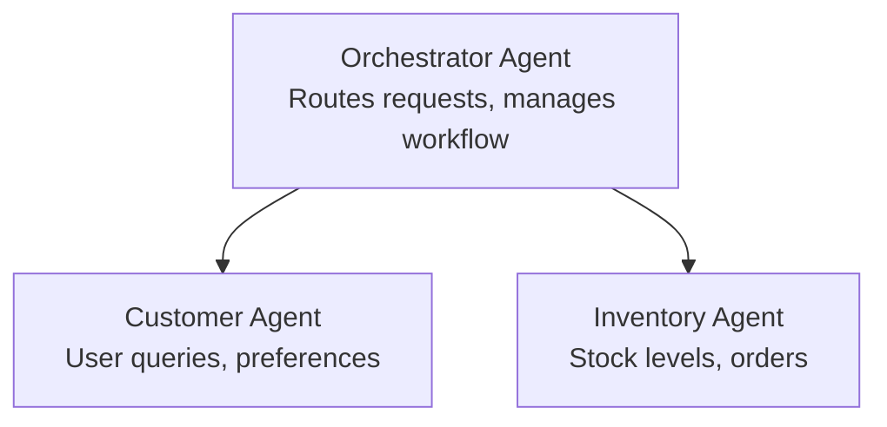

# 5. peatükk: Mitme agendiga AI lahendused

**📚 Kursus**: [AZD algajatele](../../README.md) | **⏱️ Kestus**: 2-3 tundi | **⭐ Keerukus**: Täiustatud

---

## Ülevaade

Selles peatükis käsitletakse täiustatud mitme agendi arhitektuurimustreid, agentide koordineerimist ja tootmiskõlblikke AI juurutusi keerukate stsenaariumite jaoks.

> Käskude juhised kontrollitud välja antud `azd 1.37.2` viite põhjal. Pilvejuurutusi ei tehtud.

## Õpieesmärgid

Selles peatükis õpid:
- Mõistma mitme agendi arhitektuurimustreid
- Juurutama koordineeritud AI agentide süsteeme
- Rakendama agentidevahelist suhtlust
- Looma tootmiskõlblikke mitme agendi lahendusi

---

## 📚 Õppetunnid

| # | Õppetund | Kirjeldus | Aeg |
|---|--------|-------------|------|
| 1 | [Mitme agendi põhialused](multi-agent-basics.md) | Praktiline: töötava mitme agendi rakenduse juurutamine koos `azd up` | 45 min |
| 2 | [Koordineerimismustrid](../chapter-06-pre-deployment/coordination-patterns.md) | Agentide orkestreerimise strateegiad (jätkub peatükis 6) | 30 min |
| 3 | [ARM mallide juurutamine](../../examples/retail-multiagent-arm-template/README.md) | Ühe klõpsuga juurutamise näide | 30 min |

> **Alusta õppetundist 1.** See on ainus täielikult praktiline ja juurutatav õppetund selles peatükis. Õppetund 2 asub peatükis 6 (see jaguneb eelpaarimisega) ja [Jaemüügi mitme agendi lahendus](../../examples/retail-scenario.md) on arhitektuuri kavand — disaini viide, mitte ühe käsu mall.

---

## 🚀 Kiire algus

```bash
# Option 1: Deploy the multi-agent template used in Lesson 1
azd init --template Azure-Samples/contoso-creative-writer .
azd up

# Option 2: Initialize a Foundry agent interactively with the GA bundle
azd ext install microsoft.foundry
azd ai agent init
azd up
```

> **Millist lähenemist valida?** Kasuta `azd init --template` selleks, et alustada töötava näidisrakendusega. Kasuta `azd ai agent init` interaktiivselt või `azd ai agent init --template <path-to-azure.yaml>`, et võtta üle olemasolev agendi projekt. Versiooninõuete ja hindamise ülemineku jaoks vaata [AZD AI CLI viidet](../chapter-08-production/production-ai-practices.md#azd-ai-cli-commands-and-extensions).

Käivita need alternatiivid eraldi tühjades kaustades. GA Foundry töövoog nõuab `azd >= 1.37.0`; selle interaktiivne voog ei loo kohandatud Service Bus torujuhtme koordineerimismustris. Kohalikuks testimiseks, koodi juurutamiseks ning uue ja taaskasutatava projekti puhastamiseks järgi [hostitud agendi samme](../chapter-02-ai-development/microsoft-foundry-integration.md#hosted-agent-walkthrough-ga).

---

## 🤖 Mitme agendi arhitektuur



---

## 🎯 Esiletõstetud lahendus: Jaemüügi mitme agendi lahendus

Lahenduse [Jaemüügi mitme agendi lahendus](../../examples/retail-scenario.md) näide:

- **Kliendiagent**: Halda kasutajate suhtlusi ja eelistusi
- **Laosagent**: Halda laoseisu ja tellimuste töötlemist
- **Orkestreerija**: Koordineerib agentide vahel
- **Jagatud mälu**: Agendiülene konteksti juhtimine

### Kasutatavad teenused

| Teenus | Eesmärk |
|---------|---------|
| Microsoft Foundry mudelid | Keeletöötlus |
| Azure AI Search | Tootekataloog |
| Cosmos DB | Agendi olek ja mälu |
| Container Apps | Agendi majutamine |
| Application Insights | Jälgimine |

---

## 🔗 Navigeerimine

| Suund | Peatükk |
|-----------|---------|
| **Eelmine** | [Peatükk 4: Taristu](../chapter-04-infrastructure/README.md) |
| **Järgmine** | [Peatükk 6: Eelpaigaldus](../chapter-06-pre-deployment/README.md) |

---

## 📖 Seotud ressursid

- [AI Agentide juhend](../chapter-02-ai-development/agents.md)
- [Produktiivse AI tavad](../chapter-08-production/production-ai-practices.md)
- [AI tõrkeotsing](../chapter-07-troubleshooting/ai-troubleshooting.md)

---

<!-- CO-OP TRANSLATOR DISCLAIMER START -->
**Lahtiütlus**:
See dokument on tõlgitud kasutades AI tõlketeenust [Co-op Translator](https://github.com/Azure/co-op-translator). Kuigi me püüdleme täpsuse poole, palun pange tähele, et automatiseeritud tõlgetes võib esineda vigu või ebatäpsusi. Originaaldokument selle emakeeles tuleks pidada autoriteetseks allikaks. Olulise teabe puhul soovitatakse kasutada professionaalset inimtõlget. Me ei vastuta selle tõlkega seotud eksimustest või valesti mõistmistest.
<!-- CO-OP TRANSLATOR DISCLAIMER END -->