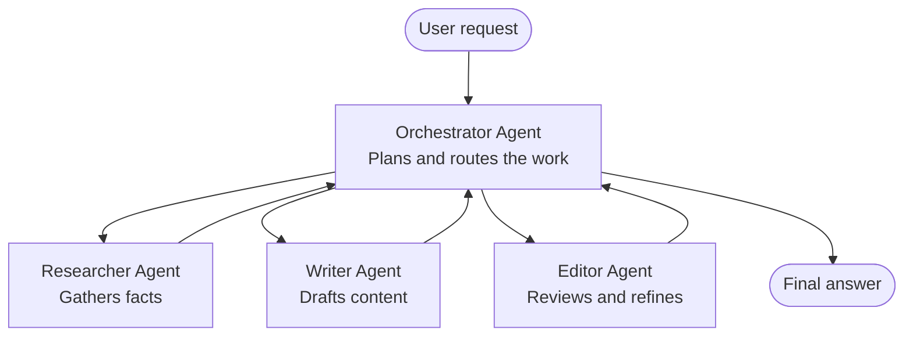

# Mitmeagendi alused - juuruta oma esimene koordineeritud tehisintellekti süsteem

**Peatüki navigeerimine:**
- **📚 Kursuse avaleht**: [AZD algajatele](../../README.md)
- **📖 Praegune peatükk**: Peatükk 5 - Mitmeagendi AI lahendused
- **⬅️ Eelmine**: [Peatükk 4: Infrastruktuur](../chapter-04-infrastructure/README.md)
- **➡️ Järgmine**: [Koordineerimismustrid](../chapter-06-pre-deployment/coordination-patterns.md)

> Käskluste juhendamine kontrolliti vabastatud `azd 1.37.2` viite järgi. Pilvejuurutused ei olnud tehtud.

## Sissejuhatus

Varasemates peatükkides juurutasite ühe rakenduse—ja peatükis 2 juurutasite ühe AI agenti. See õppetund viib järgmise sammu: juurutada **mitmeagendi süsteemi**, kus mitmed spetsialiseerunud agendid teevad koostööd lahendamaks probleemi, mida üks agent üksi hästi teha ei suudaks.

Hea uudis algajatele: **sul ei ole vaja uusi käske.** Mitmeagendi lahendus on ikka azd projekt. Sa `azd init`, `azd up`, testid ja `azd down`—täpselt see töövoog, mida sa juba tunned. Muutub vaid rakenduse *kuju* sees.

## Õpieesmärgid

Selle õppetunni lõpuks:
- Mõistad, mida tähendab "mitmeagent" ja millal tasub keerukust lisada
- Tunned ära levinud rollid mitmeagendisüsteemis (koordinaator + spetsialistid)
- Juurutad tegeliku toimiva mitmeagendi malli koos `azd up`
- Mõistad Azure ressursse, mis toetavad mitmeagendirakendust
- Tead, kuidas lahendust turvaliselt kontrollida, kohandada ja maha võtta

## Õpitulemused

Pärast selle õppetunni lõpetamist saad:
- Selgitada, mis vahe on ühel agentil ja mitmeagendisüsteemil
- Valida ühe agendi tööriistade ja tõelise mitmeagendilise disaini vahel
- Juurutada ja testida mitmeagendi malli algusest lõpuni azd abil
- Tuvastada, kus iga agent töötab ja kuidas nad suhtlevad
- Puhastada kõik ressursid jooksva tasude vältimiseks

---

## Mis on mitmeagendisüsteem?

Üks AI agent on üks mudel koos juhiste kogumiga ja (valikuliselt) mõningate tööriistadega. See toimib hästi keskendunud ülesannete puhul. Kuid kui ülesanne kasvab—uurimine, siis kirjutamine, siis redigeerimine, siis faktikontroll—siis kõike ühte päringusse mahutamine teeb agendi aeglasemaks, vähem usaldusväärseks ja raskemini siluma.

**Mitmeagendisüsteem** jagab töö spetsialistideks, kes kõik teevad ühe töö hästi, mida koordineerib orkestreerija:



### Kaks rolli, mida sa alati näed

| Roll | Töö | Näide |
|------|-----|--------|
| **Orkestreerija** | Otsustab *mis juhtub järgmisena* ja suunab tööd agentide vahel | "Esiteks uurimine, siis kirjutamine, siis redigeerimine" |
| **Spetsialist** | Teeb ühe keskendunud töö ja tagastab tulemuse | "uurija", kes kogub ainult fakte |

### Kas sa tegelikult vajad mitut agenti?

Alusta lihtsast. Kasuta mitmeagendi **ainult** kui kehtib üks neist:

- ✅ Ülesandel on **erinevad etapid**, mis vajavad erinevaid juhiseid (uurimine vs. kirjutamine vs. ülevaatus)
- ✅ Sa tahad, et spetsialistid töötaksid **samaaegselt**, et aega kokku hoida
- ✅ Erinevad sammud vajavad **erinevaid tööriistu või andmeallikaid**
- ✅ Sa vajad, et iga samm oleks **isesõltuvalt testitav ja silutav**

Kui su ülesanne on üks küsimus-vastus või lihtne tööriista väljakutse, on **üks agent koos tööriistadega** (peatükk 2) lihtsam, odavam ja kergemini hallatav.

> **Algaja nõuanne:** "Rohkem agente" ei ole "parem." Iga agent lisab latentsust, kulusid ja jälgimist. Lisa agente vaid siis, kui probleem selgelt jaguneb osadeks.

---

## Kaks viisi ehitada mitmeagent Azure peale

| Lähenemine | Mis see on | Parim kasutus |
|----------|-----------|--------------|
| **Üks agent + tööriistad** | Üks Foundry agent, mis kutsub funktsioone/tööriistu | Lihtsad töövood, alustamine |
| **Mitmed koordineeritud agendid** | Mitmed agendid koos orkestreerijaga | Erinevad etapid, samaaegne töö, spetsialiseerumine |

See õppetund keskendub teisele lähenemisele, kasutades **valmis malli**, et saaksid enne enda ehitamist näha tõelist mitmeagendisüsteemi töötamas.

---

## Praktiline: juuruta toimiv mitmeagendirakendus

Juurutame **Contoso Creative Writeri**, ametliku Azure näidise, mis koordineerib uurimis-, toote-, kirjutamis- ja redigeerimisagente, et toota artiklit. Enne jätkamist vaata [näidise eeltingimusi ja kulusid](https://github.com/Azure-Samples/contoso-creative-writer#azure-account-requirements): see vajab mudelikvooti, Azure AI Searchi, Bing Grounding ligipääsu, Pythoni, Dockerit ja Bash-ühilduvaid konksusid. Mudeli ja regiooni saadavus sõltub sinu tellimusest; juurutamine pole kindlustatud ühegi regiooni valimisel.

### Samm 1: Algusta mallit

```bash
# Create a working folder
mkdir creative-writer && cd creative-writer

# Initialize from the official multi-agent template
azd init --template Azure-Samples/contoso-creative-writer .
```

> Sirvi rohkem mitmeagendi malle igal ajal [Awesome AZD AI galeriis](https://azure.github.io/awesome-azd/?tags=ai). Teised algajasõbralikud võimalused on `get-started-with-ai-agents` ja `azure-ai-travel-agents`.

### Samm 2: Autendi

```bash
# Required for azd workflows
azd auth login

# Also required by this sample's Azure CLI hooks
az login
```

### Samm 3: Kontrolli keskkonda

```bash
# init normally creates/selects an environment; confirm it before proceeding
azd env list
# Only if you need an additional environment:
# azd env new dev
```

### Samm 4: Eelvaade, seejärel juuruta

```bash
# See what will be created before spending anything (recommended)
azd provision --preview

# Provision infrastructure and deploy all agents in one step
azd up
```

`azd up` küsib puuduvate tellimuse ja regiooni sätete kohta, seejärel loob ressursid ja juurutab rakenduse. Eelvaade ei reserveeri kvota ega garanteeri edu; mallilõksud võivad endiselt juurutuse eelvaate ajal käivituda, seega kontrolli neid esmalt. Azd suhtlemisaega iga **teenuse juurutuse** (mitte mudeli juurutuse) puhul pikendamiseks:

```bash
azd deploy --timeout 1800
```

Timeout peatab azd ootamise; see ei tühista juurutust Azures. Kontrolli ressursi olekut enne uuesti proovimist.

> **Hoiatus kulu ja võimsuse kohta:** Mitmeagent-rakendused juurutavad tehisintellekti mudeleid, mis kasutavad kvotat ja tekitavad kulusid. Kui `azd up` ebaõnnestub mudelikvota tõttu, vaata [AI tõrkeotsingut](../chapter-07-troubleshooting/ai-troubleshooting.md) regiooni ja kvota paranduste jaoks ning peatükki 6 [Võimsuse planeerimine](../chapter-06-pre-deployment/capacity-planning.md).

---

## Arusaamine, mida sa juurutasid

Tüüpiline mitmeagent-rakendus juurutab komplekti Azure ressursse, mis kaarduvad otseselt ülaloleva diagrammi vastutustele:

| Ressurss | Miks see seal on |
|----------|----------------|
| **Microsoft Foundry / Mudelid** | Hostib iga agendi kasutatavaid keelemudeleid |
| **Azure AI Search** | Annab teadustöötaja agendile asjakohased andmed otsimiseks |
| **Container Apps** (või App Service) | Hostib orkestri ja agendi koodi |
| **Cosmos DB** (mõnes näites) | Salvestab agendide vahel jagatud oleku/mälu |
| **Application Insights** | Jälgib päringuid *agentide vahel*, et saaksid voo siluda |

### Kuidas agendid omavahel suhtlevad

Enamikus azd mitmeagent näidetes **käib orkestratsioon sinu rakenduse koodis** (näiteks Semantic Kernel või Microsoft Agent Framework raamistiku abil). Orkestri järjekorras kutsub ta iga spetsialisti agendi, edastab tulemused ja koondab lõpliku vastuse. Agendid jagavad konteksti läbi:

- **Funktsioon-/tööriistakutsed** — orkestrija kutsub spetsialisti ja saab vastuse tagasi
- **Jagatud mälu** — andmebaas (tavaliselt Cosmos DB) hoiab olekut, mida mõlemad agendid saavad lugeda
- **Sõnumid/sündmused** — nõrgema sidumise jaoks suhtlevad agendid järjekorra või Service Busi kaudu

> **Miks see on silumisel oluline:** kuna iga samm on eraldi, näitab Application Insights sulle *milline* agent oli aeglane või ebaõnnestus. See on peamine põhjus töö jaotamiseks agentide vahel.

---

## Kontrolli juurutust

Kinnita, et süsteem tegelikult töötab, enne kui edasi liigud:

```bash
# Show the deployed endpoints
azd show

# Open the app's monitoring dashboard
azd monitor

# Open Application Insights Logs (not a terminal log stream)
azd monitor --logs
```

Seejärel ava rakenduse URL, mis saadakse `azd show` kaudu, ja taotle lühikest artiklit. Kasuta näite silumisvaadet agentide töövoo kontrollimiseks. Application Insights tehingute otsing näitab üksikuid samme ainult siis, kui näide neid instrumendiga märgistab ja korreleerib; azd ei lisa agente automaatselt jälje vahemikku.

**Edu kriteeriumid:**
- ✅ `azd show` loetleb kättesaadava lõpp-punkti
- ✅ Päring toodab tulemuse, mis läbis selgelt mitu etappi
- ✅ Silumisvaade näitab mitut agendi sammu; kui jälgimine on lubatud, kontrolli vastavat telemeetrilist andmestikku pärast töötlemist

---

## Kohanda: Lisa või muuda agenti

Kuna iga agent on lihtsalt juhised ja tööriistad, on kohandamine lähenemisviisilt mugav:

1. **Leia esindajate definitsioonid** mallis (tavaliselt `prompts/`, `agents/` või `*.prompty` failide komplekt).
2. **Täpsemalt seab esindaja juhised** — näiteks käskige toimetaja agentil järgida kindlat tooni või sõnade arvu.
3. **Uuesti juurutage ainult kood** (tарифтura ei muutu):

   ```bash
   azd deploy
   ```

Oma *enda* Foundry esindaja projekti puhul kasutage esindaja laiendi interaktiivset algatust:

```bash
azd extension install azure.ai.agents
azd ai agent init
azd up
azd ai agent invoke      # test, with response timing
```

Vaadake [2. peatükk: Esindajad](../chapter-02-ai-development/agents.md) ja [AZD AI CLI viide](../chapter-08-production/production-ai-practices.md#azd-ai-cli-commands-and-extensions) kogu elutsükli jaoks: esindaja `invoke`, eraldi hinnangute laiendi `azd ai eval` töövoog, esindaja `optimize` ja esindaja `delete`.

---

## Puhastamine

Mitme esindajaga rakendused käitavad mitut arveldusteenust. Kui olete lõpetanud, eemaldage kõik:

```bash
# Review the resources and confirm deletion interactively
azd down
```

Kustutamine on hävitav. Ühekordse labori puhul `azd down --force --purge` vahele jätab kustutamise ja toetatud pehme kustutamise kinnitused; puhastamine on pöördumatu, kus see on toetatud ja selle võib blokeerida puhastusprotseduuride kaitse. Pehme kustutamine on taastamis- / nime kordkasutuse probleem, mitte tõend jätkuvate tasude kohta. Kontrollige puhastamise järel säilinud ressursse ja arveldamist.

---

## Märkus tootmises kasutatavate mitme esindajaga süsteemide kohta

Selle repositooriumi [Jaemüügi mitme esindajaga lahendus](../../examples/retail-scenario.md) on **arhitektuuri plaan**, mitte ühe käsuga mall — see dokumenteerib, kuidas tootmissüsteem *võiks* olla üles ehitatud (ja rõhutab, et täielik ehitus on märkimisväärne ülesanne). Kasutage seda disainiviitena *pärast* töötava näidise juurutamist siin. Tootmisega seotud küsimuste (vastupidavus, kulud, järelevalve, juhtimine) korral vaadake [8. peatükk: Toote AI praktikad](../chapter-08-production/production-ai-practices.md).

---

## Kokkuvõte

- Mitme esindajaga süsteem jagab tööd spetsialistide vahel, mida koordineerib orkestreerija.
- Kasutage seda ainult siis, kui ülesandel on erinevad etapiviisid, paralleelsus või sammude lõikes erinevad tööriistad — muidu eelistage ühes esindajat.
- Azd töövoog ei muutu: `azd init` → `azd up` → test → `azd down`.
- Tõeline mall nagu `contoso-creative-writer` võimaldab teil täna näha ja kohandada töötavat mitme esindajaga rakendust.
- Rakenduse Insights jälgimine esindajate vahel on üks mitme esindajaga disaini suurimaid praktilisi eeliseid.

---

## 🔗 Navigeerimine

| Suund | Õppetund |
|-----------|--------|
| **Eelmine** | [4. peatükk: Infrastruktuur](../chapter-04-infrastructure/README.md) |
| **Järgmine** | [Koordineerimise mustrid](../chapter-06-pre-deployment/coordination-patterns.md) |

## 📖 Seotud ressursid

- [AI esindajate juhend](../chapter-02-ai-development/agents.md)
- [Koordineerimise mustrid](../chapter-06-pre-deployment/coordination-patterns.md)
- [Tootmise AI praktikad](../chapter-08-production/production-ai-practices.md)
- [AI tõrkeotsing](../chapter-07-troubleshooting/ai-troubleshooting.md)

---

<!-- CO-OP TRANSLATOR DISCLAIMER START -->
**Lahtiütlus**:
See dokument on tõlgitud kasutades AI tõlketeenust [Co-op Translator](https://github.com/Azure/co-op-translator). Kuigi me püüdleme täpsuse poole, palun pange tähele, et automatiseeritud tõlgetes võib esineda vigu või ebatäpsusi. Originaaldokument selle emakeeles tuleks pidada autoriteetseks allikaks. Olulise teabe puhul soovitatakse kasutada professionaalset inimtõlget. Me ei vastuta selle tõlkega seotud eksimustest või valesti mõistmistest.
<!-- CO-OP TRANSLATOR DISCLAIMER END -->