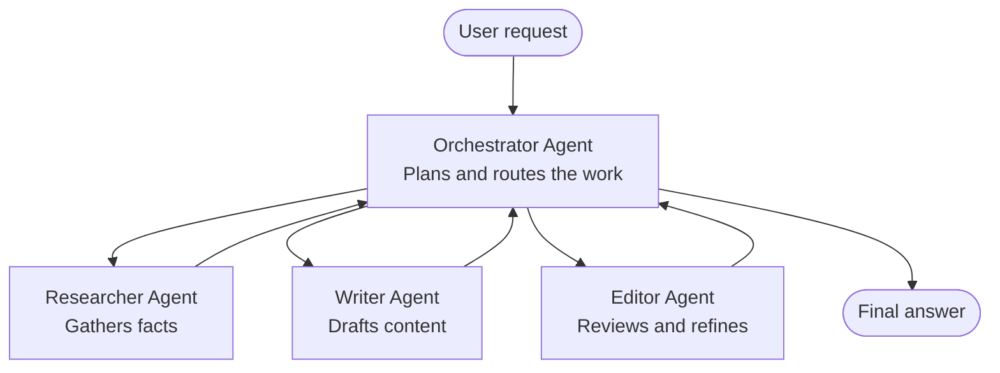

# Mitme Agendi Põhitõed - Paigalda Oma Esimene Koordineeritud AI Süsteem

**Peatüki Navigeerimine:**
- **📚 Kursuse Kodu**: [AZD Algajatele](../../README.md)
- **📖 Praegune Peatükk**: Peatükk 5 - Mitme Agendi AI Lahendused
- **⬅️ Eelmine**: [Peatükk 4: Infrastruktuur](../chapter-04-infrastructure/README.md)
- **➡️ Järgmine**: [Koordineerimise Mustrid](../chapter-06-pre-deployment/coordination-patterns.md)

> Käskude juhised on üle vaadatud vabastatud `azd 1.37.2` viite alusel. Pilve paigaldusi ei teostatud.

## Sissejuhatus

Varasemates peatükkides paigaldasid ühe rakenduse — ja Peatükis 2 paigaldasid ühe AI agendi. See õppetund astub järgmise sammu: paigaldada **mitme agendi süsteemi**, kus mitu spetsialiseerunud agenti töötavad koos, et lahendada probleem, mida üksainus agent üksi hästi lahendada ei suudaks.

Hea uudis algajatele: **sul ei ole vaja uusi käske.** Mitme agendi lahendus on endiselt azd projekt. Sa `azd init`, `azd up`, testid ja `azd down` — täpselt see töökäik, mida sa juba tead. Muutub rakenduse *kuju* sees.

## Õpieesmärgid

Selle õppetunni lõpuks sa:
- Mõistad, mida "mitme agent" tähendab ja millal see on väärt lisakompleksust
- Tunned ära tavalisi rolle mitme agendi süsteemis (koordinaator + spetsialistid)
- Paigaldad toimiva mitme agendi malli kasutades `azd up`
- Mõistad Azure ressursse, mis toetavad mitme agendi rakendust
- Oskad turvaliselt lahendust kontrollida, kohandada ja likvideerida

## Õpitulemused

Pärast selle õppetunni läbimist suudad:
- Selgitada erinevust ühe agendi ja mitme agendi süsteemi vahel
- Valida ühe agendi koos tööriistadega ja tõelise mitme agendi disaini vahel
- Paigaldada ja testida mitme agendi malli algusest lõpuni azd abil
- Tuua välja, kus iga agent töötab ja kuidas nad suhtlevad
- Puhastada kõik ressursid, et vältida pidevaid kulusid

---

## Mis On Mitme Agendi Süsteem?

Üks AI agent on üks mudel koos juhiste kogumiga ja (valikuliselt) mõne tööriistaga. See töötab hästi keskendunud ülesannete puhul. Kuid kui ülesanne kasvab — uurimisest kirjutamise, redigeerimise ja faktikontrollini —, annavad kõik ühte sisendi kimpupanekud agenti aeglasemaks, vähem usaldusväärseks ja raskemini silumitavaks.

**Mitme agendi süsteem** jagab töö spetsialistideks, kes teevad igaüks ühe töö hästi, koordineerituna koordinaatori poolt:



### Kaks rolli, mida sa alati näed

| Roll | Töö | Näide |
|------|-----|---------|
| **Koordinaator** | Otsustab *mis järgmisena juhtub* ja suunab töö agentide vahel | "Esmalt uurimus, siis kirjutamine, siis redigeerimine" |
| **Spetsialist** | Tegutseb ühe keskendunud ülesandega ja tagastab tulemuse | "Uurija", kes kogub ainult fakte |

### Kas sul on tõesti vaja mitut agenti?

Alusta lihtsalt. Kasuta mitme agendi lahendust **ainult** siis, kui üks järgmistest kehtib:

- ✅ Ülesandel on **erinevad etapid**, mis vajavad erinevaid juhiseid (uurimine vs kirjutamine vs ülevaatus)
- ✅ Soovid, et spetsialistid töötaksid **paralleelselt** aja säästmiseks
- ✅ Erinevad sammud vajavad **erinevaid tööriistu või andmeallikaid**
- ✅ Vajad, et iga samm oleks **iseseisvalt testitav ja silutav**

Kui su ülesanne on üks küsimus-vastus või lihtne tööriista kutsumine, on **üks agent koos tööriistadega** (Peatükk 2) lihtsam, odavam ja lihtsam hallata.

> **Algaja näpunäide:** "Rohkem agente" ei tähenda "paremat." Iga agent lisab latentsust, kulusid ja uue jälgimisobjekti. Lisa agente vaid siis, kui probleem rõhutab selgelt eri osi.

---

## Kaks Viisi Mitme Agendi Loomiseks Azure'il

| Lähenemine | Mis see on | Parim kasutus |
|----------|-----------|----------|
| **Üks agent + tööriistad** | Üks Foundry agent, mis kutsub funktsioone/tööriistu | Lihtsad töökäigud, alustamine |
| **Mitmed koordineeritud agentid** | Mitmed agentid koos koordinaatoriga | Erilised etapid, paralleelne töö, spetsialiseerumine |

See õppetund keskendub teisele lähenemisele, kasutades **valmis malli**, et saaksid näha toimivat mitme agendi süsteemi enne omaenda loomist.

---

## Käed-külge: Paigalda Töötav Mitme Agendi Rakendus

Paigaldame **Contoso Creative Writer'i**, ametliku Azure näidise, mis koordineerib uurimis-, toote-, kirjutamis- ja redigeerimisagente artikli loomiseks. Enne jätkamist vaata [näidise eeldused ja kulud](https://github.com/Azure-Samples/contoso-creative-writer#azure-account-requirements): vaja on mudeli kvota, Azure AI Searchi, Bing Grounding ligipääsu, Pythonit, Dockerit ja Bash-kompatible hooks'e. Mudelite ja piirkondade saadavus sõltub sinu tellimusest; paigaldus ei ole garanteeritud valides konkreetset piirkonda.

### Samm 1: Initsializeeri mall

```bash
# Create a working folder
mkdir creative-writer && cd creative-writer

# Initialize from the official multi-agent template
azd init --template Azure-Samples/contoso-creative-writer .
```

> Sirvi rohkem mitme agendi malle igal ajal [Awesome AZD AI galeriis](https://azure.github.io/awesome-azd/?tags=ai). Teised algajasõbralikud valikud on näiteks `get-started-with-ai-agents` ja `azure-ai-travel-agents`.

### Samm 2: Autentimine

```bash
# Required for azd workflows
azd auth login

# Also required by this sample's Azure CLI hooks
az login
```

### Samm 3: Kontrolli keskkonda

```bash
# init normally creates/selects an environment; confirm it before proceeding
azd env list
# Only if you need an additional environment:
# azd env new dev
```

### Samm 4: Eelvaade ja seejärel paigalda

```bash
# See what will be created before spending anything (recommended)
azd provision --preview

# Provision infrastructure and deploy all agents in one step
azd up
```

`azd up` küsib puuduvaid tellimuse ja piirkonna seadeid ning seejärel tagab ressursid ja paigaldab rakenduse. Eelvaade ei reserveeri kvotat ega taga edu; malli hookid võivad siiski jooksutada paigalduse eelvaate ajal, seega vaata need enne üle. Kui soovid pikendada, kui kaua azd ootab iga **teenuse paigaldust** (mitte mudeli loomist):

```bash
azd deploy --timeout 1800
```

Aegumine peatab azd ooteaja; see ei tühista paigaldust Azure'is. Vaata ressursi olekut enne uuesti proovimist.

> **Mõtle kuludele ja mahule:** Mitme agendi rakendused paigaldavad AI mudeleid, mis tarbivad kvotat ja tekitavad kulusid. Kui `azd up` ebaõnnestub mudeli kvota tõttu, vaata [AI tõrkeotsingut](../chapter-07-troubleshooting/ai-troubleshooting.md) piirkondade ja kvota parandamiseks ning Peatükk 6-st [Mahtude planeerimine](../chapter-06-pre-deployment/capacity-planning.md).

---

## Mõista, Mida Sa Paigaldasid

Tüüpiline mitme agendi rakendus nagu see loob Azure'i ressursside komplekti, mis vastavad otse eelpool näidatud vastutustele:

| Ressurss | Miks see seal on |
|----------|----------------|
| **Microsoft Foundry / Mudelid** | Hosti keeltemudeleid, mida iga agent kasutab |
| **Azure AI Search** | Annab uurimisagentile asjakohased andmed otsimiseks |
| **Container Apps** (või App Service) | Hosti koordinaatori ja agentide koodi |
| **Cosmos DB** (mõnes näites) | Salvestab jagatud oleku/mälu, mida agentide vahel vahetatakse |
| **Application Insights** | Jälgib päringuid *agentide vahel*, et saaksid voogu siluda |

### Kuidas agendid omavahel suhtlevad

Enamikes azd mitme agendi näidetes **jookseb koordinaator sinu rakenduse koodis** (näiteks kasutades Semantic Kernel või Microsoft Agent Framework raamistikke). Koordinaator kutsub iga spetsialisti järjest, edastab tulemused ja koondab lõpliku vastuse. Agendid jagavad konteksti järgmiste abil:

- **Funktsioonide/tööriistade kutsed** — koordinaator kutsub spetsialisti ja saab tulemuse tagasi
- **Jagatud mälu** — andmebaas (tihti Cosmos DB) hoiab olekut, mida mõlemad agendid loevad
- **Sõnumid/sündmused** — nõrgemaks seotudks suhtlemiseks suhtlevad agendid järjekorra või Service Busi kaudu

> **Miks see on vigade puhul oluline:** kuna iga samm on eraldi, näitab Application Insights sulle, *milline* agent oli aeglane või ebaõnnestus. See ongi peamine põhjus, miks tööd agentide vahel jagada.

---

## Kontrolli Paigaldust

Veendu, et süsteem oleks tegelikult töökorras enne edasi liikumist:

```bash
# Show the deployed endpoints
azd show

# Open the app's monitoring dashboard
azd monitor

# Open Application Insights Logs (not a terminal log stream)
azd monitor --logs
```

Ava siis rakenduse URL aadress `azd show` ja palu lühikest artiklit. Kasuta näidise silumisvaadet, et uurida agendi töökäiku. Application Insights päringuotsing näitab üksiktasemeid ainult siis, kui näidis neid instrumenteerib ja seob; azd ei lisa agentide ulatusi automaatselt.

**Edu kriteeriumid:**
- ✅ `azd show` näitab kohale jõudvat lõpp-punkti
- ✅ Päring toob tulemuse, mis on selgelt läbinud mitu etappi
- ✅ Silumisvaade näitab mitut agendi sammu; kui jälgimine on lubatud, kontrolli vastavat telemeetrilist andmestikku pärast töötlemist

---

## Kohanda: Lisa või Muuda Agent

Kuna iga agent on lihtsalt juhised pluss tööriistad, on kohandamine ligipääsetav:

1. **Leia agendi definitsioonid** mallist (tihti `prompts/`, `agents/` või `*.prompty` failid).
2. **Reguleeri agendi juhiseid** — näiteks käsu anna toimetajale konkreetne toon või sõnade arv.
3. **Paigalda ainult kood uuesti** (infrastruktuur jääb samaks):

   ```bash
   azd deploy
   ```

Oma *enda* Foundry agendi projektiga liikumiseks kasuta GA paketti AZD 1.37.0+ versioonis eraldi tühjas kaustas:

```bash
azd ext install microsoft.foundry
azd ai agent init
azd up
azd ai agent invoke      # test, with response timing
```

Vaata [GA hosted-agent juhendit](../chapter-02-ai-development/microsoft-foundry-integration.md#hosted-agent-walkthrough-ga) lokaliseks testimiseks, kaugpaigalduseks ja koristamise haldamiseks. [AZD AI CLI viide](../chapter-08-production/production-ai-practices.md#azd-ai-cli-commands-and-extensions) hõlmab ka eraldi hindamise laiendust, optimeerimist ja agendi eemaldamist.

---

## Puhasta

Mitme agendi rakendused jooksevad mitmeid tasulisi teenuseid. Lõpeta kõik, kui oled lõpetanud:

```bash
# Review the resources and confirm deletion interactively
azd down
```

Kustutamine on hävitav. Ajutise katsekeskkonna jaoks `azd down --force --purge` vahele jätab kustutamise ja toetatud pehme kustutuse kinnitamised; kustutamine on pöördumatu, kui see on toetatud ning võib olla blokeeritud puhastuskaitsega. Pehme kustutamine on taastamise/nime uuesti kasutamise küsimus, mitte ennast pikemaajalise tasu tõendus. Pärast puhastust vaata, kas ressursid ja arved on alles.

Kui sa ka initsialiseerisid hosted agendi olemasoleva Foundry projekti vastu, `azd down` jätab selle projekti agendi ja muud ressursid alles. Eemalda ainult soovimatud ressursid, mis kuuluvad sulle eraldi. Uue Foundry projekti puhul, mille on loonud AZD keskkond, `azd down` kustutab ressursside grupi ja kõik selle sees.

---

## Märkus Tootmise Mitme Agendi Süsteemidest

Selles repositooriumis olev [Retail Mitme Agendi Lahendus](../../examples/retail-scenario.md) on **arhitektuuri musternäidis**, mitte ühe käsuga mall — see dokumenteerib, kuidas tootmise jaemüügisüsteem *saaks* üles ehitada (ja rõhutab, et täielik ehitus on märkimisväärne pingutus). Kasuta seda kujundusviitana *pärast* siin toimiva näidise paigaldamist. Tootmisega seotud küsimuste (vastupidavus, kulud, jälgimine, haldus) jaoks vaata [Peatükk 8: Tootmise AI Praktikad](../chapter-08-production/production-ai-practices.md).

---

## Kokkuvõte

- Mitme agendi süsteem jagab tööd spetsialistide vahel, mida koordineerib koordinaator.
- Kasuta seda ainult siis, kui ülesandel on eristatavad etapid, paralleelsus või erinevad tööriistad igas etapis – muidu eelista üht agenti.
- azd töökäik on muutumatuks jäänud: `azd init` → `azd up` → test → `azd down`.
- Tõeline mall nagu `contoso-creative-writer` laseb sul täna näha ja kohandada toimivat mitme agendi rakendust.
- Application Insightsi jälgimine agentide vahel on üks suurimaid praktilisi eeliseid mitme agendi disainis.

---

## 🔗 Navigeerimine

| Suund | Õppetund |
|-----------|--------|
| **Eelmine** | [Peatükk 4: Infrastruktuur](../chapter-04-infrastructure/README.md) |
| **Järgmine** | [Koordineerimise Mustrid](../chapter-06-pre-deployment/coordination-patterns.md) |

## 📖 Seotud Ressursid

- [AI Agentide Juhend](../chapter-02-ai-development/agents.md)
- [Koordineerimise Mustrid](../chapter-06-pre-deployment/coordination-patterns.md)
- [Tootmise AI Praktikad](../chapter-08-production/production-ai-practices.md)
- [AI Tõrkeotsing](../chapter-07-troubleshooting/ai-troubleshooting.md)

---

<!-- CO-OP TRANSLATOR DISCLAIMER START -->
**Lahtiütlus**:
See dokument on tõlgitud kasutades AI tõlketeenust [Co-op Translator](https://github.com/Azure/co-op-translator). Kuigi me püüdleme täpsuse poole, palun pange tähele, et automatiseeritud tõlgetes võib esineda vigu või ebatäpsusi. Originaaldokument selle emakeeles tuleks pidada autoriteetseks allikaks. Olulise teabe puhul soovitatakse kasutada professionaalset inimtõlget. Me ei vastuta selle tõlkega seotud eksimustest või valesti mõistmistest.
<!-- CO-OP TRANSLATOR DISCLAIMER END -->