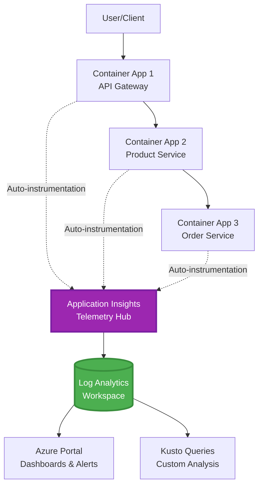
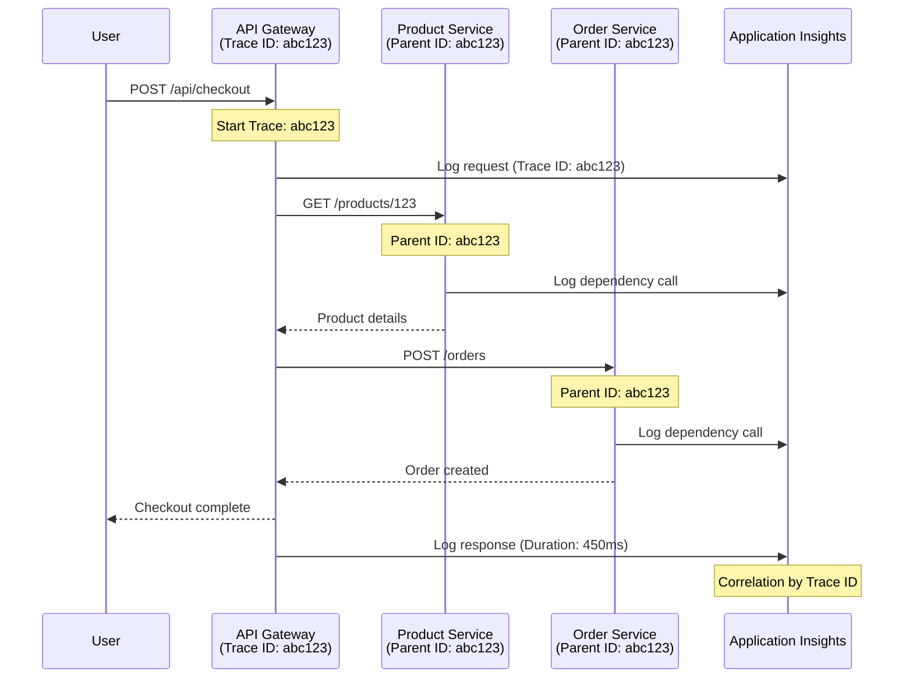

# Application Insights integratsioon AZD-ga

⏱️ **Eeldatav aeg**: 40-50 minutit | 💰 **Maksukulu**: umbes $5-15/kuus | ⭐ **Keerukus**: Kesktase

**📚 Õpperada:**
- ← Eelmine: [Eellekanded](preflight-checks.md) - Eelkohandamise valideerimine
- 🎯 **Oled siin**: Application Insights integratsioon (Järelevalve, telemeetria, silumine)
- → Järgmine: [Lepituse juhend](../chapter-04-infrastructure/deployment-guide.md) - Paigaldus Azure'i
- 🏠 [Kursuse avaleht](../../README.md)

---

## Mida õpid

Selle õppetüki läbimisel:
- Deklareerid **Application Insights** AZD infrastruktuuris ja seadistad SDK instrumenteerimise
- Konfigureerid **jagamise jälgimise** mikroteenustele
- Rakendad **kohandatud telemeetria** (mõõdikud, sündmused, sõltuvused)
- Seadistad **otseülekande mõõdikud** reaalajas jälgimiseks
- Loobad **hoiatused ja juhtpaneelid** AZD deploydest
- Silud tootmisprobleeme **telemeetria päringutega**
- Optimeerid **kulutusi ja proovivõtu** strateegiaid
- Jälgid **AI/LLM rakendusi** (tokenid, latentsus, kulud)

## Miks Application Insights koos AZD-ga on oluline

### Väljakutse: Tootmisvaatlus

**Ilma Application Insightsita:**
```
❌ No visibility into production behavior
❌ Manual log aggregation across services
❌ Reactive debugging (wait for customer complaints)
❌ No performance metrics
❌ Cannot trace requests across services
❌ Unknown failure rates and bottlenecks
```

**Application Insights + AZD-ga:**
```
✅ Automatic telemetry collection
✅ Centralized logs from all services
✅ Proactive issue detection
✅ End-to-end request tracing
✅ Performance metrics and insights
✅ Real-time dashboards
✅ AZD provisions the monitoring declared in your templates
```

**Analoogia**: Application Insights on nagu sinu rakenduse musta kasti pardakaamera + juhtpaneel. Näed reaalajas kõike, mis toimub ja saad igat intsidenti järele mängida.

---

## Arhitektuuri ülevaade

### Application Insights AZD arhitektuuris



### Mis jälgitakse automaatselt

Toetatud automaatinstrumenteerimine hõlmab instrumenteeritud teekide päringuid ja sõltuvusi. Kohandatud sündmused ja mõõdikud vajavad rakenduse koodi; kättesaadavuse testid tuleb eraldi seadistada. Kõiki allpool olevaid ridu ei koguta lihtsalt seetõttu, et ressurss eksisteerib.

| Telemeetria tüüp | Mis see tabab | Kasutusjuhtum |
|----------------|------------------|----------|
| **Päringud** | HTTP päringud, staatusekoodid, kestus | API jõudluse jälgimine |
| **Sõltuvused** | Välimised kõned (andmebaasid, API-d, salvestus) | Kitsaskohtade tuvastamine |
| **Erandid** | Käitlemata vead koos virnastuspäevikutega | Rikkeotsing |
| **Kohandatud sündmused** | Ärisündmused (registreerimine, ost) | Analüütika ja konversioonilehtrid |
| **Mõõdikud** | Jõudluse loendurid, kohandatud mõõdikud | Võimsuse planeerimine |
| **Jäljed** | Logisõnumid raskusastmega | Silumine ja auditeerimine |
| **Kättesaadavus** | Käiduvea ja reageerimisaja testid | Teenustaseme jälgimine |

---

## Eeltingimused

### Vajalikud tööriistad

```bash
# Verify Azure Developer CLI
azd version
# Command reference baseline: azd 1.37.2

# Verify Azure CLI
az --version
# ✅ Expected: azure-cli 2.50.0 or higher
```

### Azure nõuded

- Aktiivne Azure tellimus
- Õigused luua:
  - Application Insights ressursse
  - Log Analytics tööruume
  - Container Apps rakendusi
  - Ressursigruppe

### Teadmised enne alustamist

Peaksid olema lõpetanud:
- [AZD põhialused](../chapter-01-foundation/azd-basics.md) - AZD põhikontseptsioonid
- [Konfiguratsioon](../chapter-03-configuration/configuration.md) - Keskkonna seadistus
- [Esimene projekt](../chapter-01-foundation/first-project.md) - Põhjalepitus

---

## Õppetükk 1: Automaatne Application Insights AZD-ga

### Kuidas AZD loob Application Insightsi

AZD loob Application Insightsi **ainult siis, kui projekti infrastruktuur selle deklareerib**. `azure.yaml` iseenesest ei loo jälgimist ega instrumendi rakenduskoodi.

> **Näide ulatusest:** See õppetükk sisaldab integratsiooni fragmente, mitte täielikku `monitored-app` projekti selles reposis. Paku peamist malli ja parameeterkaardistust, Container Apps keskkonda, repositooriumi/pilti ja identiteedi seadistust, Dockerfile’i ning teenusetähiseid enne deploy’damist. Hilisemad õppetükid näitavad alternatiivseid/moodulilisi fragmente, mitte faile, mida kõiki koos muudatusteta kleepida. Alusta töötava [mikroteenuste näitega](../../../../examples/microservices), kui vajad töötavat alusvarianti.

### Projekti struktuur

```
monitored-app/
├── azure.yaml                     # AZD configuration
├── infra/
│   ├── main.bicep                # Main infrastructure
│   ├── core/
│   │   └── monitoring.bicep      # Application Insights + Log Analytics
│   └── app/
│       └── api.bicep             # Container App with monitoring
└── src/
    ├── app.py                    # Application with telemetry
    ├── requirements.txt
    └── Dockerfile
```

---

### Samm 1: Konfigureeri AZD (azure.yaml)

**Fail: `azure.yaml`**

```yaml
name: monitored-app
metadata:
  template: monitored-app@1.0.0

services:
  api:
    project: ./src
    language: python
    host: containerapp

# Monitoring must be declared in infra/ and enabled in application code.
```

See deklareerib deploy-da teenuse. Järgmine Bicep ja SDK konfiguratsioon toob seire; azd ei lisa neid implitsiitselt.

---

### Samm 2: Seire infrastruktuur (Bicep)

**Fail: `infra/core/monitoring.bicep`**

```bicep
param logAnalyticsName string
param applicationInsightsName string
param location string = resourceGroup().location
param tags object = {}

// Log Analytics Workspace (required for Application Insights)
resource logAnalytics 'Microsoft.OperationalInsights/workspaces@2022-10-01' = {
  name: logAnalyticsName
  location: location
  tags: tags
  properties: {
    sku: {
      name: 'PerGB2018'  // Pay-as-you-go pricing
    }
    retentionInDays: 30  // Keep logs for 30 days
    features: {
      enableLogAccessUsingOnlyResourcePermissions: true
    }
  }
}

// Application Insights
resource applicationInsights 'Microsoft.Insights/components@2020-02-02' = {
  name: applicationInsightsName
  location: location
  tags: tags
  kind: 'web'
  properties: {
    Application_Type: 'web'
    WorkspaceResourceId: logAnalytics.id
    IngestionMode: 'LogAnalytics'
    publicNetworkAccessForIngestion: 'Enabled'
    publicNetworkAccessForQuery: 'Enabled'
  }
}

// Outputs for Container Apps
output logAnalyticsWorkspaceId string = logAnalytics.id
output logAnalyticsWorkspaceName string = logAnalytics.name
output applicationInsightsConnectionString string = applicationInsights.properties.ConnectionString
output applicationInsightsInstrumentationKey string = applicationInsights.properties.InstrumentationKey
output applicationInsightsName string = applicationInsights.name
output applicationInsightsId string = applicationInsights.id
```

---

### Samm 3: Ühenda Container App Application Insightsiga

**Fail: `infra/app/api.bicep`**

```bicep
param name string
param location string
param tags object = {}
param containerAppsEnvironmentId string
param containerImage string
param applicationInsightsConnectionString string

resource containerApp 'Microsoft.App/containerApps@2023-05-01' = {
  name: name
  location: location
  tags: tags
  properties: {
    managedEnvironmentId: containerAppsEnvironmentId
    configuration: {
      ingress: {
        external: true
        targetPort: 8000
      }
      secrets: [
        {
          name: 'appinsights-connection-string'
          value: applicationInsightsConnectionString
        }
      ]
    }
    template: {
      containers: [
        {
          name: 'api'
          image: containerImage // Supply an accessible image and registry authentication
          resources: {
            cpu: json('0.5')
            memory: '1Gi'
          }
          env: [
            {
              name: 'APPLICATIONINSIGHTS_CONNECTION_STRING'
              secretRef: 'appinsights-connection-string'
            }
            {
              name: 'APPLICATIONINSIGHTS_ENABLED'
              value: 'true'
            }
          ]
        }
      ]
    }
  }
}

output uri string = 'https://${containerApp.properties.configuration.ingress.fqdn}'
```

---

### Samm 4: Rakenduskood koos telemeetriaga

**Fail: `src/app.py`**

```python
from flask import Flask, request, jsonify
from azure.monitor.opentelemetry import configure_azure_monitor
import logging
import os

app = Flask(__name__)

# Get Application Insights connection string
connection_string = os.environ.get('APPLICATIONINSIGHTS_CONNECTION_STRING')

if connection_string:
    # Azure Monitor OpenTelemetry instruments supported libraries, including Flask.
    configure_azure_monitor(
        connection_string=connection_string,
        logger_name=__name__,
        enable_live_metrics=True
    )
    logger = logging.getLogger(__name__)
    logger.setLevel(logging.INFO)
    
    print("✅ Application Insights enabled")
else:
    logger = logging.getLogger(__name__)
    logger.setLevel(logging.INFO)
    print("⚠️ Application Insights not configured")

@app.route('/health')
def health():
    logger.info('Health check endpoint called')
    return jsonify({'status': 'healthy', 'monitoring': 'enabled' if connection_string else 'disabled'})

@app.route('/api/products')
def get_products():
    logger.info('Fetching products')
    
    # In-memory fixture: this is not a database dependency call.
    products = [
        {'id': 1, 'name': 'Laptop', 'price': 999.99},
        {'id': 2, 'name': 'Mouse', 'price': 29.99},
        {'id': 3, 'name': 'Keyboard', 'price': 79.99}
    ]
    
    logger.info(f'Returned {len(products)} products')
    return jsonify(products)

@app.route('/api/error-test')
def error_test():
    """Test error tracking"""
    logger.error('Testing error tracking')
    try:
        raise ValueError('This is a test exception')
    except Exception as e:
        logger.exception('Exception occurred in error-test endpoint')
        return jsonify({'error': str(e)}), 500

@app.route('/api/slow')
def slow_endpoint():
    """Test performance tracking"""
    import time
    logger.info('Slow endpoint called')
    time.sleep(3)  # Simulate slow operation
    logger.warning('Endpoint took 3 seconds to respond')
    return jsonify({'message': 'Slow operation completed'})

if __name__ == '__main__':
    app.run(host='0.0.0.0', port=8000)
```

**Fail: `src/requirements.txt`**

```txt
Flask
azure-monitor-opentelemetry
gunicorn
requests
openai
```

Lahenda need sõltuvused oma projektis, testi neid koos ja fikseeri saadud versioonid. Uued projektid peaksid kasutama Azure Monitor OpenTelemetry’t, mitte pensionile jäänud OpenCensus Python eksportijaid.

---

### Samm 5: Deploy ja kontrolli

```bash
# Deploy only after completing and wiring the infrastructure fragments above
azd up

# Get app URL
APP_URL=$(azd env get-value API_URL) # Requires this output in main.bicep

# Generate telemetry
curl $APP_URL/health
curl $APP_URL/api/products
curl $APP_URL/api/error-test
curl $APP_URL/api/slow
```

**✅ Oodatud väljund:**
```json
{
  "status": "healthy",
  "monitoring": "enabled"
}
```

---

### Samm 6: Vaata telemeetriat Azure portaalis

```bash
# Get Application Insights details
azd env get-values | grep APPLICATIONINSIGHTS

# Open in Azure Portal
az monitor app-insights component show \
  --app $(azd env get-values | grep APPLICATIONINSIGHTS_NAME | cut -d '=' -f2 | tr -d '"') \
  --resource-group $(azd env get-values | grep AZURE_RESOURCE_GROUP | cut -d '=' -f2 | tr -d '"') \
  --query "appId" -o tsv
```

**Mine Azure Portaal → Application Insights → Transaction Search**

Sa peaksid nägema:
- ✅ HTTP-päringud staatusekoodidega
- ✅ Päringu kestus (3+ sekundit `/api/slow` jaoks)
- ✅ Erandite detailid `/api/error-test`
- ✅ Kohandatud logisõnumid

---

## Õppetükk 2: Kohandatud telemeetria ja sündmused

### Jälgi ärisündmusi

Lisame ärikriitiliste sündmuste jaoks kohandatud telemeetria.

**Fail: `src/telemetry.py`**

```python
from contextlib import contextmanager
from azure.monitor.opentelemetry import configure_azure_monitor
from opentelemetry import metrics, trace
from opentelemetry.trace import SpanKind
import logging
import os

class TelemetryClient:
    """Custom telemetry client for Application Insights"""
    
    def __init__(self, connection_string=None):
        self.connection_string = connection_string or os.environ.get('APPLICATIONINSIGHTS_CONNECTION_STRING')
        
        # Configure once per process. If app.py already calls this, keep only
        # one configure_azure_monitor call and use logger_name='telemetry'.
        if self.connection_string:
            configure_azure_monitor(
                connection_string=self.connection_string,
                logger_name=__name__,
                enable_live_metrics=True
            )
        self.logger = logging.getLogger(__name__)
        self.logger.setLevel(logging.INFO)
        self.tracer = trace.get_tracer(__name__)
        self.meter = metrics.get_meter(__name__)
        self.instruments = {}
    
    def track_event(self, event_name: str, properties: dict = None):
        """Track custom business event"""
        properties = properties or {}
        self.logger.info(
            f"CustomEvent: {event_name}",
            extra={
                # OTel log attributes become customDimensions in App Insights.
                    'event_name': event_name,
                    **properties
            }
        )
    
    def track_metric(self, metric_name: str, value: float, properties: dict = None):
        """Track custom metric"""
        properties = properties or {}
        if metric_name not in self.instruments:
            self.instruments[metric_name] = self.meter.create_histogram(metric_name)
        self.instruments[metric_name].record(value, attributes=properties)
    
    @contextmanager
    def track_dependency(self, name: str):
        """Time the real operation inside a client span; exceptions mark failure."""
        with self.tracer.start_as_current_span(name, kind=SpanKind.CLIENT) as span:
            yield span

# Global telemetry client
telemetry = TelemetryClient()
```

### Uuenda rakendust kohandatud sündmustega

**Fail: `src/app.py` (täiendatud)**

Lisa need marsruudid olemasolevale Flaski rakendusele; säilita eelnevad tervise/testi marsruudid. Allpool lühendatud plokk näitab eraldi rakendust selguse huvides. Telemeetria initsialiseerimine elab nüüd `telemetry.py` sees—ära initsialiseeri eksportijaid kaks korda.

```python
from flask import Flask, request, jsonify
from telemetry import telemetry
import time
import random
import os

app = Flask(__name__)

@app.route('/api/purchase', methods=['POST'])
def purchase():
    """Track purchase event with custom telemetry"""
    data = request.get_json(silent=True) or {}
    product_id = data.get('product_id')
    quantity = data.get('quantity', 1)
    price = data.get('price', 0)
    if not isinstance(quantity, int) or quantity < 1 or \
       not isinstance(price, (int, float)) or price < 0:
        return jsonify({'error': 'quantity and price must be non-negative numbers; quantity >= 1'}), 400
    
    # Track business event
    telemetry.track_event('Purchase', {
        'product_id': product_id,
        'quantity': quantity,
        'total_amount': price * quantity,
        'user_id': request.headers.get('X-User-Id', 'anonymous')
    })
    
    # Track revenue metric
    telemetry.track_metric('Revenue', price * quantity, {
        'product_id': product_id,
        'currency': 'USD'
    })
    
    return jsonify({
        'order_id': f'ORD-{random.randint(1000, 9999)}',
        'status': 'confirmed',
        'total': price * quantity
    })

@app.route('/api/search')
def search():
    """Track search queries"""
    query = request.args.get('q', '')
    
    start_time = time.time()
    
    # Simulate search (would be real database query)
    results = [{'id': 1, 'name': f'Result for {query}'}]
    
    duration = (time.time() - start_time) * 1000  # Convert to ms
    
    # Track search event
    telemetry.track_event('Search', {
        'query': query,
        'results_count': len(results),
        'duration_ms': duration
    })
    
    # Track search performance metric
    telemetry.track_metric('SearchDuration', duration, {
        'query_length': len(query)
    })
    
    return jsonify({'results': results, 'count': len(results)})

@app.route('/api/external-call')
def external_call():
    """Track external API dependency"""
    import requests
    
    try:
        # Set an actual test endpoint; api.example.com is not a working API.
        with telemetry.track_dependency('ExternalAPI'):
            response = requests.get(os.environ['EXTERNAL_API_URL'], timeout=5)
            response.raise_for_status()
            result = response.json()
    except Exception as e:
        return jsonify({'error': 'External dependency failed'}), 502
    
    return jsonify(result)

if __name__ == '__main__':
    app.run(host='0.0.0.0', port=8000)
```

### Testi kohandatud telemeetriat

```bash
# Track purchase event
curl -X POST $APP_URL/api/purchase \
  -H "Content-Type: application/json" \
  -H "X-User-Id: user123" \
  -d '{"product_id": 1, "quantity": 2, "price": 29.99}'

# Track search event
curl "$APP_URL/api/search?q=laptop"

# Track external dependency
curl $APP_URL/api/external-call
```

**Vaata Azure Portaalis:**

Mine Application Insights → Logs ja käivita:

```kusto
// View purchase events
traces
| where customDimensions.event_name == "Purchase"
| project 
    timestamp,
    product_id = tostring(customDimensions.product_id),
    total_amount = todouble(customDimensions.total_amount),
    user_id = tostring(customDimensions.user_id)
| order by timestamp desc

// Revenue recorded in Purchase events (not a billing ledger)
traces
| where customDimensions.event_name == "Purchase"
| summarize TotalRevenue = sum(todouble(customDimensions.total_amount)) by bin(timestamp, 1h)
| render timechart

// View search performance
traces
| where customDimensions.event_name == "Search"
| summarize 
    AvgDuration = avg(todouble(customDimensions.duration_ms)),
    SearchCount = count()
  by bin(timestamp, 5m)
| render timechart
```

---

## Õppetükk 3: Jagatud jälgimine mikroteenustele

### Luba teenustevaheline jälgimine

Kooskõlastatud instrumenteerimise ja W3C trace-context levitamisega seob Application Insights päringud teenuste vahel. Ainult ühendusstringi jagamine ei loo isa-lapse spane. Järgmine arhitektuuri fragment viitab moodulitele, mida pead ise realiseerima.

**Fail: `infra/main.bicep`**

```bicep
targetScope = 'subscription'

param environmentName string
param location string = 'eastus'

var tags = { 'azd-env-name': environmentName }

resource rg 'Microsoft.Resources/resourceGroups@2021-04-01' = {
  name: 'rg-${environmentName}'
  location: location
  tags: tags
}

// Monitoring (shared by all services)
module monitoring './core/monitoring.bicep' = {
  name: 'monitoring'
  scope: rg
  params: {
    logAnalyticsName: 'log-${environmentName}'
    applicationInsightsName: 'appi-${environmentName}'
    location: location
    tags: tags
  }
}

// API Gateway
module apiGateway './app/api-gateway.bicep' = {
  name: 'api-gateway'
  scope: rg
  params: {
    name: 'ca-gateway-${environmentName}'
    location: location
    tags: union(tags, { 'azd-service-name': 'gateway' })
    applicationInsightsConnectionString: monitoring.outputs.applicationInsightsConnectionString
  }
}

// Product Service
module productService './app/product-service.bicep' = {
  name: 'product-service'
  scope: rg
  params: {
    name: 'ca-products-${environmentName}'
    location: location
    tags: union(tags, { 'azd-service-name': 'products' })
    applicationInsightsConnectionString: monitoring.outputs.applicationInsightsConnectionString
  }
}

// Order Service
module orderService './app/order-service.bicep' = {
  name: 'order-service'
  scope: rg
  params: {
    name: 'ca-orders-${environmentName}'
    location: location
    tags: union(tags, { 'azd-service-name': 'orders' })
    applicationInsightsConnectionString: monitoring.outputs.applicationInsightsConnectionString
  }
}

output APPLICATIONINSIGHTS_CONNECTION_STRING string = monitoring.outputs.applicationInsightsConnectionString
output GATEWAY_URL string = apiGateway.outputs.uri
```

### Vaata lõpp-lõpuni tehingut



**Päring kogu jäljele:**

```kusto
// Find complete request flow
let traceId = "abc123...";  // Copy operation_Id from a request in Application Insights
dependencies
| union requests
| where operation_Id == traceId
| project 
    timestamp,
    type = itemType,
    name,
    duration,
    success,
    cloud_RoleName
| order by timestamp asc
```

---

## Õppetükk 4: Live Metrics ja reaalajas jälgimine

### Luba Live Metrics Stream

Live Metrics pakub telemeetriat peaaegu reaalajas, kui SDK seda toetab ja lubab. See ei ole latentsuse SLA. Ülaltoodud Python OpenTelemetry seadistus valis `enable_live_metrics=True`.

**Live Metrics’ile ligipääs:**

```bash
# Get Application Insights resource
APPI_NAME=$(azd env get-values | grep APPLICATIONINSIGHTS_NAME | cut -d '=' -f2 | tr -d '"')

# Get resource group
RG_NAME=$(azd env get-values | grep AZURE_RESOURCE_GROUP | cut -d '=' -f2 | tr -d '"')

echo "Navigate to: Azure Portal → Resource Groups → $RG_NAME → $APPI_NAME → Live Metrics"
```

**Mida näed reaalajas:**
- ✅ Sissetulevate päringute kiirus (päringud/sek)
- ✅ Väljaminevad sõltuvuste kõned
- ✅ Erandite arv
- ✅ CPU ja mälu kasutus
- ✅ Aktiivsete serverite arv
- ✅ Proovtelemeetria

### Loo koormust testimiseks

```bash
# Generate load to see live metrics
for i in {1..100}; do
  curl --silent --max-time 10 "$APP_URL/api/products"
  curl --silent --max-time 10 "$APP_URL/api/search?q=test$i"
done

# Watch live metrics in Azure Portal
# You should see request rate spike
```

---

## Praktilised harjutused

### Harjutus 1: Hoiatuste seadistamine ⭐⭐ (Keskmine)

**Eesmärk**: Loo hoiatused kõrgete vigade määrade ja aeglaste vastuste jaoks.

**Sammud:**

1. **Loo hoiatus vigade määra kohta:**

```bash
# Get Application Insights resource ID
APPI_ID=$(az monitor app-insights component show \
  --app $APPI_NAME \
  --resource-group $RG_NAME \
  --query "id" -o tsv)

# Create metric alert for failed requests
az monitor metrics alert create \
  --name "High-Error-Rate" \
  --resource-group $RG_NAME \
  --scopes $APPI_ID \
  --condition "count requests/failed > 10" \
  --window-size 5m \
  --evaluation-frequency 1m \
  --description "Alert when failed request count exceeds 10 per 5 minutes"
```

2. **Loo hoiatus aeglaste vastuste kohta:**

```bash
az monitor metrics alert create \
  --name "Slow-Responses" \
  --resource-group $RG_NAME \
  --scopes $APPI_ID \
  --condition "avg requests/duration > 3000" \
  --window-size 5m \
  --evaluation-frequency 1m \
  --description "Alert when average response time exceeds 3 seconds"
```

3. **Loo hoiatus Bicepiga (soovitatav AZD jaoks):**

**Fail: `infra/core/alerts.bicep`**

```bicep
param applicationInsightsId string
param actionGroupId string = ''
param location string = resourceGroup().location

// High error rate alert
resource errorRateAlert 'Microsoft.Insights/metricAlerts@2018-03-01' = {
  name: 'high-error-rate'
  location: 'global'
  properties: {
    description: 'Alert when error rate exceeds threshold'
    severity: 2
    enabled: true
    scopes: [
      applicationInsightsId
    ]
    evaluationFrequency: 'PT1M'
    windowSize: 'PT5M'
    criteria: {
      'odata.type': 'Microsoft.Azure.Monitor.SingleResourceMultipleMetricCriteria'
      allOf: [
        {
          name: 'Error rate'
          metricName: 'requests/failed'
          operator: 'GreaterThan'
          threshold: 10
          timeAggregation: 'Count'
        }
      ]
    }
    actions: actionGroupId != '' ? [
      {
        actionGroupId: actionGroupId
      }
    ] : []
  }
}

// Slow response alert
resource slowResponseAlert 'Microsoft.Insights/metricAlerts@2018-03-01' = {
  name: 'slow-responses'
  location: 'global'
  properties: {
    description: 'Alert when response time is too high'
    severity: 3
    enabled: true
    scopes: [
      applicationInsightsId
    ]
    evaluationFrequency: 'PT1M'
    windowSize: 'PT5M'
    criteria: {
      'odata.type': 'Microsoft.Azure.Monitor.SingleResourceMultipleMetricCriteria'
      allOf: [
        {
          name: 'Response duration'
          metricName: 'requests/duration'
          operator: 'GreaterThan'
          threshold: 3000
          timeAggregation: 'Average'
        }
      ]
    }
  }
}

output errorAlertId string = errorRateAlert.id
output slowResponseAlertId string = slowResponseAlert.id
```

4. **Testi hoiatusi:**

```bash
# Generate errors
for i in {1..20}; do
  curl $APP_URL/api/error-test
done

# Generate slow responses
for i in {1..10}; do
  curl $APP_URL/api/slow
done

# Check rule configuration (not fired/resolved alert-instance history)
az monitor metrics alert list \
  --resource-group $RG_NAME \
  --query "[].{Name:name, Enabled:enabled}" \
  --output table
```

**✅ Edu kriteeriumid:**
- ✅ Hoiatused loodud edukalt
- ✅ Hoiatused käivituvad, kui piirmäärad on ületatud
- ✅ Hoiatuste ajalugu on näha Azure Portaalis
- ✅ Integreeritud AZD deployga

**Aeg**: 20-25 minutit

---

### Harjutus 2: Kohandatud juhtpaneel loomine ⭐⭐ (Keskmine)

**Eesmärk**: Ehita juhtpaneel, mis kuvab võtmerakenduse mõõdikuid.

**Sammud:**

1. **Loo juhtpaneel Azure Portaali kaudu:**

Mine: Azure Portaal → Dashboard’id → Uus juhtpaneel

2. **Lisa kastid võtme mõõdikute jaoks:**

- Päringute arv (viimase 24 tunni jooksul)
- Keskmine reageerimisaeg
- Vigade määr
- 5 kõige aeglasemat operatsiooni
- Kasutajate geograafiline jaotus

3. **Loo juhtpaneel Bicepiga:**

**Fail: `infra/core/dashboard.bicep`**

```bicep
param dashboardName string
param applicationInsightsId string
param location string = resourceGroup().location

resource dashboard 'Microsoft.Portal/dashboards@2020-09-01-preview' = {
  name: dashboardName
  location: location
  properties: {
    lenses: [
      {
        order: 0
        parts: [
          // Request count
          {
            position: {
              x: 0
              y: 0
              rowSpan: 4
              colSpan: 6
            }
            metadata: {
              type: 'Extension/Microsoft_OperationsManagementSuite_Workspace/PartType/LogsDashboardPart'
              inputs: [
                {
                  name: 'resourceId'
                  value: applicationInsightsId
                }
                {
                  name: 'query'
                  value: '''
                    requests
                    | summarize RequestCount = count() by bin(timestamp, 1h)
                    | render timechart
                  '''
                }
              ]
            }
          }
          // Error rate
          {
            position: {
              x: 6
              y: 0
              rowSpan: 4
              colSpan: 6
            }
            metadata: {
              type: 'Extension/Microsoft_OperationsManagementSuite_Workspace/PartType/LogsDashboardPart'
              inputs: [
                {
                  name: 'resourceId'
                  value: applicationInsightsId
                }
                {
                  name: 'query'
                  value: '''
                    requests
                    | summarize 
                        Total = count(),
                        Failed = countif(success == false)
                    | extend ErrorRate = (Failed * 100.0) / Total
                    | project ErrorRate
                  '''
                }
              ]
            }
          }
        ]
      }
    ]
  }
}

output dashboardId string = dashboard.id
```

4. **Paigalda juhtpaneel:**

```bicep
// Add to a subscription-scoped main.bicep with rg and monitoring declared
module dashboard './core/dashboard.bicep' = {
  name: 'dashboard'
  scope: rg
  params: {
    dashboardName: 'dashboard-${environmentName}'
    applicationInsightsId: monitoring.outputs.applicationInsightsId
    location: location
  }
}
```

```bash
# Deploy
azd up
```

**✅ Edu kriteeriumid:**
- ✅ Juhtpaneel kuvab võtmemõõdikuid
- ✅ Saab kinnitada Azure Portaali avalehele
- ✅ Uuendab reaalajas
- ✅ Deploydatav AZD kaudu

**Aeg**: 25-30 minutit

---

### Harjutus 3: AI/LLM rakenduse jälgimine ⭐⭐⭐ (Edasijõudnud)

**Eesmärk**: Jälgi Microsoft Foundry mudelite kasutust (tokenid, kulud, latentsus).

**Sammud:**

1. **Loo AI jälgimise ümbris:**

**Fail: `src/ai_telemetry.py`**

```python
from telemetry import telemetry
from openai import AzureOpenAI
import time

class MonitoredAzureOpenAI:
    """Microsoft Foundry Models client with automatic telemetry"""
    
    def __init__(self, api_key, endpoint, input_usd_per_million,
                 output_usd_per_million, api_version="2024-10-21"):
        self.client = AzureOpenAI(
            api_key=api_key,
            api_version=api_version,
            azure_endpoint=endpoint
        )
        self.input_rate = input_usd_per_million
        self.output_rate = output_usd_per_million
    
    def chat_completion(self, model: str, messages: list, **kwargs):
        """Track chat completion with telemetry"""
        start_time = time.time()
        
        try:
            # Call Microsoft Foundry Models
            response = self.client.chat.completions.create(
                model=model,
                messages=messages,
                **kwargs
            )
            
            duration = (time.time() - start_time) * 1000  # ms
            
            # Extract usage
            usage = response.usage
            prompt_tokens = usage.prompt_tokens
            completion_tokens = usage.completion_tokens
            total_tokens = usage.total_tokens
            
            # Approximation: supply actual deployment/region/contract rates.
            # Cached input, batch, provisioned and other charges need separate accounting.
            prompt_cost = (prompt_tokens / 1_000_000) * self.input_rate
            completion_cost = (completion_tokens / 1_000_000) * self.output_rate
            total_cost = prompt_cost + completion_cost
            
            # Track custom event
            telemetry.track_event('OpenAI_Request', {
                'model': model,
                'prompt_tokens': prompt_tokens,
                'completion_tokens': completion_tokens,
                'total_tokens': total_tokens,
                'duration_ms': duration,
                'cost_usd': total_cost,
                'success': True
            })
            
            # Track metrics
            telemetry.track_metric('OpenAI_Tokens', total_tokens, {
                'model': model,
                'type': 'total'
            })
            
            telemetry.track_metric('OpenAI_Cost', total_cost, {
                'model': model,
                'currency': 'USD'
            })
            
            telemetry.track_metric('OpenAI_Duration', duration, {
                'model': model
            })
            
            return response
            
        except Exception as e:
            duration = (time.time() - start_time) * 1000
            
            telemetry.track_event('OpenAI_Request', {
                'model': model,
                'duration_ms': duration,
                'success': False,
                'error': str(e)
            })
            
            raise
```

2. **Kasuta jälgitud klienti:**

```python
from flask import Flask, request, jsonify
from ai_telemetry import MonitoredAzureOpenAI
import os

app = Flask(__name__)

# Initialize monitored OpenAI client
openai_client = MonitoredAzureOpenAI(
    api_key=os.environ['AZURE_OPENAI_API_KEY'],
    endpoint=os.environ['AZURE_OPENAI_ENDPOINT'],
    input_usd_per_million=float(os.environ['INPUT_USD_PER_MILLION']),
    output_usd_per_million=float(os.environ['OUTPUT_USD_PER_MILLION'])
)

@app.route('/api/chat', methods=['POST'])
def chat():
    data = request.json
    user_message = data.get('message')
    
    # Call with automatic monitoring
    response = openai_client.chat_completion(
        model=os.environ['AZURE_OPENAI_DEPLOYMENT'], # Deployment name, not catalog ID
        messages=[
            {'role': 'user', 'content': user_message}
        ]
    )
    
    return jsonify({
        'response': response.choices[0].message.content,
        'tokens': response.usage.total_tokens
    })
```

3. **Päring AI mõõdikute kohta:**

```kusto
// Total AI spend over time
traces
| where customDimensions.event_name == "OpenAI_Request"
| where tobool(customDimensions.success) == true
| summarize TotalCost = sum(todouble(customDimensions.cost_usd)) by bin(timestamp, 1h)
| render timechart

// Token usage by model
traces
| where customDimensions.event_name == "OpenAI_Request"
| summarize 
    TotalTokens = sum(toint(customDimensions.total_tokens)),
    RequestCount = count()
  by Model = tostring(customDimensions.model)

// Average latency
traces
| where customDimensions.event_name == "OpenAI_Request"
| summarize AvgDuration = avg(todouble(customDimensions.duration_ms))
| project AvgDurationSeconds = AvgDuration / 1000

// Cost per request
traces
| where customDimensions.event_name == "OpenAI_Request"
| extend Cost = todouble(customDimensions.cost_usd)
| summarize 
    TotalCost = sum(Cost),
    RequestCount = count(),
    AvgCostPerRequest = avg(Cost)
```

**✅ Edu kriteeriumid:**
- ✅ Iga OpenAI kõne jälgitakse automaatselt
- ✅ Tokenikasutus ja kulud on nähtavad
- ✅ Latentsus on jälgitud
- ✅ Võid määrata eelarvehoiatusi

**Aeg**: 35-45 minutit

---

## Kuluoptimeerimine

### Proovivõtu strateegiad

Kontrolli kulusid, proovides telemeetriat nii:

```python
import os

# Configure before the one configure_azure_monitor() call in your process.
os.environ["OTEL_TRACES_SAMPLER"] = "microsoft.fixed_percentage"
os.environ["OTEL_TRACES_SAMPLER_ARG"] = "0.1" # 10% trace sampling
```

Jälje proovivõtt ei vähenda kõiki telemeetria kategooriaid 90%. Mõõdikud ja iseseisvalt väljastatud logid vajavad oma mahu kontrolli. Vali määr vastavalt vaatlusvajadustele, mitte üleüldise keelamisena tootmiskeskkonnas.

Sea SDK proovivõtt eksplicitse; komponendi `SamplingPercentage` omadus ei asenda Python OpenTelemetry proovi seadistust.

### Andmete säilitamine

```bicep
resource logAnalytics 'Microsoft.OperationalInsights/workspaces@2022-10-01' = {
  name: logAnalyticsName
  properties: {
    retentionInDays: 30  // Minimum (cheapest)
    // Options: 30, 31, 60, 90, 120, 180, 270, 365, 550, 730
  }
}
```

### Kuu maksumuse hinnangud

| Andmemaht | Säilitusaeg | Kuu kulu |
|-------------|-----------|--------------|
| 1 GB/kuus | 30 päeva | umbes $2-5 |
| 5 GB/kuus | 30 päeva | umbes $10-15 |
| 10 GB/kuus | 90 päeva | umbes $25-40 |
| 50 GB/kuus | 90 päeva | umbes $100-150 |

Need numbrid on illustratiivsed, mitte pakkumised. Kinnita oma piirkonna ja lepingu söödu, säilituse, hoiatus- ja testi hinnad; tasuta mahud jagunevad vastavalt Azure Monitor hinnastamisele, mitte garantii Free SKU na Application Insights ressursside kohta.

---

## Teadmiste kontrollpunkt

### 1. Põhine integratsioon ✓

Testi oma arusaamist:

- [ ] **K1**: Kuidas AZD loob Application Insightsi?
  - **V**: See deploydab selgelt projekti Bicep/Terraform mallides deklareeritud seireserverid.

- [ ] **K2**: Milline keskkonnamuutuja lubab Application Insightsi?
  - **V**: `APPLICATIONINSIGHTS_CONNECTION_STRING`

- [ ] **K3**: Millised on kolm peamist telemeetria tüüpi?
  - **V**: Päringud (HTTP kõned), sõltuvused (välimised kõned), erandid (vead)

**Praktiline kontroll:**
```bash
# Check if Application Insights is configured
azd env get-values | grep APPLICATIONINSIGHTS

# Verify telemetry is flowing
az monitor app-insights metrics show \
  --app $APPI_NAME \
  --resource-group $RG_NAME \
  --metric "requests/count"
```

---

### 2. Kohandatud telemeetria ✓

Testi oma arusaamist:

- [ ] **K1**: Kuidas jälgid kohandatud ärisündmusi?
  - **V**: Selle õppetüki ümbris kirjutab struktureeritud OTel logisid koos `event_name` atribuutidega, mida saab pärida `traces`; need ei ole automaatselt `customEvents`.

- [ ] **K2**: Mis on sündmuste ja mõõdikute erinevus?
  - **V**: Sündmused on eraldiseisvad juhtumid, mõõdikud numbrilised väärtused

- [ ] **K3**: Kuidas seostad telemeetriat teenuste vahel?
  - **V**: Application Insights kasutab automaatselt `operation_Id` seostamiseks

**Praktiline kontroll:**
```kusto
// Verify custom events
traces
| where customDimensions.event_name != ""
| summarize count() by tostring(customDimensions.event_name)
```

---

### 3. Tootmise jälgimine ✓

Testi oma arusaamist:

- [ ] **K1**: Mis on proovivõtt ja miks seda kasutatakse?
  - **V**: Proovivõtt vähendab andmemahtu (ja kulusid) juhul, kui ainult osa telemeetriast salvestatakse

- [ ] **K2**: Kuidas seadistad hoiatusi?
  - **V**: Kasuta mõõdikute hoiatusi Bicepis või Azure Portaalis Application Insightsi mõõdikute põhjal

- [ ] **K3**: Mis on erinevus Log Analyticsi ja Application Insightsi vahel?
  - **V**: Application Insights salvestab andmed Log Analytics tööruumi; App Insights pakub rakendusele spetsiifilisi vaateid

**Praktiline kontroll:**
```bash
# Check the sampler configured for the running application, not only the ARM component.
az containerapp show --name "$APP_NAME" --resource-group "$RG_NAME" \
  --query "properties.template.containers[].env[?starts_with(name, 'OTEL_TRACES_SAMPLER')]"
```

---

## Parimad tavad

### ✅ Tee nii:

1. **Kasuta seostus-ID-sid**
   ```python
   logger.info('Processing order', extra={
           'order_id': order_id,
           'user_id': user_id
   })
   ```

2. **Seadista kriitiliste mõõdikute hoiatused**
   ```bicep
   // Error rate, slow responses, availability
   ```

3. **Kasuta struktureeritud logimist**
   ```python
   # ✅ GOOD: Structured
   logger.info('User signup', extra={'user_id': 'pseudonymous-id'})
   
   # ❌ BAD: Unstructured
   logger.info(f'User 123 signed up')
   ```

4. **Jälgi sõltuvusi**
   ```python
   # Automatically track database calls, HTTP requests, etc.
   ```

5. **Kasuta Live Metricsit deploy’de ajal**

### ❌ Ära tee:

1. **Ärge logige tundlikke andmeid**
   ```python
   # ❌ BAD
   logger.info(f'Login: {username}:{password}')
   
   # ✅ GOOD
   logger.info('Login attempt', extra={'result': 'failed'})
   ```

2. **Ärge valige proovivõtmist ilma mahu ja diagnostikavajaduste mõõtmiseta**
   ```python
   # ❌ Expensive
   # 100% traces may be appropriate for a small workload or investigation.
   
   # ✅ Cost-effective
   # A lower trace rate reduces visibility; validate coverage before enabling.
   ```

3. **Ärge ignoreerige surnud kirjade järjekordi**

4. **Ärge unustage määrata andmete säilitamise piire**

---

## Veaotsing

### Probleem: Telemeetria ei ilmu

**Diagnoos:**
```bash
# Check connection string is set
azd env get-values | grep APPLICATIONINSIGHTS

# Check application logs via Azure Monitor
azd monitor --logs

# Or use Azure CLI for Container Apps:
az containerapp logs show --name $APP_NAME --resource-group $RG_NAME --tail 50
```

**Lahendus:**
```bash
# Verify connection string in Container App
az containerapp show \
  --name $APP_NAME \
  --resource-group $RG_NAME \
  --query "properties.template.containers[0].env" \
  | grep -i applicationinsights
```

---

### Probleem: Kõrged kulud

**Diagnoos:**
```bash
# Query ingestion volume in the linked Log Analytics workspace.
# WORKSPACE_ID is the workspace customer ID (GUID), not its ARM resource ID.
az monitor log-analytics query --workspace "$WORKSPACE_ID" \
  --analytics-query "Usage | where TimeGenerated > ago(30d) | where IsBillable == true | summarize IngestedMB=sum(Quantity) by DataType"
```

**Lahendus:**
- Vähendage proovivõtu määra
- Lühendage säilitamisperioodi
- Eemaldage detailsed logid

---

## Lisateave

### Ametlik dokumentatsioon
- [Application Insights Ülevaade](https://learn.microsoft.com/azure/azure-monitor/app/app-insights-overview)
- [Azure Monitor OpenTelemetry seadistamine](https://learn.microsoft.com/azure/azure-monitor/app/opentelemetry-enable?tabs=python)
- [Kusto Query Language](https://learn.microsoft.com/azure/data-explorer/kusto/query/)
- [AZD Monitooring](https://learn.microsoft.com/azure/developer/azure-developer-cli/monitor-your-app)

### Järgmised sammud selles kursuses
- ← Eelmine: [Eelpäringute kontroll](preflight-checks.md)
- → Järgmine: [Juurutamise juhend](../chapter-04-infrastructure/deployment-guide.md)
- 🏠 [Kursuse avaleht](../../README.md)

### Seotud näited
- [Microsoft Foundry mudelite näide](../../../../examples/azure-openai-chat) - AI telemeetria
- [Mikroteenuste näide](../../../../examples/microservices) - Hajutatud jälgimine

---

## Kokkuvõte

**Olete õppinud:**
- ✅ Automaatne Application Insights seadistamine AZD-ga
- ✅ Kohandatud telemeetria (sündmused, mõõdikud, sõltuvused)
- ✅ Hajutatud jälgimine mikroteenuste vahel
- ✅ Reaalajas mõõdikud ja jälgimine
- ✅ Häired ja juhtpaneelid
- ✅ AI/LLM rakenduse monitooring
- ✅ Kulu optimeerimise strateegiad

**Peamised järeldused:**
1. **Deklari monitooring selgelt** - AZD juurutab teie mallid; SDK instrumentatsioon saadab telemeetria
2. **Kasuta struktureeritud logimist** - Muudab päringud lihtsamaks
3. **Jälgi ärisündmusi** - Mitte ainult tehnilisi mõõdikuid
4. **Jälgi AI kulusid** - Jälgi toiminguid ja kulutusi
5. **Sea häired üles** - Ole proaktiivne, mitte reaktiivne
6. **Optimeeri kulusid** - Kasuta proovivõttu ja säilitamise piire

**Järgmised sammud:**
1. Täida praktilised harjutused
2. Lisa Application Insights oma AZD projektidesse
3. Loo oma meeskonnale kohandatud juhtpaneelid
4. Õpi [Juurutamise juhendit](../chapter-04-infrastructure/deployment-guide.md)

---

<!-- CO-OP TRANSLATOR DISCLAIMER START -->
**Lahtiütlus**:
See dokument on tõlgitud kasutades AI tõlketeenust [Co-op Translator](https://github.com/Azure/co-op-translator). Kuigi me püüdleme täpsuse poole, palun pange tähele, et automatiseeritud tõlgetes võib esineda vigu või ebatäpsusi. Originaaldokument selle emakeeles tuleks pidada autoriteetseks allikaks. Olulise teabe puhul soovitatakse kasutada professionaalset inimtõlget. Me ei vastuta selle tõlkega seotud eksimustest või valesti mõistmistest.
<!-- CO-OP TRANSLATOR DISCLAIMER END -->