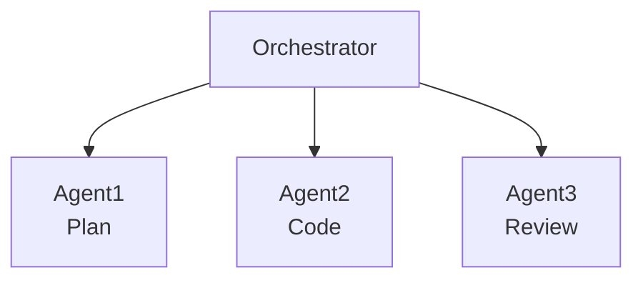
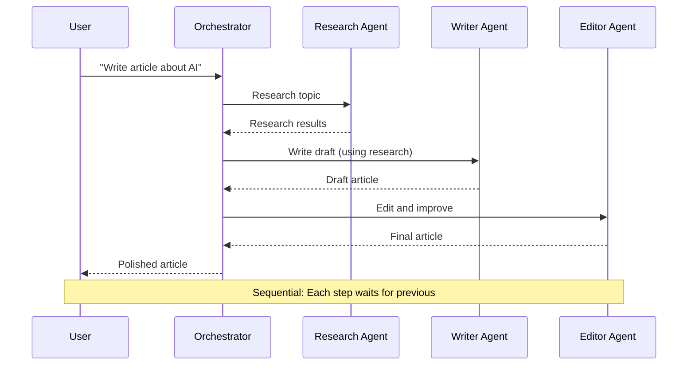
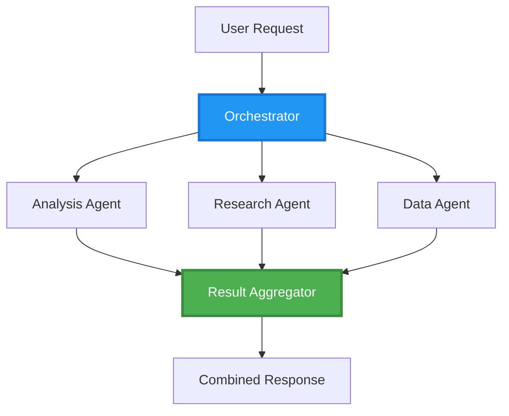
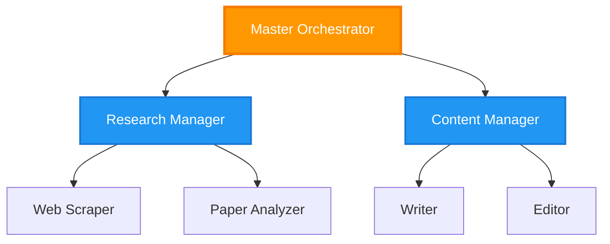
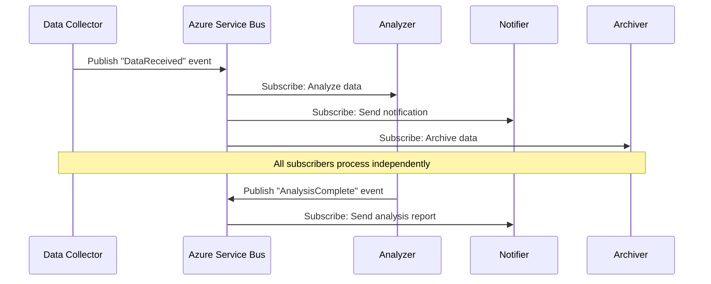
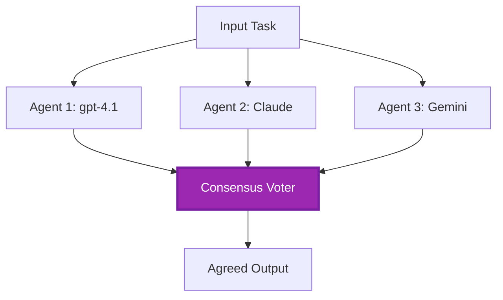
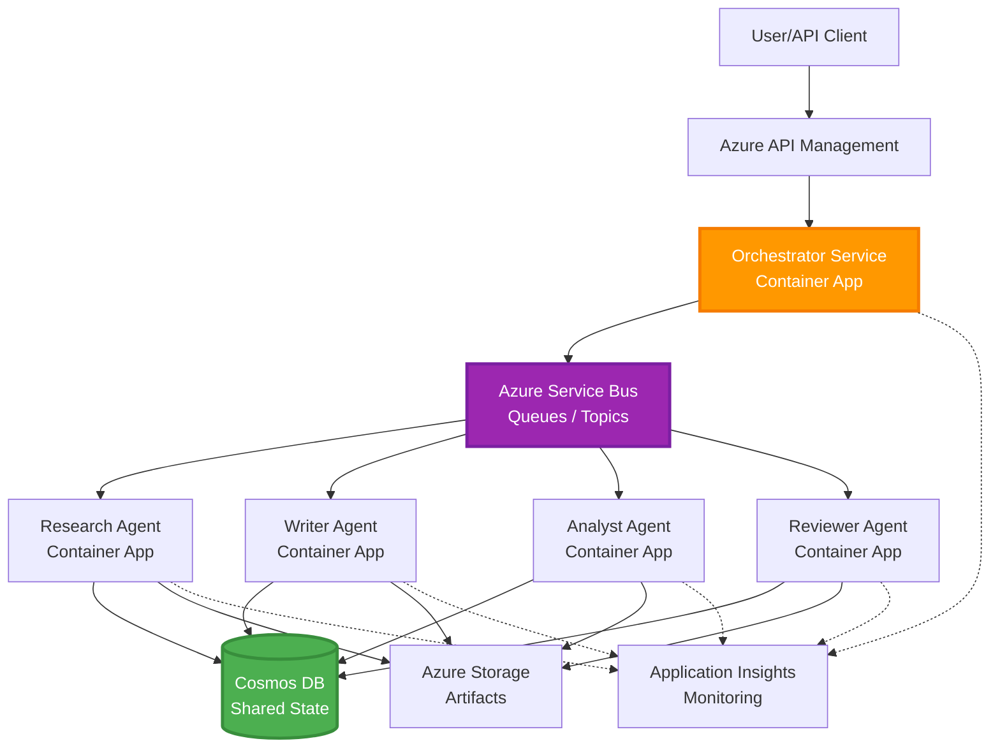

# Mitmeagendi koordineerimise mustrid

⏱️ **Hinnanguline aeg**: 60-75 minutit lugemist; mitmed tunnid implementeerimiseks | 💰 **Hinnanguline maksumus**: töökoormusest sõltuv | ⭐ **Kompleksus**: Edasijõudnu

**📚 Õppeteekond:**
- ← Eelmine: [Võimsuse planeerimine](capacity-planning.md) - Ressursside suuruse määramine ja skaleerimisstrateegiad
- 🎯 **Sa oled siin**: Mitmeagendi koordineerimise mustrid (orchestratsioon, kommunikatsioon, oleku haldamine)
- → Järgmine: [SKU valik](sku-selection.md) - Õigete Azure teenuste valimine
- 🏠 [Kursuse avaleht](../../README.md)

---

## Mida sa õpid

Selle õppetunni läbimisel sa:
- Mõistad **mitmeagendi arhitektuuri** mustreid ja millal neid kasutada
- Rakendad **orchestratsiooni mustreid** (tsentraliseeritud, detsentraliseeritud, hierarhiline)
- Kujundad **agendi kommunikatsiooni** strateegiaid (sünhoorne, asünkroonne, sündmuspõhine)
- Halda **jagatud olekut** hajutatud agentide vahel
- Paigaldad **mitmeagendi süsteeme** Azure'is AZD abil
- Rakendad **koordineerimise mustreid** reaalse maailma tehisintellekti stsenaariumitele
- Jälgid ja silud hajutatud agentide süsteeme

## Miks mitmeagendi koordineerimine on oluline

### Areng: Ühe agendi süsteemist mitmeagendi süsteemini

**Üks agent (lihtne):**
```
User → Agent → Response
```
- ✅ Lihtne mõista ja rakendada
- ✅ Kiire lihtsate ülesannete puhul
- ❌ Piiratud ühe mudeli võimekusega
- ❌ Ei saa keerukaid ülesandeid paralleelselt töödelda
- ❌ Pole spetsialiseerumist

**Mitmeagendi süsteem (edasijõudnu):**

- ✅ Spetsialiseerunud agendid konkreetseteks ülesanneteks
- ✅ Kiireks tööks paralleeltöötlus
- ✅ Modulaarne ja hooldatav
- ✅ Parem keeruliste töökäikude haldamisel
- ⚠️ Vajab koordineerimisloogikat

**Analüogia**: Üks agent on nagu üks inimene, kes teeb kõik ülesanded. Mitmeagendi süsteem on nagu meeskond, kus iga liige on spetsiifiliste oskustega (uurija, programmeerija, arvustaja, kirjutaja), kes töötavad koos.

---

## Põhilised koordineerimise mustrid

### Muster 1: Järjekindel koordineerimine (Vastutusahela muster)

**Millal kasutada**: Ülesanded peavad toimuma kindlas järjekorras, iga agent ehitab eelmise väljundi peale.



**Eelised:**
- ✅ Selge andmevoog
- ✅ Lihtne siluda
- ✅ Ennustatav täitmise järjekord

**Piirangud:**
- ❌ Aeglasem (puudub paralleeltöötlus)
- ❌ Üks ebaõnnestumine peatab kogu ahela
- ❌ Ei suuda hallata omavahel sõltuvaid ülesandeid

**Näited:**
- Sisu loomise torujuhe (uurimine → kirjutamine → redigeerimine → avaldamine)
- Koodi genereerimine (planeerimine → rakendamine → testimine → juurutamine)
- Aruande koostamine (andmete kogumine → analüüs → visualiseerimine → kokkuvõte)

---

### Muster 2: Paralleelne koordineerimine (Fan-Out/Fan-In)

**Millal kasutada**: Sõltumatud ülesanded võivad töötada samaaegselt, tulemused koondatakse lõpus.



**Eelised:**
- ✅ Kiire (paralleeltöötlus)
- ✅ Taldlik vigade suhtes (osalised tulemused on aktsepteeritavad)
- ✅ Horisontaalselt skaleeritav

**Piirangud:**
- ⚠️ Tulemused võivad saabuda vales järjekorras
- ⚠️ Vajab agregatsiooni loogikat
- ⚠️ Keeruline oleku haldamine

**Näited:**
- Mitmeallikatest andmete kogumine (API-d + andmebaasid + veebikraapimine)
- Konkurentsianalüüs (mitmed mudelid genereerivad lahendusi, valitakse parim)
- Tõlketeenused (tõlkimine mitmesse keelde samaaegselt)

---

### Muster 3: Hierarhiline koordineerimine (Juhataja-Tööline)

**Millal kasutada**: Keerukad töövood alamülesannetega, vajalik delegatsioon.



**Eelised:**
- ✅ Haldab keerukaid töövooge
- ✅ Modulaarne ja hooldatav
- ✅ Selged vastutuspiirid

**Piirangud:**
- ⚠️ Keerulisem arhitektuur
- ⚠️ Suurem latentsus (mitmed koordineerimiskihid)
- ⚠️ Vajab keerukat orchestratsiooni

**Näited:**
- Ettevõtte dokumenditöötlus (klasifitseeri → suuna → töötle → arhiveeri)
- Mitmeetapilised andmetorud (sissevõtt → puhastus → teisendus → analüüs → aruanne)
- Keerukad automatiseerimise töövood (planeerimine → ressursside jagamine → täitmine → jälgimine)

---

### Muster 4: Sündmuspõhine koordineerimine (Avalda-Telli)

**Millal kasutada**: Agendid peavad reageerima sündmustele, soovitud on lahtine ühendus.



**Eelised:**
- ✅ Lahtine ühendus agentide vahel
- ✅ Lihtne lisada uusi agente (lihtsalt telli)
- ✅ Asünkroonne töötlemine
- ✅ Vastupidav (sõnumi püsivus)

**Piirangud:**
- ⚠️ Lõplik järjepidevus
- ⚠️ Keeruline silumine
- ⚠️ Sõnumite tellimise väljakutsed

**Näited:**
- Reaalajas jälgimissüsteemid (häired, armatuurlaud, logid)
- Mitmekanalilised teavitused (e-post, SMS, push, Slack)
- Andmetöötluskoridorid (mitmed samade andmete tarbijad)

---

### Muster 5: Konsensusel põhinev koordineerimine (Häälte / Kvoorum)

**Millal kasutada**: Vajalik mitme agendi nõusolek enne jätkamist.



**Eelised:**
- ✅ Suurem täpsus (mitmed arvamused)
- ✅ Taldlik vigade suhtes (väiksemad vigaded aktsepteeritavad)
- ✅ Kvaliteedi kontroll kaasas

**Piirangud:**
- ❌ Kulukas (mitmed mudelikutsed)
- ❌ Aeglasem (ootab kõiki agente)
- ⚠️ Vajab konfliktide lahendamist

**Näited:**
- Sisu modereerimine (mitmed mudelid hindavad sisu)
- Koodi ülevaatus (mitmed linters/analüsaatorid)
- Meditsiiniline diagnoos (mitmed tehisintellekti mudelid, ekspertide valideerimine)

---

## Arhitektuuri ülevaade

### Täielik mitmeagendi süsteem Azure'is



**Põhikompendid:**

| Komponent | Eesmärk | Azure teenus |
|-----------|---------|---------------|
| **API värav** | Sisenemispunkt, sageduse piiramine, autentimine | API Management |
| **Orchestrator** | Agentide töövoogude koordineerimine | Container Apps |
| **Sõnumite järjekord** | Asünkroonne kommunikatsioon | Service Bus / Event Hubs |
| **Agendid** | Spetsialiseerunud tehisintellekti töötajad | Container Apps / Functions |
| **Oleku hoidla** | Jagatud olek, ülesannete jälgimine | Cosmos DB |
| **Artefaktide hoidla** | Dokumendid, tulemused, logid | Blob Storage |
| **Jälgimine** | Hajutatud jälgimine, logid | Application Insights |

Service Busi järjekorrad/teemad ja Event Hubs on erinevad teenused erinevate edastuse/ tarbimise mudelitega; Event Hubs ei ole otse asendatav Service Busi töötajakoodiga allpool. Paralleelsus, püsivad sõnumid ja mudelite hääletus ei taga iseenesest vigadetaluvust ega suuremat täpsust.

---

## Eeltingimused

### Nõutavad tööriistad

```bash
# Verify Azure Developer CLI
azd version
# Command reference baseline: azd 1.37.2

# Verify Azure CLI
az --version
# ✅ Expected: azure-cli 2.50.0 or higher

# Verify Docker (for local testing)
docker --version
# ✅ Expected: Docker version 20.10 or higher
```

### Azure nõuded

- Aktiivne Azure tellimus
- Luba luua:
  - Container Apps
  - Service Busi nimed
  - Cosmos DB kontod
  - Salvestuskontod
  - Application Insights

### Teadmiste eeltingimused

Tuleks olla läbitud:
- [Konfiguratsiooni haldus](../chapter-03-configuration/configuration.md)
- [Autentimine ja turvalisus](../chapter-03-configuration/authsecurity.md)
- [Mikroteenuste näide](../../../../examples/microservices)

---

## Teostusjuhend

> **Disaini fragmendid, mitte juurutatav labor:** Projektistruktuur ja allpool olevad `File:` sildid kirjeldavad faile, mida luua oma projektis; see hoidla ei sisalda täielikku `multi-agent-system` rakendust. Puuduvad osad on peamallid/parameetrite mallid, Container Apps keskkond/registreerimine, Dockerfilid ja sõltuvuste lukustused, Cosmos andmebaasi/konteineri seadistused, mudelite juurutamine, identiteedi/rolli konfiguratsioon, skaleerimisreeglid ja paralleelsed töötajad/ järjekorrad. Ärge oodake, et `azd init` genereerib neid faile või `azd up` juurutab näited muutmatult. Käivitatava lähtepunkti jaoks lõpetage [Mitme agendi põhialused](../chapter-05-multi-agent/multi-agent-basics.md).

**Jooksutuse eeldused:** Python 3.10+, `azure-servicebus`, `azure-cosmos`, `openai`, Flask ja (jälgimiseks) `azure-monitor-opentelemetry`; pange `shared` Python'i importimise teele igas teenuse pildis. Cosmos `agent-state/tasks` konteiner peab juba olemas olema koos partitsiooni võtmega `/id`. Võtme-põhised ühendused lihtsustavad neid fragmente, mitte tootmises juhendamiseks: eelistage hallatud identiteete, millel on määratud Service Bus/Cosmos/OpenAI andmetasandi rollid. Ärge avaldage võtmisi väljundites ega logides.

Service Busi kohaletoimetamine on **vähemalt üks kord**. Säilitage idempotentsus iga ülesande **ja sammu** kohta, kasutage optimistlikku samaaegsust (ETag'id) oleku lugemiseks/muutmiseks/kirjutamiseks ja uuendage sõnumi lukke pikaajalise töötlemise jooksul. Allpool olev lihtne olekujuht on vaid järjestikune ega rakenda neid tootmise garantiisid.

### Projekti struktuur

```
multi-agent-system/
├── azure.yaml                    # AZD configuration
├── infra/
│   ├── main.bicep               # Main infrastructure
│   ├── core/
│   │   ├── servicebus.bicep     # Message queue
│   │   ├── cosmos.bicep         # State store
│   │   ├── storage.bicep        # Artifact storage
│   │   └── monitoring.bicep     # Application Insights
│   └── app/
│       ├── orchestrator.bicep   # Orchestrator service
│       └── agent.bicep          # Agent template
└── src/
    ├── orchestrator/            # Orchestration logic
    │   ├── app.py
    │   ├── workflows.py
    │   └── Dockerfile
    ├── agents/
    │   ├── research/            # Research agent
    │   ├── writer/              # Writer agent
    │   ├── analyst/             # Analyst agent
    │   └── reviewer/            # Reviewer agent
    └── shared/
        ├── state_manager.py     # Shared state logic
        └── message_handler.py   # Message handling
```

---

## Õppetund 1: Järjestikuse koordineerimise muster

### Teostus: Sisu loomise torujuhe

Kujundame järjestikulise torujuhtme: Uurimine → Kirjutamine → Redigeerimine. Avaldamine jääb selle näite väljapoole.

### 1. AZD konfiguratsioon

**Fail: `azure.yaml`**

```yaml
name: content-pipeline
metadata:
  template: multi-agent-sequential@1.0.0

services:
  orchestrator:
    project: ./src/orchestrator
    language: python
    host: containerapp
  
  research-agent:
    project: ./src/agents/research
    language: python
    host: containerapp
  
  writer-agent:
    project: ./src/agents/writer
    language: python
    host: containerapp
  
  editor-agent:
    project: ./src/agents/editor
    language: python
    host: containerapp
```

### 2. Taristu: Service Bus koordineerimiseks

**Fail: `infra/core/servicebus.bicep`**

```bicep
param name string
param location string
param tags object = {}

resource serviceBusNamespace 'Microsoft.ServiceBus/namespaces@2022-10-01-preview' = {
  name: name
  location: location
  tags: tags
  sku: {
    name: 'Standard'
    tier: 'Standard'
  }
  properties: {
    minimumTlsVersion: '1.2'
  }
}

// Queue for orchestrator → research agent
resource researchQueue 'Microsoft.ServiceBus/namespaces/queues@2022-10-01-preview' = {
  parent: serviceBusNamespace
  name: 'research-tasks'
  properties: {
    maxDeliveryCount: 3
    lockDuration: 'PT5M'
    deadLetteringOnMessageExpiration: true
  }
}

// Queue for research agent → writer agent
resource writerQueue 'Microsoft.ServiceBus/namespaces/queues@2022-10-01-preview' = {
  parent: serviceBusNamespace
  name: 'writer-tasks'
  properties: {
    maxDeliveryCount: 3
    lockDuration: 'PT5M'
  }
}

// Queue for writer agent → editor agent
resource editorQueue 'Microsoft.ServiceBus/namespaces/queues@2022-10-01-preview' = {
  parent: serviceBusNamespace
  name: 'editor-tasks'
  properties: {
    maxDeliveryCount: 3
    lockDuration: 'PT5M'
  }
}

output namespace string = serviceBusNamespace.name
// Do not output RootManageSharedAccessKey. Resolve scoped credentials
// securely or use managed identity in the application and scale rules.
```

### 3. Jagatud oleku haldur

**Fail: `src/shared/state_manager.py`**

```python
from azure.cosmos import CosmosClient, PartitionKey
from datetime import datetime, timezone
import os

class StateManager:
    """Manages shared state across agents using Cosmos DB"""
    
    def __init__(self):
        endpoint = os.environ['COSMOS_ENDPOINT']
        key = os.environ['COSMOS_KEY']
        
        self.client = CosmosClient(endpoint, key)
        self.database = self.client.get_database_client('agent-state')
        self.container = self.database.get_container_client('tasks')
    
    def create_task(self, task_id: str, task_type: str, input_data: dict):
        """Create a new task"""
        task = {
            'id': task_id,
            'type': task_type,
            'status': 'pending',
            'input': input_data,
            'created_at': datetime.now(timezone.utc).isoformat(),
            'steps': []
        }
        self.container.create_item(task)
        return task
    
    def update_task_step(self, task_id: str, step_name: str, result: dict):
        """Update task with completed step"""
        task = self.container.read_item(task_id, partition_key=task_id)
        
        task['steps'].append({
            'name': step_name,
            'completed_at': datetime.now(timezone.utc).isoformat(),
            'result': result
        })
        
        self.container.replace_item(task_id, task)
        return task
    
    def complete_task(self, task_id: str, final_result: dict):
        """Mark task as complete"""
        task = self.container.read_item(task_id, partition_key=task_id)
        task['status'] = 'completed'
        task['result'] = final_result
        task['completed_at'] = datetime.now(timezone.utc).isoformat()
        self.container.replace_item(task_id, task)
        return task
    
    def get_task(self, task_id: str):
        """Retrieve task state"""
        return self.container.read_item(task_id, partition_key=task_id)
```

### 4. Orchestratori teenus

**Fail: `src/orchestrator/app.py`**

```python
from flask import Flask, request, jsonify
from azure.servicebus import ServiceBusClient, ServiceBusMessage
import json
import uuid
import os
from shared.state_manager import StateManager

app = Flask(__name__)
state_manager = StateManager()

# Service Bus connection
servicebus_connection_str = os.environ['SERVICEBUS_CONNECTION_STRING']
servicebus_client = ServiceBusClient.from_connection_string(servicebus_connection_str)

@app.route('/health', methods=['GET'])
def health():
    return jsonify({'status': 'healthy', 'service': 'orchestrator'})

@app.route('/create-content', methods=['POST'])
def create_content():
    """
    Sequential workflow: Research → Write → Edit (returns a draft; no publishing)
    """
    data = request.get_json(silent=True) or {}
    topic = data.get('topic')
    
    if not topic:
        return jsonify({'error': 'Topic required'}), 400
    
    # Create task in state store
    task_id = str(uuid.uuid4())
    task = state_manager.create_task(
        task_id=task_id,
        task_type='content_creation',
        input_data={'topic': topic}
    )
    
    # Send message to research agent (first step)
    sender = servicebus_client.get_queue_sender('research-tasks')
    message = ServiceBusMessage(
        body=json.dumps({
            'task_id': task_id,
            'topic': topic,
            'next_queue': 'writer-tasks'  # Where to send results
        }),
        content_type='application/json'
    )
    
    with sender:
        sender.send_messages(message)
    
    return jsonify({
        'task_id': task_id,
        'status': 'started',
        'workflow': 'sequential',
        'steps': ['research', 'write', 'edit'],
        'message': 'Content creation pipeline initiated'
    }), 202

@app.route('/task/<task_id>', methods=['GET'])
def get_task_status(task_id):
    """Check task status"""
    try:
        task = state_manager.get_task(task_id)
        return jsonify(task)
    except Exception as e:
        return jsonify({'error': str(e)}), 404

if __name__ == '__main__':
    app.run(host='0.0.0.0', port=8080)
```

### 5. Uurimise agent

**Fail: `src/agents/research/app.py`**

```python
from azure.servicebus import ServiceBusClient, ServiceBusMessage
from openai import AzureOpenAI
import json
import os
import time
from shared.state_manager import StateManager

# Initialize clients
state_manager = StateManager()
servicebus_client = ServiceBusClient.from_connection_string(
    os.environ['SERVICEBUS_CONNECTION_STRING']
)

openai_client = AzureOpenAI(
    api_key=os.environ['AZURE_OPENAI_API_KEY'],
    api_version="2024-10-21",
    azure_endpoint=os.environ['AZURE_OPENAI_ENDPOINT']
)

def process_research_task(message_data):
    """Process research request and pass to writer"""
    task_id = message_data['task_id']
    topic = message_data['topic']
    next_queue = message_data['next_queue']
    
    print(f"🔬 Researching: {topic}")
    
    # Call Microsoft Foundry Models for research
    response = openai_client.chat.completions.create(
        model=os.environ['AZURE_OPENAI_DEPLOYMENT'],
        messages=[
            {"role": "system", "content": "You are a research assistant. Provide comprehensive research on the given topic."},
            {"role": "user", "content": f"Research this topic thoroughly: {topic}"}
        ],
        max_tokens=1500
    )
    
    research_results = response.choices[0].message.content
    
    # Update state
    state_manager.update_task_step(
        task_id=task_id,
        step_name='research',
        result={'research': research_results}
    )
    
    # Send to next agent (writer)
    sender = servicebus_client.get_queue_sender(next_queue)
    message = ServiceBusMessage(
        body=json.dumps({
            'task_id': task_id,
            'topic': topic,
            'research': research_results,
            'next_queue': 'editor-tasks'
        }),
        content_type='application/json'
    )
    
    with sender:
        sender.send_messages(message)
    
    print(f"✅ Research complete for task {task_id}")

def main():
    """Listen to research queue"""
    receiver = servicebus_client.get_queue_receiver('research-tasks')
    
    print("🔬 Research Agent started, listening for tasks...")
    
    with receiver:
        while True:
            messages = receiver.receive_messages(max_wait_time=5)
            for message in messages:
                try:
                    message_data = json.loads(str(message))
                    process_research_task(message_data)
                    receiver.complete_message(message)
                except Exception as e:
                    print(f"❌ Error processing message: {e}")
                    receiver.abandon_message(message)

if __name__ == '__main__':
    main()
```

### 6. Kirjutaja agent

**Fail: `src/agents/writer/app.py`**

```python
from azure.servicebus import ServiceBusClient, ServiceBusMessage
from openai import AzureOpenAI
import json
import os
from shared.state_manager import StateManager

state_manager = StateManager()
servicebus_client = ServiceBusClient.from_connection_string(
    os.environ['SERVICEBUS_CONNECTION_STRING']
)

openai_client = AzureOpenAI(
    api_key=os.environ['AZURE_OPENAI_API_KEY'],
    api_version="2024-10-21",
    azure_endpoint=os.environ['AZURE_OPENAI_ENDPOINT']
)

def process_writing_task(message_data):
    """Write article based on research"""
    task_id = message_data['task_id']
    topic = message_data['topic']
    research = message_data['research']
    next_queue = message_data['next_queue']
    
    print(f"✍️ Writing article: {topic}")
    
    # Call Microsoft Foundry Models to write article
    response = openai_client.chat.completions.create(
        model=os.environ['AZURE_OPENAI_DEPLOYMENT'],
        messages=[
            {"role": "system", "content": "You are a professional writer. Write engaging, well-structured articles."},
            {"role": "user", "content": f"Based on this research:\n\n{research}\n\nWrite a comprehensive article about: {topic}"}
        ],
        max_tokens=2000
    )
    
    article_draft = response.choices[0].message.content
    
    # Update state
    state_manager.update_task_step(
        task_id=task_id,
        step_name='writing',
        result={'draft': article_draft}
    )
    
    # Send to editor
    sender = servicebus_client.get_queue_sender(next_queue)
    message = ServiceBusMessage(
        body=json.dumps({
            'task_id': task_id,
            'topic': topic,
            'draft': article_draft
        }),
        content_type='application/json'
    )
    
    with sender:
        sender.send_messages(message)
    
    print(f"✅ Article draft complete for task {task_id}")

def main():
    """Listen to writer queue"""
    receiver = servicebus_client.get_queue_receiver('writer-tasks')
    
    print("✍️ Writer Agent started, listening for tasks...")
    
    with receiver:
        while True:
            messages = receiver.receive_messages(max_wait_time=5)
            for message in messages:
                try:
                    message_data = json.loads(str(message))
                    process_writing_task(message_data)
                    receiver.complete_message(message)
                except Exception as e:
                    print(f"❌ Error: {e}")
                    receiver.abandon_message(message)

if __name__ == '__main__':
    main()
```

### 7. Redaktori agent

**Fail: `src/agents/editor/app.py`**

```python
from azure.servicebus import ServiceBusClient
from openai import AzureOpenAI
import json
import os
from shared.state_manager import StateManager

state_manager = StateManager()
servicebus_client = ServiceBusClient.from_connection_string(
    os.environ['SERVICEBUS_CONNECTION_STRING']
)

openai_client = AzureOpenAI(
    api_key=os.environ['AZURE_OPENAI_API_KEY'],
    api_version="2024-10-21",
    azure_endpoint=os.environ['AZURE_OPENAI_ENDPOINT']
)

def process_editing_task(message_data):
    """Edit and finalize article"""
    task_id = message_data['task_id']
    topic = message_data['topic']
    draft = message_data['draft']
    
    print(f"📝 Editing article: {topic}")
    
    # Call Microsoft Foundry Models to edit
    response = openai_client.chat.completions.create(
        model=os.environ['AZURE_OPENAI_DEPLOYMENT'],
        messages=[
            {"role": "system", "content": "You are an expert editor. Improve grammar, clarity, and structure."},
            {"role": "user", "content": f"Edit and improve this article:\n\n{draft}"}
        ],
        max_tokens=2000
    )
    
    final_article = response.choices[0].message.content
    
    # Mark task as complete
    state_manager.complete_task(
        task_id=task_id,
        final_result={
            'topic': topic,
            'final_article': final_article,
            'word_count': len(final_article.split())
        }
    )
    
    print(f"✅ Article finalized for task {task_id}")

def main():
    """Listen to editor queue"""
    receiver = servicebus_client.get_queue_receiver('editor-tasks')
    
    print("📝 Editor Agent started, listening for tasks...")
    
    with receiver:
        while True:
            messages = receiver.receive_messages(max_wait_time=5)
            for message in messages:
                try:
                    message_data = json.loads(str(message))
                    process_editing_task(message_data)
                    receiver.complete_message(message)
                except Exception as e:
                    print(f"❌ Error: {e}")
                    receiver.abandon_message(message)

if __name__ == '__main__':
    main()
```

### 8. Paigalda ja testi

Need käsud kehtivad **ainult pärast seda, kui olete lisanud puuduvaid projektifaile**. Interaktiivne Foundry agendi initsialiseerimine on eraldi töövoog; see ei genereeri seda Service Busi disaini.

```bash
# In your completed custom project
azd up

# Alternative in a SEPARATE empty folder (GA bundle workflow requires azd >= 1.37.0)
azd ext install microsoft.foundry
azd ai agent init
azd up
```

> Vaata [AZD AI CLI käsud](../chapter-08-production/production-ai-practices.md#azd-ai-cli-commands-and-extensions) kõigi `azd ai` lipu ja valikute kohta.

```bash
# Get orchestrator URL
ORCHESTRATOR_URL=$(azd env get-values | grep ORCHESTRATOR_URL | cut -d '=' -f2 | tr -d '"')

# Create content
curl -X POST $ORCHESTRATOR_URL/create-content \
  -H "Content-Type: application/json" \
  -d '{"topic": "The Future of AI in Healthcare"}'
```

**✅ Oodatav väljund:**
```json
{
  "task_id": "a1b2c3d4-e5f6-7890-abcd-ef1234567890",
  "status": "started",
  "workflow": "sequential",
  "steps": ["research", "write", "edit"],
  "message": "Content creation pipeline initiated"
}
```

**Kontrolli ülesande edenemist:**
```bash
TASK_ID="a1b2c3d4-e5f6-7890-abcd-ef1234567890"
curl $ORCHESTRATOR_URL/task/$TASK_ID
```

**✅ Oodatav väljund (valmis):**
```json
{
  "id": "a1b2c3d4-e5f6-7890-abcd-ef1234567890",
  "type": "content_creation",
  "status": "completed",
  "steps": [
    {
      "name": "research",
      "completed_at": "2025-11-19T10:30:00Z",
      "result": {"research": "..."}
    },
    {
      "name": "writing",
      "completed_at": "2025-11-19T10:32:00Z",
      "result": {"draft": "..."}
    }
  ],
  "result": {
    "topic": "The Future of AI in Healthcare",
    "final_article": "...",
    "word_count": 1500
  }
}
```

---

## Õppetund 2: Paralleelse koordineerimise muster

### Teostus: Mitmeallikas uurimise kogujak

Loome paralleelse süsteemi, mis kogub informatsiooni samaaegselt mitmest allikast.

### Paralleelne orchestrator

**Fail: `src/orchestrator/parallel_workflow.py`**

```python
from flask import Flask, request, jsonify
from azure.servicebus import ServiceBusClient, ServiceBusMessage
import json
import uuid
import os
from shared.state_manager import StateManager

app = Flask(__name__)
state_manager = StateManager()

servicebus_client = ServiceBusClient.from_connection_string(
    os.environ['SERVICEBUS_CONNECTION_STRING']
)

@app.route('/research-parallel', methods=['POST'])
def research_parallel():
    """
    Parallel workflow: Multiple agents work simultaneously
    """
    data = request.json
    query = data.get('query')
    
    task_id = str(uuid.uuid4())
    task = state_manager.create_task(
        task_id=task_id,
        task_type='parallel_research',
        input_data={
            'query': query,
            'agents': ['web', 'academic', 'news', 'social']
        }
    )
    
    # Fan-out: publish sequentially; workers may process concurrently.
    agents = [
        ('web-research-queue', 'web'),
        ('academic-research-queue', 'academic'),
        ('news-research-queue', 'news'),
        ('social-research-queue', 'social')
    ]
    
    for queue_name, agent_type in agents:
        sender = servicebus_client.get_queue_sender(queue_name)
        message = ServiceBusMessage(
            body=json.dumps({
                'task_id': task_id,
                'query': query,
                'agent_type': agent_type,
                'result_queue': 'aggregation-queue'
            }),
            content_type='application/json'
        )
        
        with sender:
            sender.send_messages(message)
    
    return jsonify({
        'task_id': task_id,
        'status': 'started',
        'workflow': 'parallel',
        'agents_dispatched': 4,
        'message': 'Parallel research initiated'
    }), 202

if __name__ == '__main__':
    app.run(host='0.0.0.0', port=8080)
```

### Agregatsiooni loogika

**Fail: `src/agents/aggregator/app.py`**

```python
from azure.servicebus import ServiceBusClient
import json
import os
from collections import defaultdict
from shared.state_manager import StateManager

state_manager = StateManager()
servicebus_client = ServiceBusClient.from_connection_string(
    os.environ['SERVICEBUS_CONNECTION_STRING']
)

# Single-process demo only: not durable or shared across replicas.
# Production: use durable unique (task_id, agent_type) result records.
task_results = defaultdict(dict)
expected_agents = 4  # web, academic, news, social

def process_result(message_data):
    """Aggregate results from parallel agents"""
    task_id = message_data['task_id']
    agent_type = message_data['agent_type']
    result = message_data['result']
    
    # Store result
    task_results[task_id][agent_type] = {
        'agent': agent_type,
        'data': result
    }
    
    print(f"📊 Received result from {agent_type} agent ({len(task_results[task_id])}/{expected_agents})")
    
    # Check if all agents completed (fan-in)
    if len(task_results[task_id]) == expected_agents:
        print(f"✅ All agents completed for task {task_id}. Aggregating...")
        
        # Combine results
        aggregated = {
            'query': message_data['query'],
            'sources': list(task_results[task_id].values()),
            'summary': generate_summary(list(task_results[task_id].values()))
        }
        
        # Mark complete
        state_manager.complete_task(task_id, aggregated)
        
        # Clean up
        del task_results[task_id]
        
        print(f"✅ Aggregation complete for task {task_id}")

def generate_summary(results):
    """Generate summary from all sources"""
    summaries = [r['data'].get('summary', '') for r in results]
    return '\n\n'.join(summaries)

def main():
    """Listen to aggregation queue"""
    receiver = servicebus_client.get_queue_receiver('aggregation-queue')
    
    print("📊 Aggregator started, listening for results...")
    
    with receiver:
        while True:
            messages = receiver.receive_messages(max_wait_time=5)
            for message in messages:
                try:
                    message_data = json.loads(str(message))
                    process_result(message_data)
                    receiver.complete_message(message)
                except Exception as e:
                    print(f"❌ Error: {e}")
                    receiver.abandon_message(message)

if __name__ == '__main__':
    main()
```

**Paralleelse mustri eelised:**
- ⚡ **Võib-olla madalam latentsus** (piiratud kõige aeglasema töötaja ja koordineerimise overhead'iga)
- 🔄 **Toetab osalisi tulemusi** selgete tähtaegade ja vigade poliitikaga (algne kogujaga pole rakendatud)
- 📈 **Skaleeritav** (lihtne lisada rohkem agente)

---

## Praktilised harjutused

### Harjutus 1: Lisa ajalõpu käsitlemine ⭐⭐ (Keskmine)

**Eesmärk**: Rakendada ajalõpu loogika, et kogujak ei ootaks aeglasi agente lõputult.

**Alguspunkt:** Käivita see lokaalne tähtaega simuleeriv test enne, kui integreerid selle järjekorra töötajasse. Ajalõpp, mis kontrollitakse vaid kui tuleb uus sõnum, ei käivituks kunagi, kui puuduv töötaja pole midagi saatnud.

**Sammud**:

1. **Lisa ajalõpu jälgimine kogujale:**

```python
import asyncio

async def simulated_agent(name, delay):
    await asyncio.sleep(delay)
    return {'agent': name, 'result': 'done'}

async def main():
    tasks = [asyncio.create_task(simulated_agent(name, delay))
             for name, delay in [('web', 0.1), ('academic', 0.2),
                                 ('news', 0.3), ('social', 3)]]
    done, pending = await asyncio.wait(tasks, timeout=1)
    results = [task.result() for task in done]
    for task in pending:
        task.cancel()
    await asyncio.gather(*pending, return_exceptions=True)
    print({'completed_agents': len(results), 'timed_out': bool(pending)})
    assert len(results) == 3 and pending

asyncio.run(main())
```

2. **Oodatav väljund:**

```text
{'completed_agents': 3, 'timed_out': True}
```

3. **Järjekorra-süsteemi integratsioon (disainitöö):** Säilita ülesande loomisel saatmise tähtaeg ja oodatavad agendid, käita perioodilist tähtaegade puhastust sõltumatult saabuvatest tulemustest, lõpeta osalised tulemused atomaarsete toimingutena ja ignoreeri hilinenud/duplikaatsõnumeid lõpetatud ülesannete jaoks. Kohalik ajalõpp ei tühista kaugtöötajaid.

Ainult sinu implementeeritud projekti jaoks:

```bash
azd deploy aggregator

# Submit task
curl -X POST $ORCHESTRATOR_URL/research-parallel \
  -H "Content-Type: application/json" \
  -d '{"query": "AI safety research"}'

# Check results after 30 seconds
curl $ORCHESTRATOR_URL/task/$TASK_ID
```

**✅ Edu kriteeriumid:**
- ✅ Kohalik test tagastab pärast ühesekundilist tähtaega ka siis, kui agent pole lõpetanud
- ✅ Vastus näitab osalisi tulemusi (`"timed_out": true`)
- ✅ Tagastatakse saadaval olevad tulemused (3 neljast agentist)

**Aeg**: 20-25 minutit

---

### Harjutus 2: Rakenda taasilmumise loogika ⭐⭐⭐ (Edasijõudnu)

**Eesmärk**: Tuleta automaatselt ebaõnnestunud agentide ülesanded uuesti enne loobumist.

**Sammud**:

1. **Kasuta Service Busi edastusarve, mitte kohandatud taasilmumise loendurite sammumist:**

```python
import json
import time
# Integration fragment: use a live peek-lock ServiceBusReceiver.
# Set queue maxDeliveryCount to 4 for one attempt + up to three retries.
```

2. **Lisa taasilmumiskäsitleja agentidele:**

```python
def process_with_retry(message, receiver, process_func):
    """Process message with automatic retry on failure"""
    try:
        message_data = json.loads(str(message))
        
        # Process the message
        process_func(message_data)
        
        # Success - complete
        receiver.complete_message(message)
        
    except Exception as e:
        if message.delivery_count < 4:
            # Bounded exponential delay: 5s, 10s, 20s.
            # Renew the lock if processing + waiting can exceed its duration.
            time.sleep(5 * 2 ** (message.delivery_count - 1))
            receiver.abandon_message(message)
        else:
            # Max retries exceeded - move to dead letter queue
            print(f"❌ Max attempts exceeded for message {message.message_id}")
            receiver.dead_letter_message(
                message,
                reason="MaxRetriesExceeded",
                error_description=str(e)
            )
```

3. **Jälgi dead letter järjekorda:**

```python
def monitor_dead_letters():
    """Check dead letter queue for failed messages"""
    receiver = servicebus_client.get_queue_receiver(
        'research-tasks',
        sub_queue='deadletter'
    )
    
    with receiver:
        messages = receiver.receive_messages(max_wait_time=5)
        for message in messages:
            print(f"☠️ Dead letter: {message.message_id}")
            print(f"Reason: {message.dead_letter_reason}")
            print(f"Description: {message.dead_letter_error_description}")
```

**✅ Edu kriteeriumid:**
- ✅ Ebaõnnestunud ülesanded taotlevad automaatselt uuesti (kuni kolm katset)
- ✅ Eksponentsiaalne tagasilöök taasilmumiste vahel (5s, 10s, 20s) koos sõnumi lukustuse uuendusega vajadusel
- ✅ Maksimaalse katse järel lähevad sõnumid dead letter järjekorda
- ✅ Dead letter sõnumeid saab uurida; taasesitus vajab eraldi idempotentset taastetöövoogu

**Aeg**: 30-40 minutit

---

### Harjutus 3: Rakenda katkestuskaitsja (Circuit Breaker) ⭐⭐⭐ (Edasijõudnu)

**Eesmärk**: Takistada tehtesüstivate vigade levikut, peatades päringud vigastele agentidele.

**Sammud**:

1. **Loo katkestuskaitsja klass:**

```python
from enum import Enum
from datetime import datetime, timedelta, timezone

class CircuitState(Enum):
    CLOSED = "closed"      # Normal operation
    OPEN = "open"          # Failing, reject requests
    HALF_OPEN = "half_open"  # Testing if recovered

class CircuitBreaker:
    def __init__(self, failure_threshold=5, timeout_seconds=60):
        self.failure_threshold = failure_threshold
        self.timeout_seconds = timeout_seconds
        self.failure_count = 0
        self.last_failure_time = None
        self.state = CircuitState.CLOSED
    
    def call(self, func):
        """Execute function with circuit breaker protection"""
        if self.state == CircuitState.OPEN:
            # Check if timeout expired
            if datetime.now(timezone.utc) - self.last_failure_time > timedelta(seconds=self.timeout_seconds):
                self.state = CircuitState.HALF_OPEN
                print("🔄 Circuit breaker: HALF_OPEN (testing)")
            else:
                raise Exception(f"Circuit breaker OPEN for agent. Try again in {self.timeout_seconds}s")
        
        try:
            result = func()
            
            # Success
            self.failure_count = 0 # Count consecutive failures only
            if self.state == CircuitState.HALF_OPEN:
                self.state = CircuitState.CLOSED
                self.failure_count = 0
                print("✅ Circuit breaker: CLOSED (recovered)")
            
            return result
            
        except Exception as e:
            self.failure_count += 1
            self.last_failure_time = datetime.now(timezone.utc)
            
            if self.failure_count >= self.failure_threshold:
                self.state = CircuitState.OPEN
                print(f"🔴 Circuit breaker: OPEN (too many failures)")
            
            raise
```

2. **Kanna see agentidele rakendamisel:**

```python
# In orchestrator
agent_circuits = {
    'web': CircuitBreaker(failure_threshold=5, timeout_seconds=60),
    'academic': CircuitBreaker(failure_threshold=5, timeout_seconds=60),
    'news': CircuitBreaker(failure_threshold=5, timeout_seconds=60),
    'social': CircuitBreaker(failure_threshold=5, timeout_seconds=60)
}

def send_to_agent(agent_type, message_data):
    """Send with circuit breaker protection"""
    circuit = agent_circuits[agent_type]
    
    try:
        circuit.call(lambda: send_message(agent_type, message_data))
    except Exception as e:
        print(f"⚠️ Skipping {agent_type} agent: {e}")
        # Continue with other agents
```

See vooluringkaitse kaitseb **saatsmistoimingut**, mitte kaugagentuuri lõpetamist: sõnumi edukas järjekorda lisamine ei ütle midagi selle kohta, kas agent on aktiivne. `send_message` on teie rakenduse saatmisfunktsioon. Täitmise vooluringide puhul edastage täheldatud ülesandete ebaõnnestumised/aegumised vastupidavasse koordinaatorisse. See mälu põhinev klass on ühe lõime demonstreerimiseks, mitte hajutatud vooluringkaitseks.

3. **Testige vooluringkaitset lokaalselt:**

```python
# Run after the class definition; no Azure changes required.
circuit = CircuitBreaker(failure_threshold=5, timeout_seconds=0)
def fail():
    raise RuntimeError("simulated failure")
for _ in range(5):
    try:
        circuit.call(fail)
    except RuntimeError:
        pass
assert circuit.state == CircuitState.OPEN
assert circuit.call(lambda: "recovered") == "recovered"
assert circuit.state == CircuitState.CLOSED
print("Circuit breaker recovery verified")
```

**✅ Edu kriteeriumid:**
- ✅ Pärast 5 ebaõnnestumist avab vooluring (keeldub päringutest)
- ✅ Pärast 60 sekundit muutub vooluring poolavaks (testib taastumist)
- ✅ Teised agendid jätkavad tavapäraselt tööd
- ✅ Vooluring sulgub automaatselt, kui agent taastub

**Aeg**: 40-50 minutit

---

## Jälgimine ja silumine

### Hajutatud jälgimine Application Insightsiga

**Fail: `src/shared/tracing.py`**

```python
from azure.monitor.opentelemetry import configure_azure_monitor
from opentelemetry import trace
from opentelemetry.trace import SpanKind
import logging
import os

connection_string = os.environ.get('APPLICATIONINSIGHTS_CONNECTION_STRING')

# Configure once per process. Message send/receive trace-context propagation
# and agent attributes on exceptions need explicit instrumentation.
if connection_string:
    configure_azure_monitor(connection_string=connection_string, logger_name=__name__)
tracer = trace.get_tracer(__name__)

# Configure logging
logger = logging.getLogger(__name__)
logger.setLevel(logging.INFO)

def trace_agent_call(agent_name, task_id, operation_name, operation):
    """Trace agent operations"""
    with tracer.start_as_current_span(f'agent.{agent_name}.{operation_name}', kind=SpanKind.CLIENT) as span:
        span.set_attribute('agent', agent_name)
        span.set_attribute('task_id', task_id)
        span.set_attribute('operation', operation_name)
        
        try:
            result = operation()
            span.set_attribute('status', 'success')
            logger.info('Agent operation completed', extra={
                'agent': agent_name, 'task_id': task_id, 'operation': operation_name
            })
            return result
        except Exception as e:
            span.set_attribute('status', 'error')
            logger.exception('Agent operation failed', extra={
                'agent': agent_name, 'task_id': task_id, 'operation': operation_name
            })
            raise
```

### Application Insightsi päringud

**Jälgige mitme agendi töövooge:**

```kusto
// Trace complete workflow for a task
traces
| where customDimensions.task_id == "a1b2c3d4-..."
| project timestamp, message, customDimensions.agent, customDimensions.operation
| order by timestamp asc
```

**Agentide jõudluse võrdlus:**

```kusto
// Compare agent execution times
dependencies
| where name contains "agent"
| summarize 
    avg_duration = avg(duration),
    p95_duration = percentile(duration, 95),
    count = count()
  by agent = tostring(customDimensions.agent)
| order by avg_duration desc
```

**Rikkeanalüüs:**

```kusto
// Find which agents fail most
exceptions
| where customDimensions.agent != ""
| summarize 
    failure_count = count(),
    unique_errors = dcount(outerMessage)
  by agent = tostring(customDimensions.agent)
| order by failure_count desc
```

---

## Kulude analüüs

### Mitme agendi süsteemi kulud (kuised hinnangud)

Illustreerivad planeerimisnumbrid, mitte pakkumised: alljärgnev summa on **240–565 USD kuus**. Kontrollige kehtivaid piirkondlikke hindu, aktiivsete/pausil olevate replikate töötunde, sisendi/väljundi tokenite suhet, salvestust ja telemeetria andmeid. Serveriteta lahendusel puudub eelmääratud läbilaskevõime minimaalne nõue, kuid arvestatakse taotlusi ja salvestust.

| Komponent | Konfiguratsioon | Kulu |
|-----------|--------------|------|
| **Orkestreerija** | 1 konteinerirakendus (1 vCPU, 2GB) | 30–50 USD |
| **4 Agenti** | 4 konteinerirakendust (igaüks 0,5 vCPU, 1GB) | 60–120 USD |
| **Service Bus** | Standardtase, 10M sõnumit | 10–20 USD |
| **Cosmos DB** | Serveriteta, 5GB salvestus, 1M RUs | 25–50 USD |
| **Blob Storage** | 10GB salvestus, 100K toimingut | 5–10 USD |
| **Application Insights** | 5GB andmete sisselase | 10–15 USD |
| **Microsoft Foundry mudelid** | gpt-4.1, 10M tokenit | 100–300 USD |
| **Kokku** | | **240–565 USD kuus** |

### Kulude optimeerimise strateegiad

1. **Kasutage serveriteta lahendusi, kus võimalik:**
   ```bicep
   // Cosmos DB serverless (no minimum cost)
   properties: {
     databaseAccountOfferType: 'Standard'
     capabilities: [{ name: 'EnableServerless' }]
   }
   ```

2. **Skaalake agendid tühikäigul nulli:**
   ```bicep
   scale: {
     minReplicas: 0  // Requires a Service Bus/KEDA scale rule to wake workers
     maxReplicas: 10
   }
   ```

3. **Kasutage Service Bus jaoks partiitöötlust:**
   ```python
   # Send messages in batches (cheaper)
   sender.send_messages([message1, message2, message3])
   ```

4. **Vahemällu salvestage sagedasti kasutatavad tulemused:**
   ```python
   # Use Azure Cache for Redis
   if cache.exists(query_hash):
       return cache.get(query_hash)
   ```

---

## Parimad praktikad

### ✅ TEHKE:

1. **Kasutage idempotentseid toiminguid**
   ```python
   # Pseudocode: implement a durable, atomic per-step deduplication claim.
   def process_task(task_id):
       raise NotImplementedError("Claim (task_id, step) atomically, execute, persist outcome")
   ```

2. **Rakendage ulatuslik logimine**
   ```python
   logger.info(f"Agent: {agent_name}, Task: {task_id}, Action: {action}")
   ```

3. **Kasutage korrelatsiooni ID-sid**
   ```python
   # Pass task_id through entire workflow
   message_data = {
       'task_id': task_id,  # Correlation ID
       'timestamp': datetime.utcnow().isoformat()
   }
   ```

4. **Määrake sõnumitele TTL (eluiga)**
   ```bicep
   properties: {
     defaultMessageTimeToLive: 'PT1H'  // 1 hour max
   }
   ```

5. **Jälgige surnud kirjade järjekordi**
   ```python
   # Regular monitoring of failed messages
   monitor_dead_letters()
   ```

### ❌ ÄRGE:

1. **Ärge looge ringsõltuvusi**
   ```python
   # ❌ BAD: Agent A → Agent B → Agent A (infinite loop)
   # ✅ GOOD: Define clear directed acyclic graph (DAG)
   ```

2. **Ärge blokeerige agentide lõime**
   ```python
   # ❌ BAD: Synchronous wait
   while not task_complete:
       time.sleep(1)
   
   # ✅ GOOD: Use message queue callbacks
   ```

3. **Ärge ignoreerige osalisi ebaõnnestumisi**
   ```python
   # ❌ BAD: Fail entire workflow if one agent fails
   # ✅ GOOD: Return partial results with error indicators
   ```

4. **Ärge kasutage lõpmatuid kordusi**
   ```python
   # ❌ BAD: retry forever
   # ✅ GOOD: max_retries = 3, then dead letter
   ```

---

## Veaotsingu juhend

### Probleem: sõnumid takerdunud järjekorda

**Sümbolid:**
- Sõnumid kogunevad järjekorda
- Agendid ei tööta
- Ülesande olek jääb "ootavale"

**Diagnoos:**
```bash
# Check queue depth
az servicebus queue show \
  --resource-group "$RG_NAME" \
  --namespace-name mybus \
  --name research-tasks \
  --query "countDetails"

# Check agent logs using Azure CLI
az containerapp logs show --name research-agent --resource-group $RG_NAME --tail 50
```

**Lahendused:**

1. **Suurendage agentide eksemplaride arvu:**
   ```bash
   az containerapp update \
     --resource-group "$RG_NAME" \
     --name research-agent \
     --min-replicas 3 \
     --max-replicas 10
   ```

2. **Kontrollige surnud kirjade järjekorda:**
   ```bash
   az servicebus queue show \
     --resource-group "$RG_NAME" \
     --namespace-name mybus \
     --name research-tasks \
     --query "countDetails.deadLetterMessageCount"
   ```

---

### Probleem: ülesande aegumine/ei lõpeta kunagi

**Sümbolid:**
- Ülesande olek jääb "töös"
- Mõned agendid lõpetavad, teised mitte
- Vigu sõnumideta

**Diagnoos:**
```bash
# Check task state
curl $ORCHESTRATOR_URL/task/$TASK_ID

# Check Application Insights
# Run query: traces | where customDimensions.task_id == "..."
```

**Lahendused:**

1. **Rakendage ajatagastus agregaatris (Harjutus 1)**

2. **Kontrollige agentide rikkeid Azure Monitori abil:**
   ```bash
   # View logs via azd monitor
   azd monitor --logs
   
   # Or use Azure CLI to check specific container app logs
   az containerapp logs show --name <agent-name> --resource-group $RG_NAME --follow | grep "ERROR\|FAIL"
   ```

3. **Veenduge, et kõik agendid töötavad:**
   ```bash
   az containerapp list \
     --resource-group rg-agents \
     --query "[].{name:name, status:properties.runningStatus}"
   ```

---

## Lisateave

### Ametlik dokumentatsioon
- [Azure Service Bus](https://learn.microsoft.com/azure/service-bus-messaging/service-bus-messaging-overview)
- [Cosmos DB](https://learn.microsoft.com/azure/cosmos-db/introduction)
- [Container Apps DAPR](https://learn.microsoft.com/azure/container-apps/dapr-overview)
- [AI Agent Orchestration Patterns](https://learn.microsoft.com/azure/architecture/ai-ml/guide/ai-agent-design-patterns)

### Järgmised sammud selles kursuses
- ← Eelmine: [Võimsuse planeerimine](capacity-planning.md)
- → Järgmine: [SKU valik](sku-selection.md)
- 🏠 [Kursuse avaleht](../../README.md)

### Seotud näited
- [Mikroteenuste näide](../../../../examples/microservices) - Teenuste side mustrid
- [Microsoft Foundry mudelite näide](../../../../examples/azure-openai-chat) - AI integratsioon

---

## Kokkuvõte

**Olete õppinud:**
- ✅ Viis koordineerimise mustrit (järjestikune, paralleelne, hierarhiline, sündmuspõhine, konsensus)
- ✅ Mitme agendi arhitektuur Azure’is (Service Bus, Cosmos DB, Container Apps)
- ✅ Staatuse haldamine hajutatud agentide vahel
- ✅ Ajatapamise haldamine, kordused ja vooluringkaitsed
- ✅ Hajutatud süsteemide jälgimine ja silumine
- ✅ Kulude optimeerimise strateegiad

**Olulised võtmed:**
1. **Valige sobiv muster** - Järjestikune tellitud töövoogude jaoks, paralleelne kiiruse saavutamiseks, sündmuspõhine paindlikkuse jaoks
2. **Halduge staatust hoolikalt** - Kasutage Cosmos DB-d või sarnast jagatud staatuse jaoks
3. **Käsitlege rikkeid mõistlikult** - Ajatapamised, kordused, vooluringkaitsed, surnud kirjade järjekorrad
4. **Jälgige kõike** - Hajutatud jälgimine on silumise jaoks hädavajalik
5. **Optimeerige kulusid** - Skaalake nulli, kasutage serveriteta lahendusi, rakendage vahemällu salvestamist

**Järgmised sammud:**
1. Täitke praktilised harjutused
2. Looge oma kasutusjuhtumile sobiv mitme agendi süsteem
3. Uurige [SKU valik](sku-selection.md) jõudluse ja kulude optimeerimiseks

---

<!-- CO-OP TRANSLATOR DISCLAIMER START -->
**Lahtiütlus**:
See dokument on tõlgitud kasutades AI tõlketeenust [Co-op Translator](https://github.com/Azure/co-op-translator). Kuigi me püüdleme täpsuse poole, palun pange tähele, et automatiseeritud tõlgetes võib esineda vigu või ebatäpsusi. Originaaldokument selle emakeeles tuleks pidada autoriteetseks allikaks. Olulise teabe puhul soovitatakse kasutada professionaalset inimtõlget. Me ei vastuta selle tõlkega seotud eksimustest või valesti mõistmistest.
<!-- CO-OP TRANSLATOR DISCLAIMER END -->