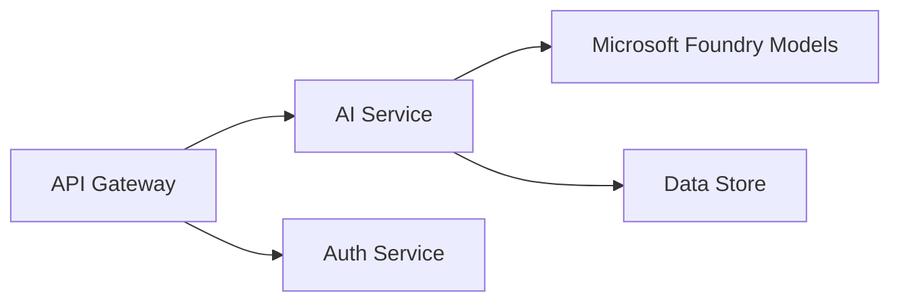
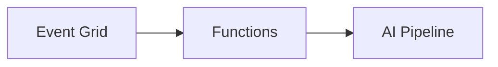

# 8. peatükk: Tootmise ja ettevõtete mustrid

**📚 Kursus**: [AZD algajatele](../../README.md) | **⏱️ Kestus**: 2-3 tundi | **⭐ Keerukus**: Täiustatud

---

## Ülevaade

See peatükk käsitleb ettevõttele valmis juurutamise mustreid, turvamistamist, jälgimist ja tootmise AI töökoormuste kulude optimeerimist.

See on arhitektuuriviide, mitte täielik juurutamiseks valmis tootmismall. Näited jätavad välja integratsiooni üksikasjad, mis tuleb teie rakenduses lisada ja testida; kontrollnimekirja lugemine ei tõenda tootmisvalmidust.

> **Foundry GA uuendus (2026-11-09):** Kasutage Foundry töövoo jaoks `azd >= 1.37.0` ja üldiselt kättesaadavat `microsoft.foundry` 1.0 komplekti; hindamised installitakse eraldi. Vaadake [väljalaske ulatust ja migratsiooni](production-ai-practices.md#recent-release-changes-and-fixes) ja [autentimisega torujuhtme näidet](production-ai-practices.md#cicd-pipeline-configuration). See on dokumentatsiooni ülevaade, mitte reaalajakontroll juurutamise või valikuliste eelvaate funktsioonide üldise GA staatuse kohta.

## Õpieesmärgid

Selle peatüki läbimisel saate:
- Juurutada mitmeregioonilisi vastupidavaid rakendusi
- Rakendada ettevõtte turbemustreid
- Konfigureerida põhjalikku jälgimist
- Optimeerida kulusid mahus
- Seada üles CI/CD torujuhtmeid AZD-ga

---

## 📚 Õppetunnid

| # | Õppetund | Kirjeldus | Aeg |
|---|--------|-------------|------|
| 1 | [Tootmise AI praktikad](production-ai-practices.md) | Ettevõtte juurutuse mustrid | 90 min |

---

## 🚀 Tootmise kontrollnimekiri

- [ ] Mitmeregiooniline juurutus vastupidavuse jaoks
- [ ] Haldusega identiteet autentimiseks (ilma võtmeteta)
- [ ] Application Insights jälgimiseks
- [ ] Kulude eelarved ja hoiatused konfigureeritud
- [ ] Turbe skaneerimine lubatud
- [ ] CI/CD torujuhtme integratsioon
- [ ] Katastroofide taastamise plaan

---

## 🏗️ Arhitektuurimustrid

### Muster 1: Mikroteenused AI



### Muster 2: Sündmustepõhine AI



---

## 🔐 Turbe parimad praktikad

```bicep
// Illustrative properties from different resources, NOT a standalone Bicep file.
// Attach identity to the application host:
identity: {
  type: 'SystemAssigned'
}

// AI account properties (also require private endpoints, DNS and app connectivity):
properties: {
  publicNetworkAccess: 'Disabled'
  networkAcls: {
    defaultAction: 'Deny'
  }
}
```

---

## 💰 Kulude optimeerimine

| Strateegia | Peamine piirang |
|----------|---------|
| Skaala nulli (Container Apps) | Nõuab sobivat päästikut; teised teenused tekitavad siiski kulusid |
| Kasuta tarbimistasemeid arenduseks | Võrdle valitud teenuse hinnakujundust ja töökoormust |
| Ajastatud skaala | Skaala toetatud infrastruktuuri/automaadiga |
| Reserveeringud/ette nähtud võimsus | Ainult kui toetatud; kohustused võivad suurendada seisvaid kulusid |

Kasutage [täielikku eelarve ressursimustrit](production-ai-practices.md#2-cost-monitoring-and-budgets) kehtiva alguskuupäeva, arvelduspiirkonna, saajate ja õigustega. Eelarve saadab hoiatusi; see ei piira kulutusi. Säästud sõltuvad mõõdetud kasutusest ja ei ole garanteeritud protsendid.

---

## 📊 Jälgimise seadistamine

```bash
# Open the Application Insights logs view (requires configured monitoring)
azd monitor --logs

# Check Application Insights
azd monitor --overview

# View metrics
az monitor metrics list --resource <resource-id>
```

---

## 🔗 Navigeerimine

| Suund | Peatükk |
|-----------|---------|
| **Eelmine** | [7. peatükk: Tõrkeotsing](../chapter-07-troubleshooting/README.md) |
| **Kursus lõpetatud** | [Kursuse avaleht](../../README.md) |

---

## 📖 Seotud ressursid

- [AI agendid juhend](../chapter-02-ai-development/agents.md)
- [Application Insights](../chapter-06-pre-deployment/application-insights.md)
- [Mitmeagendi lahendused](../chapter-05-multi-agent/README.md)
- [Mikroteenuste näide](../../examples/microservices/README.md)

---

<!-- CO-OP TRANSLATOR DISCLAIMER START -->
**Lahtiütlus**:
See dokument on tõlgitud kasutades AI tõlketeenust [Co-op Translator](https://github.com/Azure/co-op-translator). Kuigi me püüdleme täpsuse poole, palun pange tähele, et automatiseeritud tõlgetes võib esineda vigu või ebatäpsusi. Originaaldokument selle emakeeles tuleks pidada autoriteetseks allikaks. Olulise teabe puhul soovitatakse kasutada professionaalset inimtõlget. Me ei vastuta selle tõlkega seotud eksimustest või valesti mõistmistest.
<!-- CO-OP TRANSLATOR DISCLAIMER END -->