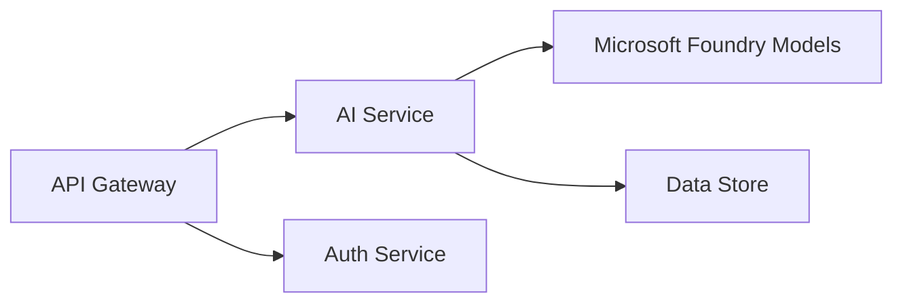
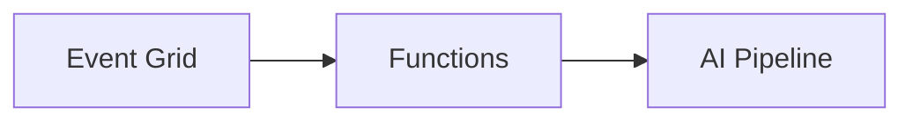

# 8. peatükk: Tootmine ja ettevõtte mustrid

**📚 Kursus**: [AZD algajatele](../../README.md) | **⏱️ Kestus**: 2–3 tundi | **⭐ Kompleksus**: Edasijõudnud

---

## Ülevaade

Käesolevas peatükis käsitletakse ettevõttesiseseid juurutusmustreid, turvakihtide tugevdamist, jälgimist ja kulude optimeerimist tootmisvalmis tehisintellekti koormuste jaoks.

See on arhitektuuri viide, mitte täielik juurutatav tootmismall. Näited jätavad välja integratsioonidetailid, mis tuleb ise rakenduses lisada ja testida; kontrollnimekirja lugemine ei taga tootmiskõlblikkust.

> **Väljalaske ülevaade (2026-11-04):** AI CLI juhendit kontrolliti `azd 1.37.2`, agentide `1.0.0-beta.23` ja hindamiste `1.0.0-beta.2` dokumentatsiooni/allika vastu. Ühilduvusnõuete ja migreerimise üksikasjade jaoks vaadake [väljalaske muudatusi ja parandusi](production-ai-practices.md#recent-release-changes-and-fixes); see ei ole reaalajas juurutuse valideerimine.

## Õpieesmärgid

Selle peatüki lõpetamisel:
- Rakendate mitmeregioonilisi vastupidavaid rakendusi
- Rakendate ettevõtete turvamustreid
- Konfigureerite põhjaliku jälgimise
- Optimeerite kulusid suures mahus
- Seadistate AZD abil CI/CD torujuhtmed

---

## 📚 Õppetunnid

| # | Õppetund | Kirjeldus | Aeg |
|---|--------|-------------|------|
| 1 | [Tootmises AI tavad](production-ai-practices.md) | Ettevõtete juurutusmustrid | 90 min |

---

## 🚀 Tootmise kontrollnimekiri

- [ ] Mitmeregiooniline juurutus vastupidavuse tagamiseks
- [ ] Halduse identiteet autentimiseks (ilma võtmeteta)
- [ ] Application Insights jälgimiseks
- [ ] Kulude eelarved ja hoiatused seadistatud
- [ ] Turvaskaneerimine lubatud
- [ ] CI/CD torujuhtme integratsioon
- [ ] Katastroofide taastumise plaan

---

## 🏗️ Arhitektuurimustrid

### Muster 1: Mikroteenused AI



### Muster 2: Sündmusel põhinev AI



---

## 🔐 Turvalisuse parimad tavad

```bicep
// Illustrative properties from different resources, NOT a standalone Bicep file.
// Attach identity to the application host:
identity: {
  type: 'SystemAssigned'
}

// AI account properties (also require private endpoints, DNS and app connectivity):
properties: {
  publicNetworkAccess: 'Disabled'
  networkAcls: {
    defaultAction: 'Deny'
  }
}
```

---

## 💰 Kulude optimeerimine

| Strateegia | Peamine piirang |
|----------|---------|
| Skaala nullini (Container Apps) | Nõuab sobivat päästikut; muud teenused põhjustavad endiselt kulusid |
| Kasuta tarbimiskihte arenduseks | Võrdle valitud teenuse hinnastust ja koormust |
| Ajakavastatud skaleerimine | Skaala toetatud infrastruktuuri/automaatika kaudu |
| Broneeringud/ette nähtud maht | Ainult siis, kui toetatud; kohustused võivad tõsta seisvaid kulusid |

Kasuta [täielikku eelarve ressursimustrit](production-ai-practices.md#2-cost-monitoring-and-budgets) kehtiva alguskuupäeva, arvelduspiirkonna, saajate ja õigustega. Eelarve saadab hoiatusi; see ei piira kulutusi. Säästud sõltuvad mõõdetud kasutusest ega ole garantii protsentides.

---

## 📊 Jälgimise seadistamine

```bash
# Open the Application Insights logs view (requires configured monitoring)
azd monitor --logs

# Check Application Insights
azd monitor --overview

# View metrics
az monitor metrics list --resource <resource-id>
```

---

## 🔗 Navigeerimine

| Suund | Peatükk |
|-----------|---------|
| **Eelmine** | [7. peatükk: Tõrkeotsing](../chapter-07-troubleshooting/README.md) |
| **Kursus lõpetatud** | [Kursuse avaleht](../../README.md) |

---

## 📖 Seotud ressursid

- [AI agentide juhend](../chapter-02-ai-development/agents.md)
- [Application Insights](../chapter-06-pre-deployment/application-insights.md)
- [Mitme agendi lahendused](../chapter-05-multi-agent/README.md)
- [Mikroteenuste näide](../../examples/microservices/README.md)

---

<!-- CO-OP TRANSLATOR DISCLAIMER START -->
**Lahtiütlus**:
See dokument on tõlgitud kasutades AI tõlketeenust [Co-op Translator](https://github.com/Azure/co-op-translator). Kuigi me püüdleme täpsuse poole, palun pange tähele, et automatiseeritud tõlgetes võib esineda vigu või ebatäpsusi. Originaaldokument selle emakeeles tuleks pidada autoriteetseks allikaks. Olulise teabe puhul soovitatakse kasutada professionaalset inimtõlget. Me ei vastuta selle tõlkega seotud eksimustest või valesti mõistmistest.
<!-- CO-OP TRANSLATOR DISCLAIMER END -->