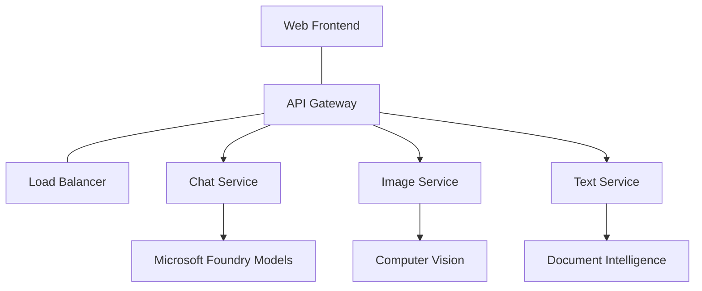

# Tootmise AI töökoormuse parimad tavad koos AZD-ga

**Peatüki navigeerimine:**
- **📚 Kursuse avaleht**: [AZD Algajatele](../../README.md)
- **📖 Praegune peatükk**: Peatükk 8 - Tootmine & Ettevõtte mustrid
- **⬅️ Eelmine peatükk**: [Peatükk 7: Rikkeotsing](../chapter-07-troubleshooting/debugging.md)
- **⬅️ Ka seotud**: [AI töötuba labor](../chapter-02-ai-development/ai-workshop-lab.md)
- **🎯 Kursuse lõpetamine**: [AZD Algajatele](../../README.md)

## Ülevaade

See juhend selgitab tootmise AI disainimustreid Azure Developer CLI (AZD) abil. See on disainiviide, mitte otse kasutatav rakendus ega tootmise sertifikaat.

**Näite piirid:** Kui pole selgesõnaliselt öeldud, et lõplik, eeldavad Bicepi fragmendid malle sisaldava malli parameetreid ja viidatud ressursse. Need jätavad välja hostipildid / plaanid, identiteedid, rolli määramised, DNS, väljundid ja muu vajaliku integratsiooni. YAML teenuse tee ja hook/test skriptid on illustreerivad failid, mida luua **omaenda rakenduses**; neid see kursus ei paku. Kasutage töötavat AZD näidist baasil, kompileerige kogu infrastruktuur ja testige seda isoleeritud keskkonnas enne tootmisse minekut.

## Käesolevad peamised väljakutsed

Levinud tootmise küsimused hõlmavad mitme teenuse juurutamist, identiteedi ja saladuste haldamist, skaleerimist, kulude kontrolli ja jälgimist. Siin ei väideta mõõdetud esinemissagedust.

## Tootmise AI arhitektuurimustrid

### Muster 1: Mikroteenuste AI arhitektuur

**Millal kasutada**: keerulised AI rakendused mitme võimekusega



**AZD rakendus**:

```yaml
# azure.yaml
name: enterprise-ai-platform
services:
  web:
    project: ./web
    host: staticwebapp
  api-gateway:
    project: ./api-gateway
    host: containerapp
  chat-service:
    project: ./services/chat
    host: containerapp
  vision-service:
    project: ./services/vision
    host: containerapp
  text-service:
    project: ./services/text
    host: containerapp
```

### Muster 2: Sündmuspõhine AI töötlemine

**Millal kasutada**: kogumisprotsessid, dokumendianalüüs, asünkroonsed töövood

```bicep
// Event Hub for AI processing pipeline
resource eventHub 'Microsoft.EventHub/namespaces@2024-01-01' = {
  name: eventHubNamespaceName
  location: location
  sku: {
    name: 'Standard'
    tier: 'Standard'
    capacity: 1
  }
}

// Service Bus for reliable message processing
resource serviceBus 'Microsoft.ServiceBus/namespaces@2024-01-01' = {
  name: serviceBusNamespaceName
  location: location
  sku: {
    name: 'Premium'
    tier: 'Premium'
    capacity: 1
  }
}

// Function App for processing
resource functionApp 'Microsoft.Web/sites@2023-01-01' = {
  name: functionAppName
  location: location
  kind: 'functionapp,linux'
  properties: {
    siteConfig: {
      appSettings: [
        {
          name: 'FUNCTIONS_EXTENSION_VERSION'
          value: '~4'
        }
        {
          name: 'AZURE_OPENAI_ENDPOINT'
          value: '@Microsoft.KeyVault(VaultName=${keyVault.name};SecretName=openai-endpoint)'
        }
      ]
    }
  }
}
```

See loob nimi-ruumi fragmente, mitte seotud sõlmi, järjekordi, tellimusi ega Functions käivitaid. Käivitatav Function vajab ka hostimiskava, jooksutamiskeskkonna/salvestuskonfiguratsiooni, ühendatud identiteeti, RBAC-i ja võrguühendust. Key Vault'i viide vajab luba saladuse lugemiseks; otse lõpp-punkti URL ei ole volitus.

## Mõtlemine AI Agendi tervise üle

Kui traditsiooniline veebirakendus rikub, on sümptomid tuttavad: lehte ei laadita, API tagastab vea või juurutus ebaõnnestub. AI-põhised rakendused võivad rikkuda samu viise — kuid ka käituda peenemal moel, mis ei tekita ilmseid veateateid.

See jaotis aitab teil luua vaimset mudelit AI töökoormuste jälgimiseks, et teada, kuhu vaadata, kui asjad ei tundu korras.

### Kuidas Agendi tervis erineb traditsioonilise rakenduse tervisest

Traditsioonilised rakendused võivad samuti kogeda peent õigsuse rikkeid. AI agent lisab tavapärasele kättesaadavuse ja õigsuse muredele deterministliku vastuse kvaliteedi. Mõelge agendi tervisele kahel kihil:

| Kiht | Mida jälgida | Kuhu vaadata |
|-------|--------------|---------------|
| **Infrastruktuuri tervis** | Kas teenus töötab? Kas ressursid on ette nähtud? Kas lõpp-punktid on kättesaadavad? | `azd monitor`, Azure Portaali ressursi tervis, konteineri/rakenduse logid |
| **Käitumise tervis** | Kas agent vastab täpselt? Kas vastused on aegsad? Kas mudelit kutsutakse õigesti? | Application Insights jäljed, mudelikutse latentsusmõõdikud, vastuse kvaliteedi logid |

Infrastruktuuri tervis on tuttav — see on sama iga azd rakenduse puhul. Käitumise tervis on AI töökoormuste uus kiht.

### Kuhu vaadata, kui AI rakendused ei käitu oodatult

Kui teie AI rakendus ei tooda oodatud tulemusi, siin on kontseptuaalne kontrollnimekiri:

1. **Alustage põhitõdedest.** Kas rakendus töötab? Kas pääseb sõltuvusteni? Kontrollige `azd monitor` ja ressursi tervist nagu iga rakenduse puhul.
2. **Kontrollige mudeli ühendust.** Kas teie rakendus kutsub edukalt AI mudelit? Ebaõnnestunud või aegunud mudelikutsed on kõige sagedasemad AI rakenduse probleemide põhjus ja ilmnevad rakenduse logides.
3. **Uurige sisendeid ja alustamist turvaliselt.** Valed vastused võivad tuleneda andmete tõmbest, juhistest, mudeli piirangutest või tööriista täitmisest. Kasutage juurdepääsupiiranguga, tsenseeritud diagnostikandmeid; ärge lubage tootmises suvalist promptide/vastuste logimist.
4. **Vaadake vastuse latentsust.** AI mudelikutsed on aeglasemad kui tavapärased API kutsed. Kui rakendus tundub aeglane, kontrollige, kas mudeli vastuseajad on pikenenud — see võib viidata piirangutele, mahupiiridele või piirkonna tasandi tihedusele.
5. **Jälgige kulumärke.** Ootamatud tõusud tokeni kasutuses või API kutsudes võivad viidata lõksele, valesti konfigureeritud promptile või liigsetele kordustele.

Te ei pea kohe omandama jälgimistööriistade oskusi. Peamine on mõista, et AI rakendustel on täiendav käitumise kiht jälgimiseks ning azd sisseehitatud jälgimine (`azd monitor`) annab aluse mõlema kihi uurimiseks.

---

## Turvalisuse parimad tavad

### 1. Null usalduse turvamudel

**Rakendusstrateegia**:
- Ühtegi teenus-teenuse vahelist suhtlust ilma autentimiseta
- Kõik API kutsed kasutavad hallatud identiteete
- Võrgu isolatsioon privaatsete lõpp-punktidega
- Vähemõiguste ligipääsu kontrollid

```bicep
// Managed Identity for each service
resource chatServiceIdentity 'Microsoft.ManagedIdentity/userAssignedIdentities@2023-01-31' = {
  name: 'chat-service-identity'
  location: location
}

// Role assignments with minimal permissions
resource openAIUserRole 'Microsoft.Authorization/roleAssignments@2022-04-01' = {
  scope: openAIAccount
  name: guid(openAIAccount.id, chatServiceIdentity.id, '5e0bd9bd-7b93-4f28-af87-19fc36ad61bd')
  properties: {
    roleDefinitionId: subscriptionResourceId('Microsoft.Authorization/roleDefinitions', '5e0bd9bd-7b93-4f28-af87-19fc36ad61bd')
    principalId: chatServiceIdentity.properties.principalId
    principalType: 'ServicePrincipal'
  }
}
```

### 2. Turvaline saladuste haldamine

**Key Vault integreerimise muster**:

```bicep
// Key Vault with proper access policies
resource keyVault 'Microsoft.KeyVault/vaults@2023-02-01' = {
  name: keyVaultName
  location: location
  properties: {
    tenantId: tenant().tenantId
    sku: {
      family: 'A'
      name: 'standard' // Premium is needed for HSM-backed keys, not ordinary secrets
    }
    enableRbacAuthorization: true  // Use RBAC instead of access policies
    enablePurgeProtection: true    // Prevent accidental deletion
    enableSoftDelete: true
    softDeleteRetentionInDays: 90
  }
}

// Optional legacy key-auth alternative; omit when using Entra ID.
resource openAIKeySecret 'Microsoft.KeyVault/vaults/secrets@2023-02-01' = {
  parent: keyVault
  name: 'openai-api-key'
  properties: {
    value: openAIAccount.listKeys().key1
    attributes: {
      enabled: true
    }
  }
}
```

Määrake jooksuaegne identiteet `Key Vault Secrets User` sobival ulatusel ja ühendada see hostiga; `enableRbacAuthorization` üksi ei anna ligipääsu. Eelistage OpenAI hallatud identiteedi autentimist koos `disableLocalAuth: true`. Vabatahtlik võti salajane on mõistlik ainult sihilikult võtmega lubatud konto puhul ning juurutuse juurde määratav põhiproovija vajab samuti õigust saladuste kirjutamiseks.

### 3. Võrgu turvalisus

**Privaatse lõpp-punkti konfiguratsioon**:

```bicep
// Virtual Network for AI services
resource virtualNetwork 'Microsoft.Network/virtualNetworks@2023-04-01' = {
  name: vnetName
  location: location
  properties: {
    addressSpace: {
      addressPrefixes: ['10.0.0.0/16']
    }
    subnets: [
      {
        name: 'ai-services-subnet'
        properties: {
          addressPrefix: '10.0.1.0/24'
          privateEndpointNetworkPolicies: 'Disabled'
        }
      }
      {
        name: 'app-services-subnet'
        properties: {
          addressPrefix: '10.0.2.0/24'
          delegations: [
            {
              name: 'Microsoft.Web/serverFarms'
              properties: {
                serviceName: 'Microsoft.Web/serverFarms'
              }
            }
          ]
        }
      }
    ]
  }
}

// Private endpoints for all AI services
resource openAIPrivateEndpoint 'Microsoft.Network/privateEndpoints@2023-04-01' = {
  name: '${openAIAccountName}-pe'
  location: location
  properties: {
    subnet: {
      id: virtualNetwork.properties.subnets[0].id
    }
    privateLinkServiceConnections: [
      {
        name: 'openai-connection'
        properties: {
          privateLinkServiceId: openAIAccount.id
          groupIds: ['account']
        }
      }
    ]
  }
}
```

Privaatsetele lõpp-punktidele on tarvis ka privaatseid DNS tsoonirühmi / VNet linke ja rakenduse VNet integratsiooni. Need ei blokeeri automaatselt avalikku ligipääsu: keelake selgesõnaliselt AI konto avalik võrgupääs pärast privaatse ühenduse ja juurutuse ligipääsu valideerimist.

## Jõudlus ja skaleerimine

### 1. Automaatse skaleerimise strateegiad

**Konteinerirakenduste automaatne skaleerimine**:

```bicep
resource containerApp 'Microsoft.App/containerApps@2023-05-01' = {
  name: containerAppName
  location: location
  properties: {
    configuration: {
      ingress: {
        external: true
        targetPort: 8000
        transport: 'http'
      }
    }
    template: {
      scale: {
        minReplicas: 2  // Always have 2 instances minimum
        maxReplicas: 50 // Scale up to 50 for high load
        rules: [
          {
            name: 'http-scaling'
            http: {
              metadata: {
                concurrentRequests: '20'  // Scale when >20 concurrent requests
              }
            }
          }
          {
            name: 'cpu-scaling'
            custom: {
              type: 'cpu'
              metadata: {
                type: 'Utilization'
                value: '70'  // Scale when CPU >70%
              }
            }
          }
        ]
      }
    }
  }
}
```

### 2. Vahemällu salvestamise strateegiad

**Redis vahemälu AI vastustele**:

```bicep
// Legacy Azure Cache for Redis example (not recommended for new deployments)
resource redisCache 'Microsoft.Cache/redis@2023-04-01' = {
  name: redisCacheName
  location: location
  properties: {
    sku: {
      name: 'Premium'
      family: 'P'
      capacity: 1
    }
    enableNonSslPort: false
    minimumTlsVersion: '1.2'
    redisConfiguration: {
      'maxmemory-policy': 'allkeys-lru'
    }
    // Sharding distributes data; replication/failover provides availability.
    shardCount: 2
  }
}

// Cache configuration in application
var cacheConnectionString = '${redisCache.properties.hostName}:6380,password=${redisCache.listKeys().primaryKey},ssl=True,abortConnect=False'
```

Azure Cache for Redis Basic/Standard/Premium on [väljasuremise teel](https://learn.microsoft.com/azure/azure-cache-for-redis/retirement-faq). Uute disainide jaoks kasutage Azure Managed Redis koos dokumenteeritud SKU, identiteedi ja TLS konfiguratsiooniga, mitte ärge kopeerige seda pärandressurssi uude tootmissüsteemi. Ühendusstringi rida on mittetöötav kohatäitja, mitte volitus. Jaga vahemälu võtmeid autoriseerimise, mudeli/juhiste ja päringu versiooni järgi koos aegumisega; jagatud ainult päringute vahemälu võib avalikustada teise kasutaja andmeid.

### 3. Koormuse tasakaalustamine ja liikluse juhtimine

**Rakenduse värav WAF-iga**:

```bicep
// Application Gateway with Web Application Firewall
resource applicationGateway 'Microsoft.Network/applicationGateways@2023-04-01' = {
  name: appGatewayName
  location: location
  properties: {
    sku: {
      name: 'WAF_v2'
      tier: 'WAF_v2'
      capacity: 2
    }
    webApplicationFirewallConfiguration: {
      enabled: true
      firewallMode: 'Prevention'
      ruleSetType: 'OWASP'
      ruleSetVersion: '3.2'
    }
    // Backend pools for AI services
    backendAddressPools: [
      {
        name: 'ai-services-pool'
        properties: {
          backendAddresses: [
            {
              fqdn: '${containerApp.properties.configuration.ingress.fqdn}'
            }
          ]
        }
      }
    ]
  }
}
```

See on osaline värava ressurss: tegelik juurutus vajab veel värava alamvõrgu/IP konfiguratsiooni, esikaardi IP sidumisi ja porte, TLS kuulajaid / sertifikaate, tagaotsa HTTP seadeid / probe, marsruutimise reegleid ja prioriteete ning läbivaadatud WAF poliitikat. TLS hostinimi / SNI ja autentimine peavad vastama Kontainerirakenduse tagaosale.

## 💰 Kulu optimeerimine

### 1. Ressursside õige suuruse määramine

**Keskkonnapõhised konfiguratsioonid**:

Need nimed on **illustreerivad kohandatud malli sisendid**, mitte automaatsed AZD seaded. Kaardistage igaüks `infra/main.parameters.json` / Bicep ja hosti konfiguratsiooni esmalt. Näiteks RAG näidis kasutab `AZURE_SEARCH_SERVICE_SKU` ja `AZURE_OPENAI_CHATGPT_DEPLOYMENT_CAPACITY`, mitte allpool olevaid üldnimesid. Määrake konteinerirakenduste mälule toetatud ühik nagu `1Gi` tegelikus ressursis. Rakendage infrastruktuuri muudatused `azd up` või `azd provision` abil; `azd deploy` üksi ei rakenda Bicepi muudatusi.

```bash
# Development environment
azd env new development
azd env set AZURE_OPENAI_SKU "S0"
azd env set AZURE_OPENAI_CAPACITY 10
azd env set AZURE_SEARCH_SKU "basic"
azd env set CONTAINER_CPU 0.5
azd env set CONTAINER_MEMORY 1.0

# Production environment  
azd env new production
azd env set AZURE_OPENAI_SKU "S0"
azd env set AZURE_OPENAI_CAPACITY 100
azd env set AZURE_SEARCH_SKU "standard"
azd env set CONTAINER_CPU 2.0
azd env set CONTAINER_MEMORY 4.0
```

### 2. Kulude jälgimine ja eelarved

```bicep
// Supply the first day of the current UTC month, e.g. 2026-11-01T00:00:00Z.
param budgetStartDate string

// Cost management and budgets
resource budget 'Microsoft.Consumption/budgets@2024-08-01' = {
  name: 'ai-workload-budget'
  properties: {
    timePeriod: {
      startDate: budgetStartDate
    }
    timeGrain: 'Monthly'
    amount: 2000  // In the billing currency, not necessarily USD
    category: 'Cost'
    notifications: {
      warning: {
        enabled: true
        operator: 'GreaterThan'
        threshold: 80
        contactEmails: [
          'finance@company.com'
          'engineering@company.com'
        ]
        contactRoles: [
          'Owner'
          'Contributor'
        ]
      }
      critical: {
        enabled: true
        operator: 'GreaterThan'
        threshold: 95
        contactEmails: [
          'cto@company.com'
        ]
      }
    }
  }
}
```

Asendage näite saajad ja kontrollige ulatust / õigusi. Eelarve hoiatused kasutavad viivitusega arveldusandmeid ega kehtesta kulutuste limiiti.

### 3. Tokeni kasutuse optimeerimine

**OpenAI kulu haldamine**:

See on UI eelvaate jaoks ainult märgipõhine heuristik, **mitte** mudeli tokeni-piiri valideerija. Tootmiskood peab kasutama mudelile sobivat tokeniseerijat ning arvestama süsteemijuhiste, tööriistade skeemide, ajaloo ja väljundieelarvega. Lükake tagasi ülemõõtu kasutaja sõnum, mitte ärge vaikselt katkestage seda.

```typescript
// Application-level token optimization
class TokenOptimizer {
  private readonly maxTokens = 4000;
  private readonly reserveTokens = 500;
  
  optimizePrompt(userInput: string, context: string): string {
    const availableTokens = this.maxTokens - this.reserveTokens;
    if (this.estimateTokens(userInput) + 8 >= availableTokens) {
      throw new Error("User input exceeds the illustrative prompt budget");
    }
    const estimatedTokens = this.estimateTokens(userInput + context) + 8;
    
    if (estimatedTokens > availableTokens) {
      // Truncate context, not user input
      context = this.truncateContext(context, Math.max(0, availableTokens - this.estimateTokens(userInput) - 8));
    }
    
    return `${context}\n\nUser: ${userInput}`;
  }
  
  private estimateTokens(text: string): number {
    // Rough estimation: 1 token ≈ 4 characters
    return Math.ceil(text.length / 4);
  }

  private truncateContext(text: string, estimatedBudget: number): string {
    return text.slice(0, Math.max(0, estimatedBudget) * 4);
  }
}
```

## Jälgimine ja nähtavus

### 1. Kõikehõlmav Application Insights

```bicep
// Application Insights with advanced features
resource applicationInsights 'Microsoft.Insights/components@2020-02-02' = {
  name: applicationInsightsName
  location: location
  kind: 'web'
  properties: {
    Application_Type: 'web'
    WorkspaceResourceId: logAnalyticsWorkspace.id
    SamplingPercentage: 100  // Ingestion setting; review cost and SDK sampling separately
    DisableIpMasking: false  // Retain IP masking
  }
}

// Custom metrics for AI operations
resource aiMetricAlerts 'Microsoft.Insights/metricAlerts@2018-03-01' = {
  name: 'ai-high-error-rate'
  location: 'global'
  properties: {
    description: 'Alert when failed request count exceeds 10 in five minutes'
    severity: 2
    enabled: true
    scopes: [
      applicationInsights.id
    ]
    evaluationFrequency: 'PT1M'
    windowSize: 'PT5M'
    criteria: {
      'odata.type': 'Microsoft.Azure.Monitor.SingleResourceMultipleMetricCriteria'
      allOf: [
        {
          name: 'high-error-rate'
          metricName: 'requests/failed'
          operator: 'GreaterThan'
          threshold: 10
          timeAggregation: 'Count'
        }
      ]
    }
  }
}
```

### 2. AI-spetsiifiline jälgimine

**Kohandatud juhtpaneelid AI mõõdikute jaoks**:

```json
{
  "dashboard": {
    "name": "AI Application Monitoring",
    "tiles": [
      {
        "name": "OpenAI Request Volume",
        "query": "dependencies | where target contains 'openai' | summarize count() by bin(timestamp, 5m)"
      },
      {
        "name": "AI Response Latency",
        "query": "dependencies | where target contains 'openai' | summarize avg(duration) by bin(timestamp, 5m)"
      },
      {
        "name": "Token Usage",
        "query": "customMetrics | where name == 'openai_tokens_used' | summarize sum(value) by bin(timestamp, 1h)"
      },
      {
        "name": "Cost per Hour",
        "query": "customMetrics | where name == 'openai_cost' | summarize sum(value) by bin(timestamp, 1h)"
      }
    ]
  }
}
```

See JSON on rakenduse määratud visand, mitte importitav Azure portaali juhis. Tokeni/kulu päringud nõuavad, et teie rakendus väljastaks täpselt need kohandatud mõõdikud; AZD neid ei loo. Kohandage sõltuvuste filtreid vastavalt teie mudeli lõpp-punkti / intervalli nimedele.

### 3. Terviseseire ja tööajas jälgimine

```bicep
// Application Insights availability tests
resource availabilityTest 'Microsoft.Insights/webtests@2022-06-15' = {
  name: 'ai-app-availability-test'
  location: location
  tags: {
    'hidden-link:${applicationInsights.id}': 'Resource'
  }
  properties: {
    SyntheticMonitorId: 'ai-app-availability-test'
    Name: 'AI Application Availability Test'
    Description: 'Tests AI application endpoints'
    Enabled: true
    Frequency: 300  // 5 minutes
    Timeout: 120    // 2 minutes
    Kind: 'standard'
    Locations: [
      {
        Id: 'us-east-2-azr'
      }
      {
        Id: 'us-west-2-azr'
      }
    ]
    Request: {
      RequestUrl: 'https://${webApp.properties.defaultHostName}/health'
      HttpVerb: 'GET'
      FollowRedirects: true
      ParseDependentRequests: false
    }
    ValidationRules: {
      ExpectedHttpStatusCode: 200
      SSLCheck: true
      SSLCertRemainingLifetimeCheck: 7
    }
  }
}
```

## Katastroofi taastamine ja kõrge kättesaadavus

Eelnev test eeldab olemasolevat App Service `webApp` ja Application Insights ressurssi. Standardseisundi testid on arveldatavad ja vajavad kättesaadavat lõpp-punkti; privaatseid rakendusi peab jälgima sobiva privaatse kavaga. URL ping testid on aegunud; kasutage [standardsed seisundi testid](https://learn.microsoft.com/azure/azure-monitor/app/availability).

### 1. Mitme piirkonna juurutus

```yaml
# azure.yaml - Multi-region configuration
name: ai-app-multiregion
services:
  api-primary:
    project: ./api
    host: containerapp
    env:
      AZURE_REGION: eastus
  api-secondary:
    project: ./api
    host: containerapp
    env:
      AZURE_REGION: westus2
```

```bicep
// Separate App Service topology, not the Container Apps declarations above
resource trafficManager 'Microsoft.Network/trafficManagerProfiles@2022-04-01' = {
  name: trafficManagerProfileName
  location: 'global'
  properties: {
    profileStatus: 'Enabled'
    trafficRoutingMethod: 'Priority'
    dnsConfig: {
      relativeName: trafficManagerProfileName
      ttl: 30
    }
    monitorConfig: {
      protocol: 'HTTPS'
      port: 443
      path: '/health'
      intervalInSeconds: 30
      toleratedNumberOfFailures: 3
      timeoutInSeconds: 10
    }
    endpoints: [
      {
        name: 'primary-endpoint'
        type: 'Microsoft.Network/trafficManagerProfiles/azureEndpoints'
        properties: {
          targetResourceId: primaryAppService.id
          endpointStatus: 'Enabled'
          priority: 1
        }
      }
      {
        name: 'secondary-endpoint'
        type: 'Microsoft.Network/trafficManagerProfiles/azureEndpoints'
        properties: {
          targetResourceId: secondaryAppService.id
          endpointStatus: 'Enabled'
          priority: 2
        }
      }
    ]
  }
}
```

Keskkonnamuutujad ei vali ressursi asukohta. IaC peab ette nägema eri piirkondade hostid ja siduma iga teenuse sobivate `resourceName` või `azd-service-name` siltidega. Traffic Manager näide on **eraldiseisev App Service topoloogia** (`primaryAppService`/`secondaryAppService`), mitte marsruutimine Container Apps deklareerimiste jaoks. Container Apps nõuab sobivalt konfigureeritud väliseid lõpp-punkte/esikõrvaid, TLS / kohandatud domeeni marsruutimist ja tervise teste.

### 2. Andmete varundamine ja taastamine

```bicep
// Backup configuration for critical data
resource backupVault 'Microsoft.DataProtection/backupVaults@2023-05-01' = {
  name: backupVaultName
  location: location
  identity: {
    type: 'SystemAssigned'
  }
  properties: {
    storageSettings: [
      {
        datastoreType: 'VaultStore'
        type: 'LocallyRedundant'
      }
    ]
  }
}

```

Üksnes vault ei varunda midagi. Konfigureerige **töökoormuspõhine toetatud poliitika ja varundus instants**, allika õigused, säilitamine ja taastamise testid kasutades [Azure varundamise tugematriise](https://learn.microsoft.com/azure/backup/backup-support-matrix). Üldist Azure Backup poliitikat hostitud Azure OpenAI mudelipõhiste juurutuste jaoks ei ole. Hoidke infrastruktuuri / mudeli juurutuse definitsioonid versioonihalduses; kaitske üleslaaditud dokumente, rakenduse andmeid ja peenhäälestuse artefakte iga toetatud varundus / eksport teenuse kaudu. Määrake ja testige RPO/RTO selgelt.

## DevOps ja CI/CD integratsioon

### 1. GitHub Actions töövoog

```yaml
# .github/workflows/deploy-ai-app.yml
name: Deploy AI Application

on:
  push:
    branches: [main]
  pull_request:
    branches: [main]

jobs:
  test:
    runs-on: ubuntu-latest
    steps:
      - uses: actions/checkout@v4
      
      - name: Setup Python
        uses: actions/setup-python@v4
        with:
          python-version: '3.11'
          
      - name: Install dependencies
        run: |
          pip install -r requirements.txt
          pip install pytest
          
      - name: Run tests
        run: pytest tests/
        
      - name: AI Safety Tests
        run: |
          python scripts/test_ai_safety.py
          python scripts/validate_prompts.py

```

See on **ainult testimise osa** töövoost ja eeldab, et olete loonud `requirements.txt`, `tests/` ja kaks turvaskripti. Lisage autentitud OIDC juurutuse / juurutustööd [CI/CD torujuhtme konfiguratsioonist](#cicd-pipeline-configuration), koos `needs: test`, usaldusväärse push/käsitsi käivitusega ja kaitstud GitHub keskkondadega. Ärge juurutage usalduseta tõmbetaotluse koodi koos pilve mandaatidega. Värske käitaja ei oma valitud kohalikku AZD keskkonda; andke keskkonna / tellimuse / asukoha sisendid ja kasutage `azd auth login`, mitte ainult `azure/login`.

### 2. Infrastruktuuri valideerimine

```bash
# scripts/validate_infrastructure.sh
#!/bin/bash
set -euo pipefail

echo "Validating AI infrastructure deployment..."

# Requires Azure CLI login and the resource group selected explicitly.
: "${AZURE_RESOURCE_GROUP:?Set AZURE_RESOURCE_GROUP}"
: "${AZURE_OPENAI_NAME:?Set AZURE_OPENAI_NAME}"
: "${AZURE_OPENAI_CHAT_DEPLOYMENT:?Set the actual deployment name}"

# A successful empty list is not proof that resources exist.
types=("Microsoft.CognitiveServices/accounts" "Microsoft.Search/searchServices"
       "Microsoft.Storage/storageAccounts" "Microsoft.KeyVault/vaults")
for resource_type in "${types[@]}"; do
    count=$(az resource list --resource-group "$AZURE_RESOURCE_GROUP" \
        --resource-type "$resource_type" --query "length(@)" -o tsv)
    if [[ "$count" -lt 1 ]]; then
        echo "ERROR: No $resource_type found in $AZURE_RESOURCE_GROUP"
        exit 1
    fi
done

# Validate OpenAI model deployments
echo "Validating OpenAI model deployments..."
state=$(az cognitiveservices account deployment show \
  --name "$AZURE_OPENAI_NAME" --resource-group "$AZURE_RESOURCE_GROUP" \
  --deployment-name "$AZURE_OPENAI_CHAT_DEPLOYMENT" \
  --query "properties.provisioningState" -o tsv)
if [[ "$state" != "Succeeded" ]]; then
    echo "ERROR: Required model deployment is not provisioned successfully"
    exit 1
fi

echo "Infrastructure validation completed successfully!"
```

Oodatud: null väljumiskood ja lõpetamissõnum ainult siis, kui kõik oodatud tüübid eksisteerivad ja nimetatud mudeli juurutus on ette nähtud. See kontrollib nimekirja / juurutuse seisundit, **mitte** ressursi tervist, täpset topoloogiat, RBAC-i, võrgu kättesaadavust või mudeli käitumist. Kohandage oodatud tüüpe oma arhitektuurile ja seejärel tehke eraldi autentitud rakenduse valmisoleku test.

## Tootmisvalmiduse kontrollnimekiri

### Turvalisus ✅
- [ ] Kõik teenused kasutavad hallatud identiteete
- [ ] Saladused hoitakse Key Vault'is
- [ ] Privaatseid lõpp-punkte on konfigureeritud
- [ ] Rakendatud võrgu turvagrupid
- [ ] RBAC vähima tagamisega
- [ ] WAF lubatud avalikel lõpp-punktidel

### Jõudlus ✅
- [ ] Automaatne skaleerimine konfigureeritud
- [ ] Vahemälu rakendatud
- [ ] Koormuse tasakaalustamine seadistatud
- [ ] CDN staatilise sisu jaoks
- [ ] Andmebaasi ühenduse puhverenimine
- [ ] Tokeni kasutuse optimeerimine

### Jälgimine ✅
- [ ] Application Insights konfigureeritud
- [ ] Kohandatud mõõdikud määratletud
- [ ] Hoiatuste reeglid seadistatud
- [ ] Juhtpaneel loodud
- [ ] Terviseseire rakendatud
- [ ] Logide säilitamise poliitikad

### Usaldusväärsus ✅
- [ ] Mitme piirkonna juurutus
- [ ] Varundus- ja taastamisplaan
- [ ] Pinge katkestajad rakendatud
- [ ] Korduskatsetuse poliitikad seadistatud
- [ ] Sujuv degradeerumine
- [ ] Tervisekontrolli lõpp-punktid

### Kulu haldus ✅
- [ ] Eelarve hoiatused seadistatud
- [ ] Ressursside õige suuruse määramine
- [ ] Dev/test allahindlused rakendatud
- [ ] Broneeritud instantsid ostetud
- [ ] Kulude jälgimise juhtpaneel
- [ ] Regulaarne kulude ülevaatus

### Vastavus ✅
- [ ] Andmete paiknemise nõuded täidetud
- [ ] Audiitlogi sisse lülitatud
- [ ] Rakendatud vastavuspoliitikad
- [ ] Rakendatud turvapõhimõtted
- [ ] Regulaarne turva hindamine
- [ ] Häire reageerimise plaan

## Jõudluse võrdlused

### Illustreerivad tootmise sihid

Need on näidiskokkulepped ja koormustestid, mitte mõõdetud võrdlused ega garantiid. Vastuse latents sõltub mudeli / väljundi pikkusest; kuu tokeni kulu sõltub liiklusest ja hindadest, mitte pelgalt tokenite arvust.

| Mõõdik | Siht | Jälgimine |
|--------|--------|------------|
| **Vastuse aeg** | < 2 sekundit | Application Insights |
| **Kättesaadavus** | 99,9% | Tööaja jälgimine |
| **Veamäär** | < 0,1% | Rakenduse logid |
| **Mudeli kulu** | < 500$ kuus (näidis eelarve) | Kulude haldus |
| **Samasajalised kasutajad** | 1000+ | Koormustestimine |
| **Taastumisaeg** | < 1 tund | Katastroofitaastamise testid |

### Koormustestimine

Järgmine on koormustestimis skripti liidese pilt, **mille peate ise rakendama**; see hoidla ei paku `scripts/load_test.py`. Määratlege päringu koormused, autentimine, representatiivsed töökoormused, protsentiilide latentsus-/veaväited ja kulupiir oma valitud koormustestimise tööriistas enne selle käivitamist:

```bash
# Load testing script for AI applications
python scripts/load_test.py \
  --endpoint https://your-ai-app.azurewebsites.net \
  --concurrent-users 100 \
  --duration 300 \
  --ramp-up 60
```

## 🤝 Kogukonna parimad tavad

Põhineb Microsoft Foundry Discord kogukonna tagasisidel:

### Kogukonna peamised soovitused:

1. **Alusta väikselt, skaleeri järk-järgult**: Alusta lihtsate SKU-dega ja skaleeri tegeliku kasutuse põhjal
2. **Jälgi kõike**: Sea üles põhjalik jälgimine esimesest päevast alates
3. **Automatiseeri turvalisus**: Kasuta infrastruktuuri koodina järjepideva turvalisuse tagamiseks
4. **Testi põhjalikult**: Lisa oma torujuhtmesse tehisintellekti-spetsiifilised testid
5. **Plaani kulud**: Jälgi tokenite kasutust ja sea eelarvehoiatused varakult

### Üldised lõksud, mida vältida:

- ❌ API võtmete kõvakodeerimine koodi
- ❌ Korraliku jälgimise mitte seadistamine
- ❌ Kulu optimeerimise ignoreerimine
- ❌ Ebaõnnestumissündmuste testimata jätmine
- ❌ Tervisekontrollideta juurutamine

## AZD AI CLI käsud ja laiendused

AZD sisaldab kasvavat komplekti tehisintellekti-spetsiifilisi käske ja laiendusi, mis lihtsustavad tootmise AI töövooge. Need tööriistad loovad silla lokaalse arenduse ja AI töökoormuste tootmise juurutamise vahel.

> **Väljalaske ülevaade (2026-11-04):** Alljärgnev CLI juhend kontrolliti vastu avaldatud versioonidega `azd` **1.37.2**, `azure.ai.agents` **1.0.0-beta.23** ja `azure.ai.evaluations` **1.0.0-beta.2**. Agentide beta.23 nõuab `azd >= 1.37.0`; hindamised beta.2 nõuavad `azd >= 1.33.0`. Kasutage kombineeritud töövoo jaoks vähemalt versiooni 1.37.0. See on dokumentatsiooni/allika ülevaade, mitte elava Azure'i juurutuse valideerimine.

### AZD laiendused AI jaoks

AZD kasutab laiendsüsteemi AI-spetsiifiliste võimete lisamiseks. Paigaldage ja haldage laiendusi käsuga:

```bash
# List all available extensions (including AI)
azd extension list

# Inspect installed extension details
azd version
azd extension show azure.ai.agents

# Install the Foundry agents extension
azd extension install azure.ai.agents

# Install the separate Foundry evaluations extension
azd extension install azure.ai.evaluations

# Install the fine-tuning extension
azd extension install azure.ai.finetune

# Install the custom models extension
azd extension install azure.ai.models

# Upgrade all installed extensions
azd extension upgrade --all
```

**Saadaval AI laiendused:**

| Laiendus | Eesmärk | Olemasolek |
|-----------|---------|-----------|
| `azure.ai.agents` | Foundry agentide teenuse haldus | Eelvaade |
| `azure.ai.evaluations` | Hindamise andmekogud, hindajad, hindamise grupid ja jooksud | Eelvaade |
| `azure.ai.skills` | Taaskasutatavad agendi oskused | Eelvaade |
| `azure.ai.connections` | Foundry ühendused (andmeallikad, tööriistad) | Eelvaade |
| `azure.ai.finetune` | Foundry mudelite peenhäälestus | Eelvaade |
| `azure.ai.models` | Foundry kohandatud mudelid | Eelvaade |
| `azure.coding-agent` | Kodeeriva agendi konfiguratsioon | Saadaval |

> Käitage `azd extension list --installed` ja `azd extension show azure.ai.evaluations`, et kontrollida paigaldatud versioone. Uuendage esmalt tuumik CLI vastavalt [paigaldamis/uuendamis juhistele](https://learn.microsoft.com/azure/developer/azure-developer-cli/install-azd) (Windowsi winget paigaldamisel: `winget upgrade Microsoft.Azd`), seejärel käivitage `azd extension upgrade --all`. Tuumikul `azd upgrade` käsku ei ole. Enne tootmise automatiseerimise uuendust vaadake kriitilisi muudatusi üle; ärge eeldage, et laienduse uuendus säilitab vanu käske või konfiguratsiooniformaate.

### Viimased versioonimuudatused ja parandused

| Väljalase | Muudatused käesolevas kursuses |
|---------|------------------------------|
| `azd 1.37.0` | Lisab stabiilsed juurutuse-eelvaate API-d ja parandab laienduse muudatusi, mis kirjutasid ümber mitteseotud `azure.yaml` seaded. |
| `azd 1.37.1` | Parandab Ctrl+C levikut laiendustes ning eristab katkestusi/aegumisi üldistest ebaõnnestumistest. |
| `azd 1.37.2` | Parandab juurutuse valideerimist: kriitilised hoiatused on vaikimisi **Ei**, ebaõnnestuvad ilma kinnitamata jooksmisel, ja tühistamine vahele jätab post-provision hooks. Parandab ka lahendamata keskkonnamuutujate väärtused Deployment Stacks keelamisnimekirjas, kui see alfa funktsioon on lubatud. |
| Agentid `beta.22` | Migreerib hindamise `azd ai eval`, muudab optimeerimise GA v1 API-le, nõuab mitmust `toolboxes` ja eraldab hallatud taristu, hääl- ja pikaajalised eelvaate valikud. Parandab keskkonnaspetsiifilist mudeli valikut ja autentimist tööriistakastis. |
| Agentid `beta.23` | Avaldab `init --harness`; parandab A2A 0.3 vastuse väljundit, kehtetud prompt-agent teid/mooduleid taristukihtide vahel, aktiveerimise aegumise diagnostikat ja säilitatud arendaja RBAC hoiatuseid. |
| Hindamised `beta.2` | Nõuab kaamelCase hindamise konfiguratsiooni, lisab staatilise/simuleeritud vestluse loomise ja ekspordib kordumatu kohalikud failiallikad, parandab andmekogu identiteedi/versiooni käsitlemist, kvaliteedimäära loendurit ja nurjunud jooksu diagnostikat. |

Agendi aktiveerimise ajapiirang ei tõenda juurutuse ebaõnnestumist: kontrollige katsetatud versiooni ja selle olekut enne uuesti proovimist. Arendaja RBAC hoiatused võivad jääda isegi siis, kui juurutus õnnestub; lahendage puuduv juurdepääs enne, kui käivitate seda arendajat.

Allikad: [AZD väljalasked](https://github.com/Azure/azure-dev/releases), [agentide beta.23 väljalase](https://github.com/Azure/azure-dev/releases/tag/azd-ext-azure-ai-agents_1.0.0-beta.23), [agentide beta.22 migratsioon](https://github.com/Azure/azure-dev/releases/tag/azd-ext-azure-ai-agents_1.0.0-beta.22) ja [hindamiste beta.2 väljalase](https://github.com/Azure/azure-dev/releases/tag/azd-ext-azure-ai-evaluations_1.0.0-beta.2).

**Mis on uuemad `skills` ja `connections` laiendused?**

Kahel eelvaate laiendusel, mis ilmusid koos agentide tööriistadega, on oluline tähendus isegi algajale:

- **`azure.ai.skills`** — **oskuse** all mõeldakse taaskasutatavat võimet (pakitud tööriist või käitumine), mida saab lisada ühele või mitmele agendile selle asemel, et seda iga kord uuesti rakendada. Mõelge sellele kui jagatud ehitusplokile: määratlege "otsing dokumentides" või "tellimuse päring" oskus korra ja taaskasutage seda agentide vahel. See hoiab mitme-agendi süsteemid (5. peatükk) ühtsed ja väldib kopeerimist-kleebimist.
- **`azure.ai.connections`** — **ühendus** on hallatav link teie Foundry projekti ja välise ressursi vahel, mida agendid vajavad — andmeallikas (nt Azure AI Search), tööriista lõpp-punkt või muu teenus. Ühendused tsentraliseerivad *kus* ja *kuidas* agendid andmetele ligi pääsevad, nii et mandaadid ja lõpp-punktid asuvad ühes hallatud kohas ega ringle koodis segmentidena.

Neid pole vaja oma esimeste agentide juurutamiseks — kasutage õppimiseks `azure.ai.agents`. Võtke `skills` kasutusele, kui avastate, et kordate sama tööriista agentide vahel, ja `connections` siis, kui mitu agenti jagavad sama andmeallikat.

### Agentprojektide alustamine `azd ai agent init` abil

Käsk `azd ai agent init` loob Microsoft Foundry agendi projekti karkassi. Kasutage praegust `azure.yaml` projekti malli, mitte implicitset vananenud agendi manifesti:

```bash
# Initialize a new agent project from a local project template
azd ai agent init --template ./templates/support-agent/azure.yaml

# Initialize and target a specific Foundry project
azd ai agent init --template ./templates/support-agent/azure.yaml --project-id <foundry-project-id>

# Adopt the template into a different directory
azd ai agent init --template ./templates/support-agent/azure.yaml --src ./agents/my-agent
```

**Põhivipud:**

| Vipp | Kirjeldus |
|------|-----------|
| `-t, --template` | Teekond või toetatud GitHub URI `azure.yaml` projekti dokumenti |
| `-p, --project-id` | Olemasolev Microsoft Foundry projekti ID teie azd keskkonnale |
| `-s, --src` | Lähtekaust loodavate agentide jaoks või sihtkaust projekti omandamisel |
| `--kind` | Alustage `hosted`, `prompt` või eelvaate `prompt-voice` agenti |
| `--harness` | Valikuline täitmise taristu `--kind prompt` jaoks; nõuab selle eelvaate valikut |
| `-e, --environment` | Kasutatav azd keskkond |

`--manifest`/`-m` on vananenud alias `--template`/`-t`; vibu ümbernimetamine ei muuda vana manifesti praeguseks projekti dokumendiks. `--host containerapp` ei ole praegune agent-init vipp. Tavalise konteinerirakenduse jaoks kasutage `azd init --template` koos malliga, mis deklariseerib `host: containerapp`.

Olemasoleva ühe `azure.ai.project` teenusega projekti jaoks lisab või uuendab `azd ai agent add support-agent --file ./agents/support-agent.yaml` otsest agendi määratlust ilma provisioneerimiseta või juurutamiseta. Käituse käsud keelavad vananenud implicitse `agent.yaml`/AgentManifest ja pesastatud teenuse `config:` määratlused; migreerige need praeguseks `azure.ai.agent` teenuseks. Kui init prindib `cd` järgmise sammu, käivitage see enne `azd up`: init ei muuda teie shelli kataloogi.

**Tootmise näpunäide**: Kasutage `--project-id`, et otse ühendada olemasoleva Foundry projektiga, hoides agendi koodi ja pilveressursid algusest sidusana.

#### Valikulised eelvaate funktsioonid

Hallatud taristu, hääl ja pikaajaline kutse on vaikimisi iseseisvalt keelatud. Määrake vajalik funktsiooni lüliti ainult **shell/CI protsessi keskkonnas**, mitte `azd env set` abil:

| Funktsioon | Protsessi keskkonnamuutuja |
|-----------|---------------------------|
| Hallatud taristu (`init --kind prompt --harness ...`) | `AZD_ALPHA_ENABLE_AGENTS_MANAGED_HARNESS=true` |
| Hääl (`init --kind prompt-voice`) | `AZD_ALPHA_ENABLE_AGENTS_VOICE=true` |
| Pikaajaline kutse | `AZD_ALPHA_ENABLE_AGENTS_LONG_RUNNING=true` |

Näiteks kasutage Bashis `export AZD_ALPHA_ENABLE_AGENTS_MANAGED_HARNESS=true` või PowerShellis `$env:AZD_ALPHA_ENABLE_AGENTS_MANAGED_HARNESS = "true"` enne vastava käsu käivitamist. Üks lüliti ei võimalda teisi. Kõigi eelvaate lülitite ja piirangute kohta vt [avaldatud agentide README-d](https://github.com/Azure/azure-dev/blob/azd-ext-azure-ai-agents_1.0.0-beta.23/cli/azd/extensions/azure.ai.agents/README.md).

### Agendi elutsükli haldamine

Kasutage `azure.ai.agents` testimiseks, ülevaatamiseks, optimeerimiseks ja agentide pensionile saatmiseks ning eraldi laiendust `azure.ai.evaluations` kvaliteedi mõõtmiseks:

```bash
# Invoke a deployed agent and view server response timing
# (total latency and time to first byte)
azd ai agent invoke

# Show the live endpoint configuration before changing it
azd ai agent endpoint show

# Download the deployed source of a code-based hosted agent
# (with SHA-256 verification)
azd ai agent code download

# Delete a hosted agent and all of its versions
# (--force terminates active sessions)
azd ai agent delete --force
```

**Elutsükkel ülevaates:**

| Etapp | Käsk | Tootlik kasutus |
|-------|------|-----------------|
| Testimine | `azd ai agent invoke` | Vastuste valideerimine ja latentsuse mõõtmine enne väljalaset |
| Ülevaatus | `azd ai agent endpoint show` | Endpointi autentimise/konfiguratsiooni ülevaatus; kriitiliste muudatuste varajane tuvastamine |
| Mõõtmine | `azd ai eval init`, `generate`, `run start` | Korduvate hindamiste määratlemine, juurutamine ja täitmine |
| Parandamine | `azd ai agent optimize --eval <evaluation-name> --optimize-model <optimizer-deployment>` | Ühilduva hindamise taaskasutamine agendi optimeerimiseks |
| Taastamine | `azd ai agent code download` | Juurutatud täpse lähtekoodi tagasitoomine auditi/tagasilükkamise jaoks |
| Pensionile saatmine | `azd ai agent delete --force` | Agendi ja selle versioonide korralik eemaldamine |

> Need on eelvaate käsud ja võivad laienduse väljalasete vahel muutuda. Käitage `azd ai agent --help`, et näha täpselt teie paigaldatud versiooni alammenüüsid.

`endpoint show` toetab hostitud, prompt- ja hääl-agente, kuid endpointi uuendused on ainult hostitud jaoks; töövoo agendid ei ole toetatud. Koodi allalaadimine ja eespool näidatud hostitud agendi pensionile saatmine ei ole üldised toimingud kõigi agentide liikide jaoks.

#### Hindamise migreerimine ja kvaliteedikontrollid

Alates agentidest **1.0.0-beta.22 (2026-10-23)** pakuvad pärilikud `azd ai agent eval` käsud migreerimisjuhiseid varasema hindamise töövoo asemel. Ärge kopeerige vanu `eval generate --dataset ...` näiteid: hindamine asub nüüd **`azd ai eval`** all.

Initsialiseeritud agendi projektis autentige `azd auth login`, kinnitage valitud keskkond/Foundry projekt ja paigaldage `azure.ai.evaluations`. Hinnangu mudeli juurutamine on vajalik mudelipõhiseks hindamiseks; genereerimine ja vestluste simulatsioon võivad vajada oma mudelivalikuid ja tuua lisakulusid.

```bash
# Scaffold evals/ and wire an azure.ai.eval service into azure.yaml
azd ai eval init

# Optionally synthesize a rubric and dataset from the agent
azd ai eval generate

# Review generated files, then register datasets, evaluators, and eval groups
azd up

# Start an evaluation and wait for its results
azd ai eval run start --wait

# Inspect runs and available test-case output
azd ai eval run list
azd ai eval run show <run-id>
azd ai eval run output list <run-id>
```

Järgige interaktiivseid valikuid ja trükitud järgmisi samme, selle asemel et eeldada, et genereeritud ressursid on juba registreeritud. Hindamiskonfiguratsioon elab tavaliselt asukohas `evals/azure.eval.yaml`, mida viitab teenus `azure.ai.eval` failis `azure.yaml`. Võtmed on **camelCase** (`evaluationLevel`, `maxSamples`, `initializationParameters`, `dataMapping`); vanad snake_case konfiguratsioonivõtmed lükatakse tagasi. Viidatud konfiguratsiooni sisemised teed lahendatakse suhteliselt selle faili suhtes, mitte hoidla juurest.

Vestluse hindamiste puhul valige **static**, et hinnata lõpetatud transkripte ilma agendi käivitamiseta, või **simulation**, et genereerida vestlusi stsenaariumi seemnetest. Simulatsioon vajab agendi sihtmärki, simulaatorimudelit ja eraldi kohtuniku mudeli valikut. Järelvalveta käskude puhul saatke sisendid, mida loetleb `azd ai eval init --help` ja `azd ai eval generate --help`; ärge eeldage, et genereerimismudel on ka kohtunik või simulaator.

CI jaoks seadistage ekspilitsiit kvaliteedipoliitika kasutades `azd ai eval run start --help` (`--fail-on`) ja käsitlege mittetühist hosti väljundit ebaõnnestumisena. Lõpetatud jooks ei ole automaatselt kvaliteedipass. Vaadake läbi ebaõnnestunud/vigased read ja diagnostika; puuduvad või vastuolulised tulemuste arvud ei ole eduka tõendiks. Registreeritud andmekogud säilitavad oma teenuse identiteedi/versiooni; `--max-samples` ei saa registreeritud andmekogu alamkogumiks teha. Avaldage väiksem andmekogu teadlikult või kasutage toetatud kohaliku faili allikat.

```bash
# Example CI policy: at least 90% of all test cases must pass
azd ai eval run start --wait --fail-on "pass-rate=0.9"
```

Läbipääsu määra värav kasutab läbitud testjuhtumite arvu jagatuna testjuhtumite koguarvuga; ebaõnnestunud, vigastatud, vahele jäetud ja muud mitte-läbitud read lähevad selle vastu. Ära kombineeri väravat koos `--no-wait`, mis tagastab enne kohtuotsuse kättesaadavust.

#### Optimeerimiskonfiguratsiooni migratsioon

Optimeerimine kasutab nüüd GA v1 API-d. Ühilduva **käigutasandi, andmekogupõhise** hindamise taaskasutamiseks uuest töövoost:

```bash
# Replace placeholders with the evaluation name and optimizer model deployment
azd ai agent optimize --eval-config ./evals/azure.eval.yaml --eval <evaluation-name> --optimize-model <optimizer-deployment>
```

`--eval` valib hindamise; `--eval-config` valib selle konfiguratsioonifaili (sealhulgas failipõhised definitsioonid). `--config` võtab selle asemel **iseseisva optimeerimise API päringu** YAML- või JSON-vormingus. Ärge edastage vanale agendile `eval.yaml` ega uuele `azure.eval.yaml` `--config`-le, ning ärge ühendage `--config` koos `--eval`/`--eval-config`-ga. Vestluse, jälje-põhised või simulatsiooni hinnangud ei ole andmekogupõhise optimeerimiskiirtee asendajad; kasutage nende stsenaariumide jaoks toetatud optimeerimispäringu vormingut. Kontrollige kandidaate enne nende rakendamist või juurutamist.

Vaadake täpseid valikuid [hinnangute viitest läbi vaadatud versioonile](https://github.com/Azure/azure-dev/blob/azd-ext-azure-ai-evaluations_1.0.0-beta.2/cli/azd/extensions/azure.ai.evaluations/README.md) ja [optimeerimise käsu lähtekoodist läbi vaadatud versioonile](https://github.com/Azure/azure-dev/blob/azd-ext-azure-ai-agents_1.0.0-beta.23/cli/azd/extensions/azure.ai.agents/internal/cmd/optimize.go).

#### Ainult lugemisõigusega hostitud agendi juurutuse eelvaade

Olemasoleva Foundry-seotud keskkonna jaoks, millel on ühtne `azure.ai.agent` teenus `kind: hosted`, võrrelge toetatud konfiguratsiooni enne juurutamist:

```bash
azd deploy <service-name> --preview --no-prompt
```

See eelvaade ei juuruta agenti. See pole täielik infrastruktuuri/turvaerinevus: käsk-/hääl-/töövooagendid, pärandkonfiguratsiooni paigutused ja mõned hostitud seaded jäävad väljapoole selle ulatust. `unknown` tulemus ei ole luba juurutamiseks. Ei ole iseseisvat `azd ai agent deploy` ega agendi `--dry-run` käsku; kasutage põhijuurutus töövoogu.

### Mudeli konteksti protokoll (MCP) koos `azd mcp`

AZD sisaldab sisseehitatud MCP serveri tuge (Alfa), mis võimaldab tehisintellektil põhinevatel agentidel ja tööriistadel suhelda teie Azure ressurssidega läbi standardiseeritud protokolli:

```bash
# Start the MCP server for your project
azd mcp start

# Review current Copilot consent rules for tool execution
azd copilot consent list
```

MCP server avaldab teie azd projekti konteksti — keskkonnad, teenused ja Azure ressursid — AI-põhistele arendustööriistadele. See võimaldab:

- **Tehisintellekti abistatud juurutamine**: laske kodeerimisagentidel pärida teie projekti olekut ja käivitada juurutusi
- **Ressursside avastamine**: AI vahendid saavad leida, milliseid Azure ressursse teie projekt kasutab
- **Keskkonna haldamine**: agendid saavad vahetada arendus-/test-/tootmiskeskkondade vahel

### Infrastruktuuri genereerimine koos `azd infra generate`

Tootmises tehisintellekti töökoormuste jaoks saate genereerida ja kohandada infrastruktuuri kui koodi asemel automaatse pakkumise:

```bash
# Generate supported infrastructure for this project type
azd infra generate
```

Tugi sõltub projektist/hostist ja installitud pakkujatest; see ei ole üldine tagasipööratav käsk suvaliste Azure ressursside jaoks ega lubadus genereerida nii Bicep kui Terraform. Käivitage `azd infra generate --help` ja kontrollige toodetud vormingut. Kus toetatud, lubab IaC kirjutamine kettale:
- Infrastruktuuri eelvaatamine ja auditeerimine enne juurutamist
- Lisage kohandatud turvapoliitikad (võrgu reeglid, privaatotsad)
- Integreerida olemasolevate IaC ülevaate protsessidega
- Versioonihaldada infrastruktuurimuudatusi eraldi rakenduskoodist

### Tootmise elutsükli konksud

AZD konksud võimaldavad teil süstida kohandatud loogikat igas juurutuse elutsükli etapis — oluline tootmises AI töövoogude jaoks:

```yaml
# azure.yaml - Production hooks example
name: ai-production-app
hooks:
  preprovision:
    shell: sh
    run: scripts/validate-quotas.sh    # Check AI model quota before provisioning
  postprovision:
    shell: sh
    run: scripts/verify-networking.sh  # Verify IaC-provisioned private connectivity
  predeploy:
    shell: sh
    run: scripts/run-ai-safety-tests.sh  # Run prompt safety checks
  postdeploy:
    shell: sh
    run: scripts/smoke-test.sh           # Verify agent responses post-deploy
services:
  agent-api:
    project: ./src/agent
    host: containerapp
    hooks:
      predeploy:
        shell: sh
        run: scripts/validate-model-access.sh  # Per-service hook
```

```bash
# Run a specific hook manually during development
azd hooks run predeploy
```

**Soovitatud tootmise konksud AI töökoormustele:**

| Konks | Kasutusjuhtum |
|------|----------|
| `preprovision` | Hinnake tellimuse kvote AI mudeli võimsusele |
| `postprovision` | Kontrollige privaatvõrgu ühenduvust ja vajalikke ressursside väljundeid |
| `predeploy` | Käitage AI turvateste, valideerige käskmalli põhjad |
| `postdeploy` | Tunnetestige agendi vastuseid, kontrollige mudeli ühenduvust |

### CI/CD torujuhtme konfiguratsioon

Kasutage `azd pipeline config`, et ühendada oma projekt GitHub Actions või Azure Pipelines turvalise Azure autentimisega:

```bash
# Configure CI/CD pipeline (interactive)
azd pipeline config

# Configure with a specific provider
azd pipeline config --provider github
```

See käsk:
- Loob või konfigureerib torujuhtme identiteedi; vaadake selle loodud rolli ulatust/lubasid, ärge eeldage minimaalset privileegi
- Konfigureerib läbiräägitavad volitused (ei hoita salajasi paroole)
- Genereerib või uuendab teie torujuhtme definitsiooni faili
- Seab vajalikud keskkonnamuutujad teie CI/CD süsteemis

#### Samm-sammult: teie esimene GitHub Actionsi torujuhe

Siin on terviklik läbivaatus töökorras azd projektist automaatsete juurutusteni iga pushi korral.

**1. Veenduge, et teie projekt on GitHubis**

```bash
git init
git add .
git commit -m "Initial azd project"
gh repo create my-ai-app --private --source=. --push
```

**2. Käivitage torujuhtme konfiguratsioon**

```bash
azd pipeline config --provider github
```

azd palub interaktiivselt:
- Millist Azure tellimust ja keskkonda sihtida
- Loob Entra **rakenduse registreerimise + teenuskontori** torujuhtmele
- Seab üles **läbiräägitavate volituste (OIDC)** — nii autentib GitHub Azure'i lühiajaliste tokenitega ja **ei hoita paroole**
- Loputab nõutud **muutujad** teie GitHubi repo (`AZURE_CLIENT_ID`, `AZURE_TENANT_ID`, `AZURE_SUBSCRIPTION_ID`, `AZURE_ENV_NAME`, `AZURE_LOCATION`)

**3. Mõistke genereeritud töövoogu**

Toetatud malli korral konfigureerige/vaadake üle `.github/workflows/azure-dev.yml`. Peamised osad näevad välja sellised (mall peab pakkuma rakenduse tööriistakomplekti ja keskkonna parameetrid):

```yaml
# .github/workflows/azure-dev.yml
on:
  push:
    branches: [ main ]
  workflow_dispatch:        # lets you run it manually too

permissions:
  id-token: write           # required for OIDC federated login
  contents: read

jobs:
  build:
    runs-on: ubuntu-latest
    env:
      AZURE_CLIENT_ID: ${{ vars.AZURE_CLIENT_ID }}
      AZURE_TENANT_ID: ${{ vars.AZURE_TENANT_ID }}
      AZURE_SUBSCRIPTION_ID: ${{ vars.AZURE_SUBSCRIPTION_ID }}
      AZURE_ENV_NAME: ${{ vars.AZURE_ENV_NAME }}
      AZURE_LOCATION: ${{ vars.AZURE_LOCATION }}
    steps:
      - uses: actions/checkout@v4
      - name: Install azd
        uses: Azure/setup-azd@v2
      - name: Log in with OIDC
        run: azd auth login --client-id "$AZURE_CLIENT_ID" --federated-credential-provider "github" --tenant-id "$AZURE_TENANT_ID"
      - name: Provision infrastructure
        run: azd provision --no-prompt
      - name: Deploy application
        run: azd deploy --no-prompt
```

**4. Kontrollige, et see töötab**

```bash
# Push a change to trigger the pipeline
git commit -am "Trigger pipeline" --allow-empty
git push
```

Avage oma GitHubi repo **Actions** sakk ja jälgige töövoo käivitumist `azd provision` ja `azd deploy` automaatselt.

> **Miks on läbiräägitavad volitused olulised:** vanemad torujuhtmed hoidsid GitHubis kliendi saladust. OIDC läbiräägitavad volitused eemaldavad selle saladuse täielikult — GitHub küsib käitamisel lühiajalist tokenit, mis on turvalisem ja midagi, mida pöörata või lekkida. See on vaikimisi, mille `azd pipeline config` seadistab.

> **Saladused vs muutujad:** mitte-tundlikud identifikaatorid (`AZURE_CLIENT_ID` jms) lähevad repo **muutujatesse**. Kui teie rakendus vajab ehitusajal tõepoolest saladust, lisage see GitHubi **saladusena** ja viidake sellele `${{ secrets.NAME }}`-ga — kuid eelistage Key Vault + hallatud identiteeti käitamisel (vaadake [3. peatükk](../chapter-03-configuration/authsecurity.md)).

**Tootmise töövoog torujuhtme konfiguratsiooniga:**

```bash
# 1. Set up production environment
azd env new production
azd env set AZURE_OPENAI_CAPACITY 100

# 2. Configure the pipeline
azd pipeline config --provider github

# 3. Review the generated trigger, provisioning/deployment steps, and approvals
```

#### Samm-sammult: Azure DevOps Pipelines

Eelistate Azure DevOpsit GitHub Actionsi asemel? azd toetab seda natiivsete `azdo` pakkujaga. Töövoog on peaaegu identne — azd genereerib torujuhtme faili, loob teenuse ühenduse ja seob autentimise.

**1. Veenduge, et teil on Azure DevOps projekt**

Vajate organisatsiooni ja projekti aadressil `https://dev.azure.com/<your-org>`. Genereerige isiklik juurdepääsu token (PAT) koos ulatustega **Build (Lugemine & käivitamine)**, **Code (Lugemine & kirjutamine)** ja **Service Connections (Lugemine, päring & haldamine)** — azd küsib selle teilt.

**2. Konfigureerige torujuhe**

```bash
azd pipeline config --provider azdo
```

azd:
- Küsib teie Azure DevOps organisatsiooni ja projekti
- Loob (või taaskasutab) **teenuse ühenduse** Azure'iga teenuskontorit kasutades
- Konfigureerib **töökoorma identiteedi federatsiooni (OIDC)**, nii et kliendi saladust ei hoita
- Konfigureerib torujuhtme definitsiooni (tavaliselt `.azdo/pipelines/azure-dev.yml`) projekti torujuhtme mallist

**3. Vaadake üle loodud torujuhe**

Kasutage projekti loodud torujuhet, sealhulgas selle **Azure teenuse ühendust ja AZD autentimise samme**. Ametlik [Azure Pipelines seadistusjuhend](https://learn.microsoft.com/azure/developer/azure-developer-cli/pipeline-azure-pipelines) näitab paigaldusfragmenti allpool; see on **ainult paigaldus**, mitte käivitatav autentitud juurutustöövoog:

```yaml
# .azdo/pipelines/azure-dev.yml (installer fragment only)
trigger:
  - main

pool:
  vmImage: ubuntu-latest

steps:
  - task: setup-azd@0
    displayName: Install azd
```

Paigaldage AZD Azure DevOps laiendus, kui seda ülesannet teie organisatsioonis pole. Ärge kopeerige paljalt `azd provision`/`azd deploy` käsurea samme ilma autentimiseta: teenuse ühenduse seadistamine ei logi automaatselt kõiki protsesse AZD-sse sisse. Järgige genereeritud malli OIDC sisselogimist ja autoriseeritud ülesande konteksti ning esitage valitud keskkond/tellimus/asukoht.

**4. Kust muutujad pärit on**

azd hoiab keskkonna väärtusi (`AZURE_ENV_NAME`, `AZURE_LOCATION`, `AZURE_SUBSCRIPTION_ID`) kui **muutujate gruppi** Azure DevOpsis, et torujuhe saaks neid lugeda. Neid saab vaadata ja muuta menüüst **Pipelines → Library**.

> **Sama OIDC eelis nagu GitHubil:** `azdo` pakkuja konfigureerib vaikimisi ka töökoorma identiteedi federatsiooni, nii et teenuse ühenduses ei ole kliendi saladust — Azure DevOps vahetab käitamise ajal lühiajalise tokeni. Edastage `--auth-type client-credentials` ainult juhul, kui teie organisatsioon ei saa OIDC-d veel kasutada.

**5. Käivitage see**

```bash
git commit -am "Add Azure DevOps pipeline" --allow-empty
git push
```

Avage Azure DevOpsis **Pipelines**, et jälgida `azd provision` ja `azd deploy` käivitumist.

### Komponentide lisamine koos `azd add`

Lisage järk-järgult Azure teenuseid olemasolevale projektile:

```bash
# Add a new service component interactively
azd add
```

See on eriti kasulik tootmise AI rakenduste laiendamiseks – näiteks vektoriotsingu teenuse, uue agendi lõpp-punkti või jälgimiskomponendi lisamiseks olemasolevasse juurutusse.

## Täiendavad ressursid

- **Azure hästi arhitektuurne raamistik**: [AI töökoormuste juhised](https://learn.microsoft.com/azure/well-architected/ai/)
- **Microsoft Foundry dokumentatsioon**: [Ametlikud dokumendid](https://learn.microsoft.com/azure/ai-studio/)
- **Kogukonna mallid**: [Azure näited](https://github.com/Azure-Samples)
- **Discord kogukond**: [#Azure kanal](https://discord.gg/microsoft-azure)
- **Azure agentide oskused**: [microsoft/github-copilot-for-azure aadressil skills.sh](https://skills.sh/microsoft/github-copilot-for-azure) - Taaskasutatavad agentide oskused Azure AI, Foundry, juurutuse, kulude optimeerimise ja diagnostika jaoks. Paigaldage oma redaktoris:
  ```bash
  npx skills add microsoft/github-copilot-for-azure
  ```

---

**Peatüki navigeerimine:**
- **📚 Kursuse avaleht**: [AZD algajatele](../../README.md)
- **📖 Praegune peatükk**: Peatükk 8 - Tootmise ja ettevõtte mustrid
- **⬅️ Eelmise peatüki**: [Peatükk 7: Veaotsing](../chapter-07-troubleshooting/debugging.md)
- **⬅️ Ka seotud**: [AI töötuba Labor](../chapter-02-ai-development/ai-workshop-lab.md)
- **🎯 Kursus lõpetatud**: [AZD algajatele](../../README.md)

**Pea meeles**: tootmise AI töökoormused vajavad hoolikat planeerimist, jälgimist ja pidevat optimeerimist. Alustage neist mustritest ja kohandage neid vastavalt oma konkreetsetele nõuetele.

---

<!-- CO-OP TRANSLATOR DISCLAIMER START -->
**Lahtiütlus**:
See dokument on tõlgitud kasutades AI tõlketeenust [Co-op Translator](https://github.com/Azure/co-op-translator). Kuigi me püüdleme täpsuse poole, palun pange tähele, et automatiseeritud tõlgetes võib esineda vigu või ebatäpsusi. Originaaldokument selle emakeeles tuleks pidada autoriteetseks allikaks. Olulise teabe puhul soovitatakse kasutada professionaalset inimtõlget. Me ei vastuta selle tõlkega seotud eksimustest või valesti mõistmistest.
<!-- CO-OP TRANSLATOR DISCLAIMER END -->