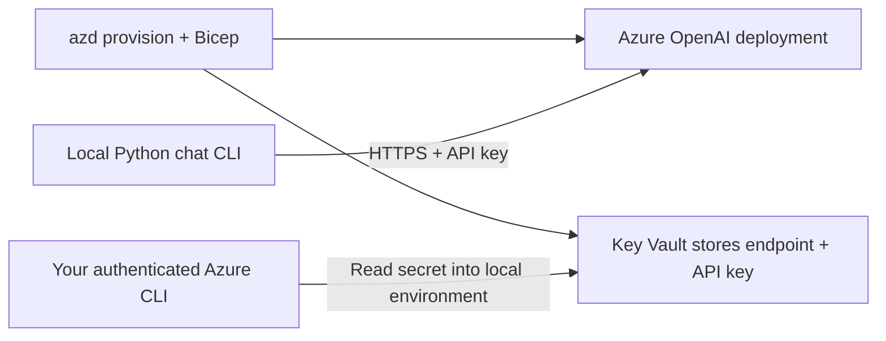

# Azure OpenAI Chat — Kohalik CLI ja AZD infrastruktuur

**Tase:** Kesktase · **Aeg:** 35–60 minutit, sealhulgas seadistamine

See näidis loob **Azure OpenAI ressursi ja Key Vaulti**, seejärel käivitab
interaktiivse Python vestluse CLI **sinu masinas**. See ei hosti veebirakendust
ega konteinerirakendust. Vaikimisi mudel on `gpt-4.1`, versioon `2025-04-14`, koos
`GlobalStandard` juurutusmahtuvusega 20. Kontrolli valitud piirkonna praegust saadavust ja limiiti enne juurutamist;
mudeli elutsükli kuupäevad võivad muutuda.

## Õpieesmärgid

- Mudeli infrastruktuuri juurutamine Bicep ja azd abil.
- API-võtme hankimine Key Vaultist ilma selle lisamiseta juurutuse väljunditesse.
- Chat Completions päringute saatmine ja vestluse ajaloo säilitamine.
- Sõnumite arvu tõlgendamine ja kuluhindade piirangud.



Selles näites ei ole hallatava identiteedi käitusaegset integratsiooni, mitme piirkonna
varukoopiat, kohandatud kiirusepiirajat, voogedastusrežiimi ega hostitud arvutusvõimsust.
OpenAI SDK proovib korduvate vigade korral kuni kahte taasalustamist; CLI teatab ülejäänud vigadest.

## Eeltingimused

- Värske stabiilne [azd](https://learn.microsoft.com/azure/developer/azure-developer-cli/install-azd)
  (vabastamise ajal versioon 1.37.2).
- [Azure CLI](https://learn.microsoft.com/cli/azure/install-azure-cli).
- Python **3.10+** (soovitatav 3.11) ja virtuaalne keskkond.
- Azure tellimus, millel on õigus luua Cognitive Services ja Key Vaulti
  ressursse, juurutada mudeleid ja lugeda voltme saladusi.
- Piirkondlik saadavus ja `GlobalStandard` limiit `gpt-4.1` jaoks. Juurdepääsunõuded
  sõltuvad tellimusest ja funktsioonist; heakskiituks ei ole garantii kohta kindlat aega.

```bash
azd version
az version
python --version
azd auth login
az login
```

Need on erinevad autentimisseansid. Valige mõlemas tööriistas enne allolevate käskude käivitamist sama tellimus.
tööriistas enne allolevate käskude käivitamist.

## Kiire alustamine (Bash)

Käivitage hoiukohana juurest:

```bash
cd examples/azure-openai-chat
azd env new myopenai
azd provision
```

Valige toetatud piirkond. Provisioning loob ressursigrupi, OpenAI konto,
mudeli juurutuse, Key Vaulti ja `openai-endpoint`/`openai-api-key` saladused.
'Sellel pole **ühtegi teenust, mida juurutada**' aadressil `azure.yaml`.

Laadige mitteesituslikud väljundid ja hankige saladus oma praegusesse shelli:

```bash
export AZURE_OPENAI_ENDPOINT="$(azd env get-value AZURE_OPENAI_ENDPOINT)"
export AZURE_OPENAI_MODEL="$(azd env get-value AZURE_OPENAI_MODEL)"
KV_NAME="$(azd env get-value AZURE_KEY_VAULT_NAME)"
export AZURE_OPENAI_API_KEY="$(az keyvault secret show \
  --vault-name "$KV_NAME" --name openai-api-key --query value --output tsv)"

python -m venv .venv
source .venv/bin/activate
python -m pip install -r src/requirements.txt
python src/chat.py
```

PowerShellis aktiveerige `.\.venv\Scripts\Activate.ps1` ja määrake keskkonnamuutujad
`$env:AZURE_OPENAI_ENDPOINT = azd env get-value AZURE_OPENAI_ENDPOINT` abil
(ja sarnaselt mudelile). API võtme hankimiseks kasutage
`$env:AZURE_OPENAI_API_KEY = az keyvault secret show --vault-name $KV_NAME --name openai-api-key --query value -o tsv`.
Määrake esmalt `$KV_NAME = azd env get-value AZURE_KEY_VAULT_NAME`.

Ärge trükkige, komiteerige ega kleepige API võtit probleemiaruannetesse. CLI loeb protsessi
keskkonnamuutujaid; see **ei** kogu Key Vault saladusi ega laadi `.env` faile.
`config.py` kontrollib käivitamisel lõpp-punkti, tokeni piiri ja temperatuuri.

Oodatav väljund (sisu ja kasutus võivad erineda):

```text
Azure OpenAI Chat Application
Model: gpt-4.1
...
You: Say hello in one sentence.
Assistant: Hello! How can I help you today?
[Tokens: ... | Cost: $...]
```

Käsklused: `stats` näitab kokkuvõtteid, `clear` kustutab vestluseajaloo ning
`quit`/`exit` lõpetab sessiooni. Pole olemas `--stream`, `--show-tokens`, `tokens`,
ega `cost` käske.

## Kontrolli juurutust

Pärast ülaltoodud shelli muutujate laadimist:

```bash
curl --fail-with-body \
  "${AZURE_OPENAI_ENDPOINT%/}/openai/deployments/${AZURE_OPENAI_MODEL}/chat/completions?api-version=2024-10-21" \
  -H "Content-Type: application/json" \
  -H "api-key: $AZURE_OPENAI_API_KEY" \
  -d '{"messages":[{"role":"user","content":"Say hello!"}],"max_tokens":50}'

az keyvault secret list --vault-name "$KV_NAME" --query "[].name" -o table
```

Edukas: API tagastab HTTP 200 koos `choices[0].message.content` ja `usage`;
vault kuvab `openai-api-key` ja `openai-endpoint`. Üks ARM-i edukas juurutamine
ise ei kinnita järeldust.

## Failid ja konfiguratsioon

```text
azure.yaml                         # Infrastructure-only AZD project
infra/main.bicep                   # Subscription deployment
infra/main.parameters.json         # Environment, location, principal ID
infra/resources/openai.bicep       # Account + model
infra/resources/keyvault.bicep     # Vault + deploying user's secret access policy
infra/resources/secrets.bicep      # Writes secrets, no key output
src/chat.py                        # Interactive CLI
src/config.py                      # Environment validation
src/requirements.txt               # Python packages
```

Muutmaks etteantud mudelit/versiooni/mahtu, redigeeri vaikimisi seadeid failis
`infra/main.bicep` ja käivita `azd provision`. Sätte `AZURE_OPENAI_MODEL` määramine oma
terminalis valib ainult **olemasoleva juurutamise nime**; see ei juuruta uut mudelit.

| Käitumismuutuja | Vaikimisi / allikas |
|---|---|
| `AZURE_OPENAI_ENDPOINT` | Nõutav; azd mitte-salajane väljund |
| `AZURE_OPENAI_API_KEY` | Nõutav; toob välja Key Vault-ist |
| `AZURE_OPENAI_MODEL` | `gpt-4.1`; Azure juurutamise nimi |
| `AZURE_OPENAI_MAX_TOKENS` | 800 (valideerimisvahemik 1–4096) |
| `AZURE_OPENAI_TEMPERATURE` | 0.7 (vahemik 0–2) |
| `AZURE_OPENAI_INPUT_PRICE_PER_1K` | 0.002 USD; illustratiivne vahemäluta sissepääsu hind |
| `AZURE_OPENAI_OUTPUT_PRICE_PER_1K` | 0.008 USD; illustratiivne väljundi hind |

## Kulud ja turvapiirangud

Kulunäidik on **hinnanguline**, mitte Azure arvelduse alus. See korrutab API tegevuse tokeni
kasutamise määratud hindadega ja ei arvesta vahemälus oleva sisendi allahindlusi,
piirkondlikke/SKU erinevusi, makse, hinnamuutusi või ebaõnnestunud/korratud kõnesid.
Üle kirjuta **mõlemad hinnad**, kui kasutad teist mudelit või SKU-d, ja kontrolli värsket
[Azure OpenAI hinnastust](https://azure.microsoft.com/pricing/details/cognitive-services/openai-service/).

Näitena maksavad 100 päringut, millest igaühes on 500 vahemäluta sisenditokenit ja 200 väljundtokenit
vaikimisi hindadel kokku `100 × (500/1000 × .002 + 200/1000 × .008) = $0.26`.
Key Vault toimingute/halduse eest võetakse eraldi tasu. Selle kohaliku CLI kasutamine ei maksa fikseeritud 50 $/kuus
ega käivitata malli kaudu hostitud arvutusressursse.

Vault kasutab juurutava isiku pääsupoliitikat; see ei ole RBAC või
hallatava identiteediga rakenduse näide. Õpetamise eesmärgil kasutatakse avalikke otspunktide ja API-võtme autentimist.
Piira õigusi ja lisa sobivad identiteedi/võrgu kontrollid enne tootmiskeskkonda kohandamist.


## Praktilised harjutused

### 1. Kinnita kontekst ja lähtesta see

**Alusta:** käivita CLI. **Eesmärk:** vaata ajalugu.
Ütle "Mäleta sõna seedripuu," siis küsi "Mis sõna palusin sul meelde jätta?"
Käivita `stats`; kaks edukat sammu peaksid kokku käivitama kaks sõnumit.
Käivita `clear` ja `stats`; vahetatud sõnumeid peaks olema null (tokenite arv jääb samaks).
Mudeli täpne väljend ei ole deterministlik.

### 2. Muuda vastuse limiiti

**Alusta:** sulge CLI, jätkates samas terminalis.
Käivita `export AZURE_OPENAI_MAX_TOKENS=100`, taaskäivita `python src/chat.py` ja küsi
lühikest selgitust azd kohta. Kontrolli, et päis näitab 100.
Taasta käivitades `unset AZURE_OPENAI_MAX_TOKENS`. Väiksem vastuse limiit ei
vähenda juba saadetud ajaloo tokeneid.

### Levinud probleemid

- **Keskkonnamuutujad puuduvad:** juurutamine ei ekspordi keskkonna muutujaid;
  korda ekspordimeetmeid. Uues terminalis tuleb neid taas määrata.
- **403 tõrge Key Vault lugemisel:** kontrolli Azure CLI tellimust/sisselogimist ja juurdepääsu poliitikasse
  lisatud isikut. Poliitika muudatuste jõustumiseks võib kuluda aega.
- **404 tõlgendus:** kontrolli juurutuse nime, otsapunkti ja juurutuse olekut.
- **429 tõlgendus:** oota, kuni kiirusepiirangud lähtestatakse; kontrolli piirkondlikku mudeli kvooti.
  CLI eemaldab ebaõnnestunud pöörded ajaloost, nii et kordamine ei dubleeri neid.
- **Konteksti pikkus:** näidis ei lühenda pikki vestlusi; kasuta `clear`.
- **Mudelit pole saadaval/pensionil:** vaata jooksvat mudeli kättesaadavust ja uuenda
  mudel/versioon/SKU koos; API versioon ja mudeli versioon on erinevad seaded.

## Puhastamine ja järgmised sammud

```bash
azd down
unset AZURE_OPENAI_API_KEY
```

Key Vaulti pehme kustutamise säilitusaeg on seitse päeva; puhastamine nõuab eraldi õigusi.
Püsivat testikomplekti pole; ära käivita mitteolemasolevat `pytest tests/` käsku.
Lisa simuleeritud API testid enne koodi laiendamist.

[Konteineri näited](../../../../examples/container-app) · [Jaemüügi arhitektuuri juhend](../retail-scenario.md) ·
[Kursuse avaleht](../../README.md) · [Teata probleemist](https://github.com/microsoft/AZD-for-beginners/issues)

---

<!-- CO-OP TRANSLATOR DISCLAIMER START -->
**Lahtiütlus**:
See dokument on tõlgitud kasutades AI tõlketeenust [Co-op Translator](https://github.com/Azure/co-op-translator). Kuigi me püüdleme täpsuse poole, palun pange tähele, et automatiseeritud tõlgetes võib esineda vigu või ebatäpsusi. Originaaldokument selle emakeeles tuleks pidada autoriteetseks allikaks. Olulise teabe puhul soovitatakse kasutada professionaalset inimtõlget. Me ei vastuta selle tõlkega seotud eksimustest või valesti mõistmistest.
<!-- CO-OP TRANSLATOR DISCLAIMER END -->