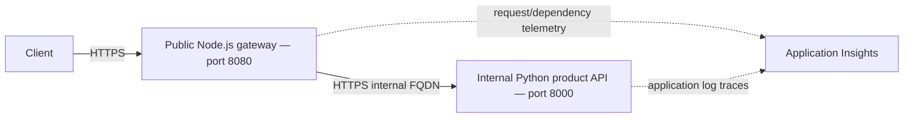

# Kahe-teenusega mikroteenused — Azure Container Apps

**Tase:** Kesktase · **Aeg:** 45–60 minutit koos seadistamisega

See õppenäide rakendab **Node.js API-silla** ja **ainult lugemiseks mõeldud Python
toote teenuse**. Allikas, Dockerfailid, Bicep ja azd konfiguratsioon on kaasas.
See ei ole tootmiskõlbulik süsteem.

## Mida õpid

- Kaks teenust juurutada iseseisvalt.
- Kasutada sisemist backend FQDN-i üle HTTPS.
- Kinnitada edukat, mitte leitud ja teenuse mittenõuetekohast vastust.
- Mõista telemeetria ja iseseisvate skaala piiranguid.



Tootekataloog sisaldab viit fikseeritud toodet mälus. Puuduvad **POST,
PUT või DELETE töötlejad**, andmebaas, Service Bus, tellimuse/kasutaja/teavitusteenus,
C# või Go kood. Need on tuleviku arendusideed, mitte kaasatud funktsioonid.
Lähtevärav ei autentita kasutajaid; sisemine sisenemine ei asenda
rakenduse autoriseerimist.

## Eeldused

Täitke esmalt [ainult Flask API](../../../../../examples/container-app/simple-flask-api).
Installige ajakohane stabiilne azd (ülevaate ajal avaldatud versioon: 1.37.2), Azure CLI,
ja Docker koos taustaprotsessiga. Vajate Azure tellimust, ressursside loomise õigusi
ning Container Apps piirkondlikku kvota.

```bash
azd version
az version
docker info
azd auth login
az login
```

Kasutage mõlemas CLI tööriistas sama tellimust. Alljärgnevad käsud on Bash-is.

## Paigaldus ja kontroll

Hoidla juurkataloogist:

```bash
cd examples/container-app/microservices
azd env new microservices-demo
azd up
GATEWAY_URL=$(azd env get-value API_GATEWAY_URL)
RG_NAME=$(azd env get-value AZURE_RESOURCE_GROUP)
GATEWAY_NAME=$(azd env get-value API_GATEWAY_NAME)
PRODUCT_NAME=$(azd env get-value PRODUCT_SERVICE_NAME)

curl --fail-with-body "${GATEWAY_URL}/health"
curl --fail-with-body "${GATEWAY_URL}/api/products"
curl --fail-with-body "${GATEWAY_URL}/api/products/1"
curl -i "${GATEWAY_URL}/api/products/999"
```

**Edu:** tervis 200; nimekiri 200 viie tootega; toode 1 on sülearvuti,
hinnaga 999,99 ja laoseisuga 50; tundmatu toode tagastab 404.
Kirjeldused on vastustes kaasatud; ajatemplitel on varieeruvus.

Esmase paigalduse puhul kasutatakse avalikke hello-world pilte pordil 80, et ei
oleks vaja tõmmata mitteolemasolevaid pilte tühjast registrist. Teenusepõhised Bicep moodulid
ja parameeterfailid asendavad need ehitatud piltide ja rakenduse portide/probidega paigalduse ajal
`azd deploy`. Peamised parameetrid säilitavad avaldatud piltide nimed hilisemaks paigaldamiseks.

## Teenused ja võrgustik

| Teenus | Avalikustatud lõpp-punktid | Vaikimisi ressursid |
|---|---|---|
| Gateway | GET `/`, `/health`, `/api/products`, `/api/products/:id` | 1 vCPU, 2 GiB, 2–20 koopiat |
| Product | GET `/`, `/health`, `/products`, `/products/<id>` | 0.5 vCPU, 1 GiB, 1–10 koopiat |

Product-ingress'il on `external: false` ja `allowInsecure: false`. Bicep süstib
`PRODUCT_SERVICE_URL=https://<actual-internal-fqdn>` gateway-sse. HTTP oleks
suunamine; HTTPS vastab konfigureeritud sisenemisteele. Lühike DNS-i nimi peab vastama
**tõelisele konteinerirakenduse nimele**, mitte loogilisele teenusevõtmele `product-service`.
Ära proovi sisemist URL-i otse oma sülearvutist kutsuda.

Sisenemislüüsil on tootepäringute jaoks viie sekundi aegumine. Puuduvad tootetunnused
põhjustavad 404; transpordivead/muutuvad taustateenuse vead tagastavad 503. Lüüs
`/health` kontrollib ainult lüüsi, mitte taustateenuse saadavust.

## Failid ja konfiguratsioon

```text
azure.yaml
infra/main.bicep
infra/main.parameters.json
infra/abbreviations.json
infra/core/container-apps-environment.bicep
infra/core/monitor.bicep
infra/app/api-gateway.bicep
infra/app/api-gateway.parameters.json
infra/app/product-service.bicep
infra/app/product-service.parameters.json
src/api-gateway/{app.js,package.json,Dockerfile}
src/product-service/{main.py,requirements.txt,Dockerfile}
```

Skaalamine, CPU/mälu, pordid ja sondid on määratud failis `infra/app/*.bicep`. Muuda neid
faile ja käivita `azd up` infrastruktuuri rakendamiseks ja ümberpaigutamiseks. Selles
näites puudub `GATEWAY_MAX_REPLICAS` keskkonnamuutuja parameeter.

Ainult koodi muudatuste puhul:

```bash
azd deploy product-service
azd deploy api-gateway
```

Node'i pilt kasutab Node 22; Pythoni pilt kasutab Python 3.11. Mõlemad seovad end
`0.0.0.0`. Sisenemiskiht/sondid kasutavad vastavalt porti 8080 (lüüs) ja 8000 (toode).

## Kohalik arendus Dockeriga

Käivita sellest näitedirektoriumist. Kasuta kasutajapoolset võrku, **mitte `localhost`
ühe konteineri jaoks teise jõudmiseks**:

```bash
docker network create azd-microservices-demo
docker build -t local-product ./src/product-service
docker build -t local-gateway ./src/api-gateway
docker run -d --name azd-product --network azd-microservices-demo local-product
docker run -d --name azd-gateway --network azd-microservices-demo \
  -p 8080:8080 -e PRODUCT_SERVICE_URL=http://azd-product:8000 local-gateway
curl --fail-with-body http://localhost:8080/api/products
```

Oodatav: viis toodet. HTTP-d kasutatakse ainult selle kohaliku Dockeri võrgu jaoks.

```bash
docker stop azd-product azd-gateway
docker rm azd-product azd-gateway
docker network rm azd-microservices-demo
```

## Jälgimine

```bash
az containerapp logs show --name "$GATEWAY_NAME" --resource-group "$RG_NAME" --follow
# In a separate terminal:
az containerapp logs show --name "$PRODUCT_NAME" --resource-group "$RG_NAME" --tail 100
```

`azd monitor --logs` avab portaali vaate; see ei vooga terminali logisid.
Node SDK kogub lüüsi päringuid/sõltuvusi. Pythoni `AzureLogHandler` ekspordib
**logijälgi**, mitte automaatseid Flaski päringuid, SQL-i sõltuvusi ega täielikke
jaotatud jälgi. OpenCensus on pärand SDK; eelistage Azure Monitor OpenTelemetry’d,
kui seda näidet laiendate.

Application Insightsi logides genereerige päringud ja vaadake:

```kusto
requests
| where timestamp > ago(1h)
| where name contains "products"
| summarize RequestCount=count(), AvgDuration=avg(duration) by bin(timestamp, 5m)
```

Pythoni rakenduste sõnumite jaoks:

```kusto
traces
| where timestamp > ago(1h)
| where message contains "products"
| project timestamp, message, severityLevel
```

Arvesta sisseimportimise viivitust ja valimit; ära oota täpset päringute arvu ega
garanteeritud latentsust. Kohandatud hoiatusi ega armatuurlaudu pole konfigureeritud.

## Praktilised harjutused

### Harjutus 1: muuta kataloogi

**Alguspunkt:** `src/product-service/main.py`.
**Eesmärk:** kontrollida sõltumatut teenuse juurutamist.
Muuda sülearvuti laoseis 50-lt 49-le fikseeritud `products` nimekirjas, käivita
`azd deploy product-service`, seejärel küsi `${GATEWAY_URL}/api/products/1`.

**Õnnestumise kriteerium / lahendus:** HTTP 200 koos `"stock":49`. Taasta 50 ja paigalda uuesti.
**Tavaline probleem:** sisenemislüüsi muutmine teenuse asemel, mis kataloogi haldab.
See muudab allikandmeid, mitte püsivat laoseisu andmebaasi.

### Harjutus 2: veendu koopiate seadistuses

**Alguspunkt:** `infra/app/product-service.bicep`.
**Eesmärk:** jälgida infrastruktuuri muutust ilma autoskaalumise oletamiseta.
Muuda `minReplicas: 1` väärtuseks `minReplicas: 2`, käivita `azd up`, seejärel:

```bash
az containerapp show --name "$PRODUCT_NAME" --resource-group "$RG_NAME" \
  --query properties.template.scale -o json
```

**Õnnestumise kriteerium:** konfigureeritud minimaalne on 2 ja maksimaalne jääb 10-ks.
Taasta minimaalne 1 ja käivita `azd up`.
**Tavaline probleem:** ainult `azd deploy` ei rakenda muudatusi mitteseotud jagatud
infrastruktuuril. Ära sea `maxReplicas` väärtust nulliks viga simuleerides.
See kontrollib konfiguratsiooni, mitte koormustesti ega garanteeritud hetkelist koopiate arvu.

### Harjutus 3: testi kohalikku teenuse mittesaadavust

**Alguspunkt:** mõlemad kohaliku Dockeri konteinerid on käimas.
**Eesmärk:** eristada taustateenuse riket puuduvast tootest.
Peata ainult tootekonteiner:

```bash
docker stop azd-product
curl -i http://localhost:8080/api/products
docker start azd-product
curl --fail-with-body http://localhost:8080/api/products
```

**Õnnestumise kriteerium:** peatamise ajal tagastab lüüs 503 koos
`"error":"Product service unavailable"`; taaskäivitamisel tagastab nimekiri 200.
Vajadusel proovi uuesti pärast lühikest käivitumisviivitust.
**Tavaline probleem:** lüüsi peatamine testib teistsugust viga (pole HTTP vastust).

## Kulud ja tootmisvahed

Vaikimisi minimaalne koopiate arv hoiab arvutuse töös. Ka registri ja jälgimise eest tuleb maksta.
Fixsumma 50 dollari kuus puudub; hinda piirkondlikku CPU/mälu,
koopiate tunde, päringuid, registrit ja logide säilitust aadressil
[Azure'i hinnakalkulaator](https://azure.microsoft.com/pricing/calculator/).
Kustuta õppematerjalid kiiresti.

Tootmises on kaasatud autentimine/autoriseerimine, piiritletud hallatavad identiteedid,
püsivad andmed, sisendi/väljundi valideerimine, toetatud jälgimisinstrumendid,
koormus-/veatesting, CI/CD, teated ja taastamismeetodid. Tellimusteenuse,
järjekorra või andmebaasi lisamine on eraldi teostustöö, mitte selle harjutuse
lõpetatud osa ega siin saadaval funktsioon.

## Tõrkeotsing ja puhastamine

- **Pilt puudub esimesel käivitamisel:** käivitamisel tuleks kasutada avalikku pilti;
  kontrolli põhipildi parameetrite vaikeväärtusi ja juurutamise mooduli seoseid.
- **503 tooted:** vaata tootelogisid, pildi revisjoni ja injekteeritud sisemist HTTPS URL-i.
- **404 ootamatu tee:** toote API on ainult lugemiseks; kontrolli marsruuti, mitte olematut CRUD-i käitlejat.
- **Telemeetria puudub:** kontrolli runtime'i ühendusstringe, ilma et neid avalikustataks, ning
  arvesta andmete vastuvõtu viivitusega. Pythoni päringulaule ei täideta selle logihalduri poolt.

Sellest näitedirektoriumist:

```bash
azd down
```

Vaata kustutusteadeid ja veendu, et pühendatud ressursigrupi eemaldamine õnnestus.

[Eelmine: Flask API](../../../../../examples/container-app/simple-flask-api) · [Järgmine: Andmebaasi rakendus](../../../../../examples/database-app) ·
[AI arendus](../../../docs/chapter-02-ai-development/README.md) ·
[Kursuse avaleht](../../../README.md) · [Teata probleemist](https://github.com/microsoft/AZD-for-beginners/issues)

---

<!-- CO-OP TRANSLATOR DISCLAIMER START -->
**Lahtiütlus**:
See dokument on tõlgitud kasutades AI tõlketeenust [Co-op Translator](https://github.com/Azure/co-op-translator). Kuigi me püüdleme täpsuse poole, palun pange tähele, et automatiseeritud tõlgetes võib esineda vigu või ebatäpsusi. Originaaldokument selle emakeeles tuleks pidada autoriteetseks allikaks. Olulise teabe puhul soovitatakse kasutada professionaalset inimtõlget. Me ei vastuta selle tõlkega seotud eksimustest või valesti mõistmistest.
<!-- CO-OP TRANSLATOR DISCLAIMER END -->