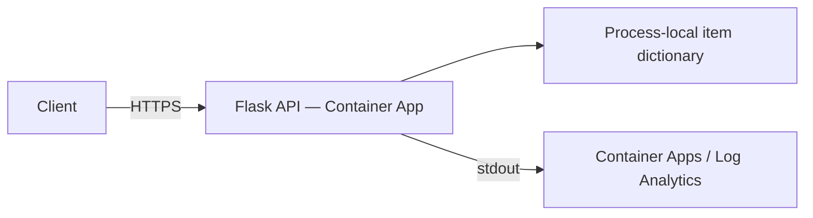

# Lihtne Flaski API — Azure Container Apps

**Tase:** Algaja · **Aeg:** 30–45 minutit koos seadistamisega

Paigalda Python Flask CRUD API Azure Developer CLI-ga (azd). Allikas, Dockerfile,
Bicep ja juurutamisparameetrid on kaasas. See on **õppimiseks mõeldud näidis**, mitte
tootmiseks valmis API.

## Mida sa õpid

- Paku ja laadi konteiner azd kaudu.
- Konfigureeri sisenemine ja elavuse/valmiduse kontrollid.
- Kontrolli CRUD vastuseid ja vaata rakenduse logisid.
- Mõista, miks sisemälu andmeid pole sobilik kasutada püsivates rakendustes.



**Oluline:** andmed hoitakse ühe protsessi sees. Vaikimisi on **üks Gunicorn tööline,
0–1 koopiat**, et vältida tahtlikult andmete ebajärjekindlust töölistel/koopiatel.
Andmed lähevad kaduma taaskäivitamisel, versiooni vahetamisel või nullini skaleerimisel. Koopiate arvu suurendamine
nõuab jagatud püsivat salvestust. API-l puudub autentimine ja autoriseerimine.

## Eeldused

- [Praegune stabiilne azd](https://learn.microsoft.com/azure/developer/azure-developer-cli/install-azd)
  (vabastusaegne versioon: 1.37.2).
- [Azure CLI](https://learn.microsoft.com/cli/azure/install-azure-cli) kontrolliks.
- Docker koos tema daemoniga töös; see on vajalik vaikimisi kohalikuks pildi koostamiseks.
- Azure'i tellimus, ressursi loomise õigused ja Container Apps piirkondlik limiit.
- Bash neid käske jooksutamiseks (või oma ekvivalentne PowerShell).
- Python 3.11 valikulise kohaliku arenduse jaoks.

```bash
azd version
az version
docker info
azd auth login
az login
```

CLI tööriistadel on eraldi sisselogimise sessioonid. Kasuta mõlemas sama tellimust.

## Kiirstart

Hoidla juuurest:

```bash
cd examples/container-app/simple-flask-api
azd env new flask-demo
azd up
API_URL=$(azd env get-value API_ENDPOINT)
RG_NAME=$(azd env get-value AZURE_RESOURCE_GROUP)
API_NAME=$(azd env get-value API_NAME)
curl --fail-with-body "${API_URL}/health"
```

Oodatav: HTTP 200 ja JSON koos `"status":"healthy"`,
`"service":"simple-flask-api"` ja praeguse UTC ajatempliga.
Loomine ja pildi koostamine võtab tavaliselt mitu minutit; aeg võib varieeruda.

Algne loomine kasutab avalikku hello-world pilti, mis kuulab pordil 80.
`azure.yaml` valib `infra/app/api.bicep` ja vastava parameetrifaili teenuse juurutamiseks,
mis vahetab pildi, sisenemise ja kontrollid pordi 8000 vastu.
Ära kustuta neid juurutamisparameetreid.

## Kontrolli CRUD-i

Käivita järgnevad käsud järjest, kui sama koopia on aktiivne:

```bash
# Create: HTTP 201; note the returned id (1 for a fresh process).
curl -i -X POST "${API_URL}/api/items" \
  -H "Content-Type: application/json" \
  -d '{"name":"Test Item","description":"My first item"}'

# Read list: HTTP 200, total 1 in a fresh process.
curl --fail-with-body "${API_URL}/api/items"

# Replace 1 if your create response returned another id.
curl --fail-with-body "${API_URL}/api/items/1"
curl -i -X PUT "${API_URL}/api/items/1" \
  -H "Content-Type: application/json" -d '{"name":"Updated Item"}'
curl -i -X DELETE "${API_URL}/api/items/1"
curl -i "${API_URL}/api/items/1"
```

Edu: POST 201, lugemine/PUT 200, DELETE 204 ilma sisuta, seejärel puuduv ese 404.
Vigane/mitteobjektiline JSON või tühi nimi tagastab 400.
Kui ese kaob päringute vahel, kontrolli taaskäivitust või nullini skaleerimist;
see on tahtlik sisemälu piirang, mitte püsivus.

| Lõpp-punkt | Meetodid |
|---|---|
| `/` | GET — teenuse info |
| `/health` | GET — elavuse/valmiduse kontroll |
| `/api/items` | GET, POST |
| `/api/items/{id}` | GET, PUT, DELETE |

## Logid ja konfiguratsioon

```bash
az containerapp logs show --name "$API_NAME" --resource-group "$RG_NAME" --follow
```

Oodatav: Gunicorn käivitamine, päringute ligipääsulogid ja rakenduse teated.
`azd monitor --logs` avab portaalivaate; see ei voogu terminali.
Application Insights on loodud, kuid **seda Flaski kood ei instrumendeeri**;
kasuta Container Apps/Log Analytics-i standartväljundi logide jaoks.

Muuda `infra/app/api.bicep` CPU/mälu, koopiate limiite või skaleerimisreegleid, seejärel
käivita `azd up`. Vaikesätted on 0.5 vCPU, 1 GiB, miinimum 0 / maksimum 1 koopia ja
50 samaaegset HTTP päringut. Nullini skaleerimine võib lisada külma käivituse latentsust.

Suvalised `azd env set MAX_REPLICAS`, `API_KEY`, `LOG_LEVEL` või
`SCALE_TO_ZERO_TIMEOUT` väärtused ei ole **kaardistatud sellele mallile ega rakendusele**.
Väärtuse seadmine ei tee sellest automaatselt jooksuaja keskkonnamuutujat.
Pilt kasutab pordina selgesõnaliselt 8000; uuenda koos Dockerfile, Bicep sisenemise ja kontrollidega
, kui porti muudad.

## Failid

```text
azure.yaml
infra/main.bicep
infra/main.parameters.json
infra/app/container-apps.bicep       # Environment, registry, monitoring
infra/app/api.bicep                  # App, ingress, probes, scale settings
infra/app/api.parameters.json        # Image and resource values for azd deploy
src/app.py
src/Dockerfile
src/requirements.txt
```

## Kohalik arendus

Sellest näidiskataloogist:

```bash
python -m venv .venv
source .venv/bin/activate  # PowerShell: .\.venv\Scripts\Activate.ps1
python -m pip install -r src/requirements.txt
python src/app.py
```

Teises terminalis testi `http://localhost:8000/health` ja CRUD lõpp-punkte.
Või koosta ja käivita tegelik pilt:

```bash
docker build -t flask-api:local ./src
docker run --rm -p 8000:8000 flask-api:local
```

Kui teed pärast esmast juurutamist ainult koodimuudatusi, käivita `azd deploy api`.
Bicep muudatuste korral käivita `azd up`, et uuesti luua ja juurutada.

## Praktilised harjutused

### 1. Kontrolli sisendi tõrjumist

**Algne seis:** juurutatud API, `API_URL` eespool.
**Eesmärk:** veendu, et API tõrjub väärad JSON kujud ja puuduvad nimed.

```bash
curl -i -X POST "${API_URL}/api/items" \
  -H "Content-Type: application/json" -d '[]'
curl -i -X POST "${API_URL}/api/items" \
  -H "Content-Type: application/json" -d '{"name":""}'
```

**Edu kriteeriumid / lahendus:** mõlemad tagastavad 400 koos JSON veateatega, mitte 500.
**Levinud probleem:** JSON sisutüübi päise puudumine.

### 2. Lisa ainult lugemiseks mõeldud versioonilõpp-punkt

**Algne seis:** `src/app.py`. **Eesmärk:** laienda ja juuruta API uuesti.
Lisa see enne `if __name__ == '__main__':` plokki:

```python
@app.route('/version', methods=['GET'])
def version():
    return jsonify({'version': '1.0.0'})
```

Käivita `azd deploy api`, seejärel `curl --fail-with-body "${API_URL}/version"`.
**Edu kriteerium:** HTTP 200 ja `{"version":"1.0.0"}`.
**Levinud probleem:** tee lisamine pärast blokeerivat `app.run()` käsku, kui
testid `python src/app.py`-ga.

### Teadmiste kontrollpunkt

Miks ei piisa ühest töölist vastupidava andmehoidla jaoks? Sest isegi üks protsess kaotab
oma sõnastiku taaskäivitamisel. Tootmisversioon vajab püsivat jagatud salvestust,
autentimist, autoriseerimist, migratsioone, teste ja operatiivset seiret.

## Kulud ja tõrkeotsing

See pole garanteeritud nullkulu juurutus: Basic registri ja logide salvestamise/tarbitamise
eest võivad tekkida kulud, isegi kui rakenduse arvutus on nullil. Kasuta
[hinnakalkulaatorit](https://azure.microsoft.com/pricing/calculator/) oma regioonile.

- **Dockeri koostuse ebaõnnestumine:** veendu, et `docker info`, võrguühendus ja sõltuvused on korras.
- **Haige rakendus:** vaata konsooli/süsteemse logisid ja veendu, et pildi port, sisenemine,
  ja kontrollid oleksid kooskõlas. Kohatäitjat ei tohi kontrollida Flaski pordil.
- **403/lubade probleem:** kontrolli tellimuse ja ressursi loomise õigusi.
- **Esa kaob:** sisemälu olek lähtestub taaskäivitusel/nullini skaleerimisel; lisa andmebaas
  vastupidava käitumise jaoks.

## Puhastamine ja järgmised sammud

```bash
azd down
```

Vaata kustutamise kinnitus ja veendu, et pühendatud ressursigrupi kustutamine on tehtud.
Ära kasuta destruktiivset puhastust ressursigrupil, mis sisaldab mitteseotud andmeid.

[Järgmine: Andmebaasrakendus](../../../../../examples/database-app) · [Mikroteenused](../../../../../examples/container-app/microservices) ·
[Konteinervaliklõige](../README.md) · [Kursuse avaleht](../../../README.md) ·
[Teata probleemist](https://github.com/microsoft/AZD-for-beginners/issues)

---

<!-- CO-OP TRANSLATOR DISCLAIMER START -->
**Lahtiütlus**:
See dokument on tõlgitud kasutades AI tõlketeenust [Co-op Translator](https://github.com/Azure/co-op-translator). Kuigi me püüdleme täpsuse poole, palun pange tähele, et automatiseeritud tõlgetes võib esineda vigu või ebatäpsusi. Originaaldokument selle emakeeles tuleks pidada autoriteetseks allikaks. Olulise teabe puhul soovitatakse kasutada professionaalset inimtõlget. Me ei vastuta selle tõlkega seotud eksimustest või valesti mõistmistest.
<!-- CO-OP TRANSLATOR DISCLAIMER END -->