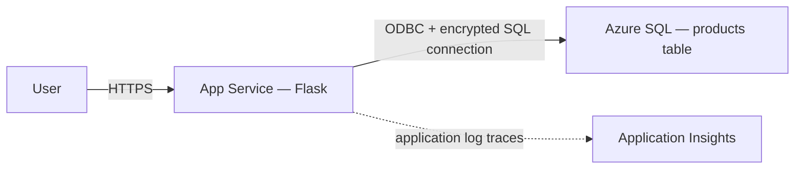

# Flask ja Azure SQL App Services

**Tase:** Kesktase · **Aeg:** 30–60 minutit, kaasa arvatud eeldused

See näidis paigaldab Python Flask lugemis-API **Linux App Service**-ile ja Basic
Azure SQL andmebaasi. Sisaldab lähtekoodi, Bicep-i ja azd konfiguratsiooni. Tegemist on
õppesuunaga, mitte tootmises kasutamiseks valmis andmebaasi arhitektuuriga.

## Mida sa õpid

- Provisioneerida App Service, SQL ja monitoorimise ressursid Bicep-iga.
- Konfigureerida krüpteeritud SQL ühenduvus ilma volitusi koodis talletamata.
- Algatada skeem enne Gunicorn töötajate käivitamist.
- Kontrollida idandatud andmeid, mitte-leitud vastuseid ja andmebaasi tervist.



Ressursid: pühendatud ressursirühm, B1 Linux App Service plaan, Python 3.11 veebirakendus,
SQL server ja Basic 2-GB andmebaas, Application Insights ja Log Analytics.
Veebiapp kasutab **lähttekoodi/ZIP paigaldust ja Oryx sõltuvuste installeerimist**;
`azd deploy` ei ehita ega paigalda valikulist Dockerfaili.

## Eeldused

- Praegune stabiilne [azd](https://learn.microsoft.com/azure/developer/azure-developer-cli/install-azd)
  (vaatlusajal avaldatud versioon: 1.37.2).
- [Azure CLI](https://learn.microsoft.com/cli/azure/install-azure-cli) kontrollimiseks.
- Azure tellimus, õigused nimetatud ressursside loomiseks ja piirkondlik kvoot.
- Python **3.11** kohalikuks arenduseks; pühendatud `pyodbc==5.0.1` võib vajada
  natiivseid ehitusvahendeid uuematelt Python versioonidelt.
- Microsoft ODBC Driver 18 (või 17) SQL Serverile kohalikus masinas. `pip install
  pyodbc` ei paigalda süsteemi draiverit. Vaata
  [ODBC paigaldust](https://learn.microsoft.com/sql/connect/odbc/download-odbc-driver-for-sql-server).
- Docker ainult, kui testid valikulist konteinerit lokaalselt.

```bash
azd version
az version
azd auth login
az login
```

Kasuta mõlemas tööriistas sama tellimust. Alltoodud käsud on Bash-is.

## Paigalda

Hoidla juurkataloogist:

```bash
cd examples/database-app
azd env new sql-demo
azd provision
azd deploy
WEB_URL=$(azd env get-value WEB_APP_URI)
WEB_NAME=$(azd env get-value WEB_APP_NAME)
RG_NAME=$(azd env get-value AZURE_RESOURCE_GROUP)
```

Vali toetatud piirkond. `sqlAdminLogin` vaikimisi on `sqladmin`; nõutav
`sqlAdminPassword` on turvaline parameeter. Sisesta tugev parool vastamisel.
Hoidu paigaldusvolituste talletamisest Git-is ja probleemide raportites. Praegune ühendus
stringi interpolatsioon eeldab parooli ilma ühendusstringi eraldajateta, näiteks
`;`; kohanda escapimist enne selliste väärtuste kasutamist.

Bicep määrab käivituskäsu, mis käitab `init_database()` **enne** Gunicorn
töötajad alustavad. See on vajalik, sest `app:app` importimine ei täida
Pythoni `if __name__ == '__main__'` plokki. Uuel andmebaasil loob algus
`products` ja lisab viis rida. See on lihtne õpetamise seeme, mitte
samaaegne migratsiooniraamistik; kasutage instantside laiendamisel korralikke migratsioone.

Rakendus valib installitud Microsoft ODBC Driver 18, siis 17, kui ühendus
string ei nimeta otseselt draiverit. Kui kumbki puudub, ebaõnnestub käivitamine
toimimist lubava installimisveaga. Kontrollige draiveri olemasolu teie valitud
App Service'i käituskeskkonnas, mitte ära eelda selle olemasolu.

## Kontrolli

```bash
curl --fail-with-body "${WEB_URL}/"
curl --fail-with-body "${WEB_URL}/health"
curl --fail-with-body "${WEB_URL}/products"
curl --fail-with-body "${WEB_URL}/products/1"
curl -i "${WEB_URL}/products/999"
```

Oodatud:

- `/` tagastab lõpp-punkti teabe.
- `/health` tagastab 200 koos `{"status":"healthy","database":"connected"}`.
- `/products` tagastab viis eelsätitud toodet uuelt andmebaasilt.
- `/products/1` tagastab sülearvuti hinnaga 1299,99.
- Olemasolematu toode tagastab 404 koos `{"error":"Product not found"}`.

API on ainult lugemiseks. POST/PUT/DELETE marsruuti ega brauseri kasutajaliidest ei ole.
Andmebaasi ühenduse tõrge tagastab 503 `/health`; see ei ole edu.

## Failid ja konfiguratsioon

```text
azure.yaml                         # Python App Service source deployment
infra/main.bicep
infra/main.parameters.json
infra/abbreviations.json
infra/resources/sql-server.bicep
infra/resources/sql-database.bicep
infra/resources/app-service-plan.bicep
infra/resources/web-app.bicep       # Settings + initialization/startup command
infra/resources/app-insights.bicep
src/web/app.py
src/web/requirements.txt
src/web/Dockerfile                 # Optional local container, not the azd target
.env.sample
```

`SQL_CONNECTION_STRING` antakse turvalise Bicep parameetrina Web App moodulile
ja salvestatakse App Service seadistustesse, mitte juurutamise väljunditesse.
`APPLICATIONINSIGHTS_CONNECTION_STRING` seadistab logi ekspordi.
`SCM_DO_BUILD_DURING_DEPLOYMENT=true` lubab serveripoolse sõltuvuste paigaldamise.
Suvaliste `azd env` väärtuste määramine ei muuda automaatselt rakenduse seadistusi.

SQL tulemüüri `0.0.0.0` reegel lubab ühendusi **Azure teenustest,
kaasa arvatud teiste klientide tellimustest**, SQL autentimise alusel. See ei ole
piiratud ainult selle rakenduse või tellimusega. SQL avaliku võrgu juurdepääs on lubatud.
Kasuta tootmises hargnenud võrgustikku ja mitte-admin-rakenduse identiteeti.

## Kohalik arendus

Kasuta Python 3.11 ja paigaldatud Microsoft SQL ODBC draiverit:

```bash
python -m venv .venv
source .venv/bin/activate  # PowerShell: .\.venv\Scripts\Activate.ps1
python -m pip install -r src/web/requirements.txt
export SQL_CONNECTION_STRING='Server=tcp:YOUR_SERVER.database.windows.net,1433;Database=YOUR_DATABASE;UID=YOUR_USER;PWD=YOUR_PASSWORD;Encrypt=yes;TrustServerCertificate=no;Connection Timeout=30;'
python src/web/app.py
```

Asenda kohakohtade väärtused turvaliselt. Kopeeritud `.env` faili **ei laadita automaatselt**
selle rakenduse poolt. Ekspordi muutujad oma hetke kestasse.
Azure SQL kasutamisel sülearvutist lubage ajutiselt ainult oma avalik IP:

```bash
SQL_SERVER=$(azd env get-value SQL_SERVER_NAME)
MY_IP=YOUR_PUBLIC_IP
az sql server firewall-rule create -g "$RG_NAME" -s "$SQL_SERVER" \
  -n AllowMyLearningIP --start-ip-address "$MY_IP" --end-ip-address "$MY_IP"
```

Eemalda reegel pärast testimist:

```bash
az sql server firewall-rule delete -g "$RG_NAME" -s "$SQL_SERVER" -n AllowMyLearningIP
```

Valikuline konteineri test sellest näitedirektoriumist:

```bash
docker build -t sql-flask:local src/web
docker run --rm -p 8000:8000 -e SQL_CONNECTION_STRING sql-flask:local
```

See pilt paigaldab Draiver 18, kasutades Debian 12 pakettide hoidlat, mis sobib selle
Bookworm baasiga, initsialiseerib andmebaasi ühe korra ja käivitab seejärel Gunicorni.

## Jälgimine ja tõrkeotsing

Lülita sisse/kuula App Service failisüsteemi rakenduse logisid käivitamise diagnoosimisel:

```bash
az webapp log config --name "$WEB_NAME" --resource-group "$RG_NAME" \
  --application-logging filesystem --level information
az webapp log tail --name "$WEB_NAME" --resource-group "$RG_NAME"
```

See kood ekspordib rakenduse **logi jälgi** läbi pärandatud OpenCensus käsitleja.
See ei seadista automaatset Flask päringu/sõltuvuste jälgimist, Live Metrics,
SQL auditeerimist, diagnostika seadeid ega hoiatusi. Need nõuavad eraldi seadistust.
Uue instrumentatsiooni jaoks eelista Azure Monitor OpenTelemetryd.

Application Insights Logsis pärast API-päringute tegemist:

```kusto
traces
| where timestamp > ago(1h)
| where message contains "products" or message contains "Health check"
| project timestamp, message, severityLevel
```

Võta arvesse tarne viivitust. Päringu tabeli või Live Metrics aktiivsus ei ole lõpetamise
kriteerium selle logipõhise instrumentatsiooni jaoks.

- **Draiver puudub:** kontrolli `pyodbc.drivers()` käitusaegset ja paigalda toetatud Microsoft ODBC draiver.
  Puhas Python pakett ei ole piisav.
- **Ühenduse tõrge:** kontrolli SQL seadeid, mandaatide, tulemüüri ja valitud
  tellimust. Ei tohi keelata krüpteerimist vea möödahiilimiseks.
- **Puuduv toodete tabel:** veendu, et Bicep käivituskäsk oli juurutatud;
  ainult `gunicorn app:app` käivitamine vahele jätab initsialiseerimise.
- **Paketi ehituse tõrge:** kasuta Python 3.11 või paku natiivset ehitusnõudeid.
- **Nullhinnaga andmed:** null on kehtiv kümnendväärtus; see peab seriaalima kui 0.0,
  mitte `null`.

## Praktikaülesanded

### Ülesanne 1: Kontrolli puuduva toote käitumist

**Alguspunkt:** juurutatud API ja `WEB_URL` eespool.
**Eesmärk:** eristada puuduolevat rida katkises andmebaasis.
Tee päringud `/health` ja `/products/999` kasutades ülaltoodud käske.
**Edu kriteeriumid / vastus:** olek 200, olemasolemata toode 404 (mitte 500 ega 503).
**Tavaline probleem:** eeldada, et mitteleidmine tõestab SQL ühenduse katkemist.

### Ülesanne 2: Muuda eelsätitud väärtust

**Alguspunkt:** Azure SQL Query Editor, ühendatud näidandmebaasiga.
**Eesmärk:** näidata, et API andmed salvestatakse SQL-s, mitte protsessi mällu.

```sql
UPDATE products SET price = 0 WHERE id = 1;
SELECT id, name, price FROM products WHERE id = 1;
```

Tee päring `${WEB_URL}/products/1`. **Edu kriteeriumid:** hind on `0.0`, mitte `null`.
Taasta väärtus:

```sql
UPDATE products SET price = 1299.99 WHERE id = 1;
```

**Tavaline probleem:** Python seemne nimekirja muutmine ei uuenda juba SQL-s olevaid ridu.
Ära käivita skeemi/andmeülesandeid tootmisandmebaasi vastu.

### Ülesanne 3: Lisa ainult lugemiseks loendamise lõpp-punkt

**Alguspunkt:** `src/web/app.py`.
**Eesmärk:** laiendada API-d parameetrita agregaatpäringuga.
Lisa see enne `if __name__ == '__main__':` plokki:

```python
@app.route('/product-count')
def product_count():
    from contextlib import closing
    with closing(get_db_connection()) as conn, closing(conn.cursor()) as cursor:
        cursor.execute("SELECT COUNT(*) FROM products")
        return jsonify({'count': cursor.fetchone()[0]})
```

Käivita `azd deploy web`, seejärel tee päring `${WEB_URL}/product-count`.
**Edu kriteeriumid:** 200 koos `{"count":5}` puutumata eelsätitud andmebaasil.
**Tavaline probleem:** marsruudi muutmine, aga ununeb uuesti juurutada.
Tootmises lisa vea käitlemine/testid; see lühike ülesanne keskendub päringule.

## Kulud, tootmislüngad ja puhastus

B1 App Service ja Basic andmebaas arveldatakse dokumendi olemasolu ajal. Veebirakenduse
peatamine EI peata App Service plaani arveldamist. Logid ja salvestus võivad lisakulusid lisada.
Kasuta [Azure hinnakalkulaatorit](https://azure.microsoft.com/pricing/calculator/)
kehtiva piirkondliku hinnastamise jaoks. Vahetus F1 vastu nõuab ka `alwaysOn` keelamist;
see ei ole ühe reale sobiv asendus. SQL serverless pole automaatselt tasuta.

Tootmine hõlmab minimaalsete õigustega rakenduse identiteeti (mitte SQL administraator),
autentimist/autorisatsiooni, privaatvõrku, turvalisi migratsioone, ühenduse
haldust, telemeetriat, auditeerimist, hoiatusi, teste ja taastamisprotseduure.
Redis vahemälu ja täiendavad tabelid on arendusideed, mitte rakendatud ülesanded.

Selle näitedirektoriumi juurest:

```bash
azd down
```

Vaata kustutamise päring üle ja veendu, et pühendatud ressursirühm on eemaldatud.
Ära kustuta gruppe, mis sisaldavad mitteseotud andmeid.

[Konteineri näited](../../../../examples/container-app) ·
[AI arendus](../../docs/chapter-02-ai-development/README.md) ·
[Kursuse avaleht](../../README.md) · [Teata probleemist](https://github.com/microsoft/AZD-for-beginners/issues)

---

<!-- CO-OP TRANSLATOR DISCLAIMER START -->
**Lahtiütlus**:
See dokument on tõlgitud kasutades AI tõlketeenust [Co-op Translator](https://github.com/Azure/co-op-translator). Kuigi me püüdleme täpsuse poole, palun pange tähele, et automatiseeritud tõlgetes võib esineda vigu või ebatäpsusi. Originaaldokument selle emakeeles tuleks pidada autoriteetseks allikaks. Olulise teabe puhul soovitatakse kasutada professionaalset inimtõlget. Me ei vastuta selle tõlkega seotud eksimustest või valesti mõistmistest.
<!-- CO-OP TRANSLATOR DISCLAIMER END -->