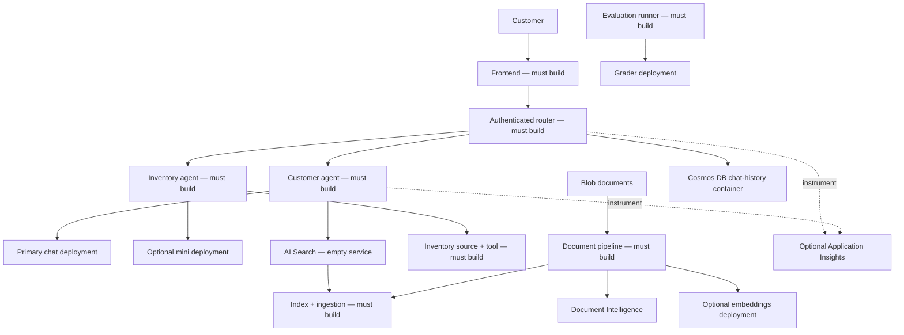

# Mitme Agendi Klienditoe — Jaemüügi Arhitektuuri Joonis

**5. peatükk: Mitme Agendi tehisintellekti lahendused**

- [Kursuse avaleht](../README.md)
- [5. peatükk](../docs/chapter-05-multi-agent/README.md)
- [Eeltingimus: tehisintellekti integratsioon](../docs/chapter-02-ai-development/microsoft-foundry-integration.md)
- [Järgmine: Võimsuse planeerimine](../docs/chapter-06-pre-deployment/capacity-planning.md)
- [ARM infrastruktuuri raamistik](retail-multiagent-arm-template/README.md)

> **Arhitektuuri juhend, mitte töötav rakendus.** Ainsad jaemüügi rakenduse
> failid on `azuredeploy.json`, `azuredeploy.parameters.json` ja `deploy.sh`
> kaustas `retail-multiagent-arm-template/`. Router/frontend konteinerid on tere-maailm
> kohatäited. Kohalikult puudub jaemüügi agent, kasutajaliides,
> andmete vastuvõtu voog, hindaja, skanner ega rakenduse testikomplekt.

## Ülevaade

**Eesmärk:** disainida klienditoe süsteem kliendiagendi ja laoseisu agendiga,
tuvastada, mida infrastruktuur pakub, ning planeerida puuduvad rakenduse
lepingud ja kontrollid.

**Sihtgrupp:** arendajad, kes on lõpetanud kohaliku
[vestluse näidis](../../../examples/azure-openai-chat) ja [kahe-teenuse konteineri näidis](../../../examples/container-app/microservices).
Arhitektuuri uurimiseks varuge 2–3 tundi. Rakenduse ehitamine on eraldi
projekt: 80–120 arendustundi on illustratiivne planeerimishinnang
kogenud arendajatele, **mitte kohaletoimetamise lubadus**; tootmise tugevdamine, testid,
turvakontroll ja haldus nõuavad täiendavat tööd.

### Õpitulemused

- Selgitada marsruutimist, alusandmeid, tööriistade õigusi ja vestluse omandiõigust.
- Eraldada mudeli identifikaatorid, juurutamise nimed, API versioonid ja ARM versioonid.
- Kujundada dokumendi sisestamine ja päring vastava vektormõõtmete järgi.
- Määratleda tõestatavad funktsionaalsed, hindamis- ja rikkeparanduse nõuded.
- Eristada valikulisi arhitektuuri eesmärke tegelikult reserveeritud ressurssidest.

## Lahenduse arhitektuur



See on **sihtotstarbeline rakenduse arhitektuur**, mitte jooksvate agendi
teenuste diagramm. ARM raamistik loob aluseks olevad teenused ja ainult kaks kohatäitjakonteinerit.
Front Door, registri, hallatud identiteedid, rollide määramised,
privaatlõpp-punktid, varukoopiad, rakenduse mõõdikud ja teated pole kaasatud.

### Vastutusalad ja lepingud

| Komponent | Nõutav käitumine | Tõendid enne lõpetamist |
|---|---|---|
| Esipaneel | Autentida kasutajad, kuvada vestlust, turvaliselt üles laadida dokumendid | UI ja üleslaadimise testid, ligipääsetavad veateated |
| Marsruuter | Volitada päringuid, valida agent, siduda tööriista kutsed/aegumised | Marsruudi testid, volituse kontrollid, veakindluse testid |
| Kliendiagent | Põhjendada poliitika/toote vastused kinnitatud allikates | Õiged viited, puudumise korral hoidumine |
| Inventuuritööriist | Lugeda autoriteetset laoseisu piiratud õigustega | Deterministlikud laotestid; mitte väljamõeldud saadavus |
| Dokumendi töövoog | Ekstraktida, tükeldada, sisestada, indekseerida, uuendada/kustutada | Indekseeritud fix-id ja kordus/surmailme käitumine |
| Vestluse salvestus | Isolatsioon kasutajate vahel, säilitamispoliitika jõustamine | Kasutajatevahelise autoriseerimise ja TTL testid |
| Hinnangu käitaja | Võrrelda väljundeid tõese info ja hindamiskriteeriumidega | Katvus, rikete arvud, korduvate aruannete koostamine |

Mõelge marsruuterile kui vastuvõtuletile ja tööriistadele kui piiratud sise-süsteemidele:
spetsialisti valimine ei ole luba igale kliendi andmekogule ligi pääseda.
Jõustage identiteet ja õigused rakenduse koodis ja andmeteenustes, mitte päringutes.

## Infrastruktuur vs rakendus

Lugege enne varustamist [raamistiku README-d](retail-multiagent-arm-template/README.md).
See loetleb täpsed ressursid, režiimid, kulud ja piirangud.

| Loogiline kasutus | ARM juurutamise nimi | Mudel / versioon | Vaikeruum |
|---|---|---|---|
| Kliendi vestlus | `gpt-4.1-chat` | `gpt-4.1` / `2025-04-14` | `eastus2` |
| Inventuur | `gpt-4.1-mini-inventory` | `gpt-4.1-mini` / `2025-04-14` | `westus2`, valikuline |
| Sisestused | `text-embedding-ada-002` | `text-embedding-ada-002` / `2` | `francecentral`, valikuline |
| Hindamine | `gpt-4.1-grader` | `gpt-4.1` / `2025-04-14` | Vaikeruum põhialal |

Kontrollige mudeli/versiooni/SKU saadavust ja kvooti **igas piirkonnas**. Vestlus/mini/hindaja
kasutab `GlobalStandard`; sisestused kasutavad `Standard`. Mahuühiku-TPM vastavused
sõltuvad mudelist. Ärge lisage erinevaid mahuühikuid kui universaalset kvoodi garantiid.

Azure OpenAI päringu `model` argument on **juurutamise nimi**, mitte
tingimata kataloogi mudeli identifikaator. Andmeplaani API versioon `2024-10-21`
erineb mudeli versioonist `2025-04-14` ja ARM ressursist `apiVersion`.
Mitte ühtegi kättesaamatut mudelit ei saa parandada, muutes ainult andmeplaani API versiooni.

`--no-multi-region` möödub teisestest ja embeddings kontodest. Peamine vestlus ja
iseseisev hindajakonto jäävad kehtima. Eraldi mudelikontod ei paku automaatset
varukoopiat; see nõuab rakenduste marsruutimist, ühilduvaid juurutusi, olekukontrolle,
taaskatsumise piire ja andmelokaalsuse ülevaatust.

## Teostamise teekaart

### 1. Alusta ühest testitud interaktsioonist

Enne suure raamistiku juurutamist kasuta kohalikku vestluse näidist, et luua
tõlgendusühendus. Määra esindav kliendiküsimus, kinnitatud
vastuse allikas, oodatav viide ja tõrke käitumine, kui allikas puudub.

### 2. Määra marsruutimine ja tööriistade piirid

Loo omaenda marsruuti allikas, sõltuvuste manifest, Dockerfile ja testid. Näiteks
võiks olla `POST /chat` koos `{"message":"...","conversation_id":"..."}`.
**See lõpp-punkt on disainiettepanek; ARM mall seda ei implementeeri.**

Kontrolli keha tüüpe/piire, tuleta kasutaja identiteet autentimisest, kehtesta
vestluse omand, kehtesta päringu aegumised ja tagasta tähenduslikud veakoodid.
Ära pea HTTP rikkeid või tühje vastuseid edukate agendi tulemuste hulka.

### 3. Rakenda alustamine ja sissetoomine

ARM mall ei loo otsinguinimest. See on **viiteks JSON
fragment, mida kohandada omaenda indeksimäärajas**, mitte fail, mis juba repos on:

```json
{
  "name": "retail-product-index",
  "fields": [
    {"name": "id", "type": "Edm.String", "key": true},
    {"name": "title", "type": "Edm.String", "searchable": true},
    {"name": "content", "type": "Edm.String", "searchable": true},
    {"name": "category", "type": "Edm.String", "filterable": true},
    {
      "name": "content_vector",
      "type": "Collection(Edm.Single)",
      "searchable": true,
      "dimensions": 1536,
      "vectorSearchProfile": "retail-profile"
    }
  ],
  "vectorSearch": {
    "algorithms": [{"name": "retail-hnsw", "kind": "hnsw"}],
    "profiles": [{"name": "retail-profile", "algorithm": "retail-hnsw"}]
  }
}
```

Profiil seob vektorvälja selle algoritmiga. Mõõtmed peavad vastama
tegelikule embedding tulemile (1536 selle `ada-002` juurutuse jaoks). Python
päringuks kasuta `azure.search.documents.models.VectorizedQuery` mitte puudulikku
sõnastikku, millest puudub vektori päringu tüüp:

```python
# Reference function only: supply an authenticated async SearchClient and an embedding.
from azure.search.documents.models import VectorizedQuery

async def retrieve(search_client, embedding):
    results = await search_client.search(
        search_text=None,
        vector_queries=[VectorizedQuery(
            vector=embedding,
            k_nearest_neighbors=5,
            fields="content_vector"
        )],
        select=["id", "title", "content"]
    )
    return [document async for document in results]
```

Loo eraldi sissetoomise rakendus, mis:

1. Autoriseerib üleslaadimise ja kontrollib sisu tüüpi ja suurust.
2. Loeb privaatseid blob'eid autentitud SDK kõnesid kasutades. Privaatse blob'i URL üksinda
   ei ole loetav Document Intelligence sisend; saada alla laaditud baitid koos
   `AnalyzeDocumentRequest(bytes_source=...)` või kasuta sobiva ulatusega,
   lühiajalist SAS-i pärast ligipääsu nõuete ülevaatamist.
3. Ekstraktib teksti, lõikab selle embedding piirmääradega sobivaks ja genereerib embedding’id.
4. Loob stabiilsed kehtivad dokumendi võtmed ja üleslaadib sobivate vektoritega tükid.
5. Kontrollib dokumendiindekseerimise tulemusi, haldab taaskatsumisi ja uuendab/kustutab aegunud andmeid.

Ära interpoleeri suvalisi kasutajavõtmeid/-väärtusi OData filtritesse. Luba ainult valitud väljad,
valideeri väärtuste tüübid ja paita stringi jutumärke. Boolea ja numbrilised filtrid vajavad
tüübiga literale, mitte jutumärkides stringe.

### 4. Veebi alustamine

**Bing Search v7 pensioneeriti 11. augustil 2025.** Vana `Microsoft.Bing/accounts`
ressurss ja `api.bing.microsoft.com/v7.0/search` näited ei ole toetatud
teostuse rada. Hinda praegu toetatud alustamisintegratsiooni Microsoft Foundry’s ning selle SDK, õiguste, arvestuse ja viitamisenõudeid;
ühtegi neist siin ei implementeerita. See ei ole sisend-pistikupesa asendus pensioneeritud lõpp-punktile.


OpenTelemetry instrumendi abi uue rakenduse ehitamisel, edasta jälituskontekst teenuste vahel ja väldi kliendi päringute, dokumentide või saladuste logimist.
Päringu lõikamine ei anonüümi seda.

Mõõda päringu kestust, marsruutimise/tööriistade rikkeid, päringu asjakohasust, viite täpsust,

koos hindamiskäikudega: hindaja ei saa ainult küsimust ja vastust põhinedes faktitäpsust usaldusväärselt määrata.

Hindaja juurutus ei ole hindamisrakendus. Rakenda versioonitud hindamisjuhend,
struktureeritud väljund/skeemi valideerimine, skoorivahemiku kontrollid, transpordi rikete loendamine

neid edukateks hinneteks ega lisa neid vaikides nullkvaliteediga mudelivastustena.

Samamoodi ei ole mõned märksõnade kontrollid turva-sertifikaat. Ebaõnnestunud HTTP
päring, puudu testistrateegia või tühi vastus teeb testi **ebaselgeks või ebaõnnestunuks**,

tööriistade ja inimeste kontrolliga enne mis tahes tootmisvalmiduse väidet.

### 6. Juuruta oma rakendus


et need vastaksid iga rakenduse kuulamisportile. Seadista jooksutamise keskkonnamuutujad Bicep'is

Loo oma lähtekaustad, manifestid, testid, registrid ja pildi tõmbamise õigused.
Asenda kohatäited ehitatud piltidega ning värskenda ingressi/probe vastavalt iga rakenduse kuulamisportile.
Konfigureeri jooksuaegsed keskkonnamuutujad Biceps.
või selgelt toetatud azd keskkonnakaardistus.

Azd teenuse all ei ole ühtegi üldist `config` sõnastikku, mis automaatselt
looks käituseelset keskkonnamuutujat. `azd env set` muudab ainult neid ressursse, mis
ekspliciitselt neid väärtusi tarbivad. Selles karkassis pole implementeeritud ei kanarilindu,
regioonide nimekirja ega peent seadistust.

## Praktilised disainiharjutused

Need on **arhitektuuri harjutused**, mitte täidetava jaemüügi stardikoodi väited.

### Harjutus 1: Kontrolli piiri

**Alguspunkt:** kolm faili kaustas `retail-multiagent-arm-template/`.
**Eesmärk:** eristada provisjonimist ja rakenduse funktsionaalsust.
Ava `azuredeploy.json`, leia nii konteineri pildid kui ka `targetPort` väärtused,
seejärel loetle rakenduse komponendid, mida hoidlas ei ole.

**Edu kriteeriumid / vastus:** mõlemad pildid on hello-world kohatäited, mis kuulavad
pordil 80; agendid, vestlusliides, ruuterite käitlejad, indeks/sisestus, hindaja ja skanner
puuduvad. Õnnestunud kohatäitja juurpäring ei valideeri `/chat`.
**Tavaline probleem:** ressursinimede, nagu `retail-router`, tõlgendamine töötava koodina.

### Harjutus 2: Jälgi vektorkonfiguratsiooni

**Alguspunkt:** ülaltoodud indeksi JSON.
**Eesmärk:** mõista iga välja → profiili → algoritmi seost.
Määra, millised väärtused peavad muutuma, kui lülituda teiste väljunddimensioonidega
sisestusmudelile, seejärel vaata `retrieve` funktsiooni.

**Edu kriteeriumid / vastus:** muuda välja `dimensions` tegelikuks vektori pikkuseks;
hoia `vectorSearchProfile` kooskõlas deklareeritud profiili ja selle algoritmiga;
päringus peab `fields` nimetama vektorivälja. Taasgenereeri olemasolevad dokumendivektorid,
kui sisestusmudel muutub.
**Tavaline probleem:** muuta ainult mudeli nime, jättes vektorid sobimatuks.

### Harjutus 3: Määra ebaõnnestumiskatse

**Alguspunkt:** vastutustetabel.
**Eesmärk:** vältida valeedust.
Kirjuta oodatav käitumine puuduvate inventuuri API-de, otsinguindeksi ilma vastavate dokumentideta ja
hindamispäringu HTTP 503 tõrke puhul.

**Edu kriteeriumid / vastus:** mitte leiutada inventuuri väärtusi; konteksti puudumisel ekspliciitne hoidumine või
eskaleerimine; hindamine teatab transpordirikkest, mitte kvaliteedi- või turvalisuskontrollist.
Lisa täidetavad testid rakenduse loomisel.
**Tavaline probleem:** püüda iga erand ja jätkata tühja vastusega.

## Kulud, tõrkeotsing ja puhastus

- Infrastruktuur nõuab pidevaid kulutusi isegi tühjade otsinguindeksite ja kohatäiterakendustega.
  Kasuta praeguseid piirkondlikke hindu; ei „minimaalne” ega mitme regiooni kasutamine ei tähenda tasuta.
- Sõnumite kulud sõltuvad mudelist, vahemälustatud/vahemälustamata sisendist, väljundist ja juurutuse SKU-st.
  Marsruutimine võib raha säästa ainult siis, kui mõõdetud töökoormus ja kvaliteeditulemused seda õigustavad;
  fikseeritud 60–80% kokkuhoidu ei ole garanteeritud.
- Kontrolli mudeli saadavust ja limiiti enne provisjonimist; erista õiguse,
  juurutuse nime, regiooni, mudeli versiooni ja API versiooni vigu.
- Ära käivita puuduvaid `setup-data.sh`, hindaja käsureaid või `pytest tests/` käske.
  Nende rakendamine on osa sinu arendustöödest.
- Karkass on mõeldud ainult ARM-ile: järgi selle
  [kontrolli- ja puhastusjuhiseid](retail-multiagent-arm-template/README.md).
  `azd down` ei halda neid ressursse.

## Seotud ressursid

- [Töötav kohalik vestlusnäide](../../../examples/azure-openai-chat)
- [Töötav kahe-teenuse konteinerinäide](../../../examples/container-app/microservices)
- [AI Otsingu vektoriindeksid](https://learn.microsoft.com/azure/search/vector-search-how-to-create-index)
- [Container Apps dokumentatsioon](https://learn.microsoft.com/azure/container-apps/)
- [Tõrkeotsing](../docs/chapter-07-troubleshooting/common-issues.md)
- [Teata probleemist](https://github.com/microsoft/AZD-for-beginners/issues)

---

<!-- CO-OP TRANSLATOR DISCLAIMER START -->
**Lahtiütlus**:
See dokument on tõlgitud kasutades AI tõlketeenust [Co-op Translator](https://github.com/Azure/co-op-translator). Kuigi me püüdleme täpsuse poole, palun pange tähele, et automatiseeritud tõlgetes võib esineda vigu või ebatäpsusi. Originaaldokument selle emakeeles tuleks pidada autoriteetseks allikaks. Olulise teabe puhul soovitatakse kasutada professionaalset inimtõlget. Me ei vastuta selle tõlkega seotud eksimustest või valesti mõistmistest.
<!-- CO-OP TRANSLATOR DISCLAIMER END -->