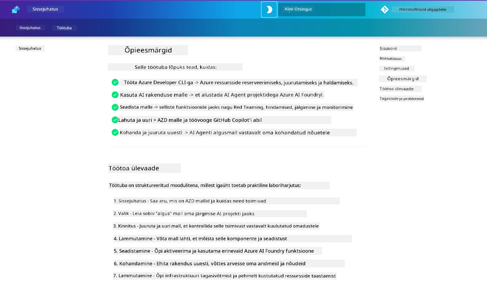

<div align="center">
  <div style="background: linear-gradient(135deg, #0078d4, #106ebe); border-radius: 10px; padding: 20px; margin: 20px 0; box-shadow: 0 4px 15px rgba(0, 120, 212, 0.3); border: 2px solid #005a9e;">
    <h2 style="color: white; margin: 0; font-size: 24px; text-shadow: 1px 1px 2px rgba(0,0,0,0.3);">
      🎯 AZD AI-arendajatele mõeldud töötoa töötuba
    </h2>
    <p style="color: white; margin: 10px 0 0 0; font-size: 16px; text-shadow: 1px 1px 2px rgba(0,0,0,0.3);">
      <strong>Käed-külge töötuba Azure Developer CLI abil AI-rakenduste ehitamiseks.</strong><br>
      Läbi vii 7 moodulit, et omandada AZD mallid ja AI juurutustöövood.
    </p>
    <div style="margin-top: 15px;">
      <span style="background: rgba(255,255,255,0.2); padding: 5px 10px; border-radius: 15px; color: white; font-size: 14px;">
        📅 Allikajuhis vaadatud: november 2026
      </span>
    </div>
  </div>
</div>

# AZD AI-arendajatele mõeldud töötoa töötuba

Tere tulemast käed-külge töötoale, kus õpitakse Azure Developer CLI-d (AZD) keskendudes AI-rakenduste juurutamisele. See töötuba aitab teil omandada praktilise arusaama AZD mallidest 3 sammuga:

1. **Avastamine** – leida oma vajadustele sobiv mall.
1. **Juurutamine** – juurutada ja valideerida selle toimimine
1. **Kohandamine** – muuta ja täiustada, et muuta see enda omaks!

Selle töötoa jooksul tutvustatakse teile ka põhilisi arendustööriistu ja töövooge, mis aitavad sujuvamaks muuta teie arendusteekonda algusest lõpuni.

<br/>

## Brauseripõhine juhend

Töötoa õppetunnid on Markdown'is. Nendega saab otse GitHubis navigeerida – või käivitada alloleval ekraanipildil näidatud brauseripõhise eelvaate.



Selle valiku kasutamiseks - tehke hoidlast oma profiilile fork ja käivitage GitHub Codespaces. Kui VS Code terminal on aktiivne, tippige käsk:

See brauseripõhine eelvaade töötab GitHub Codespaces'is, arenduskonteinerites või kohalikus kloonis, kus on paigaldatud Python ja MkDocs.

```bash title="" linenums="0"
python -m pip install -r requirements-dev.txt
python -m mkdocs serve --config-file workshop/mkdocs.yml
```

Käivitage need käsud **kursuse hoidla juurkataloogist**, mitte eraldi algatatud AI näite kataloogist. Hoidke eelvaade esiplaanil, et vead oleksid nähtavad; peatage see Ctrl+C-ga. Saidi kontrollimiseks ilma teenindamiseta käivitage `python -m mkdocs build --strict --config-file workshop/mkdocs.yml`.

Mõne sekundi pärast näete hüpikakent. Valige valik `Open in browser`. Veebipõhine juhend avaneb nüüd uues brauseri vahelehes. Mõned selle eelvaate eelised:

1. **Sisseehitatud otsing** – leidke märksõnu või õppetunde kiiresti.
1. **Kopeeri ikoon** – hõljutage hiirega koodiplokkidel, et näha seda valikut
1. **Teema vahetamine** – lülituda tumeda ja heleda teema vahel
1. **Abi saamine** – klõpsake jaluses Discordi ikoonil, et liituda!

<br/>

## Töötoa ülevaade

**Kestus:** 3–4 tundi  
**Tase:** Algaja kuni kesktase  
**Eeltingimused:** Tutvumine Azure’ga, AI kontseptsioonid, VS Code ja käsureatööriistad.

See on praktiline töötuba, kus õpite tegevuse käigus. Kui olete harjutused lõpetanud, soovitame läbida AZD algajatele kursuse, et jätkata õppimist turvalisuse ja tootlikkuse parimate tavade osas.

| Aeg | Moodul | Eesmärk |
|:---|:---|:---|
| 15 min | [Sissejuhatus](docs/instructions/0-Introduction.md) | Seadke siht, mõistke eesmärke |
| 30 min | [Vali AI mall](docs/instructions/1-Select-AI-Template.md) | Uurige valikuid ja valige stardimudel | 
| 30 min | [Valideeri AI mall](docs/instructions/2-Validate-AI-Template.md) | Juurutage vaikimisi lahendus Azure'i |
| 30 min | [Lammutage AI mall](docs/instructions/3-Deconstruct-AI-Template.md) | Uurige struktuuri ja konfiguratsiooni |
| 30 min | [Konfigureerige AI mall](docs/instructions/4-Configure-AI-Template.md) | Aktiveerige ja proovige olemasolevaid funktsioone |
| 30 min | [Kohandage AI mall](docs/instructions/5-Customize-AI-Template.md) | Kohandage mall oma vajadustele vastavaks |
| 30 min | [Lammutage infrastruktuur](docs/instructions/6-Teardown-Infrastructure.md) | Puhastage ja vabastage ressursid |
| 15 min | [Kokkuvõte ja järgmised sammud](docs/instructions/7-Wrap-up.md) | Õppematerjalid, töötoa väljakutse |

<br/>

## Mida õpite

Mõelge AZD mallile kui õpiliivakastile, et uurida erinevaid võimalusi ja tööriistu Microsoft Foundry lõpp-to-lõpp arenduseks. Selle töötoa lõpuks peaks teil olema intuitiivne arusaam erinevatest tööriistadest ja kontseptsioonidest selles kontekstis.

| Kontseptsioon | Eesmärk |
|:---|:---|
| **Azure Developer CLI** | Mõista tööriista käske ja töövooge |
| **AZD mallid** | Mõista projekti struktuuri ja konfiguratsiooni |
| **Azure AI agent** | Provisioneerida ja juurutada Microsoft Foundry projekt |
| **Azure AI Search** | Võimaldada konteksti inseneriteadust agentidega |
| **Jälgitavus** | Uurida jälgimist, monitooringut ja hindamisi |
| **Punase meeskonna testimine** | Uurida vastandlikku testimist ja leevendamist |

<br/>

## Töötoa struktuur

Töötoa struktuur viib teid teekonnale mallide leidmisest, juurutamisest ja lagundamisest kuni kohandamiseni – kasutades aluseks ametlikku [Getting Started with AI Agents](https://github.com/Azure-Samples/get-started-with-ai-agents) stardimalli.

### [Moodul 1: Vali AI mall](docs/instructions/1-Select-AI-Template.md) (30 min)

- Mis on AI mallid?
- Kust leida AI malle?
- Kuidas alustada AI agentide ehitamist?
- **Labor:** Kiirstart Codespaces'is või arenduskonteineris

### [Moodul 2: Valideeri AI mall](docs/instructions/2-Validate-AI-Template.md) (30 min)

- Mis on AI malli arhitektuur?
- Mis on AZD arendustöövoog?
- Kuidas saada abi AZD arendamisel?
- **Labor:** Juuruta ja valideeri AI agentide mall

### [Moodul 3: Lammuta AI mall](docs/instructions/3-Deconstruct-AI-Template.md) (30 min)

- Uuri oma keskkonda `.azure/`
- Uuri oma ressursiseadeid `infra/`
- Uuri oma AZD konfiguratsiooni `azure.yaml`-des
- **Labor:** Muuda keskkonnamuutujaid ja juuruta uuesti

### [Moodul 4: Konfigureeri AI mall](docs/instructions/4-Configure-AI-Template.md) (30 min)
- Uuri: Rekuperatsiooni assisteeritud genereerimine
- Uuri: Agendi hindamine ja punase meeskonna testimine
- Uuri: Jälgimine ja monitooring
- **Labor:** Uuri AI agenti ja jälgitavust

### [Moodul 5: Kohanda AI mall](docs/instructions/5-Customize-AI-Template.md) (30 min)
- Määratle: PRD stsenaariuminõuetega
- Konfigureeri: Keskkonnamuutujad AZD jaoks
- Rakenda: Elutsükli haakid lisatööde jaoks
- **Labor:** Kohanda mall oma stsenaariumile

### [Moodul 6: Lammuta infrastruktuur](docs/instructions/6-Teardown-Infrastructure.md) (30 min)
- Kokkuvõte: Mis on AZD mallid?
- Kokkuvõte: Miks kasutada Azure Developer CLI-d?
- Järgmised sammud: Proovi mõnda teist malli!
- **Labor:** Lammutamine ja koristamine

<br/>

## Töötoa väljakutse

Kas soovite end rohkem proovile panna? Siin on mõned projektiideed – või jagage oma mõtteid meiega!

| Projekt | Kirjeldus |
|:---|:---|
|1. **Lammutage keeruline AI mall** | Kasutage kirjeldatud töövoogu ja tööriistu ning proovige juurutada, valideerida ja kohandada teist AI lahenduse malli. _Mida sa õppisid?_|
|2. **Kohandage oma stsenaariumiga**  | Proovige kirjutada PRD (tootenõuete dokument) teise stsenaariumi jaoks. Seejärel kasutage GitHub Copiloti oma malli hoidlas Agent Model'is ja paluge sellel koostada kohandamisprotsess. _Mida sa õppisid? Kuidas saaks neid soovitusi parandada?_|
| | |

## Kas teil on tagasisidet?

1. Postitage selle hoidla probleem - märkige see mugavuse huvides `Workshop`.
1. Liituge Microsoft Foundry Discordiga – ühenduge oma eakaaslastega!


| | | 
|:---|:---|
| **📚 Kursuse kodu** | [AZD algajatele](../README.md)|
| **📖 Dokumentatsioon** | [Alustage AI mallidega](https://learn.microsoft.com/en-us/azure/ai-foundry/how-to/develop/ai-template-get-started)|
| **🛠️AI mallid** | [Microsoft Foundry mallid](https://ai.azure.com/templates) |
|**🚀 Järgmised sammud** | [Alusta töötuba](#workshop-overview) |
| | |

<br/>

---

**Navigeerimine:** [Peamine kursus](../README.md) | [Sissejuhatus](docs/instructions/0-Introduction.md) | [Moodul 1: Vali mall](docs/instructions/1-Select-AI-Template.md)

**Valmis AI-rakendusi AZD abil ehitama?**

[Alusta töötuba: sissejuhatus →](docs/instructions/0-Introduction.md)

---

<!-- CO-OP TRANSLATOR DISCLAIMER START -->
**Lahtiütlus**:
See dokument on tõlgitud kasutades AI tõlketeenust [Co-op Translator](https://github.com/Azure/co-op-translator). Kuigi me püüdleme täpsuse poole, palun pange tähele, et automatiseeritud tõlgetes võib esineda vigu või ebatäpsusi. Originaaldokument selle emakeeles tuleks pidada autoriteetseks allikaks. Olulise teabe puhul soovitatakse kasutada professionaalset inimtõlget. Me ei vastuta selle tõlkega seotud eksimustest või valesti mõistmistest.
<!-- CO-OP TRANSLATOR DISCLAIMER END -->