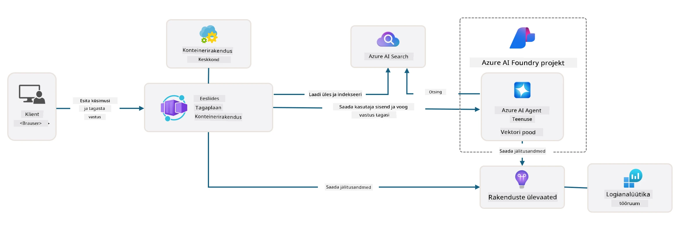

# 3. Malli lagundamine

!!! tip "SELLE MÕÕDULI LÕPUS OLETE VÕIMALIK"

    - [ ] Use GitHub Copilot and optional MCP tools for Azure documentation and read-only exploration
    - [ ] Identify the template's application, infrastructure, configuration, and test entry points
    - [ ] Verify generated explanations against actual repository files
    - [ ] **Lab 3:** Trace one request and one configuration input through the project

---

## 1. Aktiveeri GitHub Copilot

Ava VS Code'is initsialiseeritud AI näidis ning lülita sisse [GitHub Copilot](https://code.visualstudio.com/docs/copilot/chat/chat-agent-mode). Logi sisse kontoga, millel on sobiv plaan; kasutuspiirangud võivad erineda. Kutsu Copiloti selgitama hoidlat enne muudatuste lubamist.

### Vabatahtlikud MCP serverid

Need teenused võivad pakkuda täiendavaid tööriistu:

- [Azure MCP Server](https://learn.microsoft.com/azure/developer/azure-mcp-server/overview)
- [Microsoft Learn MCP Server](https://learn.microsoft.com/training/support/mcp)

VS Code'is vaata üle [MCP konfiguratsiooni juhend](https://code.visualstudio.com/docs/copilot/chat/mcp-servers) ja loo vajadusel `.vscode/mcp.json`:

```json
{
  "servers": {
    "Azure MCP Server": {
      "type": "stdio",
      "command": "npx",
      "args": ["-y", "@azure/mcp@latest", "server", "start"]
    },
    "microsoft.docs.mcp": {
      "type": "http",
      "url": "https://learn.microsoft.com/api/mcp"
    }
  }
}
```

Käsk `npx` vajab toetatud Node.js/npm paigaldust ja tõmbab alla täidetava koodi. Vaata paketti üle ja seosta kinnitatud versioon korduvkasutatava meeskonna seadistuse jaoks. Käivita serverid VS Code'i MCP juhtnuppude abil ning kontrolli nende tööriistu; nimed võivad versioonide vahel muutuda.

**Autentimine on eraldi.** Kasuta AZD jaoks `azd auth login`. Järgi Azure MCP dokumenteeritud autentimise voogu selle tööriistade jaoks; pelgalt AZD sisselogimine ei loo MCP sessiooni. Kasuta eraldi `az login`, kui mingi harjutus või haak kutsub Azure CLI-d.

Proovi lugemisõigusega päringuid:

1. “Kasuta Microsoft Learn MCP-d, et leida Azure Developer CLI konfiguratsiooni dokumentatsioon.”
2. “Selgita selle hoidla `azure.yaml`; too välja failid, mis rakendavad iga haaki.”
3. “Kasuta saadaolevaid Azure MCP tööriistu, loetle mu juurutatud ressursid ilma midagi muutmata.”

Kontrolli valitud rentniku/tellimuse ja iga pakutava tööriistakutse puhul. Ära heaks kiida ressursi loomist, kustutamist või ligipääsmuudatusi vaid arhitektuuri uurimiseks.

## 2. Arhitektuuri mõistmine

Näidis majutab Pythoni FastAPI tagapoolt ja React/TypeScripti esiotsa Azure Container Appsis. Tagapool suhtleb agendiga Microsoft Foundry projektis. Andmete hankimine ja jälgitavus sõltuvad lubatud malli omadustest ja õnnestunud seadistusest; neid ei garanteerita ainult rakenduse juurutamise põhjal.



Võrdle seda skeemi [praeguse ülespoole juurutusjuhendiga](https://github.com/Azure-Samples/get-started-with-ai-agents/blob/main/docs/deployment.md) ja oma tegelike ressurssidega. Kontrolli seadistatud mudelijuhtimist, agendi tööriistu, hallatud identiteeti, rollimääranguid ja vabatahtlikke AI Search/Application Insights ressursse.

**Harjutus:** Kutsu Copilot jälgima vestluse päringut esiotsast läbi API Foundryni koos failide ja funktsioonide viidetega. Ava need viited ja kontrolli selgitust. Ära järeldage rakendatud autentimist, marsruutimist ega lubamist ainult skeemi põhjal.

## 3. Hoidla struktuur

Alljärgnevaid valitud teid kontrolliti vastavalt näidisele 4. novembril 2026. Sinu initsialiseeritud revisjon jääb tõe allikaks:

```text
get-started-with-ai-agents/
  azure.yaml
  docker-compose.yaml
  requirements-dev.txt
  .devcontainer/
  infra/
    main.bicep
    main.parameters.json
    api.bicep
    core/
  src/
    Dockerfile
    pyproject.toml
    requirements.txt
    api/
      main.py
      routes.py
      search_index_manager.py
    frontend/
      package.json
      src/
    files/
  scripts/
    validate_env_vars.sh
    validate_env_vars.ps1
    postdeploy.sh
    postdeploy.ps1
  tests/
    test_evaluation.py
    test_red_teaming.py
  docs/
    deployment.md
    deploy_customization.md
    ai_search.md
    observability.md
    local_development.md
    troubleshooting.md
```

### Tehniline taristu ja konfiguratsioon

`infra/main.bicep` haldab ressursse; `main.parameters.json` ühendab malli sisendid AZD keskkonna väärtustega. `azure.yaml` valib rakendusteenuse ja elutsükli haakid. Jälgi näiteks sisendit `USE_AZURE_AI_SEARCH_SERVICE` nende failide kaudu, et leida, mis tegelikult muutub.

### Rakendus ja identiteet

Loe `src/api/` ja `src/frontend/` koos. Määra, kus agent luuakse või hangitakse, kus juhised/tööriistad seadistatakse ja millist identiteeti iga Azure kõne kasutab. Näidise failid kaustas `src/files/` on demonstratiivsed andmed, mitte tootmiskataloog või volitusmudel.

### Testid ja jälgitavus

Praegused hindamis- ja punatiimimise sisendid on kaustas `tests/`; vanemad kaustaviited `evals/` ja `airedteaming/` on selle näidise jaoks aegunud. Loe `docs/observability.md` eelduste ja kulude kohta enne pilvetestide käivitamist. Need Pythoni testid on eraldi vabatahtlikust `azure.ai.evaluations` AZD laiendusest.

## 4. Kinnita oma leiud

- Leia ühe näidisküsimuse API marsruut, agendi suhtlus ja andmete hankimise kood.
- Selgita, milline identiteet pääseb Foundryle ligi ja milline konfiguratsioon valib selle otsapunkti.
- Leia tegelikud eelsättimise ja järeljuurutamise skriptid ning nende veakäsitluskäitumine.
- Tõmba nimekirja kõik sõltuvused või vabatahtlikud funktsioonid, mis sinu juurutusest puuduvad.

Jätka [Malli seadistamisega](4-Configure-AI-Template.md).

---

<!-- CO-OP TRANSLATOR DISCLAIMER START -->
**Lahtiütlus**:
See dokument on tõlgitud kasutades AI tõlketeenust [Co-op Translator](https://github.com/Azure/co-op-translator). Kuigi me püüdleme täpsuse poole, palun pange tähele, et automatiseeritud tõlgetes võib esineda vigu või ebatäpsusi. Originaaldokument selle emakeeles tuleks pidada autoriteetseks allikaks. Olulise teabe puhul soovitatakse kasutada professionaalset inimtõlget. Me ei vastuta selle tõlkega seotud eksimustest või valesti mõistmistest.
<!-- CO-OP TRANSLATOR DISCLAIMER END -->