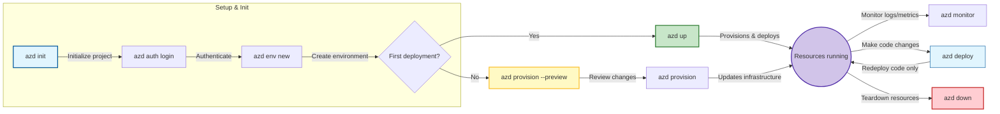
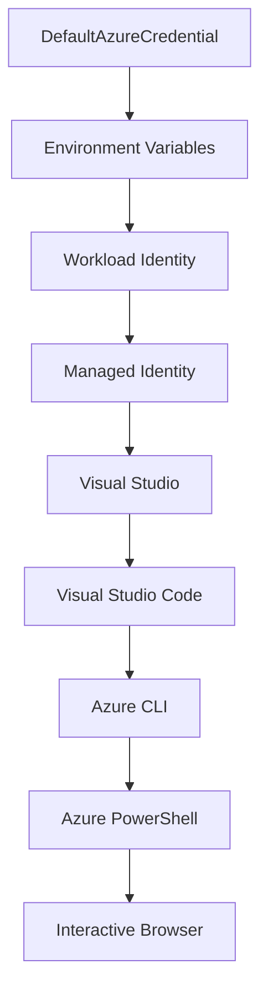

# اصول پایه AZD - مفاهیم و مبانی اصلی

**هدایت فصل:**
- **📚 صفحه اصلی دوره**: [AZD برای مبتدیان](../../README.md)
- **📖 فصل فعلی**: فصل 1 - پایه و شروع سریع
- **⬅️ قبلی**: [مروری بر دوره](../../README.md#-chapter-1-foundation--quick-start)
- **➡️ بعدی**: [نصب و راه‌اندازی](installation.md)
- **🚀 فصل بعدی**: [فصل 2: توسعه اول هوش مصنوعی](../chapter-02-ai-development/microsoft-foundry-integration.md)

## مقدمه

> بازبینی شده در برابر `azd 1.37.2` (نوامبر 2026). دستورات Bash از جایگزین‌های داخل نقل قول استفاده می‌کنند که باید آنها را جایگزین کنید. گردش‌کارهای قالب از `.` برای مقداردهی اولیه دایرکتوری کنونی استفاده می‌کنند؛ بدون آرگومان دایرکتوری، مقداردهی اولیه قالب یک زیرشاخه ایجاد می‌کند و دایرکتوری کاری پوسته شما را تغییر نمی‌دهد. قطعات پیشرفته نمایشی هستند و پروژه‌های کامل نیستند.

این درس شما را با Azure Developer CLI (azd) آشنا می‌کند که ابزاری قدرتمند خط فرمان است و مسیر شما از توسعه محلی تا استقرار در Azure را تسریع می‌کند. شما مفاهیم پایه، ویژگی‌های اصلی را یاد خواهید گرفت و درک خواهید کرد که چگونه azd استقرار برنامه‌های بومی ابری را ساده می‌کند.

## اهداف یادگیری

تا پایان این درس، شما:
- درک می‌کنید Azure Developer CLI چیست و هدف اصلی آن چیست
- مفاهیم اصلی قالب‌ها، محیط‌ها و خدمات را یاد می‌گیرید
- ویژگی‌های کلیدی از جمله توسعه مبتنی بر قالب و زیرساخت به‌عنوان کد را بررسی می‌کنید
- ساختار پروژه azd و گردش‌کار آن را درک می‌کنید
- آماده نصب و پیکربندی azd برای محیط توسعه خود خواهید بود

## دستاوردهای یادگیری

پس از اتمام این درس، قادر خواهید بود:
- نقش azd در گردش‌کارهای توسعه مدرن ابری را توضیح دهید
- اجزای ساختار پروژه azd را شناسایی کنید
- شرح دهید چگونه قالب‌ها، محیط‌ها و خدمات با هم کار می‌کنند
- مزایای زیرساخت به‌عنوان کد با azd را درک کنید
- فرمان‌های مختلف azd و اهداف آنها را تشخیص دهید

## Azure Developer CLI (azd) چیست؟

Azure Developer CLI (azd) ابزاری خط فرمان است که برای تسریع مسیر شما از توسعه محلی تا استقرار در Azure طراحی شده است. این ابزار فرایند ساخت، استقرار و مدیریت برنامه‌های بومی ابری را در Azure ساده می‌کند.

### با azd چه چیزهایی می‌توانید مستقر کنید؟

azd از دامنه وسیعی از بار کاری پشتیبانی می‌کند — و این فهرست همچنان در حال رشد است. امروزه شما می‌توانید از azd برای استقرار موارد زیر استفاده کنید:

| نوع بار کاری | مثال‌ها | آیا گردش‌کار یکسان است؟ |
|---------------|----------|----------------|
| **برنامه‌های سنتی** | برنامه‌های وب، REST APIها، سایت‌های استاتیک | ✅ `azd up` |
| **خدمات و ریزخدمات‌ها** | برنامه‌های کانتینری، برنامه‌های تابعی، پشت‌صحنه‌های دارای چند خدمت | ✅ `azd up` |
| **برنامه‌های مجهز به هوش مصنوعی** | برنامه‌های چت با مدل‌های Microsoft Foundry، راه‌حل‌های RAG با جستجوی هوش مصنوعی | ✅ `azd up` |
| **عامل‌های هوشمند** | عامل‌های میزبانی شده توسط Foundry، ارکستراسیون چندعاملی | ✅ `azd up` |

نکته کلیدی این است که **چرخه‌عمر azd فارغ از اینکه چه چیزی مستقر می‌کنید یکسان می‌ماند**. شما پروژه را مقداردهی اولیه می‌کنید، زیرساخت را فراهم می‌آورید، کد خود را مستقر می‌کنید، برنامه خود را پایش می‌کنید و پاکسازی انجام می‌دهید — خواه یک وب‌سایت ساده باشد یا یک عامل هوش مصنوعی پیشرفته.

این پیوستگی به صورت طراحی شده است. azd قابلیت‌های هوش مصنوعی را به عنوان نوع دیگری از خدماتی که برنامه شما می‌تواند استفاده کند، در نظر می‌گیرد، نه چیزی کاملاً متفاوت. نقطه پایانی چت پشتیبانی شده توسط مدل‌های Microsoft Foundry از دید azd تنها یک خدمت دیگر برای پیکربندی و استقرار است.

### 🎯 چرا از AZD استفاده کنیم؟ مقایسه واقعی

بیایید استقرار یک برنامه وب ساده با پایگاه داده را مقایسه کنیم:

#### ❌ بدون AZD: استقرار دستی در Azure (بیش از 30 دقیقه)

**مقایسه تصویرسازی شده با Bash، نه آغازگر برنامه قابل اجرا.** این فرض می‌کند کد برنامه موجود است، نام منابع منحصر به فرد است، احراز هویت Azure CLI انجام شده و هر افزونه CLI لازم نصب شده است. مسیر پشتیبانی شده انتها به انتها را با تمرین قالب زیر دنبال کنید.

```bash
# Step 1: Create resource group
az group create --name myapp-rg --location eastus

# Step 2: Create App Service Plan
az appservice plan create --name myapp-plan \
  --resource-group myapp-rg \
  --sku B1 --is-linux

# Step 3: Create Web App
az webapp create --name myapp-web-unique123 \
  --resource-group myapp-rg \
  --plan myapp-plan \
  --runtime "NODE:22-lts"

# Step 4: Create Cosmos DB account (10-15 minutes)
az cosmosdb create --name myapp-cosmos-unique123 \
  --resource-group myapp-rg \
  --kind MongoDB

# Step 5: Create database
az cosmosdb mongodb database create \
  --account-name myapp-cosmos-unique123 \
  --resource-group myapp-rg \
  --name tododb

# Step 6: Create collection
az cosmosdb mongodb collection create \
  --account-name myapp-cosmos-unique123 \
  --resource-group myapp-rg \
  --database-name tododb \
  --name todos

# Step 7: Get connection string
CONN_STR=$(az cosmosdb keys list \
  --name myapp-cosmos-unique123 \
  --resource-group myapp-rg \
  --type connection-strings \
  --query "connectionStrings[0].connectionString" -o tsv)

# Step 8: Configure app settings
az webapp config appsettings set \
  --name myapp-web-unique123 \
  --resource-group myapp-rg \
  --settings MONGODB_URI="$CONN_STR"

# Step 9: Enable logging
az webapp log config --name myapp-web-unique123 \
  --resource-group myapp-rg \
  --application-logging filesystem \
  --detailed-error-messages true

# Step 10: Set up Application Insights
az monitor app-insights component create \
  --app myapp-insights \
  --location eastus \
  --resource-group myapp-rg

# Step 11: Link App Insights to Web App
INSTRUMENTATION_KEY=$(az monitor app-insights component show \
  --app myapp-insights \
  --resource-group myapp-rg \
  --query "instrumentationKey" -o tsv)

az webapp config appsettings set \
  --name myapp-web-unique123 \
  --resource-group myapp-rg \
  --settings APPINSIGHTS_INSTRUMENTATIONKEY="$INSTRUMENTATION_KEY"

# Step 12: Build application locally
npm install
npm run build

# Step 13: Create deployment package
zip -r app.zip . -x "*.git*" "node_modules/*"

# Step 14: Deploy application
az webapp deployment source config-zip \
  --resource-group myapp-rg \
  --name myapp-web-unique123 \
  --src app.zip

# Step 15: Wait and pray it works 🙏
# (No automated validation, manual testing required)
```

**مشکلات:**
- ❌ بیش از 15 دستور برای به خاطر سپردن و اجرای ترتیبی
- ❌ 30-45 دقیقه کار دستی
- ❌ احتمال خطاهای آسان (اشتباه‌های تایپی، پارامترهای نادرست)
- ❌ اعتبارنامه‌ها نیازمند مدیریت صریح هستند؛ لاگ‌های اشکال‌زدایی و ردیابی پوسته ممکن است آنها را نمایش دهند
- ❌ برگشت خودکار در صورت خطا وجود ندارد
- ❌ سخت است برای اعضای تیم تکرار شود
- ❌ هر بار متفاوت است (قابل بازتولید نیست)

#### ✅ با AZD: استقرار خودکار (5 دستور، 10-15 دقیقه)

```bash
# Step 1: Initialize from template
azd init --template todo-nodejs-mongo .

# Step 2: Authenticate
azd auth login

# Step 3: Select the environment created during init
azd env select dev

# Step 4: Preview changes (optional but recommended)
azd provision --preview

# Step 5: Deploy everything
azd up

# ✨ Done! Everything is deployed, configured, and monitored
```

**مزایا:**
- ✅ **5 دستور** در مقابل بیش از 15 گام دستی
- ✅ **10-15 دقیقه** کل زمان (عمدتاً در انتظار Azure)
- ✅ **اشتباهات دستی کمتر** — گردش‌کار منسجم و مبتنی بر قالب
- ✅ **مدیریت امن اسرار** — بسیاری از قالب‌ها از مخزن اسرار مدیریت شده Azure استفاده می‌کنند
- ✅ **استقرارهای قابل تکرار** — هر بار گردش‌کار یکسان
- ✅ **تعاریف زیرساخت قابل تکرار** — با توجه به سهمیه‌ها، دسترسی منطقه‌ای و نسخه‌های قالب
- ✅ **مناسب برای تیم** — هر کسی می‌تواند با همان دستورات استقرار دهد
- ✅ **زیرساخت به عنوان کد** — قالب‌های Bicep کنترل‌شده با نسخه
- ✅ **نظارت تعریف شده توسط قالب** — در صورت درج در قالب، Application Insights

### زمان و اطمینان

زمان‌های بالا برآورد هستند، نه معیارهای دقیق. azd تعداد دستورات هماهنگ شده را کاهش می‌دهد، اما مدت زمان استقرار را تضمین نمی‌کند، خطاها را حذف نمی‌کند یا برگشت خودکار برنامه/پایگاه داده ارائه نمی‌دهد. نسخه‌های کاری را در کنترل منبع نگه دارید و روش‌های بازیابی را تست کنید.

## مفاهیم اصلی

### قالب‌ها
قالب‌ها اساس azd را تشکیل می‌دهند. آنها شامل موارد زیر هستند:
- **کد برنامه** — کد منبع و وابستگی‌های شما
- **تعاریف زیرساخت** — منابع Azure تعریف شده در Bicep یا Terraform
- **فایل‌های پیکربندی** — تنظیمات و متغیرهای محیطی
- **اسکریپت‌های استقرار** — گردش‌کارهای استقرار خودکار

### محیط‌ها
محیط‌ها نمایانگر اهداف استقرار مختلف هستند:
- **توسعه** — برای تست و توسعه
- **استیجینگ** — محیط پیش‌تولید
- **تولید** — محیط تولید زنده

هر محیط موارد زیر را نگهداری می‌کند:
- نام محیط و مقادیر؛ ایزولاسیون منابع به قالب زیرساخت بستگی دارد
- تنظیمات پیکربندی
- وضعیت استقرار

### خدمات
خدمات در `azure.yaml` اجزای برنامه قابل استقرار را توصیف می‌کنند:
- **فرانت‌اند** — برنامه‌های وب، SPAها
- **بک‌اند** — APIها، میکروسرویس‌ها

پایگاه‌های داده و ذخیره‌سازی معمولاً به عنوان منابع زیرساخت فراهم می‌شوند، نه میزبان‌های خدمات اختراعی مانند `host: postgres`.

## ویژگی‌های کلیدی

### 1. توسعه مبتنی بر قالب
```bash
# Browse available templates
azd template list

# Initialize from a template
azd init --template "<template-name>" .
```

### 2. زیرساخت به عنوان کد
- **Bicep** — زبان دامنه اختصاصی Azure
- **Terraform** — ابزار زیرساخت چند ابری
- Bicep به قالب‌های ARM کامپایل می‌شود؛ JSON خام ARM یک `infra.provider` داخلی جداگانه نیست.

### 3. گردش‌کارهای یکپارچه
```bash
# Complete deployment workflow
azd up            # Provision + Deploy this is hands off for first time setup

# 🧪 NEW: Preview infrastructure changes before deployment (SAFE)
azd provision --preview    # Simulate infrastructure deployment without making changes

azd provision     # Create Azure resources if you update the infrastructure use this
azd deploy        # Deploy application code or redeploy application code once update
azd down          # Clean up resources
```

#### 🛡️ برنامه‌ریزی امن زیرساخت با پیش‌نمایش
فرمان `azd provision --preview` انقلابی در استقرار ایمن ایجاد می‌کند:
- **تحلیل آزمایشی** — نشان می‌دهد چه چیزی ایجاد، اصلاح یا حذف می‌شود
- **بدون اعمال زیرساخت** — تغییرات ارائه‌دهنده را بازبینی می‌کند؛ ابتدا قلاب‌های پروژه را بررسی کنید، چون قلاب‌ها می‌توانند دستوراتی با اثرات جانبی اجرا کنند
- **همکاری تیمی** — نتایج پیش‌نمایش را قبل از استقرار به اشتراک بگذارید
- **ورودی برنامه‌ریزی هزینه** — SKUهای پیشنهادی را بررسی کنید، سپس آنها را با ماشین حساب قیمت Azure قیمت‌گذاری کنید؛ پیش‌نمایش قیمت‌ها را محاسبه نمی‌کند

```bash
# Example preview workflow
azd provision --preview           # See what will change
# Review the output, discuss with team
azd provision                     # Apply changes with confidence
```

### 📊 تصویری: گردش‌کار توسعه AZD



**توضیح گردش‌کار:**
1. **Init** — شروع با قالب یا پروژه جدید
2. **Auth** — احراز هویت با Azure
3. **Environment** — ایجاد محیط استقرار ایزوله
4. **Preview** — 🆕 همیشه ابتدا تغییرات زیرساخت را پیش‌نمایش کنید (عمل ایمن)
5. **Provision** — ایجاد/بروزرسانی منابع Azure
6. **Deploy** — کد برنامه خود را ارسال کنید
7. **Monitor** — عملکرد برنامه را مشاهده کنید
8. **Iterate** — تغییرات ایجاد کرده و کد را دوباره مستقر کنید
9. **Cleanup** — منابع را پس از اتمام حذف کنید

### 4. مدیریت محیط
```bash
# Create and manage environments
azd env new "<environment-name>"
azd env select "<environment-name>"
azd env list
```

### 5. افزونه‌ها و فرمان‌های هوش مصنوعی

azd از یک سیستم افزونه برای افزودن قابلیت‌های فراتر از CLI اصلی استفاده می‌کند. این به خصوص برای بارهای کاری هوش مصنوعی مفید است:

```bash
# List available extensions
azd extension list

# Install the GA Foundry bundle (requires azd >= 1.37.0)
azd ext install microsoft.foundry

# Initialize an AI agent project interactively
azd ai agent init

# Test a deployed agent (shows latency and time-to-first-byte)
azd ai agent invoke

# Start the MCP server for AI-assisted development (Alpha)
azd mcp start
```

**چرخه عمر عامل، از ابتدا تا انتها.** بسته GA `microsoft.foundry` شامل `azure.ai.agents` و شش افزونه اصلی دیگر است. `azure.ai.evaluations` را جداگانه برای ارزیابی نصب کنید. برای این گردش‌کار از `azd >= 1.37.0` استفاده کنید. نیازی نیست همه این‌ها را در روز اول داشته باشید:

| مرحله | فرمان | کاری که انجام می‌دهد |
|-------|---------|--------------|
| **اسکافلد** | `azd ai agent init --template <path-to-azure.yaml>` | پذیرش قالب پروژه عامل جاری |
| **اجرای محلی** | `azd ai agent run`، سپس `azd ai agent invoke --local "Test prompt"` در ترمینال دیگر | مشاهده فعالیت محلی در Agent Inspector؛ فراخوانی مدل‌ها همچنان از Azure استفاده می‌کند |
| **استقرار** | `azd deploy` | برای عامل‌های میزبانی شده حالت کد، آپلود منبع برای ساخت راه دور Foundry |
| **تست** | `azd ai agent invoke` | تماس با عامل و مشاهده زمان پاسخ |
| **اندازه‌گیری** | `azd ai eval init`، `generate`، `run start` | پیکربندی، استقرار و اجرای ارزیابی‌ها با افزونه جداگانه |
| **بهبود** | `azd ai agent optimize --eval <evaluation-name> --optimize-model <optimizer-deployment>` | استفاده مجدد از ارزیابی سازگار برای بهینه‌سازی عامل |
| **بازرسی** | `azd ai agent endpoint show` | مشاهده پیکربندی نقطه پایانی زنده |
| **پاکسازی** | `azd ai agent delete` | حذف یک عامل میزبانی شده و تمام نسخه‌های آن |

> با [راهنمای عامل میزبانی شده GA](../chapter-02-ai-development/microsoft-foundry-integration.md#hosted-agent-walkthrough-ga) شروع کنید که پیش‌نیازها، فراهم‌سازی و پاکسازی ایمن را پوشش می‌دهد. افزونه‌ها در مرجع [دستورات AZD AI CLI](../chapter-08-production/production-ai-practices.md#azd-ai-cli-commands-and-extensions) بیشتر توضیح داده شده‌اند.

## 📁 ساختار پروژه

ساختار معمول پروژه azd:
```
my-app/
├── .azure/                  # Local environments and selected-environment config
│   ├── config.json
│   └── dev/.env
├── .devcontainer/          # Development container config
├── .github/workflows/      # GitHub Actions
├── .vscode/               # VS Code settings
├── infra/                 # Infrastructure code
│   ├── main.bicep        # Main infrastructure template
│   ├── main.parameters.json
│   └── modules/          # Reusable modules
├── src/                  # Application source code
│   ├── api/             # Backend services
│   └── web/             # Frontend application
├── azure.yaml           # azd project configuration
└── README.md
```

## 🔧 فایل‌های پیکربندی

### azure.yaml
فایل پیکربندی اصلی پروژه:
```yaml
name: my-awesome-app
metadata:
  template: my-template@1.0.0

services:
  web:
    project: ./src/web
    language: js
    host: appservice
  api:
    project: ./src/api
    language: js
    host: appservice

hooks:
  preprovision:
    shell: pwsh
    run: echo "Preparing to provision..."
```

### .azure/config.json
انتخاب محلی پروژه از محیط پیش‌فرض (نمایشی؛ مدیریت شده توسط azd):
```json
{
  "defaultEnvironment": "dev"
}
```

## 🎪 گردش‌کارهای رایج با تمرین‌های عملی

> **💡 نکته یادگیری:** این تمرین‌ها را به ترتیب دنبال کنید تا مهارت‌های AZD خود را تدریجی بسازید.

### 🎯 تمرین 1: مقداردهی اولیه اولین پروژه شما

**هدف:** ایجاد پروژه AZD و کاوش ساختار آن

**مراحل:**
```bash
# Use a proven template
mkdir azd-basics-practice
cd azd-basics-practice
# Choose "dev" for the environment name when prompted
azd init --template todo-nodejs-mongo .

# Explore the generated files
ls -la  # View all files including hidden ones

# Key files created:
# - azure.yaml (main config)
# - infra/ (infrastructure code)
# - src/ (application code)
```

**✅ موفقیت:** دارای پوشه‌ها azure.yaml، infra/ و src/ هستید

---

### 🎯 تمرین 2: استقرار در Azure

**هدف:** تکمیل استقرار انتها به انتها

**مراحل:**
```bash
# 1. Authenticate
azd auth login

# 2. Select the dev environment created in Exercise 1
azd env select dev
azd env set AZURE_LOCATION eastus

# 3. Preview changes (RECOMMENDED)
azd provision --preview

# 4. Deploy everything
azd up

# 5. Verify deployment
azd show    # View your app URL
```

**زمان مورد انتظار:** 10-15 دقیقه  
**✅ موفقیت:** آدرس برنامه در مرورگر باز می‌شود

---

### 🎯 تمرین 3: چند محیط

**هدف:** استقرار در dev و staging

**مراحل:**
```bash
# Already have dev, create staging
azd env new staging
azd env set AZURE_LOCATION westus2
azd up

# Switch between them
azd env list
azd env select dev
```

**✅ موفقیت:** دو گروه منبع جداگانه در Azure Portal

**پاکسازی:** تمرین 3 یک استقرار دوم قابل صورتحساب ایجاد می‌کند. هر دو را پس از اتمام حذف کنید:

```bash
azd down --environment dev
azd down --environment staging
```

---

### 🛡️ پاکسازی مخرب: `azd down --force --purge`

زمانی که قصد دارید منابع Azure محیط انتخاب‌شده را عمداً حذف کنید:

```bash
azd down --force --purge
```

**کاری که انجام می‌دهد:**
- `--force`: بدون درخواست تأیید
- `--purge`: همچنین منابع حذف نرم پشتیبانی شده را به صورت دائمی حذف می‌کند (مثلاً Key Vaultها)، جایی که حفاظت پاکسازی اجازه دهد. دایرکتوری محلی `.azure/` را حذف نمی‌کند.

**زمان استفاده:** پس از اتمام کار با محیط قابل دفع. پاکسازی مخرب را به عنوان پاسخ اولیه به خطای احراز هویت، سهمیه یا پیکربندی در نظر نگیرید.

---

## 🎪 مرجع گردش‌کار اصلی

### شروع پروژه جدید
```bash
# Method 1: Use existing template
azd init --template todo-nodejs-mongo .

# Method 2: Start from scratch
azd init

# Method 3: Use current directory
azd init .
```

### چرخه توسعه
```bash
# Set up development environment
azd auth login
azd env new dev
azd env select dev

# Deploy everything
azd up

# Make changes and redeploy
azd deploy

# Clean up when done
azd down --force --purge # Deletes this environment's discovered Azure resources; review before forcing deletion.
```

## درک `azd down --force --purge`
فرمان `azd down --force --purge` روشی قدرتمند برای تخریب کامل محیط azd و تمام منابع مرتبط است. در اینجا شرح کار هر فلگ آمده است:
```
--force
```
- رد کردن درخواست‌های تأیید.
- مفید برای اتوماسیون یا اسکریپت‌نویسی که ورودی دستی ممکن نیست.
- از دسترسی‌ها، حفاظت پاکسازی یا شکست حذف عبور نمی‌کند.

```
--purge
```
 منبع‌های Azure که به‌صورت نرم‌افزاری حذف شده‌اند را به‌طور دائم حذف می‌کند بدون اینکه تاییدیه اضافی لازم باشد. محافظت از پاک‌سازی و مجوزها همچنان اعمال می‌شوند. این دستور **محیط‌های محلی** یا پوشه `.azure/` را حذف نمی‌کند.


### چرا هر دو را استفاده کنیم؟
فقط زمانی از هر دو استفاده کنید که قصد دارید منابع Azure محیط انتخاب‌شده را حذف کرده و منابع قابل بازیابی را پاک کنید. این یک پاکسازی مخرب است، نه تعمیر عمومی یا بازنشانی حالت محلی.

این خصوصاً پس از حذف دستی منابع در پورتال Azure یا هنگام تغییر قالب‌ها، محیط‌ها یا قراردادهای نام‌گذاری گروه منابع مفید است.


### مدیریت محیط‌های متعدد
```bash
# Create staging environment
azd env new staging
azd env select staging
azd up

# Switch back to dev
azd env select dev

# Compare environments
azd env list
```

## 🔐 احراز هویت و اعتبارنامه‌ها

احراز هویت استقرار (`azd auth login`) را از احراز هویت SDK برنامه (`DefaultAzureCredential`) متمایز کنید. این‌ها جداگانه هستند. azd به طور پیش‌فرض از اعتبارنامه‌های Azure CLI استفاده نمی‌کند.

### احراز هویت Azure CLI (`az login`)

برای azd اجرا کنید `azd auth login`. دستورات زیر Azure CLI اختیاری هستند و دستورات `az` را به طور جداگانه احراز هویت می‌کنند:

```bash
# Interactive login (opens browser)
az login

# Login with specific tenant
az login --tenant "<tenant-id>"

# Login with service principal
az login --service-principal -u "<app-id>" -p "<password>" --tenant "<tenant-id>"

# Check current login status
az account show

# List available subscriptions
az account list --output table

# Set default subscription
az account set --subscription "<subscription-id>"
```

### روند احراز هویت
1. **ورود تعاملی**: مرورگر پیش‌فرض شما را برای احراز هویت باز می‌کند
۲. **گردش کد دستگاه**: برای محیط‌هایی بدون دسترسی به مرورگر
۳. **خدمت‌گیر اصلی**: برای سناریوهای خودکارسازی و CI/CD
۴. **هویت مدیریت‌شده**: برای برنامه‌های میزبانی‌شده در Azure

### زنجیره DefaultAzureCredential

`DefaultAzureCredential` نوعی اعتبارنامه است که تجربه احراز هویت را ساده می‌کند و به‌صورت خودکار منابع اعتبارنامه متعددی را به ترتیب خاصی امتحان می‌کند:

#### زنجیره اعتبارنامه SDK برنامه

زنجیره دقیق بستگی به زبان، نسخه، افزونه‌های نصب‌شده، و گزینه‌های Azure Identity SDK دارد. این نمودار مفهومی است، نه توالی احراز هویت ثابت azd؛ SDKهای جدید همچنین ممکن است اعتبارنامه‌های Azure Developer CLI را شامل شوند.


#### ۱. متغیرهای محیطی
```bash
# Set environment variables for service principal
export AZURE_CLIENT_ID="<app-id>"
export AZURE_CLIENT_SECRET="<password>"
export AZURE_TENANT_ID="<tenant-id>"
```

#### ۲. هویت بارکاری (کوب‌رنتیز/GitHub Actions)
به‌صورت خودکار در موارد زیر استفاده می‌شود:
- سرویس کوب‌رنتیز Azure (AKS) با هویت بارکاری
- GitHub Actions با اتحاد OIDC
- سایر سناریوهای هویت اتحاد شده

#### ۳. هویت مدیریت‌شده
برای منابع Azure مانند:
- ماشین‌های مجازی
- سرویس برنامه
- Azure Functions
- نمونه‌های کانتینر

```bash
# Inspect a deployed Container App's configured identity (requires az login)
az containerapp show --name "<app-name>" --resource-group "<rg-name>" --query identity
```

#### ۴. ادغام ابزارهای توسعه‌دهنده
- **Visual Studio**: به‌صورت خودکار از حساب وارد شده استفاده می‌کند
- **VS Code**: پشتیبانی به SDK و تنظیمات کارگزار/افزونه پشتیبانی‌شده بستگی دارد
- **Azure CLI**: از اعتبارنامه‌های `az login` استفاده می‌کند (رایج‌ترین برای توسعه محلی)

### تنظیم احراز هویت AZD

```bash
# Method 1: Direct azd authentication (recommended)
azd auth login

# Method 2: Direct azd authentication
azd auth login --use-device-code  # For headless environments

# Method 3: Check authentication status
azd auth login --check-status

# Method 4: Logout and re-authenticate
azd auth logout
azd auth login
```

### بهترین روش‌های احراز هویت

#### برای توسعه محلی
```bash
# 1. Log in to azd
azd auth login

# 2. Select the subscription for this initialized environment
azd env set AZURE_SUBSCRIPTION_ID "<subscription-id>"

# 3. Check azd sign-in details (read the status message)
azd auth login --check-status
```

#### برای خطوط لوله CI/CD
```yaml
# Partial GitHub Actions steps: assumes checkout, azd installation,
# required AZURE_* environment values, and pipeline secret configuration.
- name: Deploy with azd
  run: |
    azd auth login --client-id ${{ secrets.AZURE_CLIENT_ID }} \
                    --client-secret ${{ secrets.AZURE_CLIENT_SECRET }} \
                    --tenant-id ${{ secrets.AZURE_TENANT_ID }}
    azd up --no-prompt
```

#### برای محیط‌های تولید
- هنگام اجرا روی منابع Azure از **هویت مدیریت‌شده** استفاده کنید
- برای سناریوهای خودکارسازی از **خدمت‌گیر اصلی** استفاده کنید
- از ذخیره اعتبارنامه‌ها در کد یا فایل‌های پیکربندی اجتناب کنید
- برای پیکربندی حساس از **Azure Key Vault** استفاده کنید

### مشکلات رایج احراز هویت و راه‌ حل‌ها

#### مشکل: "هیچ اشتراکی یافت نشد"
```bash
# Solution: Set default subscription
az account list --output table
az account set --subscription "<subscription-id>"
azd env set AZURE_SUBSCRIPTION_ID "<subscription-id>"
```

#### مشکل: "مجوزهای ناکافی"
```bash
# Solution: Check and assign required roles
az role assignment list --assignee $(az account show --query user.name --output tsv)

# Common required roles:
# - Contributor (for resource management)
# - User Access Administrator (for role assignments)
```

#### مشکل: "توکن منقضی شده"
```bash
# Solution: Re-authenticate
az logout
az login
azd auth logout
azd auth login
```

### احراز هویت در سناریوهای مختلف

#### توسعه محلی
```bash
# Personal development account
az login
azd auth login
```

#### توسعه تیمی
```bash
# Use specific tenant for organization
az login --tenant contoso.onmicrosoft.com
azd auth login --tenant-id "<tenant-id>"
```

#### سناریوهای چندمستاجری
```bash
# Switch between tenants
az login --tenant tenant1.onmicrosoft.com
azd auth login --tenant-id "<tenant-1-id>"
# Select an environment configured with tenant 1's subscription
azd env select tenant1-dev
# Deploy to tenant 1
azd up

az login --tenant tenant2.onmicrosoft.com  
azd auth login --tenant-id "<tenant-2-id>"
azd env select tenant2-dev
# Deploy to tenant 2
azd up
```

### ملاحظات امنیتی

۱. **ذخیره اعتبارنامه‌ها**: هرگز اعتبارنامه‌ها را در کد منبع ذخیره نکنید
۲. **محدودیت دامنه**: اصل کمترین امتیاز را برای خدمت‌گیرهای اصلی رعایت کنید
۳. **چرخش توکن**: محرمانه‌های خدمت‌گیر اصلی را به‌طور منظم بچرخانید
۴. **ردیابی حسابرسی**: فعالیت‌های احراز هویت و استقرار را نظارت کنید
۵. **امنیت شبکه**: در صورت ممکن از نقاط انتهایی خصوصی استفاده کنید

### عیب‌یابی احراز هویت

```bash
# Debug authentication issues
azd auth login --check-status
az account show
az account get-access-token

# Common diagnostic commands
whoami                          # Current user context
az ad signed-in-user show      # Microsoft Entra ID user details
az group list                  # Test resource access
```

## کشف دستورات

### کشف
```bash
azd template list              # Browse templates
azd template list --help       # Template discovery options
azd init --help               # Initialization options
```

### مدیریت پروژه
```bash
azd show                     # Project overview
azd env list                # Available environments and selected default
azd config show            # Configuration settings
```

### پایش
```bash
azd monitor                  # Open Azure portal monitoring
azd monitor --logs           # View application logs
azd monitor --live           # View live metrics
azd pipeline config          # Set up CI/CD
```

## بهترین روش‌ها

### ۱. استفاده از نام‌های معنادار
```bash
# Good
azd env new production-east
azd init --template todo-nodejs-mongo .

# Avoid
azd env new env1
azd init --template template1 .
```

### ۲. بهره‌گیری از قالب‌ها
- از قالب‌های موجود شروع کنید
- سفارشی‌سازی برای نیازهای خود
- قالب‌های قابل استفاده مجدد برای سازمان خود بسازید

### ۳. جداسازی محیط‌ها
- از محیط‌های جداگانه برای dev/staging/prod استفاده کنید
- هیچ‌گاه مستقیما از دستگاه محلی به تولید مستقر نکنید
- از خطوط لوله CI/CD برای استقرارهای تولید استفاده کنید

### ۴. مدیریت پیکربندی
- از هویت مدیریت‌شده و Key Vault برای رمزها استفاده کنید؛ مقادیر معمولی `azd env set` متن ساده محلی هستند
- پیکربندی را در کنترل نسخه نگه‌دارید
- تنظیمات خاص محیط را مستندسازی کنید

## پیشرفت یادگیری

### مبتدی (هفته ۱-۲)
۱. نصب azd و احراز هویت
۲. استقرار یک قالب ساده
۳. درک ساختار پروژه
۴. یادگیری دستورات پایه (up, down, deploy)

### متوسط (هفته ۳-۴)
۱. سفارشی‌سازی قالب‌ها
۲. مدیریت چند محیط
۳. درک کد زیرساخت
۴. راه‌اندازی خطوط لوله CI/CD

### پیشرفته (هفته ۵+)
۱. ساخت قالب‌های سفارشی
۲. الگوهای پیشرفته زیرساخت
۳. استقرار چندمنطقه‌ای
۴. پیکربندی‌های سطح سازمانی

## مراحل بعدی

**📖 ادامه یادگیری فصل ۱:**
- [نصب و راه‌اندازی](installation.md) - دریافت و پیکربندی azd
- [اولین پروژه شما](first-project.md) - آموزش عملی کامل
- [راهنمای پیکربندی](../chapter-03-configuration/configuration.md) - گزینه‌های پیکربندی پیشرفته

**🎯 آماده برای فصل بعد؟**
- [فصل ۲: توسعه هوش مصنوعی محور](../chapter-02-ai-development/microsoft-foundry-integration.md) - شروع ساخت برنامه‌های هوش مصنوعی

## منابع اضافی

- [بررسی اجمالی Azure Developer CLI](https://learn.microsoft.com/en-us/azure/developer/azure-developer-cli/)
- [گالری قالب‌ها](https://azure.github.io/awesome-azd/)
- [نمونه‌های انجمن](https://github.com/Azure-Samples)

---

## 🙋 سوالات متداول

### سوالات عمومی

**س: تفاوت AZD و Azure CLI چیست؟**

پاسخ: Azure CLI (`az`) برای مدیریت منابع منفرد Azure است. AZD (`azd`) برای مدیریت کل برنامه‌ها است:

```bash
# Azure CLI - Low-level resource management
az webapp create --name myapp --resource-group rg
az sql server create --name myserver --resource-group rg
# ...many more commands needed

# AZD - Application-level management
azd up  # Deploys entire app with all resources
```

**به این صورت فکر کنید:**
- `az` = کار با آجرهای لگوی منفرد
- `azd` = کار با مجموعه‌های کامل لگو

---

**س: آیا باید Bicep یا Terraform را برای استفاده از AZD بدانم؟**

پاسخ: نه! با قالب‌ها شروع کنید:
```bash
# Use existing template - no IaC knowledge needed
azd init --template todo-nodejs-mongo .
azd up
```

بعداً می‌توانید Bicep را برای سفارشی‌سازی زیرساخت یاد بگیرید. قالب‌ها نمونه‌هایی عملی برای یادگیری فراهم می‌کنند.

---

**س: هزینه اجرای قالب‌های AZD چقدر است؟**

پاسخ: هزینه‌ها بسته به منطقه، SKU، زمان کارکرد، حالت پایگاه داده و استفاده از مدل متفاوت است. محیط توسعه حتی در صورت بلااستفاده بودن می‌تواند هزینه‌های ماهانه قابل توجهی داشته باشد؛ فرض نکنید بازه ۵۰-۱۵۰ دلار عمومی است:

```bash
# Preview resource changes (not prices)
azd provision --preview

# Always cleanup when not using
azd down --force --purge  # Removes all resources
```

**نکته حرفه‌ای:** در صورت وجود، از لایه‌های رایگان استفاده کنید:
- سرویس برنامه: لایه F1 (رایگان)
- Azure OpenAI: هیچ مقدار رایگان ماهانه تضمینی عمومی دارد؛ قیمت مدل و پیشنهاد فعلی را بررسی کنید
- Cosmos DB: حساب‌های مجاز با ظرفیت مشخص می‌توانند در لایه رایگان ثبت‌نام کنند؛ قالب‌های بدون سرور به‌طور خودکار واجد شرایط نیستند

---

**س: آیا می‌توانم AZD را با منابع Azure موجود استفاده کنم؟**

پاسخ: بله، اما شروع تازه آسان‌تر است. AZD بهترین کارایی را زمانی دارد که کل چرخه عمر را مدیریت کند. برای منابع موجود:

```bash
# Option 1: Import existing resources (advanced)
azd init
# Then modify infra/ to reference existing resources

# Option 2: Start fresh (recommended)
azd init --template "<verified-template-name>" .
azd up  # Creates new environment
```

---

**س: چگونه پروژه‌ام را با هم‌تیمی‌ها به اشتراک بگذارم؟**

پاسخ: پروژه AZD را به گیت متعهد کنید (اما پوشه .azure را نه):

```bash
# Already in .gitignore by default
.azure/        # Contains secrets and environment data
*.env          # Environment variables

# Team members then:
git clone "<your-repo>"
# Change into the cloned repository before running the remaining commands.
azd auth login
azd env new "<their-name>-dev"
azd up
```

همه از همان قالب‌ها زیرساخت یکسان دریافت می‌کنند.

---

### سوالات عیب‌یابی

**س: "azd up" نیمه راه شکست خورد. چه کنم؟**

پاسخ: خطا را بررسی، رفع و دوباره تلاش کنید:

```bash
# Capture detailed diagnostics (redact sensitive values before sharing)
azd up --debug

# Common fixes:

# 1. If quota exceeded:
azd env set AZURE_LOCATION "westus2"  # Try different region

# 2. If resource name conflict:
azd down --force --purge  # Clean slate
azd up  # Retry

# 3. If auth expired:
az login
azd auth login
azd up
```

**شایع‌ترین مشکل:** انتخاب اشتراک Azure نادرست
```bash
az account list --output table
az account set --subscription "<correct-subscription>"
azd env set AZURE_SUBSCRIPTION_ID "<correct-subscription-id>"
```

---

**س: چگونه فقط تغییرات کد را بدون ایجاد دوباره زیرساخت مستقر کنم؟**

پاسخ: به جای `azd up` از `azd deploy` استفاده کنید:

```bash
azd up          # First time: provision + deploy (slow)

# Make code changes...

azd deploy      # Subsequent times: deploy only (fast)
```

مقایسه سرعت:
- `azd up`: ۱۰-۱۵ دقیقه (زیرساخت را فراهم می‌کند)
- `azd deploy`: ۲-۵ دقیقه (تنها کد)

---

**س: آیا می‌توانم قالب‌های زیرساخت را سفارشی کنم؟**

پاسخ: بله! فایل‌های Bicep در `infra/` را ویرایش کنید:

```bash
# After azd init
cd infra/
code main.bicep  # Edit in VS Code

# Preview changes
azd provision --preview

# Apply changes
azd provision
```

**نکته:** از کوچک شروع کنید - ابتدا SKUs را تغییر دهید:
```bicep
// infra/main.bicep
sku: {
  name: 'B1'  // Change to 'P1V2' for production
}
```

---

**س: چگونه همه چیز ساخته‌شده توسط AZD را حذف کنم؟**

پاسخ: یک فرمان همه منابع را حذف می‌کند:

```bash
azd down --force --purge

# This deletes:
# - Azure resources/resource groups discovered for the selected environment
# - Supported soft-deleted resources, if purge protection allows
# Local .azure files remain; shared/external resources may remain too.
```

**همیشه این را اجرا کنید هنگامی که:**
- آزمایش یک قالب را به پایان رسانده‌اید
- به پروژه دیگری سوئیچ می‌کنید
- می‌خواهید تازه شروع کنید

**بررسی هزینه:** حذف را در Azure تأیید و منابع نگهداری‌شده/اشتراکی را بررسی کنید. هزینه‌های گذشته همچنان اعمال می‌شوند.

---

**س: اگر به‌اشتباه منابع را در پنل Azure حذف کردم، چه کنم؟**

پاسخ: وضعیت AZD می‌تواند هماهنگی خود را از دست بدهد. رویکرد پاک نشانه:

```bash
# 1. Delete remaining resources only if that is your intent
azd down --force --purge

# 2. Start fresh
azd up

# Alternative: Let AZD detect and fix
azd provision  # Will create missing resources
```

---

### سوالات پیشرفته

**س: آیا می‌توانم AZD را در خطوط لوله CI/CD استفاده کنم؟**

پاسخ: بله! نمونه GitHub Actions:

```yaml
# .github/workflows/deploy.yml
name: Deploy with AZD

on:
  push:
    branches: [main]

jobs:
  deploy:
    runs-on: ubuntu-latest
    steps:
      - uses: actions/checkout@v4
      
      - name: Install azd
        run: curl -fsSL https://aka.ms/install-azd.sh | bash
      
      - name: Azure Login
        run: |
          azd auth login \
            --client-id ${{ secrets.AZURE_CLIENT_ID }} \
            --client-secret ${{ secrets.AZURE_CLIENT_SECRET }} \
            --tenant-id ${{ secrets.AZURE_TENANT_ID }}
      
      - name: Deploy
        env:
          AZURE_ENV_NAME: dev
          AZURE_LOCATION: ${{ vars.AZURE_LOCATION }}
          AZURE_SUBSCRIPTION_ID: ${{ vars.AZURE_SUBSCRIPTION_ID }}
        run: azd up --no-prompt
```

---

**س: چگونه داده‌های حساس و رازها را مدیریت کنم؟**

پاسخ: به‌طور صریح از Key Vault استفاده کنید. `azd env set` مقادیر معمولی را در فایل محیط محلی می‌نویسد؛ به‌طور خودکار ولت ایجاد، نقش اختصاص نمی‌دهد یا رمزها را به برنامه تزریق نمی‌کند.

```bash
# Interactive: create/select a Key Vault secret and save its reference
azd env set-secret DATABASE_PASSWORD
```

شما به مجوزهای مناسب ولت نیاز دارید. زیرساخت/برنامه شما باید همچنان راز را به مصرف‌کننده خود متصل کرده و به هویت زمان اجرا دسترسی بدهد. مقادیر رمز حل‌شده را در لاگ‌ها چاپ نکنید.

**هرگز متعهد نشوید:**
- پوشه `.azure/` (شامل داده‌های محیط)
- فایل‌های `.env` (رازهای محلی)
- رشته‌های اتصال

---

**س: آیا می‌توانم به چندین منطقه استقرار دهم؟**

پاسخ: بله، برای هر منطقه یک محیط بسازید:

```bash
# East US environment
azd env new prod-eastus
azd env set AZURE_LOCATION eastus
azd up

# West Europe environment
azd env new prod-westeurope
azd env set AZURE_LOCATION westeurope
azd up

# Each environment is independent
azd env list
```

برای برنامه‌های چندمنطقه‌ای واقعی، قالب‌های Bicep را برای استقرار همزمان در چند منطقه سفارشی کنید.

---

**س: اگر گیر کردم، از کجا کمک بگیرم؟**

۱. **مستندات AZD:** https://learn.microsoft.com/azure/developer/azure-developer-cli/
۲. **مشکلات GitHub:** https://github.com/Azure/azure-dev/issues
۳. **دیسکورد:** [Azure Discord](https://discord.gg/microsoft-azure) - کانال #azure-developer-cli
۴. **Stack Overflow:** برچسب `azure-developer-cli`
۵. **این دوره:** [راهنمای عیب‌یابی](../chapter-07-troubleshooting/common-issues.md)

**نکته حرفه‌ای:** قبل از پرسیدن، این را اجرا کنید:
```bash
azd show       # Shows current state
azd version    # Shows your version
```
 این اطلاعات را در سوال خود وارد کنید تا سریع‌تر کمک بگیرید.

---

## 🎓 مرحله بعد چیست؟

اکنون اصول AZD را می‌دانید. مسیر خود را انتخاب کنید:

### 🎯 برای مبتدیان:
۱. **بعد:** [نصب و راه‌اندازی](installation.md) - نصب AZD روی دستگاهتان
۲. **سپس:** [اولین پروژه شما](first-project.md) - استقرار اولین برنامه شما
۳. **تمرین:** انجام همه ۳ تمرین در این درس

### 🚀 برای توسعه‌دهندگان هوش مصنوعی:
۱. **پرش به:** [فصل ۲: توسعه هوش مصنوعی محور](../chapter-02-ai-development/microsoft-foundry-integration.md)
۲. **استقرار:** در یک دایرکتوری پروژه جدید با `azd init --template get-started-with-ai-chat .` شروع کنید
۳. **یادگیری:** همزمان با استقرار بسازید

### 🏗️ برای توسعه‌دهندگان با تجربه:
۱. **مرور:** [راهنمای پیکربندی](../chapter-03-configuration/configuration.md) - تنظیمات پیشرفته
۲. **کاوش:** [زیرساخت به‌عنوان کد](../chapter-04-infrastructure/provisioning.md) - بررسی دقیق Bicep
۳. **ساخت:** قالب‌های سفارشی برای پشته خود بسازید

---

**ناوبری فصل:**
- **📚 خانه دوره**: [AZD برای مبتدیان](../../README.md)
- **📖 فصل جاری**: فصل ۱ - بنیان و شروع سریع
- **⬅️ قبلی**: [مرور دوره](../../README.md#-chapter-1-foundation--quick-start)
- **➡️ بعدی**: [نصب و راه‌اندازی](installation.md)
- **🚀 فصل بعدی**: [فصل ۲: توسعه هوش مصنوعی محور](../chapter-02-ai-development/microsoft-foundry-integration.md)

---

<!-- CO-OP TRANSLATOR DISCLAIMER START -->
**سلب مسئولیت**:
این سند با استفاده از سرویس ترجمه هوش مصنوعی [Co-op Translator](https://github.com/Azure/co-op-translator) ترجمه شده است. در حالی که ما در تلاش برای دقت هستیم، لطفاً توجه داشته باشید که ترجمه‌های خودکار ممکن است شامل خطاها یا نادرستی‌هایی باشند. سند اصلی به زبان مادری خود باید به عنوان منبع معتبر در نظر گرفته شود. برای اطلاعات حیاتی، ترجمه حرفه‌ای انسانی توصیه می‌شود. ما در قبال هرگونه سوء تفاهم یا برداشت نادرست ناشی از استفاده از این ترجمه مسئولیتی نداریم.
<!-- CO-OP TRANSLATOR DISCLAIMER END -->