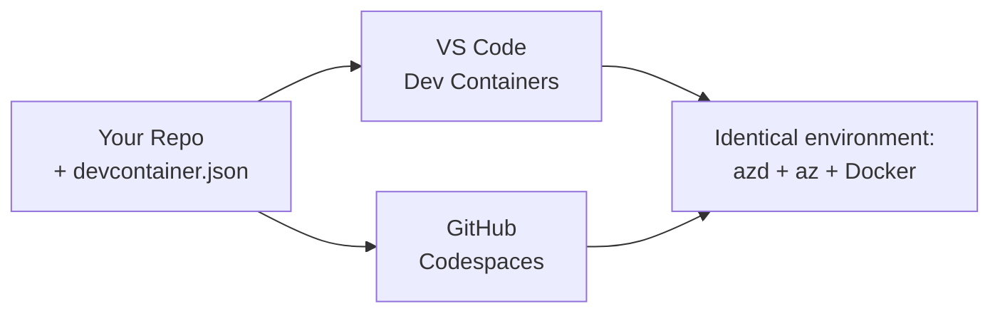

# کانتینرهای توسعه و کداسپیس‌های گیت‌هاب برای azd

**هدایت فصل:**
- **📚 صفحه اصلی دوره**: [AZD برای مبتدیان](../../README.md)
- **📖 فصل فعلی**: فصل ۱ - پایه و شروع سریع
- **⬅️ قبلی**: [برنامه خود را بیاورید](bring-your-own-app.md)
- **🚀 فصل بعدی**: [فصل ۲: توسعه هوش مصنوعی محور](../chapter-02-ai-development/README.md)

> هدف بازبینی فرمان و پیکربندی: `azd 1.37.2` (نوامبر ۲۰۲۶). ساخت کانتینرها و استقرارهای Azure به عنوان بخشی از این بازبینی اجرا نشد.

## مقدمه

نصب azd، محیط اجرای زبان مناسب، داکر و Azure CLI روی هر ماشین کاری خسته‌کننده است — و این دلیل شماره یک برای شکست آموزش‌هایی است که «روی ماشین من کار می‌کند» ولی روی ماشین دیگران خیر. یک **کانتینر توسعه** این مشکل را با شرح تمام زنجیره ابزار شما در یک فایل حل می‌کند. هر کسی که پروژه را در VS Code یا GitHub Codespaces باز کند، دقیقاً همان محیط را با azd نصب شده از پیش دریافت می‌کند. این درس به شما نشان می‌دهد چگونه یکی اضافه کنید.

## اهداف یادگیری

تا پایان این درس، شما قادر خواهید بود:
- بفهمید کانتینر توسعه چیست و چرا در azd کمک می‌کند
- یک `.devcontainer/devcontainer.json` حداقلی به پروژه اضافه کنید
- شامل کردن azd، Azure CLI و Docker از طریق *ویژگی‌های* کانتینر توسعه
- پروژه را در GitHub Codespaces یا VS Code باز کنید

## نتایج یادگیری

پس از کامل کردن این درس، می‌توانید:
- یک `devcontainer.json` برای پروژه azd بنویسید
- بدون نصب دستی، azd و ابزارهای Azure را اضافه کنید
- `azd up` را از داخل یک کانتینر یا Codespace اجرا کنید

---

## کانتینر توسعه چیست؟

کانتینر توسعه یک محیط توسعه مبتنی بر داکر است که توسط یک فایل `.devcontainer/devcontainer.json` در مخزن شما تعریف شده است. وقتی پروژه را باز می‌کنید:

- **VS Code** (با افزونه Dev Containers) کانتینر را می‌سازد و به آن متصل می‌شود.
- **GitHub Codespaces** همان کانتینر را در فضای ابری می‌سازد و یک ویرایشگر مبتنی بر مرورگر به شما می‌دهد.

در هر صورت، هر مشارکت‌کننده ابزارهای یکسانی دارد — نیازی به عیب‌یابی «azd را نصب کردی؟» نیست.



---

## گام ۱: ایجاد فایل devcontainer

در ریشه پروژه خود یک `.devcontainer/devcontainer.json` ایجاد کنید:

```json
{
  "name": "azd-project",
  "image": "mcr.microsoft.com/devcontainers/base:bookworm",
  "features": {
    "ghcr.io/devcontainers/features/azure-cli:1": {},
    "ghcr.io/azure/azure-dev/azd:0": { "version": "1.37.2" },
    "ghcr.io/devcontainers/features/docker-in-docker:2": {},
    "ghcr.io/devcontainers/features/node:1": {}
  },
  "customizations": {
    "vscode": {
      "extensions": [
        "ms-azuretools.azure-dev",
        "ms-azuretools.vscode-bicep"
      ]
    }
  },
  "forwardPorts": [3000],
  "postCreateCommand": "azd version"
}
```

هر بخش چه کاری انجام می‌دهد:

| کلید | هدف |
|-----|---------|
| `image` | سیستم‌عامل پایه برای کانتینر |
| `features` | نصب‌کننده‌های آماده — اینجا: Azure CLI، **azd**، Docker و Node.js |
| `customizations.vscode.extensions` | نصب خودکار افزونه‌های azd و Bicep در VS Code |
| `forwardPorts` | درگاه برنامه شما را به مرورگر باز می‌کند |
| `postCreateCommand` | یک بار پس از ساخت کانتینر اجرا می‌شود (اینجا، یک بررسی سلامت) |

> نسخه ویژگی (`azd:0`) و نسخه نصب شده CLI متفاوت است. گزینه `version` ویژگی را روی `"1.37.2"` تنظیم کنید تا CLI ثابت بماند؛ از نسخه CLI به عنوان برچسب ویژگی استفاده نکنید.

---

## گام ۲: ویژگی را با زبان اپ خود هماهنگ کنید

ویژگی `node` را با زبانی که اپ شما استفاده می‌کند، جایگزین کنید:

```jsonc
// Python project
"ghcr.io/devcontainers/features/python:1": {},

// .NET project
"ghcr.io/devcontainers/features/dotnet:2": {},

// Java project
"ghcr.io/devcontainers/features/java:1": {},

// Go project
"ghcr.io/devcontainers/features/go:1": {}
```

هنگام ساخت تصاویر به صورت محلی، `docker-in-docker` را نگه دارید. یک ساخت ACR راه دور پیکربندی شده (`docker.remoteBuild: true`) جایگزین است؛ نوع میزبان به تنهایی همیشه به داکر محلی نیاز ندارد.

---

## گام ۳: باز کردن آن

**در VS Code:**
1. افزونه **Dev Containers** را نصب کنید.
2. پوشه پروژه را باز کنید.
3. وقتی درخواست شد، روی **Reopen in Container** کلیک کنید (یا *Dev Containers: Reopen in Container* را اجرا کنید).

**در GitHub Codespaces:**
1. مخزن را به گیت‌هاب پوش کنید.
2. روی **Code → Codespaces → Create codespace on main** کلیک کنید.
3. منتظر ساخت کانتینر بمانید — azd در ترمینال آماده است.

---

## گام ۴: استقرار از داخل کانتینر

کانتینر azd را از پیش نصب شده دارد، پس روند معمول به خوبی کار می‌کند:

```bash
azd auth login --use-device-code   # device code is handy inside Codespaces
azd up
```

> **چرا `--use-device-code`؟** در یک کانتینر ریموت یا Codespace مرورگر محلی برای ریدایرکت وجود ندارد، پس ورود به سیستم با کد دستگاه مسیر قابل اعتماد است. شما کد را در یک تب مرورگر وارد می‌کنید تا ورود کامل شود.

---

## مشکلات رایج

| مشکل | راه حل |
|---------|-----|
| `azd up` نمی‌تواند یک ایمیج بسازد | ویژگی `docker-in-docker` را اضافه کنید |
| ورود به مرورگر در Codespaces گیر می‌کند | از `azd auth login --use-device-code` استفاده کنید |
| ابزارها بین اعضای تیم متفاوت است | CLI را از طریق گزینه `version` ویژگی azd ثابت کنید و محیط اجرای زبان را پین کنید |
| برنامه در مرورگر قابل دسترس نیست | درگاه را به `forwardPorts` اضافه کنید |

---

## خلاصه

- یک کانتینر توسعه زنجیره ابزار azd شما را برای همه بازتولیدپذیر می‌کند.
- azd، Azure CLI و Docker را از طریق *ویژگی‌های* کانتینر توسعه اضافه کنید.
- ویژگی زبان را با اپ خود هماهنگ کنید و `docker-in-docker` را برای میزبان‌های کانتینر نگه دارید.
- هنگام اجرای داخل Codespaces از ورود با کد دستگاه استفاده کنید.

---

## 🔗 ناوبری

| جهت | منبع |
|-----------|----------|
| **قبلی** | [برنامه خود را بیاورید](bring-your-own-app.md) |
| **صفحه اصلی فصل** | [فصل ۱: پایه و شروع سریع](README.md) |
| **فصل بعدی** | [فصل ۲: توسعه هوش مصنوعی محور](../chapter-02-ai-development/README.md) |

## 📖 منابع مرتبط

- [نصب و راه‌اندازی](installation.md)
- [برگه راهنمای فرمان‌ها](../../resources/cheat-sheet.md)
- [مشخصات رسمی Dev Containers](https://containers.dev/)
- [ویژگی Dev Container در azd](https://github.com/Azure/azure-dev/tree/main/ext/devcontainer)

---

<!-- CO-OP TRANSLATOR DISCLAIMER START -->
**سلب مسئولیت**:
این سند با استفاده از سرویس ترجمه هوش مصنوعی [Co-op Translator](https://github.com/Azure/co-op-translator) ترجمه شده است. در حالی که ما در تلاش برای دقت هستیم، لطفاً توجه داشته باشید که ترجمه‌های خودکار ممکن است شامل خطاها یا نادرستی‌هایی باشند. سند اصلی به زبان مادری خود باید به عنوان منبع معتبر در نظر گرفته شود. برای اطلاعات حیاتی، ترجمه حرفه‌ای انسانی توصیه می‌شود. ما در قبال هرگونه سوء تفاهم یا برداشت نادرست ناشی از استفاده از این ترجمه مسئولیتی نداریم.
<!-- CO-OP TRANSLATOR DISCLAIMER END -->