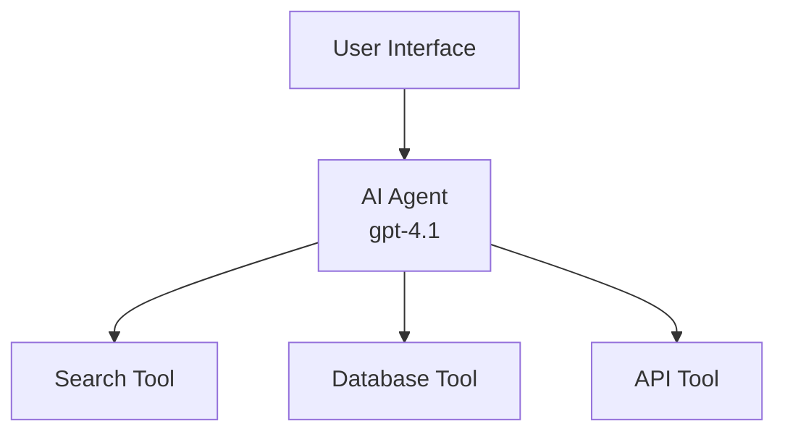
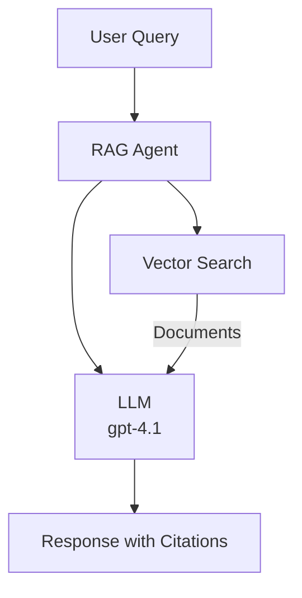
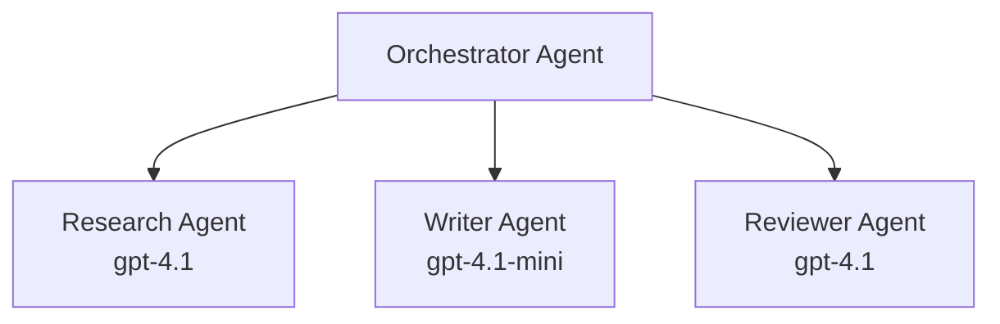

# عوامل هوش مصنوعی با Azure Developer CLI

**مسیریابی فصل:**
- **📚 صفحه اصلی دوره**: [AZD برای مبتدیان](../../README.md)
- **📖 فصل جاری**: فصل ۲ - توسعه هوش‌محور
- **⬅️ قبلی**: [ادغام Microsoft Foundry](microsoft-foundry-integration.md)
- **➡️ بعدی**: [استقرار مدل هوش مصنوعی](ai-model-deployment.md)
- **🚀 پیشرفته**: [راه‌حل‌های چندعامله](../../examples/retail-scenario.md)

---

## مقدمه

عوامل هوش مصنوعی برنامه‌های خودمختاری هستند که می‌توانند محیط خود را درک کنند، تصمیم بگیرند و اقدامات لازم برای رسیدن به اهداف خاص را انجام دهند. برخلاف چت‌بات‌های ساده که فقط به درخواست‌ها پاسخ می‌دهند، عوامل می‌توانند:

- **استفاده از ابزارها** - فراخوانی APIها، جستجوی پایگاه داده‌ها، اجرای کد
- **برنامه‌ریزی و استدلال** - تجزیه کارهای پیچیده به مراحل
- **یادگیری از زمینه** - حفظ حافظه و تطبیق رفتار
- **همکاری** - کار با سایر عوامل (سیستم‌های چندعامله)

این راهنما نحوه استقرار عوامل هوش مصنوعی در Azure با استفاده از Azure Developer CLI (azd) را نشان می‌دهد.

استفاده از زمینه مکالمه آموزش مدل نیست: حافظه پایدار، کنترل دسترسی و نگهداری باید توسط برنامه پیاده‌سازی/پیکربندی شود.

> **به‌روزرسانی Foundry GA (2026-11-09):** بسته عمومی در دسترس `microsoft.foundry` نسخه ۱.۰ را با `azd >= 1.37.0` نصب کنید. ارزیابی‌ها جداگانه نصب می‌شوند؛ ویژگی‌های پیش‌نمایش اختیاری و قطعه SDK کلاسیک زیر توسط اعلام نسخه عمومی بسته ارتقا نمی‌یابند. این راهنما بر اساس [اعلامیه GA](https://devblogs.microsoft.com/azure-sdk/microsoft-foundry-azure-developer-cli-ga/) و مستندات است، نه استقرار زنده Azure.

## اهداف یادگیری

با کامل کردن این راهنما، شما:
- درک خواهید کرد که عوامل هوش مصنوعی چیستند و چگونه با چت‌بات‌ها متفاوتند
- قالب‌های عامل هوش مصنوعی از پیش ساخته شده را با AZD استقرار خواهید داد
- عوامل Foundry را برای عوامل سفارشی پیکربندی خواهید کرد
- الگوهای پایه عامل (استفاده از ابزار، RAG، چندعامل) را پیاده‌سازی خواهید کرد
- عامل‌های مستقر شده را زیر نظر گرفته و خطاها را رفع خواهید کرد

## نتایج یادگیری

پس از اتمام این دوره، قادر خواهید بود:
- برنامه‌های عامل هوش مصنوعی را با یک دستور به Azure مستقر کنید
- ابزارها و قابلیت‌های عامل را پیکربندی کنید
- تولید افزوده شده با بازیابی (RAG) را با عوامل پیاده‌سازی کنید
- معماری‌های چندعامله برای گردش کارهای پیچیده طراحی کنید
- مشکلات رایج استقرار عامل را رفع کنید

---

## 🤖 عامل چه تفاوتی با چت‌بات دارد؟

| ویژگی | چت‌بات | عامل هوش مصنوعی |
|---------|---------|----------|
| **رفتار** | پاسخ به درخواست‌ها | انجام خودکار اقدامات |
| **ابزارها** | ممکن است از بازیابی یا ابزارها استفاده کند | معمولاً در حلقه هدفمند از ابزارها استفاده می‌کند |
| **حافظه** | وابسته به برنامه | حافظه پایدار فقط اگر به‌طور صریح پیاده‌سازی شده باشد |
| **برنامه‌ریزی** | پاسخ تک مرحله‌ای | استدلال چند مرحله‌ای |
| **همکاری** | موجودیت تنها | امکان تعامل با سایر عوامل |

### تشبیه ساده

- **چت‌بات** = شخصی مفید که به سوالات در میز اطلاع‌رسانی پاسخ می‌دهد
- **عامل هوش مصنوعی** = دستیار شخصی که می‌تواند تماس تلفنی بگیرد، وقت ملاقات رزرو کند و کارها را برای شما انجام دهد

---

## 🚀 شروع سریع: اولین عامل خود را مستقر کنید

یکی از گزینه‌ها را در **یک پوشه کاری خالی جدید** انتخاب کنید. دستور انتهایی `.` در آنجا مقداردهی اولیه می‌کند؛ بدون تعیین مقصد صریح، AZD ممکن است زیرپوشه‌ای به نام قالب ایجاد کند و پوشه شِل شما را تغییر ندهد. قالب‌ها/محیط‌های جداگانه را در پوشه‌های جدا نگه دارید.

زمان/هزینه‌های زیر تنها نمونه هستند و قیمت‌های تایید نشده. قبل از استقرار پیش‌نیازها، قیمت‌ها، سهمیه مدل و خدمات اختیاری هر نمونه را بررسی کنید.

### گزینه ۱: قالب عوامل Foundry (توصیه شده)

```bash
# Initialize the AI agents template
azd init --template get-started-with-ai-agents .

# Deploy to Azure
azd up
```

**آنچه مستقر می‌شود:** زیرساخت فعلی نمونه و گزینه‌های انتخابی مدل، ابزارها، میزبانی و منابع نظارت را تعیین می‌کنند. قبل از تأمین منابع، فایل README و `infra/` را مرور کنید؛ فرض نکنید هر قالب عاملی شامل جستجو یا رابط وب است.

**زمان:** حدود ۱۵-۲۰ دقیقه
**هزینه:** حدود ۱۰۰-۱۵۰ دلار در ماه (برای توسعه)

### گزینه ۲: عوامل نویسندگی خلاقانه با Prompty

```bash
# Initialize the Prompty-based agent template
azd init --template https://github.com/Azure-Samples/contoso-creative-writer .

# Deploy to Azure
azd up
```

**آنچه مستقر می‌شود:** نمونه چندعامله FastAPI/Prompty برای نویسندگی، با استفاده از Azure OpenAI، Bing Grounding، و Azure AI Search. مخزن قبلی `agent-openai-python-prompty` به اینجا هدایت می‌شود؛ این قالب یک نمونه ساده هوش مصنوعی آب‌وهوا با Azure Functions نیست. README فعلی آن را برای میزبانی، سهمیه مدل و پیش‌نیازهای Bing Grounding دنبال کنید.

**زمان:** حدود ۱۰-۱۵ دقیقه
**هزینه:** حدود ۵۰-۱۰۰ دلار در ماه (برای توسعه)

### گزینه ۳: عامل چت RAG

```bash
# Initialize RAG chat template
azd init --template azure-search-openai-demo .

# Deploy to Azure
azd up
```

**آنچه مستقر می‌شود:**
- ✅ مدل‌های Microsoft Foundry
- ✅ جستجوی Azure AI با داده نمونه
- ✅ خط لوله پردازش سند
- ✅ رابط چت با استنادها

**زمان:** حدود ۱۵-۲۵ دقیقه
**هزینه:** حدود ۸۰-۱۵۰ دلار در ماه (برای توسعه)

### گزینه ۴: عامل میزبانی شده با بسته GA Foundry

از [آموزش کامل عامل میزبانی شده](microsoft-foundry-integration.md#hosted-agent-walkthrough-ga) برای نمونه چارچوب پاسخ‌های Python Agent Framework استفاده کنید. این مسیر استقرار کد به پایتون ۳.۱۳+، نسخه فعلی uv، مجوزهای Foundry و سهمیه منطقه‌ای مدل نیاز دارد. هنگام استفاده از اعتبارنامه Azure CLI، احراز هویت تماس‌های SDK محلی را جداگانه انجام دهید.

```bash
azd auth login
azd ext install microsoft.foundry
```

در پوشه خالی، نمونه را مقداردهی اولیه کنید:

```text
azd ai agent init --template https://github.com/microsoft-foundry/foundry-samples/blob/main/samples/python/hosted-agents/agent-framework/responses/01-basic/azure.yaml --deploy-mode code --src .
```

پروژه جدید یا موجود را انتخاب کنید، `azure.yaml` را مرور کرده و `azd provision` را اجرا کنید. از `azd ai agent run` برای باز کردن Agent Inspector استفاده کنید و در یک ترمینال دیگر در همان پوشه، `azd ai agent invoke --local "Explain how this agent is hosted."` را اجرا کنید. پس از تایید محلی، از `azd deploy` و `azd ai agent invoke "Explain how this agent is hosted."` برای مقایسه پاسخ مستقر شده استفاده کنید. Foundry منبع آپلود شده را از راه دور می‌سازد؛ ساخت محلی کانتینر لازم نیست.

**چه زمانی از `azd ai agent init` در مقابل `azd init --template` استفاده کنیم:**

| رویکرد | بهترین کاربرد | نحوه عملکرد |
|----------|----------|------|
| `azd init --template` | شروع از یک برنامه نمونه آماده | کپی کامل یک مخزن قالب حاوی کد و زیرساخت |
| `azd ai agent init --template` | پذیرش یک پروژه عامل Foundry موجود | استفاده از سند پروژه `azure.yaml` و تعاریف آن |

> **نکته:** گزینه‌های ۱ تا ۳ از قالب‌های کامل برنامه شروع می‌کنند؛ گزینه ۴ جریان کاری عامل میزبانی شده GA را آموزش می‌دهد. هیچ دستور مقداردهی اولیه‌ای خودکار به مانیفست‌های عامل قدیمی مهاجرت نمی‌کند. برای افزودن تعریف مستقیم عامل به یک پروژه موجود، به [راهنمای مقداردهی اولیه و مهاجرت](../chapter-08-production/production-ai-practices.md#initializing-agent-projects-with-azd-ai-agent-init) مراجعه کنید.

بسته `azure.ai.evaluations` را جداگانه نصب کنید تا داده‌ها/معیارهای تست را تولید و مرور، ارزیابی را پیکربندی و با `azd ai eval` اجرا کنید. بهینه‌سازی می‌تواند از ارزیابی سازگار مجدداً استفاده کند؛ نامزدها را قبل از استقرار صریح بررسی کنید. قبل از استفاده مجدد از نمونه‌های قدیمی، [جریان کاری ارزیابی](../chapter-08-production/production-ai-practices.md#evaluation-migration-and-quality-checks) و [مهاجرت بهینه‌سازی](../chapter-08-production/production-ai-practices.md#optimization-configuration-migration) را دنبال کنید. برای پاک‌سازی، منابع پروژه Foundry استفاده شده پس از `azd down` باقی می‌مانند؛ گروه منابع پروژه تازه ساخته شده حذف می‌شود. به [راهنمای پاک‌سازی آموزش](microsoft-foundry-integration.md#7-clean-up-deliberately) مراجعه کنید.

---

## 🏗️ الگوهای معماری عامل

### الگو ۱: عامل تک با ابزارها

ساده‌ترین الگوی عامل - یک عامل که می‌تواند از چند ابزار استفاده کند.



**مناسب برای:**
- ربات‌های پشتیبانی مشتری
- دستیاران پژوهشی
- عوامل تجزیه و تحلیل داده

**نمونه برنامه مرتبط:** `azure-search-openai-demo` نمونه RAG را نشان می‌دهد، نه یک حلقه عاملی با ابزار دلخواه.

### الگو ۲: عامل RAG (تولید افزوده شده با بازیابی)

عاملی که اسناد مرتبط را قبل از تولید پاسخ‌ها بازیابی می‌کند.



**مناسب برای:**
- پایگاه‌های دانش سازمانی
- سیستم‌های سوال و جواب اسناد
- پژوهش‌های قانونی و انطباق

**قالب AZD:** `azure-search-openai-demo`

### الگو ۳: سیستم چندعامله

چند عامل تخصصی که با هم روی کارهای پیچیده کار می‌کنند.



**مناسب برای:**
- تولید محتوای پیچیده
- گردش کارهای چند مرحله‌ای
- کارهایی که به تخصص‌های مختلف نیاز دارند

**بیشتر بیاموزید:** [الگوهای هماهنگی چندعاملی](../chapter-06-pre-deployment/coordination-patterns.md)

---

## ⚙️ پیکربندی ابزارهای عامل

عوامل وقتی قدرتمند می‌شوند که بتوانند از ابزارها استفاده کنند. در اینجا نحوه پیکربندی ابزارهای رایج آمده است:

### پیکربندی ابزار در عوامل Foundry

این **قطعه قدیمی SDK سرویس عامل** `azure-ai-projects==1.0.0` و `azure-ai-agents==1.1.0` را با `azure-identity` هدف قرار می‌دهد. این نسخه جدید API پاسخ‌های عاملی/نسخه‌ای که در برخی قالب‌های فعلی Foundry است یا افزونه AZD `azure.ai.agents` نیست (بسته‌ای متفاوت). این نسل‌های API را مخلوط نکنید. `PROJECT_ENDPOINT` را روی نقطه پایانی پروژه کلاسیک Foundry و `MODEL_DEPLOYMENT_NAME` را روی یک استقرار مدل پشتیبانی شده‌ی موجود تنظیم کنید؛ محلی با `az login` احراز هویت کنید و مجوزهای لازم پروژه را بدهید.

```python
# agent_config.py
import os
from azure.ai.projects import AIProjectClient
from azure.ai.agents.models import FunctionTool
from azure.identity import DefaultAzureCredential

def search_knowledge_base(query: str) -> str:
    """Search the demonstration knowledge base.

    :param query: Search text.
    :return: Matching demonstration information.
    """
    # Local fixture only, not a production search implementation.
    return "Demo policy: returns are accepted within 30 days."

project_client = AIProjectClient(
    endpoint=os.environ["PROJECT_ENDPOINT"],
    credential=DefaultAzureCredential(),
)
search_tool = FunctionTool(functions={search_knowledge_base})
project_client.agents.enable_auto_function_calls(search_tool)
agent = project_client.agents.create_agent(
    model=os.environ["MODEL_DEPLOYMENT_NAME"],
    name="Support Agent",
    instructions="Use search_knowledge_base for policy questions. Label results as demo data.",
    tools=search_tool.definitions,
)
```

ثبت یک طرح تابع باعث اجرای پایتون روی سرویس نمی‌شود. در این SDK، `enable_auto_function_calls` به همراه `agents.runs.create_and_process(...)` فراخوان‌های ثبت شده را در فرآیند مشتری شما اجرا می‌کند. به [نمونه SDK منتشر شده](https://github.com/Azure/azure-sdk-for-python/blob/azure-ai-agents_1.1.0/sdk/ai/azure-ai-agents/samples/agents_tools/sample_agents_auto_function_call.py) مراجعه کنید. در پایان کار مشتری را ببندید و عوامل/رشته‌های نمایشی را حذف کنید.

### پیکربندی محیط

نام‌های زیر **ورودی‌های قالب سفارشی نمونه‌ای** هستند و سویچ‌های تعبیه‌شده AZD نیستند. ابتدا هر مقدار را از طریق `infra/main.parameters.json`، زیرساخت و کد برنامه عبور دهید. `azd env set` به تنهایی ابزارها یا دستورالعمل‌های عامل را تغییر نمی‌دهد.

```bash
# Set up agent-specific environment variables
azd env set AZURE_OPENAI_MODEL "gpt-4.1"
azd env set AGENT_INSTRUCTIONS "You are a helpful assistant..."
azd env set ENABLE_CODE_INTERPRETER "true"
azd env set ENABLE_FILE_SEARCH "true"

# Apply wired infrastructure and application changes
azd up
```

---

## 📊 نظارت بر عوامل

### یکپارچه‌سازی Application Insights

اگر قالب انتخاب شده Application Insights را تأمین و ابزارسازی را پیکربندی کند:

```bash
# Open monitoring dashboard
azd monitor --overview

# Open the Application Insights logs view (not a streaming log tail)
azd monitor --logs

# View live metrics
azd monitor --live
```

### شاخص‌های کلیدی برای پیگیری

| شاخص | توضیح | هدف |
|--------|-------------|--------|
| تاخیر پاسخ | زمان تولید پاسخ | کمتر از ۵ ثانیه |
| مصرف توکن | تعداد توکن‌ها در هر درخواست | برای کنترل هزینه نظارت شود |
| نرخ موفقیت فراخوانی ابزار | درصد اجرای موفق ابزار | بیشتر از ۹۵٪ |
| نرخ خطا | درخواست‌های ناموفق عامل | کمتر از ۱٪ |
| رضایت کاربران | امتیاز بازخورد | بالای ۴.۰ از ۵.۰ |

### ثبت‌سازی سفارشی برای عوامل

```python
import os
from azure.monitor.opentelemetry import configure_azure_monitor
from opentelemetry import trace

# Configure Azure Monitor with OpenTelemetry
configure_azure_monitor(
    connection_string=os.environ["APPLICATIONINSIGHTS_CONNECTION_STRING"]
)

tracer = trace.get_tracer(__name__)

def log_agent_interaction(user_query, agent_response, tools_used, latency_ms):
    with tracer.start_as_current_span("agent_interaction") as span:
        span.set_attributes({
            "query_length": len(user_query),  # Do not log raw prompts or personal data
            "response_length": len(agent_response),
            "tools_used": tools_used,
            "latency_ms": latency_ms
        })
```

> **توجه:** بسته لازم `pip install azure-monitor-opentelemetry` را نصب کنید. این بسته وابستگی‌های OpenTelemetry را به همراه دارد؛ فضای نام ایمپورت شرط نصب بسته‌ای به نام `opentelemetry` نیست.

---

## 💰 ملاحظات هزینه

### هزینه‌های ماهانه بر اساس الگو

این‌ها بازه‌های برنامه‌ریزی نمونه هستند و قیمت یا سقف تخصیص هزینه نیستند. منطقه، توکن‌های مدل، SKUهای جستجو/محاسبه، جلسات ابزار، ذخیره‌سازی و ترافیک ممکن است بیش از این باشند. قبل از `azd up` راهنمای قیمت نمونه و قیمت‌های Azure را بررسی کنید.

| الگو | محیط توسعه | محیط تولید |
|---------|-----------------|------------|
| عامل تک | ۵۰-۱۰۰ دلار | ۲۰۰-۵۰۰ دلار |
| عامل RAG | ۸۰-۱۵۰ دلار | ۳۰۰-۸۰۰ دلار |
| چندعامل (۲-۳ عامل) | ۱۵۰-۳۰۰ دلار | ۵۰۰-۱۵۰۰ دلار |
| چندعامل سازمانی | ۳۰۰-۵۰۰ دلار | ۱,۵۰۰-۵,۰۰۰+ دلار |

### نکات بهینه‌سازی هزینه

1. **برای کارهای ساده از gpt-4.1-mini استفاده کنید** ( تنها در صورتی که قالب شما این ورودی را مصرف می‌کند)
   ```bash
   azd env set AZURE_OPENAI_MODEL "gpt-4.1-mini"
   ```

2. **کشینگ محدوده‌ای برای پرسش‌های امن و تکراری پیاده‌سازی کنید.** مجوز مستاجر/کاربر، استقرار مدل، دستورالعمل‌ها و نسخه بازیابی را در کلید کش بگنجانید؛ یک زمان انقضا تنظیم کنید. پاسخ‌های خصوصی مکالمه را از طریق کش فقط پرسش در کل فرایند به اشتراک نگذارید. شیء عامل SDK متدی عمومی به نام `agent.run()` ندارد.

3. **محدودیت توکن برای هر اجرا تعیین کنید**
   ```python
   # Set max_completion_tokens when running the agent, not during creation
   run = project_client.agents.runs.create_and_process(
       thread_id=thread.id,
       agent_id=agent.id,
       max_completion_tokens=1000  # Budget across the run; may finish as incomplete
   )
   ```

4. **زمان عدم استفاده، برنامه‌های ظرفیتی Container Apps واجد شرایط را به صفر برسانید**
   ```bash
   # Custom-template input: must map to template.scale.minReplicas
   azd env set MIN_REPLICAS "0"
   ```
   تغییر زیرساخت را با `azd provision` یا `azd up` اعمال کنید. مقیاس به صفر به ماشه مناسب نیاز دارد و هزینه‌های جستجو، ذخیره‌سازی یا مدل/ابزار را متوقف نمی‌کند.

---

## 🔧 رفع اشکال عوامل

### مشکلات رایج و راه‌حل‌ها

<details>
<summary><strong>❌ عامل به فراخوانی‌های ابزار پاسخ نمی‌دهد</strong></summary>

```bash
# Inspect the application deployment (not the agent's registered tools)
azd show

# Verify OpenAI deployment
az cognitiveservices account deployment list \
  --name $AZURE_OPENAI_NAME \
  --resource-group $RG_NAME

# Check agent logs
azd monitor --logs
```

**علل رایج:**
- عدم تطابق امضا تابع ابزار
- کمبود مجوزهای لازم
- نقطه پایانی API قابل دسترسی نیست
</details>

<details>
<summary><strong>❌ تاخیر زیاد در پاسخ‌های عامل</strong></summary>

```bash
# Check Application Insights for bottlenecks
azd monitor --live

# Consider using a faster model
azd env set AZURE_OPENAI_MODEL "gpt-4.1-mini"
azd up
```

**نکات بهینه‌سازی:**
- استفاده از پاسخ‌های جریان‌یافته
- پیاده‌سازی کشینگ پاسخ
- کاهش اندازه پنجره زمینه
</details>

<details>
<summary><strong>❌ عامل اطلاعات نادرست یا هذیان‌آمیز بازمی‌گرداند</strong></summary>

```python
# Improve with better system prompts
instructions = """
You are a helpful assistant. IMPORTANT:
- Only answer based on provided context
- If you don't know, say "I don't know"
- Always cite your sources
- Never make up information
"""

# Use these instructions in the agent definition.
# For classic file search, first upload/index documents in a vector store,
# then use FileSearchTool(vector_store_ids=[...]) and pass both its
# .definitions and .resources when creating the agent.
```
 دستورالعمل‌ها و بازیابی ریسک را کاهش می‌دهند؛ هیچکدام پاسخ‌های واقعی را تضمین نمی‌کنند. سوالات مبتنی بر زمین و خارج از دامنه را با پاسخ‌های شناخته شده ارزیابی کنید.
</details>

<details>
<summary><strong>❌ خطاهای تجاوز از محدودیت توکن</strong></summary>

```python
# Implement context window management
def truncate_context(messages, max_tokens=8000, model="gpt-4.1"):
    """Approximate content-only budget for objects with .content strings."""
    import tiktoken
    encoding = tiktoken.encoding_for_model(model)
    total_tokens = 0
    truncated = []
    
    for msg in reversed(messages):
        msg_tokens = len(encoding.encode(msg.content))
        if total_tokens + msg_tokens > max_tokens:
            break
        truncated.insert(0, msg)
        total_tokens += msg_tokens
    
    return truncated
```
 این کمکی نقش‌ها/طرح‌های ابزار، دستورالعمل‌های سیستمی، توکن‌های تصویر و سربار پروتکل را حذف می‌کند. برای آن‌ها و تکمیل فضا رزرو کنید؛ جفت فراخوانی/نتیجه ابزار را تقسیم نکنید یا دستورالعمل‌های ضروری سیستم را حذف نکنید. بسته `tiktoken` را جداگانه نصب کنید. اعتبارسنج پنجره زمینه عمومی نیست.
</details>

---

## 🎓 تمرین‌های عملی

### تمرین ۱: استقرار عامل پایه (۲۰ دقیقه)

**هدف:** اولین عامل هوش مصنوعی خود را با AZD مستقر کنید

```bash
# Step 1: Initialize template
azd init --template get-started-with-ai-agents .

# Step 2: Login to Azure
azd auth login
# If you work across tenants, add --tenant-id <tenant-id>

# Step 3: Deploy
azd up

# Step 4: Test the agent
# Expected output after deployment:
#   Deployment Complete!
#   Endpoint: https://<app-name>.<region>.azurecontainerapps.io
# Open the URL shown in the output and try asking a question

# Step 5: View monitoring
azd monitor --overview

# Step 6: Review the listed resources and confirm cleanup
azd down
```

**معیارهای موفقیت:**
- [ ] عامل به سوالات پاسخ می‌دهد
- [ ] می‌تواند به داشبورد نظارت از طریق `azd monitor` دسترسی پیدا کند
- [ ] منابع با موفقیت پاک‌سازی شده‌اند

### تمرین ۲: افزودن ابزار سفارشی (۳۰ دقیقه)

**هدف:** افزودن یک ابزار سفارشی به عامل

**نقطه شروع:** از کلاینت SDK کلاسیک از [پیکربندی ابزار](#tool-configuration-in-foundry-agents) استفاده کنید، نه یک قالب دلخواه با نسل SDK مختلف.

۱. این داده تعیین‌شده را به `agent_config.py` اضافه کنید:
   ```python
   def get_weather(location: str) -> str:
       """Return demonstration weather, not live conditions.

       :param location: City name.
       :return: A clearly labelled fixture.
       """
       print(f"TOOL_CALLED: {location}")
       return f"Demo weather in {location}: Sunny, 72°F (fixture, not live)"
   ```
 ۲. بلوک ثبت و ایجاد ابزار جستجو را با این جایگزین کنید:
   ```python
   weather_tool = FunctionTool(functions={get_weather})
   project_client.agents.enable_auto_function_calls(weather_tool)
   agent = project_client.agents.create_agent(
       model=os.environ["MODEL_DEPLOYMENT_NAME"],
       name="Weather Agent",
       instructions="Call get_weather for weather questions; explain that it returns demo data.",
       tools=weather_tool.definitions,
   )
   thread = project_client.agents.threads.create()
   try:
       project_client.agents.messages.create(
           thread_id=thread.id, role="user", content="Use get_weather for Seattle."
       )
       run = project_client.agents.runs.create_and_process(
           thread_id=thread.id, agent_id=agent.id
       )
       if run.status != "completed":
           raise RuntimeError(f"Run status: {run.status}; error: {run.last_error}")
       for message in project_client.agents.messages.list(thread_id=thread.id):
           for text in message.text_messages:
               print(text.text.value)
   finally:
       project_client.agents.threads.delete(thread.id)
       project_client.agents.delete_agent(agent.id)
       project_client.close()
   ```
 ۳. به‌صورت محلی اجرا کنید (این پروژه Azure موجود را فراخوانی می‌کند و هزینه مدل دارد):
   ```bash
   python agent_config.py
   # Expected: TOOL_CALLED: Seattle, then a completed answer labelled demo data.
   ```

**معیارهای موفقیت:**
- [ ] عامل سوالات مربوط به هواشناسی را تشخیص می‌دهد
- [ ] ابزار به درستی فراخوانی می‌شود
- [ ] پاسخ شامل اطلاعات هواشناسی است

### تمرین ۳: ساخت عامل RAG (۴۵ دقیقه)

**هدف:** ساخت عاملی که به سوالات از روی اسناد شما پاسخ دهد

```bash
# Step 1: Deploy RAG template
azd init --template azure-search-openai-demo .
azd up

# Step 2: Upload your documents
# For the sample's local ingestion path, place supported files in data/.
# Run from the sample root after following its Python environment setup:
./scripts/prepdocs.sh
# Windows PowerShell equivalent: .\\scripts\\prepdocs.ps1

# Step 3: Test with domain-specific questions
# Open the web app URL from the azd up output
# Ask questions about your uploaded documents
# Responses should include citation references like [doc.pdf]
```

**معیارهای موفقیت:**
- [ ] عامل به سوالات از اسناد بارگذاری شده پاسخ می‌دهد
- [ ] پاسخ‌ها شامل ارجاعات هستند
- [ ] سوالات خارج از حوزه به‌گونه‌ای پاسخ داده می‌شوند که ادعاهای پشتیبانی‌نشده ندارند (این تضمینی برای هر سوال آینده نیست)

اگر `USE_CLOUD_INGESTION=true`، به جای آن از جریان بارگذاری/ورود ابری نمونه استفاده کنید؛ بسته محلی به‌طور عمدی ورود داده را رد می‌کند. پس از آزمایش، `azd down` را در محیط RAG اجرا کرده و منابعی را که باید حذف شوند مرور کنید.

---

## 📚 مراحل بعدی

اکنون که با عوامل هوش مصنوعی آشنا شدید، این موضوعات پیشرفته را کاوش کنید:

| موضوع | توضیح | لینک |
|-------|-------------|------|
| **سیستم‌های چندعاملی** | ساخت سیستم‌هایی با چند عامل همکاری‌کننده | [مثال چندعامل خرده‌فروشی](../../examples/retail-scenario.md) |
| **الگوهای هماهنگی** | یادگیری الگوهای ارکستراسیون و ارتباط | [الگوهای هماهنگی](../chapter-06-pre-deployment/coordination-patterns.md) |
| **استقرار در تولید** | استقرار عامل آماده سازمان | [شیوه‌های هوش مصنوعی در تولید](../chapter-08-production/production-ai-practices.md) |
| **ارزیابی عامل** | آزمایش و ارزیابی عملکرد عامل | [عیب‌یابی هوش مصنوعی](../chapter-07-troubleshooting/ai-troubleshooting.md) |
| **کارگاه هوش مصنوعی** | کار عملی: آماده‌سازی راه‌حل هوش مصنوعی برای AZD | [کارگاه هوش مصنوعی](ai-workshop-lab.md) |

---

## 📖 منابع بیشتر

### مستندات رسمی
- [سرویس عامل Microsoft Foundry](https://learn.microsoft.com/azure/ai-services/agents/)
- [شروع سریع سرویس عامل Microsoft Foundry](https://learn.microsoft.com/azure/ai-services/agents/quickstart)
- [چارچوب عامل Semantic Kernel](https://learn.microsoft.com/semantic-kernel/)

### قالب‌های AZD برای عوامل
- [شروع کار با عوامل هوش مصنوعی](https://github.com/Azure-Samples/get-started-with-ai-agents)
- [عوامل نویسندگی خلاق با Prompty](https://github.com/Azure-Samples/contoso-creative-writer)
- [دموی Azure Search OpenAI](https://github.com/Azure-Samples/azure-search-openai-demo)

### منابع جامعه
- [Awesome AZD - قالب‌های عامل](https://azure.github.io/awesome-azd/?tags=ai-agents)
- [Discord هوش مصنوعی Azure](https://discord.gg/microsoft-azure)
- [Discord Microsoft Foundry](https://discord.gg/nTYy5BXMWG)

### مهارت‌های عامل برای ویرایشگر شما
- [**مهارت‌های عامل Microsoft Azure**](https://skills.sh/microsoft/github-copilot-for-azure) - نصب مهارت‌های عامل هوش مصنوعی قابل استفاده مجدد برای توسعه آینده در GitHub Copilot، Cursor یا هر عامل پشتیبانی شده. شامل مهارت‌هایی برای [هوش مصنوعی Azure](https://skills.sh/microsoft/github-copilot-for-azure/azure-ai)، [Microsoft Foundry](https://skills.sh/microsoft/github-copilot-for-azure/microsoft-foundry)، [استقرار](https://skills.sh/microsoft/github-copilot-for-azure/azure-deploy) و [عیب‌یابی](https://skills.sh/microsoft/github-copilot-for-azure/azure-diagnostics):
  ```bash
  npx skills add microsoft/github-copilot-for-azure
  ```

---

**ناوبری**
- **درس قبلی**: [ادغام Microsoft Foundry](microsoft-foundry-integration.md)
- **درس بعدی**: [استقرار مدل هوش مصنوعی](ai-model-deployment.md)

---

<!-- CO-OP TRANSLATOR DISCLAIMER START -->
**سلب مسئولیت**:
این سند با استفاده از سرویس ترجمه هوش مصنوعی [Co-op Translator](https://github.com/Azure/co-op-translator) ترجمه شده است. در حالی که ما در تلاش برای دقت هستیم، لطفاً توجه داشته باشید که ترجمه‌های خودکار ممکن است شامل خطاها یا نادرستی‌هایی باشند. سند اصلی به زبان مادری خود باید به عنوان منبع معتبر در نظر گرفته شود. برای اطلاعات حیاتی، ترجمه حرفه‌ای انسانی توصیه می‌شود. ما در قبال هرگونه سوء تفاهم یا برداشت نادرست ناشی از استفاده از این ترجمه مسئولیتی نداریم.
<!-- CO-OP TRANSLATOR DISCLAIMER END -->