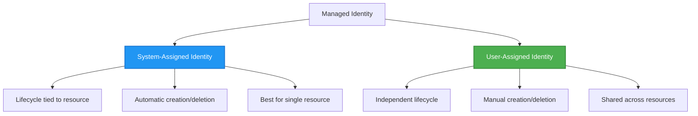

# الگوهای احراز هویت و هویت مدیریت‌شده

⏱️ **زمان تخمینی**: ۴۵-۶۰ دقیقه مطالعه؛ برای ادغام تمرین‌ها زمان اضافی در نظر بگیرید | 💰 **تأثیر هزینه**: هویت/RBAC رایگان است؛ محاسبات، ذخیره‌سازی، و Key Vault مستقر شده مشمول هزینه هستند | ⭐ **سطح دشواری**: متوسط

> مرور شده بر اساس `azd 1.37.2` (نوامبر ۲۰۲۶). این درس شامل **بخش‌های نمونه ادغام است، نه قالب کامل قابل دانلود `secure-app`**. فایل‌های مرجع را ایجاد کنید، زیرساخت مطابق فراهم کنید، و جایگزین‌های مورد نظر را پیش از استقرار جایگزین کنید. در زمان مرور هیچ منبع آژوری ایجاد نشد.

**📚 مسیر یادگیری:**
- ← قبلی: [مدیریت پیکربندی](configuration.md) - مدیریت متغیرهای محیطی و اسرار
- 🎯 **شما اینجایید**: احراز هویت و امنیت (هویت مدیریت‌شده، Key Vault، الگوهای ایمن)
- → بعدی: [زیرساخت به عنوان کد](../chapter-04-infrastructure/README.md) - تامین و استقرار منابع
- 🏠 [خانه دوره](../../README.md)

---

## آنچه خواهید آموخت

با اتمام این درس، شما:
- الگوهای احراز هویت آژور (کلیدها، رشته‌های اتصال، هویت مدیریت‌شده) را درک خواهید کرد
- **هویت مدیریت شده** را برای احراز هویت بدون رمز عبور پیاده‌سازی خواهید کرد
- اسرار را با ادغام **Azure Key Vault** ایمن خواهید کرد
- کنترل دسترسی نقش‌محور (**RBAC**) را برای استقرارهای AZD پیکربندی خواهید کرد
- بهترین شیوه‌های امنیتی را در برنامه‌های کانتینری و خدمات آژور اعمال خواهید کرد
- از احراز هویت مبتنی بر کلید به هویت مبتنی بر هویت مهاجرت خواهید کرد

## اهمیت هویت مدیریت‌شده

### مشکل: احراز هویت سنتی

**قبل از هویت مدیریت‌شده:**
```javascript
// ❌ SECURITY RISK: Hardcoded secrets in code
const connectionString = "Server=mydb.database.windows.net;User=admin;Password=P@ssw0rd123";
const storageKey = "xK7mN9pQ2wR5tY8uI0oP3aS6dF1gH4jK...";
const cosmosKey = "C2x7B9n4M1p8Q5w3E6r0T2y5U8i1O4p7...";
```

**مشکلات:**
- 🔴 اسرار **در کد، فایل‌های پیکربندی، متغیرهای محیطی آشکار شده‌اند**
- 🔴 **گردش اعتبارنامه** نیازمند تغییر کد و استقرار مجدد است
- 🔴 **کابوس‌های ممیزی** - چه کسی به چه چیزی و کی دسترسی داشت؟
- 🔴 **گسترش نامتعادل** - اسرار پراکنده در سیستم‌های مختلف
- 🔴 **ریسک‌های تطابق** - شکست در ممیزی‌های امنیتی

### راه‌حل: هویت مدیریت‌شده

**پس از هویت مدیریت‌شده:**
```javascript
// ✅ SECURE: No secrets in code
const credential = new DefaultAzureCredential();
const client = new BlobServiceClient(
  "https://mystorageaccount.blob.core.windows.net",
  credential  // Azure automatically handles authentication
);
```

**مزایا:**
- ✅ **بدون اسرار** در کد یا پیکربندی
- ✅ **گردش خودکار** - توسط آژور مدیریت می‌شود
- ✅ **رد پای کامل ممیزی** در گزارش‌های Microsoft Entra ID
- ✅ **امنیت متمرکز** - مدیریت از طریق پورتال آژور
- ✅ **آماده تطابق** - مطابق با استانداردهای امنیتی

**تشبیه**: احراز هویت سنتی مانند حمل چندین کلید فیزیکی برای درهای مختلف است. هویت مدیریت‌شده مانند داشتن یک نشان امنیتی است که به طور خودکار بر اساس هویت شما دسترسی می‌دهد — بدون کلیدی برای گم کردن، کپی کردن، یا گردش دادن.

---

## نمای کلی معماری

### جریان احراز هویت با هویت مدیریت‌شده

```mermaid
sequenceDiagram
    participant App as Your Application<br/>(Container App)
    participant MI as Managed Identity<br/>(Microsoft Entra ID)
    participant KV as Key Vault
    participant Storage as Azure Storage
    participant DB as Azure SQL
    
    App->>MI: Request access token<br/>(automatic)
    MI->>MI: Verify identity<br/>(no password needed)
    MI-->>App: Return token for requested audience<br/>(lifetime varies)
    
    App->>KV: Get secret<br/>(using token)
    KV->>KV: Check RBAC permissions
    KV-->>App: Return secret value
    
    App->>Storage: Upload blob<br/>(using token)
    Storage->>Storage: Check RBAC permissions
    Storage-->>App: Success
    
    App->>DB: Query data<br/>(using token)
    DB->>DB: Check SQL permissions
    DB-->>App: Return results
    
    Note over App,DB: Request a separate token for each service audience;<br/>SDK credentials handle caching and renewal
```

### انواع هویت‌های مدیریت‌شده



| ویژگی | اختصاصی به سیستم | اختصاصی به کاربر |
|---------|----------------|---------------|
| **چرخه عمر** | مرتبط با منبع | مستقل |
| **ایجاد** | خودکار با منبع | ایجاد دستی |
| **حذف** | با حذف منبع حذف می‌شود | پس از حذف منبع باقی می‌ماند |
| **اشتراک‌گذاری** | فقط یک منبع | چند منابع |
| **مورد استفاده** | سناریوهای ساده | سناریوهای پیچیده چندمنبعی |
| **انتخاب قالب** | تعریف شده در زیرساخت | تعریف شده در زیرساخت |

---

## پیش‌نیازها

### ابزارهای مورد نیاز

باید قبلاً این موارد را از درس‌های گذشته نصب کرده باشید:

```bash
# Verify Azure Developer CLI
azd version
# ✅ Expected: azd version 1.0.0 or higher

# Verify Azure CLI
az --version
# ✅ Expected: azure-cli 2.50.0 or higher
```

### نیازمندی‌های آژور

- اشتراک فعال آژور
- دسترسی‌ها به:
  - ایجاد هویت‌های مدیریت‌شده
  - تخصیص نقش‌های RBAC
  - ایجاد منابع Key Vault
  - استقرار برنامه‌های کانتینری

### پیش‌نیازهای دانش

باید گذرانده باشید:
- [راهنمای نصب](../chapter-01-foundation/installation.md) - راه‌اندازی AZD
- [مبانی AZD](../chapter-01-foundation/azd-basics.md) - مفاهیم اصلی
- [مدیریت پیکربندی](configuration.md) - متغیرهای محیطی

---

## درس ۱: فهم الگوهای احراز هویت

### الگو ۱: رشته‌های اتصال (سنتی - اجتناب شود)

**نحوه عملکرد:**
```bash
# Connection string contains credentials
STORAGE_CONNECTION_STRING="DefaultEndpointsProtocol=https;AccountName=myaccount;AccountKey=xK7mN9pQ2wR5..."
COSMOS_CONNECTION_STRING="AccountEndpoint=https://myaccount.documents.azure.com:443/;AccountKey=C2x7..."
SQL_CONNECTION_STRING="Server=myserver.database.windows.net;User=admin;Password=P@ssw0rd..."
```

**مشکلات:**
- ❌ اسرار قابل مشاهده در متغیرهای محیطی
- ❌ ثبت شده در سیستم‌های استقرار
- ❌ دشوار برای گردش
- ❌ رد پای ممیزی دسترسی وجود ندارد

**زمان استفاده:** هنگامی که سرویس هدف احراز هویت مبتنی بر کلید را می‌طلبد. اگر پشتیبانی شده، هویت را ترجیح دهید؛ در غیر این صورت کلیدها را به صورت ایمن ذخیره و گردش دهید، از جمله در محیط تولید.

---

### الگو ۲: مراجع Key Vault (بهتر)

**نحوه عملکرد:**
**قطعات جزئی Bicep:** فیلدهای مورد نیاز vault، هویت Container App و ورودی `configuration.secrets` آن حذف شده‌اند. `secretRef` یک راز Container App را نام‌گذاری می‌کند؛ خود آن **آدرس Key Vault نیست**. برای استفاده از Key Vault، راز نام‌گذاری‌شده را با `keyVaultUrl` و یک `identity` مجاز تعریف کنید.

```bicep
// Store secret in Key Vault
resource keyVault 'Microsoft.KeyVault/vaults@2023-02-01' = {
  name: 'mykv'
  properties: {
    enableRbacAuthorization: true
  }
}

// Reference in Container App
env: [
  {
    name: 'STORAGE_KEY'
    secretRef: 'storage-key'  // References Key Vault
  }
]
```

**مزایا:**
- ✅ اسرار به صورت امن در Key Vault ذخیره می‌شوند
- ✅ مدیریت متمرکز اسرار
- ✅ چرخش بدون تغییر در کد

**محدودیت‌ها:**
- ⚠️ هنوز از کلیدها/رمزهای عبور استفاده می‌شود
- ⚠️ نیاز به مدیریت دسترسی Key Vault

**زمان استفاده:** مرحله انتقال از رشته‌های اتصال به هویت مدیریت‌شده.

---

### الگو 3: هویت مدیریت‌شده (بهترین روش)

**نحوه کار:**
**قطعه جزئی Bicep:** بلوک هویت را در یک Container App کامل ادغام کنید و `storageAccount` و تعریف نقش را تامین کنید. انتساب نقش همچنین نیازمند یک `name` قطعی است.

```bicep
// Enable managed identity
resource containerApp 'Microsoft.App/containerApps@2023-05-01' = {
  name: 'myapp'
  identity: {
    type: 'SystemAssigned'  // Automatically creates identity
  }
}

// Grant permissions
resource roleAssignment 'Microsoft.Authorization/roleAssignments@2022-04-01' = {
  name: guid(storageAccount.id, containerApp.id, storageBlobDataContributorRole)
  scope: storageAccount
  properties: {
    roleDefinitionId: storageBlobDataContributorRole
    principalId: containerApp.identity.principalId
    principalType: 'ServicePrincipal'
  }
}
```

**کد برنامه:**
```javascript
// No secrets needed!
const { DefaultAzureCredential } = require('@azure/identity');
const { BlobServiceClient } = require('@azure/storage-blob');

const credential = new DefaultAzureCredential();
const blobServiceClient = new BlobServiceClient(
  'https://mystorageaccount.blob.core.windows.net',
  credential
);
```

**مزایا:**
- ✅ صفر راز در کد/پیکربندی
- ✅ چرخش خودکار مجوزها
- ✅ ردیابی کامل ممیزی
- ✅ مجوزهای مبتنی بر RBAC
- ✅ آماده رعایت قوانین

**زمان استفاده:** ترجیح برای برنامه‌های میزبانی‌شده در Azure که به خدماتی دسترسی دارند که احراز هویت Microsoft Entra را پشتیبانی می‌کنند.

---

### الگو 4: اصول سرویس (CI/CD و اتوماسیون)

هویت مدیریت‌شده استاندارد طلایی *برای منابعی است که در داخل Azure اجرا می‌شوند*. اما درباره چیزهایی که **خارج از** Azure اجرا می‌شوند، مانند خط لوله CI/CD روی یک عامل ساخت، یا اسکریپتی روی لپ‌تاپ شما که نمی‌تواند از ورود تعاملی استفاده کند، چیست؟ اینجاست که یک **اصل سرویس** وارد می‌شود: یک هویت غیرانسانی با مدارک خودش که یک فرآیند خودکار می‌تواند با آن وارد شود.

**نحوه کار:**

ساختن یک اصل سرویس با دامنه مربوط به یک گروه منبع (حداقل امتیاز):

```bash
az ad sp create-for-rbac \
  --name "myapp-cicd" \
  --role contributor \
  --scopes "/subscriptions/<sub-id>/resourceGroups/<rg-name>"
```

این شناسه کلاینت، راز کلاینت و شناسه مستاجر را چاپ می‌کند. azd می‌تواند بدون تعامل با آنها وارد شود:

```bash
azd auth login \
  --client-id "<appId>" \
  --client-secret "<password>" \
  --tenant-id "<tenant>"
```

**ترجیح دادن اعتبارنامه‌های فدرال (OIDC) به جای اسرار.** به جای یک راز کلاینت طولانی‌مدت، یک اعتبارنامه فدرال تنظیم کنید تا خط لوله توکن کوتاه‌مدتی تبادل کند—بدون هیچ رازی برای نشت یا چرخش:

```bash
azd auth login \
  --client-id "<appId>" \
  --federated-credential-provider "github" \
  --tenant-id "<tenant>"
```

> `azd pipeline config` این کار را به طور خودکار برای شما راه‌اندازی می‌کند. آموزش‌های CI/CD را در [فصل ۸](../chapter-08-production/production-ai-practices.md) ببینید.

**مزایا:**
- ✅ خارج از Azure کار می‌کند (عوامل ساخت، محل استقرار، سایر ابرها)
- ✅ می‌تواند به یک گروه منبع خاص با یک نقش تخصیص داده شود
- ✅ نسخه فدرال (OIDC) هیچ راز ذخیره شده‌ای ندارد

**معایب:**
- ⚠️ نسخه مبتنی بر راز نیاز به ذخیره و چرخش دقیق دارد
- ⚠️ نشت راز، هر کاری که SP می‌تواند انجام دهد را فراهم می‌کند—حیطه‌ها را محدود نگه دارید

**زمان استفاده:** خطوط لوله CI/CD و اتوماسیونی که نمی‌توانند از هویت مدیریت‌شده استفاده کنند. همیشه نسخه **فدرال/OIDC** را به جای راز کلاینت ترجیح دهید و هر زمان بار کاری داخل Azure اجرا می‌شود، هویت مدیریت‌شده را ترجیح دهید.

**ذخیره امن مدارک:**
- هرگز اسرار را کامیت نکنید—از فروشگاه راز خط لوله خود استفاده کنید (رازهای GitHub Actions، گروه‌های متغیر Azure DevOps / Key Vault).
- اصل سرویس را به کوچک‌ترین نقش و گروه منبعی که نیاز دارد محدود کنید.
- تنظیم تاریخ انقضا و چرخش، یا حذف کامل راز با OIDC.

---

## درس ۲: پیاده‌سازی Managed Identity با AZD

### پیاده‌سازی گام‌به‌گام

قطعات زیر نشان می‌دهند چگونه managed identity را در یک پروژه Container App ادغام کنیم. این‌ها **یک شروع‌کننده کپی-و-اجرا نیستند**: ماژول Storage، زیرساخت کامل محیط/ثبت‌نام مدیریت شده، Dockerfile و فایل پارامتر همه اینجا ارائه نشده‌اند. از یک قالب کارکردی Container Apps شروع کنید و این الگوها را ادغام کنید، همزمان پیکربندی ثبت‌نام و برچسب‌های سرویس آن را حفظ کنید.

### ساختار پروژه

```
secure-app/
├── azure.yaml                 # AZD configuration
├── infra/
│   ├── main.bicep            # Main infrastructure
│   ├── core/
│   │   ├── identity.bicep    # Managed identity setup
│   │   ├── keyvault.bicep    # Key Vault configuration
│   │   └── storage.bicep     # Storage with RBAC
│   └── app/
│       └── container-app.bicep
└── src/
    ├── app.js                # Application code
    ├── package.json
    └── Dockerfile
```

### ۱. پیکربندی AZD (azure.yaml)

```yaml
name: secure-app
metadata:
  template: secure-app@1.0.0

services:
  api:
    project: ./src
    language: js
    host: containerapp

# Managed identity must be enabled in the infrastructure, not by this YAML.
```

### ۲. زیرساخت: فعال‌کردن Managed Identity

**فایل: `infra/main.bicep`**

```bicep
targetScope = 'subscription'

param environmentName string
param location string = 'eastus'
param containerAppsEnvironmentId string
param containerImage string

var tags = { 'azd-env-name': environmentName }

// Resource group
resource rg 'Microsoft.Resources/resourceGroups@2021-04-01' = {
  name: 'rg-${environmentName}'
  location: location
  tags: tags
}

// Storage Account
module storage './core/storage.bicep' = {
  name: 'storage'
  scope: rg
  params: {
    name: 'st${uniqueString(rg.id)}'
    location: location
    tags: tags
  }
}

// Key Vault
module keyVault './core/keyvault.bicep' = {
  name: 'keyvault'
  scope: rg
  params: {
    name: 'kv-${uniqueString(rg.id)}'
    location: location
    tags: tags
  }
}

// Container App with Managed Identity
module containerApp './app/container-app.bicep' = {
  name: 'container-app'
  scope: rg
  params: {
    name: 'ca-${environmentName}'
    location: location
    tags: tags
    storageAccountName: storage.outputs.name
    keyVaultName: keyVault.outputs.name
    containerAppsEnvironmentId: containerAppsEnvironmentId
    containerImage: containerImage
  }
}

// Grant Container App access to Storage
module storageRoleAssignment './core/role-assignment.bicep' = {
  name: 'storage-role'
  scope: rg
  params: {
    principalId: containerApp.outputs.identityPrincipalId
    roleDefinitionId: 'ba92f5b4-2d11-453d-a403-e96b0029c9fe'  // Storage Blob Data Contributor
    targetResourceType: 'storage'
    targetResourceName: storage.outputs.name
  }
}

// Grant Container App access to Key Vault
module kvRoleAssignment './core/role-assignment.bicep' = {
  name: 'kv-role'
  scope: rg
  params: {
    principalId: containerApp.outputs.identityPrincipalId
    roleDefinitionId: '4633458b-17de-408a-b874-0445c86b69e6'  // Key Vault Secrets User
    targetResourceType: 'keyvault'
    targetResourceName: keyVault.outputs.name
  }
}

// Outputs
output AZURE_STORAGE_ACCOUNT_NAME string = storage.outputs.name
output AZURE_KEY_VAULT_NAME string = keyVault.outputs.name
output APP_URL string = containerApp.outputs.url
```

### ۳. Container App با هویت تخصیص داده شده توسط سیستم

**فایل: `infra/app/container-app.bicep`**

```bicep
param name string
param location string
param tags object = {}
param storageAccountName string
param keyVaultName string
param containerAppsEnvironmentId string
param containerImage string

resource containerApp 'Microsoft.App/containerApps@2023-05-01' = {
  name: name
  location: location
  tags: union(tags, { 'azd-service-name': 'api' })
  identity: {
    type: 'SystemAssigned'  // 🔑 Enable managed identity
  }
  properties: {
    managedEnvironmentId: containerAppsEnvironmentId
    configuration: {
      ingress: {
        external: true
        targetPort: 3000
      }
    }
    template: {
      containers: [
        {
          name: 'api'
          image: containerImage // Must exist; configure registry credentials for private images
          resources: {
            cpu: json('0.5')
            memory: '1Gi'
          }
          env: [
            {
              name: 'AZURE_STORAGE_ACCOUNT_NAME'
              value: storageAccountName
            }
            {
              name: 'AZURE_KEY_VAULT_NAME'
              value: keyVaultName
            }
            // 🔑 No secrets - managed identity handles authentication!
          ]
        }
      ]
    }
  }
}

// Output the identity for RBAC assignments
output identityPrincipalId string = containerApp.identity.principalId
output id string = containerApp.id
output url string = 'https://${containerApp.properties.configuration.ingress.fqdn}'
```

### ۴. ماژول تخصیص نقش RBAC

**فایل: `infra/core/role-assignment.bicep`**

```bicep
param principalId string
param roleDefinitionId string  // Azure built-in role ID
@allowed(['storage', 'keyvault'])
param targetResourceType string
param targetResourceName string

// Typed existing resources give Bicep a valid resource scope, not a string ID.
resource storageTarget 'Microsoft.Storage/storageAccounts@2023-01-01' existing = {
  name: targetResourceName
}
resource vaultTarget 'Microsoft.KeyVault/vaults@2023-02-01' existing = {
  name: targetResourceName
}

resource storageAssignment 'Microsoft.Authorization/roleAssignments@2022-04-01' = if (targetResourceType == 'storage') {
  name: guid(storageTarget.id, principalId, roleDefinitionId)
  scope: storageTarget
  properties: {
    roleDefinitionId: subscriptionResourceId('Microsoft.Authorization/roleDefinitions', roleDefinitionId)
    principalId: principalId
    principalType: 'ServicePrincipal'
  }
}

resource vaultAssignment 'Microsoft.Authorization/roleAssignments@2022-04-01' = if (targetResourceType == 'keyvault') {
  name: guid(vaultTarget.id, principalId, roleDefinitionId)
  scope: vaultTarget
  properties: {
    roleDefinitionId: subscriptionResourceId('Microsoft.Authorization/roleDefinitions', roleDefinitionId)
    principalId: principalId
    principalType: 'ServicePrincipal'
  }
}

// This module assigns at the target resource scope, not the whole resource group.
```

### ۵. کد برنامه با Managed Identity

**فایل: `src/app.js`**

```javascript
const express = require('express');
const { DefaultAzureCredential } = require('@azure/identity');
const { BlobServiceClient } = require('@azure/storage-blob');
const { SecretClient } = require('@azure/keyvault-secrets');

const app = express();
const PORT = process.env.PORT || 3000;

// 🔑 Initialize credential (works automatically with managed identity)
const credential = new DefaultAzureCredential();

// Azure Storage setup
const storageAccountName = process.env.AZURE_STORAGE_ACCOUNT_NAME;
const blobServiceClient = new BlobServiceClient(
  `https://${storageAccountName}.blob.core.windows.net`,
  credential  // No keys needed!
);

// Key Vault setup
const keyVaultName = process.env.AZURE_KEY_VAULT_NAME;
const secretClient = new SecretClient(
  `https://${keyVaultName}.vault.azure.net`,
  credential  // No keys needed!
);

// Health check
app.get('/health', (req, res) => {
  res.json({ status: 'healthy', authentication: 'managed-identity' });
});

// Upload file to blob storage
app.post('/upload', async (req, res) => {
  try {
    const containerClient = blobServiceClient.getContainerClient('uploads');
    await containerClient.createIfNotExists();
    
    const blobName = `file-${Date.now()}.txt`;
    const blockBlobClient = containerClient.getBlockBlobClient(blobName);
    
    const content = 'Hello from managed identity!';
    await blockBlobClient.upload(content, Buffer.byteLength(content));
    
    res.json({
      success: true,
      blobName: blobName,
      message: 'File uploaded using managed identity!'
    });
  } catch (error) {
    console.error('Upload error:', error);
    res.status(500).json({ error: error.message });
  }
});

// Get secret from Key Vault
app.get('/secret/:name', async (req, res) => {
  try {
    const secretName = req.params.name;
    const secret = await secretClient.getSecret(secretName);
    
    res.json({
      name: secretName,
      retrieved: secret.value !== undefined, // Never return the secret value to callers
      message: 'Secret retrieved using managed identity!'
    });
  } catch (error) {
    console.error('Secret error:', error);
    res.status(500).json({ error: error.message });
  }
});

// List blob containers (demonstrates read access)
app.get('/containers', async (req, res) => {
  try {
    const containers = [];
    for await (const container of blobServiceClient.listContainers()) {
      containers.push(container.name);
    }
    
    res.json({
      containers: containers,
      count: containers.length,
      message: 'Containers listed using managed identity!'
    });
  } catch (error) {
    console.error('List error:', error);
    res.status(500).json({ error: error.message });
  }
});

app.listen(PORT, () => {
  console.log(`Secure API listening on port ${PORT}`);
  console.log('Authentication: Managed Identity (passwordless)');
});
```

**فایل: `src/package.json`**

```json
{
  "name": "secure-app",
  "version": "1.0.0",
  "dependencies": {
    "express": "^4.18.2",
    "@azure/identity": "^4.0.0",
    "@azure/storage-blob": "^12.17.0",
    "@azure/keyvault-secrets": "^4.7.0"
  },
  "scripts": {
    "start": "node app.js"
  }
}
```

### ۶. استقرار و آزمایش

این دستورات را فقط **پس از** تکمیل زیرساخت، Dockerfile و `main.parameters.json` متناظر در پروژه خود اجرا کنید. تأیید هویت azd را با `azd auth login` انجام دهید؛ برای بررسی‌های بعدی Azure CLI جداگانه با `az login` وارد شوید. نقاط پایانی نشان داده شده نمونه هستند و قبل از استفاده عمومی نیاز به کنترل‌های دسترسی مناسب دارند.

```bash
# Initialize AZD environment
azd init

# Deploy infrastructure and application
azd up

# Get the app URL
APP_URL=$(azd env get-value APP_URL)

# Test health check
curl $APP_URL/health
```

**✅ خروجی مورد انتظار:**
```json
{
  "status": "healthy",
  "authentication": "managed-identity"
}
```

**آزمایش بارگذاری blob:**
```bash
curl -X POST $APP_URL/upload
```

**✅ خروجی مورد انتظار:**
```json
{
  "success": true,
  "blobName": "file-1700404800000.txt",
  "message": "File uploaded using managed identity!"
}
```

**آزمایش فهرست کانتینر:**
```bash
curl $APP_URL/containers
```

**✅ خروجی مورد انتظار:**
```json
{
  "containers": ["uploads"],
  "count": 1,
  "message": "Containers listed using managed identity!"
}
```

---

## نقش‌های رایج Azure RBAC

### شناسه‌های نقش پیش‌فرض برای Managed Identity

| سرویس | نام نقش | شناسه نقش | دسترسی‌ها |
|---------|-----------|---------|-------------|
| **Storage** | Storage Blob Data Reader | `2a2b9908-6ea1-4ae2-8e65-a410df84e7d1` | خواندن blobs و containers |
| **Storage** | Storage Blob Data Contributor | `ba92f5b4-2d11-453d-a403-e96b0029c9fe` | خواندن، نوشتن، حذف blobs |
| **Storage** | Storage Queue Data Contributor | `974c5e8b-45b9-4653-ba55-5f855dd0fb88` | خواندن، نوشتن، حذف صف‌ها/پیام‌ها |
| **Key Vault** | Key Vault Secrets User | `4633458b-17de-408a-b874-0445c86b69e6` | خواندن اسرار |
| **Key Vault** | Key Vault Secrets Officer | `b86a8fe4-44ce-4948-aee5-eccb2c155cd7` | خواندن، نوشتن، حذف اسرار |
| **Cosmos DB** | Cosmos DB Built-in Data Reader | `00000000-0000-0000-0000-000000000001` | خواندن داده‌های Cosmos DB |
| **Cosmos DB** | Cosmos DB Built-in Data Contributor | `00000000-0000-0000-0000-000000000002` | خواندن، نوشتن داده‌های Cosmos DB |
| **SQL Database** | SQL DB Contributor | `9b7fa17d-e63e-47b0-bb0a-15c516ac86ec` | مدیریت منابع پایگاه داده؛ دسترسی به داده‌های SQL نمی‌دهد |
| **Service Bus** | Azure Service Bus Data Owner | `090c5cfd-751d-490a-894a-3ce6f1109419` | ارسال، دریافت، مدیریت پیام‌ها |

### چگونه شناسه‌های نقش را پیدا کنیم

دو شناسه بالا در Cosmos DB برای NoSQL، **تعاریف نقش داده‌محور اصلی بومی Cosmos** هستند، نه شناسه‌های نقش اشتراک Azure RBAC. آنها را با `az cosmosdb sql role assignment create` (یا `Microsoft.DocumentDB/databaseAccounts/sqlRoleAssignments`) اختصاص دهید، نه `az role assignment create`. دسترسی به داده‌های SQL نیازمند یک کاربر پایگاه داده Entra و مجوزهای SQL است.

```bash
# List all built-in roles
az role definition list --query "[].{Name:roleName, ID:name}" --output table

# Search for specific role
az role definition list --query "[?contains(roleName, 'Storage Blob')].{Name:roleName, ID:name}" --output table

# Get role details
az role definition list --name "Storage Blob Data Contributor"
```

---

## تمرین‌های عملی

**پیش‌نیاز‌های ادغام برای هر سه تمرین:** یک قالب Container App کارا در پروژه خودتان، منابع Bicep مرتبط، ورود به سیستم Azure CLI/azd، و اختیار اختصاص نقش‌های لازم. این‌ها تمرینات هدایت‌شده هستند، نه شروع‌کننده‌های مستقل محلی؛ نام‌های نمونه منابع را با نام‌های مستقر شده خود جایگزین کنید.

### تمرین ۱: فعال‌سازی Managed Identity برای اپلیکیشن موجود ⭐⭐ (متوسط)

**هدف**: افزودن شناسه مدیریت شده به استقرار موجود Container App

**سناریو**: یک Container App دارید که از رشته‌های اتصال استفاده می‌کند. آن را به Managed Identity تبدیل کنید.

**نقطه شروع:** Container App با این پیکربندی:

```bicep
// ❌ Current: Using connection string
env: [
  {
    name: 'STORAGE_CONNECTION_STRING'
    secretRef: 'storage-connection'
  }
]
```

**مراحل**:

۱. **فعال‌سازی شناسه مدیریت شده در Bicep:**

```bicep
resource containerApp 'Microsoft.App/containerApps@2023-05-01' = {
  name: 'myapp'
  identity: {
    type: 'SystemAssigned'  // Add this
  }
  // ... rest of configuration
}
```

۲. **دادن دسترسی به Storage:**

```bicep
// Get storage account reference
resource storageAccount 'Microsoft.Storage/storageAccounts@2023-01-01' existing = {
  name: storageAccountName
}

// Assign role
resource roleAssignment 'Microsoft.Authorization/roleAssignments@2022-04-01' = {
  name: guid(containerApp.id, 'ba92f5b4-2d11-453d-a403-e96b0029c9fe', storageAccount.id)
  scope: storageAccount
  properties: {
    roleDefinitionId: subscriptionResourceId('Microsoft.Authorization/roleDefinitions', 'ba92f5b4-2d11-453d-a403-e96b0029c9fe')
    principalId: containerApp.identity.principalId
    principalType: 'ServicePrincipal'
  }
}
```

۳. **به‌روزرسانی کد برنامه:**

**قبل (رشته اتصال):**
```javascript
const { BlobServiceClient } = require('@azure/storage-blob');

const blobServiceClient = BlobServiceClient.fromConnectionString(
  process.env.STORAGE_CONNECTION_STRING
);
```

**بعد (شناسه مدیریت شده):**
```javascript
const { DefaultAzureCredential } = require('@azure/identity');
const { BlobServiceClient } = require('@azure/storage-blob');

const credential = new DefaultAzureCredential();
const blobServiceClient = new BlobServiceClient(
  `https://${process.env.STORAGE_ACCOUNT_NAME}.blob.core.windows.net`,
  credential
);
```

۴. **به‌روزرسانی متغیرهای محیطی:**

```bicep
env: [
  {
    name: 'STORAGE_ACCOUNT_NAME'
    value: storageAccountName  // Just the name, no secrets!
  }
  // Remove STORAGE_CONNECTION_STRING
]
```

۵. **استقرار و تست:**

```bash
# Redeploy
azd up

# Test that it still works
APP_URL=$(azd show --output json | jq -er '.services.api.ingressUrl')
curl --fail -X POST "$APP_URL/upload"
```

**✅ معیارهای موفقیت:**
- ✅ برنامه بدون خطا استقرار می‌یابد
- ✅ عملیات Storage (بارگذاری، فهرست، دانلود) کار می‌کند
- ✅ رشته اتصال در متغیرهای محیطی وجود ندارد
- ✅ شناسه در پرتال Azure در زیر بخش "Identity" قابل مشاهده است

**اعتبارسنجی:**

```bash
# Check managed identity is enabled
az containerapp show \
  --name myapp \
  --resource-group rg-myapp \
  --query "identity.type"
# ✅ Expected: "SystemAssigned"

# Check role assignment
az role assignment list \
  --assignee $(az containerapp show --name myapp --resource-group rg-myapp --query "identity.principalId" -o tsv) \
  --scope /subscriptions/{sub-id}/resourceGroups/rg-myapp/providers/Microsoft.Storage/storageAccounts/mystorageaccount
# ✅ Expected: Shows "Storage Blob Data Contributor" role
```

**زمان**: ۲۰-۳۰ دقیقه

---

### تمرین ۲: دسترسی چندسرویسی با شناسه تخصیص یافته به کاربر ⭐⭐⭐ (پیشرفته)

**هدف**: ایجاد یک شناسه تخصیص یافته به کاربر که بین چندین Container App مشترک باشد

**سناریو**: ۳ میکروسرویس دارید که همه نیاز به دسترسی به یک حساب Storage و Key Vault یکسان دارند.

**مراحل**:

۱. **ایجاد شناسه تخصیص یافته به کاربر:**

**فایل: `infra/core/identity.bicep`**

```bicep
param name string
param location string
param tags object = {}

resource userAssignedIdentity 'Microsoft.ManagedIdentity/userAssignedIdentities@2023-01-31' = {
  name: name
  location: location
  tags: tags
}

output id string = userAssignedIdentity.id
output principalId string = userAssignedIdentity.properties.principalId
output clientId string = userAssignedIdentity.properties.clientId
```

۲. **اختصاص نقش‌ها به شناسه تخصیص یافته به کاربر:**

```bicep
// In main.bicep
module userIdentity './core/identity.bicep' = {
  name: 'user-identity'
  scope: rg
  params: {
    name: 'id-${environmentName}'
    location: location
    tags: tags
  }
}

// Grant Storage access
resource storageRoleAssignment 'Microsoft.Authorization/roleAssignments@2022-04-01' = {
  name: guid(storageAccount.id, environmentName, 'storage-contributor')
  scope: storageAccount
  properties: {
    roleDefinitionId: subscriptionResourceId('Microsoft.Authorization/roleDefinitions', 'ba92f5b4-2d11-453d-a403-e96b0029c9fe')
    principalId: userIdentity.outputs.principalId
    principalType: 'ServicePrincipal'
  }
}

// Grant Key Vault access
resource kvRoleAssignment 'Microsoft.Authorization/roleAssignments@2022-04-01' = {
  name: guid(keyVault.id, environmentName, 'kv-secrets-user')
  scope: keyVault
  properties: {
    roleDefinitionId: subscriptionResourceId('Microsoft.Authorization/roleDefinitions', '4633458b-17de-408a-b874-0445c86b69e6')
    principalId: userIdentity.outputs.principalId
    principalType: 'ServicePrincipal'
  }
}
```

3. **اختصاص هویت به چندین برنامه Container:**

```bicep
resource apiGateway 'Microsoft.App/containerApps@2023-05-01' = {
  name: 'api-gateway'
  identity: {
    type: 'UserAssigned'
    userAssignedIdentities: {
      '${userIdentity.outputs.id}': {}
    }
  }
  // ... rest of config
}

resource productService 'Microsoft.App/containerApps@2023-05-01' = {
  name: 'product-service'
  identity: {
    type: 'UserAssigned'
    userAssignedIdentities: {
      '${userIdentity.outputs.id}': {}
    }
  }
  // ... rest of config
}

resource orderService 'Microsoft.App/containerApps@2023-05-01' = {
  name: 'order-service'
  identity: {
    type: 'UserAssigned'
    userAssignedIdentities: {
      '${userIdentity.outputs.id}': {}
    }
  }
  // ... rest of config
}
```

4. **کد برنامه (تمام سرویس‌ها از یک الگو استفاده می‌کنند):**

```javascript
const { ManagedIdentityCredential } = require('@azure/identity');
const { BlobServiceClient } = require('@azure/storage-blob');

// For user-assigned identity, specify the client ID
const credential = new ManagedIdentityCredential(
  process.env.AZURE_CLIENT_ID  // User-assigned identity client ID
);

// Alternative (choose ONE credential declaration):
// const { DefaultAzureCredential } = require('@azure/identity');
// const credential = new DefaultAzureCredential({
//   managedIdentityClientId: process.env.AZURE_CLIENT_ID
// });

const blobServiceClient = new BlobServiceClient(
  `https://${process.env.STORAGE_ACCOUNT_NAME}.blob.core.windows.net`,
  credential
);
```

هر زمان اجرای Container App خود را در Bicep به صورت `AZURE_CLIENT_ID` تنظیم کنید به `userIdentity.outputs.clientId` و `STORAGE_ACCOUNT_NAME` را به نام فضای ذخیره‌سازی خود تنظیم کنید. صرفاً اختصاص هویت یا اجرای `azd env set` این مقادیر زمان اجرا را پیکربندی نمی‌کند.

5. **استقرار و تأیید:**

```bash
azd up

# Test all services can access storage
# Replace with the actual ingress URLs reported for your three services
curl --fail -X POST "$API_GATEWAY_URL/upload"
curl --fail -X POST "$PRODUCT_SERVICE_URL/upload"
curl --fail -X POST "$ORDER_SERVICE_URL/upload"
```

**✅ معیارهای موفقیت:**
- ✅ یک هویت مشترک بین ۳ سرویس
- ✅ تمام سرویس‌ها می‌توانند به Storage و Key Vault دسترسی داشته باشند
- ✅ هویت در صورت حذف یک سرویس حفظ می‌شود
- ✅ مدیریت متمرکز مجوزها

**مزایای هویت اختصاص‌یافته به کاربر:**
- هویت واحد برای مدیریت
- مجوزهای یکسان در سراسر سرویس‌ها
- حفظ هنگام حذف سرویس
- مناسب‌تر برای معماری‌های پیچیده

**زمان**: ۳۰-۴۰ دقیقه

---

### تمرین ۳: پیاده‌سازی چرخش اسرار Key Vault ⭐⭐⭐ (پیشرفته)

**هدف**: ذخیره کلیدهای API شخص ثالث در Key Vault و دسترسی به آنها با استفاده از هویت مدیریت شده

**سناریو**: برنامه شما نیاز دارد تا به API خارجی (OpenAI، Stripe، SendGrid) که نیاز به کلیدهای API دارد، فراخوانی کند.

**مراحل**:

1. **ایجاد Key Vault با RBAC:**

**فایل: `infra/core/keyvault.bicep`**

```bicep
param name string
param location string
param tags object = {}

resource keyVault 'Microsoft.KeyVault/vaults@2023-02-01' = {
  name: name
  location: location
  tags: tags
  properties: {
    enableRbacAuthorization: true  // Use RBAC instead of access policies
    sku: {
      family: 'A'
      name: 'standard'
    }
    tenantId: subscription().tenantId
    enableSoftDelete: true
    softDeleteRetentionInDays: 90
  }
}

// Allow Container App to read secrets
output id string = keyVault.id
output name string = keyVault.name
output uri string = keyVault.properties.vaultUri
```

2. **ذخیره اسرار در Key Vault:**

```bash
# Get Key Vault name
KV_NAME=$(azd env get-value AZURE_KEY_VAULT_NAME)

# Store third-party API keys
az keyvault secret set \
  --vault-name $KV_NAME \
  --name "OpenAI-ApiKey" \
  --value "sk-proj-xxxxxxxxxxxxx"

az keyvault secret set \
  --vault-name $KV_NAME \
  --name "Stripe-ApiKey" \
  --value "sk_live_xxxxxxxxxxxxx"

az keyvault secret set \
  --vault-name $KV_NAME \
  --name "SendGrid-ApiKey" \
  --value "SG.xxxxxxxxxxxxx"
```

3. **کد برنامه برای واکشی اسرار:**

**فایل: `src/config.js`**

```javascript
const { DefaultAzureCredential } = require('@azure/identity');
const { SecretClient } = require('@azure/keyvault-secrets');

class Config {
  constructor() {
    this.credential = new DefaultAzureCredential();
    this.secretClient = new SecretClient(
      `https://${process.env.AZURE_KEY_VAULT_NAME}.vault.azure.net`,
      this.credential
    );
    this.cache = {};
  }

  async getSecret(secretName) {
    // Check cache first
    if (this.cache[secretName]) {
      return this.cache[secretName];
    }

    try {
      const secret = await this.secretClient.getSecret(secretName);
      this.cache[secretName] = secret.value;
      console.log(`✅ Retrieved secret: ${secretName}`);
      return secret.value;
    } catch (error) {
      console.error(`❌ Failed to get secret ${secretName}:`, error.message);
      throw error;
    }
  }

  async getOpenAIKey() {
    return this.getSecret('OpenAI-ApiKey');
  }

  async getStripeKey() {
    return this.getSecret('Stripe-ApiKey');
  }

  async getSendGridKey() {
    return this.getSecret('SendGrid-ApiKey');
  }
}

module.exports = new Config();
```

4. **استفاده از اسرار در برنامه:**

**فایل: `src/app.js`**

این **قطعه کد جایگزین برنامه** نیازمند `npm install openai`، یک کلید واقعی از شخص ثالث، یک مدل در دسترس و زیرساخت از پروژه کاری شما است. مستقیماً به OpenAI فراخوانی می‌کند، نه یک استقرار Azure OpenAI. کلیدهای نمونه زیر درخواست را مجاز نمی‌کنند.

```javascript
const express = require('express');
const config = require('./config');
const { OpenAI } = require('openai');

const app = express();

// Initialize OpenAI with key from Key Vault
let openaiClient;

async function initializeServices() {
  const openaiKey = await config.getOpenAIKey();
  openaiClient = new OpenAI({ apiKey: openaiKey });
  console.log('✅ Services initialized with secrets from Key Vault');
}

app.post('/chat', async (req, res) => {
  try {
    const completion = await openaiClient.chat.completions.create({
      model: 'gpt-4.1',
      messages: [{ role: 'user', content: 'Hello!' }]
    });
    
    res.json({
      response: completion.choices[0].message.content,
      authentication: 'Key from Key Vault via Managed Identity'
    });
  } catch (error) {
    res.status(500).json({ error: error.message });
  }
});

// Start listening only after initialization succeeds.
initializeServices().then(() => {
  app.listen(3000, () => console.log('Key Vault demo running'));
}).catch(error => {
  console.error('Initialization failed:', error.message);
  process.exitCode = 1;
});
```

5. **استقرار و آزمایش:**

```bash
azd up

# Test that API keys work
curl -X POST https://myapp.azurecontainerapps.io/chat \
  -H "Content-Type: application/json" \
  -d '{"message":"Hello AI"}'
```

**✅ معیارهای موفقیت:**
- ✅ هیچ کلید API در کد یا متغیرهای محیطی نیست
- ✅ برنامه کلیدها را از Key Vault واکشی می‌کند
- ✅ APIهای شخص ثالث به درستی کار می‌کنند
- ✅ می‌توان کلیدها را بدون تغییر کد چرخاند

**چرخش یک راز:**

```bash
# Update secret in Key Vault
az keyvault secret set \
  --vault-name $KV_NAME \
  --name "OpenAI-ApiKey" \
  --value "sk-proj-NEW_KEY_HERE"

# Find the active revision name, then restart it to clear the in-process cache
az containerapp revision list --name myapp --resource-group rg-myapp --output table
az containerapp revision restart \
  --name myapp \
  --resource-group rg-myapp \
  --revision "<active-revision-name>"
```

**زمان**: ۲۵-۳۵ دقیقه

---

## آزمون دانش

### ۱. الگوهای احراز هویت ✓

درک خود را آزمایش کنید:

- [ ] **سؤال 1**: سه الگوی اصلی احراز هویت کدامند؟
  - **پاسخ**: رشته‌های اتصال (سنتی)، ارجاعات Key Vault (انتقالی)، هویت مدیریت شده (بهتر)

- [ ] **سؤال 2**: چرا هویت مدیریت شده بهتر از رشته‌های اتصال است؟
  - **پاسخ**: هیچ سری در کد نیست، چرخش خودکار، ردیابی کامل حسابرسی، مجوزهای RBAC

- [ ] **سؤال 3**: کی از هویت اختصاص‌یافته به کاربر به جای سیستم اختصاص‌یافته استفاده می‌کنید؟
  - **پاسخ**: وقتی هویت بین چندین منبع به اشتراک گذاشته می‌شود یا چرخه زندگی هویت مستقل از چرخه زندگی منبع است

**تأیید عملی:**
```bash
# Check what type of identity your app uses
az containerapp show \
  --name myapp \
  --resource-group rg-myapp \
  --query "identity.type"

# List all role assignments for the identity
az role assignment list \
  --assignee $(az containerapp show --name myapp --resource-group rg-myapp --query "identity.principalId" -o tsv)
```

---

### ۲. RBAC و مجوزها ✓

درک خود را آزمایش کنید:

- [ ] **سؤال 1**: شناسه نقش "مشارکت‌کننده داده Blob ذخیره‌سازی" چیست؟
  - **پاسخ**: `ba92f5b4-2d11-453d-a403-e96b0029c9fe`

- [ ] **سؤال 2**: مجوزهای "کاربر اسرار Key Vault" چیست؟
  - **پاسخ**: دسترسی فقط خواندنی به اسرار (نمی‌تواند ایجاد، به‌روزرسانی یا حذف کند)

- [ ] **سؤال 3**: چگونه به یک Container App دسترسی به Azure SQL می‌دهید؟
  - **پاسخ**: پیکربندی احراز هویت Microsoft Entra، ایجاد هویت به عنوان کاربر پایگاه داده و اعطای مجوزهای لازم SQL. "مشارکت‌کننده DB SQL" فقط منابع Azure را مدیریت می‌کند و مجوز کوئری ندارد.

**تأیید عملی:**
```bash
# Find specific role
az role definition list --name "Storage Blob Data Contributor"

# Check what roles are assigned to your identity
PRINCIPAL_ID=$(az containerapp show --name myapp --resource-group rg-myapp --query "identity.principalId" -o tsv)
az role assignment list --assignee $PRINCIPAL_ID --output table
```

---

### ۳. یکپارچه‌سازی Key Vault ✓

درک خود را آزمایش کنید:

- [ ] **سؤال 1**: چگونه RBAC را به جای سیاست‌های دسترسی برای Key Vault فعال می‌کنید؟
  - **پاسخ**: تنظیم `enableRbacAuthorization: true` در Bicep

- [ ] **سؤال 2**: کدام کتابخانه Azure SDK احراز هویت هویت مدیریت شده را پشتیبانی می‌کند؟
  - **پاسخ**: `@azure/identity` با کلاس `DefaultAzureCredential`

- [ ] **سؤال 3**: اسرار Key Vault چقدر در حافظه کش باقی می‌مانند؟
  - **پاسخ**: وابسته به برنامه؛ استراتژی کش شما را پیاده‌سازی کنید

**تأیید عملی:**
```bash
# Test Key Vault access
az keyvault secret show \
  --vault-name $KV_NAME \
  --name "OpenAI-ApiKey" \
  --query "{name:name,enabled:attributes.enabled}"

# Check RBAC is enabled
az keyvault show \
  --name $KV_NAME \
  --query "properties.enableRbacAuthorization"
# ✅ Expected: true
```

---

## بهترین روش‌های امنیتی

### ✅ انجام دهید:

1. **همیشه در تولید از هویت مدیریت شده استفاده کنید**
   ```bicep
   identity: {
     type: 'SystemAssigned'
   }
   ```

2. **از نقش‌های RBAC با کمترین امتیاز استفاده کنید**
   - در صورت امکان از نقش‌های "خواننده" استفاده کنید
   - مگر در موارد ضروری از "مالک" یا "مشارکت‌کننده" اجتناب کنید

3. **کلیدهای شخص ثالث را در Key Vault ذخیره کنید**
   ```javascript
   const apiKey = await secretClient.getSecret('ThirdPartyApiKey');
   ```

4. **فعال‌سازی گزارش‌گیری حسابرسی** (قطعه جزئی از منبع؛ با اعلامیه‌های vault و workspace خود ادغام کنید)
   ```bicep
   resource vaultDiagnostics 'Microsoft.Insights/diagnosticSettings@2021-05-01-preview' = {
     name: 'vault-audit'
     scope: keyVault
     properties: {
       workspaceId: logAnalytics.id
       logs: [{ category: 'AuditEvent', enabled: true }]
     }
   }
   ```

5. **برای dev/staging/prod هویت‌های متفاوت استفاده کنید**
   ```bash
   azd env new dev
   azd env new staging
   azd env new prod
   ```

6. **اسرار را به طور منظم بچرخانید**
   - تاریخ انقضای اسرار Key Vault را تنظیم کنید
   - چرخش خودکار با Azure Functions

### ❌ انجام ندهید:

1. **هرگز اسرار را به صورت سخت‌کد شده ذخیره نکنید**
   ```javascript
   // ❌ BAD
   const apiKey = "sk-proj-xxxxxxxxxxxxx";
   ```

2. **از رشته‌های اتصال در تولید استفاده نکنید**
   ```javascript
   // ❌ BAD
   BlobServiceClient.fromConnectionString(process.env.STORAGE_CONNECTION_STRING)
   ```

3. **مجوزهای بیش از حد ندهید**
   ```bicep
   // ❌ BAD - too much access
   roleDefinitionId: subscriptionResourceId('Microsoft.Authorization/roleDefinitions', '8e3af657-a8ff-443c-a75c-2fe8c4bcb635')
   
   // ✅ GOOD - least privilege
   roleDefinitionId: subscriptionResourceId('Microsoft.Authorization/roleDefinitions', '2a2b9908-6ea1-4ae2-8e65-a410df84e7d1')
   ```

4. **اسرار را لاگ نکنید**
   ```javascript
   // ❌ BAD
   console.log('API Key:', apiKey);
   
   // ✅ GOOD
   console.log('API Key retrieved successfully');
   ```

5. **هویت‌های تولید را بین محیط‌ها به اشتراک نگذارید**
   ```bicep
   // ❌ BAD - same identity for dev and prod
   // ✅ GOOD - separate identities per environment
   ```

---

## راهنمای رفع عیب

### مشکل: «Unauthorized» هنگام دسترسی به ذخیره‌سازی Azure

**علائم:**
```
Error: Unauthorized (403)
AuthorizationPermissionMismatch: This request is not authorized to perform this operation
```

**تشخیص:**

```bash
# Check if managed identity is enabled
az containerapp show \
  --name myapp \
  --resource-group rg-myapp \
  --query "identity.type"
# ✅ Expected: "SystemAssigned" or "UserAssigned"

# Check role assignments
PRINCIPAL_ID=$(az containerapp show --name myapp --resource-group rg-myapp --query "identity.principalId" -o tsv)
az role assignment list --assignee $PRINCIPAL_ID

# Expected: Should see "Storage Blob Data Contributor" or similar role
```

**راه‌حل‌ها:**

1. **اعطای نقش صحیح RBAC:**
```bash
STORAGE_ID=$(az storage account show --name mystorageaccount --resource-group rg-myapp --query "id" -o tsv)
az role assignment create \
  --assignee $PRINCIPAL_ID \
  --role "Storage Blob Data Contributor" \
  --scope $STORAGE_ID
```

2. **صبر برای انتشار (ممکن است ۵-۱۰ دقیقه طول بکشد):**
```bash
# Check role assignment status
az role assignment list --assignee $PRINCIPAL_ID --scope $STORAGE_ID
```

3. **تأیید اینکه کد برنامه از اعتبارنامه درست استفاده می‌کند:**
```javascript
// Make sure you're using DefaultAzureCredential
const credential = new DefaultAzureCredential();
```

---

### مشکل: دسترسی به Key Vault رد شد

**علائم:**
```
Error: Forbidden (403)
The user, group or application does not have secrets get permission
```

**تشخیص:**

```bash
# Check Key Vault RBAC is enabled
az keyvault show \
  --name $KV_NAME \
  --query "properties.enableRbacAuthorization"
# ✅ Expected: true

# Check role assignments
az role assignment list \
  --assignee $PRINCIPAL_ID \
  --scope /subscriptions/{sub-id}/resourceGroups/rg-myapp/providers/Microsoft.KeyVault/vaults/$KV_NAME
```

**راه‌حل‌ها:**

1. **فعال کردن RBAC روی Key Vault:**
```bash
az keyvault update \
  --name $KV_NAME \
  --enable-rbac-authorization true
```

2. **اعطای نقش کاربر اسرار Key Vault:**
```bash
KV_ID=$(az keyvault show --name $KV_NAME --query "id" -o tsv)
az role assignment create \
  --assignee $PRINCIPAL_ID \
  --role "Key Vault Secrets User" \
  --scope $KV_ID
```

---

### مشکل: DefaultAzureCredential به صورت محلی شکست می‌خورد

**علائم:**
```
Error: DefaultAzureCredential failed to retrieve a token
CredentialUnavailableError: No credential available
```

**تشخیص:**

```bash
# Check if you're logged in
az account show

# Check Azure CLI authentication
az ad signed-in-user show
```

**راه‌حل‌ها:**

1. **ورود به Azure CLI:**
```bash
az login
```

2. **تنظیم اشتراک Azure:**
```bash
az account set --subscription "Your Subscription Name"
```

3. **برای توسعه محلی، از متغیرهای محیطی استفاده کنید:**
```bash
export AZURE_TENANT_ID="your-tenant-id"
export AZURE_CLIENT_ID="your-client-id"
export AZURE_CLIENT_SECRET="your-client-secret"
```

4. **یا به صورت محلی از اعتبارنامه متفاوت استفاده کنید:**
```javascript
const { DefaultAzureCredential, AzureCliCredential } = require('@azure/identity');

// Use AzureCliCredential for local dev
const credential = process.env.NODE_ENV === 'production' 
  ? new DefaultAzureCredential()
  : new AzureCliCredential();
```

---

### مشکل: اختصاص نقش طول می‌کشد تا منتشر شود

**علائم:**
- نقش با موفقیت اختصاص داده شده
- هنوز خطاهای ۴۰۳ دریافت می‌کنید
- دسترسی متناوب (گاهی کار می‌کند، گاهی نه)

**توضیح:**
تغییرات RBAC Azure ممکن است ۵-۱۰ دقیقه طول بکشد تا در سراسر جهان منتشر شود.

**راه‌حل:**

```bash
# Wait and retry
echo "Waiting for RBAC propagation..."
sleep 300  # Wait 5 minutes

# Test access
curl --fail -X POST "$APP_URL/upload"

# If still failing, restart the app
az containerapp revision restart \
  --name myapp \
  --resource-group rg-myapp \
  --revision "<active-revision-name>"
```

---

## ملاحظات هزینه

### هزینه‌های هویت مدیریت شده

| منبع | هزینه |
|----------|------|
| **هویت مدیریت شده** | 🆓 **رایگان** - بدون هزینه |
| **اختصاص نقش RBAC** | 🆓 **رایگان** - بدون هزینه |
| **درخواست‌های توکن Microsoft Entra ID** | 🆓 **رایگان** - شامل شده |
| **عملیات Key Vault** | ۰.۰۳ دلار به ازای هر ۱۰ هزار عملیات |
| **ذخیره اسرار Key Vault** | قیمت فعلی را بررسی کنید؛ فرض نکنید هزینه ماهانه به ازای هر راز وجود دارد |

**هویت مدیریت شده پول را با این روش‌ها ذخیره می‌کند:**
- ✅ حذف عملیات Key Vault برای احراز هویت سرویس به سرویس
- ✅ کاهش حوادث امنیتی (بدون افشای اعتبارنامه)
- ✅ کاهش سربار عملیاتی (چرخش دستی وجود ندارد)

تعداد درخواست‌های برنامه برابر با تعداد عملیات Key Vault نیست: الگوهای کش و چرخش هزینه‌های خواندن اسرار را تعیین می‌کنند. هویت هزینه محاسباتی/ذخیره‌سازی را حذف نمی‌کند. قیمت [Key Vault](https://azure.microsoft.com/pricing/details/key-vault/) و ماشین حساب قیمت Azure منطقه خود را بررسی کنید به جای فرض صرفه‌جویی ماهانه بر اساس تعداد درخواست‌ها.

---

## بیشتر بیاموزید

### مستندات رسمی
- [Azure Managed Identity](https://learn.microsoft.com/entra/identity/managed-identities-azure-resources/overview)
- [Azure RBAC](https://learn.microsoft.com/azure/role-based-access-control/overview)
- [Azure Key Vault](https://learn.microsoft.com/azure/key-vault/general/overview)
- [DefaultAzureCredential](https://learn.microsoft.com/dotnet/api/azure.identity.defaultazurecredential)

### مستندات SDK
- [@azure/identity (Node.js)](https://www.npmjs.com/package/@azure/identity)
- [Azure.Identity (C#)](https://www.nuget.org/packages/Azure.Identity/)
- [azure-identity (Python)](https://pypi.org/project/azure-identity/)

### گام‌های بعدی در این دوره
- ← قبلی: [مدیریت پیکربندی](configuration.md)
- → بعدی: [زیرساخت به عنوان کد](../chapter-04-infrastructure/README.md)
- 🏠 [خانه دوره](../../README.md)

### مثال‌های مرتبط
- [مثال چت مدل‌های Microsoft Foundry](../../../../examples/azure-openai-chat) - استفاده از هویت مدیریت شده برای مدل‌های Microsoft Foundry
- [مثال Microservices](../../../../examples/microservices) - الگوهای احراز هویت چندسرویسی

---

## خلاصه

**شما یاد گرفته‌اید:**
- ✅ سه الگوی احراز هویت (رشته اتصال، Key Vault، هویت مدیریت شده)
- ✅ چگونگی فعال سازی و پیکربندی هویت مدیریت شده در AZD
- ✅ اختصاص نقش RBAC برای خدمات Azure
- ✅ یکپارچه‌سازی Key Vault برای اسرار شخص ثالث
- ✅ هویت‌های اختصاص‌یافته به کاربر در مقابل سیستم اختصاص‌یافته
- ✅ بهترین روش‌های امنیتی و رفع عیب

**نکات کلیدی:**
1. **همیشه در تولید از هویت مدیریت شده استفاده کنید** - بدون اسرار، چرخش خودکار
2. **از نقش‌های RBAC با کمترین امتیاز استفاده کنید** - فقط مجوزهای لازم را بدهید
3. **کلیدهای شخص ثالث را در Key Vault ذخیره کنید** - مدیریت متمرکز اسرار
4. **هویت‌های مجزا برای محیط‌های مختلف** - ایزوله‌سازی dev، staging، prod
5. **فعال‌سازی گزارش‌گیری حسابرسی** - دنبال کردن دسترسی‌ها

**گام‌های بعد:**
1. تمرینات عملی بالا را کامل کنید
2. مهاجرت یک برنامه موجود از رشته اتصال به هویت مدیریت شده
3. بازبینی جریان استقرار مبتدی: [اولین پروژه](../chapter-01-foundation/first-project.md)

---

<!-- CO-OP TRANSLATOR DISCLAIMER START -->
**سلب مسئولیت**:
این سند با استفاده از سرویس ترجمه هوش مصنوعی [Co-op Translator](https://github.com/Azure/co-op-translator) ترجمه شده است. در حالی که ما در تلاش برای دقت هستیم، لطفاً توجه داشته باشید که ترجمه‌های خودکار ممکن است شامل خطاها یا نادرستی‌هایی باشند. سند اصلی به زبان مادری خود باید به عنوان منبع معتبر در نظر گرفته شود. برای اطلاعات حیاتی، ترجمه حرفه‌ای انسانی توصیه می‌شود. ما در قبال هرگونه سوء تفاهم یا برداشت نادرست ناشی از استفاده از این ترجمه مسئولیتی نداریم.
<!-- CO-OP TRANSLATOR DISCLAIMER END -->