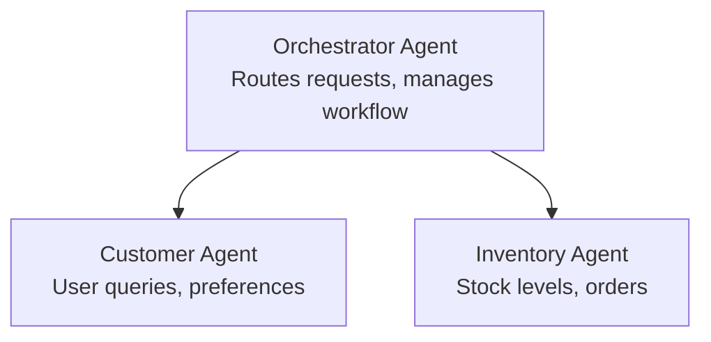

# فصل ۵: راه‌حل‌های هوش مصنوعی چندعاملی

**📚 دوره**: [AZD برای مبتدیان](../../README.md) | **⏱️ مدت زمان**: ۲-۳ ساعت | **⭐ پیچیدگی**: پیشرفته

---

## مرور کلی

این فصل الگوهای معماری پیشرفته چندعاملی، هماهنگی عوامل، و استقرارهای هوش مصنوعی آماده تولید برای سناریوهای پیچیده را پوشش می‌دهد.

> راهنمای فرمان‌ها در مقابل مستندات منتشر شده `azd 1.37.2` بررسی شده است. استقرارهای ابری اجرا نشدند.

## اهداف یادگیری

با تکمیل این فصل، شما قادر خواهید بود:
- الگوهای معماری چندعاملی را درک کنید
- سیستم‌های هماهنگ‌شده عوامل هوش مصنوعی را مستقر کنید
- ارتباط عامل به عامل را پیاده‌سازی کنید
- راه‌حل‌های چندعاملی آماده تولید بسازید

---

## 📚 درس‌ها

| # | درس | توضیحات | زمان |
|---|--------|-------------|------|
| ۱ | [مبانی چندعاملی](multi-agent-basics.md) | کاربردی: استقرار یک برنامه چندعاملی عملی با `azd up` | ۴۵ دقیقه |
| ۲ | [الگوهای هماهنگی](../chapter-06-pre-deployment/coordination-patterns.md) | استراتژی‌های هماهنگی عوامل (در فصل ۶ ادامه دارد) | ۳۰ دقیقه |
| ۳ | [استقرار قالب ARM](../../examples/retail-multiagent-arm-template/README.md) | مثال استقرار با یک کلیک | ۳۰ دقیقه |

> **با درس ۱ شروع کنید.** تنها درس کاملاً عملی و قابل استقرار در این فصل است. درس ۲ در فصل ۶ قرار دارد (با برنامه‌ریزی پیش استقرار به اشتراک گذاشته شده است)، و [راه‌حل چندعاملی خرده‌فروشی](../../examples/retail-scenario.md) یک طرح معماری است — یک مرجع طراحی، نه یک قالب قابل اجرا با یک فرمان.

---

## 🚀 شروع سریع

```bash
# Option 1: Deploy the multi-agent template used in Lesson 1
azd init --template Azure-Samples/contoso-creative-writer .
azd up

# Option 2: Initialize a Foundry agent interactively (requires azure.ai.agents)
azd extension install azure.ai.agents
azd ai agent init
azd up
```

> **کدام روش؟** برای شروع از یک نمونه عملی، از `azd init --template` استفاده کنید. به صورت تعاملی از `azd ai agent init` استفاده کنید، یا از `azd ai agent init --template <path-to-azure.yaml>` برای پذیرش یک پروژه عامل جاری بهره ببرید. برای نیازهای نسخه و مهاجرت ارزیابی، به [مستندات AZD AI CLI](../chapter-08-production/production-ai-practices.md#azd-ai-cli-commands-and-extensions) مراجعه کنید.

این گزینه‌ها را در پوشه‌های جداگانه خالی اجرا کنید. افزونه عوامل `1.0.0-beta.23` نیازمند `azd >= 1.37.0` است؛ جریان تعاملی آن خط لوله سفارشی سرویس باس در درس هماهنگی را ایجاد نمی‌کند.

---

## 🤖 معماری چندعاملی



---

## 🎯 راه‌حل ویژه: چندعاملی خرده‌فروشی

راه‌حل [چندعامله خرده‌فروشی](../../examples/retail-scenario.md) نشان می‌دهد:

- **عامل مشتری**: مدیریت تعاملات و ترجیحات کاربر
- **عامل موجودی**: مدیریت موجودی و پردازش سفارش‌ها
- **هماهنگ‌کننده**: هماهنگی بین عوامل
- **حافظه مشترک**: مدیریت زمینه بین عوامل

### خدمات استفاده‌شده

| خدمت | هدف |
|---------|---------|
| مدل‌های Microsoft Foundry | درک زبان |
| جستجوی Azure AI | فهرست محصولات |
| Cosmos DB | وضعیت و حافظه عامل |
| برنامه‌های کانتینری | میزبانی عامل |
| Application Insights | نظارت |

---

## 🔗 ناوبری

| جهت | فصل |
|-----------|---------|
| **قبلی** | [فصل ۴: زیرساخت](../chapter-04-infrastructure/README.md) |
| **بعدی** | [فصل ۶: پیش‌استقرار](../chapter-06-pre-deployment/README.md) |

---

## 📖 منابع مرتبط

- [راهنمای عوامل هوش مصنوعی](../chapter-02-ai-development/agents.md)
- [شیوه‌های تولید هوش مصنوعی](../chapter-08-production/production-ai-practices.md)
- [عیب‌یابی هوش مصنوعی](../chapter-07-troubleshooting/ai-troubleshooting.md)

---

<!-- CO-OP TRANSLATOR DISCLAIMER START -->
**سلب مسئولیت**:
این سند با استفاده از سرویس ترجمه هوش مصنوعی [Co-op Translator](https://github.com/Azure/co-op-translator) ترجمه شده است. در حالی که ما در تلاش برای دقت هستیم، لطفاً توجه داشته باشید که ترجمه‌های خودکار ممکن است شامل خطاها یا نادرستی‌هایی باشند. سند اصلی به زبان مادری خود باید به عنوان منبع معتبر در نظر گرفته شود. برای اطلاعات حیاتی، ترجمه حرفه‌ای انسانی توصیه می‌شود. ما در قبال هرگونه سوء تفاهم یا برداشت نادرست ناشی از استفاده از این ترجمه مسئولیتی نداریم.
<!-- CO-OP TRANSLATOR DISCLAIMER END -->