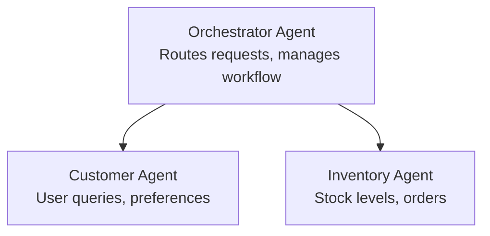

# فصل ۵: راه‌حل‌های هوش مصنوعی چندعامله

**📚 دوره**: [AZD برای مبتدیان](../../README.md) | **⏱️ مدت زمان**: ۲-۳ ساعت | **⭐ پیچیدگی**: پیشرفته

---

## مرور کلی

این فصل الگوهای پیشرفته معماری چندعامله، هماهنگی عوامل و استقرارهای آماده تولید هوش مصنوعی برای سناریوهای پیچیده را پوشش می‌دهد.

> راهنمایی فرمان بر اساس مرجع `azd 1.37.2` منتشر شده بازبینی شده است. استقرارهای ابری اجرا نشده‌اند.

## اهداف یادگیری

با تکمیل این فصل، شما:
- با الگوهای معماری چندعامله آشنا خواهید شد
- سیستم‌های عامل هماهنگ هوش مصنوعی را مستقر خواهید کرد
- ارتباط عامل به عامل را پیاده‌سازی خواهید کرد
- راه‌حل‌های چندعامله آماده تولید را خواهید ساخت

---

## 📚 دروس

| # | درس | توضیحات | زمان |
|---|--------|-------------|------|
| ۱ | [مبانی چندعامل](multi-agent-basics.md) | تمرینی: استقرار یک برنامه چندعامله عملی با `azd up` | ۴۵ دقیقه |
| ۲ | [الگوهای هماهنگی](../chapter-06-pre-deployment/coordination-patterns.md) | استراتژی‌های هماهنگی عامل‌ها (ادامه در فصل ۶) | ۳۰ دقیقه |
| ۳ | [استقرار قالب ARM](../../examples/retail-multiagent-arm-template/README.md) | نمونه استقرار با یک کلیک | ۳۰ دقیقه |

> **با درس ۱ شروع کنید.** این تنها درس کاملاً عملی و قابل استقرار در این فصل است. درس ۲ در فصل ۶ قرار دارد (که با برنامه‌ریزی پیش از استقرار مشترک است) و [راه‌حل چندعامله خرده‌فروشی](../../examples/retail-scenario.md) یک نقشه‌راه معماری است — مرجع طراحی، نه یک قالب یک‌فرمانه.

---

## 🚀 شروع سریع

```bash
# Option 1: Deploy the multi-agent template used in Lesson 1
azd init --template Azure-Samples/contoso-creative-writer .
azd up

# Option 2: Initialize a Foundry agent interactively with the GA bundle
azd ext install microsoft.foundry
azd ai agent init
azd up
```

> **کدام رویکرد؟** از `azd init --template` برای شروع با نمونه‌ای عملی استفاده کنید. `azd ai agent init` را تعاملی به کار ببرید، یا `azd ai agent init --template <path-to-azure.yaml>` را برای پذیرش پروژه فعلی عامل. برای الزامات نسخه و مهاجرت ارزیابی به [مرجع AZD AI CLI](../chapter-08-production/production-ai-practices.md#azd-ai-cli-commands-and-extensions) مراجعه کنید.

این گزینه‌ها را در پوشه‌های جداگانه و خالی اجرا کنید. روند کاری GA Foundry به `azd >= 1.37.0` نیاز دارد؛ روند تعاملی آن خط لوله Service Bus سفارشی را در درس هماهنگی ایجاد نمی‌کند. برای تست محلی، استقرار کد و پاک‌سازی پروژه‌های نو در مقابل بازاستفاده شده، راهنمای [عامل میزبانی](../chapter-02-ai-development/microsoft-foundry-integration.md#hosted-agent-walkthrough-ga) را دنبال کنید.

---

## 🤖 معماری چندعامله



---

## 🎯 راه‌حل ویژه: چندعامل خرده‌فروشی

راه‌حل [چندعامله خرده‌فروشی](../../examples/retail-scenario.md) نشان می‌دهد:

- **عامل مشتری**: مدیریت تعاملات و ترجیحات کاربر
- **عامل موجودی**: مدیریت انبار و پردازش سفارش‌ها
- **هماهنگ‌کننده**: هماهنگی بین عوامل
- **حافظه مشترک**: مدیریت زمینه بین عوامل

### خدمات استفاده‌شده

| خدمت | هدف |
|---------|---------|
| مدل‌های Microsoft Foundry | درک زبان |
| جستجوی Azure AI | فهرست محصولات |
| Cosmos DB | وضعیت و حافظه عامل |
| Container Apps | میزبانی عامل |
| Application Insights | نظارت |

---

## 🔗 ناوبری

| جهت | فصل |
|-----------|---------|
| **قبلی** | [فصل ۴: زیرساخت](../chapter-04-infrastructure/README.md) |
| **بعدی** | [فصل ۶: پیش از استقرار](../chapter-06-pre-deployment/README.md) |

---

## 📖 منابع مرتبط

- [راهنمای عوامل هوش مصنوعی](../chapter-02-ai-development/agents.md)
- [شیوه‌های تولید هوش مصنوعی](../chapter-08-production/production-ai-practices.md)
- [عیب‌زدایی هوش مصنوعی](../chapter-07-troubleshooting/ai-troubleshooting.md)

---

<!-- CO-OP TRANSLATOR DISCLAIMER START -->
**سلب مسئولیت**:
این سند با استفاده از سرویس ترجمه هوش مصنوعی [Co-op Translator](https://github.com/Azure/co-op-translator) ترجمه شده است. در حالی که ما در تلاش برای دقت هستیم، لطفاً توجه داشته باشید که ترجمه‌های خودکار ممکن است شامل خطاها یا نادرستی‌هایی باشند. سند اصلی به زبان مادری خود باید به عنوان منبع معتبر در نظر گرفته شود. برای اطلاعات حیاتی، ترجمه حرفه‌ای انسانی توصیه می‌شود. ما در قبال هرگونه سوء تفاهم یا برداشت نادرست ناشی از استفاده از این ترجمه مسئولیتی نداریم.
<!-- CO-OP TRANSLATOR DISCLAIMER END -->