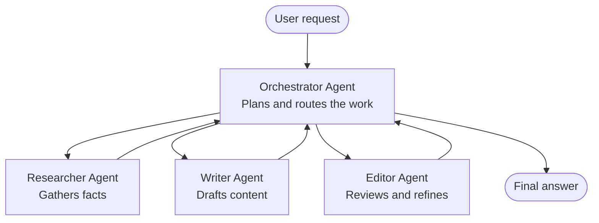

# مبانی چندعامل - اولین سیستم هماهنگ شده هوش مصنوعی خود را مستقر کنید

**ناوبری فصل:**
- **📚 صفحه اصلی دوره**: [AZD برای مبتدیان](../../README.md)
- **📖 فصل جاری**: فصل ۵ - راهکارهای هوش مصنوعی چندعاملی
- **⬅️ قبلی**: [فصل ۴: زیرساخت](../chapter-04-infrastructure/README.md)
- **➡️ بعدی**: [الگوهای هماهنگی](../chapter-06-pre-deployment/coordination-patterns.md)

> راهنمایی دستورات بر اساس مرجع منتشر شده `azd 1.37.2` مرور شده است. استقرارهای ابری اجرا نشده‌اند.

## مقدمه

در فصل‌های قبلی شما یک برنامه واحد را مستقر کردید — و در فصل ۲ یک عامل هوش مصنوعی واحد را مستقر کردید. این درس گام بعدی را برمی‌دارد: استقرار یک **سیستم چندعاملی**، جایی که چندین عامل تخصصی با هم کار می‌کنند تا مشکلی را حل کنند که هیچ عامل واحدی به تنهایی نمی‌تواند به خوبی انجام دهد.

خبر خوب برای مبتدیان: **شما به دستورات جدید نیاز ندارید.** یک راهکار چندعاملی هنوز یک پروژه azd است. شما `azd init`، `azd up`، آزمایش، و `azd down` خواهید کرد — دقیقاً همان روند کاری که قبلاً می‌دانستید. چیزی که تغییر می‌کند *شکل* برنامه درون است.

## اهداف یادگیری

تا پایان این درس، شما:
- درک خواهید کرد که "چندعاملی" یعنی چه و چه زمانی ارزش پیچیدگی اضافی را دارد
- نقش‌های رایج در یک سیستم چندعاملی (هماهنگ‌کننده + تخصص‌ها) را تشخیص خواهید داد
- یک قالب چندعاملی واقعی و عملی را با `azd up` مستقر خواهید کرد
- منابع آزور که پشت یک برنامه چندعاملی هستند را خواهید شناخت
- خواهید دانست چگونه راهکار را به صورت ایمن بررسی، سفارشی‌سازی و حذف کنید

## نتایج یادگیری

پس از تکمیل این درس، شما قادر خواهید بود:
- تفاوت بین یک عامل واحد و یک سیستم چندعاملی را توضیح دهید
- بین یک عامل واحد با ابزارها و یک طراحی واقعی چندعاملی انتخاب کنید
- یک قالب چندعاملی را از ابتدا تا انتها با azd مستقر و آزمایش کنید
- تشخیص دهید هر عامل کجا اجرا می‌شود و چگونه با هم ارتباط دارند
- تمام منابع را پاک کنید تا از هزینه‌های مداوم جلوگیری شود

---

## سیستم چندعاملی چیست؟

یک عامل هوش مصنوعی واحد یک مدل با مجموعه‌ای از دستورات و (اختیاری) برخی ابزارها است. این برای وظایف متمرکز خوب کار می‌کند. اما وقتی یک وظیفه رشد می‌کند — تحقیق، سپس نوشتن، سپس ویرایش، سپس بررسی صحت — فروکردن همه چیز در یک درخواست، عامل را کندتر، کمتر قابل اعتماد و سخت‌تر برای اشکال‌زدایی می‌کند.

یک **سیستم چندعاملی** کار را به تخصص‌ها تقسیم می‌کند که هر کدام یک کار را به خوبی انجام می‌دهند، به کمک یک هماهنگ‌کننده مدیریت می‌شود:



### دو نقش که همیشه می‌بینید

| نقش | وظیفه | مثال |
|------|-----|---------|
| **هماهنگ‌کننده** | تصمیم می‌گیرد *بعد چه اتفاقی می‌افتد* و کارها را بین عوامل هدایت می‌کند | «ابتدا تحقیق، سپس نوشتن، سپس ویرایش» |
| **تخصصی** | یک کار متمرکز را انجام می‌دهد و نتیجه را بازمی‌گرداند | یک «محقق» که فقط حقایق را جمع‌آوری می‌کند |

### آیا واقعاً به چند عامل نیاز دارید؟

ساده شروع کنید. فقط زمانی به چندعامل فکر کنید که یکی از این موارد درست باشد:

- ✅ وظیفه مراحل مشخصی دارد که از دستورات متفاوت سود می‌برند (تحقیق در مقابل نوشتن در مقابل بررسی)
- ✅ می‌خواهید تخصصی‌ها **به‌طور هم‌زمان** اجرا شوند تا در وقت صرفه‌جویی شود
- ✅ مراحل مختلف به **ابزارها یا منابع داده متفاوتی** نیاز دارند
- ✅ باید هر مرحله به صورت **مستقل قابل آزمایش و اشکال‌زدایی باشد**

اگر وظیفه شما یک پرسش و پاسخ واحد یا فراخوانی ساده ابزار است، یک **عامل واحد با ابزارها** (فصل ۲) ساده‌تر، ارزان‌تر و آسان‌تر برای اجرا است.

> **نکته مبتدی:** "عامل‌های بیشتر" به معنی "بهتر" نیست. هر عامل تأخیر، هزینه و یک چیز جدید برای پایش اضافه می‌کند. فقط زمانی عامل اضافه کنید که مشکل به وضوح به بخش‌هایی تقسیم شده باشد.

---

## دو روش برای ساخت سیستم چندعاملی در آزور

| رویکرد | چیست | مناسب برای |
|----------|-----------|----------|
| **عامل واحد + ابزارها** | یک عامل Foundry که توابع/ابزارها را صدا می‌زند | جریان‌های کاری ساده، شروع کار |
| **چند عامل هماهنگ شده** | چندین عامل با یک هماهنگ‌کننده | مراحل مشخص، کار موازی، تخصصی‌سازی |

این درس بر رویکرد دوم با استفاده از یک **قالب آماده** تمرکز دارد، بنابراین می‌توانید قبل از ساخت خودتان، یک سیستم چندعاملی واقعی در حال اجرا ببینید.

---

## عملی: استقرار یک برنامه چندعاملی کاری

ما **نویسنده خلاق Contoso** را مستقر خواهیم کرد، نمونه رسمی آزور که عوامل تحقیق، محصول، نوشتن و ویرایش را هماهنگ می‌کند تا یک مقاله تولید کند. قبل از ادامه، پیش‌نیازها و هزینه‌های [نمونه](https://github.com/Azure-Samples/contoso-creative-writer#azure-account-requirements) را بررسی کنید: نیاز به سهمیه مدل، جستجوی Azure AI، دسترسی به Bing Grounding، پایتون، داکر و هوک‌های سازگار با بش دارد. دسترسی مدل و منطقه به اشتراک شما بستگی دارد؛ انتخاب یک منطقه خاص تضمینی برای استقرار نیست.

### مرحله ۱: قالب را مقداردهی اولیه کنید

```bash
# Create a working folder
mkdir creative-writer && cd creative-writer

# Initialize from the official multi-agent template
azd init --template Azure-Samples/contoso-creative-writer .
```

> هر زمان می‌توانید قالب‌های چندعاملی بیشتری را در [گالری عالی AZD AI](https://azure.github.io/awesome-azd/?tags=ai) مرور کنید. گزینه‌های مبتدی پسند دیگر شامل `get-started-with-ai-agents` و `azure-ai-travel-agents` هستند.

### مرحله ۲: احراز هویت

```bash
# Required for azd workflows
azd auth login

# Also required by this sample's Azure CLI hooks
az login
```

### مرحله ۳: محیط را بررسی کنید

```bash
# init normally creates/selects an environment; confirm it before proceeding
azd env list
# Only if you need an additional environment:
# azd env new dev
```

### مرحله ۴: پیش‌نمایش کنید، سپس مستقر کنید

```bash
# See what will be created before spending anything (recommended)
azd provision --preview

# Provision infrastructure and deploy all agents in one step
azd up
```

`azd up` تنظیمات اشتراک و منطقه گمشده را درخواست می‌کند، سپس منابع را فراهم و برنامه را مستقر می‌کند. پیش‌نمایش سهمیه رزرو نمی‌کند و موفقیت را تضمین نمی‌کند؛ قلاب‌های قالب ممکن است در طول پیش‌نمایش فراهم‌سازی اجرا شوند، بنابراین ابتدا آنها را بررسی کنید. برای افزایش مدت زمان انتظار azd برای هر **استقرار سرویس** (نه آماده‌سازی مدل):

```bash
azd deploy --timeout 1800
```

یک تایم‌اوت مانع انتظار azd می‌شود؛ این باعث لغو استقرار در Azure نمی‌شود. قبل از تلاش مجدد، وضعیت منبع را بررسی کنید.

> **هشدار درباره هزینه و ظرفیت:** برنامه‌های چندعامله مدل‌های هوش مصنوعی را مستقر می‌کنند که سهمیه مصرف کرده و هزینه ایجاد می‌کنند. اگر `azd up` به دلیل سهمیه مدل شکست خورد، به [عیب‌یابی هوش مصنوعی](../chapter-07-troubleshooting/ai-troubleshooting.md) برای اصلاح منطقه و سهمیه مراجعه کنید، و فصل ۶ [برنامه‌ریزی ظرفیت](../chapter-06-pre-deployment/capacity-planning.md).

---

## درک آنچه مستقر کرده‌اید

یک برنامه چندعامله معمولی مانند این، مجموعه‌ای از منابع Azure را فراهم می‌کند که مستقیماً با مسئولیت‌ها در نمودار بالا مطابقت دارد:

| منبع | دلیل وجود آن |
|----------|----------------|
| **Microsoft Foundry / Models** | میزبان مدل‌های زبانی است که هر عامل استفاده می‌کند |
| **Azure AI Search** | به عامل پژوهشگر داده‌های مبتنی ارائه می‌دهد تا جستجو کند |
| **Container Apps** (یا App Service) | میزبان کد هماهنگ‌کننده و عامل است |
| **Cosmos DB** (در برخی نمونه‌ها) | وضعیت/حافظه به اشتراک گذاشته شده میان عوامل را ذخیره می‌کند |
| **Application Insights** | درخواست‌ها را *بین* عوامل ردیابی می‌کند تا بتوانید جریان را اشکال‌زدایی کنید |

### نحوه ارتباط عوامل با یکدیگر

در بیشتر نمونه‌های چندعامله azd، **هماهنگ‌کننده در کد برنامه شما اجرا می‌شود** (برای مثال، با استفاده از چارچوبی مانند Semantic Kernel یا Microsoft Agent Framework). هماهنگ‌کننده هر عامل متخصص را به نوبت فراخوانی می‌کند، نتایج را منتقل می‌کند و پاسخ نهایی را جمع‌آوری می‌کند. عوامل از طریق موارد زیر زمینه مشترک دارند:

- **فراخوانی توابع/ابزارها** — هماهنگ‌کننده یک متخصص را فراخوانی کرده و نتیجه‌ای دریافت می‌کند
- **حافظه مشترک** — یک پایگاه داده (اغلب Cosmos DB) وضعیت را نگهداری می‌کند که هر دو عامل می‌توانند آن را بخوانند
- **پیام‌ها/رویدادها** — برای اتصال سست‌تر، عوامل از طریق صف یا Service Bus ارتباط برقرار می‌کنند

> **چرا این برای اشکال‌زدایی اهمیت دارد:** چون هر مرحله جداست، Application Insights به شما نشان می‌دهد *کدام* عامل کند یا شکست‌خورده است. این دلیل اصلی تقسیم کار بین عوامل است.

---

## تایید استقرار

قبل از ادامه، تأیید کنید که سیستم واقعاً کار می‌کند:

```bash
# Show the deployed endpoints
azd show

# Open the app's monitoring dashboard
azd monitor

# Open Application Insights Logs (not a terminal log stream)
azd monitor --logs
```

سپس URL برنامه را از `azd show` باز کنید و یک مقاله کوتاه درخواست کنید. از نمای اشکال‌زدایی نمونه برای بررسی جریان کار عامل آن استفاده کنید. جستجوی تراکنش Application Insights فقط در صورتی مراحل جداگانه را نشان می‌دهد که نمونه آنها را ابزارسازی و مرتبط کرده باشد؛ azd به صورت خودکار بازه‌های عامل را اضافه نمی‌کند.

**معیارهای موفقیت:**
- ✅ `azd show` یک نقطه انتهایی قابل دسترسی فهرست می‌کند
- ✅ یک درخواست نتیجه‌ای تولید می‌کند که واضحاً از چند مرحله عبور کرده است
- ✅ نمای اشکال‌زدایی چند مرحله عامل را نشان می‌دهد؛ اگر ردیابی فعال است، پس از ورود داده‌های تلومتری مربوطه را بررسی کنید

---

## سفارشی‌سازی: افزودن یا تنظیم یک عامل

چون هر عامل فقط دستورالعمل‌ها به‌علاوه ابزارها است، سفارشی‌سازی قابل انجام است:

1. **تعاریف عامل را پیدا کنید** در الگو (اغلب یک مجموعه فایل `prompts/`، `agents/`، یا `*.prompty`).
2. **دستورات یک عامل را تنظیم کنید** — برای مثال، به عامل ویرایشگر بگویید که یک لحن یا تعداد کلمات خاص را اعمال کند.
3. **فقط کد را دوباره مستقر کنید** (زیرساخت تغییر نمی‌کند):

   ```bash
   azd deploy
   ```

برای پیشرفت بیشتر با پروژه عامل *خودتان* Foundry، از بسته GA با AZD 1.37.0+ در یک دایرکتوری خالی جداگانه استفاده کنید:

```bash
azd ext install microsoft.foundry
azd ai agent init
azd up
azd ai agent invoke      # test, with response timing
```

راهنمای [GA hosted-agent walkthrough](../chapter-02-ai-development/microsoft-foundry-integration.md#hosted-agent-walkthrough-ga) را برای تست محلی Agent Inspector، استقرار کد از راه دور و مالکیت پاک‌سازی ببینید. همچنین [مراجعه AZD AI CLI](../chapter-08-production/production-ai-practices.md#azd-ai-cli-commands-and-extensions) به بخش ارزیابی‌های جداگانه، بهینه‌سازی و حذف عامل پرداخته است.

---

## پاک‌سازی

برنامه‌های چندعامله چند سرویس قابل صورتحساب را اجرا می‌کنند. همه چیز را پس از اتمام متوقف کنید:

```bash
# Review the resources and confirm deletion interactively
azd down
```

حذف تخریبی است. برای یک آزمایشگاه مصرفی، `azd down --force --purge` حذف را رد می‌کند و تأییدیه‌های نرم-حذف پشتیبانی شده را نادیده می‌گیرد؛ پاک‌سازی غیرقابل بازگشت است در جایی که پشتیبانی می‌شود و ممکن است توسط حفاظت پاک‌سازی مسدود شود. حذف نرم، نگرانی بازیابی/استفاده مجدد نام است و خود اثبات هزینه‌های جاری نیست. منابع باقی‌مانده و صورتحساب را پس از پاک‌سازی بررسی کنید.

اگر همچنین یک عامل میزبان را در برابر پروژه Foundry موجود مقداردهی اولیه کردید، `azd down` عامل آن پروژه و منابع دیگر را دست نخورده رها می‌کند. فقط منابع ناخواسته‌ای که مالک آن هستید را جداگانه حذف کنید. برای پروژه جدید Foundry که توسط محیط AZD آن ایجاد شده، `azd down` گروه منابع و همه چیز در آن را حذف می‌کند.

---

## نکته‌ای درباره سیستم‌های چندعامله تولیدی

راه‌حل [فروشگاه چندعاملی](../../examples/retail-scenario.md) در این مخزن یک **نقشه معماری** است، نه یک قالب یک‌دستوری—این مستندسازی می‌کند که چگونه یک سیستم فروشگاهی تولیدی *باید* ساخته شود (و به صراحت گفته شده که ساخت کامل یک تلاش قابل توجه است). از آن به عنوان مرجع طراحی *پس از* اینکه نمونه‌ای عملیاتی را اینجا مستقر کردید، استفاده کنید. برای موارد مرتبط با تولید (پایداری، هزینه، نظارت، حکمرانی) به [فصل 8: شیوه‌های تولید هوش مصنوعی](../chapter-08-production/production-ai-practices.md) مراجعه کنید.

---

## خلاصه

- یک سیستم چندعاملی کارها را بین متخصصان تقسیم می‌کند که توسط یک هماهنگ‌کننده سازماندهی می‌شوند.
- فقط زمانی از آن استفاده کنید که کار دارای مراحل متمایز، موازی‌سازی، یا ابزارهای مختلف در هر مرحله باشد—در غیر این صورت یک عامل واحد را ترجیح دهید.
- روند azd تغییر نکرده است: `azd init` → `azd up` → تست → `azd down`.
- یک قالب واقعی مانند `contoso-creative-writer` امروز به شما اجازه می‌دهد یک اپلیکیشن چندعاملی عملیاتی را مشاهده و سفارشی‌سازی کنید.
- ردیابی Application Insights در میان عوامل، یکی از بزرگ‌ترین مزایای عملی طراحی چندعاملی است.

---

## 🔗 ناوبری

| جهت | درس |
|-----------|--------|
| **قبلی** | [فصل ۴: زیرساخت](../chapter-04-infrastructure/README.md) |
| **بعدی** | [الگوهای هماهنگی](../chapter-06-pre-deployment/coordination-patterns.md) |

## 📖 منابع مرتبط

- [راهنمای عوامل هوش مصنوعی](../chapter-02-ai-development/agents.md)
- [الگوهای هماهنگی](../chapter-06-pre-deployment/coordination-patterns.md)
- [شیوه‌های تولید هوش مصنوعی](../chapter-08-production/production-ai-practices.md)
- [عیب‌یابی هوش مصنوعی](../chapter-07-troubleshooting/ai-troubleshooting.md)

---

<!-- CO-OP TRANSLATOR DISCLAIMER START -->
**سلب مسئولیت**:
این سند با استفاده از سرویس ترجمه هوش مصنوعی [Co-op Translator](https://github.com/Azure/co-op-translator) ترجمه شده است. در حالی که ما در تلاش برای دقت هستیم، لطفاً توجه داشته باشید که ترجمه‌های خودکار ممکن است شامل خطاها یا نادرستی‌هایی باشند. سند اصلی به زبان مادری خود باید به عنوان منبع معتبر در نظر گرفته شود. برای اطلاعات حیاتی، ترجمه حرفه‌ای انسانی توصیه می‌شود. ما در قبال هرگونه سوء تفاهم یا برداشت نادرست ناشی از استفاده از این ترجمه مسئولیتی نداریم.
<!-- CO-OP TRANSLATOR DISCLAIMER END -->