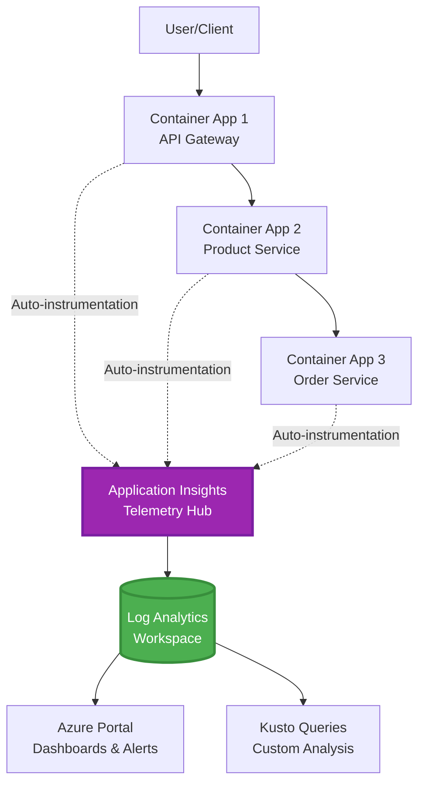
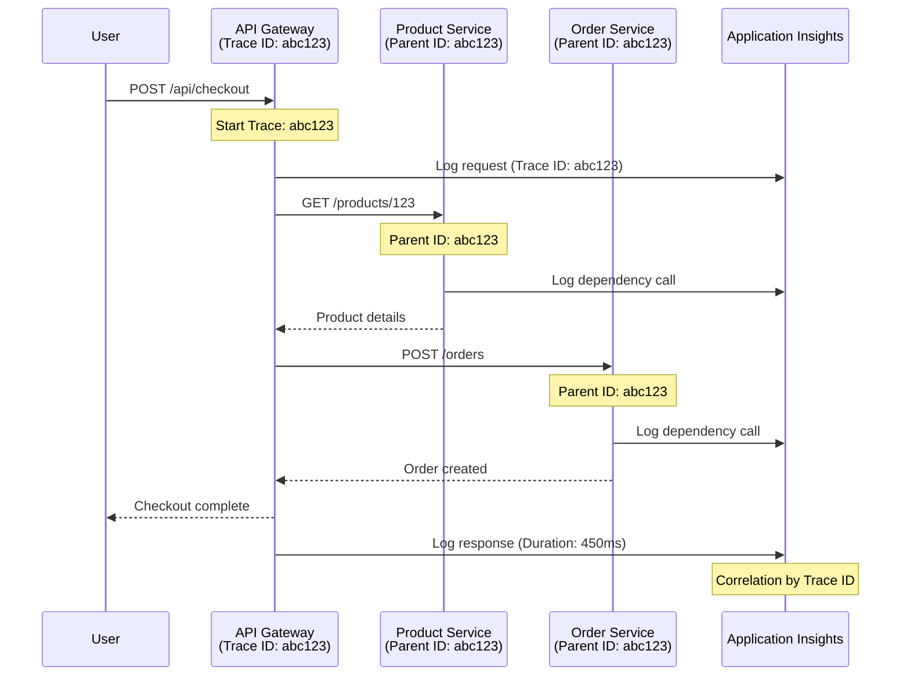

# ادغام Application Insights با AZD

⏱️ **زمان تقریبی**: ۴۰-۵۰ دقیقه | 💰 **تأثیر هزینه**: حدود ۵-۱۵ دلار در ماه | ⭐ **سطح دشواری**: متوسط

**📚 مسیر یادگیری:**
- ← قبلی: [بررسی‌های پیش‌پرواز](preflight-checks.md) - اعتبارسنجی پیش از استقرار
- 🎯 **شما اینجا هستید**: ادغام Application Insights (نظارت، تله‌متری، اشکال‌زدایی)
- → بعدی: [راهنمای استقرار](../chapter-04-infrastructure/deployment-guide.md) - استقرار در Azure
- 🏠 [خانه دوره](../../README.md)

---

## آنچه یاد خواهید گرفت

با تکمیل این درس، شما:
- در AZD زیرساخت **Application Insights** را اعلام و ابزار SDK را پیکربندی خواهید کرد
- ردیابی **توزیع‌شده** برای میکروسرویس‌ها را پیکربندی خواهید کرد
- **تله‌متری سفارشی** (متریک‌ها، رویدادها، وابستگی‌ها) را پیاده‌سازی خواهید کرد
- **متریک‌های زنده** را برای نظارت بلادرنگ راه‌اندازی خواهید کرد
- **هشدارها و داشبوردها** را از استقرارهای AZD ایجاد خواهید کرد
- مشکلات تولید را با **پرس‌وجوهای تله‌متری** عیب‌یابی خواهید کرد
- استراتژی‌های **بهینه‌سازی هزینه‌ها و نمونه‌برداری** را تنظیم خواهید کرد
- برنامه‌های **AI/LLM** را (توکن‌ها، تأخیر، هزینه‌ها) مانیتور خواهید کرد

## چرا Application Insights با AZD اهمیت دارد

### چالش: قابلیت مشاهده در تولید

**بدون Application Insights:**
```
❌ No visibility into production behavior
❌ Manual log aggregation across services
❌ Reactive debugging (wait for customer complaints)
❌ No performance metrics
❌ Cannot trace requests across services
❌ Unknown failure rates and bottlenecks
```

**با Application Insights + AZD:**
```
✅ Automatic telemetry collection
✅ Centralized logs from all services
✅ Proactive issue detection
✅ End-to-end request tracing
✅ Performance metrics and insights
✅ Real-time dashboards
✅ AZD provisions the monitoring declared in your templates
```

**تشبیه**: Application Insights مثل داشتن یک ضبط‌کننده پرواز "جعبه سیاه" + داشبورد کابین برای برنامه شما است. همه چیز را در زمان واقعی می‌بینید و می‌توانید هر حادثه‌ای را بازپخش کنید.

---

## مرور معماری

### Application Insights در معماری AZD



### چه مواردی به‌صورت خودکار مانیتور می‌شود

ابزار ابزارگیری خودکار پشتیبانی‌شده درخواست‌ها/وابستگی‌ها را برای کتابخانه‌های ابزارگیر ثبت می‌کند. رویدادها و متریک‌های سفارشی به کد برنامه نیاز دارند؛ تست‌های در دسترس بودن باید جداگانه پیکربندی شوند. این فقط به دلیل وجود منبع، همه ردیف‌های زیر را جمع‌آوری نمی‌کند.

| نوع تله‌متری | چه چیزی ثبت می‌کند | کاربرد |
|----------------|------------------|----------|
| **درخواست‌ها** | درخواست‌های HTTP، کدهای وضعیت، مدت زمان | نظارت بر عملکرد API |
| **وابستگی‌ها** | فراخوانی‌های خارجی (پایگاه داده، API‌ها، ذخیره‌سازی) | شناسایی گلوگاه‌ها |
| **خطاها** | خطاهای بدون رسیدگی با ردپای پشته | اشکال زدایی شکست‌ها |
| **رویدادهای سفارشی** | رویدادهای کسب‌وکار (ثبت‌نام، خرید) | تحلیل‌ها و قیف‌ها |
| **متریک‌ها** | شمارنده‌های عملکرد، متریک‌های سفارشی | برنامه‌ریزی ظرفیت |
| **ردگیری‌ها** | پیام‌های لاگ با شدت | اشکال زدایی و ممیزی |
| **دسترس‌پذیری** | تست‌های زمان آپ‌تایم و پاسخ‌دهی | نظارت بر SLA |

---

## پیش‌نیازها

### ابزارهای مورد نیاز

```bash
# Verify Azure Developer CLI
azd version
# Command reference baseline: azd 1.37.2

# Verify Azure CLI
az --version
# ✅ Expected: azure-cli 2.50.0 or higher
```

### ملزومات Azure

- اشتراک Azure فعال
- دسترسی برای ایجاد:
  - منابع Application Insights
  - فضای Log Analytics
  - برنامه‌های کانتینری
  - گروه‌های منابع

### پیش‌نیازهای دانش

باید موارد زیر را تکمیل کرده باشید:
- [مبانی AZD](../chapter-01-foundation/azd-basics.md) - مفاهیم اصلی AZD
- [پیکربندی](../chapter-03-configuration/configuration.md) - تنظیم محیط
- [اولین پروژه](../chapter-01-foundation/first-project.md) - استقرار پایه

---

## درس ۱: Application Insights خودکار با AZD

### نحوه فراهم‌آوری Application Insights توسط AZD

AZD Application Insights را **فقط زمانی که زیرساخت پروژه آن را اعلام کند** فراهم می‌کند. `azure.yaml` به تنهایی نظارت یا ابزارگیری کد برنامه را ایجاد نمی‌کند.

> **دامنه نمونه:** این درس حاوی قطعات ادغام است، نه پروژه کامل `monitored-app` در این مخزن. قبل از استقرار قالب اصلی و نگاشت پارامتر، محیط Container Apps، پیکربندی رجیستری/ایمیج و هویت، Dockerfile و برچسب‌های سرویس را آماده کنید. درس‌های بعدی قطعات جایگزین/افزوده نشان می‌دهند، نه فایل‌هایی که همه بدون تغییر چسبانده شوند. اگر به یک پایه قابل اجرا نیاز دارید، با [نمونه میکروسرویس‌ها](../../../../examples/microservices) شروع کنید.

### ساختار پروژه

```
monitored-app/
├── azure.yaml                     # AZD configuration
├── infra/
│   ├── main.bicep                # Main infrastructure
│   ├── core/
│   │   └── monitoring.bicep      # Application Insights + Log Analytics
│   └── app/
│       └── api.bicep             # Container App with monitoring
└── src/
    ├── app.py                    # Application with telemetry
    ├── requirements.txt
    └── Dockerfile
```

---

### گام ۱: پیکربندی AZD (azure.yaml)

**پرونده: `azure.yaml`**

```yaml
name: monitored-app
metadata:
  template: monitored-app@1.0.0

services:
  api:
    project: ./src
    language: python
    host: containerapp

# Monitoring must be declared in infra/ and enabled in application code.
```

این سرویس قابل استقرار را اعلام می‌کند. پیکربندی Bicep و SDK زیر نظارت را فراهم می‌کنند؛ azd آن‌ها را به‌طور ضمنی اضافه نمی‌کند.

---

### گام ۲: زیرساخت مانیتورینگ (Bicep)

**پرونده: `infra/core/monitoring.bicep`**

```bicep
param logAnalyticsName string
param applicationInsightsName string
param location string = resourceGroup().location
param tags object = {}

// Log Analytics Workspace (required for Application Insights)
resource logAnalytics 'Microsoft.OperationalInsights/workspaces@2022-10-01' = {
  name: logAnalyticsName
  location: location
  tags: tags
  properties: {
    sku: {
      name: 'PerGB2018'  // Pay-as-you-go pricing
    }
    retentionInDays: 30  // Keep logs for 30 days
    features: {
      enableLogAccessUsingOnlyResourcePermissions: true
    }
  }
}

// Application Insights
resource applicationInsights 'Microsoft.Insights/components@2020-02-02' = {
  name: applicationInsightsName
  location: location
  tags: tags
  kind: 'web'
  properties: {
    Application_Type: 'web'
    WorkspaceResourceId: logAnalytics.id
    IngestionMode: 'LogAnalytics'
    publicNetworkAccessForIngestion: 'Enabled'
    publicNetworkAccessForQuery: 'Enabled'
  }
}

// Outputs for Container Apps
output logAnalyticsWorkspaceId string = logAnalytics.id
output logAnalyticsWorkspaceName string = logAnalytics.name
output applicationInsightsConnectionString string = applicationInsights.properties.ConnectionString
output applicationInsightsInstrumentationKey string = applicationInsights.properties.InstrumentationKey
output applicationInsightsName string = applicationInsights.name
output applicationInsightsId string = applicationInsights.id
```

---

### گام ۳: اتصال برنامه کانتینری به Application Insights

**پرونده: `infra/app/api.bicep`**

```bicep
param name string
param location string
param tags object = {}
param containerAppsEnvironmentId string
param containerImage string
param applicationInsightsConnectionString string

resource containerApp 'Microsoft.App/containerApps@2023-05-01' = {
  name: name
  location: location
  tags: tags
  properties: {
    managedEnvironmentId: containerAppsEnvironmentId
    configuration: {
      ingress: {
        external: true
        targetPort: 8000
      }
      secrets: [
        {
          name: 'appinsights-connection-string'
          value: applicationInsightsConnectionString
        }
      ]
    }
    template: {
      containers: [
        {
          name: 'api'
          image: containerImage // Supply an accessible image and registry authentication
          resources: {
            cpu: json('0.5')
            memory: '1Gi'
          }
          env: [
            {
              name: 'APPLICATIONINSIGHTS_CONNECTION_STRING'
              secretRef: 'appinsights-connection-string'
            }
            {
              name: 'APPLICATIONINSIGHTS_ENABLED'
              value: 'true'
            }
          ]
        }
      ]
    }
  }
}

output uri string = 'https://${containerApp.properties.configuration.ingress.fqdn}'
```

---

### گام ۴: کد برنامه با تله‌متری

**پرونده: `src/app.py`**

```python
from flask import Flask, request, jsonify
from azure.monitor.opentelemetry import configure_azure_monitor
import logging
import os

app = Flask(__name__)

# Get Application Insights connection string
connection_string = os.environ.get('APPLICATIONINSIGHTS_CONNECTION_STRING')

if connection_string:
    # Azure Monitor OpenTelemetry instruments supported libraries, including Flask.
    configure_azure_monitor(
        connection_string=connection_string,
        logger_name=__name__,
        enable_live_metrics=True
    )
    logger = logging.getLogger(__name__)
    logger.setLevel(logging.INFO)
    
    print("✅ Application Insights enabled")
else:
    logger = logging.getLogger(__name__)
    logger.setLevel(logging.INFO)
    print("⚠️ Application Insights not configured")

@app.route('/health')
def health():
    logger.info('Health check endpoint called')
    return jsonify({'status': 'healthy', 'monitoring': 'enabled' if connection_string else 'disabled'})

@app.route('/api/products')
def get_products():
    logger.info('Fetching products')
    
    # In-memory fixture: this is not a database dependency call.
    products = [
        {'id': 1, 'name': 'Laptop', 'price': 999.99},
        {'id': 2, 'name': 'Mouse', 'price': 29.99},
        {'id': 3, 'name': 'Keyboard', 'price': 79.99}
    ]
    
    logger.info(f'Returned {len(products)} products')
    return jsonify(products)

@app.route('/api/error-test')
def error_test():
    """Test error tracking"""
    logger.error('Testing error tracking')
    try:
        raise ValueError('This is a test exception')
    except Exception as e:
        logger.exception('Exception occurred in error-test endpoint')
        return jsonify({'error': str(e)}), 500

@app.route('/api/slow')
def slow_endpoint():
    """Test performance tracking"""
    import time
    logger.info('Slow endpoint called')
    time.sleep(3)  # Simulate slow operation
    logger.warning('Endpoint took 3 seconds to respond')
    return jsonify({'message': 'Slow operation completed'})

if __name__ == '__main__':
    app.run(host='0.0.0.0', port=8000)
```

**پرونده: `src/requirements.txt`**

```txt
Flask
azure-monitor-opentelemetry
gunicorn
requests
openai
```

این وابستگی‌ها را در پروژه خود حل کرده، آنها را با هم آزمایش کنید و نسخه‌های نتیجه را قفل کنید. پروژه‌های جدید باید از Azure Monitor OpenTelemetry استفاده کنند، نه از صادرکنندگان بازنشسته OpenCensus Python.

---

### گام ۵: استقرار و تأیید

```bash
# Deploy only after completing and wiring the infrastructure fragments above
azd up

# Get app URL
APP_URL=$(azd env get-value API_URL) # Requires this output in main.bicep

# Generate telemetry
curl $APP_URL/health
curl $APP_URL/api/products
curl $APP_URL/api/error-test
curl $APP_URL/api/slow
```

**✅ خروجی مورد انتظار:**
```json
{
  "status": "healthy",
  "monitoring": "enabled"
}
```

---

### گام ۶: مشاهده تله‌متری در پرتال Azure

```bash
# Get Application Insights details
azd env get-values | grep APPLICATIONINSIGHTS

# Open in Azure Portal
az monitor app-insights component show \
  --app $(azd env get-values | grep APPLICATIONINSIGHTS_NAME | cut -d '=' -f2 | tr -d '"') \
  --resource-group $(azd env get-values | grep AZURE_RESOURCE_GROUP | cut -d '=' -f2 | tr -d '"') \
  --query "appId" -o tsv
```

**به پرتال Azure بروید → Application Insights → جستجوی تراکنش**

باید موارد زیر را ببینید:
- ✅ درخواست‌های HTTP با کدهای وضعیت
- ✅ مدت زمان درخواست (بالای ۳ ثانیه برای `/api/slow`)
- ✅ جزئیات استثنا از `/api/error-test`
- ✅ پیام‌های لاگ سفارشی

---

## درس ۲: تله‌متری و رویدادهای سفارشی

### ردیابی رویدادهای کسب‌وکار

بیایید تله‌متری سفارشی برای رویدادهای حیاتی کسب‌وکار اضافه کنیم.

**پرونده: `src/telemetry.py`**

```python
from contextlib import contextmanager
from azure.monitor.opentelemetry import configure_azure_monitor
from opentelemetry import metrics, trace
from opentelemetry.trace import SpanKind
import logging
import os

class TelemetryClient:
    """Custom telemetry client for Application Insights"""
    
    def __init__(self, connection_string=None):
        self.connection_string = connection_string or os.environ.get('APPLICATIONINSIGHTS_CONNECTION_STRING')
        
        # Configure once per process. If app.py already calls this, keep only
        # one configure_azure_monitor call and use logger_name='telemetry'.
        if self.connection_string:
            configure_azure_monitor(
                connection_string=self.connection_string,
                logger_name=__name__,
                enable_live_metrics=True
            )
        self.logger = logging.getLogger(__name__)
        self.logger.setLevel(logging.INFO)
        self.tracer = trace.get_tracer(__name__)
        self.meter = metrics.get_meter(__name__)
        self.instruments = {}
    
    def track_event(self, event_name: str, properties: dict = None):
        """Track custom business event"""
        properties = properties or {}
        self.logger.info(
            f"CustomEvent: {event_name}",
            extra={
                # OTel log attributes become customDimensions in App Insights.
                    'event_name': event_name,
                    **properties
            }
        )
    
    def track_metric(self, metric_name: str, value: float, properties: dict = None):
        """Track custom metric"""
        properties = properties or {}
        if metric_name not in self.instruments:
            self.instruments[metric_name] = self.meter.create_histogram(metric_name)
        self.instruments[metric_name].record(value, attributes=properties)
    
    @contextmanager
    def track_dependency(self, name: str):
        """Time the real operation inside a client span; exceptions mark failure."""
        with self.tracer.start_as_current_span(name, kind=SpanKind.CLIENT) as span:
            yield span

# Global telemetry client
telemetry = TelemetryClient()
```

### به‌روزرسانی برنامه با رویدادهای سفارشی

**پرونده: `src/app.py` (تقویت‌شده)**

این ای‌پی‌آی‌ها را به برنامه Flask موجود اضافه کنید؛ مسیرهای سلامتی/تست قبلی را نگه دارید. بلوک کوتاه شده زیر یک برنامه جداگانه برای وضوح نشان می‌دهد. مقداردهی اولیه تله‌متری اکنون در `telemetry.py` انجام می‌شود—صادرکنندگان را دوبار مقداردهی نکنید.

```python
from flask import Flask, request, jsonify
from telemetry import telemetry
import time
import random
import os

app = Flask(__name__)

@app.route('/api/purchase', methods=['POST'])
def purchase():
    """Track purchase event with custom telemetry"""
    data = request.get_json(silent=True) or {}
    product_id = data.get('product_id')
    quantity = data.get('quantity', 1)
    price = data.get('price', 0)
    if not isinstance(quantity, int) or quantity < 1 or \
       not isinstance(price, (int, float)) or price < 0:
        return jsonify({'error': 'quantity and price must be non-negative numbers; quantity >= 1'}), 400
    
    # Track business event
    telemetry.track_event('Purchase', {
        'product_id': product_id,
        'quantity': quantity,
        'total_amount': price * quantity,
        'user_id': request.headers.get('X-User-Id', 'anonymous')
    })
    
    # Track revenue metric
    telemetry.track_metric('Revenue', price * quantity, {
        'product_id': product_id,
        'currency': 'USD'
    })
    
    return jsonify({
        'order_id': f'ORD-{random.randint(1000, 9999)}',
        'status': 'confirmed',
        'total': price * quantity
    })

@app.route('/api/search')
def search():
    """Track search queries"""
    query = request.args.get('q', '')
    
    start_time = time.time()
    
    # Simulate search (would be real database query)
    results = [{'id': 1, 'name': f'Result for {query}'}]
    
    duration = (time.time() - start_time) * 1000  # Convert to ms
    
    # Track search event
    telemetry.track_event('Search', {
        'query': query,
        'results_count': len(results),
        'duration_ms': duration
    })
    
    # Track search performance metric
    telemetry.track_metric('SearchDuration', duration, {
        'query_length': len(query)
    })
    
    return jsonify({'results': results, 'count': len(results)})

@app.route('/api/external-call')
def external_call():
    """Track external API dependency"""
    import requests
    
    try:
        # Set an actual test endpoint; api.example.com is not a working API.
        with telemetry.track_dependency('ExternalAPI'):
            response = requests.get(os.environ['EXTERNAL_API_URL'], timeout=5)
            response.raise_for_status()
            result = response.json()
    except Exception as e:
        return jsonify({'error': 'External dependency failed'}), 502
    
    return jsonify(result)

if __name__ == '__main__':
    app.run(host='0.0.0.0', port=8000)
```

### تست تله‌متری سفارشی

```bash
# Track purchase event
curl -X POST $APP_URL/api/purchase \
  -H "Content-Type: application/json" \
  -H "X-User-Id: user123" \
  -d '{"product_id": 1, "quantity": 2, "price": 29.99}'

# Track search event
curl "$APP_URL/api/search?q=laptop"

# Track external dependency
curl $APP_URL/api/external-call
```

**مشاهده در پرتال Azure:**

به Application Insights → لاگ‌ها بروید، سپس اجرا کنید:

```kusto
// View purchase events
traces
| where customDimensions.event_name == "Purchase"
| project 
    timestamp,
    product_id = tostring(customDimensions.product_id),
    total_amount = todouble(customDimensions.total_amount),
    user_id = tostring(customDimensions.user_id)
| order by timestamp desc

// Revenue recorded in Purchase events (not a billing ledger)
traces
| where customDimensions.event_name == "Purchase"
| summarize TotalRevenue = sum(todouble(customDimensions.total_amount)) by bin(timestamp, 1h)
| render timechart

// View search performance
traces
| where customDimensions.event_name == "Search"
| summarize 
    AvgDuration = avg(todouble(customDimensions.duration_ms)),
    SearchCount = count()
  by bin(timestamp, 5m)
| render timechart
```

---

## درس ۳: ردیابی توزیع‌شده برای میکروسرویس‌ها

### فعال‌سازی ردیابی فرابخشی

با ابزارگیری سازگار و پراپاگیشن W3C trace-context، Application Insights درخواست‌ها را در خدمات مختلف همبسته می‌کند. تنها اشتراک رشته اتصال باعث ایجاد ارتباط والد-فرزند نمی‌شود. قطعه معماری زیر به ماژول‌هایی اشاره می‌کند که باید پیاده‌سازی کنید.

**پرونده: `infra/main.bicep`**

```bicep
targetScope = 'subscription'

param environmentName string
param location string = 'eastus'

var tags = { 'azd-env-name': environmentName }

resource rg 'Microsoft.Resources/resourceGroups@2021-04-01' = {
  name: 'rg-${environmentName}'
  location: location
  tags: tags
}

// Monitoring (shared by all services)
module monitoring './core/monitoring.bicep' = {
  name: 'monitoring'
  scope: rg
  params: {
    logAnalyticsName: 'log-${environmentName}'
    applicationInsightsName: 'appi-${environmentName}'
    location: location
    tags: tags
  }
}

// API Gateway
module apiGateway './app/api-gateway.bicep' = {
  name: 'api-gateway'
  scope: rg
  params: {
    name: 'ca-gateway-${environmentName}'
    location: location
    tags: union(tags, { 'azd-service-name': 'gateway' })
    applicationInsightsConnectionString: monitoring.outputs.applicationInsightsConnectionString
  }
}

// Product Service
module productService './app/product-service.bicep' = {
  name: 'product-service'
  scope: rg
  params: {
    name: 'ca-products-${environmentName}'
    location: location
    tags: union(tags, { 'azd-service-name': 'products' })
    applicationInsightsConnectionString: monitoring.outputs.applicationInsightsConnectionString
  }
}

// Order Service
module orderService './app/order-service.bicep' = {
  name: 'order-service'
  scope: rg
  params: {
    name: 'ca-orders-${environmentName}'
    location: location
    tags: union(tags, { 'azd-service-name': 'orders' })
    applicationInsightsConnectionString: monitoring.outputs.applicationInsightsConnectionString
  }
}

output APPLICATIONINSIGHTS_CONNECTION_STRING string = monitoring.outputs.applicationInsightsConnectionString
output GATEWAY_URL string = apiGateway.outputs.uri
```

### مشاهده تراکنش انتها به انتها



**پرس‌وجوی ردیابی انتها به انتها:**

```kusto
// Find complete request flow
let traceId = "abc123...";  // Copy operation_Id from a request in Application Insights
dependencies
| union requests
| where operation_Id == traceId
| project 
    timestamp,
    type = itemType,
    name,
    duration,
    success,
    cloud_RoleName
| order by timestamp asc
```

---

## درس ۴: متریک‌های زنده و نظارت بلادرنگ

### فعال‌سازی جریان متریک‌های زنده

متریک‌های زنده تله‌متری نزدیک به بلادرنگ را وقتی که توسط SDK پشتیبانی و فعال شده باشد ارائه می‌دهد. این یک SLA تأخیر نیست. تنظیم OpenTelemetry پایتون بالا با `enable_live_metrics=True` انتخاب شده است.

**دسترسی به متریک‌های زنده:**

```bash
# Get Application Insights resource
APPI_NAME=$(azd env get-values | grep APPLICATIONINSIGHTS_NAME | cut -d '=' -f2 | tr -d '"')

# Get resource group
RG_NAME=$(azd env get-values | grep AZURE_RESOURCE_GROUP | cut -d '=' -f2 | tr -d '"')

echo "Navigate to: Azure Portal → Resource Groups → $RG_NAME → $APPI_NAME → Live Metrics"
```

**آنچه در زمان واقعی می‌بینید:**
- ✅ نرخ درخواست‌های ورودی (درخواست/ثانیه)
- ✅ تماس‌های وابستگی خروجی
- ✅ تعداد استثناها
- ✅ استفاده از CPU و حافظه
- ✅ تعداد سرورهای فعال
- ✅ نمونه تله‌متری

### تولید بار برای آزمایش

```bash
# Generate load to see live metrics
for i in {1..100}; do
  curl --silent --max-time 10 "$APP_URL/api/products"
  curl --silent --max-time 10 "$APP_URL/api/search?q=test$i"
done

# Watch live metrics in Azure Portal
# You should see request rate spike
```

---

## تمرین‌های عملی

### تمرین ۱: تنظیم هشدارها ⭐⭐ (متوسط)

**هدف**: ایجاد هشدار برای نرخ بالای خطا و پاسخ‌های کند.

**مراحل:**

۱. **ایجاد هشدار برای نرخ خطا:**

```bash
# Get Application Insights resource ID
APPI_ID=$(az monitor app-insights component show \
  --app $APPI_NAME \
  --resource-group $RG_NAME \
  --query "id" -o tsv)

# Create metric alert for failed requests
az monitor metrics alert create \
  --name "High-Error-Rate" \
  --resource-group $RG_NAME \
  --scopes $APPI_ID \
  --condition "count requests/failed > 10" \
  --window-size 5m \
  --evaluation-frequency 1m \
  --description "Alert when failed request count exceeds 10 per 5 minutes"
```

۲. **ایجاد هشدار برای پاسخ‌های کند:**

```bash
az monitor metrics alert create \
  --name "Slow-Responses" \
  --resource-group $RG_NAME \
  --scopes $APPI_ID \
  --condition "avg requests/duration > 3000" \
  --window-size 5m \
  --evaluation-frequency 1m \
  --description "Alert when average response time exceeds 3 seconds"
```

۳. **ایجاد هشدار از طریق Bicep (ترجیحی برای AZD):**

**پرونده: `infra/core/alerts.bicep`**

```bicep
param applicationInsightsId string
param actionGroupId string = ''
param location string = resourceGroup().location

// High error rate alert
resource errorRateAlert 'Microsoft.Insights/metricAlerts@2018-03-01' = {
  name: 'high-error-rate'
  location: 'global'
  properties: {
    description: 'Alert when error rate exceeds threshold'
    severity: 2
    enabled: true
    scopes: [
      applicationInsightsId
    ]
    evaluationFrequency: 'PT1M'
    windowSize: 'PT5M'
    criteria: {
      'odata.type': 'Microsoft.Azure.Monitor.SingleResourceMultipleMetricCriteria'
      allOf: [
        {
          name: 'Error rate'
          metricName: 'requests/failed'
          operator: 'GreaterThan'
          threshold: 10
          timeAggregation: 'Count'
        }
      ]
    }
    actions: actionGroupId != '' ? [
      {
        actionGroupId: actionGroupId
      }
    ] : []
  }
}

// Slow response alert
resource slowResponseAlert 'Microsoft.Insights/metricAlerts@2018-03-01' = {
  name: 'slow-responses'
  location: 'global'
  properties: {
    description: 'Alert when response time is too high'
    severity: 3
    enabled: true
    scopes: [
      applicationInsightsId
    ]
    evaluationFrequency: 'PT1M'
    windowSize: 'PT5M'
    criteria: {
      'odata.type': 'Microsoft.Azure.Monitor.SingleResourceMultipleMetricCriteria'
      allOf: [
        {
          name: 'Response duration'
          metricName: 'requests/duration'
          operator: 'GreaterThan'
          threshold: 3000
          timeAggregation: 'Average'
        }
      ]
    }
  }
}

output errorAlertId string = errorRateAlert.id
output slowResponseAlertId string = slowResponseAlert.id
```

۴. **آزمایش هشدارها:**

```bash
# Generate errors
for i in {1..20}; do
  curl $APP_URL/api/error-test
done

# Generate slow responses
for i in {1..10}; do
  curl $APP_URL/api/slow
done

# Check rule configuration (not fired/resolved alert-instance history)
az monitor metrics alert list \
  --resource-group $RG_NAME \
  --query "[].{Name:name, Enabled:enabled}" \
  --output table
```

**✅ معیارهای موفقیت:**
- ✅ هشدارها با موفقیت ایجاد شدند
- ✅ هشدارها هنگام عبور از آستانه‌ها فعال می‌شوند
- ✅ تاریخچه هشدارها در پرتال Azure قابل مشاهده است
- ✅ در استقرار AZD یکپارچه شده است

**زمان**: ۲۰-۲۵ دقیقه

---

### تمرین ۲: ایجاد داشبورد سفارشی ⭐⭐ (متوسط)

**هدف**: ساخت داشبوردی که متریک‌های کلیدی برنامه را نشان دهد.

**مراحل:**

۱. **ایجاد داشبورد از طریق پرتال Azure:**

به مسیر: پرتال Azure → داشبوردها → داشبورد جدید بروید

۲. **افزودن کاشی‌ها برای متریک‌های کلیدی:**

- شمارش درخواست‌ها (۲۴ ساعت گذشته)
- میانگین زمان پاسخ
- نرخ خطا
- ۵ عملیات کند برتر
- توزیع جغرافیایی کاربران

۳. **ایجاد داشبورد از طریق Bicep:**

**پرونده: `infra/core/dashboard.bicep`**

```bicep
param dashboardName string
param applicationInsightsId string
param location string = resourceGroup().location

resource dashboard 'Microsoft.Portal/dashboards@2020-09-01-preview' = {
  name: dashboardName
  location: location
  properties: {
    lenses: [
      {
        order: 0
        parts: [
          // Request count
          {
            position: {
              x: 0
              y: 0
              rowSpan: 4
              colSpan: 6
            }
            metadata: {
              type: 'Extension/Microsoft_OperationsManagementSuite_Workspace/PartType/LogsDashboardPart'
              inputs: [
                {
                  name: 'resourceId'
                  value: applicationInsightsId
                }
                {
                  name: 'query'
                  value: '''
                    requests
                    | summarize RequestCount = count() by bin(timestamp, 1h)
                    | render timechart
                  '''
                }
              ]
            }
          }
          // Error rate
          {
            position: {
              x: 6
              y: 0
              rowSpan: 4
              colSpan: 6
            }
            metadata: {
              type: 'Extension/Microsoft_OperationsManagementSuite_Workspace/PartType/LogsDashboardPart'
              inputs: [
                {
                  name: 'resourceId'
                  value: applicationInsightsId
                }
                {
                  name: 'query'
                  value: '''
                    requests
                    | summarize 
                        Total = count(),
                        Failed = countif(success == false)
                    | extend ErrorRate = (Failed * 100.0) / Total
                    | project ErrorRate
                  '''
                }
              ]
            }
          }
        ]
      }
    ]
  }
}

output dashboardId string = dashboard.id
```

۴. **استقرار داشبورد:**

```bicep
// Add to a subscription-scoped main.bicep with rg and monitoring declared
module dashboard './core/dashboard.bicep' = {
  name: 'dashboard'
  scope: rg
  params: {
    dashboardName: 'dashboard-${environmentName}'
    applicationInsightsId: monitoring.outputs.applicationInsightsId
    location: location
  }
}
```

```bash
# Deploy
azd up
```

**✅ معیارهای موفقیت:**
- ✅ داشبورد متریک‌های کلیدی را نمایش می‌دهد
- ✅ امکان سنجاق کردن به صفحه اصلی پرتال Azure وجود دارد
- ✅ به‌روزرسانی در زمان واقعی دارد
- ✅ از طریق AZD قابل استقرار است

**زمان**: ۲۵-۳۰ دقیقه

---

### تمرین ۳: مانیتور برنامه AI/LLM ⭐⭐⭐ (پیشرفته)

**هدف**: ردیابی استفاده از مدل‌های Microsoft Foundry (توکن‌ها، هزینه‌ها، تأخیر).

**مراحل:**

۱. **ایجاد پوشش‌مانیتورینگ AI:**

**پرونده: `src/ai_telemetry.py`**

```python
from telemetry import telemetry
from openai import AzureOpenAI
import time

class MonitoredAzureOpenAI:
    """Microsoft Foundry Models client with automatic telemetry"""
    
    def __init__(self, api_key, endpoint, input_usd_per_million,
                 output_usd_per_million, api_version="2024-10-21"):
        self.client = AzureOpenAI(
            api_key=api_key,
            api_version=api_version,
            azure_endpoint=endpoint
        )
        self.input_rate = input_usd_per_million
        self.output_rate = output_usd_per_million
    
    def chat_completion(self, model: str, messages: list, **kwargs):
        """Track chat completion with telemetry"""
        start_time = time.time()
        
        try:
            # Call Microsoft Foundry Models
            response = self.client.chat.completions.create(
                model=model,
                messages=messages,
                **kwargs
            )
            
            duration = (time.time() - start_time) * 1000  # ms
            
            # Extract usage
            usage = response.usage
            prompt_tokens = usage.prompt_tokens
            completion_tokens = usage.completion_tokens
            total_tokens = usage.total_tokens
            
            # Approximation: supply actual deployment/region/contract rates.
            # Cached input, batch, provisioned and other charges need separate accounting.
            prompt_cost = (prompt_tokens / 1_000_000) * self.input_rate
            completion_cost = (completion_tokens / 1_000_000) * self.output_rate
            total_cost = prompt_cost + completion_cost
            
            # Track custom event
            telemetry.track_event('OpenAI_Request', {
                'model': model,
                'prompt_tokens': prompt_tokens,
                'completion_tokens': completion_tokens,
                'total_tokens': total_tokens,
                'duration_ms': duration,
                'cost_usd': total_cost,
                'success': True
            })
            
            # Track metrics
            telemetry.track_metric('OpenAI_Tokens', total_tokens, {
                'model': model,
                'type': 'total'
            })
            
            telemetry.track_metric('OpenAI_Cost', total_cost, {
                'model': model,
                'currency': 'USD'
            })
            
            telemetry.track_metric('OpenAI_Duration', duration, {
                'model': model
            })
            
            return response
            
        except Exception as e:
            duration = (time.time() - start_time) * 1000
            
            telemetry.track_event('OpenAI_Request', {
                'model': model,
                'duration_ms': duration,
                'success': False,
                'error': str(e)
            })
            
            raise
```

۲. **استفاده از کلاینت مانیتور شده:**

```python
from flask import Flask, request, jsonify
from ai_telemetry import MonitoredAzureOpenAI
import os

app = Flask(__name__)

# Initialize monitored OpenAI client
openai_client = MonitoredAzureOpenAI(
    api_key=os.environ['AZURE_OPENAI_API_KEY'],
    endpoint=os.environ['AZURE_OPENAI_ENDPOINT'],
    input_usd_per_million=float(os.environ['INPUT_USD_PER_MILLION']),
    output_usd_per_million=float(os.environ['OUTPUT_USD_PER_MILLION'])
)

@app.route('/api/chat', methods=['POST'])
def chat():
    data = request.json
    user_message = data.get('message')
    
    # Call with automatic monitoring
    response = openai_client.chat_completion(
        model=os.environ['AZURE_OPENAI_DEPLOYMENT'], # Deployment name, not catalog ID
        messages=[
            {'role': 'user', 'content': user_message}
        ]
    )
    
    return jsonify({
        'response': response.choices[0].message.content,
        'tokens': response.usage.total_tokens
    })
```

۳. **پرس‌وجوی متریک‌های AI:**

```kusto
// Total AI spend over time
traces
| where customDimensions.event_name == "OpenAI_Request"
| where tobool(customDimensions.success) == true
| summarize TotalCost = sum(todouble(customDimensions.cost_usd)) by bin(timestamp, 1h)
| render timechart

// Token usage by model
traces
| where customDimensions.event_name == "OpenAI_Request"
| summarize 
    TotalTokens = sum(toint(customDimensions.total_tokens)),
    RequestCount = count()
  by Model = tostring(customDimensions.model)

// Average latency
traces
| where customDimensions.event_name == "OpenAI_Request"
| summarize AvgDuration = avg(todouble(customDimensions.duration_ms))
| project AvgDurationSeconds = AvgDuration / 1000

// Cost per request
traces
| where customDimensions.event_name == "OpenAI_Request"
| extend Cost = todouble(customDimensions.cost_usd)
| summarize 
    TotalCost = sum(Cost),
    RequestCount = count(),
    AvgCostPerRequest = avg(Cost)
```

**✅ معیارهای موفقیت:**
- ✅ تمام تماس‌های OpenAI به‌صورت خودکار ردیابی می‌شوند
- ✅ استفاده از توکن و هزینه‌ها قابل مشاهده است
- ✅ تأخیر مانیتور می‌شود
- ✅ می‌توان هشدار بودجه تنظیم کرد

**زمان**: ۳۵-۴۵ دقیقه

---

## بهینه‌سازی هزینه

### استراتژی‌های نمونه‌برداری

کنترل هزینه‌ها از طریق نمونه‌برداری تله‌متری:

```python
import os

# Configure before the one configure_azure_monitor() call in your process.
os.environ["OTEL_TRACES_SAMPLER"] = "microsoft.fixed_percentage"
os.environ["OTEL_TRACES_SAMPLER_ARG"] = "0.1" # 10% trace sampling
```

نمونه‌برداری ردگیری همه دسته‌های تله‌متری را به میزان ۹۰٪ کاهش نمی‌دهد. متریک‌ها و لاگ‌های ارسال شده مستقل به کنترل حجم خود نیاز دارند. نرخ را با نیازهای قابلیت مشاهده انتخاب کنید، نه با ممنوعیت کلی در تولید.

نمونه‌برداری SDK را به‌طور صریح تنظیم کنید؛ ویژگی `SamplingPercentage` جزء جایگزین پیکربندی نمونه‌بردار OpenTelemetry پایتون نیست.

### نگهداری داده‌ها

```bicep
resource logAnalytics 'Microsoft.OperationalInsights/workspaces@2022-10-01' = {
  name: logAnalyticsName
  properties: {
    retentionInDays: 30  // Minimum (cheapest)
    // Options: 30, 31, 60, 90, 120, 180, 270, 365, 550, 730
  }
}
```

### برآورد هزینه ماهانه

| حجم داده | نگهداری | هزینه ماهانه |
|-------------|-----------|--------------|
| ۱ گیگابایت در ماه | ۳۰ روز | حدود ۲-۵ دلار |
| ۵ گیگابایت در ماه | ۳۰ روز | حدود ۱۰-۱۵ دلار |
| ۱۰ گیگابایت در ماه | ۹۰ روز | حدود ۲۵-۴۰ دلار |
| ۵۰ گیگابایت در ماه | ۹۰ روز | حدود ۱۰۰-۱۵۰ دلار |

این ارقام نمایشی است، نه قیمت نهایی. قیمت‌های ورودی، نگهداری، هشدار و آزمایش را در منطقه و قرارداد خود بررسی کنید؛ تخصیص‌های رایگان به‌صورت مشترک یا محدود به قیمت‌گذاری Azure Monitor است، نه حق انتخاب رایگان مطمئن برای هر منبع Application Insights.

---

## مرحله بازبینی دانش

### ۱. ادغام پایه‌ای ✓

دانش خود را بیازمایید:

- [ ] **سوال ۱**: AZD چگونه Application Insights را فراهم می‌کند؟
  - **پاسخ**: منابع نظارتی که به‌صراحت توسط قالب‌های Bicep/Terraform پروژه اعلام شده‌اند را مستقر می‌کند.

- [ ] **سوال ۲**: کدام متغیر محیطی Application Insights را فعال می‌کند؟
  - **پاسخ**: `APPLICATIONINSIGHTS_CONNECTION_STRING`

- [ ] **سوال ۳**: سه نوع اصلی تله‌متری چیست؟
  - **پاسخ**: درخواست‌ها (HTTP)، وابستگی‌ها (فراخوانی‌های خارجی)، خطاها (استثناها)

**تأیید عملی:**
```bash
# Check if Application Insights is configured
azd env get-values | grep APPLICATIONINSIGHTS

# Verify telemetry is flowing
az monitor app-insights metrics show \
  --app $APPI_NAME \
  --resource-group $RG_NAME \
  --metric "requests/count"
```

---

### ۲. تله‌متری سفارشی ✓

دانش خود را بیازمایید:

- [ ] **سوال ۱**: چگونه رویدادهای کسب‌وکار سفارشی را ردیابی می‌کنید؟
  - **پاسخ**: این پوشش لاگ‌های ساختار یافته OTel با ویژگی‌های `event_name` می‌نویسد که در `traces` قابل پرس‌وجو هستند؛ اینها به‌طور خودکار `customEvents` نیستند.

- [ ] **سوال ۲**: تفاوت بین رویدادها و متریک‌ها چیست؟
  - **پاسخ**: رویدادها وقوع‌های مستقل هستند، متریک‌ها اندازه‌گیری‌های عددی

- [ ] **سوال ۳**: چگونه تله‌متری را در سرویس‌ها همبسته می‌کنید؟
  - **پاسخ**: Application Insights به‌طور خودکار از `operation_Id` برای همبستگی استفاده می‌کند

**تأیید عملی:**
```kusto
// Verify custom events
traces
| where customDimensions.event_name != ""
| summarize count() by tostring(customDimensions.event_name)
```

---

### ۳. مانیتورینگ تولید ✓

دانش خود را بیازمایید:

- [ ] **سوال ۱**: نمونه‌برداری چیست و چرا باید استفاده شود؟
  - **پاسخ**: نمونه‌برداری حجم داده‌ها (و هزینه) را با ثبت تنها درصدی از تله‌متری کاهش می‌دهد

- [ ] **سوال ۲**: چگونه هشدارها را تنظیم می‌کنید؟
  - **پاسخ**: از هشدارهای متریکی در Bicep یا پرتال Azure بر اساس متریک‌های Application Insights استفاده کنید

- [ ] **سوال ۳**: تفاوت Log Analytics و Application Insights چیست؟
  - **پاسخ**: Application Insights داده‌ها را در فضای Log Analytics ذخیره می‌کند؛ App Insights دیدهای خاص برنامه را فراهم می‌کند

**تأیید عملی:**
```bash
# Check the sampler configured for the running application, not only the ARM component.
az containerapp show --name "$APP_NAME" --resource-group "$RG_NAME" \
  --query "properties.template.containers[].env[?starts_with(name, 'OTEL_TRACES_SAMPLER')]"
```

---

## بهترین شیوه‌ها

### ✅ کارهایی که باید انجام دهید:

۱. **استفاده از شناسه‌های همبستگی**
   ```python
   logger.info('Processing order', extra={
           'order_id': order_id,
           'user_id': user_id
   })
   ```

۲. **راه‌اندازی هشدار برای متریک‌های حیاتی**
   ```bicep
   // Error rate, slow responses, availability
   ```

۳. **استفاده از لاگ‌گذاری ساختاریافته**
   ```python
   # ✅ GOOD: Structured
   logger.info('User signup', extra={'user_id': 'pseudonymous-id'})
   
   # ❌ BAD: Unstructured
   logger.info(f'User 123 signed up')
   ```

۴. **نظارت بر وابستگی‌ها**
   ```python
   # Automatically track database calls, HTTP requests, etc.
   ```

۵. **استفاده از متریک‌های زنده هنگام استقرار**

### ❌ کارهایی که نباید انجام دهید:

۱. **داده‌های حساس را لاگ نکنید**
   ```python
   # ❌ BAD
   logger.info(f'Login: {username}:{password}')
   
   # ✅ GOOD
   logger.info('Login attempt', extra={'result': 'failed'})
   ```

۲. **بدون اندازه‌گیری حجم و نیازهای تشخیصی، نمونه‌گیری را انتخاب نکنید**
   ```python
   # ❌ Expensive
   # 100% traces may be appropriate for a small workload or investigation.
   
   # ✅ Cost-effective
   # A lower trace rate reduces visibility; validate coverage before enabling.
   ```

۳. **صف‌های نامه مرده را نادیده نگیرید**

۴. **فراموش نکنید محدودیت‌های نگهداری داده را تنظیم کنید**

---

## عیب‌یابی

### مشکل: هیچ تلمتری ظاهر نمی‌شود

**تشخیص:**
```bash
# Check connection string is set
azd env get-values | grep APPLICATIONINSIGHTS

# Check application logs via Azure Monitor
azd monitor --logs

# Or use Azure CLI for Container Apps:
az containerapp logs show --name $APP_NAME --resource-group $RG_NAME --tail 50
```

**راه‌حل:**
```bash
# Verify connection string in Container App
az containerapp show \
  --name $APP_NAME \
  --resource-group $RG_NAME \
  --query "properties.template.containers[0].env" \
  | grep -i applicationinsights
```

---

### مشکل: هزینه‌های بالا

**تشخیص:**
```bash
# Query ingestion volume in the linked Log Analytics workspace.
# WORKSPACE_ID is the workspace customer ID (GUID), not its ARM resource ID.
az monitor log-analytics query --workspace "$WORKSPACE_ID" \
  --analytics-query "Usage | where TimeGenerated > ago(30d) | where IsBillable == true | summarize IngestedMB=sum(Quantity) by DataType"
```

**راه‌حل:**
- کاهش نرخ نمونه‌گیری
- کاهش دوره نگهداری
- حذف لاگ‌برداری پرحجم

---

## اطلاعات بیشتر

### مستندات رسمی
- [بررسی کلی Application Insights](https://learn.microsoft.com/azure/azure-monitor/app/app-insights-overview)
- [تنظیم Azure Monitor OpenTelemetry](https://learn.microsoft.com/azure/azure-monitor/app/opentelemetry-enable?tabs=python)
- [زبان پرس‌وجوی کاستو](https://learn.microsoft.com/azure/data-explorer/kusto/query/)
- [نظارت AZD](https://learn.microsoft.com/azure/developer/azure-developer-cli/monitor-your-app)

### گام‌های بعدی در این دوره
- ← قبلی: [بررسی‌های پیش پرواز](preflight-checks.md)
- → بعدی: [راهنمای استقرار](../chapter-04-infrastructure/deployment-guide.md)
- 🏠 [خانه دوره](../../README.md)

### مثال‌های مرتبط
- [مثال مدل‌های Microsoft Foundry](../../../../examples/azure-openai-chat) - تلمتری هوش مصنوعی
- [مثال میکروسرویس‌ها](../../../../examples/microservices) - ردیابی توزیع‌شده

---

## خلاصه

**شما آموخته‌اید:**
- ✅ فراهم‌سازی خودکار Application Insights با AZD
- ✅ تلمتری سفارشی (رویدادها، معیارها، وابستگی‌ها)
- ✅ ردیابی توزیع‌شده در میکروسرویس‌ها
- ✅ معیارهای لحظه‌ای و نظارت در زمان واقعی
- ✅ هشدارها و داشبوردها
- ✅ نظارت بر برنامه‌های AI/LLM
- ✅ استراتژی‌های بهینه‌سازی هزینه

**نکات کلیدی:**
۱. **نظارت را به‌صراحت اعلام کنید** - AZD قالب‌های شما را مستقر می‌کند؛ SDK تلمتری ارسال می‌کند
۲. **از لاگ‌برداری ساخت‌یافته استفاده کنید** - جستجو را آسان‌تر می‌کند
۳. **رویدادهای کسب‌وکار را پیگیری کنید** - فقط معیارهای فنی نیستند
۴. **هزینه‌های AI را نظارت کنید** - توکن‌ها و هزینه را دنبال کنید
۵. **هشدارها را راه‌اندازی کنید** - فعال باشید، نه واکنشی
۶. **هزینه‌ها را بهینه کنید** - از نمونه‌گیری و محدودیت‌های نگهداری استفاده کنید

**گام‌های بعدی:**
۱. تمرینات عملی را کامل کنید
۲. Application Insights را به پروژه‌های AZD خود اضافه کنید
۳. داشبوردهای سفارشی برای تیم خود بسازید
۴. یادگیری [راهنمای استقرار](../chapter-04-infrastructure/deployment-guide.md)

---

<!-- CO-OP TRANSLATOR DISCLAIMER START -->
**سلب مسئولیت**:
این سند با استفاده از سرویس ترجمه هوش مصنوعی [Co-op Translator](https://github.com/Azure/co-op-translator) ترجمه شده است. در حالی که ما در تلاش برای دقت هستیم، لطفاً توجه داشته باشید که ترجمه‌های خودکار ممکن است شامل خطاها یا نادرستی‌هایی باشند. سند اصلی به زبان مادری خود باید به عنوان منبع معتبر در نظر گرفته شود. برای اطلاعات حیاتی، ترجمه حرفه‌ای انسانی توصیه می‌شود. ما در قبال هرگونه سوء تفاهم یا برداشت نادرست ناشی از استفاده از این ترجمه مسئولیتی نداریم.
<!-- CO-OP TRANSLATOR DISCLAIMER END -->