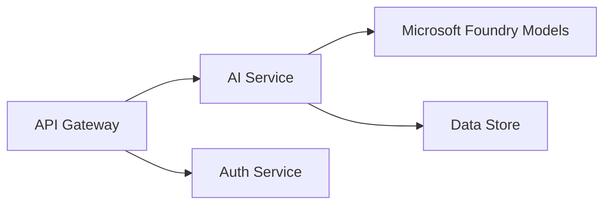
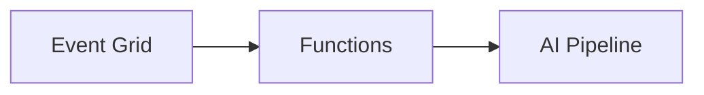

# فصل ۸: الگوهای تولید و سازمانی

**📚 دوره**: [AZD برای مبتدیان](../../README.md) | **⏱️ مدت زمان**: ۲-۳ ساعت | **⭐ پیچیدگی**: پیشرفته

---

## مرور کلی

این فصل الگوهای آماده استقرار سازمانی، سخت‌افزاری امنیت، مانیتورینگ و بهینه‌سازی هزینه‌ها برای بارهای کاری هوش مصنوعی در تولید را پوشش می‌دهد.

این یک مرجع معماری است، نه یک قالب کامل و قابل استقرار در تولید. مثال‌ها جزئیات یکپارچه‌سازی که باید در برنامه شما تأمین و آزمایش شود را حذف کرده‌اند؛ خواندن چک‌لیست به معنای تأیید آمادگی تولید نیست.

> **به‌روزرسانی Foundry GA (۲۰۲۶-۱۱-۰۹):** از `azd >= 1.37.0` و بسته عمومی در دسترس `microsoft.foundry` نسخه ۱.۰ برای فرآیند کاری Foundry استفاده کنید؛ ارزیابی‌ها به‌طور جداگانه نصب می‌شوند. به [دامنه انتشار و مهاجرت](production-ai-practices.md#recent-release-changes-and-fixes) و [مثال خط لوله احراز هویت شده](production-ai-practices.md#cicd-pipeline-configuration) مراجعه کنید. این یک بازبینی مستندات است، نه اعتبارسنجی استقرار زنده یا وضعیت GA کلی برای ویژگی‌های اختیاری پیش‌نمایش.

## اهداف یادگیری

با تکمیل این فصل، شما خواهید:
- برنامه‌های مقاوم در چند منطقه را مستقر کنید
- الگوهای امنیتی سازمانی را پیاده‌سازی کنید
- مانیتورینگ جامع را پیکربندی کنید
- هزینه‌ها را در مقیاس بهینه کنید
- خط لوله‌های CI/CD را با AZD راه‌اندازی کنید

---

## 📚 درس‌ها

| شماره | درس | توضیحات | زمان |
|---|--------|-------------|------|
| ۱ | [تمرین‌های هوش مصنوعی تولیدی](production-ai-practices.md) | الگوهای استقرار سازمانی | ۹۰ دقیقه |

---

## 🚀 چک‌لیست تولید

- [ ] استقرار چند منطقه‌ای برای افزایش تاب‌آوری
- [ ] هویت مدیریت شده برای احراز هویت (بدون کلید)
- [ ] Application Insights برای مانیتورینگ
- [ ] تنظیم بودجه‌ها و هشدارهای هزینه‌ای
- [ ] فعال‌سازی اسکن امنیتی
- [ ] یکپارچه‌سازی خط لوله CI/CD
- [ ] برنامه بازیابی از فاجعه

---

## 🏗️ الگوهای معماری

### الگو ۱: میکروسرویس‌های هوش مصنوعی



### الگو ۲: هوش مصنوعی رویدادمحور



---

## 🔐 بهترین تمرین‌های امنیتی

```bicep
// Illustrative properties from different resources, NOT a standalone Bicep file.
// Attach identity to the application host:
identity: {
  type: 'SystemAssigned'
}

// AI account properties (also require private endpoints, DNS and app connectivity):
properties: {
  publicNetworkAccess: 'Disabled'
  networkAcls: {
    defaultAction: 'Deny'
  }
}
```

---

## 💰 بهینه‌سازی هزینه

| استراتژی | محدودیت اصلی |
|----------|---------|
| مقیاس به صفر (Container Apps) | نیاز به ماشه مناسب دارد؛ سایر خدمات همچنان هزینه‌بر هستند |
| استفاده از لایه‌های مصرف برای توسعه | مقایسه قیمت سرویس انتخاب‌شده و حجم کاری |
| مقیاس بندی برنامه‌ریزی شده | مقیاس‌بندی از طریق زیرساخت/اتوماسیون پشتیبانی شده |
| رزروها/ظرفیت تخصیص‌یافته | فقط در صورت پشتیبانی؛ تعهدات می‌تواند هزینه‌های بیکار را افزایش دهد |

از [الگوی کامل منبع بودجه](production-ai-practices.md#2-cost-monitoring-and-budgets) با تاریخ شروع معتبر، دامنه صورتحساب، گیرندگان و مجوزها استفاده کنید. بودجه هشدارها را ارسال می‌کند؛ محدودیتی برای هزینه‌ها ایجاد نمی‌کند. صرفه‌جویی‌ها به بهره‌وری اندازه‌گیری شده وابسته است و درصدی تضمین‌شده نیست.

---

## 📊 راه‌اندازی مانیتورینگ

```bash
# Open the Application Insights logs view (requires configured monitoring)
azd monitor --logs

# Check Application Insights
azd monitor --overview

# View metrics
az monitor metrics list --resource <resource-id>
```

---

## 🔗 ناوبری

| جهت | فصل |
|-----------|---------|
| **قبلی** | [فصل ۷: رفع اشکال](../chapter-07-troubleshooting/README.md) |
| ** تکمیل دوره ** | [صفحه اصلی دوره](../../README.md) |

---

## 📖 منابع مرتبط

- [راهنمای عوامل هوش مصنوعی](../chapter-02-ai-development/agents.md)
- [Application Insights](../chapter-06-pre-deployment/application-insights.md)
- [راه‌حل‌های چند عامل](../chapter-05-multi-agent/README.md)
- [مثال میکروسرویس‌ها](../../examples/microservices/README.md)

---

<!-- CO-OP TRANSLATOR DISCLAIMER START -->
**سلب مسئولیت**:
این سند با استفاده از سرویس ترجمه هوش مصنوعی [Co-op Translator](https://github.com/Azure/co-op-translator) ترجمه شده است. در حالی که ما در تلاش برای دقت هستیم، لطفاً توجه داشته باشید که ترجمه‌های خودکار ممکن است شامل خطاها یا نادرستی‌هایی باشند. سند اصلی به زبان مادری خود باید به عنوان منبع معتبر در نظر گرفته شود. برای اطلاعات حیاتی، ترجمه حرفه‌ای انسانی توصیه می‌شود. ما در قبال هرگونه سوء تفاهم یا برداشت نادرست ناشی از استفاده از این ترجمه مسئولیتی نداریم.
<!-- CO-OP TRANSLATOR DISCLAIMER END -->