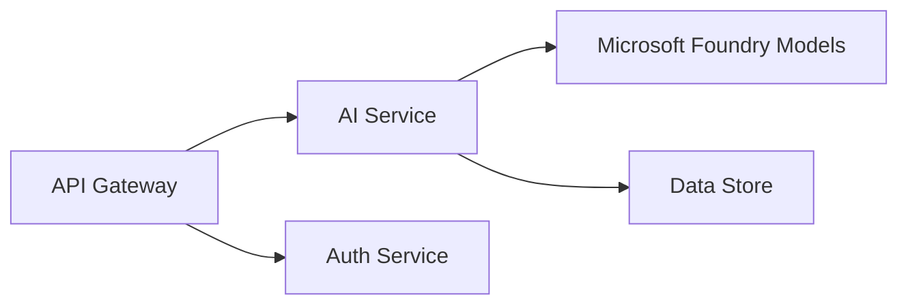
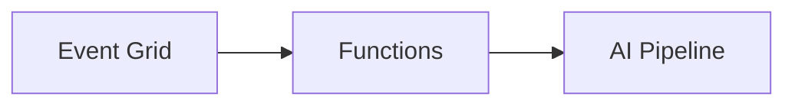

# فصل ۸: الگوهای تولید و سازمانی

**📚 دوره**: [AZD برای مبتدیان](../../README.md) | **⏱️ مدت زمان**: ۲-۳ ساعت | **⭐ پیچیدگی**: پیشرفته

---

## مروری کلی

این فصل الگوهای آماده‌برای‌سازمان استقرار، سخت‌سازی امنیت، نظارت و بهینه‌سازی هزینه برای بارهای کاری هوش مصنوعی در تولید را پوشش می‌دهد.

این یک مرجع معماری است، نه یک قالب تولیدی قابل استقرار کامل. مثال‌ها جزئیات یکپارچه‌سازی که باید توسط خود شما تأمین و تست شوند را حذف کرده‌اند؛ خواندن فهرست بررسی تضمین کننده آمادگی تولید نیست.

> **بازبینی نسخه (۲۰۲۶-۱۱-۰۴):** راهنمای CLI هوش مصنوعی با مستندات/منبع `azd 1.37.2`، نمایندگان `1.0.0-beta.23` و ارزیابی‌ها `1.0.0-beta.2` بررسی شده است. برای نیازهای سازگاری و جزئیات مهاجرت به [تغییرات و اصلاحات نسخه](production-ai-practices.md#recent-release-changes-and-fixes) مراجعه کنید؛ این یک اعتبارسنجی استقرار زنده نیست.

## اهداف یادگیری

با تکمیل این فصل، شما قادر خواهید بود:
- استقرار برنامه‌های مقاوم در چند منطقه
- پیاده‌سازی الگوهای امنیت سازمانی
- پیکربندی نظارت جامع
- بهینه‌سازی هزینه در مقیاس بزرگ
- راه‌اندازی خطوط CI/CD با AZD

---

## 📚 درس‌ها

| # | درس | توضیح | زمان |
|---|--------|-------------|------|
| 1 | [تمرین‌های تولید هوش مصنوعی](production-ai-practices.md) | الگوهای استقرار سازمانی | ۹۰ دقیقه |

---

## 🚀 فهرست بررسی تولید

- [ ] استقرار چند منطقه‌ای برای مقاومت
- [ ] شناسه مدیریت برای احراز هویت (بدون کلید)
- [ ] Application Insights برای نظارت
- [ ] تنظیم بودجه‌های هزینه و هشدارها
- [ ] فعال‌سازی اسکن امنیتی
- [ ] یکپارچه‌سازی خط CI/CD
- [ ] برنامه بازیابی پس از فاجعه

---

## 🏗️ الگوهای معماری

### الگو ۱: هوش مصنوعی میکروسرویس



### الگو ۲: هوش مصنوعی مبتنی بر رویداد



---

## 🔐 بهترین شیوه‌های امنیتی

```bicep
// Illustrative properties from different resources, NOT a standalone Bicep file.
// Attach identity to the application host:
identity: {
  type: 'SystemAssigned'
}

// AI account properties (also require private endpoints, DNS and app connectivity):
properties: {
  publicNetworkAccess: 'Disabled'
  networkAcls: {
    defaultAction: 'Deny'
  }
}
```

---

## 💰 بهینه‌سازی هزینه

| استراتژی | محدودیت اصلی |
|----------|---------|
| مقیاس به صفر (Container Apps) | نیاز به ماشه مناسب؛ سایر سرویس‌ها همچنان هزینه دارند |
| استفاده از سطح مصرف برای توسعه | مقایسه قیمت‌گذاری سرویس انتخاب شده و بار کاری |
| مقیاس‌بندی زمان‌بندی شده | مقیاس از طریق زیرساخت/اتوماسیون پشتیبانی شده |
| رزروها/ظرفیت اختصاص یافته | فقط هنگام پشتیبانی؛ تعهدات می‌توانند هزینه‌های بیکار را افزایش دهند |

از [الگوی بودجه کامل منابع](production-ai-practices.md#2-cost-monitoring-and-budgets) با تاریخ شروع معتبر، محدوده صورتحساب، گیرندگان و مجوزها استفاده کنید. بودجه هشدارها را ارسال می‌کند؛ محدودیت هزینه نیست. صرفه‌جویی‌ها به استفاده اندازه‌گیری شده بستگی دارند و درصدهای تضمین شده نیستند.

---

## 📊 تنظیم نظارت

```bash
# Open the Application Insights logs view (requires configured monitoring)
azd monitor --logs

# Check Application Insights
azd monitor --overview

# View metrics
az monitor metrics list --resource <resource-id>
```

---

## 🔗 ناوبری

| جهت | فصل |
|-----------|---------|
| **قبلی** | [فصل ۷: عیب‌یابی](../chapter-07-troubleshooting/README.md) |
| **پایان دوره** | [صفحه اصلی دوره](../../README.md) |

---

## 📖 منابع مرتبط

- [راهنمای نمایندگان هوش مصنوعی](../chapter-02-ai-development/agents.md)
- [Application Insights](../chapter-06-pre-deployment/application-insights.md)
- [راه‌حل‌های چند نماینده‌ای](../chapter-05-multi-agent/README.md)
- [مثال میکروسرویس](../../examples/microservices/README.md)

---

<!-- CO-OP TRANSLATOR DISCLAIMER START -->
**سلب مسئولیت**:
این سند با استفاده از سرویس ترجمه هوش مصنوعی [Co-op Translator](https://github.com/Azure/co-op-translator) ترجمه شده است. در حالی که ما در تلاش برای دقت هستیم، لطفاً توجه داشته باشید که ترجمه‌های خودکار ممکن است شامل خطاها یا نادرستی‌هایی باشند. سند اصلی به زبان مادری خود باید به عنوان منبع معتبر در نظر گرفته شود. برای اطلاعات حیاتی، ترجمه حرفه‌ای انسانی توصیه می‌شود. ما در قبال هرگونه سوء تفاهم یا برداشت نادرست ناشی از استفاده از این ترجمه مسئولیتی نداریم.
<!-- CO-OP TRANSLATOR DISCLAIMER END -->