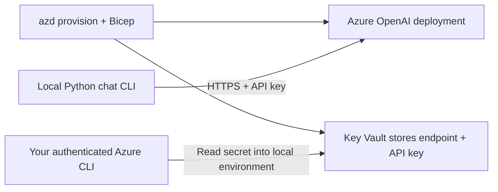

# گفتگوی Azure OpenAI — رابط خط فرمان محلی و زیرساخت AZD

**سطح:** متوسط · **زمان:** ۳۵–۶۰ دقیقه شامل تنظیمات

این نمونه یک **منبع Azure OpenAI و Key Vault** را فراهم می‌کند، سپس یک
رابط خط فرمان تعاملی پایتون **روی دستگاه شما** اجرا می‌کند. این برنامه یک وب‌اپلیکیشن
یا برنامه Container App را میزبانی نمی‌کند. مدل پیش‌فرض `gpt-4.1`، نسخه `2025-04-14` است، با
ظرفیت استقرار `GlobalStandard` به میزان ۲۰. پیش از فراهم‌کردن، در
منطقه انتخابی خود در دسترس بودن و سهمیه فعلی را بررسی کنید؛ تاریخ‌های چرخه عمر مدل ممکن است تغییر کنند.

## اهداف یادگیری

- فراهم‌کردن زیرساخت مدل با Bicep و azd.
- بازیابی کلید API از Key Vault بدون قرار دادن آن در خروجی‌های استقرار.
- ارسال درخواست‌های تکمیل گفت‌وگو و حفظ تاریخچه گفتگو.
- تفسیر تعداد توکن‌ها و محدودیت‌های تخمین هزینه.



در این نمونه، ادغام زمان اجرا با managed-identity، failover چندمنطقه‌ای، محدودکننده نرخ سفارشی، حالت پخش زنده، یا محاسبه میزبانی شده وجود ندارد. SDK OpenAI
تا دو بار برای خطاهای قابل تلاش مجدد تلاش می‌کند؛ CLI خطاهای باقی‌مانده را گزارش می‌دهد.


## پیش‌نیازها

- نسخه پایدار فعلی [azd](https://learn.microsoft.com/azure/developer/azure-developer-cli/install-azd)
  (نسخه منتشر شده در زمان بررسی: 1.37.2).
- [Azure CLI](https://learn.microsoft.com/cli/azure/install-azure-cli).
- پایتون **3.10+** (3.11 توصیه می‌شود) و یک محیط مجازی.
- یک اشتراک Azure با مجوز ایجاد منابع Cognitive Services و Key Vault،
  استقرار مدل‌ها و خواندن اسرار vault.
- در دسترس بودن منطقه‌ای و سقف `GlobalStandard` برای `gpt-4.1`. الزامات دسترسی
  به اشتراک و ویژگی بستگی دارد؛ هیچ بازه زمانی تضمینی برای تأیید وجود ندارد.

```bash
azd version
az version
python --version
azd auth login
az login
```

این‌ها نشست‌های احراز هویت جداگانه‌ای هستند. قبل از اجرای دستورات زیر در هر دو ابزار همان اشتراک را انتخاب کنید.


## شروع سریع (Bash)

از ریشه مخزن اجرا کنید:

```bash
cd examples/azure-openai-chat
azd env new myopenai
azd provision
```

منطقه‌ای پشتیبانی‌شده را انتخاب کنید. تهیه منابع یک گروه منابع، حساب OpenAI،
استقرار مدل، Key Vault و اسرار `openai-endpoint`/`openai-api-key` را ایجاد می‌کند.
هیچ **سرویسی برای استقرار** در `azure.yaml` وجود ندارد.

خروجی‌های غیرمحرمانه را بارگذاری کنید و مقدار محرمانه را در شل فعلی خود بازیابی کنید:

```bash
export AZURE_OPENAI_ENDPOINT="$(azd env get-value AZURE_OPENAI_ENDPOINT)"
export AZURE_OPENAI_MODEL="$(azd env get-value AZURE_OPENAI_MODEL)"
KV_NAME="$(azd env get-value AZURE_KEY_VAULT_NAME)"
export AZURE_OPENAI_API_KEY="$(az keyvault secret show \
  --vault-name "$KV_NAME" --name openai-api-key --query value --output tsv)"

python -m venv .venv
source .venv/bin/activate
python -m pip install -r src/requirements.txt
python src/chat.py
```

در PowerShell، با استفاده از `.\.venv\Scripts\Activate.ps1` فعال کنید و محیط را اختصاص دهید
متغیرها با `$env:AZURE_OPENAI_ENDPOINT = azd env get-value AZURE_OPENAI_ENDPOINT`
(و به همین ترتیب برای مدل). کلید API را با استفاده از دریافت کنید
`$env:AZURE_OPENAI_API_KEY = az keyvault secret show --vault-name $KV_NAME --name openai-api-key --query value -o tsv`.
ابتدا `$KV_NAME = azd env get-value AZURE_KEY_VAULT_NAME` را تنظیم کنید.

کلید API را در گزارش‌های مشکل چاپ، کامیت یا پیست نکنید. CLI متغیرهای محیطی فرآیند را می‌خواند؛
و **هیچ‌گاه** اسرار Key Vault را واکشی نمی‌کند یا فایل‌های `.env` را بارگذاری نمی‌کند.
`config.py` در زمان راه‌اندازی نقطه پایان، محدودیت توکن و دما را اعتبارسنجی می‌کند.

خروجی مورد انتظار (محتوا و کاربرد متغیر است):

```text
Azure OpenAI Chat Application
Model: gpt-4.1
...
You: Say hello in one sentence.
Assistant: Hello! How can I help you today?
[Tokens: ... | Cost: $...]
```

دستورات: `stats` مجموع‌ها را نمایش می‌دهد، `clear` تاریخچه گفتگو را پاک می‌کند، و
`quit`/`exit` جلسه را پایان می‌دهد. هیچ دستور `--stream`، `--show-tokens`، `tokens`،
یا `cost` وجود ندارد.

## بررسی استقرار

پس از بارگذاری متغیرهای شل بالا:

```bash
curl --fail-with-body \
  "${AZURE_OPENAI_ENDPOINT%/}/openai/deployments/${AZURE_OPENAI_MODEL}/chat/completions?api-version=2024-10-21" \
  -H "Content-Type: application/json" \
  -H "api-key: $AZURE_OPENAI_API_KEY" \
  -d '{"messages":[{"role":"user","content":"Say hello!"}],"max_tokens":50}'

az keyvault secret list --vault-name "$KV_NAME" --query "[].name" -o table
```

موفقیت: API با HTTP 200 به همراه `choices[0].message.content` و `usage` پاسخ می‌دهد؛
خزانه لیست‌های `openai-api-key` و `openai-endpoint` را می‌دهد. یک استقرار موفق ARM
به تنهایی تأیید پیش‌بینی را تضمین نمی‌کند.

## فایل‌ها و پیکربندی

```text
azure.yaml                         # Infrastructure-only AZD project
infra/main.bicep                   # Subscription deployment
infra/main.parameters.json         # Environment, location, principal ID
infra/resources/openai.bicep       # Account + model
infra/resources/keyvault.bicep     # Vault + deploying user's secret access policy
infra/resources/secrets.bicep      # Writes secrets, no key output
src/chat.py                        # Interactive CLI
src/config.py                      # Environment validation
src/requirements.txt               # Python packages
```

برای تغییر مدل/نسخه/ظرفیت تخصیص داده شده، پیش‌فرض‌ها را در
`infra/main.bicep` ویرایش کرده و `azd provision` را اجرا کنید. تنظیم `AZURE_OPENAI_MODEL` در
شل شما تنها یک **نام استقرار موجود** را انتخاب می‌کند؛ این کار مدل دیگری را مستقر نمی‌کند.

| متغیر زمان اجرا | مقدار پیش‌فرض / منبع |
|---|---|
| `AZURE_OPENAI_ENDPOINT` | الزامی؛ خروجی غیرمخفی azd |
| `AZURE_OPENAI_API_KEY` | الزامی؛ بازیابی از Key Vault |
| `AZURE_OPENAI_MODEL` | `gpt-4.1`؛ نام استقرار Azure |
| `AZURE_OPENAI_MAX_TOKENS` | ۸۰۰ (دامنه اعتبارسنجی ۱–۴۰۹۶) |
| `AZURE_OPENAI_TEMPERATURE` | ۰.۷ (دامنه ۰–۲) |
| `AZURE_OPENAI_INPUT_PRICE_PER_1K` | ۰.۰۰۲ دلار؛ نرخ ورودی بدون کش تصویری |
| `AZURE_OPENAI_OUTPUT_PRICE_PER_1K` | ۰.۰۰۸ دلار؛ نرخ خروجی تصویری |

## هزینه‌ها و محدودیت‌های امنیتی

نمایش هزینه‌ها یک **برآورد** است، نه صورتحساب Azure. این هزینه، مصرف توکن API را در
نرخ‌های پیکربندی شده ضرب می‌کند و تخفیف‌های ورودی کش‌شده،
تفاوت‌های منطقه‌ای/کالا، مالیات‌ها، تغییرات قیمت یا تماس‌های ناموفق/تلاش دوباره را در نظر نمی‌گیرد.
هنگام استفاده از مدل یا کالا (SKU) دیگر، **هر دو نرخ** را بازنویسی کنید و
[قیمت‌گذاری Azure OpenAI](https://azure.microsoft.com/pricing/details/cognitive-services/openai-service/) فعلی را بررسی کنید.

برای مثال، ۱۰۰ درخواست با استفاده از ۵۰۰ توکن ورودی بدون کش و ۲۰۰ توکن خروجی هر کدام
با نرخ‌های پیش‌فرض هزینه‌ای برابر با `100 × (500/1000 × .002 + 200/1000 × .008) = $0.26` دارد.
عملیات گنجه کلید/ذخیره‌سازی هزینه‌های جداگانه‌ای دارند. هزینه ثابتی به مبلغ ۵۰ دلار در ماه
برای این CLI محلی وجود ندارد و همچنین هیچ محاسبه میزبانی شده‌ای در قالب نیست.

گنجه از سیاست دسترسی برای اصل متصدی پیاده‌سازی استفاده می‌کند؛ این یک نمونه برنامه RBAC یا
شناسه مدیریت شده نیست. نقطه‌های پایانی عمومی و احراز هویت کلید API
برای آموزش استفاده شده‌اند. قبل از تطبیق آن برای محیط تولید، مجوزها را محدود کرده و کنترل‌های مناسب هویت/شبکه را اضافه کنید.


## تمرینات عملی

### ۱. تایید زمینه و بازنشانی آن

**شروع:** اجرای CLI. **هدف:** مشاهده تاریخچه.
بگویید «کلمه سدر را به خاطر بسپار»، سپس بپرسید «چه کلمه‌ای را خواسته‌ام به خاطر بسپاری؟»
`stats` را اجرا کنید؛ دو دور موفق باید به عنوان دو پیام ردوبدل شده شمرده شود.
اجرای `clear` و `stats`؛ پیام‌های رد و بدل شده باید صفر باشند (مجموع توکن‌ها باقی می‌ماند).
بیان دقیق مدل غیرقطعی است.

### ۲. تغییر محدودیت پاسخ

**شروع:** از CLI خارج شوید، در حالی که همان شل حفظ شود.
اجرای `export AZURE_OPENAI_MAX_TOKENS=100`، راه‌اندازی مجدد `python src/chat.py` و درخواست
توضیح کوتاهی از azd. بررسی کنید که بنر عدد ۱۰۰ را نشان دهد.
بازیابی با `unset AZURE_OPENAI_MAX_TOKENS`. محدودیت پاسخ کمتر باعث
کاهش توکن‌های تاریخچه ارسال شده قبلی نمی‌شود.

### مشکلات رایج

- **متغیرهای محیطی مفقود:** provision کردن مقادیر شل را صادر نمی‌کند؛
  مراحل export را تکرار کنید. یک ترمینال جدید دوباره به آنها نیاز دارد.
- **خطای ۴۰۳ هنگام خواندن Key Vault:** صحت اشتراک/ورود Azure CLI و هویت اصلی
  در سیاست دسترسی به ولت را بررسی کنید. اعمال تغییرات سیاست ممکن است زمان ببرد.
- **خطای ۴۰۴ در استنتاج:** نام استقرار، نقطه انتهایی و وضعیت استقرار را بررسی کنید.
- **خطای ۴۲۹ در استنتاج:** منتظر بازنشانی محدودیت‌های نرخ باشید؛ سهمیه مدل منطقه‌ای را بررسی کنید.
  CLI نوبت‌های ناموفق را از تاریخچه حذف می‌کند تا تلاش مجدد آنها را تکراری نکند.
- **طول متن زمینه:** نمونه مکالمات طولانی را کوتاه نمی‌کند؛ از `clear` استفاده کنید.
- **مدل در دسترس نیست/از رده خارج است:** در دسترس بودن مدل فعلی را بررسی کرده و مدل/نسخه/SKU
  را با هم به‌روزرسانی کنید؛ نسخه API و نسخه مدل تنظیمات متفاوتی هستند.

## پاکسازی و مراحل بعدی

```bash
azd down
unset AZURE_OPENAI_API_KEY
```

نگهداری حذف نرم Key Vault هفت روز است؛ پاکسازی نیاز به مجوزهای جداگانه دارد.
مجموعه تست قطعی وجود ندارد؛ دستور `pytest tests/` که وجود ندارد را اجرا نکنید.
قبل از گسترش کد، تست‌های API شبیه‌سازی‌شده اضافه کنید.

[نمونه‌های کانتینری](../../../../examples/container-app) · [طرح معماری فروشگاهی](../retail-scenario.md) ·
[خانه دوره](../../README.md) · [گزارش مشکل](https://github.com/microsoft/AZD-for-beginners/issues)

---

<!-- CO-OP TRANSLATOR DISCLAIMER START -->
**سلب مسئولیت**:
این سند با استفاده از سرویس ترجمه هوش مصنوعی [Co-op Translator](https://github.com/Azure/co-op-translator) ترجمه شده است. در حالی که ما در تلاش برای دقت هستیم، لطفاً توجه داشته باشید که ترجمه‌های خودکار ممکن است شامل خطاها یا نادرستی‌هایی باشند. سند اصلی به زبان مادری خود باید به عنوان منبع معتبر در نظر گرفته شود. برای اطلاعات حیاتی، ترجمه حرفه‌ای انسانی توصیه می‌شود. ما در قبال هرگونه سوء تفاهم یا برداشت نادرست ناشی از استفاده از این ترجمه مسئولیتی نداریم.
<!-- CO-OP TRANSLATOR DISCLAIMER END -->