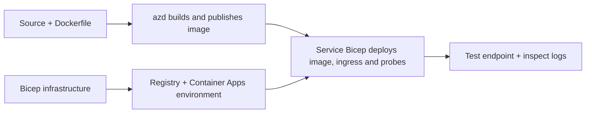

# نمونه‌های استقرار برنامه‌های کانتینری با AZD

این دایرکتوری شامل دو نمونه آموزشی به همراه کد منبع، فایل‌های داکرفایل،
زیرساخت Bicep و `azure.yaml` است. هیچ یک برای محیط تولید مقاوم‌سازی نشده‌اند.

## انتخاب یک نمونه

| نمونه | چه چیزی پیاده‌سازی شده است | پیش‌نیاز |
|---|---|---|
| [API ساده Flask](../../../../examples/container-app/simple-flask-api) | API CRUD تک‌خدمتی پایتون، اقلام در حافظه، بررسی‌های سلامت، مقیاس‌پذیری HTTP | دانش پایه CLI و HTTP |
| [میکروسرویس‌های دوخدمتی](../../../../examples/container-app/microservices) | درگاه Node.js، سرویس محصول خواندنی فقط داخلی پایتون، تله‌متری و مقیاس‌پذیری | ابتدا نمونه تک‌خدمتی را کامل کنید |

اجازه دهید ۳۰–۶۰ دقیقه شامل نصب و تأیید صرف شود. زمان‌های تهیه Azure متفاوت است.

## پیش‌نیازها

- [Azure Developer CLI](https://learn.microsoft.com/azure/developer/azure-developer-cli/install-azd)
- [Azure CLI](https://learn.microsoft.com/cli/azure/install-azure-cli) برای دستورات تأیید
- داکر با راه‌اندازی daemon آن برای ساخت این تصاویر کانتینری
- یک اشتراک Azure با اجازه‌های ایجاد منابع و سهم منطقه‌ای کافی
- بش برای مثال‌های شل، یا دستورات معادل پاورشل

```bash
azd version
az version
docker info
azd auth login
az login
```

این دو ابزار نشست‌های ورود جداگانه دارند. از نسخه پایدار کنونی azd استفاده کنید؛ 
نسخه منتشر شده کنونی در زمان بررسی 1.37.2 است. ادعاهای نسخه حداقل قدیمی‌تر 
تضمین سازگاری نمی‌باشد.

## شروع سریع

از ریشه مخزن:

```bash
cd examples/container-app/simple-flask-api
azd env new flask-demo
azd up
API_URL=$(azd env get-value API_ENDPOINT)
curl --fail-with-body "${API_URL}/health"
```

انتظار می‌رود: HTTP 200 با `"status": "healthy"`. از نمونه README برای ایجاد،
خواندن، به‌روزرسانی و حذف یک مورد و همچنین بررسی لاگ‌ها پیروی کنید.



تأمین اولیه از یک تصویر عمومی hello-world در پورت ۸۰ استفاده می‌کند. فایل‌های پارامتر بایسپ مخصوص سرویس
اجازه می‌دهند `azd deploy` آن را با تصویر برنامه ساخته‌شده جایگزین کند
و پورت/پراب‌های صحیح برنامه (۸۰۰۰ برای Flask/product، ۸۰۸۰ برای gateway).
این فایل‌ها را با تنظیمات `azure.yaml` `module` خود نگه دارید.

## پیکربندی: چه چیزی چه چیزی را تغییر می‌دهد

`azure.yaml` دایرکتوری‌های منبع، زبان‌ها، میزبان‌ها و ماژول‌های استقرار را انتخاب می‌کند.
منابع CPU/حافظه کانتینر، اینگرس، پروب‌ها، تعداد نمونه‌ها و قوانین مقیاس تعریف می‌شوند
در **Bicep**، نه پراپرتی‌های سرویس دلخواه `resources`، `scale`، یا `regions`.  

`azd env set SOME_VALUE ...` یک مقدار را به صورت محلی ذخیره می‌کند. این مقدار فقط زمانی منابع مستقر شده  
را تغییر می‌دهد که یک پارامتر، نگاشت محیط، یا هوک آن مقدار را صریحاً مصرف کند.  
این مثال‌ها `MAX_REPLICAS`، `SCALE_TO_ZERO_TIMEOUT`،
`CONTAINER_APP_REPLICA_TYPE` یا تنظیمات سفارشی کاناری از مقادیر محیط azd را مصرف نمی‌کنند.  
فایل‌های Bicep مرتبط را ویرایش کنید و `azd up` را اجرا کنید تا مجدداً تأمین و مستقر شود.  

سورس برنامه را زیر `infra/` قرار ندهید. `project` باید به دایرکتوری سورسی اشاره کند که  
فایل Dockerfile و فایل فهرست وابستگی‌ها را دارد.  

## مانیتورینگ و هزینه‌ها  

- `azd monitor --logs` یک نمای پرتال باز می‌کند؛ این یک جریان لاگ ترمینال نیست.  
  از `az containerapp logs show --follow` همراه با نام واقعی منبع استفاده کنید.  
- API ساده لاگ‌های stdout جمع‌آوری شده از طریق Container Apps/Log Analytics را می‌نویسد.  
  منبع Application Insights تأمین شده به صورت خودکار ابزاردهی نمی‌شود.  
- دروازه مایکروسرویس‌ها از SDK برنامه‌نویسی Application Insights نود.جی‌اس استفاده می‌کند؛ سرویس پایتون
  گزارش‌های برنامه را صادر می‌کند. ردیابی کامل درخواست/وابستگی پایتون
  پیکربندی نشده است.
- مقیاس به صفر می‌تواند هزینه‌های محاسباتی را کاهش دهد، اما ثبت و ذخیره‌سازی لاگ و رجیستری
  همچنان ممکن است هزینه‌بر باشد. پیش‌فرض‌های مایکروسرویس‌ها باعث می‌شود نسخه‌ها در حال اجرا بمانند.
  منطقه و استفاده خود را در
  [ماشین حساب قیمت‌گذاری Azure](https://azure.microsoft.com/pricing/calculator/) تخمین بزنید.

## الگوهای پیشرفته — پیاده‌سازی‌های وارد نشده

این‌ها جهت‌گیری‌های طراحی هستند، نه پروژه‌های محلی اضافی یا قطعات کد کپی-اجرا:

- **داده‌های پایدار و احراز هویت:** جایگزین کردن فروشگاه‌های درون‌حافظه و افزودن
  احراز هویت/مجوز Microsoft Entra ID پیش از محیط تولید.
- **آبی-سبز/کناری:** استفاده از حالت چند ویرایش Container Apps، برچسب‌های ویرایش،
  وزن‌های ترافیک، بررسی سلامت و روند بازگردانی.
  در این نمونه‌ها پیکربندی azd وجود ندارد `deploymentStrategy: canary` .
  رجوع کنید به [مدیریت ویرایش](https://learn.microsoft.com/azure/container-apps/revisions).
- **چند منطقه‌ای:** ایجاد محیط‌ها و برنامه‌های جداگانه در Bicep و طراحی
  مسیریابی جهانی و سازگاری داده‌ها. فهرست سرویس `regions` مکانیزم استقرار azd نیست.
- **کارگران صف:** افزودن منبع کارگر، وابستگی‌ها، منابع صف، یک حساب مدیریت شده
- **کارگران صف:** اضافه کردن منبع کارگر، وابستگی‌ها، منابع صف، یک مدیریت شده
  هویتی با نقش‌های داده-پلان و یک قانون مقیاس‌بندی احراز شده. کپی نکنید
  یک مسیر `src/worker` خالی و انتظار یک پروژه قابل اجرا را نداشته باشید.
- **Dapr:** اجزارا تامین می‌کند، سایدکار را پیکربندی می‌کند، SDK مطابقت‌دار را نصب می‌کند،
  و پیاده‌سازی مدیریت خطا برای حالت/انتشار-اشتراک.
- **اسرار:** در صورت امکان از هویت مدیریت‌شده و تخصیص نقش‌ها استفاده کنید. صرفاً
  ایجاد یک مخزن کلید موجب دسترسی برنامه‌ها یا بارگذاری اسرار نمی‌شود.

## پاک‌سازی

از دایرکتوری نمونه:

```bash
azd down
```

درخواست‌های حذف را مرور کنید و تأیید کنید که گروه منبع اختصاصی حذف شده است.
از این نمونه‌ها بدون طراحی و آزمایش‌های اضافی به عنوان مبنای تولید استفاده نکنید.

[فهرست نمونه‌ها](../README.md) · [خانه دوره](../../README.md) ·
[مستندات برنامه‌های کانتینری](https://learn.microsoft.com/azure/container-apps/) ·
[گزارش مشکل](https://github.com/microsoft/AZD-for-beginners/issues)

---

<!-- CO-OP TRANSLATOR DISCLAIMER START -->
**سلب مسئولیت**:
این سند با استفاده از سرویس ترجمه هوش مصنوعی [Co-op Translator](https://github.com/Azure/co-op-translator) ترجمه شده است. در حالی که ما در تلاش برای دقت هستیم، لطفاً توجه داشته باشید که ترجمه‌های خودکار ممکن است شامل خطاها یا نادرستی‌هایی باشند. سند اصلی به زبان مادری خود باید به عنوان منبع معتبر در نظر گرفته شود. برای اطلاعات حیاتی، ترجمه حرفه‌ای انسانی توصیه می‌شود. ما در قبال هرگونه سوء تفاهم یا برداشت نادرست ناشی از استفاده از این ترجمه مسئولیتی نداریم.
<!-- CO-OP TRANSLATOR DISCLAIMER END -->