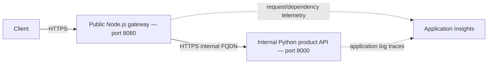

# میکروسرویس‌های دوخدمتی — اپلیکیشن‌های کانتینری آزور

**سطح:** متوسط · **زمان:** ۴۵–۶۰ دقیقه شامل راه‌اندازی

این نمونه آموزشی یک **دروازه API نود.جی‌اس** و یک **سرویس محصول پایتون فقط خواندنی** را پیاده‌سازی می‌کند.
سورس، فایل‌های داکر، بیسک، و پیکربندی azd شامل شده است.
این سیستم برای محیط‌های تولید مقاوم‌سازی نشده است.

## چیزهایی که یاد می‌گیرید

- استقرار دو سرویس به‌صورت مستقل.
- استفاده از FQDN داخلی بک‌اند بر بستر HTTPS.
- بررسی پاسخ‌های موفقیت، یافت نشدن، و سرویس در دسترس نیست.
- درک تله‌متری و مرزهای مقیاس‌پذیری مستقل.



کاتالوگ محصول شامل پنج محصول ثابت در حافظه است. هیچ **هندلر POST،  
PUT، یا DELETE**، پایگاه داده، سرویس باس، سرویس سفارش/کاربر/اطلاع‌رسانی،  
کد C# یا Go وجود ندارد. این‌ها ایده‌های توسعه آینده هستند و ویژگی‌های شامل‌شده نیستند.  
درگاه کاربران را احراز هویت نمی‌کند؛ ورود داخلی جایگزینی برای  
مجوز برنامه نیست.  

## پیش‌نیازها  

ابتدا [API تک Flask](../../../../../examples/container-app/simple-flask-api) را کامل کنید.  
azd پایدار فعلی (نسخه منتشر شده در زمان بازبینی: 1.37.2)، Azure CLI،  
و Docker با دیمون در حال اجرا را نصب کنید. به یک اشتراک Azure،  
مجوز ایجاد منابع، و سهمیه منطقه‌ای Container Apps نیاز دارید.  

```bash
azd version
az version
docker info
azd auth login
az login
```
  
از همان اشتراک در هر دو ابزار CLI استفاده کنید. دستورات زیر از Bash استفاده می‌کنند.  

## مستقرسازی و تأیید  

از ریشه مخزن:  

```bash
cd examples/container-app/microservices
azd env new microservices-demo
azd up
GATEWAY_URL=$(azd env get-value API_GATEWAY_URL)
RG_NAME=$(azd env get-value AZURE_RESOURCE_GROUP)
GATEWAY_NAME=$(azd env get-value API_GATEWAY_NAME)
PRODUCT_NAME=$(azd env get-value PRODUCT_SERVICE_NAME)

curl --fail-with-body "${GATEWAY_URL}/health"
curl --fail-with-body "${GATEWAY_URL}/api/products"
curl --fail-with-body "${GATEWAY_URL}/api/products/1"
curl -i "${GATEWAY_URL}/api/products/999"
```
  
**موفقیت:** سلامت ۲۰۰؛ فهرست ۲۰۰ با **پنج** محصول؛ محصول ۱ یک لپ‌تاپ  
است با قیمت ۹۹۹.۹۹ و موجودی ۵۰؛ محصول ناشناخته ۴۰۴ برمی‌گرداند.  
توضیحات در پاسخ‌ها گنجانده شده‌اند؛ زمان‌ها متغیر است.  

تخصیص اولیه از تصاویر عمومی hello-world روی پورت ۸۰ استفاده می‌کند تا تلاش نکند  
تصاویر ناموجود را از یک رجیستری خالی بکشد. ماژول‌های Bicep خاص سرویس  
و فایل‌های پارامترها را با تصاویر ساخته شده و پورت‌ها/پروب‌های اپلیکیشن در طول
`azd deploy` جایگزین می‌کنند. پارامترهای اصلی نام تصاویر منتشر شده را برای تامین بعدی حفظ می‌کنند.

## خدمات و شبکه‌بندی

| سرویس | نقاط پایانی نمایان شده | منابع پیش‌فرض |
|---|---|---|
| دروازه | GET `/`, `/health`, `/api/products`, `/api/products/:id` | ۱ vCPU، ۲ GiB، ۲-۲۰ نسخه |
| محصول | GET `/`, `/health`, `/products`, `/products/<id>` | ۰.۵ vCPU، ۱ GiB، ۱-۱۰ نسخه |

ورودی محصول `external: false` و `allowInsecure: false` دارد. بیسپ این را به دروازه تزریق می‌کند
`PRODUCT_SERVICE_URL=https://<actual-internal-fqdn>` . HTTP خواهد بود
ریدایرکت؛ HTTPS با اینگرس پیکربندی شده مطابقت دارد. نام کوتاه DNS باید با
**نام واقعی Container App** مطابقت داشته باشد، نه کلید سرویس منطقی `product-service`.
سعی نکنید مستقیماً از لپ‌تاپ خود به URL داخلی دسترسی پیدا کنید.

گیت‌وی یک تایم‌اوت پنج ثانیه‌ای برای تماس‌های محصول دارد. شناسه‌های محصول گمشده
به صورت 404 پراپگیت می‌شوند؛ خطاهای انتقال/خطاهای دیگر بک‌اند 503 را باز می‌گردانند. گیت‌وی
`/health` فقط گیت‌وی را بررسی می‌کند، نه در دسترس بودن بک‌اند را.

## فایل‌ها و پیکربندی

```text
azure.yaml
infra/main.bicep
infra/main.parameters.json
infra/abbreviations.json
infra/core/container-apps-environment.bicep
infra/core/monitor.bicep
infra/app/api-gateway.bicep
infra/app/api-gateway.parameters.json
infra/app/product-service.bicep
infra/app/product-service.parameters.json
src/api-gateway/{app.js,package.json,Dockerfile}
src/product-service/{main.py,requirements.txt,Dockerfile}
```

مقیاس‌پذیری، پردازنده/حافظه، پورت‌ها و پروب‌ها در `infra/app/*.bicep` تنظیم شده‌اند. این
فایل‌ها را تغییر دهید و `azd up` را اجرا کنید تا زیرساخت اعمال و دوباره مستقر شود. هیچ
پارامتر متغیر محیطی `GATEWAY_MAX_REPLICAS` در این نمونه وجود ندارد.

برای تغییرات کد-تنها:

```bash
azd deploy product-service
azd deploy api-gateway
```

تصویر Node از Node 22 استفاده می‌کند؛ تصویر Python از Python 3.11 استفاده می‌کند. هر دو به
`0.0.0.0` متصل می‌شوند. اینگرس/پروب‌ها به ترتیب از پورت ۸۰۸۰ (درگاه) و ۸۰۰۰ (محصول) استفاده می‌کنند.

## توسعه محلی با Docker

از این دایرکتوری نمونه اجرا کنید. از یک شبکه تعریف‌شده توسط کاربر استفاده کنید، **نه `localhost`
تا یک کانتینر به کانتینر دیگر برسد**:

```bash
docker network create azd-microservices-demo
docker build -t local-product ./src/product-service
docker build -t local-gateway ./src/api-gateway
docker run -d --name azd-product --network azd-microservices-demo local-product
docker run -d --name azd-gateway --network azd-microservices-demo \
  -p 8080:8080 -e PRODUCT_SERVICE_URL=http://azd-product:8000 local-gateway
curl --fail-with-body http://localhost:8080/api/products
```

مورد انتظار: پنج محصول. HTTP فقط برای این شبکه محلی Docker استفاده می‌شود.

```bash
docker stop azd-product azd-gateway
docker rm azd-product azd-gateway
docker network rm azd-microservices-demo
```

## مانیتورینگ

```bash
az containerapp logs show --name "$GATEWAY_NAME" --resource-group "$RG_NAME" --follow
# In a separate terminal:
az containerapp logs show --name "$PRODUCT_NAME" --resource-group "$RG_NAME" --tail 100
```

`azd monitor --logs` یک نمای پرتال باز می‌کند؛ فایل‌های لاگ ترمینال را استریم نمی‌کند.
کیت توسعه Node درخواست‌ها/وابستگی‌های درگاه را جمع‌آوری می‌کند. `AzureLogHandler`
پایتون **ردیابی لاگ‌ها** را صادر می‌کند، نه درخواست‌های خودکار Flask، وابستگی‌های SQL، یا ردیابی‌های توزیع‌شده کامل.
OpenCensus یک کیت توسعه قدیمی است؛ در هنگام گسترش این نمونه، ترجیحاً از Azure Monitor OpenTelemetry استفاده کنید.


```kusto
requests
| where timestamp > ago(1h)
| where name contains "products"
| summarize RequestCount=count(), AvgDuration=avg(duration) by bin(timestamp, 5m)
```

برای پیام‌های برنامه پایتون:

```kusto
traces
| where timestamp > ago(1h)
| where message contains "products"
| project timestamp, message, severityLevel
```

تأخیر در دریافت و نمونه‌برداری را مجاز کنید؛ انتظار شمار درخواست دقیق یا تأخیر تضمین‌شده نداشته باشید.
هشدارها یا داشبوردهای سفارشی تنظیم نشده‌اند.

## تمرین‌های عملی

### تمرین ۱: اصلاح کاتالوگ

**نقطه شروع:** `src/product-service/main.py`.
**هدف:** تأیید استقرار مستقل سرویس.
تغییر موجودی لپ‌تاپ از ۵۰ به ۴۹ در لیست ثابت `products`، اجرای
`azd deploy product-service`، سپس درخواست `${GATEWAY_URL}/api/products/1`.

**معیار موفقیت / راه‌حل:** دریافت HTTP 200 با `"stock":49`. بازیابی مقدار ۵۰ و استقرار مجدد.
**مشکل رایج:** ویرایش دروازه (gateway) به جای سرویسی که مالک کاتالوگ است.
این تغییر داده‌های منبع است، نه پایگاه داده موجودی پایدار.

### تمرین ۲: بررسی پیکربندی نسخه (replica)

**نقطه شروع:** `infra/app/product-service.bicep`.
**هدف:** مشاهده تغییر زیرساخت بدون حدس زدن در مورد مقیاس‌بندی خودکار.
تغییر `minReplicas: 1` به `minReplicas: 2`، اجرای `azd up`، سپس:

```bash
az containerapp show --name "$PRODUCT_NAME" --resource-group "$RG_NAME" \
  --query properties.template.scale -o json
```

**معیار موفقیت:** حداقل پیکربندی شده ۲ و حداکثر همچنان ۱۰ باشد.
مقدار حداقل را به ۱ بازگردانده و `azd up` را اجرا کنید.
**مسئله رایج:** `azd deploy` به تنهایی تغییراتی در زیرساخت مشترک نامرتبط اعمال نمی‌کند.
تنظیم `maxReplicas` روی صفر را به عنوان شبیه‌سازی شکست انجام ندهید.
این فقط پیکربندی را تأیید می‌کند، نه تست بار یا تضمین تعداد فوری نمونه.

### تمرین ۳: تست مدیریت سرویس در دسترس نبودن به صورت محلی

**نقطه شروع:** هر دو کانتینر داکر محلی بالا در حال اجرا هستند.
**هدف:** تشخیص شکست بک‌اند از محصول گمشده.
فقط کانتینر محصول را متوقف کنید:

```bash
docker stop azd-product
curl -i http://localhost:8080/api/products
docker start azd-product
curl --fail-with-body http://localhost:8080/api/products
```

**معیار موفقیت:** در هنگام توقف، دروازه پاسخ ۵۰۳ با
`"error":"Product service unavailable"` برگرداند؛ پس از راه‌اندازی مجدد، فهرست پاسخ ۲۰۰ بدهد.
در صورت لزوم پس از تأخیر کوتاه راه‌اندازی مجدد تلاش کنید.
**مسئله رایج:** توقف دروازه شکست متفاوتی را آزمایش می‌کند (بدون پاسخ HTTP).

## هزینه‌ها و خلأهای تولید

حداقل نمونه‌های پیش‌فرض باعث ادامه‌ی اجرای پردازش می‌شوند. رجیستری و مانیتورینگ نیز
هزینه‌هایی ایجاد می‌کنند. هیچ مبلغ ثابتی به اندازه ۵۰ دلار در ماه تأیید نشده است: پردازنده/حافظه منطقه‌ای،
ساعت‌های نمونه، درخواست‌ها، رجیستری و نگهداری لاگ را در
[محاسبه‌گر قیمت Azure](https://azure.microsoft.com/pricing/calculator/) برآورد کنید.
منابع یادگیری را به موقع حذف کنید.

کارهای تولید شامل احراز هویت/مجوز، شناسه‌های مدیریت شده محدوده‌دار،
داده‌های پایدار، اعتبارسنجی ورودی/پاسخ، ابزارهای نظارت پشتیبانی‌شده،
تست بار/شکست، CI/CD، هشدارها و رویه‌های بازیابی است. افزودن سرویس سفارش،
صف، یا پایگاه داده یک وظیفه پیاده‌سازی جداگانه است، نه تمرین تمام‌شده
یا ویژگی‌ای که در اینجا قبلاً موجود باشد.

## رفع مشکل و پاکسازی

- **تصویر در اولین استقرار پیدا نشد:** bootstrap باید از تصویر عمومی استفاده کند؛
  پیش‌فرض پارامتر تصویر اصلی و نگاشت‌های ماژول استقرار را بررسی کنید.
- **۵۰۳ محصولات:** لاگ‌های محصول، نسخه تصویر و URL داخلی HTTPS تزریق‌شده را بررسی کنید.
- **۴۰۴ مسیر غیرمنتظره:** API محصول فقط قابل خواندن است؛ مسیر را بررسی کنید، نه یک کنترل‌کننده CRUD موجود نبود.
- **بدون تله‌متری:** رشته‌های اتصال زمان اجرا را بدون نمایش آن‌ها بررسی کرده و
  تأخیر در دریافت داده را اجازه دهید. جداول درخواست پایتون توسط کنترل‌کننده لاگ آن پر نمی‌شوند.

از این پوشه نمونه:

```bash
azd down
```

درخواست‌های حذف را بازبینی کرده و اطمینان حاصل کنید گروه منابع اختصاصی حذف شده است.

[قبلی: Flask API](../../../../../examples/container-app/simple-flask-api) · [بعدی: برنامه پایگاه داده](../../../../../examples/database-app) ·
[توسعه هوش مصنوعی](../../../docs/chapter-02-ai-development/README.md) ·
[صفحه اصلی دوره](../../../README.md) · [گزارش مشکل](https://github.com/microsoft/AZD-for-beginners/issues)

---

<!-- CO-OP TRANSLATOR DISCLAIMER START -->
**سلب مسئولیت**:
این سند با استفاده از سرویس ترجمه هوش مصنوعی [Co-op Translator](https://github.com/Azure/co-op-translator) ترجمه شده است. در حالی که ما در تلاش برای دقت هستیم، لطفاً توجه داشته باشید که ترجمه‌های خودکار ممکن است شامل خطاها یا نادرستی‌هایی باشند. سند اصلی به زبان مادری خود باید به عنوان منبع معتبر در نظر گرفته شود. برای اطلاعات حیاتی، ترجمه حرفه‌ای انسانی توصیه می‌شود. ما در قبال هرگونه سوء تفاهم یا برداشت نادرست ناشی از استفاده از این ترجمه مسئولیتی نداریم.
<!-- CO-OP TRANSLATOR DISCLAIMER END -->