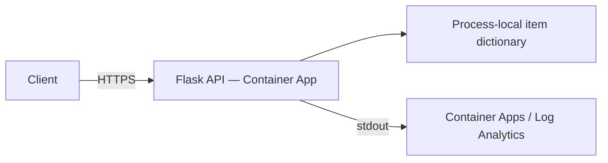

# API ساده Flask — برنامه‌های کانتینری Azure

**سطح:** مبتدی · **زمان:** ۳۰–۴۵ دقیقه شامل راه‌اندازی

یک API CRUD پایتون فلکس را با Azure Developer CLI (azd) مستقر کنید. سورس، Dockerfile،
Bicep، و پارامترهای استقرار شامل شده‌اند. این یک **نمونه آموزشی** است، نه
یک API آماده برای تولید.

## آنچه یاد خواهید گرفت

- ساخت و انتشار یک کانتینر از طریق azd.
- پیکربندی ورودی و پروب‌های لایو بودن/آمادگی.
- بررسی پاسخ‌های CRUD و مشاهده لاگ‌های برنامه.
- درک دلیل نامناسب بودن داده‌های درون حافظه برای برنامه‌های بادوام.



**مهم:** آیتم‌ها در یک فرایند نگهداری می‌شوند. تنظیم پیش‌فرض **یک کارگر Gunicorn،
۰–۱ نمونه** است، که عمداً از ناسازگاری داده روی کارگران/نمونه‌ها جلوگیری می‌کند.
آیتم‌ها هنگام راه‌اندازی مجدد، تغییر نسخه، یا مقیاس به صفر از دست می‌روند.
افزایش تعداد نمونه‌ها نیاز به ذخیره‌سازی پایدار مشترک دارد. این API تأیید هویت یا مجوز ندارد.

## پیش‌نیازها

- [نسخه پایدار فعلی azd](https://learn.microsoft.com/azure/developer/azure-developer-cli/install-azd)
  (نسخه منتشر شده در زمان بررسی: 1.37.2).
- [Azure CLI](https://learn.microsoft.com/cli/azure/install-azure-cli) برای تأیید صحت.
- داکر با دیمون فعال؛ برای ساخت تصویر محلی پیش‌فرض لازم است.
- اشتراک Azure، مجوزهای ایجاد منابع، و سهمیه منطقه‌ای برنامه‌های کانتینری.
- بش برای دستورهای زیر (یا معادل PowerShell).
- پایتون 3.11 برای توسعه محلی اختیاری.

```bash
azd version
az version
docker info
azd auth login
az login
```

ابزارهای CLI جلسات ورود جداگانه دارند. از همان اشتراک در هر دو استفاده کنید.

## شروع سریع

از ریشه مخزن:

```bash
cd examples/container-app/simple-flask-api
azd env new flask-demo
azd up
API_URL=$(azd env get-value API_ENDPOINT)
RG_NAME=$(azd env get-value AZURE_RESOURCE_GROUP)
API_NAME=$(azd env get-value API_NAME)
curl --fail-with-body "${API_URL}/health"
```

انتظار: HTTP 200 و JSON با `"status":"healthy"`،
`"service":"simple-flask-api"`، و یک زمان‌بندی UTC فعلی.
استقرار و ساخت تصویر معمولاً چند دقیقه طول می‌کشد؛ زمان‌بندی ممکن است متفاوت باشد.

استقرار اولیه از تصویر hello-world عمومی استفاده می‌کند که روی پورت ۸۰ گوش می‌دهد.
`azure.yaml` فایل پارامتر مطابقت‌دهنده `infra/app/api.bicep` را برای
استقرار سرویس انتخاب می‌کند که تصویر، ورودی و پروب‌ها را به پورت ۸۰۰۰ تغییر می‌دهد.
این پارامترهای استقرار را حذف نکنید.

## بررسی CRUD

به ترتیب دستورات زیر را اجرا کنید در حالی که همان نمونه فعال باقی است:

```bash
# Create: HTTP 201; note the returned id (1 for a fresh process).
curl -i -X POST "${API_URL}/api/items" \
  -H "Content-Type: application/json" \
  -d '{"name":"Test Item","description":"My first item"}'

# Read list: HTTP 200, total 1 in a fresh process.
curl --fail-with-body "${API_URL}/api/items"

# Replace 1 if your create response returned another id.
curl --fail-with-body "${API_URL}/api/items/1"
curl -i -X PUT "${API_URL}/api/items/1" \
  -H "Content-Type: application/json" -d '{"name":"Updated Item"}'
curl -i -X DELETE "${API_URL}/api/items/1"
curl -i "${API_URL}/api/items/1"
```

موفقیت: POST ۲۰۱، خواندن/PUT ۲۰۰، DELETE ۲۰۴ بدون بدنه، سپس آیتم مفقود ۴۰۴.
JSON ناقص/غیرشیء یا نام خالی بازگشت ۴۰۰ را دارند.
اگر آیتم بین درخواست‌ها ناپدید شد، راه‌اندازی مجدد یا مقیاس به صفر را بررسی کنید؛
این محدودیت عمدی درون حافظه است، نه حفظ داده.

| نقطه پایانی | متدها |
|---|---|
| `/` | GET — اطلاعات سرویس |
| `/health` | GET — لایو بودن/آمادگی |
| `/api/items` | GET, POST |
| `/api/items/{id}` | GET, PUT, DELETE |

## لاگ‌ها و پیکربندی

```bash
az containerapp logs show --name "$API_NAME" --resource-group "$RG_NAME" --follow
```

انتظار: راه‌اندازی Gunicorn، لاگ‌های دسترسی به درخواست، و پیام‌های برنامه.
`azd monitor --logs` دیدگاه درگاه را باز می‌کند؛ به ترمینال جریانی نمی‌فرستد.
Application Insights تخصیص یافته اما **توسط این کد Flask ابزاردهی نشده**؛
برای لاگ‌های stdout از Container Apps/Log Analytics استفاده کنید.

`infra/app/api.bicep` را برای CPU/حافظه، محدودیت نمونه‌ها یا قوانین مقیاس ویرایش کنید، سپس
`azd up` را اجرا کنید. مقادیر پیش‌فرض ۰.۵ vCPU، ۱ GiB، حداقل ۰ / حداکثر ۱ نمونه،
و آستانه HTTP پنجاه درخواست همزمان است. مقیاس به صفر می‌تواند تأخیر راه‌اندازی سرد اضافه کند.

مقادیر دلخواه `azd env set MAX_REPLICAS`، `API_KEY`، `LOG_LEVEL`، یا
مقدارهای `SCALE_TO_ZERO_TIMEOUT` **به این قالب یا برنامه متصل نیستند**.
تنظیم یک مقدار به‌طور خودکار آن را به یک متغیر محیطی زمان اجرا تبدیل نمی‌کند.
تصویر پورت ۸۰۰۰ را به‌صورت صریح متصل می‌کند؛ اگر پورت را تغییر می‌دهید Dockerfile، ورود بایسکپ و پروب‌ها را
همزمان به‌روزرسانی کنید.

## فایل‌ها

```text
azure.yaml
infra/main.bicep
infra/main.parameters.json
infra/app/container-apps.bicep       # Environment, registry, monitoring
infra/app/api.bicep                  # App, ingress, probes, scale settings
infra/app/api.parameters.json        # Image and resource values for azd deploy
src/app.py
src/Dockerfile
src/requirements.txt
```

## توسعه محلی

از این دایرکتوری نمونه:

```bash
python -m venv .venv
source .venv/bin/activate  # PowerShell: .\.venv\Scripts\Activate.ps1
python -m pip install -r src/requirements.txt
python src/app.py
```

در یک ترمینال دیگر، `http://localhost:8000/health` و نقاط پایانی CRUD را تست کنید.
یا تصویر واقعی را بسازید و اجرا کنید:

```bash
docker build -t flask-api:local ./src
docker run --rm -p 8000:8000 flask-api:local
```

برای تغییرات فقط کد پس از اولین استقرار، `azd deploy api` را اجرا کنید.
برای تغییرات بایسکپ، `azd up` را برای بازتامین و استقرار مجدد اجرا کنید.

## تمرین‌های عملی

### ۱. اعتبارسنجی رد ورودی

**نقطه شروع:** API مستقر شده، `API_URL` بالا.
**هدف:** تأیید اینکه API اشکال JSON نامعتبر و نام‌های گمشده را رد می‌کند.

```bash
curl -i -X POST "${API_URL}/api/items" \
  -H "Content-Type: application/json" -d '[]'
curl -i -X POST "${API_URL}/api/items" \
  -H "Content-Type: application/json" -d '{"name":""}'
```

**معیار موفقیت / راه‌حل:** هر دو با خطای ۴۰۰ و یک خطای JSON بازمی‌گردند، نه ۵۰۰.
**مشکل معمول:** حذف سرعنوان نوع محتوا JSON.

### ۲. افزودن یک نقطه پایانی نسخه فقط خواندنی

**نقطه شروع:** `src/app.py`. **هدف:** توسعه و استقرار مجدد API.
این را قبل از بلوک `if __name__ == '__main__':` اضافه کنید:

```python
@app.route('/version', methods=['GET'])
def version():
    return jsonify({'version': '1.0.0'})
```

`azd deploy api` را اجرا کنید، سپس `curl --fail-with-body "${API_URL}/version"`.
**معیار موفقیت:** HTTP ۲۰۰ و `{"version":"1.0.0"}`.
**مشکل رایج:** قرار دادن مسیر پس از فراخوانی مسدودکننده `app.run()` هنگام
آزمایش با `python src/app.py`.

### نقطه بررسی دانش

چرا یک کارگر برای داده‌های با دوام کافی نیست؟ زیرا حتی یک فرآیند نیز دیکشنری خود را هنگام راه‌اندازی مجدد از دست می‌دهد. یک نسخه تولیدی نیاز به ذخیره‌سازی مشترک پایدار،
احراز هویت، مجوزدهی، مهاجرت‌ها، آزمایش‌ها و نظارت عملیاتی دارد.


## هزینه‌ها و عیب‌یابی

این یک استقرار با هزینه‌ی تضمین‌شده $0 نیست: ثبت‌نام پایه و ذخیره‌سازی/ورود لاگ
حتی زمانی که محاسبات برنامه صفر است، ممکن است هزینه‌هایی داشته باشند. از ماشین حساب قیمت‌گذاری
[pricing calculator](https://azure.microsoft.com/pricing/calculator/) برای منطقه خود استفاده کنید.

- **شکست ساخت داکر:** تأیید `docker info`، دسترسی به شبکه، و وابستگی‌ها.
- **برنامه ناسالم:** لاگ‌های کنسول/سیستم را بررسی کنید و از تطابق پورت تصویر، ورود،
  و پروب‌ها اطمینان حاصل کنید. نباید یک نگهدارنده بر روی پورت Flask پروب شود.
- **خطای 403/مجوزها:** تأیید اشتراک و مجوزهای ایجاد منابع.
- **نایاب شدن آیتم‌ها:** حالت در حافظه هنگام راه‌اندازی مجدد/مقیاس به صفر بازنشانی می‌شود؛ یک پایگاه داده
  برای رفتار با دوام اضافه کنید.

## پاک‌سازی و مراحل بعدی

```bash
azd down
```

بازبینی اعلان حذف و تأیید حذف گروه منابع اختصاص‌یافته.
از پاک‌سازی مخرب در برابر گروه منابعی که داده‌های نامرتبط دارد استفاده نکنید.

[بعدی: برنامه پایگاه داده](../../../../../examples/database-app) · [ریزخدمات](../../../../../examples/container-app/microservices) ·
[مروری بر کانتینر](../README.md) · [خانه دوره](../../../README.md) ·
[گزارش یک مشکل](https://github.com/microsoft/AZD-for-beginners/issues)

---

<!-- CO-OP TRANSLATOR DISCLAIMER START -->
**سلب مسئولیت**:
این سند با استفاده از سرویس ترجمه هوش مصنوعی [Co-op Translator](https://github.com/Azure/co-op-translator) ترجمه شده است. در حالی که ما در تلاش برای دقت هستیم، لطفاً توجه داشته باشید که ترجمه‌های خودکار ممکن است شامل خطاها یا نادرستی‌هایی باشند. سند اصلی به زبان مادری خود باید به عنوان منبع معتبر در نظر گرفته شود. برای اطلاعات حیاتی، ترجمه حرفه‌ای انسانی توصیه می‌شود. ما در قبال هرگونه سوء تفاهم یا برداشت نادرست ناشی از استفاده از این ترجمه مسئولیتی نداریم.
<!-- CO-OP TRANSLATOR DISCLAIMER END -->