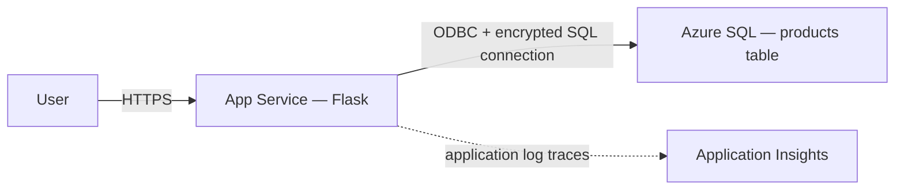

# فلاسک و Azure SQL روی App Service

**سطح:** متوسط · **زمان:** ۳۰–۶۰ دقیقه شامل پیش‌نیازها

این نمونه، یک API خواندنی پایتون فلاسک را به **Linux App Service** و یک پایگاه داده Azure SQL پایه مستقر می‌کند.
سورس، فایل Bicep، و پیکربندی azd شامل است. این یک برنامه یادگیری است، نه معماری پایگاه داده آماده برای تولید.


## آنچه خواهید آموخت

- تامین منابع App Service، SQL، و مانیتورینگ با Bicep.
- پیکربندی اتصال رمزنگاری شده SQL بدون ذخیره کردن مدارک کاربری.
- مقداردهی اولیه طرح (schema) قبل از شروع کارگرهای Gunicorn.
- بررسی داده‌های اضافه شده، پاسخ‌های یافت نشد، و سلامت پایگاه داده.



منابع: گروه منبع اختصاصی، برنامه خدمات لینوکس B1، برنامه وب پایتون 3.11،
اپ وب، سرور SQL و پایگاه داده Basic با حجم 2 گیگابایت، Application Insights و Log Analytics.
اپ وب از **استقرار منبع/ZIP و نصب وابستگی Oryx** استفاده می‌کند؛
`azd deploy` فایل Dockerfile اختیاری را نمی‌سازد یا مستقر نمی‌کند.

## پیش‌نیازها

- نسخه پایدار فعلی [azd](https://learn.microsoft.com/azure/developer/azure-developer-cli/install-azd)
  (نسخه منتشر شده در زمان بازبینی: 1.37.2).
- [Azure CLI](https://learn.microsoft.com/cli/azure/install-azure-cli) برای تأیید صحت.
- اشتراک Azure، دسترسی لازم برای ایجاد منابع فهرست شده، و سهمیه منطقه‌ای.
- پایتون **3.11** برای توسعه محلی؛ `pyodbc==5.0.1` متعهد شده ممکن است
  به ابزارهای بومی ساخت در نسخه‌های جدیدتر پایتون نیاز داشته باشد.
- درایور Microsoft ODBC نسخه 18 (یا 17) برای SQL Server روی ماشین‌های محلی. `pip install
  pyodbc` درایور سیستم را نصب نمی‌کند. ببینید
  [نصب ODBC](https://learn.microsoft.com/sql/connect/odbc/download-odbc-driver-for-sql-server).
- داکر فقط اگر کانتینر اختیاری را به صورت محلی آزمایش می‌کنید.

```bash
azd version
az version
azd auth login
az login
```

از همان اشتراک در هر دو ابزار استفاده کنید. دستورات زیر از Bash استفاده می‌کنند.

## استقرار

از ریشه مخزن:

```bash
cd examples/database-app
azd env new sql-demo
azd provision
azd deploy
WEB_URL=$(azd env get-value WEB_APP_URI)
WEB_NAME=$(azd env get-value WEB_APP_NAME)
RG_NAME=$(azd env get-value AZURE_RESOURCE_GROUP)
```

منطقه پشتیبانی شده را انتخاب کنید. `sqlAdminLogin` به صورت پیش‌فرض روی `sqladmin` تنظیم شده است؛
`sqlAdminPassword` یک پارامتر امن است. هنگام درخواست، یک رمز عبور قوی وارد کنید.
اعتبارنامه‌های استقرار را خارج از Git و گزارش‌های ایراد نگه دارید. در رشته اتصال فعلی،
عبارت‌گذاری رشته انتظار دارد رمز عبور بدون جداکننده‌های رشته اتصال مانند
`;` باشد؛ قبل از استفاده از چنین مقادیری، فرار دادن را تنظیم کنید.

Bicep فرمان راه‌اندازی را تنظیم می‌کند که `init_database()` **قبل از** Gunicorn اجرا می‌شود
کارگرها شروع می‌کنند. این لازم است زیرا وارد کردن `app:app` اجرای
بلاک `if __name__ == '__main__'` پایتون را انجام نمی‌دهد. در یک پایگاه داده تازه،
مقداردهی اولیه `products` را ایجاد می‌کند و پنج ردیف درج می‌کند. این یک بذر آموزشی ساده است، نه یک
چارچوب مهاجرت همزمان؛ قبل از افزایش نمونه‌ها از مهاجرت‌های مناسب استفاده کنید.

برنامه درایور Microsoft ODBC Driver 18 نصب‌شده را انتخاب می‌کند، سپس 17 را، اگر رشته اتصال
به طور صریح یک درایور را نام نبرد. اگر هیچ‌کدام وجود نداشته باشند، راه‌اندازی با
یک خطای اجرایی نصب شکست می‌خورد. در دسترس بودن درایور را در زمان اجرای
App Service انتخاب‌شده خود تأیید کنید به جای اینکه فرض کنید موجود است.

## تأیید کنید

```bash
curl --fail-with-body "${WEB_URL}/"
curl --fail-with-body "${WEB_URL}/health"
curl --fail-with-body "${WEB_URL}/products"
curl --fail-with-body "${WEB_URL}/products/1"
curl -i "${WEB_URL}/products/999"
```

مورد انتظار:

- `/` اطلاعات نقطه پایانی را بازمی‌گرداند.
- `/health` با `{"status":"healthy","database":"connected"}` پاسخ ۲۰۰ می‌دهد.
- `/products` پنج محصول پیش‌فرض را در پایگاه داده تازه بازمی‌گرداند.
- `/products/1` لپ‌تاپی با قیمت ۱۲۹۹.۹۹ بازمی‌گرداند.
- یک محصول موجود‌نبودنی، با `{"error":"Product not found"}` خطای ۴۰۴ می‌دهد.

این API فقط خواندنی است. هیچ مسیر POST/PUT/DELETE یا رابط کاربری مرورگر ندارد.
خطای اتصال به پایگاه داده از `/health` پاسخ ۵۰۳ می‌دهد؛ این موفقیت نیست.

## فایل‌ها و پیکربندی

```text
azure.yaml                         # Python App Service source deployment
infra/main.bicep
infra/main.parameters.json
infra/abbreviations.json
infra/resources/sql-server.bicep
infra/resources/sql-database.bicep
infra/resources/app-service-plan.bicep
infra/resources/web-app.bicep       # Settings + initialization/startup command
infra/resources/app-insights.bicep
src/web/app.py
src/web/requirements.txt
src/web/Dockerfile                 # Optional local container, not the azd target
.env.sample
```

`SQL_CONNECTION_STRING` به‌عنوان پارامتر امن Bicep به ماژول Web App ارسال می‌شود
و در تنظیمات App Service ذخیره می‌گردد، نه در خروجی‌های استقرار.
`APPLICATIONINSIGHTS_CONNECTION_STRING` صادرات لاگ را پیکربندی می‌کند.
`SCM_DO_BUILD_DURING_DEPLOYMENT=true` نصب وابستگی سمت سرور را فعال می‌کند.
تنظیم مقادیر دلخواه `azd env` به‌طور خودکار تنظیمات برنامه را تغییر نمی‌دهد.

قانون `0.0.0.0` فایروال SQL اجازه می‌دهد اتصالات از **سرویس‌های Azure،  
از جمله اشتراک‌های سایر مشتریان** برقرار شود، با شرط احراز هویت SQL. این قانون  
محدود به این برنامه یا اشتراک نیست. دسترسی شبکه عمومی SQL فعال است.  
قبل از محیط تولید، از شبکه‌بندی محدوده‌ای و هویت برنامه غیرادمین استفاده کنید.  

## توسعه محلی  

از Python 3.11 و درایور Microsoft SQL ODBC نصب‌شده استفاده کنید:  

```bash
python -m venv .venv
source .venv/bin/activate  # PowerShell: .\.venv\Scripts\Activate.ps1
python -m pip install -r src/web/requirements.txt
export SQL_CONNECTION_STRING='Server=tcp:YOUR_SERVER.database.windows.net,1433;Database=YOUR_DATABASE;UID=YOUR_USER;PWD=YOUR_PASSWORD;Encrypt=yes;TrustServerCertificate=no;Connection Timeout=30;'
python src/web/app.py
```
  
جای‌گزین‌ها را به‌صورت امن جایگزین کنید. یک فایل کپی‌شده `.env` به‌صورت **خودکار توسط این برنامه بارگذاری نمی‌شود**  
بلکه باید متغیرها را در پوسته فعلی خود صادر کنید.  
برای Azure SQL از لپ‌تاپ خود، فقط موقتا IP عمومی خود را مجاز کنید:  

```bash
SQL_SERVER=$(azd env get-value SQL_SERVER_NAME)
MY_IP=YOUR_PUBLIC_IP
az sql server firewall-rule create -g "$RG_NAME" -s "$SQL_SERVER" \
  -n AllowMyLearningIP --start-ip-address "$MY_IP" --end-ip-address "$MY_IP"
```
  
پس از تست، قانون را حذف کنید:  

```bash
az sql server firewall-rule delete -g "$RG_NAME" -s "$SQL_SERVER" -n AllowMyLearningIP
```
  
تست اختیاری کانتینر از این دایرکتوری نمونه:  

```bash
docker build -t sql-flask:local src/web
docker run --rm -p 8000:8000 -e SQL_CONNECTION_STRING sql-flask:local
```
  
این تصویر درایور ۱۸ را با استفاده از مخزن بسته Debian 12 که با  
پایه Bookworm آن مطابقت دارد نصب می‌کند، پایگاه داده را یکبار مقداردهی اولیه کرده، سپس Gunicorn را راه‌اندازی می‌کند.  

## پایش و عیب‌یابی  

هنگام تشخیص شروع به کار، لاگ‌های برنامه در سیستم فایل App Service را فعال/دنبال کنید:  

```bash
az webapp log config --name "$WEB_NAME" --resource-group "$RG_NAME" \
  --application-logging filesystem --level information
az webapp log tail --name "$WEB_NAME" --resource-group "$RG_NAME"
```
  
این کد **ردیابی‌های لاگ برنامه** را از طریق یک handler قدیمی OpenCensus صادر می‌کند.  
تنظیم خودکار ردیابی درخواست/وابستگی Flask، معیارهای زنده،  
حسابرسی SQL، تنظیمات تشخیصی یا هشدارها را پیکربندی نمی‌کند. این‌ها نیاز به تنظیمات جداگانه دارند.  
برای ابزار جدید، Azure Monitor OpenTelemetry را ترجیح دهید.  

در Application Insights Logs، پس از انجام درخواست‌های API:  

```kusto
traces
| where timestamp > ago(1h)
| where message contains "products" or message contains "Health check"
| project timestamp, message, severityLevel
```
  
تاخیر در دریافت را مجاز بدانید. فعالیت جدول درخواست یا معیارهای زنده معیار تکمیل نیست  
برای این ابزار فقط لاگ.  

- **درایور گمشده:** در زمان اجرا `pyodbc.drivers()` را بررسی کنید و درایور ODBC مایکروسافت پشتیبانی شده‌ای نصب کنید.
  صرفاً یک بسته پایتون کافی نیست.
- **خطای اتصال:** تنظیمات SQL، اطلاعات ورود، فایروال و اشتراک انتخاب شده را بررسی کنید.
  رمزگذاری را برای دور زدن خطا غیرفعال نکنید.
- **نبود جدول محصولات:** تأیید کنید دستور راه‌اندازی Bicep مستقر شده است؛
  اجرای تنها `gunicorn app:app` باعث رد کردن فرایند مقداردهی اولیه می‌شود.
- **خطای ساخت بسته:** از پایتون 3.11 استفاده کنید یا پیش‌نیازهای ساخت بومی را فراهم کنید.
- **داده قیمت صفر:** صفر یک قیمت اعشاری معتبر است؛ باید به صورت 0.0 سریال شود،
  نه `null`.

## تمرین‌های عملی

### تمرین 1: تأیید رفتار محصول گمشده

**نقطه شروع:** API مستقر شده و `WEB_URL` بالا.
**هدف:** تشخیص یک ردیف گمشده از پایگاه داده شکسته.
درخواست `/health` و `/products/999` را با فرمان‌های بالا ارسال کنید.
**معیار موفقیت / پاسخ:** سلامت 200، محصول وجود ندارد 404 (نه 500 یا 503).
**مشکل رایج:** فرض بر این است که پاسخ یافت نشد به معنای شکستن اتصال SQL است.

### تمرین 2: تغییر مقدار اولیه

**نقطه شروع:** ویرایشگر کوئری Azure SQL، متصل به پایگاه داده نمونه.
**هدف:** نشان دادن اینکه داده‌های API در SQL ذخیره شده‌اند نه در حافظه پردازش.

```sql
UPDATE products SET price = 0 WHERE id = 1;
SELECT id, name, price FROM products WHERE id = 1;
```

درخواست `${WEB_URL}/products/1`. **معیار موفقیت:** قیمت `0.0` است، نه `null`.
مقدار را بازگردانید:

```sql
UPDATE products SET price = 1299.99 WHERE id = 1;
```

**مشکل رایج:** ویرایش فهرست اولیه پایتون باعث به‌روزرسانی ردیف‌های موجود در SQL نمی‌شود.
تمرین‌های طرح‌واره/داده را روی پایگاه داده تولید اجرا نکنید.

### تمرین ۳: افزودن نقطه پایان فقط خواندنی شمارش

**نقطه شروع:** `src/web/app.py`.
**هدف:** گسترش API با استفاده از یک پرس‌وجوی تجمیعی بدون پارامتر.
این را قبل از بلوک `if __name__ == '__main__':` اضافه کنید:

```python
@app.route('/product-count')
def product_count():
    from contextlib import closing
    with closing(get_db_connection()) as conn, closing(conn.cursor()) as cursor:
        cursor.execute("SELECT COUNT(*) FROM products")
        return jsonify({'count': cursor.fetchone()[0]})
```

`azd deploy web` را اجرا کنید، سپس درخواست `${WEB_URL}/product-count` را ارسال کنید.
**معیار موفقیت:** ۲۰۰ با `{"count":5}` روی پایگاه داده اولیه‌سازی نشده.
**مشکل رایج:** تغییر مسیر اما فراموش کردن استقرار مجدد.
برای تولید، افزودن مدیریت خطا/آزمایش‌ها لازم است؛ این تمرین کوتاه روی پرس‌وجو تمرکز دارد.

## هزینه‌ها، شکاف‌های تولید و پاک‌سازی

سرویس اپ B1 و پایگاه داده Basic در حالی که تامین شده‌اند هزینه دارند. توقف
برنامه وب هزینه برنامه سرویس اپ را **توقف نمی‌کند**. لاگ‌ها و ذخیره‌سازی می‌توانند هزینه‌ساز باشند.
از [ماشین حساب قیمت‌گذاری آزور](https://azure.microsoft.com/pricing/calculator/)
برای قیمت‌گذاری منطقه‌ای جاری استفاده کنید. تغییر به F1 نیاز به غیرفعال کردن `alwaysOn` دارد؛
این یک جایگزین یک خطی نیست. SQL بدون سرور به طور خودکار رایگان نیست.

کار تولید شامل هویت برنامه کمترین امتیاز (نه مدیر SQL)،
احراز هویت/مجوز، شبکه خصوصی، مهاجرت‌های ایمن، بررسی چرخه عمر/پولینگ اتصال،
تله‌متری، حسابرسی، هشدارها، آزمایش‌ها و رویه‌های بازیابی است.
کش Redis و جدول‌های اضافی ایده‌های توسعه هستند، تمرین‌های اجراشده نیستند.

از این دایرکتوری نمونه:

```bash
azd down
```

درخواست حذف را مرور کرده و اطمینان حاصل کنید که گروه منبع اختصاصی حذف شده است.
گروه‌هایی که داده‌های نامرتبط دارند را حذف نکنید.

[نمونه‌های کانتینر](../../../../examples/container-app) ·
[توسعه هوش مصنوعی](../../docs/chapter-02-ai-development/README.md) ·
[خانه دوره](../../README.md) · [گزارش مشکل](https://github.com/microsoft/AZD-for-beginners/issues)

---

<!-- CO-OP TRANSLATOR DISCLAIMER START -->
**سلب مسئولیت**:
این سند با استفاده از سرویس ترجمه هوش مصنوعی [Co-op Translator](https://github.com/Azure/co-op-translator) ترجمه شده است. در حالی که ما در تلاش برای دقت هستیم، لطفاً توجه داشته باشید که ترجمه‌های خودکار ممکن است شامل خطاها یا نادرستی‌هایی باشند. سند اصلی به زبان مادری خود باید به عنوان منبع معتبر در نظر گرفته شود. برای اطلاعات حیاتی، ترجمه حرفه‌ای انسانی توصیه می‌شود. ما در قبال هرگونه سوء تفاهم یا برداشت نادرست ناشی از استفاده از این ترجمه مسئولیتی نداریم.
<!-- CO-OP TRANSLATOR DISCLAIMER END -->