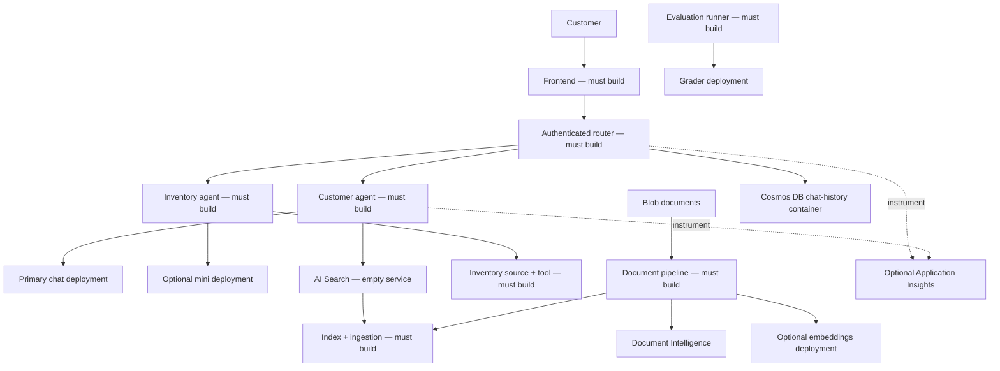

# پشتیبانی چندعاملی مشتری — نقشه راه معماری فروشگاهی

**فصل ۵: راه‌حل‌های هوش مصنوعی چندعاملی**

- [صفحه اصلی دوره](../README.md)
- [فصل ۵](../docs/chapter-05-multi-agent/README.md)
- [پیش‌نیاز: ادغام هوش مصنوعی](../docs/chapter-02-ai-development/microsoft-foundry-integration.md)
- [بعدی: برنامه‌ریزی ظرفیت](../docs/chapter-06-pre-deployment/capacity-planning.md)
- [چارچوب زیرساخت ARM](retail-multiagent-arm-template/README.md)

> **راهنمای معماری، نه یک برنامه کاری.** تنها فایل‌های پیاده‌سازی فروشگاهی
> فایل‌های `azuredeploy.json`، `azuredeploy.parameters.json` و `deploy.sh` در
> `retail-multiagent-arm-template/` هستند. کانتینرهای روتر/فرانت‌اند فقط
> مکان‌نگهدارهای hello-world هستند. هیچ عامل فروشگاهی، رابط کاربری، خط لوله جمع‌آوری داده،
> ارزیاب، اسکنر یا مجموعه تست برنامه به‌صورت محلی وجود ندارد.

## مرور کلی

**هدف:** طراحی یک سیستم پشتیبانی مشتری با یک عامل مشتری و عامل موجودی،
مشخص کردن آنچه زیرساخت فراهم می‌کند و برنامه‌ریزی قراردادهای برنامه‌ای
و ارزیابی‌های مفقود شده.

**مخاطبان:** توسعه‌دهندگانی که دوره محلی را تکمیل کرده‌اند
[نمونه چت](../../../examples/azure-openai-chat) و [نمونه کانتینر دو سرویسی](../../../examples/container-app/microservices).
اجازه دهید ۲–۳ ساعت برای مطالعه معماری وقت بگذارید. ساخت برنامه یک پروژه جداگانه است:
۸۰–۱۲۰ ساعت توسعه تخمینی برنامه‌ریزی تشریحی برای توسعه‌دهندگان باتجربه است، **نه یک وعده تحویل**؛ سخت‌افزاری سازی تولید، تست‌ها،
بررسی امنیت و عملیات نیازمند کار اضافی است.


- تمایز شناسه‌های مدل، نام‌های استقرار، نسخه‌های API، و نسخه‌های ARM.
- طراحی ورود و بازیابی اسناد با ابعاد برداری مطابقت داده شده.
- تعریف الزامات عملکردی قابل تایید، ارزیابی، و بازیابی خطا.
- جدا کردن اهداف معماری اختیاری از منابع واقعا تامین شده.




این یک **معماری برنامه هدف** است، نه نموداری از سرویس‌های عامل در حال اجرا.
اسکافولد ARM فقط خدمات زیرساختی و دو کانتینر نگه‌دارنده را ایجاد می‌کند.
Front Door، رجیستری، هویت‌های مدیریت شده، تخصیص نقش‌ها،
نقاط پایانی خصوصی، بازیابی خودکار، ابزارهای برنامه‌نویسی و هشدارها شامل نمی‌شوند.

### مسئولیت‌ها و قراردادها

| مولفه | رفتار مورد نیاز | شواهد پیش از اعلام اتمام |
|---|---|---|
| رابط کاربری | احراز هویت کاربران، نمایش چت، بارگذاری امن اسناد | تست‌های UI و بارگذاری، خطاهای قابل دسترسی |
| مسیردهنده | مجوزدهی درخواست‌ها، انتخاب عامل، محدودیت تماس/تایم‌اوت ابزارها | تست‌های مسیردهی، بررسی‌های مجوز، تست‌های خطا |
| عامل مشتری | پاسخ‌های سیاست/محصول را مبتنی بر منابع تایید شده نگه دارد | استنادات صحیح، خودداری هنگام نبود داده |
| ابزار موجودی | خواندن موجودی معتبر با مجوزهای محدود شده | تست‌های موجودی قطعی؛ بدون دستکاری دسترسی |
| خط‌لوله اسناد | استخراج، تقسیم بخش‌ها، جاسازی، فهرست‌بندی، به‌روزرسانی/حذف | وسایل فهرست‌بندی شده و رفتار تلاش مجدد/مرگ‌نامه |
| ذخیره‌سازی مکالمه | جداسازی کاربران، اجرای نگهداری داده‌ها | تست‌های مجوز متقابل کاربران و مدت زمان نگهداری |
| اجراکننده ارزیابی | مقایسه خروجی‌ها با حقیقت زمینه و معیار | پوشش، شمارش خطاها، گزارش‌های قابل بازتولید |

مسیردهنده را مانند یک میز پذیرش و ابزارها را مانند سیستم‌های داخلی محدود در نظر بگیرید:
انتخاب یک متخصص مجوز دسترسی به همه سوابق مشتری نیست.
هویت و مجوزها را در کد برنامه و خدمات داده اعمال کنید، نه در پرامپت‌ها.

## زیرساخت در مقابل برنامه

قبل از تامین، [README اسکافولد](retail-multiagent-arm-template/README.md) را بخوانید.
در آن منابع دقیق، حالت‌ها، هزینه‌ها و محدودیت‌ها ذکر شده است.

| کاربرد منطقی | نام استقرار ARM | مدل / نسخه | منطقه پیش‌فرض |
|---|---|---|---|
| چت مشتری | `gpt-4.1-chat` | `gpt-4.1` / `2025-04-14` | `eastus2` |
| موجودی | `gpt-4.1-mini-inventory` | `gpt-4.1-mini` / `2025-04-14` | `westus2`، اختیاری |
| جاسازی‌ها | `text-embedding-ada-002` | `text-embedding-ada-002` / `2` | `francecentral`، اختیاری |
| ارزیابی | `gpt-4.1-grader` | `gpt-4.1` / `2025-04-14` | به طور پیش‌فرض منطقه اصلی |

بررسی دسترسی و سهمیه مدل/نسخه/SKU در **هر منطقه**. چت/مینی/ارزیاب
از `GlobalStandard` استفاده می‌کند؛ تعبیه‌ها از `Standard` استفاده می‌کنند. تخصیص واحد ظرفیت به TPM
وابسته به مدل است. واحدهای ظرفیت متفاوت را به عنوان تضمین سهمیه جهانی اضافه نکنید.

آرگومان `model` در درخواست Azure OpenAI، **نام استقرار** است، نه 
لزوماً شناسه مدل کاتالوگ. نسخه API داده‌پلان `2024-10-21` 
با نسخه مدل `2025-04-14` و منبع ARM `apiVersion` متفاوت است.
نمی‌توان مدل غیرقابل دسترس را فقط با تغییر نسخه API داده‌پلان رفع کرد.

`--no-multi-region` حساب‌های ثانویه و تعبیه‌ها را رد می‌کند. یک حساب چت اولیه و
ارزیاب مستقل باقی می‌ماند. حساب‌های مدل جداگانه، failover خودکار فراهم نمی‌کنند؛
این نیازمند مسیریابی برنامه، استقرارهای سازگار، بررسی سلامت،
محدودیت‌های تلاش مجدد، و بازبینی محل داده‌ها است.

## نقشه راه پیاده‌سازی

### 1. با یک تعامل آزمایش شده شروع کنید

قبل از فراهم کردن ساختار بزرگ، از نمونه چت محلی برای برقراری
اتصال استنتاج استفاده کنید. یک سوال نماینده مشتری، منبع پاسخ تأیید شده،
استناد مورد انتظار، و رفتار شکست زمانی که آن منبع موجود نیست را تعریف کنید.

### 2. مرزهای مسیریابی و ابزار را تعریف کنید

منبع مسیریاب خود، مانیفست وابستگی، Dockerfile و تست‌ها را ایجاد کنید. یک
قرارداد تصویری می‌تواند `POST /chat` با `{"message":"...","conversation_id":"..."}` باشد.
**آن نقطه‌ی انتهایی یک پیشنهاد طراحی است؛ توسط قالب ARM پیاده‌سازی نشده است.**

اعتبارسنجی نوع/محدودیت‌های بدنه، استخراج هویت کاربر از احراز هویت، اعمال مالکیت مکالمه، 
اعمال تایم‌اوت درخواست‌ها و بازگرداندن کدهای خطای معنادار.
شکست‌های HTTP یا پاسخ‌های خالی را به عنوان نتایج موفق عامل در نظر نگیرید.

### ۳. پیاده‌سازی پایه‌گذاری و دریافت داده

قالب ARM ایندکس جستجو ایجاد نمی‌کند. این یک **بخش JSON مرجع برای سازگار کردن در تعریف ایندکس خودتان است**،  
نه یک فایل که قبلاً در مخزن وجود داشته باشد:

```json
{
  "name": "retail-product-index",
  "fields": [
    {"name": "id", "type": "Edm.String", "key": true},
    {"name": "title", "type": "Edm.String", "searchable": true},
    {"name": "content", "type": "Edm.String", "searchable": true},
    {"name": "category", "type": "Edm.String", "filterable": true},
    {
      "name": "content_vector",
      "type": "Collection(Edm.Single)",
      "searchable": true,
      "dimensions": 1536,
      "vectorSearchProfile": "retail-profile"
    }
  ],
  "vectorSearch": {
    "algorithms": [{"name": "retail-hnsw", "kind": "hnsw"}],
    "profiles": [{"name": "retail-profile", "algorithm": "retail-hnsw"}]
  }
}
```

پروفایل، فیلد برداری را به الگوریتم آن مرتبط می‌کند. ابعاد باید با هم مطابقت داشته باشند
خروجی واقعی تعبیه (۱۵۳۶ برای این `ada-002` استقرار). برای بازیابی در پایتون،
از `azure.search.documents.models.VectorizedQuery` به جای یک
دیکشنری ناقص که نوع پرس‌وجوی برداری آن را ندارد، استفاده کنید:

```python
# Reference function only: supply an authenticated async SearchClient and an embedding.
from azure.search.documents.models import VectorizedQuery

async def retrieve(search_client, embedding):
    results = await search_client.search(
        search_text=None,
        vector_queries=[VectorizedQuery(
            vector=embedding,
            k_nearest_neighbors=5,
            fields="content_vector"
        )],
        select=["id", "title", "content"]
    )
    return [document async for document in results]
```

یک پیاده‌سازی جداسازی ingest ایجاد کنید که:

1. دسترسی به آپلود را مجاز می‌کند و نوع و اندازه محتوا را اعتبارسنجی می‌کند.
2. بلوک‌های خصوصی را با استفاده از فراخوانی‌های SDK احراز هویت شده می‌خواند. یک URL بلوک خصوصی به خودی خود
   ورودی قابل خواندن Document Intelligence **نیست**؛ بایت‌های دانلود شده را با
   `AnalyzeDocumentRequest(bytes_source=...)` ارسال کنید یا پس از بررسی نیازهای دسترسی،
   از SAS با دسترسی محدود و مدت زمان کوتاه استفاده کنید.
3. متن را استخراج می‌کند، آن را به قطعاتی متناسب با محدودیت‌های جاسازی تقسیم می‌کند و جاسازی‌ها را تولید می‌کند.
4. کلیدهای مستند معتبر و پایدار ایجاد می‌کند و قطعات را همراه با وکتورهای مرتبط آپلود می‌کند.
5. نتایج نمایه‌سازی هر سند را بررسی می‌کند، مجدداً تلاش‌ها را مدیریت می‌کند، و داده‌های قدیمی را به‌روزرسانی/حذف می‌کند.

کلیدها/مقادیر دلخواه کاربر را در فیلترهای OData وارد نکنید. فیلدها را در فهرست مجاز قرار دهید،
نوع مقادیر را اعتبارسنجی کنید و نقل‌قول‌های رشته‌ای را فرار دهید. فیلترهای بولی و عددی نیاز به 
عباراتی با نوع مشخص دارند، نه رشته‌های نقل‌قول‌دار.

### ۴. پیاده‌سازی وب

**جستجوگر Bing نسخه 7 در ۱۱ اوت ۲۰۲۵ بازنشسته شد.** منبع قدیمی `Microsoft.Bing/accounts`
و نمونه‌های `api.bing.microsoft.com/v7.0/search` مسیر پیاده‌سازی پشتیبانی‌شده نیستند.
یک ادغام پیاده‌سازی فعلی پشتیبانی‌شده را در Microsoft Foundry و کیت توسعه آن، مجوز‌ها، صورتحساب و الزامات استناد ارزیابی کنید؛
هیچ‌کدام در اینجا پیاده‌سازی نشده‌اند. این یک جایگزین قطعی برای نقطه پایانی بازنشسته شده نیست.


### ۵. افزودن تله‌متری و ارزیابی

ایجاد Application Insights کد را ابزار نمی‌کند. هنگام ساخت یک برنامه جدید، از ابزار Azure Monitor OpenTelemetry پشتیبانی‌شده استفاده کنید،
زمینه ردیابی را بین سرویس‌ها منتقل کنید و از ثبت درخواست‌های مشتری، اسناد یا اسرار خودداری کنید.

کوتاه کردن یک پرس‌وجو **آن را ناشناس نمی‌کند**.

مدت زمان درخواست، خطاهای مسیر‌یابی/ابزار، مرتبط بودن بازیابی، صحت ارجاع، مصرف توکن و اجتناب را اندازه‌گیری کنید.
حقایق موجودی/سیاست زمین حقیقت را در کنار موارد ارزیابی ذخیره کنید: یک ارزیاب نمی‌تواند دقت واقعی را
فقط از یک سؤال و پاسخ به‌طور قابل اعتماد تشخیص دهد.


یک استقرار ارزیاب، یک اجراکننده ارزیابی نیست. یک دستورالعمل نسخه‌بندی شده، خروجی ساختاری/اعتبارسنجی طرح،
بررسی محدوده امتیاز، شمارش شکست‌های انتقال و موارد بررسی شده توسط انسان را پیاده‌سازی کنید.
موارد ناقص/خطا را جداگانه گزارش کنید؛ آن‌ها را به نمرات موفق تبدیل نکنید یا به‌طور خاموش به‌عنوان پاسخ‌های مدل با کیفیت صفر درج نکنید.


استراتژی آزمایش گم‌شده یا پاسخ خالی باید آزمون را **نامشخص یا ناموفق** کند، نه اینکه امتیاز «۱۰۰٪ ایمن» بدهد.
آزمایش مجاز را با ابزارهای مناسب و بازبینی انسانی قبل از هر ادعای آمادگی تولید انجام دهید.


جایگذین‌ها را با تصاویر ساخته‌شده جایگزین کرده و ingress/probes را مطابق با پورت شنود هر برنامه به‌روزرسانی کنید.

متغیرهای محیط زمان اجرا را در Bicep یا نقشه‌برداری محیطی azd پشتیبانی‌شده بصورت صریح پیکربندی کنید.


هیچ دیکشنری عمومی `config` تحت یک سرویس azd وجود ندارد که به طور خودکار
متغیرهای محیط اجرای زمان اجرا را ایجاد کند. `azd env set` فقط منابعی را تغییر می‌دهد که
به طور صریح آن مقادیر را مصرف می‌کنند. هیچ ساز و کار کناری، فهرست مناطق یا هوک تنظیم دقیق در این ساختار پیاده‌سازی نشده است.


## تمرین‌های عملی طراحی

این‌ها **تمرین‌های معماری** هستند، نه ادعاهایی درباره کد اجرایی اولیه برای فروشگاه.

### تمرین ۱: بررسی مرز

**نقطه شروع:** سه فایل در `retail-multiagent-arm-template/`.
**هدف:** تفکیک تأمین منابع از عملکرد برنامه.
فایل `azuredeploy.json` را باز کنید، هر دو تصویر کانتینر و مقادیر `targetPort` را پیدا کنید،
سپس اجزای برنامه‌ای که در مخزن گم شده‌اند را فهرست کنید.

**معیارهای موفقیت / پاسخ:** هر دو تصویر نگهدارنده hello-world هستند که به
پورت ۸۰ گوش می‌دهند؛ عوامل، رابط کاربری گفتگو، هندلرهای روتر، شاخص/ورودی، ارزیاب و اسکنر
وجود ندارند. یک درخواست ریشه نگهدارنده موفق `/chat` را تایید نمی‌کند.
**مشکل رایج:** تفسیر نام‌های منابع مانند `retail-router` به‌عنوان کد عملیاتی.

### تمرین ۲: پیگیری پیکربندی وکتور

**نقطه شروع:** JSON شاخص بالا.
**هدف:** فهم رابطه فیلد → پروفایل → الگوریتم.
مشخص کنید کدام مقادیر باید هنگام تغییر به یک مدل جاسازی با
بُعد خروجی متفاوت تغییر کنند، سپس تابع `retrieve` را بررسی کنید.

**معیارهای موفقیت / پاسخ:** فیلد `dimensions` را به طول واقعی وکتور تغییر دهید؛
`vectorSearchProfile` را با پروفایل اعلام‌شده و الگوریتم مربوطه هماهنگ نگه دارید؛
query `fields` باید نام فیلد وکتور را بگیرد. هنگام تغییر مدل جاسازی، وکتورهای سند موجود
را بازتولید کنید.
**مشکل رایج:** تنها تغییر نام مدل در حالی که وکتورهای ناسازگار حفظ می‌شوند.

### تمرین ۳: تعریف یک تست شکست

**نقطه شروع:** جدول مسئولیت‌ها.
**هدف:** جلوگیری از موفقیت کاذب.
رفتار مورد انتظار برای یک API موجودی در دسترس‌نبودنی، شاخص جستجو بدون
اسناد مطابق، و درخواست ارزیابی با بازگشت HTTP ۵۰۳ را بنویسید.

**معیارهای موفقیت / پاسخ:** بدون مقادیر موجودی ساختگی؛ امتناع صریح یا
تشدید هنگام فقدان زمینه؛ گزارش ارزیابی یک شکست ترابری را به جای
گذر کیفیت یا امنیت می‌دهد. هنگام ساخت برنامه، تست قابل اجرا اضافه کنید.
**مشکل رایج:** گرفتن همه استثناها و ادامه با پاسخی خالی.

## هزینه‌ها، عیب‌یابی، و پاک‌سازی

- زیرساخت هزینه‌های جاری حتی با شاخص‌های جستجوی خالی و برنامه‌های نگهدارنده دارد.
  از قیمت‌های منطقه‌ای فعلی استفاده کنید؛ «حداقل» یا چندمنطقه‌ای به معنای رایگان نیست.
- هزینه‌های توکن به مدل، ورودی کش‌شده/کش‌نشده، خروجی، و SKU استقرار بستگی دارد.
  مسیردهی فقط زمانی می‌تواند صرفه‌جویی کند که بار اندازه‌گیری‌شده و نتایج کیفیت توجیه کنند؛
  صرفه‌جویی ثابت ۶۰–۸۰٪ تضمین‌شده نیست.
- قبل از تهیه، در دسترس بودن مدل و سهمیه را بررسی کنید؛ اشتباهات مجوز،
  نام استقرار، منطقه، نسخه مدل، و نسخه API را تمایز دهید.
- اجرای `setup-data.sh`، CLIهای ارزیاب، یا دستورات `pytest tests/` حذف‌شده را نداشته باشید.
  پیاده‌سازی‌های آن‌ها بخشی از کارهای عقب‌افتاده توسعه شما است.
- اسکافولد فقط مختص ARM است: دستورالعمل‌های
  [تأیید و پاک‌سازی](retail-multiagent-arm-template/README.md) آن را دنبال کنید.
  `azd down` آن منابع را مدیریت نمی‌کند.

## منابع مرتبط

- [نمونه محاوره محلی عملی](../../../examples/azure-openai-chat)
- [نمونه کانتینر دو سرویس عملی](../../../examples/container-app/microservices)
- [شاخص‌های وکتور جستجوی هوش مصنوعی](https://learn.microsoft.com/azure/search/vector-search-how-to-create-index)
- [مستندات برنامه‌های کانتینری](https://learn.microsoft.com/azure/container-apps/)
- [عیب‌یابی](../docs/chapter-07-troubleshooting/common-issues.md)
- [گزارش مشکل](https://github.com/microsoft/AZD-for-beginners/issues)

---

<!-- CO-OP TRANSLATOR DISCLAIMER START -->
**سلب مسئولیت**:
این سند با استفاده از سرویس ترجمه هوش مصنوعی [Co-op Translator](https://github.com/Azure/co-op-translator) ترجمه شده است. در حالی که ما در تلاش برای دقت هستیم، لطفاً توجه داشته باشید که ترجمه‌های خودکار ممکن است شامل خطاها یا نادرستی‌هایی باشند. سند اصلی به زبان مادری خود باید به عنوان منبع معتبر در نظر گرفته شود. برای اطلاعات حیاتی، ترجمه حرفه‌ای انسانی توصیه می‌شود. ما در قبال هرگونه سوء تفاهم یا برداشت نادرست ناشی از استفاده از این ترجمه مسئولیتی نداریم.
<!-- CO-OP TRANSLATOR DISCLAIMER END -->