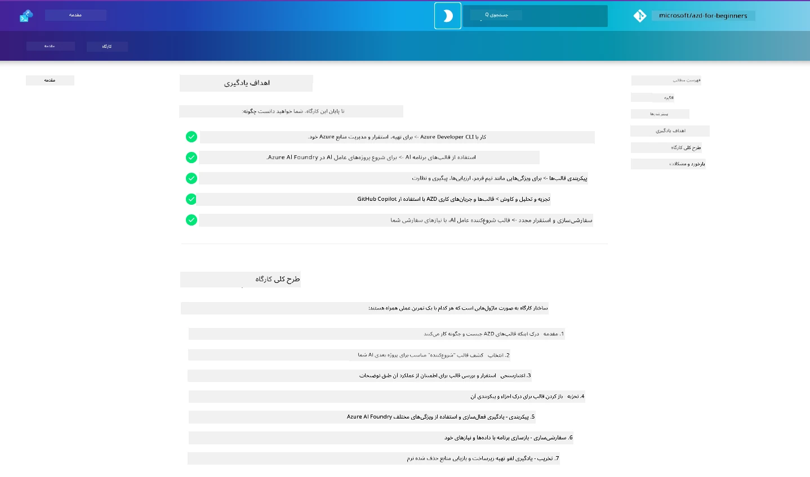

<div align="center">
  <div style="background: linear-gradient(135deg, #0078d4, #106ebe); border-radius: 10px; padding: 20px; margin: 20px 0; box-shadow: 0 4px 15px rgba(0, 120, 212, 0.3); border: 2px solid #005a9e;">
    <h2 style="color: white; margin: 0; font-size: 24px; text-shadow: 1px 1px 2px rgba(0,0,0,0.3);">
      🎯 کارگاه AZD برای توسعه‌دهندگان هوش مصنوعی
    </h2>
    <p style="color: white; margin: 10px 0 0 0; font-size: 16px; text-shadow: 1px 1px 2px rgba(0,0,0,0.3);">
      <strong>کارگاه عملی برای ساخت برنامه‌های هوش مصنوعی با استفاده از Azure Developer CLI.</strong><br>
      هفت ماژول را کامل کنید تا در قالب‌های AZD و جریان‌های کاری استقرار هوش مصنوعی مهارت پیدا کنید.
    </p>
    <div style="margin-top: 15px;">
      <span style="background: rgba(255,255,255,0.2); padding: 5px 10px; border-radius: 15px; color: white; font-size: 14px;">
        📅 راهنمای منبع بازبینی شده: نوامبر 2026
      </span>
    </div>
  </div>
</div>

# کارگاه AZD برای توسعه‌دهندگان هوش مصنوعی

به کارگاه عملی یادگیری Azure Developer CLI (AZD) خوش آمدید که تمرکز آن بر استقرار برنامه‌های هوش مصنوعی است. این کارگاه به شما کمک می‌کند در ۳ مرحله، درک کاربردی از قالب‌های AZD کسب کنید:

1. **کشف** - قالب مناسب خود را پیدا کنید.
1. **استقرار** - استقرار دهید و اعتبارسنجی کنید که کار می‌کند
1. **شخصی‌سازی** - تغییر دهید و تکرار کنید تا متعلق به خودتان شود!

در طول این کارگاه، با ابزارها و جریان‌های کاری اصلی توسعه‌دهندگان نیز آشنا می‌شوید تا به شما در ساده‌سازی مسیر توسعه از ابتدا تا انتها کمک کند.

<br/>

## راهنمای مبتنی بر مرورگر

درس‌های کارگاه به صورت مارک‌داون هستند. شما می‌توانید مستقیماً در GitHub آنها را مرور کنید یا پیش‌نمایش مبتنی بر مرورگری را همانطور که در تصویر زیر نشان داده شده، راه‌اندازی کنید.



برای استفاده از این گزینه - مخزن را به پروفایل خود فورک کنید و GitHub Codespaces را راه‌اندازی کنید. پس از فعال شدن ترمینال VS Code، این فرمان را وارد کنید:

این پیش‌نمایش مرورگر در GitHub Codespaces، کانتینرهای توسعه یا نسخه محلی با Python و MkDocs نصب شده کار می‌کند.

```bash title="" linenums="0"
python -m pip install -r requirements-dev.txt
python -m mkdocs serve --config-file workshop/mkdocs.yml
```

این دستورات را از **ریشه مخزن دوره** اجرا کنید، نه نمونه AI که جداگانه مقداردهی اولیه شده است. پیش‌نمایش را در پیش‌زمینه نگه دارید تا خطاها قابل مشاهده باشند؛ با Ctrl+C آن را متوقف کنید. برای بررسی سایت بدون سرو کردن آن، فرمان `python -m mkdocs build --strict --config-file workshop/mkdocs.yml` را اجرا کنید.

در عرض چند ثانیه، یک دیالوگ پاپ‌آپ ظاهر می‌شود. گزینه `Open in browser` را انتخاب کنید. راهنمای مبتنی بر وب اکنون در تب جدید مرورگر باز می‌شود. برخی مزایای این پیش‌نمایش:

1. **جستجوی داخلی** - به سرعت کلیدواژه‌ها یا درس‌ها را پیدا کنید.
1. **آیکون کپی** - با قرار دادن ماوس روی بلوک‌های کد این گزینه را ببینید
1. **تغییر تم** - تغییر بین تم‌های تاریک و روشن
1. **دریافت کمک** - روی آیکون دیسکورد در فوتر کلیک کنید و بپیوندید!

<br/>

## مرور کلی کارگاه

**مدت:** ۳-۴ ساعت  
**سطح:** مبتدی تا متوسط  
**پیش‌نیازها:** آشنایی با Azure، مفاهیم هوش مصنوعی، VS Code و ابزارهای خط فرمان.

این یک کارگاه عملی است که در آن از طریق انجام دادن یاد می‌گیرید. پس از کامل کردن تمرین‌ها، توصیه می‌کنیم برای ادامه یادگیری، برنامه درسی AZD For Beginners را مرور کنید و درباره بهترین شیوه‌های امنیت و بهره‌وری بیشتر بدانید.

| زمان | ماژول  | هدف |
|:---|:---|:---|
| ۱۵ دقیقه | [معرفی](docs/instructions/0-Introduction.md) | صحنه را آماده کنید، اهداف را درک کنید |
| ۳۰ دقیقه | [انتخاب قالب هوش مصنوعی](docs/instructions/1-Select-AI-Template.md) | گزینه‌ها را بررسی کرده و شروع‌کننده را انتخاب کنید | 
| ۳۰ دقیقه | [اعتبارسنجی قالب هوش مصنوعی](docs/instructions/2-Validate-AI-Template.md) | استقرار راه‌حل پیش‌فرض در Azure |
| ۳۰ دقیقه | [تفکیک قالب هوش مصنوعی](docs/instructions/3-Deconstruct-AI-Template.md) | ساختار و پیکربندی را بررسی کنید |
| ۳۰ دقیقه | [پیکربندی قالب هوش مصنوعی](docs/instructions/4-Configure-AI-Template.md) | فعال‌سازی و آزمایش امکانات موجود |
| ۳۰ دقیقه | [شخصی‌سازی قالب هوش مصنوعی](docs/instructions/5-Customize-AI-Template.md) | قالب را با نیازهای خود تطبیق دهید |
| ۳۰ دقیقه | [تخریب زیرساخت](docs/instructions/6-Teardown-Infrastructure.md) | پاک‌سازی و آزادسازی منابع |
| ۱۵ دقیقه | [جمع‌بندی و گام‌های بعدی](docs/instructions/7-Wrap-up.md) | منابع یادگیری، چالش کارگاه |

<br/>

## آنچه یاد می‌گیرید

قالب AZD را به عنوان یک محیط یادگیری برای بررسی قابلیت‌ها و ابزارهای مختلف برای توسعه پایانی به پایانی روی Microsoft Foundry تصور کنید. در پایان این کارگاه، شما باید حس شهودی نسبت به ابزارها و مفاهیم مختلف در این زمینه داشته باشید.

| مفهوم  | هدف |
|:---|:---|
| **Azure Developer CLI** | درک دستورات و جریان‌های کاری ابزار |
| **قالب‌های AZD**| درک ساختار پروژه و پیکربندی |
| **عامل AI Azure**| تامین و استقرار پروژه Microsoft Foundry |
| **جستجوی AI Azure**| فعال‌سازی مهندسی زمینه با عوامل |
| **نظارت‌پذیری**| بررسی ردیابی، مانیتورینگ و ارزیابی‌ها |
| **تیم قرمز**| بررسی تست‌های خصمانه و تدابیر مقابله‌ای |

<br/>

## ساختار کارگاه

کارگاه به گونه‌ای ساختاربندی شده است که شما را از کشف قالب، به استقرار، تفکیک و شخصی‌سازی می‌برد - با استفاده از قالب شروع رسمی [شروع به کار با عوامل AI](https://github.com/Azure-Samples/get-started-with-ai-agents) به عنوان پایه.

### [ماژول ۱: انتخاب قالب هوش مصنوعی](docs/instructions/1-Select-AI-Template.md) (۳۰ دقیقه)

- قالب‌های هوش مصنوعی چیستند؟
- قالب‌های هوش مصنوعی را کجا می‌توانم پیدا کنم؟
- چگونه می‌توانم با ساخت عوامل هوش مصنوعی شروع کنم؟
- **آزمایشگاه**: شروع سریع در Codespaces یا یک کانتینر توسعه

### [ماژول ۲: اعتبارسنجی قالب هوش مصنوعی](docs/instructions/2-Validate-AI-Template.md) (۳۰ دقیقه)

- معماری قالب هوش مصنوعی چیست؟
- جریان کاری توسعه AZD چیست؟
- چگونه می‌توانم در توسعه AZD کمک بگیرم؟
- **آزمایشگاه**: استقرار و اعتبارسنجی قالب عوامل هوش مصنوعی

### [ماژول ۳: تفکیک قالب هوش مصنوعی](docs/instructions/3-Deconstruct-AI-Template.md) (۳۰ دقیقه)

- محیط خود را در `.azure/` بررسی کنید 
- تنظیمات منابع خود را در `infra/` بررسی کنید 
- پیکربندی AZD خود را در `azure.yaml`ها بررسی کنید
- **آزمایشگاه**: تغییر متغیرهای محیطی و استقرار مجدد

### [ماژول ۴: پیکربندی قالب هوش مصنوعی](docs/instructions/4-Configure-AI-Template.md) (۳۰ دقیقه)
- بررسی: تولید تقویت‌شده بازیابی
- بررسی: ارزیابی عامل و تیم قرمز
- بررسی: ردیابی و مانیتورینگ
- **آزمایشگاه**: بررسی عامل هوش مصنوعی و نظارت‌پذیری 

### [ماژول ۵: شخصی‌سازی قالب هوش مصنوعی](docs/instructions/5-Customize-AI-Template.md) (۳۰ دقیقه)
- تعریف: PRD با نیازهای سناریو
- پیکربندی: متغیرهای محیطی برای AZD
- پیاده‌سازی: هوک‌های چرخه عمر برای وظایف اضافه
- **آزمایشگاه**: شخصی‌سازی قالب برای سناریوی من

### [ماژول ۶: تخریب زیرساخت](docs/instructions/6-Teardown-Infrastructure.md) (۳۰ دقیقه)
- جمع‌بندی: قالب‌های AZD چیستند؟
- جمع‌بندی: چرا از Azure Developer CLI استفاده کنیم؟
- گام‌های بعدی: یک قالب متفاوت را امتحان کنید!
- **آزمایشگاه**: از بین بردن زیرساخت و پاک‌سازی

<br/>

## چالش کارگاه

می‌خواهید خود را به چالش بکشید تا بیشتر انجام دهید؟ در اینجا چند پیشنهاد پروژه وجود دارد - یا ایده‌های خود را با ما به اشتراک بگذارید!

| پروژه | توضیحات |
|:---|:---|
|1. **تفکیک یک قالب پیچیده هوش مصنوعی** | با استفاده از جریان کاری و ابزارهایی که توضیح دادیم، ببینید آیا می‌توانید یک قالب راه‌حل هوش مصنوعی متفاوت را استقرار، اعتبارسنجی و شخصی‌سازی کنید. _چه چیزی یاد گرفتید؟_|
|2. **شخصی‌سازی با سناریوی خود**  | سعی کنید یک PRD (سند نیازمندی‌های محصول) برای یک سناریوی متفاوت بنویسید. سپس از GitHub Copilot در مخزن قالب خود در مدل عامل استفاده کنید و از آن بخواهید یک جریان کاری شخصی‌سازی تولید کند. _چه چیزی یاد گرفتید؟ چگونه می‌توانید این پیشنهادات را بهبود دهید؟_|
| | |

## بازخورد دارید؟

1. در این مخزن یک مسئله ثبت کنید - برای راحتی آن را با `Workshop` برچسب بزنید.
1. به دیسکورد Microsoft Foundry بپیوندید - با هم‌تیمی‌هایتان ارتباط برقرار کنید!


| | | 
|:---|:---|
| **📚 صفحه اصلی دوره**| [AZD For Beginners](../README.md)|
| **📖 مستندات** | [شروع به کار با قالب‌های AI](https://learn.microsoft.com/en-us/azure/ai-foundry/how-to/develop/ai-template-get-started)|
| **🛠️ قالب‌های AI** | [قالب‌های Microsoft Foundry](https://ai.azure.com/templates) |
|**🚀 گام‌های بعدی** | [شروع کارگاه](#workshop-overview) |
| | |

<br/>

---

**ناوبری:** [دوره اصلی](../README.md) | [معرفی](docs/instructions/0-Introduction.md) | [ماژول ۱: انتخاب قالب](docs/instructions/1-Select-AI-Template.md)

**آماده‌اید ساخت برنامه‌های هوش مصنوعی را با AZD شروع کنید؟**

[شروع کارگاه: معرفی →](docs/instructions/0-Introduction.md)

---

<!-- CO-OP TRANSLATOR DISCLAIMER START -->
**سلب مسئولیت**:
این سند با استفاده از سرویس ترجمه هوش مصنوعی [Co-op Translator](https://github.com/Azure/co-op-translator) ترجمه شده است. در حالی که ما در تلاش برای دقت هستیم، لطفاً توجه داشته باشید که ترجمه‌های خودکار ممکن است شامل خطاها یا نادرستی‌هایی باشند. سند اصلی به زبان مادری خود باید به عنوان منبع معتبر در نظر گرفته شود. برای اطلاعات حیاتی، ترجمه حرفه‌ای انسانی توصیه می‌شود. ما در قبال هرگونه سوء تفاهم یا برداشت نادرست ناشی از استفاده از این ترجمه مسئولیتی نداریم.
<!-- CO-OP TRANSLATOR DISCLAIMER END -->