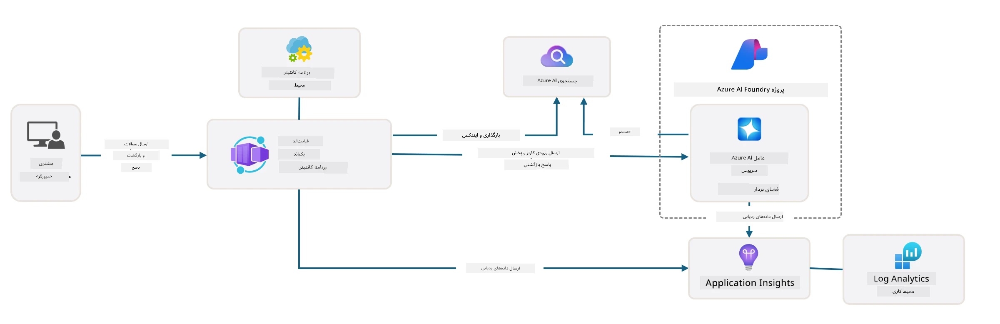
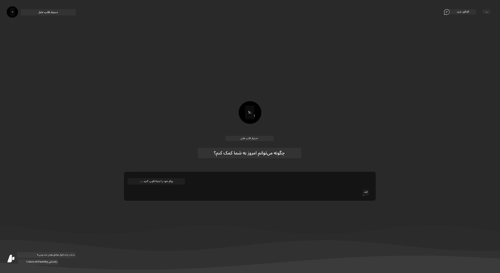

# 2. اعتبارسنجی یک قالب

> راهنمایی منبع در تاریخ 4 نوامبر 2026 در برابر AZD 1.37.2 و نمونه فعلی بررسی شده است. عکس‌های صفحه به صورت تصویری هستند؛ ناوبری پورتال، پیش‌فرض‌های قالب، و در دسترس بودن سرویس ممکن است تغییر کنند. این بررسی شامل اجرای زنده Azure نبوده است.

!!! tip "تا پایان این ماژول قادر خواهید بود"

    - [ ] Identify the sample's prerequisites and intended resources
    - [ ] Deploy the selected template into an intentional environment
    - [ ] Verify the application and agent behavior separately from deployment success
    - [ ] **Lab 2:** Record evidence of a working baseline, or an actionable deployment blocker

---

## 1. بررسی پیش‌نیازها

رابط خط فرمان توسعه‌دهنده [Azure](https://learn.microsoft.com/azure/developer/azure-developer-cli/) مدیریت استقرار برنامه را با استفاده از پیکربندی، زیرساخت و کد قالب انجام می‌دهد. نسخه نصب‌شده خود را بررسی کنید:

```bash
azd version
```

در صورت نیاز از [دستورالعمل نصب/بروزرسانی فعلی](https://learn.microsoft.com/azure/developer/azure-developer-cli/install-azd) استفاده کنید. نمونه بررسی شده AZD `>=1.14.0` را اعلام می‌کند، اما نسخه فعلی پشتیبانی شده توصیه می‌شود. افزونه‌های اختیاری هوش مصنوعی دارای الزامات نسخه جداگانه هستند؛ جریان کاری عادی `azd up` این نمونه به افزونه نمایندگان نیاز ندارد.

قبل از فراهم‌سازی، راه‌اندازی حساب Azure نمونه [Azure account setup](https://github.com/Azure-Samples/get-started-with-ai-agents/blob/main/docs/azure_account_setup.md) و [deployment guide](https://github.com/Azure-Samples/get-started-with-ai-agents/blob/main/docs/deployment.md) را بخوانید. اشتراک، مجوزها، دسترسی به مدل، سهمیه منطقه‌ای و هزینه‌های مورد انتظار خود را تأیید کنید. حساب رایگان Azure تضمینی برای دسترسی یا استفاده رایگان از هر سرویس مورد نیاز نیست.

## 2. نمونه انتخاب شده را باز کنید

از مخزن [شروع کار با عامل‌های هوش مصنوعی](https://github.com/Azure-Samples/get-started-with-ai-agents) که در ماژول ۱ راه‌اندازی شده است استفاده کنید. اگر آن را راه‌اندازی نکرده‌اید، یکی از این گزینه‌ها را انتخاب کنید:

- یک [کداسپیس برای نمونه](https://github.com/codespaces/new/Azure-Samples/get-started-with-ai-agents) باز کنید.
- نمونه را کلون کرده و تنظیمات محلی/کانتینر توسعه آن را دنبال کنید.
- در یک **دایرکتوری خالی** دستور زیر را اجرا کنید:

```bash
azd init --template Azure-Samples/get-started-with-ai-agents .
```

قالب دوم را بر روی یک پروژه موجود راه‌اندازی نکنید. دستورات بعدی را از ریشه نمونه که شامل `azure.yaml` است اجرا کنید، نه ریشه مخزن دوره.

نمونه، یک برنامه چت پشتیبانی شده توسط عامل را در Container Apps میزبانی می‌کند و منابع Foundry پشتیبانی‌کننده را فراهم می‌آورد. معماری فعلی و خدمات اختیاری را مرور کنید و به جای تکیه بر یک اسکرین‌شات قدیمی، از فهرست دقیق منابع مطلع شوید.



## ۳. به‌طور هدفمند مستقر کنید

```bash
azd auth login
azd up
```

پرسش‌ها را مرور کنید:

۱. یک نام محیط AZD یکتا انتخاب کنید.
۲. اشتراکی که قصد استفاده دارید را انتخاب کنید، نه صرفاً اولین اشتراک ارائه شده.
۳. منطقه‌ای که توسط مدل/نسخه/SKU مورد نیاز و سهمیه شما پشتیبانی می‌شود را انتخاب کنید.
۴. خروجی مرحله تخصیص، استقرار و پس از استقرار را مطالعه کنید.

تنظیمات پیش‌فرض بررسی‌شده شامل `gpt-5-mini`، نسخه `2025-08-07` و `GlobalStandard` است. قالب اولیه خود و [ترکیب‌های مدل/منطقه‌ی پشتیبانی شده](https://learn.microsoft.com/azure/ai-services/agents/concepts/model-region-support) را بررسی کنید. هیچ منطقه‌ای به‌طور کلی تضمین شده نیست که کار کند.

مدت زمان استقرار متفاوت است. اگر تخصیص ناموفق بود، خطا را حفظ کنید و علت آن را قبل از تلاش مجدد برطرف کنید. حذف استقرار یا پاکسازی دائمی منابع را به عنوان گام عمومی عیب‌یابی انجام ندهید.

## ۴. اعتبارسنجی برنامه

```bash
azd show
```

نقطه دسترسی را برای `api_and_frontend` باز کنید، یا اپلیکیشن کانتینری را در گروه منابع استقرار در [پرتال آزور](https://portal.azure.com/) پیدا کنید. اگر نیاز به ورود است، دستورالعمل‌های دسترسی/احراز هویت نمونه را دنبال کنید؛ برای گذر از تست سریع، احراز هویت را غیرفعال نکنید.



چند [سؤال نمونه](https://github.com/Azure-Samples/get-started-with-ai-agents/blob/main/docs/sample_questions.md) را امتحان کنید:

- یک سؤال عمومی واقعی.
- سؤالی که پاسخ آن باید در اسناد بارگذاری‌شده نمونه وجود داشته باشد.
- سؤالی که نمی‌توان از آن اسناد پاسخ داد.

بررسی کنید که رابط کاربری بارگذاری شود، API پاسخ دهد، بازیابی از داده‌های مورد انتظار استفاده کند، استنادات با محتوای منبع مطابقت داشته باشند و سوالات پشتیبانی نشده به طور مناسب مدیریت شوند. تنها پیام موفق `azd up` این موارد را تضمین نمی‌کند.

## ۵. عامل مستقر شده را بررسی کنید

پروژه خود را در [درگاه Foundry](https://ai.azure.com/) باز کنید. در جریان بررسی درگاه، گزینه **Build**، سپس **Agents** را انتخاب کنید و عاملی را که نمونه ایجاد کرده است پیدا کنید. برچسب‌های ناوبری ممکن است تغییر کنند.

موارد زیر را ثبت کنید:

- نام و نسخه عامل.
- استقرار مدل پیکربندی شده آن.
- دستورالعمل‌های واقعی و ابزارهای فعال شده.
- کدام فایل‌ها یا نمایه جستجو متصل هستند و آیا راه‌اندازی با موفقیت انجام شده است.

نمونه بررسی شده از شناسه عاملی در قالب `agent_name:agent_version` برای آزمایش‌های ارزیابی خود استفاده می‌کند. شناسه عامل کلاسیک یا رشته‌ای را از اسکرین‌شات قدیمی در جریان کاری API جدید کپی نکنید.

اسناد بارگذاری شده را با `src/files/` در بازنگری مقداردهی اولیه شده خود مقایسه کنید. اسکرین‌شات‌های قبلی ۳۲ فایل را نشان می‌دادند؛ این تعداد پیش‌فرض فعلی تضمین‌شده نیست. هر پاسخی درباره مشتریان/محصولات نمونه را با داده‌های مصنوعی منبع واقعی بررسی کنید و برای این تمرین داده واقعی مشتری بارگذاری نکنید.

## ۶. مقایسه با محیط آزمایش (playground)

محیط آزمایش عامل انتخاب شده را در Foundry باز کنید و همان سوال بازیابی را بپرسید. نسخه عامل پیکربندی‌شده، ابزارها، استنادات و کیفیت پاسخ را با برنامه مستقر مقایسه کنید.

پاسخ‌ها احتمالاتی هستند؛ تطابق کلمه‌به‌کلمه معیار نیست. اگر نتایج به طور چشمگیری متفاوت بود، بررسی کنید که برنامه و محیط آزمایش روی یک پروژه، عامل/نسخه، و منبع دانش هدف گرفته باشند.

## ۷. پیش‌نیازهای قابلیت مشاهده را بررسی کنید

راهنمای [قابلیت مشاهده](https://github.com/Azure-Samples/get-started-with-ai-agents/blob/main/docs/observability.md) نمونه، منبع اصلی برای ردگیری، ارزیابی و تنظیم تیم قرمز است.

در تنظیمات پیش‌فرض زیرساخت بررسی‌شده، Application Insights فعال است اما **ردگیری مشتری غیرفعال است** (`ENABLE_AZURE_MONITOR_TRACING=false`). ایجاد یک منبع نظارت اثبات نمی‌کند که برنامه در حال صادر کردن ردگیری‌ها است. ماژول ۵ به فعال‌سازی ردگیری و تولید درخواست آزمایشی می‌پردازد.

از لاگ‌های برنامه Container App برای بررسی خطاهای راه‌اندازی/API استفاده کنید. در Foundry، نماهای ردگیری و نظارت موجود برای عامل را بررسی کنید. ورودی‌های ارزیابی نیازمند پیکربندی مرتبط، ارزیابان/منطقه پشتیبانی شده و درخواست‌های واقعی هستند؛ تضمینی وجود ندارد که به طور خودکار برای هر اجرا ظاهر شوند.

ضبط محتوای سوال/پاسخ را غیر فعال باقی بگذارید مگر اینکه الزامات حریم خصوصی، نگهداری، دسترسی و سانسور آن بررسی شده باشد.

## ۸. درک مقادیر محیط

AZD محیط انتخاب‌شده را در `.azure/<environment-name>/` ذخیره می‌کند. ورودی‌های پایدار و خروجی‌های استقرار را می‌توان با این دستور خواند:

```bash
azd env list
azd env get-value AZURE_ENV_NAME
azd env get-value AZURE_LOCATION
```

`azd env get-values` همه مقادیر را فهرست می‌کند که ممکن است شامل پیکربندی حساس باشد. آن خروجی را در مسائل عمومی یا لاگ‌ها نچسبانید.

AZD هنگام اجرای دستورات/هوک‌های خود از محیط انتخاب‌شده استفاده می‌کند، در حالی که متغیرهای محیطی فرآیند نیز می‌توانند بر دستورات و قالب‌ها تأثیر بگذارند. این **مقادیر را به شل والد یا هر پروسه پایتون مستقل صادر نمی‌کند**. دستورالعمل‌های [توسعه محلی](https://github.com/Azure-Samples/get-started-with-ai-agents/blob/main/docs/local_development.md) نمونه را دنبال کنید.

پیش‌فرض‌های قالب می‌توانند در `infra/main.parameters.json` اعمال شوند بدون اینکه به عنوان مقادیر محلی صریح ظاهر شوند. تنظیم یک متغیر دلخواه زیرساخت را تغییر نمی‌دهد مگر اینکه قالب از آن استفاده کند.

برای مثال، برای انتخاب صریح پیش‌فرض‌های مدل بررسی‌شده:

```bash
azd env set AZURE_AI_AGENT_MODEL_NAME gpt-5-mini
azd env set AZURE_AI_AGENT_MODEL_VERSION 2025-08-07
azd env set AZURE_AI_AGENT_DEPLOYMENT_SKU GlobalStandard
azd provision --preview
azd up
```

ابتدا سازگاری، ظرفیت، دسترسی و تغییرات برنامه‌ریزی‌شده را بررسی کنید. به‌روزرسانی‌های زیرساخت نیاز به تأمین منابع دارد؛ خود `azd deploy` کافی نیست. معمولاً تغییرات مدل پشتیبانی‌شده نیازی به تخریب کل برنامه ندارند.

`azd env refresh` خروجی‌های استقرار برای یک محیط قابل دسترس را بازیابی می‌کند؛ این فرمان همه ورودی‌های سفارشی را بازسازی، اسرار را هماهنگ یا مدیریت پیکربندی را جایگزین نمی‌کند.

## 9. ثبت خط مبنای خود

- [ ] محیط، اشتراک، منطقه و مدل صحیح تأیید شده است.
- [ ] تأمین منابع، استقرار و وابستگی‌های راه‌اندازی مورد نیاز بدون خطاهای حل‌نشده انجام شده است.
- [ ] دسترسی به برنامه، چت، بازیابی و ارجاعات بررسی شده است.
- [ ] عامل/نسخه و منبع دانش شناسایی شده‌اند.
- [ ] پیش‌نیازهای رصدپذیری و هر مشکلات باقی‌مانده مستند شده است.

ادامه دهید به [تجزیه قالب](3-Deconstruct-AI-Template.md).

---

<!-- CO-OP TRANSLATOR DISCLAIMER START -->
**سلب مسئولیت**:
این سند با استفاده از سرویس ترجمه هوش مصنوعی [Co-op Translator](https://github.com/Azure/co-op-translator) ترجمه شده است. در حالی که ما در تلاش برای دقت هستیم، لطفاً توجه داشته باشید که ترجمه‌های خودکار ممکن است شامل خطاها یا نادرستی‌هایی باشند. سند اصلی به زبان مادری خود باید به عنوان منبع معتبر در نظر گرفته شود. برای اطلاعات حیاتی، ترجمه حرفه‌ای انسانی توصیه می‌شود. ما در قبال هرگونه سوء تفاهم یا برداشت نادرست ناشی از استفاده از این ترجمه مسئولیتی نداریم.
<!-- CO-OP TRANSLATOR DISCLAIMER END -->