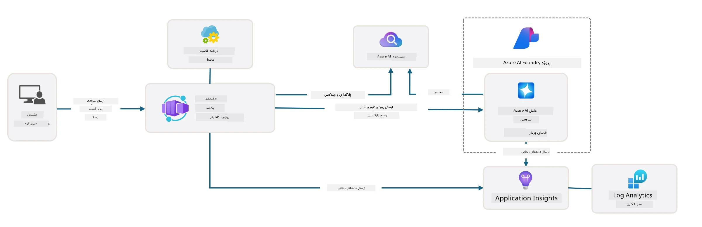

# ۳. تحلیل یک قالب

!!! tip "در پایان این ماژول قادر خواهید بود"

    - [ ] Use GitHub Copilot and optional MCP tools for Azure documentation and read-only exploration
    - [ ] Identify the template's application, infrastructure, configuration, and test entry points
    - [ ] Verify generated explanations against actual repository files
    - [ ] **Lab 3:** Trace one request and one configuration input through the project

---

## ۱. فعال‌سازی GitHub Copilot

نمونه AI راه‌اندازی شده را در VS Code باز کنید و [GitHub Copilot](https://code.visualstudio.com/docs/copilot/chat/chat-agent-mode) را فعال کنید. با حسابی وارد شوید که برنامه مجاز دارد؛ محدودیت‌های استفاده متفاوت است. از Copilot بخواهید قبل از تایید تغییرات، مخزن را توضیح دهد.

### سرورهای اختیاری MCP

این سرویس‌ها می‌توانند ابزارهای اضافی فراهم کنند:

- [سرور Azure MCP](https://learn.microsoft.com/azure/developer/azure-mcp-server/overview)
- [سرور Microsoft Learn MCP](https://learn.microsoft.com/training/support/mcp)

در VS Code، راهنمای [پیکربندی MCP](https://code.visualstudio.com/docs/copilot/chat/mcp-servers) را مرور کنید و در صورت نیاز `.vscode/mcp.json` بسازید:

```json
{
  "servers": {
    "Azure MCP Server": {
      "type": "stdio",
      "command": "npx",
      "args": ["-y", "@azure/mcp@latest", "server", "start"]
    },
    "microsoft.docs.mcp": {
      "type": "http",
      "url": "https://learn.microsoft.com/api/mcp"
    }
  }
}
```

دستور `npx` نیاز به نصب Node.js/npm پشتیبانی شده دارد و کد اجرایی را دانلود می‌کند. بسته را مرور کرده و نسخه تایید شده را برای راه‌اندازی تکرارپذیر تیمی پین کنید. سرورها را با کنترل‌های MCP در VS Code راه‌اندازی و ابزارهای موجود را بررسی کنید؛ نام‌ها در نسخه‌های مختلف می‌توانند تغییر کنند.

**تأیید هویت جداست.** از `azd auth login` برای AZD استفاده کنید. جریان تأیید هویت مستند شده Azure MCP را برای ابزارهای آن دنبال کنید؛ ورود AZD به تنهایی جلسه MCP ایجاد نمی‌کند. هنگامی که تمرین یا هوک از Azure CLI استفاده می‌کند، به‌صورت جداگانه `az login` را اجرا کنید.

تست دستورات فقط خواندنی را امتحان کنید:

۱. "استفاده از Microsoft Learn MCP برای یافتن مستندات پیکربندی Azure Developer CLI."
۲. "توضیح دهید که این مخزن `azure.yaml` چیست؛ فایل‌هایی که هر هوک را پیاده‌سازی می‌کنند را ذکر کنید."
۳. "با استفاده از ابزارهای Azure MCP موجود، منابع مستقرشده من را بدون تغییر چیزی فهرست کنید."

اشتراک/مستأجر انتخاب‌شده و هر فراخوان پیشنهادی ابزار را بررسی کنید. فقط برای کاوش در معماری، ایجاد، حذف یا تغییر دسترسی به منابع را تأیید نکنید.

## ۲. درک معماری

نمونه شامل بک‌اند Python FastAPI و فرانت‌اند React/TypeScript در Azure Container Apps است. بک‌اند با یک عامل در پروژه Microsoft Foundry ارتباط برقرار می‌کند. بازیابی و مشاهده به ویژگی‌های قالب فعال‌شده و راه‌اندازی موفق وابسته است؛ صرفاً مستقر شدن برنامه تضمین نمی‌کند.



این نمودار را با [راهنمای استقرار فعلی بالادستی](https://github.com/Azure-Samples/get-started-with-ai-agents/blob/main/docs/deployment.md) و منابع واقعی خود مقایسه کنید. استقرار مدل پیکربندی شده، ابزارهای عامل، هویت مدیریت‌شده، انتساب نقش‌ها و منابع اختیاری AI Search/Application Insights را بررسی کنید.

**تمرین:** از Copilot بخواهید درخواست چت را از فرانت‌اند از طریق API تا Foundry دنبال کند، همراه با مراجع فایل و تابع. آن مراجع را باز کنید و توضیح را تأیید کنید. پیاده‌سازی تأیید هویت، مسیردهی یا مجوز را صرفاً از نمودار استنباط نکنید.

## ۳. ساختار مخزن

مسیرهای انتخاب‌شده زیر در تاریخ ۴ نوامبر ۲۰۲۶ با نمونه بررسی شده‌اند. بازنگری راه‌اندازی‌شده شما منبع حقیقت باقی می‌ماند:

```text
get-started-with-ai-agents/
  azure.yaml
  docker-compose.yaml
  requirements-dev.txt
  .devcontainer/
  infra/
    main.bicep
    main.parameters.json
    api.bicep
    core/
  src/
    Dockerfile
    pyproject.toml
    requirements.txt
    api/
      main.py
      routes.py
      search_index_manager.py
    frontend/
      package.json
      src/
    files/
  scripts/
    validate_env_vars.sh
    validate_env_vars.ps1
    postdeploy.sh
    postdeploy.ps1
  tests/
    test_evaluation.py
    test_red_teaming.py
  docs/
    deployment.md
    deploy_customization.md
    ai_search.md
    observability.md
    local_development.md
    troubleshooting.md
```

### زیرساخت و پیکربندی

`infra/main.bicep` منابع را هماهنگ می‌کند؛ `main.parameters.json` ورودی‌های قالب را به مقادیر محیط AZD متصل می‌کند. `azure.yaml` سرویس برنامه و هوک‌های دوره عمر را انتخاب می‌کند. ورودی‌ای مانند `USE_AZURE_AI_SEARCH_SERVICE` را در این فایل‌ها دنبال کنید تا ببینید چه چیزی واقعاً تغییر می‌کند.

### برنامه و هویت

`src/api/` و `src/frontend/` را با هم بخوانید. محل ایجاد یا بازیابی عامل، جایی که دستورالعمل‌ها/ابزارها پیکربندی می‌شوند و اینکه هر تماس Azure از کدام هویت استفاده می‌کند را شناسایی کنید. فایل‌های نمونه زیر `src/files/` داده‌های نمایشی هستند، نه ساختار تولید یا مدل مجوز.

### آزمایش‌ها و مشاهده‌پذیری

ورودی‌های ارزیابی فعلی و red-teaming زیر `tests/` هستند؛ مراجع قدیمی دایرکتوری `evals/` و `airedteaming/` برای این نمونه منسوخ شده‌اند. پیش‌نیازها و هزینه‌ها را قبل از اجرای آزمایش‌های ابری در `docs/observability.md` بخوانید. این آزمایش‌های Python جدا از افزونه اختیاری `azure.ai.evaluations` AZD هستند.

## ۴. یافته‌های خود را تأیید کنید

- مسیر API، تعامل عامل و کد بازیابی برای یک سوال نمونه را مشخص کنید.
- توضیح دهید کدام هویت به Foundry دسترسی دارد و کدام پیکربندی نقطه پایانی آن را انتخاب می‌کند.
- اسکریپت‌های پیش‌استقرار و پس‌استقرار واقعی و رفتار مدیریت خطای آن‌ها را پیدا کنید.
- هر وابستگی یا ویژگی اختیاری که در استقرار شما وجود ندارد را فهرست کنید.

ادامه به [پیکربندی یک قالب](4-Configure-AI-Template.md).

---

<!-- CO-OP TRANSLATOR DISCLAIMER START -->
**سلب مسئولیت**:
این سند با استفاده از سرویس ترجمه هوش مصنوعی [Co-op Translator](https://github.com/Azure/co-op-translator) ترجمه شده است. در حالی که ما در تلاش برای دقت هستیم، لطفاً توجه داشته باشید که ترجمه‌های خودکار ممکن است شامل خطاها یا نادرستی‌هایی باشند. سند اصلی به زبان مادری خود باید به عنوان منبع معتبر در نظر گرفته شود. برای اطلاعات حیاتی، ترجمه حرفه‌ای انسانی توصیه می‌شود. ما در قبال هرگونه سوء تفاهم یا برداشت نادرست ناشی از استفاده از این ترجمه مسئولیتی نداریم.
<!-- CO-OP TRANSLATOR DISCLAIMER END -->