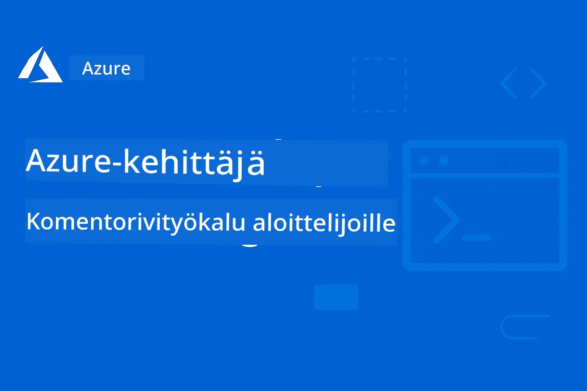

# AZD Aloittelijoille: Rakenteellinen oppimismatka

 

[](https://github.com/microsoft/AZD-for-beginners)
[](https://GitHub.com/microsoft/azd-for-beginners/network/)
[](https://github.com/microsoft/AZD-for-beginners)

[](https://discord.com/invite/nkVh3dp)
[](https://discord.gg/nTYy5BXMWG)

---

### Automaattiset käännökset (aina ajan tasalla)

<!-- CO-OP TRANSLATOR LANGUAGES TABLE START -->
[Arabic](../ar/README.md) | [Bengali](../bn/README.md) | [Bulgarian](../bg/README.md) | [Burmese (Myanmar)](../my/README.md) | [Chinese (Simplified)](../zh-CN/README.md) | [Chinese (Traditional, Hong Kong)](../zh-HK/README.md) | [Chinese (Traditional, Macau)](../zh-MO/README.md) | [Chinese (Traditional, Taiwan)](../zh-TW/README.md) | [Croatian](../hr/README.md) | [Czech](../cs/README.md) | [Danish](../da/README.md) | [Dutch](../nl/README.md) | [Estonian](../et/README.md) | [Finnish](./README.md) | [French](../fr/README.md) | [German](../de/README.md) | [Greek](../el/README.md) | [Hebrew](../he/README.md) | [Hindi](../hi/README.md) | [Hungarian](../hu/README.md) | [Indonesian](../id/README.md) | [Italian](../it/README.md) | [Japanese](../ja/README.md) | [Kannada](../kn/README.md) | [Khmer](../km/README.md) | [Korean](../ko/README.md) | [Lithuanian](../lt/README.md) | [Malay](../ms/README.md) | [Malayalam](../ml/README.md) | [Manipuri (Meitei Mayek)](../mni/README.md) | [Marathi](../mr/README.md) | [Nepali](../ne/README.md) | [Nigerian Pidgin](../pcm/README.md) | [Norwegian](../no/README.md) | [Persian (Farsi)](../fa/README.md) | [Polish](../pl/README.md) | [Portuguese (Brazil)](../pt-BR/README.md) | [Portuguese (Portugal)](../pt-PT/README.md) | [Punjabi (Gurmukhi)](../pa/README.md) | [Romanian](../ro/README.md) | [Russian](../ru/README.md) | [Serbian (Cyrillic)](../sr/README.md) | [Slovak](../sk/README.md) | [Slovenian](../sl/README.md) | [Spanish](../es/README.md) | [Swahili](../sw/README.md) | [Swedish](../sv/README.md) | [Tagalog (Filipino)](../tl/README.md) | [Tamil](../ta/README.md) | [Telugu](../te/README.md) | [Thai](../th/README.md) | [Turkish](../tr/README.md) | [Ukrainian](../uk/README.md) | [Urdu](../ur/README.md) | [Vietnamese](../vi/README.md)

> **Haluatko kloonata paikallisesti?**
>
> Tämä arkisto sisältää yli 50 käännöstä, mikä kasvattaa merkittävästi lataustiedoston kokoa. Jos haluat kloonata ilman käännöksiä, käytä sparse checkout -toimintoa:
>
> **Bash / macOS / Linux:**
> ```bash
> git clone --filter=blob:none --sparse https://github.com/microsoft/AZD-for-beginners.git
> cd AZD-for-beginners
> git sparse-checkout set --no-cone '/*' '!translations' '!translated_images'
> ```
>
> **CMD (Windows):**
> ```cmd
> git clone --filter=blob:none --sparse https://github.com/microsoft/AZD-for-beginners.git
> cd AZD-for-beginners
> git sparse-checkout set --no-cone "/*" "!translations" "!translated_images"
> ```
>
> Tämä antaa sinulle kaiken, mitä tarvitset kurssin suorittamiseen paljon nopeammalla latauksella.
<!-- CO-OP TRANSLATOR LANGUAGES TABLE END -->

## 🆕 Mikä on uutta azd:ssa tänään

> 📌 **AI CLI julkaisuarvio (2026-11-04):** Ohjeistus tarkistettiin julkaisun **`azd 1.37.2`**, **agenttien `1.0.0-beta.23`** ja **arviointien `1.0.0-beta.2`** dokumentaation/lähteen perusteella. Käytä `azd >= 1.37.0` yhdistetyn työnkulun käyttöön. Suorita `azd version` ja [päivitä ydinkomentorivi](https://learn.microsoft.com/azure/developer/azure-developer-cli/install-azd) ennen laajennuksia. Katso [julkaisumuutokset ja korjaukset](docs/chapter-08-production/production-ai-practices.md#recent-release-changes-and-fixes). Tämä ei ole koko kurssin live-jakelun vahvistus.

Azure Developer CLI tukee monia sovellustyyppejä, kuten web-sovelluksia, API:ita ja AI-agentteja, tuettujen isäntien, mallien ja laajennusten kautta.

Tässä mitä se tarkoittaa sinulle:

- **AI-agentit ovat nyt ensiluokkaisia azd-tehtäviä.** Voit alustaa, ottaa käyttöön ja hallita AI-agenttiprojekteja käyttämällä samaa `azd init` → `azd up` työnkulkua, jonka jo tunnet.
- **Agentin elinkaari kahden laajennuksen kautta.** Käytä `azure.ai.agents` alustamiseen, kutsumiseen, optimointiin ja eläköitymiseen. Asenna **`azure.ai.evaluations`** erikseen `azd ai eval init`, `generate` ja `run start` varten. Agentit beta.22 korvasi perinteisen arviointityönkulun ja muutti optimointiasetuksia; seuraa [siirtymäopasta](docs/chapter-08-production/production-ai-practices.md#evaluation-migration-and-quality-checks).
- **Lisää tekoälyn rakennuspalikoita.** Uudet esikatselulaajennukset—`azure.ai.skills` ja `azure.ai.connections`—antavat sinun hallita uudelleenkäytettäviä agenttikykyjä ja Foundry-yhteyksiä suoraan azd:llä.
- **Microsoft Foundry -integraatio** tuo mallien käyttöönoton, agenttien isännöinnin ja tekoälypalvelujen konfiguroinnin suoraan azd-mallipohjaekosysteemiin.
- **Sujuvammat arkipäiväiset perusasiat.** Viimeisimmät julkaisut tekivät `azd init` idempotentiksi (turvallinen ajaa uudelleen), tekivät `azd auth login` automaattisesti poistamaan vanhentuneet valtuudet ja lisäsivät ystävällisen `azd tool` ensimmäisen suorituksen asetuskehotteen.
- **Ydin työnkulku ei ole muuttunut.** Olitpa ottamassa käyttöön tehtävälistasovelluksen, mikropalvelun tai monen agentin tekoälyratkaisun, komennot ovat samat.

> **Huomautus Aspire-käyttäjille:** Microsoft kutsuu tuotetta nyt yksinkertaisesti **Aspire** (entinen ".NET Aspire"). azd:n Aspire-tuki ei ole muuttunut—vain nimi päivitettiin.

Jos olet käyttänyt azd:tä aiemmin, tekoälytuki on luonnollinen laajennus—ei erillinen työkalu tai edistynyt polku. Jos aloitat alusta, opit yhden työnkulun, joka toimii kaikkeen.

---

## 🚀 Mikä on Azure Developer CLI (azd)?

**Azure Developer CLI (azd)** on kehittäjäystävällinen komentorivityökalu, joka tekee sovellusten käyttöönotosta Azuren päälle helppoa. Sen sijaan, että loisit ja yhdistäisit manuaalisesti kymmeniä Azure-resursseja, voit ottaa käyttöön kokonaisia sovelluksia yhdellä komennolla.

### `azd up` taika

```bash
# This single command does everything:
# ✅ Creates all Azure resources  
# ✅ Configures networking and security
# ✅ Builds your application code
# ✅ Deploys to Azure
# ✅ Gives you a working URL
azd up
```

Mallipohja tarjoaa sovellus- ja infrastruktuurikokoonpanon. Onnistunut käyttöönotto vaatii edelleen tuettuja palveluita/malleja, riittävästi kiintiötä ja oikeuksia, oikeat syötteet sekä käyttöönotetun sovelluksen varmistuksen. `azd up` ei automaattisesti tee mallipohjasta turvallista, vaatimustenmukaista tai tuotantovalmiita.

---

## ❓ Azure Developer CLI vs Azure CLI: Mikä ero?

Tämä on yleisin kysymys aloittelijoilta. Tässä yksinkertainen vastaus:

| Ominaisuus | **Azure CLI (`az`)** | **Azure Developer CLI (`azd`)** |
|---------|---------------------|--------------------------------|
| **Tarkoitus** | Hallita yksittäisiä Azure-resursseja | Ota käyttöön kokonaisia sovelluksia |
| **Ajattelutapa** | Infrastruktuurikeskeinen | Sovelluskeskeinen |
| **Esimerkki** | `az webapp create --name myapp...` | `azd up` |
| **Oppimiskäyrä** | Täytyy tuntea Azure-palvelut | Riittää tuntea oma sovellus |
| **Parhaiten sopii** | DevOps, Infrastruktuuri | Kehittäjät, prototypointi |

### Yksinkertainen vertaus

- **Azure CLI** on kuin olisi kaikki työkalut talon rakentamiseen - vasarat, sahat, naulat. Voit rakentaa mitä tahansa, mutta sinun täytyy ymmärtää rakentaminen.
- **Azure Developer CLI** on kuin palkkaisit urakoitsijan - kuvailet mitä haluat, ja he hoitavat rakentamisen.

### Milloin käyttää kumpaakin

| Tilanne | Käytä tätä |
|----------|----------|
| "Haluan ottaa käyttöön verkkosovellukseni nopeasti" | `azd up` |
| "Tarvitsen vain tallennustilin luomista" | `az storage account create` |
| "Rakennan täyden tekoälysovelluksen" | `azd init --template azure-search-openai-demo` |
| "Tarvitsen vianmääritystä tietylle Azure-resurssille" | `az resource show` |
| "Haluan ottaa käyttöön konfiguroidussa tuotantoympäristössäni" | Tarkista kokoonpano, käyttöoikeudet, kustannukset ja operatiiviset portit ennen `azd up --environment production` |

### Ne toimivat yhdessä!

AZD:llä ja Azure CLI:llä on erilliset todennus ja kokoonpano. Käytä `azd auth login` AZD:ssä ja `az login` silloin, kun koukku tai vianetsintäkomento nimenomaan tarvitsee Azure CLI:n. Voit käyttää molempia:
```bash
# Deploy your app with AZD
azd up

# Then fine-tune specific resources with Azure CLI
az webapp config set --name myapp --always-on true
```

---

## 🌟 Löydä mallipohjat Awesome AZD:stä

Älä aloita tyhjästä! **Awesome AZD** on yhteisön kokoama valikoima valmiita otettavaksi käyttöön mallipohjia:

| Resurssi | Kuvaus |
|----------|-------------|
| 🔗 [**Awesome AZD Gallery**](https://azure.github.io/awesome-azd/) | Selaa 200+ mallipohjaa yhdellä klikkauksella otettavaksi käyttöön |
| 🔗 [**Lähetä Mallipohja**](https://github.com/Azure/awesome-azd/issues) | Osallistu oman mallipohjasi kanssa yhteisöön |
| 🔗 [**GitHub-repositorio**](https://github.com/Azure/awesome-azd) | Tähtiä ja tutustu lähdekoodiin |

### Suosittuja tekoälymalleja Awesome AZD:stä

Valitse yksi mallipohja sen omaan tyhjään kansioon; alla olevat komennot ovat vaihtoehtoja. Perässä oleva `.` alustaa kyseisen kansion.

```bash
# RAG Chat with Microsoft Foundry Models + AI Search
azd init --template azure-search-openai-demo .

# Quick AI Chat Application
azd init --template openai-chat-app-quickstart .

# AI Agents with Foundry Agents
azd init --template get-started-with-ai-agents .
```

---

## 🎯 Aloita 3 askeleessa

Ennen aloittamista varmista, että koneesi on valmis haluamaasi mallipohjaan:

**Windows:**
```powershell
.\validate-setup.ps1
```

**macOS / Linux:**
```bash
bash ./validate-setup.sh
```

Jos jokin vaadituista tarkastuksista epäonnistuu, korjaa se ensin ja jatka sitten pika-aloitukseen.

### Vaihe 1: Asenna AZD (2 minuuttia)

**Windows:**
```powershell
winget install microsoft.azd
```

**macOS:**
```bash
brew tap azure/azd && brew install azd
```

**Linux:**
```bash
curl -fsSL https://aka.ms/install-azd.sh | bash
```

### Vaihe 2: Todennus AZD:lle

```bash
# Optional if you plan to use Azure CLI commands directly in this course
az login

# Required for AZD workflows
azd auth login
```

Jos et ole varma kumpaa tarvitset, seuraa täyttä asennusprosessia kohdassa [Installation & Setup](docs/chapter-01-foundation/installation.md#authentication-setup).

### Vaihe 3: Ota ensimmäinen sovelluksesi käyttöön

```bash
# Initialize from a template
azd init --template todo-nodejs-mongo .

# Deploy to Azure (creates everything!)
azd up
```

**🎉 Siinä se!** Sovelluksesi on nyt käytössä Azurella.

### Siivoa jäljet (älä unohda!)

```bash
# Remove all resources when done experimenting
azd down --force --purge
```

---

## 📚 Kuinka käyttää tätä kurssia

Tämä kurssi on suunniteltu **progressiiviseen oppimiseen** - aloita sieltä, missä tunnet olosi mukavaksi ja etene laajemmaksi:

| Kokemuksesi | Aloita tästä |
|-----------------|------------|
| **Täysin uusi Azureen** | [Luku 1: Perusteet](#-chapter-1-foundation--quick-start) |
| **Tuntee Azuren, uusi AZD:hen** | [Luku 1: Perusteet](#-chapter-1-foundation--quick-start) |
| **Haluat ottaa tekoälysovelluksia käyttöön** | [Luku 2: AI-Ensimmäinen kehitys](#-chapter-2-ai-first-development-recommended-for-ai-developers) |
| **Haluat käytännön harjoituksen** | [🎓 Interaktiivinen työpaja](workshop/README.md) - 3-4 tunnin ohjattu harjoitus |
| **Tarvitset tuotantomalleja** | [Luku 8: Tuotanto & Yritys](#-chapter-8-production--enterprise-patterns) |

### Pika-aloitus

1. **Forkkaa tämä repositorio**: [](https://GitHub.com/microsoft/azd-for-beginners/fork)
2. **Kloonaa se**: `git clone https://github.com/YOUR-USERNAME/azd-for-beginners.git`
3. **Hanki apua**: [Azure Discord Community](https://discord.com/invite/ByRwuEEgH4)

> **Haluatko mieluummin kloonata paikallisesti?**

> Tämä arkisto sisältää yli 50 kielikäännöstä, mikä lisää latauskokoa merkittävästi. Jos haluat kloonata ilman käännöksiä, käytä sparse checkout -menetelmää:
> ```bash
> git clone --filter=blob:none --sparse https://github.com/microsoft/AZD-for-beginners.git
> cd AZD-for-beginners
> git sparse-checkout set --no-cone '/*' '!translations' '!translated_images'
> ```
> Tämä antaa sinulle kaiken tarvitsemasi kurssin suorittamiseen huomattavasti nopeammalla latauksella.


## Kurssin yleiskatsaus

Hallitse Azure Developer CLI (azd) rakenteellisten lukujen kautta, jotka on suunniteltu asteittaiseen oppimiseen. **Erityinen painotus tekoälysovellusten käyttöönottoon Microsoft Foundryn integroinnilla.**

### Miksi tämä kurssi on välttämätön nykyaikaisille kehittäjille

Tekoälykuormia käyttöönotettavat kehittäjät tarvitsevat usein ohjausta:
- Monimutkaisissa monipalveluissa tekoälyarkkitehtuureissa
- Parhaissa tuotantokäyttöön ottamisen käytännöissä  
- Azure AI -palveluiden integroinnissa ja määrityksissä
- Kustannusten optimoinnissa tekoälykuormille
- Tekoälyyn liittyvien käyttöönotto-ongelmien vianmäärityksessä

### Oppimistavoitteet

Suoritettuasi tämän rakenteellisen kurssin:
- **Hallinnoi AZD:n perusteet**: Ydinperiaatteet, asennus ja määritys
- **Ota käyttöön tekoälysovelluksia**: Käytä AZD:tä Microsoft Foundryn palveluiden kanssa
- **Toteuta infrastruktuuri koodina**: Hallitse Azure-resursseja Bicep-mallien avulla
- **Vianmääritys käyttöönotossa**: Ratkaise yleisiä ongelmia ja debuggaa
- **Optimoi tuotantoon**: Turvallisuus, skaalaus, valvonta ja kustannusten hallinta
- **Rakenna monipalveluratkaisuja**: Käyttöönotto monimutkaisille tekoälyarkkitehtuureille

## Ennen kuin aloitat: Tilit, pääsyt ja oletukset

Ennen kuin aloitat luvusta 1, varmista, että seuraavat asiat ovat kunnossa. Asennusvaiheet tässä ohjeessa olettavat, että nämä perusteet on jo hoidettu.

- **Azure-tilaus**: Voit käyttää olemassa olevaa tilausta työpaikaltasi tai omalta tililtäsi tai luoda [ilmaisen kokeilujakson](https://aka.ms/azurefreetrial) aloittaaksesi.
- **Oikeudet Azure-resurssien luomiseen**: Useimmissa harjoituksissa sinun tulisi saada vähintään **Contributor**-oikeudet kohdetilaukseen tai resurssiryhmään. Jotkut luvut voivat edellyttää myös resurssiryhmien, managed identiteettien ja RBAC-määritysten luomista.
- [**GitHub-tili**](https://github.com): Tämä on hyödyllinen repositorion haarauttamiseen, omien muutosten seurantaan sekä GitHub Codespacesin käyttöön työpajassa.
- **Mallit suoritusedellytykset**: Jotkut mallit vaativat paikallisia työkaluja kuten Node.js, Python, Java tai Docker. Suorita asetusten tarkistus ennen aloitusta, jotta puuttuvat työkalut havaitaan ajoissa.
- **Perustiedot komentorivistä**: Sinun ei tarvitse olla asiantuntija, mutta komentojen kuten `git clone`, `azd auth login` ja `azd up` suorittaminen pitäisi olla sujuvaa.

> **Työskenteletkö yritystilausessa?**
> Jos Azure-ympäristösi hallitaan ylläpitäjän toimesta, varmista etukäteen, että voit ottaa käyttöön resursseja siinä tilauksessa tai resurssiryhmässä, jota aiot käyttää. Jos et, pyydä hiekkalaatikkotilausta tai Contributor-oikeuksia ennen aloitusta.

> **Uusi Azure-käyttäjä?**
> Aloita omalla Azure-kokeilutilauksellasi tai pay-as-you-go -tilauksella osoitteessa https://aka.ms/azurefreetrial, jotta voit suorittaa harjoitukset alusta loppuun odottelematta organisaatiotasoisia hyväksyntöjä.

## 🗺️ Kurssikartta: Nopea navigointi lukujen mukaan

Jokaisella luvulla on oma README-tiedosto oppimistavoitteineen, pika-aloituksineen ja harjoituksineen:

| Luku | Aihe | Oppitunnit | Kesto | Vaativuus |
|---------|-------|---------|----------|------------|
| **[Luku 1: Perusta](docs/chapter-01-foundation/README.md)** | Aloittaminen | [AZD:n perusteet](docs/chapter-01-foundation/azd-basics.md) &#124; [Asennus](docs/chapter-01-foundation/installation.md) &#124; [Ensimmäinen projekti](docs/chapter-01-foundation/first-project.md) | 30-45 min | ⭐ |
| **[Luku 2: Tekoälyn kehitys](docs/chapter-02-ai-development/README.md)** | AI-Ensisijaiset sovellukset | [Foundryn integrointi](docs/chapter-02-ai-development/microsoft-foundry-integration.md) &#124; [Tekoälyagentit](docs/chapter-02-ai-development/agents.md) &#124; [Mallien käyttöönotto](docs/chapter-02-ai-development/ai-model-deployment.md) &#124; [Työpaja](docs/chapter-02-ai-development/ai-workshop-lab.md) | 1-2 h | ⭐⭐ |
| **[Luku 3: Määritys](docs/chapter-03-configuration/README.md)** | Auth & Turvallisuus | [Määritys](docs/chapter-03-configuration/configuration.md) &#124; [Auth & Turvallisuus](docs/chapter-03-configuration/authsecurity.md) | 45-60 min | ⭐⭐ |
| **[Luku 4: Infrastruktuuri](docs/chapter-04-infrastructure/README.md)** | IaC & Käyttöönotto | [Käyttöönotto-opas](docs/chapter-04-infrastructure/deployment-guide.md) &#124; [Valmistelu](docs/chapter-04-infrastructure/provisioning.md) | 1-1,5 h | ⭐⭐⭐ |
| **[Luku 5: Multi-Agent](docs/chapter-05-multi-agent/README.md)** | Tekoälyagenttiratkaisut | [Vähittäiskaupan skenaario](examples/retail-scenario.md) &#124; [Orkestrointimallit](docs/chapter-06-pre-deployment/coordination-patterns.md) | 2-3 h | ⭐⭐⭐⭐ |
| **[Luku 6: Ennen käyttöönottoa](docs/chapter-06-pre-deployment/README.md)** | Suunnittelu & validointi | [Ennen lento-tarkistukset](docs/chapter-06-pre-deployment/preflight-checks.md) &#124; [Kapsiteetin suunnittelu](docs/chapter-06-pre-deployment/capacity-planning.md) &#124; [SKU-valinta](docs/chapter-06-pre-deployment/sku-selection.md) &#124; [App Insights](docs/chapter-06-pre-deployment/application-insights.md) | 1 h | ⭐⭐ |
| **[Luku 7: Vianmääritys](docs/chapter-07-troubleshooting/README.md)** | Debug & Korjaus | [Yleiset ongelmat](docs/chapter-07-troubleshooting/common-issues.md) &#124; [Debuggaus](docs/chapter-07-troubleshooting/debugging.md) &#124; [Tekoälyongelmat](docs/chapter-07-troubleshooting/ai-troubleshooting.md) | 1-1,5 h | ⭐⭐ |
| **[Luku 8: Tuotanto](docs/chapter-08-production/README.md)** | Yritysmallit | [Tuotantokäytännöt](docs/chapter-08-production/production-ai-practices.md) | 2-3 h | ⭐⭐⭐⭐ |
| **[🎓 Työpaja](workshop/README.md)** | Käytännön työpaja | [Johdanto](workshop/docs/instructions/0-Introduction.md) &#124; [Valinta](workshop/docs/instructions/1-Select-AI-Template.md) &#124; [Validointi](workshop/docs/instructions/2-Validate-AI-Template.md) &#124; [Purku](workshop/docs/instructions/3-Deconstruct-AI-Template.md) &#124; [Määritys](workshop/docs/instructions/4-Configure-AI-Template.md) &#124; [Muokattavuus](workshop/docs/instructions/5-Customize-AI-Template.md) &#124; [Purkutoimet](workshop/docs/instructions/6-Teardown-Infrastructure.md) &#124; [Yhteenveto](workshop/docs/instructions/7-Wrap-up.md) | 3-4 h | ⭐⭐ |

**Kurssin kokonaiskesto:** ~10-14 tuntia | **Taitotaso:** Aloittelija → Tuotantovalmius

---

## 📚 Oppimisluvut

*Valitse oppimispolkusi kokemus- ja tavoitetasosi mukaan*

### 🚀 Luku 1: Perusta & pika-aloitus
**Esivaatimukset**: Azure-tilaus, perustiedot komentorivistä  
**Kesto**: 30-45 minuuttia  
**Vaativuus**: ⭐

#### Mitä opit
- Azure Developer CLI:n perusteet
- AZD:n asentaminen alustallesi
- Ensimmäinen onnistunut käyttöönotto

#### Oppimateriaalit
- **🎯 Aloita tästä**: [Mikä on Azure Developer CLI?](#-what-is-azure-developer-cli-azd)
- **📖 Teoria**: [AZD:n perusteet](docs/chapter-01-foundation/azd-basics.md) - Keskeiset käsitteet ja termit
- **⚙️ Asetukset**: [Asennus & asetukset](docs/chapter-01-foundation/installation.md) - Alustakohtaiset ohjeet
- **🛠️ Käytännön harjoitus**: [Ensimmäinen projektisi](docs/chapter-01-foundation/first-project.md) - Askel askeleelta opas
- **📋 Pikaviite**: [Komentojen pikaopas](resources/cheat-sheet.md)

#### Käytännön harjoitukset
```bash
# Quick installation check
azd version

# Deploy your first application
azd init --template todo-nodejs-mongo .
azd up
```

**💡 Luvun tulos**: Ota onnistuneesti käyttöön yksinkertainen web-sovellus Azureen AZD:n avulla

**✅ Onnistumisen mittari:**
```bash
# After completing Chapter 1, you should be able to:
azd version              # Shows installed version
azd init --template todo-nodejs-mongo  # Initializes project
azd up                  # Deploys to Azure
azd show                # Displays running app URL
# Application opens in browser and works
azd down --force --purge  # Cleans up resources
```

**📊 Aika**: 30-45 minuuttia  
**📈 Taitotaso suorituksen jälkeen:** Osaa ottaa käyttöön perussovelluksia itsenäisesti

---

### 🤖 Luku 2: AI-ensimmäinen kehitys (suositellaan tekoälykehittäjille)
**Esivaatimukset**: Luku 1 suoritettu  
**Kesto**: 1-2 tuntia  
**Vaativuus**: ⭐⭐

#### Mitä opit
- Microsoft Foundryn integrointi AZD:n kanssa
- Tekoälyllä tehostettujen sovellusten käyttöönotto
- AI-palveluiden määritysten ymmärtäminen

#### Oppimateriaalit
- **🎯 Aloita tästä**: [Microsoft Foundryn integrointi](docs/chapter-02-ai-development/microsoft-foundry-integration.md)
- **🤖 AI-agentit**: [AI-agenttien opas](docs/chapter-02-ai-development/agents.md) - Älykkäiden agenttien käyttöönotto AZD:llä
- **📖 Mallit**: [AI-mallien käyttöönotto](docs/chapter-02-ai-development/ai-model-deployment.md) - AI-mallien käyttöönotto ja hallinta
- **🛠️ Työpaja**: [AI-työpajaluokka](docs/chapter-02-ai-development/ai-workshop-lab.md) - Tee AI-ratkaisuistasi AZD-valmiita
- **🎥 Interaktiivinen opas**: [Työpajamateriaalit](workshop/README.md) - Selainpohjaista oppimista MkDocsin * DevContainer-ympäristössä
- **📋 Mallipohjat**: [Microsoft Foundryn mallit](#featured-microsoft-foundry-templates)
- **📝 Esimerkit**: [AZD:n käyttöönottoesimerkit](examples/README.md)

#### Käytännön harjoitukset
```bash
# Deploy your first AI application
azd init --template azure-search-openai-demo .
azd up

# Try additional AI templates
azd init --template openai-chat-app-quickstart .
azd init --template agent-openai-python-prompty .
```

**💡 Luvun tulos**: Käyttöönotto ja määritys tekoälyä hyödyntävälle chat-sovellukselle RAG-ominaisuuksilla

**✅ Onnistumisen mittari:**
```bash
# After Chapter 2, you should be able to:
azd init --template azure-search-openai-demo .
azd up
# Test the AI chat interface
# Ask questions and get AI-powered responses with sources
# Verify search integration works
azd monitor  # Check Application Insights shows telemetry
azd down --force --purge
```

**📊 Aika**: 1-2 tuntia  
**📈 Taitotaso suorituksen jälkeen:** Osaa ottaa käyttöön tekoälyoppimissovelluksia ja tunnistaa lisävaatimuksia tuotantovalmiuteen
**💰 Kustannusten ymmärrys:** Ymmärrys 80–150 $/kk kehityskustannuksista ja 300–3500 $/kk tuotantokustannuksista

#### 💰 Kustannusnäkökohtia tekoälyn käyttöönotolle

**Kehitysympäristö (arvioitu 80-150 $/kk):**
- Microsoft Foundryn mallit (Pay-as-you-go): 0-50 $/kk (token-käytön mukaan)
- AI Search (Perustaso): 75 $/kk
- Container Apps (Kulutuksen mukaan): 0-20 $/kk
- Tallennustila (Standardi): 1-5 $/kk

**Tuotantoympäristö (arvioitu 300-3 500+ $/kk):**
- Microsoft Foundryn mallit (PTU tasainen suorituskyky): 3000+ $/kk TAI pay-as-you-go suurella volyymillä
- AI Search (Standarditaso): 250 $/kk
- Container Apps (Oma): 50-100 $/kk
- Application Insights: 5-50 $/kk
- Tallennustila (Premium): 10-50 $/kk

**💡 Kustannusten optimointivinkit:**
- Tarkista mallin inferenssihinnoittelu ja tilikohtaiset krediitit; Azure OpenAI ei sisällä yleistä 50 000 tokenin ilmaista kuukausittaista kiintiötä
- Suorita `azd down` poistaaksesi resurssit, kun niitä ei enää tarvita, valittua ympäristöä tarkasteltuasi
- Aloita kulutukseen perustuvalla laskutuksella, päivitä PTU:hun vain tuotannossa
- Käytä `azd provision --preview` tarkistaaksesi suunnitellun infrastruktuurin ja hinnoitellaksesi resurssit Azure Pricing Calculatorissa
- Ota käyttöön automaattinen skaalaus: maksa vain todellisesta käytöstä

**Kustannusten seuranta:**
```bash
# Inspect planned resources (this does not calculate prices)
azd provision --preview

# Monitor actual costs in Azure Portal
az consumption budget list --resource-group <your-rg>
```

---

### ⚙️ Luku 3: Määritys & todennus
**Esivaatimukset**: Luku 1 suoritettu  
**Kesto**: 45-60 minuuttia  
**Vaativuus**: ⭐⭐

#### Mitä opit
- Ympäristön määritys ja hallinta
- Todennus ja turvallisuus parhaat käytännöt
- Resurssien nimeäminen ja järjestäminen

#### Oppimateriaalit
- **📖 Määritys**: [Määritysopas](docs/chapter-03-configuration/configuration.md) - Ympäristön asettaminen
- **🔐 Turvallisuus**: [Todennusmallit ja managed identity](docs/chapter-03-configuration/authsecurity.md) - Todennusmallit
- **📝 Esimerkit**: [Tietokantasovellus-esimerkki](examples/database-app/README.md) - AZD:n tietokantaesimerkit

#### Käytännön harjoitukset
- Määritä useita ympäristöjä (kehitys, esikatselu, tuotanto)
- Ota käyttöön managed identity -todennus
- Toteuta ympäristökohtaiset määritykset

**💡 Luvun tulos**: Hallitse useita ympäristöjä oikealla todennuksella ja turvallisuudella

---

### 🏗️ Luku 4: Infrastrukturkoodi ja käyttöönotto
**Esivaatimukset**: Lukujen 1–3 suorittaminen  
**Kesto**: 1-1,5 tuntia  
**Vaativuus**: ⭐⭐⭐

#### Mitä opit
- Edistyneet käyttöönoton mallit
- Infrastruktuuri koodina Bicep:llä
- Resurssien valmistelustrategiat

#### Oppimateriaalit
- **📖 Käyttöönotto**: [Käyttöönotto-opas](docs/chapter-04-infrastructure/deployment-guide.md) - Täydelliset työnkulut
- **🏗️ Valmistelu**: [Resurssien valmistelu](docs/chapter-04-infrastructure/provisioning.md) - Azure-resurssien hallinta
- **📝 Esimerkit**: [Container App -esimerkki](../../examples/container-app) - Säilöön pakatut käyttöönotot

#### Käytännön harjoitukset
- Luo mukautettuja Bicep-malleja
- Käyttöönotto monipalvelusovelluksille
- Toteuta blue-green -käyttöönoton strategiat

**💡 Luvun tulos**: Ota käyttöön monimutkaisia monipalvelusovelluksia käyttäen mukautettuja infrastruktuurimalleja

---

### 🎯 Luku 5: Moniagenttiset tekoälyratkaisut (edistynyt)
**Esivaatimukset**: Lukujen 1–2 suorittaminen  
**Kesto**: 2-3 tuntia  
**Vaativuus**: ⭐⭐⭐⭐

#### Mitä opit
- Moniagenttien arkkitehtuurimallit
- Agenttien orkestrointi ja koordinointi
- Tuotantovalmiit tekoälyn käyttöönotot

#### Oppimateriaalit
- **🤖 Esitelty malli**: [Vähittäiskaupan moniagenttiratkaisu](examples/retail-scenario.md) - Arkkitehtuurin luonnos, ei kokonainen sovellus
- **🛠️ ARM-mallit**: [ARM Template Package](../../examples/retail-multiagent-arm-template) - Infrastruktuurin runko; tarkista vaatimukset ja puuttuvat sovelluskomponentit
- **📖 Arkkitehtuuri**: [Moniagenttikoordinaatiomallit](docs/chapter-06-pre-deployment/coordination-patterns.md) - Mallit

#### Käytännön harjoitukset
```bash
# Inspect the retail infrastructure scaffold before choosing to deploy it
cd examples/retail-multiagent-arm-template
cat README.md

# After an intentional deployment, inspect infrastructure state
az deployment group show --resource-group <rg-name> --name <deployment-name>
```

**💡 Luvun tulos**: Ymmärrä moniagenttisuunnittelu ja tunnista toteutukseen, validointiin ja operointiin liittyvät työt infrastruktuurin rungon lisäksi

---

### 🔍 Luku 6: Ennakko-vahvistus ja suunnittelu
**Esivaatimukset**: Luku 4 suoritettu  
**Kesto**: 1 tunti  
**Vaativuus**: ⭐⭐

#### Mitä opit
- Kapasiteettisuunnittelu ja resurssien validointi
- SKU-valintastrategiat
- Ennakko-tarkistukset ja automaatio

#### Oppimateriaalit
- **📊 Suunnittelu**: [Kapasiteettisuunnittelu](docs/chapter-06-pre-deployment/capacity-planning.md) - Resurssien validointi
- **💰 Valinta**: [SKU-valinta](docs/chapter-06-pre-deployment/sku-selection.md) - Kustannustehokkaat valinnat
- **✅ Vahvistus**: [Ennakko-tarkistukset](docs/chapter-06-pre-deployment/preflight-checks.md) - Automaattiset skriptit

#### Käytännön harjoitukset
- Suorita kapasiteetin validointiskriptit
- Optimoi SKU-valinnat kustannusten mukaan
- Toteuta automatisoidut ennakko-tarkistukset

**💡 Luvun tulos**: Vahvista ja optimoi käyttöönotot ennen toteutusta

---

### 🚨 Luku 7: Vianetsintä ja virheenkorjaus
**Esivaatimukset**: Mikä tahansa käyttöönoton luku suoritettu  
**Kesto**: 1-1,5 tuntia  
**Vaativuus**: ⭐⭐

#### Mitä opit
- Järjestelmälliset virheenkorjausmenetelmät
- Yleiset ongelmat ja ratkaisut
- AI:n erityiset vianetsinnät

#### Oppimateriaalit
- **🔧 Yleiset ongelmat**: [Yleiset ongelmat](docs/chapter-07-troubleshooting/common-issues.md) - Usein kysytyt kysymykset ja ratkaisut
- **🕵️ Virheenkorjaus**: [Virheenkorjausopas](docs/chapter-07-troubleshooting/debugging.md) - Askel askeleelta -strategiat
- **🤖 AI-ongelmat**: [AI:n erityiset vianetsinnät](docs/chapter-07-troubleshooting/ai-troubleshooting.md) - AI-palvelujen ongelmat

#### Käytännön harjoitukset
- Diagnosoi käyttöönoton epäonnistumiset
- Ratkaise tunnistautumisongelmat
- Virheenkorjaa AI-palvelun yhteysongelmat

**💡 Luvun tulos**: Diagnosoi ja ratkaise yleisimmät käyttöönotto-ongelmat itsenäisesti

---

### 🏢 Luku 8: Tuotanto- ja yritysmallit
**Esivaatimukset**: Luvut 1-4 suoritettu  
**Kesto**: 2-3 tuntia  
**Vaativuus**: ⭐⭐⭐⭐

#### Mitä opit
- Tuotantokäyttöönoton strategiat
- Yritysturvallisuusmallit
- Valvonta ja kustannusten optimointi

#### Oppimateriaalit
- **🏭 Tuotanto**: [Tuotannon AI parhaat käytännöt](docs/chapter-08-production/production-ai-practices.md) - Yritysmallit
- **📝 Esimerkit**: [Mikropalveluesimerkki](../../examples/microservices) - Monimutkaiset arkkitehtuurit
- **📊 Valvonta**: [Application Insights -integraatio](docs/chapter-06-pre-deployment/application-insights.md) - Valvonta

#### Käytännön harjoitukset
- Toteuta yritysturvallisuusmallit
- Ota käyttöön kattava valvonta
- Käytä tuotantoon asianmukaisella hallinnalla

**💡 Luvun tulos**: Ota käyttöön yritysvalmiit sovellukset täysillä tuotantokyvykkyyksillä

---

## 🎓 Työpajan yleiskatsaus: Käytännön oppimiskokemus

> **⚠️ TYÖPAJAN TILA: Aktiivinen kehitys**  
> Työpajan materiaalit ovat parhaillaan kehityksessä ja hiomisessa. Perusmoduulit toimivat, mutta jotkin edistyneet osiot ovat keskeneräisiä. Työskentelemme aktiivisesti sisällön loppuunsaattamiseksi. [Seuraa edistymistä →](workshop/README.md)

### Interaktiiviset työpajamateriaalit
**Kattavaa käytännön oppimista selaimessa toimivilla työkaluilla ja ohjatuilla harjoituksilla**

Työpajamateriaalimme tarjoavat rakenteellisen, interaktiivisen oppimiskokemuksen, joka täydentää yllä olevaa lukukohtaista opetussuunnitelmaa. Työpaja on suunniteltu sekä itsenäiseen opiskeluun että ohjattuihin istuntoihin.

#### 🛠️ Työpajan ominaisuudet
- **Selaimessa toimiva käyttöliittymä**: Täydellinen MkDocs-pohjainen työpaja haku-, kopiointi- ja teematoiminnoilla
- **GitHub Codespaces -integraatio**: Yhden napsautuksen kehitysympäristön käyttöönotto
- **Rakenneoppimispolku**: 8-moduulinen ohjattu harjoitus (3-4 tuntia kokonaiskesto)
- **Jatkuva menetelmä**: Johdanto → Valinta → Validointi → Purku → Konfigurointi → Mukautus → Purku → Yhteenveto
- **Interaktiivinen DevContainer-ympäristö**: Esikonfiguroidut työkalut ja riippuvuudet

#### 📚 Työpajan moduulirakenne
Työpaja noudattaa **8-moduulista jatkuvaa menetelmää**, joka vie sinut löytämisestä käyttöönoton hallintaan:

| Moduuli | Aihe | Mitä teet | Kesto |
|--------|-------|-----------|-------|
| **0. Johdanto** | Työpajan yleiskatsaus | Ymmärrä oppimistavoitteet, vaatimukset ja työpajan rakenne | 15 min |
| **1. Valinta** | Mallin löytäminen | Tutustu AZD-malleihin ja valitse oikea AI-malli skenaariosi mukaan | 20 min |
| **2. Validointi** | Käyttöönotto & tarkistus | Ota malli käyttöön `azd up` avulla ja vahvista infrastruktuurin toimivuus | 30 min |
| **3. Purku** | Rakenne ymmärrettäväksi | Käytä GitHub Copilotia tutkiaksesi mallin arkkitehtuuria, Bicep-tiedostoja ja koodin organisointia | 30 min |
| **4. Konfigurointi** | azure.yaml syväluotaus | Hallitse `azure.yaml` -konfigurointia, elinkaarikoukkuja ja ympäristömuuttujia | 30 min |
| **5. Mukautus** | Tee siitä oma | Ota käyttöön AI-haku, jäljitys, arviointi ja mukauta skenaariosi mukaan | 45 min |
| **6. Purku** | Siivous | Resurssien turvallinen purku käyttämällä `azd down --purge` | 15 min |
| **7. Yhteenveto** | Seuraavat askeleet | Tarkastele saavutuksia, keskeisiä käsitteitä ja jatka oppimisprosessia | 15 min |

**Työpajan kulku:**
```
Introduction → Selection → Validation → Deconstruction → Configuration → Customization → Teardown → Wrap-up
     ↓            ↓           ↓              ↓               ↓              ↓            ↓           ↓
  Overview    Find the     Deploy &      Explore        Master         Customize     Clean up    Review &
             right        verify        code &        azure.yaml      for your      resources   next steps
             template                   structure                     scenario
```

#### 🚀 Työpajan aloittaminen
```bash
# Option 1: GitHub Codespaces (Recommended)
# Click "Code" → "Create codespace on main" in the repository

# Option 2: Local Development
git clone https://github.com/microsoft/azd-for-beginners.git
cd azd-for-beginners/workshop
# Follow the setup instructions in workshop/README.md
```

#### 🎯 Työpajan oppimistulokset
Työpajan suorittamalla osallistujat:
- **Ota käyttöön tuotannon AI-sovellukset**: Käytä AZD:tä Microsoft Foundry -palvelujen kanssa
- **Hallitse moniagenttikäyttöarkkitehtuurit**: Toteuta koordinoituja AI-agenttiratkaisuja
- **Ota käyttöön turvallisuuden parhaat käytännöt**: Määritä todennus ja käyttöoikeuksien hallinta
- **Optimoi skaalausta varten**: Suunnittele kustannustehokkaita ja suorituskykyisiä käyttöönottoja
- **Ratkaise käyttöönoton ongelmat**: Korjaa yleisiä ongelmia itsenäisesti

#### 📖 Työpajamateriaalit
- **🎥 Interaktiivinen opas**: [Työpajamateriaalit](workshop/README.md) - Selaimessa toimiva oppimisympäristö
- **📋 Moduulikohtaiset ohjeet**:
  - [0. Johdanto](workshop/docs/instructions/0-Introduction.md) - Työpajan yleiskuva ja tavoitteet
  - [1. Valinta](workshop/docs/instructions/1-Select-AI-Template.md) - Löydä ja valitse AI-malleja
  - [2. Vahvistus](workshop/docs/instructions/2-Validate-AI-Template.md) - Ota käyttöön ja varmista mallit
  - [3. Purku](workshop/docs/instructions/3-Deconstruct-AI-Template.md) - Tutki mallin arkkitehtuuria
  - [4. Konfigurointi](workshop/docs/instructions/4-Configure-AI-Template.md) - Hallitse azure.yaml-tiedostoa
  - [5. Räätälöinti](workshop/docs/instructions/5-Customize-AI-Template.md) - Mukauta omaan käyttötapaukseesi
  - [6. Purku](workshop/docs/instructions/6-Teardown-Infrastructure.md) - Siivoa resurssit
  - [7. Yhteenveto](workshop/docs/instructions/7-Wrap-up.md) - Tarkastelu ja seuraavat askeleet
- **🛠️ AI Työpajalaki**: [AI Työpajalaki](docs/chapter-02-ai-development/ai-workshop-lab.md) - AI-keskeiset harjoitukset
- **💡 Nopea aloitus**: [Työpajan asennusopas](workshop/README.md#browser-based-guide) - Ympäristön konfigurointi

**Täydellinen:** Yrityskoulutukseen, yliopistokursseille, itseopiskeluun ja kehittäjien bootcampeihin.

---

## 📖 Syväluotaus: AZD:n ominaisuudet

Perusasioiden lisäksi AZD tarjoaa tehokkaita ominaisuuksia tuotantokäyttöönottoihin:

- **Mallipohjaiset käyttöönotot** - Käytä valmiita malleja yleisille sovelluskuvioille
- **Infrastruktuuri koodina** - Hallinnoi Azure-resursseja Bicepillä tai Terraformilla  
- **Integroitu työnkulku** - Varaa, ota käyttöön ja valvo sovelluksia saumattomasti
- **Kehittäjäystävällinen** - Optimoitu kehittäjien tuottavuuteen ja käyttökokemukseen

### **AZD + Microsoft Foundry: Täydellinen AI-käyttöönottoihin**

**Miksi AZD AI-ratkaisuihin?** AZD vastaa AI-kehittäjien tärkeimpiin haasteisiin:

- **AI-valmiit mallit** - Esikonfiguroidut mallit Microsoft Foundry -malleille, Azure AI -palveluille ja ML-kuormituksille
- **Turvalliset AI-käyttöönotot** - Sisäänrakennetut turvallisuuskuviot AI-palveluille, API-avaimille ja mallipäätepisteille  
- **Tuotannon AI-kuviot** - Parhaat käytännöt skaalautuviin, kustannustehokkaisiin AI-sovellusintegraatioihin
- **End-to-End AI-työnkulut** - Mallin kehityksestä tuotantoon asianmukaisella valvonnalla
- **Kustannusten optimointi** - Älykkäät resurssien allokointi- ja skaalausstrategiat AI-kuormille
- **Microsoft Foundryn integraatio** - Saumaton yhteys Microsoft Foundryn malliluetteloon ja päätepisteisiin

---

## 🎯 Mallipohjat ja esimerkkikirjasto

### Esitelty: Microsoft Foundryn mallit
**Aloita täältä, jos otat käyttöön AI-sovelluksia!**

> **Huom:** Nämä mallit demonstroivat erilaisia AI-kuvioita. Osa on ulkopuolisia Azure-samppeleita, osa paikallisia toteutuksia.

| Malli | Luku | Vaativuus | Palvelut | Tyyppi |
|----------|---------|------------|----------|------|
| [**Aloita AI-chatin kanssa**](https://github.com/Azure-Samples/get-started-with-ai-chat) | Luku 2 | ⭐⭐ | AzureOpenAI + Azure AI Model Inference API + Azure AI Search + Azure Container Apps + Application Insights | Ulkopuolinen |
| [**Aloita AI-agenttien kanssa**](https://github.com/Azure-Samples/get-started-with-ai-agents) | Luku 2 | ⭐⭐ | Foundry Agents + AzureOpenAI + Azure AI Search + Azure Container Apps + Application Insights | Ulkopuolinen |
| [**Azure Search + OpenAI Demo**](https://github.com/Azure-Samples/azure-search-openai-demo) | Luku 2 | ⭐⭐ | Azure OpenAI + Azure AI Search + Container Apps (oletus) + Storage | Ulkopuolinen |
| [**OpenAI Chat App Quickstart**](https://github.com/Azure-Samples/openai-chat-app-quickstart) | Luku 2 | ⭐ | AzureOpenAI + Container Apps + Application Insights | Ulkopuolinen |
| [**Agent OpenAI Python Prompty**](https://github.com/Azure-Samples/agent-openai-python-prompty) | Luku 5 | ⭐⭐⭐ | AzureOpenAI + Azure Functions + Prompty | Ulkopuolinen |
| [**Contoso Chat RAG**](https://github.com/Azure-Samples/contoso-chat) | Luku 8 | ⭐⭐⭐⭐ | AzureOpenAI + AI Search + Cosmos DB + Container Apps | Ulkopuolinen |
| [**Retail Multi-Agent Solution**](examples/retail-scenario.md) | Luku 5 | ⭐⭐⭐⭐ | Ehdotettu arkkitehtuuri ja infrastruktuurirunko; sovelluksen toteutus vaaditaan | **Paikallinen mallipohja** |

### Esitelty: Täydelliset oppimistilanteet
**Tuotantovalmiit sovellusmallit oppimislukuihin liittyen**

| Malli | Oppimisjakso | Vaativuus | Keskeinen oppi |
|----------|------------------|------------|--------------|
| [**openai-chat-app-quickstart**](https://github.com/Azure-Samples/openai-chat-app-quickstart) | Luku 2 | ⭐ | Perus AI-käyttöönoton mallit |
| [**azure-search-openai-demo**](https://github.com/Azure-Samples/azure-search-openai-demo) | Luku 2 | ⭐⭐ | RAG-toteutus Azure AI Searchilla |
| [**get-started-with-ai-agents**](https://github.com/Azure-Samples/get-started-with-ai-agents) | Luku 2 | ⭐⭐ | Agenttien tukema chat ja esimerkkikohtaiset arviointitestit |
| [**agent-openai-python-prompty**](https://github.com/Azure-Samples/agent-openai-python-prompty) | Luku 5 | ⭐⭐⭐ | Agenttirunko ja funktiokutsut |
| [**contoso-chat**](https://github.com/Azure-Samples/contoso-chat) | Luku 8 | ⭐⭐⭐ | Yrityksen AI-orchestrointi |
| [**retail-multi-agent-solution**](examples/retail-scenario.md) | Luku 5 | ⭐⭐⭐⭐ | Moniagenttiarkkitehtuuri Customer- ja Inventory-agenttien kanssa |

### Oppiminen esimerkkityypin mukaan

> **📌 Paikalliset vs. ulkoiset esimerkit:**  
> **Paikalliset esimerkit** (tässä repossa) = Tarkista esimerkin README-tiedosto toteutuksen tilasta ja vaatimuksista
> **Ulkopuoliset esimerkit** (Azure Samples) = Kloonaa linkitetyistä repositorioista

#### Paikalliset esimerkit (valmiit käytettäväksi)
- [**Retail Multi-Agent Solution**](examples/retail-scenario.md) - Arkkitehtuurin suunnitelma ARM-infrastruktuurirungolla
  - Ehdotetut Customer- ja Inventory-agenttien roolit
  - Valvonta, arviointi ja sovelluskoodi on toteutettava ja varmistettava
  - Pelkkä resurssien varaaminen ei tuota toimivaa vähittäiskauppasovellusta

#### Paikalliset esimerkit - Container-sovellukset (luvut 2-5)
**Täydelliset container-käyttöönottoesimerkit tässä repossa:**
- [**Container App -esimerkit**](examples/container-app/README.md) - Täydellinen opas konttikäyttöönottoihin
  - [Yksinkertainen Flask API](../../examples/container-app/simple-flask-api) - Perus REST API skaalaus nollaan asti
  - [Mikropalveluarkkitehtuuri](../../examples/container-app/microservices) - Kaksi palvelua sisältävä oppimisesimerkki; tuotannon vahvistaminen on lisätyötä
  - Nopea aloitus, tuotanto- ja edistyneet käyttöönoton mallit
  - Valvonta, turvallisuus ja kustannusten optimointi

#### Ulkoiset esimerkit - Yksinkertaiset sovellukset (luvut 1-2)
**Kloonaa nämä Azure Samples -repositoriot aloittaaksesi:**
- [Yksinkertainen web-sovellus - Node.js + MongoDB](https://github.com/Azure-Samples/todo-nodejs-mongo) - Peruskäyttöönoton mallit
- [Staattinen sivusto - React SPA](https://github.com/Azure-Samples/todo-csharp-sql-swa-func) - Staattinen sisällön käyttöönotto
- [Container App - Python Flask](https://github.com/Azure-Samples/container-apps-store-api-microservice) - REST API -käyttöönotto

#### Ulkoiset esimerkit - Tietokantaintegraatio (luvut 3-4)  
- [Tietokantasovellus - C# + SQL](https://github.com/Azure-Samples/todo-csharp-sql) - Tietokantayhteyden mallit
- [Toiminnot + Cosmos DB](https://github.com/Azure-Samples/todo-python-mongo-swa-func) - Serverittömät tietotyövirrat

#### Ulkoiset esimerkit - Edistyneet mallit (luvut 4-8)
- [Java-mikropalvelut](https://github.com/Azure-Samples/java-microservices-aca-lab) - Monipalveluarkkitehtuurit
- [Container Apps -tehtävät](https://github.com/Azure-Samples/container-apps-jobs) - Taustaprosessointi  
- [Yrityksen ML-putki](https://github.com/Azure/mlops-v2) - MLOps-viitemallit; ei valmiiksi käyttöön otettava AZD-malli

### Ulkoiset mallikokoelmat
- [**Virallinen AZD-malligalleria**](https://azure.github.io/awesome-azd/) - Virallisten ja yhteisön mallien valikoima
- [**Azure Developer CLI -mallit**](https://learn.microsoft.com/en-us/azure/developer/azure-developer-cli/azd-templates) - Microsoft Learn -mallidokumentaatio
- [**Esimerkkihakemisto**](examples/README.md) - Paikallisia oppimisesimerkkejä yksityiskohtaisilla selityksillä

---

## 📚 Oppimateriaalit ja viitteet

### Nopeat viitteet
- [**Komentojen pikakuvake**](resources/cheat-sheet.md) - Tärkeimmät azd-komennot luku kerrallaan
- [**Sanasto**](resources/glossary.md) - Azure- ja azd-termit  
- [**UKK**](resources/faq.md) - Usein kysytyt kysymykset oppimislukujen mukaan
- [**Opas**](resources/study-guide.md) - Laajat harjoitustehtävät

### Käytännön työpajat
- [**AI-työpajalomake**](docs/chapter-02-ai-development/ai-workshop-lab.md) - Tee AI-ratkaisuistasi AZD-otettavia (2-3 tuntia)
- [**Interaktiivinen työpaja**](workshop/README.md) - 8-moduulinen ohjattu harjoituskokonaisuus MkDocsin ja GitHub Codespacesin kanssa
  - Seuraa: Johdanto → Valinta → Vahvistus → Analysointi → Määritys → Räätälöinti → Purku → Yhteenveto

### Ulkoiset oppimisresurssit
- [Azure Developer CLI -dokumentaatio](https://learn.microsoft.com/en-us/azure/developer/azure-developer-cli/)
- [Azure Architecture Center](https://learn.microsoft.com/en-us/azure/architecture/)
- [Azure Pricing Calculator](https://azure.microsoft.com/pricing/calculator/)
- [Azure Status](https://status.azure.com/)

### AI-agenttien taidot editorillesi
- [**Microsoft Azure Skills at skills.sh**](https://skills.sh/microsoft/github-copilot-for-azure) - 37 avointa agenttitaitoa Azure AI:lle, Foundrylle, käyttöönotolle, diagnostiikalle, kustannusten optimoinnille ja muulle. Asenna ne GitHub Copilotiin, Cursoriin, Claude Codeen tai mihin tahansa tuettuun agenttiin:
  ```bash
  npx skills add microsoft/github-copilot-for-azure
  ```

---

## 🔧 Nopean vianmäärityksen opas

**Yleisiä aloittelijoiden kohtaamia ongelmia ja välittömät ratkaisut:**

<details>
<summary><strong>❌ "azd: komentoa ei löydy"</strong></summary>

```bash
# Install AZD first
# Windows (PowerShell):
winget install microsoft.azd

# macOS:
brew tap azure/azd && brew install azd

# Linux:
curl -fsSL https://aka.ms/install-azd.sh | bash

# Verify installation
azd version
```
</details>

<details>
<summary><strong>❌ "Ei tilausta löydetty" tai "Tilausta ei ole asetettu"</strong></summary>

```bash
# List available subscriptions
az account list --output table

# Set default subscription
az account set --subscription "<subscription-id-or-name>"

# Set for AZD environment
azd env set AZURE_SUBSCRIPTION_ID "<subscription-id>"

# Verify
az account show
```
</details>

<details>
<summary><strong>❌ "RiittämätönKiintiö" tai "Kiintiö ylittynyt"</strong></summary>

```bash
# Try different Azure region
azd env set AZURE_LOCATION "westus2"
azd up

# Or use smaller SKUs in development
# Edit infra/main.parameters.json:
{
  "sku": "B1"  // Instead of "P1V2"
}
```
</details>

<details>
<summary><strong>❌ "azd up" epäonnistuu puolivälissä</strong></summary>

```bash
# Option 1: Inspect the error and retry after correcting its cause
azd show
azd up --debug

# Option 2: Just fix infrastructure
azd provision

# Option 3: Check detailed status
azd show

# Option 4: Check logs in Azure Monitor
azd monitor --logs
```
</details>

<details>
<summary><strong>❌ "Todennus epäonnistui" tai "Tokenin voimassaolo päättynyt"</strong></summary>

```bash
# Re-authenticate for AZD
azd auth logout
azd auth login

# Optional: refresh Azure CLI too if you are running az commands
az logout
az login

# Verify authentication
az account show
```
</details>

<details>
<summary><strong>❌ "Resurssi on jo olemassa" tai nimeämiskonfliktit</strong></summary>

```bash
# Inspect the conflicting resource before changing or deleting anything.
# For an isolated new deployment, create a separate environment:
azd env new dev-v2
azd up
```
</details>

<details>
<summary><strong>❌ Mallin käyttöönotto kestää liian kauan</strong></summary>

**Normaalit odotusajat:**
- Yksinkertainen web-sovellus: 5-10 minuuttia
- Sovellus tietokannalla: 10-15 minuuttia
- AI-sovellukset: 15-25 minuuttia (OpenAI:n käyttöönotto on hidasta)

```bash
# Check progress
azd show

# If stuck >30 minutes, check Azure Portal:
azd monitor --overview
# Look for failed deployments
```
</details>

<details>
<summary><strong>❌ "Lupa evätty" tai "Kielletty"</strong></summary>

```bash
# Check your Azure role
az role assignment list --assignee $(az account show --query user.name -o tsv)

# You need at least "Contributor" role
# Ask your Azure admin to grant:
# - Contributor (for resources)
# - User Access Administrator (for role assignments)
```
</details>

<details>
<summary><strong>❌ Ei löydy käyttöön otetun sovelluksen URL-osoitetta</strong></summary>

```bash
# Show all service endpoints
azd show

# Or open Azure Portal
azd monitor

# Check specific service
azd env get-values
# Look for *_URL variables
```
</details>

### 📚 Kattavat vianmäärityksen resurssit

- **Yleisohjeet ongelmiin:** [Yksityiskohtaiset ratkaisut](docs/chapter-07-troubleshooting/common-issues.md)
- **AI:hin liittyvät ongelmat:** [AI:n vianmääritys](docs/chapter-07-troubleshooting/ai-troubleshooting.md)
- **Virheenkorjausopas:** [Askeltainen virheenkorjaus](docs/chapter-07-troubleshooting/debugging.md)
- **Hanki apua:** [Azure Discord](https://discord.gg/microsoft-azure) #azure-developer-cli

---

## 🎓 Kurssin suoritus ja sertifikaatti

### Edistymisen seuranta
Seuraa oppimisesi etenemistä kunkin luvun kohdalla:

- [ ] **Luku 1**: Perusteet ja nopea aloitus ✅
- [ ] **Luku 2**: AI-ensimmäinen kehitys ✅  
- [ ] **Luku 3**: Määritys ja todennus ✅
- [ ] **Luku 4**: Infrastruktuuri koodina ja käyttöönotto ✅
- [ ] **Luku 5**: Moni-agenttiset AI-ratkaisut ✅
- [ ] **Luku 6**: Ennakollinen vahvistus ja suunnittelu ✅
- [ ] **Luku 7**: Vianmääritys ja virheenkorjaus ✅
- [ ] **Luku 8**: Tuotanto- ja yritysmallit ✅

### Oppimisen varmistus
Jokaisen luvun jälkeen varmista osaamisesi:
1. **Käytännön harjoitus**: Suorita luvun käytännön käyttöönotto
2. **Tietotesti**: Käy läpi kyseisen luvun UKK-osio
3. **Yhteisökeskustelu**: Jaa kokemuksesi Azure Discordissa
4. **Seuraava luku**: Siirry seuraavaan vaativuustasoon

### Kurssin suorittamisen edut
Kaikkien lukujen suorittamisen jälkeen sinulla on:
- **Tuotantokokemus**: Käyttöönotettu aidot AI-sovellukset Azureen
- **Ammatilliset taidot**: Yrityskäyttöön valmiit käyttöönotto-osaamiset  
- **Yhteisön tunnustus**: Aktiivinen jäsen Azure-kehittäjäyhteisössä
- **Uramahdollisuudet**: Kysytyt AZD- ja AI-käyttöönotto-osaamiset

---

## 🤝 Yhteisö ja tuki

### Hanki apua ja tukea
- **Tekniset ongelmat**: [Raportoi virheistä ja pyydä ominaisuuksia](https://github.com/microsoft/azd-for-beginners/issues)
- **Oppimiskysymykset**: [Microsoft Azure Discord -yhteisö](https://discord.gg/microsoft-azure) ja [](https://discord.gg/nTYy5BXMWG)
- **AI:hin liittyvä apu**: Liity [](https://discord.gg/nTYy5BXMWG)
- **Dokumentaatio**: [Virallinen Azure Developer CLI -dokumentaatio](https://learn.microsoft.com/en-us/azure/developer/azure-developer-cli/)

### Yhteisön näkemykset Microsoft Foundry Discordista

**Yhteisössä keskusteltuja aiheita:**
- Monipalveluiden käyttöönotot, tunnistetietojen hallinta ja tuotantovalmius
- AI-spesifiset mallit, vianmääritysohjeet ja parhaat käytännöt

**Liity yhteisöömme, jotta voit:**
- Jakaa kokemuksiasi AZD:stä ja AI:sta sekä saada apua
- Saada käyttöön uusien AI-mallien varhaiset esikatselut
- Edistää AI-käyttöönoton parhaita käytäntöjä
- Vaikuttaa tulevien AI + AZD -ominaisuuksien kehitykseen

### Osallistuminen kurssiin
Toivotamme osallistumisesi tervetulleeksi! Lue [Osallistumisopas](CONTRIBUTING.md) saadaksesi tietoja:
- **Sisällön parantaminen**: Paranna olemassa olevia lukuja ja esimerkkejä
- **Uudet esimerkit**: Lisää käytännön tilanteita ja malleja  
- **Käännökset**: Auta monikielisen tuen ylläpidossa
- **Virheraportit**: Paranna tarkkuutta ja selkeyttä
- **Yhteisön säännöt**: Noudata osallistavaa yhteisöpolitiikkaamme

---

## 📄 Kurssin tiedot

### Lisenssi
Tämä projekti on lisensoitu MIT-lisenssillä - katso lisätiedot tiedostosta [LICENSE](../../LICENSE).

### Microsoft Learn -lisäresurssit

Tiimimme tuottaa myös muita kattavia oppimiskursseja:

<!-- CO-OP TRANSLATOR OTHER COURSES START -->
### LangChain
[](https://aka.ms/langchain4j-for-beginners)
[](https://aka.ms/langchainjs-for-beginners?WT.mc_id=m365-94501-dwahlin)
[](https://github.com/microsoft/langchain-for-beginners?WT.mc_id=m365-94501-dwahlin)
---

### Azure / Edge / MCP / Agentit
[](https://github.com/microsoft/AZD-for-beginners?WT.mc_id=academic-105485-koreyst)
[](https://github.com/microsoft/edgeai-for-beginners?WT.mc_id=academic-105485-koreyst)
[](https://github.com/microsoft/mcp-for-beginners?WT.mc_id=academic-105485-koreyst)
[](https://github.com/microsoft/ai-agents-for-beginners?WT.mc_id=academic-105485-koreyst)

---
 
### Generatiivinen AI -sarja
[](https://github.com/microsoft/generative-ai-for-beginners?WT.mc_id=academic-105485-koreyst)
[-9333EA?style=for-the-badge&labelColor=E5E7EB&color=9333EA)](https://github.com/microsoft/Generative-AI-for-beginners-dotnet?WT.mc_id=academic-105485-koreyst)
[-C084FC?style=for-the-badge&labelColor=E5E7EB&color=C084FC)](https://github.com/microsoft/generative-ai-for-beginners-java?WT.mc_id=academic-105485-koreyst)
[-E879F9?style=for-the-badge&labelColor=E5E7EB&color=E879F9)](https://github.com/microsoft/generative-ai-with-javascript?WT.mc_id=academic-105485-koreyst)

---
 
### Perusopetus
[](https://aka.ms/ml-beginners?WT.mc_id=academic-105485-koreyst)
[](https://aka.ms/datascience-beginners?WT.mc_id=academic-105485-koreyst)
[](https://aka.ms/ai-beginners?WT.mc_id=academic-105485-koreyst)
[](https://github.com/microsoft/Security-101?WT.mc_id=academic-96948-sayoung)
[](https://aka.ms/webdev-beginners?WT.mc_id=academic-105485-koreyst)
[](https://aka.ms/iot-beginners?WT.mc_id=academic-105485-koreyst)
[](https://github.com/microsoft/xr-development-for-beginners?WT.mc_id=academic-105485-koreyst)

---
 
### Copilot-sarja
[](https://aka.ms/GitHubCopilotAI?WT.mc_id=academic-105485-koreyst)
[](https://github.com/microsoft/mastering-github-copilot-for-dotnet-csharp-developers?WT.mc_id=academic-105485-koreyst)
[](https://github.com/microsoft/CopilotAdventures?WT.mc_id=academic-105485-koreyst)
<!-- CO-OP TRANSLATOR OTHER COURSES END -->

---

## 🗺️ Kurssin navigointi

**🚀 Valmis aloittamaan oppimisen?**

**Aloittelijat**: Aloita [Luku 1: Perusteet ja nopea aloitus](#-chapter-1-foundation--quick-start)  
**AI-kehittäjät**: Siirry suoraan [Luku 2: AI-ensimmäinen kehitys](#-chapter-2-ai-first-development-recommended-for-ai-developers)  
**Kokeneet kehittäjät**: Aloita [Luku 3: Määritys ja todennus](#️-chapter-3-configuration--authentication)

**Seuraavat askeleet**: [Aloita luku 1 - AZD:n perusteet](docs/chapter-01-foundation/azd-basics.md) →

---

<!-- CO-OP TRANSLATOR DISCLAIMER START -->
**Vastuuvapauslauseke**:
Tämä asiakirja on käännetty käyttämällä tekoälypohjaista käännöspalvelua [Co-op Translator](https://github.com/Azure/co-op-translator). Vaikka pyrimme tarkkuuteen, otathan huomioon, että automaattiset käännökset saattavat sisältää virheitä tai epätarkkuuksia. Alkuperäinen asiakirja sen alkuperäiskielellä on virallinen lähde. Tärkeissä asioissa suositellaan ammattimaista ihmiskäännöstä. Emme ole vastuussa tämän käännöksen käytöstä aiheutuvista väärinymmärryksistä tai tulkinnoista.
<!-- CO-OP TRANSLATOR DISCLAIMER END -->