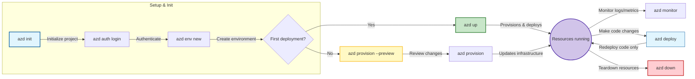
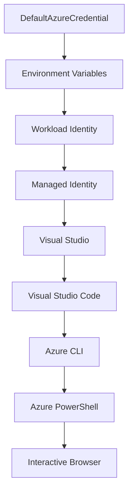

# AZD Perusteet - Keskeiset käsitteet ja perusteet

**Lukuvalikko:**
- **📚 Kurssin etusivu**: [AZD Aloittelijoille](../../README.md)
- **📖 Nykyinen luku**: Luku 1 - Perusta ja pikaaloitus
- **⬅️ Edellinen**: [Kurssin yleiskatsaus](../../README.md#-chapter-1-foundation--quick-start)
- **➡️ Seuraava**: [Asennus ja määritys](installation.md)
- **🚀 Seuraava luku**: [Luku 2: AI-Ensisijainen kehitys](../chapter-02-ai-development/microsoft-foundry-integration.md)

## Johdanto

> Tarkistettu versioon `azd 1.37.2` (marraskuu 2026). Bash-komennot käyttävät lainausmerkeissä olevia paikkamerkkejä, jotka sinun täytyy korvata. Mallipohjaiset työnkulut käyttävät `.` alustamaan nykyisen hakemiston; jos hakemistoa ei anneta argumenttina, mallin alustaminen luo alihakemiston eikä muuta kuoren työskentelyhakemistoa. Edistyneet koodikatkelmat ovat havainnollistavia, eivät kokonaisia projekteja.

Tämä oppitunti esittelee sinulle Azure Developer CLI:n (azd), tehokkaan komentorivityökalun, joka nopeuttaa matkaasi paikallisesta kehityksestä Azure-sovelluksen käyttöönottoon. Opit keskeiset käsitteet, tärkeimmät ominaisuudet ja ymmärrät, miten azd helpottaa pilvipohjaisten sovellusten käyttöönottoa.

## Oppimistavoitteet

Oppitunnin lopussa osaat:
- Ymmärtää, mitä Azure Developer CLI on ja sen ensisijainen tarkoitus
- Oppia mallien, ympäristöjen ja palveluiden keskeiset käsitteet
- Tutustua tärkeisiin ominaisuuksiin, mukaan lukien mallipohjainen kehitys ja infrastruktuuri koodina
- Ymmärtää azd-projektin rakenteen ja työnkulun
- Olla valmis asentamaan ja määrittämään azd kehitysympäristöösi

## Oppimistulokset

Oppitunnin jälkeen pystyt:
- Selittämään azd:n roolin nykyaikaisissa pilvikehityksen työnkuluissa
- Tunnistamaan azd-projektin rakenteen osat
- Kuvaamaan, miten mallit, ympäristöt ja palvelut toimivat yhdessä
- Ymmärtämään infrastruktuurin koodina tuomat hyödyt azd:n avulla
- Tunnistamaan erilaiset azd-komennot ja niiden tarkoitukset

## Mikä on Azure Developer CLI (azd)?

Azure Developer CLI (azd) on komentorivityökalu, joka on suunniteltu nopeuttamaan matkaasi paikallisesta kehityksestä Azure-käyttöönottoon. Se yksinkertaistaa pilvipohjaisten sovellusten rakentamisen, käyttöönoton ja hallinnan prosessia Azure-ympäristössä.

### Mitä voit ottaa käyttöön azd:n avulla?

azd tukee laajaa valikoimaa työkuormia — ja lista kasvaa jatkuvasti. Tänään voit käyttää azd:ta seuraavien käyttöönottoon:

| Työkuorman tyyppi | Esimerkkejä | Sama työnkulku? |
|---------------|----------|----------------|
| **Perinteiset sovellukset** | Web-sovellukset, REST-rajapinnat, staattiset sivustot | ✅ `azd up` |
| **Palvelut ja mikropalvelut** | Container Apps, Function Apps, monipalveluperustaiset backendit | ✅ `azd up` |
| **AI-pohjaiset sovellukset** | Keskustelusovellukset Microsoft Foundry -malleilla, RAG-ratkaisut AI-haulla | ✅ `azd up` |
| **Älykkäät agentit** | Foundry-isännöidyt agentit, monen agentin orkestroinnit | ✅ `azd up` |

Keskeinen oivallus on, että **azd:n elinkaari pysyy samana riippumatta siitä, mitä otat käyttöön**. Aloitat projektin, varaat infrastruktuurin, otat koodisi käyttöön, seuraat sovellusta ja siivoat jäljet — oli kyse yksinkertaisesta verkkosivustosta tai monimutkaisesta AI-agentista.

Tämä jatkuvuus on tarkoituksenmukaista. azd käsittelee AI-ominaisuuksia yhtenä muiden palveluiden tyypinä, joita sovelluksesi voi käyttää, ei aivan eri asiana. Microsoft Foundry -mallien tukema keskustelupäätepiste on azd:n näkökulmasta vain toinen konfiguroitava ja otettava käyttöön palvelu.

### 🎯 Miksi käyttää AZD:tä? Todellinen vertailu

Vertailkaamme yksinkertaisen web-sovelluksen ja tietokannan käyttöönottoa:

#### ❌ ILMAN AZD:tä: Manuaalinen Azure-käyttöönotto (yli 30 minuuttia)

**Havainnollistava Bash-vertailu, ei suoritettava sovelluksen aloitin.** Oletetaan, että sovelluskoodi on olemassa, resurssien nimet ovat uniikkeja, Azure CLI on autentikoitu ja tarvittavat CLI-laajennukset asennettu. Käytä alla olevaa malliharjoitusta tuetulle kokonaispolulle.

```bash
# Step 1: Create resource group
az group create --name myapp-rg --location eastus

# Step 2: Create App Service Plan
az appservice plan create --name myapp-plan \
  --resource-group myapp-rg \
  --sku B1 --is-linux

# Step 3: Create Web App
az webapp create --name myapp-web-unique123 \
  --resource-group myapp-rg \
  --plan myapp-plan \
  --runtime "NODE:22-lts"

# Step 4: Create Cosmos DB account (10-15 minutes)
az cosmosdb create --name myapp-cosmos-unique123 \
  --resource-group myapp-rg \
  --kind MongoDB

# Step 5: Create database
az cosmosdb mongodb database create \
  --account-name myapp-cosmos-unique123 \
  --resource-group myapp-rg \
  --name tododb

# Step 6: Create collection
az cosmosdb mongodb collection create \
  --account-name myapp-cosmos-unique123 \
  --resource-group myapp-rg \
  --database-name tododb \
  --name todos

# Step 7: Get connection string
CONN_STR=$(az cosmosdb keys list \
  --name myapp-cosmos-unique123 \
  --resource-group myapp-rg \
  --type connection-strings \
  --query "connectionStrings[0].connectionString" -o tsv)

# Step 8: Configure app settings
az webapp config appsettings set \
  --name myapp-web-unique123 \
  --resource-group myapp-rg \
  --settings MONGODB_URI="$CONN_STR"

# Step 9: Enable logging
az webapp log config --name myapp-web-unique123 \
  --resource-group myapp-rg \
  --application-logging filesystem \
  --detailed-error-messages true

# Step 10: Set up Application Insights
az monitor app-insights component create \
  --app myapp-insights \
  --location eastus \
  --resource-group myapp-rg

# Step 11: Link App Insights to Web App
INSTRUMENTATION_KEY=$(az monitor app-insights component show \
  --app myapp-insights \
  --resource-group myapp-rg \
  --query "instrumentationKey" -o tsv)

az webapp config appsettings set \
  --name myapp-web-unique123 \
  --resource-group myapp-rg \
  --settings APPINSIGHTS_INSTRUMENTATIONKEY="$INSTRUMENTATION_KEY"

# Step 12: Build application locally
npm install
npm run build

# Step 13: Create deployment package
zip -r app.zip . -x "*.git*" "node_modules/*"

# Step 14: Deploy application
az webapp deployment source config-zip \
  --resource-group myapp-rg \
  --name myapp-web-unique123 \
  --src app.zip

# Step 15: Wait and pray it works 🙏
# (No automated validation, manual testing required)
```

**Ongelmia:**
- ❌ Yli 15 komentoa muistettavaksi ja suoritettavaksi oikeassa järjestyksessä
- ❌ 30-45 minuuttia manuaalista työtä
- ❌ Helppo tehdä virheitä (näppäilyvirheet, väärät parametrit)
- ❌ Tunnistetietojen käsittely vaatii erillistä huomiota; virhelokit ja kuoren jäljitys voivat paljastaa ne
- ❌ Ei automaattista palautusta virheen sattuessa
- ❌ Vaikea toistaa tiimin jäsenille
- ❌ Eri kerralla eri tavalla (ei toistettavissa)

#### ✅ AZD:n KANSSA: Automatisoitu käyttöönotto (5 komentoa, 10-15 minuuttia)

```bash
# Step 1: Initialize from template
azd init --template todo-nodejs-mongo .

# Step 2: Authenticate
azd auth login

# Step 3: Select the environment created during init
azd env select dev

# Step 4: Preview changes (optional but recommended)
azd provision --preview

# Step 5: Deploy everything
azd up

# ✨ Done! Everything is deployed, configured, and monitored
```

**Hyötyjä:**
- ✅ **5 komentoa** vs. yli 15 manuaalista vaihetta
- ✅ **10-15 minuutin** kokonaisaika (enimmäkseen odotusta Azurelle)
- ✅ **Vähemmän manuaalisia virheitä** - johdonmukainen, mallipohjainen työnkulku
- ✅ **Turvallinen salaisuuksien käsittely** - monet mallit käyttävät Azure-hallittuja salaisuuksien tallennuksia
- ✅ **Toistettavat käyttöönotot** - sama työnkulku joka kerta
- ✅ **Toistettavat infrastruktuurin määritelmät** - alisteiset käyttörajoille, alueen saatavuudelle ja malliversioille
- ✅ **Tiimivalmis** - kuka tahansa voi ottaa käyttöön samoilla komennoilla
- ✅ **Infrastruktuuri koodina** - versionhallitut Bicep-mallit
- ✅ **Mallipohjainen valvonta** - Application Insights, kun se on sisällytetty malliin

### Aika ja luotettavuus

Yllä olevat aikamääreet ovat arvioita, eivät mittaustuloksia. azd vähentää tarvittavia komentoja, mutta ei takaa käyttöönoton kestoa, poista virheitä tai tarjoa automaattista sovellus- tai tietokantapalautusta. Säilytä toimivat versiot versionhallinnassa ja testaa palautusmenettelyt.

## Keskeiset käsitteet

### Mallit
Mallit ovat azd:n perusta. Ne sisältävät:
- **Sovelluskoodi** - Lähdekoodi ja riippuvuudet
- **Infrastruktuurin määritelmät** - Azure-resurssit määriteltyinä Bicep- tai Terraform-kielellä
- **Konfiguraatiotiedostot** - Asetukset ja ympäristömuuttujat
- **Julkaisu skriptit** - Automatisoidut työnkulut käyttöönottoon

### Ympäristöt
Ympäristöt edustavat eri käyttökohteita:
- **Kehitys** - Testaus- ja kehitysympäristö
- **Testi** - Esituotanto-ympäristö
- **Tuotanto** - Tuotantoympäristö

Jokaisella ympäristöllä on oma:
- Ympäristön nimi ja arvot; resurssieristys riippuu infrastruktuurimallista
- Konfiguraatioasetukset
- Julkaisun tila

### Palvelut
Palvelut `azure.yaml` kuvaavat julkaisukelpoisia sovelluskomponentteja:
- **Etupää** - Web-sovellukset, SPA:t
- **Takapää** - Rajapinnat, mikropalvelut

Tietokannat ja tallennustilat varataan yleensä infrastruktuuriresursseina, ei keksittyinä palveluiden isäntinä kuten `host: postgres`.

## Keskeiset ominaisuudet

### 1. Mallipohjainen kehitys
```bash
# Browse available templates
azd template list

# Initialize from a template
azd init --template "<template-name>" .
```

### 2. Infrastruktuuri koodina
- **Bicep** – Azuren oma erikoiskieli
- **Terraform** – Monipilvityökalu infrastruktuurin hallintaan
- Bicep kääntyy ARM-malleiksi; raakaa ARM JSON:ää ei ole sisäänrakennettuna erillisenä `infra.provider`.

### 3. Integroitu työnkulku
```bash
# Complete deployment workflow
azd up            # Provision + Deploy this is hands off for first time setup

# 🧪 NEW: Preview infrastructure changes before deployment (SAFE)
azd provision --preview    # Simulate infrastructure deployment without making changes

azd provision     # Create Azure resources if you update the infrastructure use this
azd deploy        # Deploy application code or redeploy application code once update
azd down          # Clean up resources
```

#### 🛡️ Turvallinen infrastruktuurin suunnittelu esikatselulla
`azd provision --preview`-komento on merkittävä parannus turvallisiin julkaisuihin:
- **Kuivakäyntianalyysi** – näyttää, mitä luodaan, muutetaan tai poistetaan
- **Ei infrastruktuurin käyttöönottoa** – tarkastaa toimittajan muutokset; tarkastele ensin projektin koukkuja, sillä ne voivat suorittaa komentoja sivuvaikutuksilla
- **Tiimityöskentely** – jaa esikatselutulokset ennen julkaisua
- **Kustannussuunnittelu** – tarkasta ehdotetut SKU:t, vertaile hintoja Azure-hinnoittelulaskimen avulla; esikatselu ei laske hintoja

```bash
# Example preview workflow
azd provision --preview           # See what will change
# Review the output, discuss with team
azd provision                     # Apply changes with confidence
```

### 📊 Visualisointi: AZD-kehitystyönkulku



**Työnkulun selitys:**
1. **Init** – Aloita mallilla tai uudella projektilla
2. **Auth** – Autentikoi Azureen
3. **Environment** – Luo eristetty käyttöympäristö
4. **Preview** – 🆕 Katso aina ensin infrastruktuurin muutokset (turvallinen käytäntö)
5. **Provision** – Luo/päivitä Azure-resurssit
6. **Deploy** – Lähetä sovelluskoodisi
7. **Monitor** – Tarkkaile sovelluksen suorituskykyä
8. **Iterate** – Tee muutoksia ja ota koodi uudelleen käyttöön
9. **Cleanup** – Poista resurssit, kun et enää tarvitse niitä

### 4. Ympäristön hallinta
```bash
# Create and manage environments
azd env new "<environment-name>"
azd env select "<environment-name>"
azd env list
```

### 5. Laajennukset ja AI-komennot

azd käyttää laajennusjärjestelmää tuodakseen perus-CLI:n ulkopuolisia ominaisuuksia. Tämä on erityisen hyödyllistä AI-työkuormien käsittelyssä:

```bash
# List available extensions
azd extension list

# Install the GA Foundry bundle (requires azd >= 1.37.0)
azd ext install microsoft.foundry

# Initialize an AI agent project interactively
azd ai agent init

# Test a deployed agent (shows latency and time-to-first-byte)
azd ai agent invoke

# Start the MCP server for AI-assisted development (Alpha)
azd mcp start
```

**Agentin elinkaari alusta loppuun.** GA-paketissa `microsoft.foundry` on mukana `azure.ai.agents` sekä kuusi muuta ydintä laajennusta. Asenna `azure.ai.evaluations` erikseen arviointia varten. Käytä `azd >= 1.37.0` tätä työnkulkua varten. Kaikkia näitä ei tarvitse alussa:

| Vaihe | Komento | Mitä tekee |
|-------|---------|--------------|
| **Mallinnus** | `azd ai agent init --template <path-to-azure.yaml>` | Ota käyttöön nykyinen agenttiprojektin malli |
| **Paikallinen ajo** | `azd ai agent run`, sitten `azd ai agent invoke --local "Test prompt"` toisessa terminaalissa | Tarkastele paikallista toimintaa Agent Inspectorissa; mallikutsut edelleen Azuren kautta |
| **Käyttöönotto** | `azd deploy` | Koodimuodossa isännöityjen agenttien lähdekoodin lataus etärakennusta varten Foundryssä |
| **Testaus** | `azd ai agent invoke` | Kutsu agenttia ja seuraa vastausaikoja |
| **Mittaus** | `azd ai eval init`, `generate`, `run start` | Määrittele, ota käyttöön ja suorita arviointeja erillisellä laajennuksella |
| **Parannus** | `azd ai agent optimize --eval <evaluation-name> --optimize-model <optimizer-deployment>` | Hyödynnä yhteensopivaa arviointia agentin optimointiin |
| **Tarkastus** | `azd ai agent endpoint show` | Katso reaaliaikaista päätepisteen konfiguraatiota |
| **Siivous** | `azd ai agent delete` | Poista isännöity agentti ja kaikki sen versiot |

> Aloita [GA-hosted-agent-oppaasta](../chapter-02-ai-development/microsoft-foundry-integration.md#hosted-agent-walkthrough-ga), jossa käydään läpi esivaatimukset, varaukset ja turvallinen siivous. Laajennukset on käsitelty laajemmin [AZD AI CLI Commands](../chapter-08-production/production-ai-practices.md#azd-ai-cli-commands-and-extensions) -viitteessä.

## 📁 Projektin rakenne

Tyypillinen azd-projektin rakenne:
```
my-app/
├── .azure/                  # Local environments and selected-environment config
│   ├── config.json
│   └── dev/.env
├── .devcontainer/          # Development container config
├── .github/workflows/      # GitHub Actions
├── .vscode/               # VS Code settings
├── infra/                 # Infrastructure code
│   ├── main.bicep        # Main infrastructure template
│   ├── main.parameters.json
│   └── modules/          # Reusable modules
├── src/                  # Application source code
│   ├── api/             # Backend services
│   └── web/             # Frontend application
├── azure.yaml           # azd project configuration
└── README.md
```

## 🔧 Konfiguraatiotiedostot

### azure.yaml
Projektin pääasiallinen konfiguraatiotiedosto:
```yaml
name: my-awesome-app
metadata:
  template: my-template@1.0.0

services:
  web:
    project: ./src/web
    language: js
    host: appservice
  api:
    project: ./src/api
    language: js
    host: appservice

hooks:
  preprovision:
    shell: pwsh
    run: echo "Preparing to provision..."
```

### .azure/config.json
Projektikohtainen oletusympäristön valinta (havainnollistava; azd hallinnoi tätä):
```json
{
  "defaultEnvironment": "dev"
}
```

## 🎪 Yleiset työnkulut käytännön harjoituksilla

> **💡 Oppimisvinkki:** Seuraa näitä harjoituksia järjestyksessä kehittääksesi AZD-taitojasi asteittain.

### 🎯 Harjoitus 1: Aloita ensimmäinen projektisi

**Tavoite:** Luo AZD-projekti ja tutki sen rakennetta

**Vaiheet:**
```bash
# Use a proven template
mkdir azd-basics-practice
cd azd-basics-practice
# Choose "dev" for the environment name when prompted
azd init --template todo-nodejs-mongo .

# Explore the generated files
ls -la  # View all files including hidden ones

# Key files created:
# - azure.yaml (main config)
# - infra/ (infrastructure code)
# - src/ (application code)
```

**✅ Onnistuminen:** Sinulla on azure.yaml, infra/ ja src/ hakemistot

---

### 🎯 Harjoitus 2: Ota käyttöön Azureen

**Tavoite:** Suorita kokonaistoimintaketjun käyttöönotto

**Vaiheet:**
```bash
# 1. Authenticate
azd auth login

# 2. Select the dev environment created in Exercise 1
azd env select dev
azd env set AZURE_LOCATION eastus

# 3. Preview changes (RECOMMENDED)
azd provision --preview

# 4. Deploy everything
azd up

# 5. Verify deployment
azd show    # View your app URL
```

**Arvioitu aika:** 10-15 minuuttia  
**✅ Onnistuminen:** Sovelluksen URL aukeaa selaimessa

---

### 🎯 Harjoitus 3: Useat ympäristöt

**Tavoite:** Ota käyttöön kehitys- ja testausympäristöihin

**Vaiheet:**
```bash
# Already have dev, create staging
azd env new staging
azd env set AZURE_LOCATION westus2
azd up

# Switch between them
azd env list
azd env select dev
```

**✅ Onnistuminen:** Kahdet erilliset resurssiryhmät Azure-portaalissa

**Siivous:** Harjoitus 3 luo toisen laskutettavan käyttöönoton. Poista molemmat käytön jälkeen:

```bash
azd down --environment dev
azd down --environment staging
```

---

### 🛡️ Tuhoava siivous: `azd down --force --purge`

Kun haluat tarkoituksellisesti poistaa valitun ympäristön Azure-resurssit:

```bash
azd down --force --purge
```

**Mitä se tekee:**
- `--force`: Ei vahvistuskehotuksia
- `--purge`: Poistaa myös pysyvästi tuetut pehmeästi poistetut resurssit (esimerkiksi Key Vaultit), jos puhdistussuoja sallii. Ei poista paikallista `.azure/` hakemistoa.

**Käytä, kun:** olet valmis hylättävän ympäristön kanssa. Älä käytä tuhoavaa siivousta ensimmäisenä ratkaisuna todennuksen, käyttörajojen tai konfiguraatio-ongelmien korjaamiseen.

---

## 🎪 Alkuperäinen työnkulun viite

### Uuden projektin aloittaminen
```bash
# Method 1: Use existing template
azd init --template todo-nodejs-mongo .

# Method 2: Start from scratch
azd init

# Method 3: Use current directory
azd init .
```

### Kehityssykli
```bash
# Set up development environment
azd auth login
azd env new dev
azd env select dev

# Deploy everything
azd up

# Make changes and redeploy
azd deploy

# Clean up when done
azd down --force --purge # Deletes this environment's discovered Azure resources; review before forcing deletion.
```

## Ymmärtäminen `azd down --force --purge`
`azd down --force --purge`-komento on tehokas tapa purkaa kokonaan azd-ympäristösi ja kaikki siihen liittyvät resurssit. Tässä erittely siitä, mitä kukin valitsin tekee:
```
--force
```
- Ohittaa varmistuskehotukset.
- Hyödyllinen automatisoinnissa tai skriptaamisessa, jossa manuaalista syöttöä ei voi tehdä.
- Ei ohita käyttöoikeuksia, puhdistussuojaa tai poistovirheitä.

```
--purge
```
Poistaa pysyvästi tuetut pehmeästi poistetut Azure-resurssit ilman lisävahvistusta. Puhdistussuojauksen ja käyttöoikeuksien soveltaminen säilyy. Se **ei** poista paikallisia ympäristöjä tai `.azure/`-kansiota.


### Miksi käyttää molempia?
Käytä molempia vain, kun aiot poistaa valitun ympäristön Azure-resurssit ja puhdistaa palautettavat resurssit. Tämä on tuhoavaa siivousta, ei yleinen korjaus tai paikallisen tilan nollaus.

Se on erityisen hyödyllinen manuaalisten resurssien poistojen jälkeen Azure-portaalissa tai kun vaihdetaan malleja, ympäristöjä tai resurssiryhmien nimeämiskäytäntöjä.


### Useiden Ympäristöjen Hallinta
```bash
# Create staging environment
azd env new staging
azd env select staging
azd up

# Switch back to dev
azd env select dev

# Compare environments
azd env list
```

## 🔐 Todennus ja tunnistetiedot

Erota käyttöönoton todennus (`azd auth login`) sovelluksen SDK-todennuksesta (`DefaultAzureCredential`). Ne ovat erillisiä. azd ei käytä oletuksena Azure CLI -tunnistetietoja.

### Azure CLI -todennus (`az login`)

Suorita `azd auth login` azd:lle. Seuraavat Azure CLI -komennot ovat valinnaisia ja todennustavat `az` komennot erikseen:

```bash
# Interactive login (opens browser)
az login

# Login with specific tenant
az login --tenant "<tenant-id>"

# Login with service principal
az login --service-principal -u "<app-id>" -p "<password>" --tenant "<tenant-id>"

# Check current login status
az account show

# List available subscriptions
az account list --output table

# Set default subscription
az account set --subscription "<subscription-id>"
```

### Todennusprosessi
1. **Interaktiivinen kirjautuminen**: Avaa oletusselaimesi todennusta varten
2. **Laitteen Koodivirta**: Selaimen käyttöä vailla oleville ympäristöille
3. **Palvelun Pääkäyttäjä**: Automaatio- ja CI/CD-skenaarioille
4. **Hallittu Tunnus**: Azure-isännöidyille sovelluksille

### DefaultAzureCredential Ketju

`DefaultAzureCredential` on tunnustyyppi, joka tarjoaa yksinkertaistetun todennuskokemuksen yrittämällä automaattisesti useita tunnistuslähteitä tietyssä järjestyksessä:

#### Sovellus-SDK:n Tunnusketju

Tarkka ketju riippuu Azure Identity SDK:n kielestä, versiosta, asennetuista lisäosista ja asetuksista. Tämä kaavio on käsitteellinen, ei kiinteä azd-todennusjärjestys; uusimmat SDK:t voivat sisältää myös Azure Developer CLI -tunnukset.


#### 1. Ympäristömuuttujat
```bash
# Set environment variables for service principal
export AZURE_CLIENT_ID="<app-id>"
export AZURE_CLIENT_SECRET="<password>"
export AZURE_TENANT_ID="<tenant-id>"
```

#### 2. Työkuorman Tunnistus (Kubernetes/GitHub Actions)
Käytetään automaattisesti:
- Azure Kubernetes Service (AKS) työkuorman tunnistuksella
- GitHub Actions OIDC-liitännällä
- Muissa liitetyissä tunnistus-skenaarioissa

#### 3. Hallittu Tunnus
Azure-resursseille kuten:
- Virtuaalikoneet
- App Service
- Azure Functions
- Container Instances

```bash
# Inspect a deployed Container App's configured identity (requires az login)
az containerapp show --name "<app-name>" --resource-group "<rg-name>" --query identity
```

#### 4. Kehittäjätyökalujen Integrointi
- **Visual Studio**: Käyttää automaattisesti sisäänkirjautunutta tiliä
- **VS Code**: Tuki riippuu SDK:sta ja sen tukemasta välittäjä-/lisäosarakenteesta
- **Azure CLI**: Käyttää `az login` tunnuksia (yleisin paikallisessa kehityksessä)

### AZD-todennuksen Asettaminen

```bash
# Method 1: Direct azd authentication (recommended)
azd auth login

# Method 2: Direct azd authentication
azd auth login --use-device-code  # For headless environments

# Method 3: Check authentication status
azd auth login --check-status

# Method 4: Logout and re-authenticate
azd auth logout
azd auth login
```

### Todennuksen Parhaat Käytännöt

#### Paikalliseen Kehitykseen
```bash
# 1. Log in to azd
azd auth login

# 2. Select the subscription for this initialized environment
azd env set AZURE_SUBSCRIPTION_ID "<subscription-id>"

# 3. Check azd sign-in details (read the status message)
azd auth login --check-status
```

#### CI/CD-putkistoille
```yaml
# Partial GitHub Actions steps: assumes checkout, azd installation,
# required AZURE_* environment values, and pipeline secret configuration.
- name: Deploy with azd
  run: |
    azd auth login --client-id ${{ secrets.AZURE_CLIENT_ID }} \
                    --client-secret ${{ secrets.AZURE_CLIENT_SECRET }} \
                    --tenant-id ${{ secrets.AZURE_TENANT_ID }}
    azd up --no-prompt
```

#### Tuotantoympäristöihin
- Käytä **Hallittua Tunnusta** kun ajat Azure-resursseilla
- Käytä **Palvelun Pääkäyttäjää** automaatioskenaarioissa
- Vältä tunnusten tallentamista koodiin tai konfiguraatiotiedostoihin
- Käytä **Azure Key Vaultia** arkaluonteiseen konfiguraatioon

### Yleisiä Todennusongelmia ja Ratkaisuja

#### Ongelma: "Ei tilausta löydetty"
```bash
# Solution: Set default subscription
az account list --output table
az account set --subscription "<subscription-id>"
azd env set AZURE_SUBSCRIPTION_ID "<subscription-id>"
```

#### Ongelma: "Puuttuvat oikeudet"
```bash
# Solution: Check and assign required roles
az role assignment list --assignee $(az account show --query user.name --output tsv)

# Common required roles:
# - Contributor (for resource management)
# - User Access Administrator (for role assignments)
```

#### Ongelma: "Token vanhentunut"
```bash
# Solution: Re-authenticate
az logout
az login
azd auth logout
azd auth login
```

### Todennus eri skenaarioissa

#### Paikallisessa Kehityksessä
```bash
# Personal development account
az login
azd auth login
```

#### Tiimikehityksessä
```bash
# Use specific tenant for organization
az login --tenant contoso.onmicrosoft.com
azd auth login --tenant-id "<tenant-id>"
```

#### Monivuokratilanteissa
```bash
# Switch between tenants
az login --tenant tenant1.onmicrosoft.com
azd auth login --tenant-id "<tenant-1-id>"
# Select an environment configured with tenant 1's subscription
azd env select tenant1-dev
# Deploy to tenant 1
azd up

az login --tenant tenant2.onmicrosoft.com  
azd auth login --tenant-id "<tenant-2-id>"
azd env select tenant2-dev
# Deploy to tenant 2
azd up
```

### Turvallisuusnäkökohdat

1. **Tunnusten Tallennus**: Älä koskaan tallenna tunnuksia lähdekoodiin
2. **Käyttölupien Rajoittaminen**: Käytä vähimmän tarvittavan käyttöoikeuden periaatetta palvelun pääkäyttäjille
3. **Tokenin Kierrätys**: Vaihda palvelun pääkäyttäjän salaisuudet säännöllisesti
4. **Audit-jälki**: Valvo todennus- ja käyttöönottoaktiviteetteja
5. **Verkkoturva**: Käytä yksityisiä päätepisteitä kun mahdollista

### Todennuksen Vianmääritys

```bash
# Debug authentication issues
azd auth login --check-status
az account show
az account get-access-token

# Common diagnostic commands
whoami                          # Current user context
az ad signed-in-user show      # Microsoft Entra ID user details
az group list                  # Test resource access
```

## Komentojen Löytäminen

### Löytäminen
```bash
azd template list              # Browse templates
azd template list --help       # Template discovery options
azd init --help               # Initialization options
```

### Projektinhallinta
```bash
azd show                     # Project overview
azd env list                # Available environments and selected default
azd config show            # Configuration settings
```

### Valvonta
```bash
azd monitor                  # Open Azure portal monitoring
azd monitor --logs           # View application logs
azd monitor --live           # View live metrics
azd pipeline config          # Set up CI/CD
```

## Parhaat Käytännöt

### 1. Käytä Merkityksellisiä Nimiä
```bash
# Good
azd env new production-east
azd init --template todo-nodejs-mongo .

# Avoid
azd env new env1
azd init --template template1 .
```

### 2. Hyödynnä Mallipohjia
- Aloita olemassa olevista malleista
- Räätälöi tarpeidesi mukaan
- Luo uudelleenkäytettäviä malleja organisaatiollesi

### 3. Ympäristöjen Eristäminen
- Käytä erillisiä ympäristöjä dev/staging/tuotanto
- Älä koskaan ota tuotantoon suoraa käyttöön paikalliselta koneelta
- Käytä CI/CD-putkia tuotantokäyttöönotoissa

### 4. Konfiguraation Hallinta
- Käytä hallittua tunnusta ja Key Vaultia salaisuuksille; tavalliset `azd env set` arvot ovat paikallisia selväkielisiä
- Säilytä konfiguraatio versionhallinnassa
- Dokumentoi ympäristökohtaiset asetukset

## Oppimisen eteneminen

### Aloittelija (Viikot 1-2)
1. Asenna azd ja todennu
2. Julkaise yksinkertainen malli
3. Ymmärrä projektin rakenne
4. Opettele peruskomennot (up, down, deploy)

### Keskitaso (Viikot 3-4)
1. Räätälöi malleja
2. Hallitse useita ympäristöjä
3. Ymmärrä infrastruktuurikoodi
4. Aseta CI/CD-putkistot

### Edistynyt (Viikot 5+)
1. Luo omia mallipohjia
2. Kehittyneet infrastruktuurikuviot
3. Monialueiden käyttöönotot
4. Yritystason konfiguraatiot

## Seuraavat Askeleet

**📖 Jatka Luku 1 Oppimista:**
- [Asennus ja Asetukset](installation.md) - Hanki azd asennettuna ja konfiguroituna
- [Ensimmäinen Projektisi](first-project.md) - Suorita käytännön opetusohjelma
- [Konfiguraatio-opas](../chapter-03-configuration/configuration.md) - Kehittyneet konfiguraatiovaihtoehdot

**🎯 Valmiina Seuraavaan Lukuun?**
- [Luku 2: AI-Ensimmäinen Kehitys](../chapter-02-ai-development/microsoft-foundry-integration.md) - Aloita tekoälysovellusten rakentaminen

## Lisäresurssit

- [Azure Developer CLI Yleiskatsaus](https://learn.microsoft.com/en-us/azure/developer/azure-developer-cli/)
- [Malligalleria](https://azure.github.io/awesome-azd/)
- [Yhteisömallit](https://github.com/Azure-Samples)

---

## 🙋 Usein Kysytyt Kysymykset

### Yleiset Kysymykset

**K: Mikä on ero AZD:n ja Azure CLI:n välillä?**

V: Azure CLI (`az`) on yksittäisten Azure-resurssien hallintaan. AZD (`azd`) hallitsee kokonaisia sovelluksia:

```bash
# Azure CLI - Low-level resource management
az webapp create --name myapp --resource-group rg
az sql server create --name myserver --resource-group rg
# ...many more commands needed

# AZD - Application-level management
azd up  # Deploys entire app with all resources
```

**Ajattele sitä näin:**
- `az` = Toimiminen yksittäisten Lego-palikoiden kanssa
- `azd` = Työskentely täydellisten Lego-lahjapakettien kanssa

---

**K: Tarvitsenko Bicepin tai Terraformin käyttääkseni AZD:tä?**

V: Ei! Aloita malleilla:
```bash
# Use existing template - no IaC knowledge needed
azd init --template todo-nodejs-mongo .
azd up
```

Voit oppia Bicepin myöhemmin infrastruktuurin räätälöintiin. Mallit tarjoavat toimivia esimerkkejä oppimista varten.

---

**K: Paljonko AZD-mallien ajaminen maksaa?**

V: Kustannukset vaihtelevat alueen, SKU:n, käyttöajan, tietokannantilan ja mallin käytön mukaan. Kehitysympäristö voi aiheuttaa huomattavia kuukausittaisia kuluja myös ollessaan passiivinen; älä olettaa yleispätevää 50-150 dollarin hintahaarukkaa:

```bash
# Preview resource changes (not prices)
azd provision --preview

# Always cleanup when not using
azd down --force --purge  # Removes all resources
```

**Vinkki:** Käytä ilmaisia tasoja mahdollisuuksien mukaan:
- App Service: F1 (Ilmainen) taso
- Azure OpenAI: ei yleistä takuutasoista kuukausittaista ilmaista token-kiintiötä; tarkista nykyinen malli ja hinnoittelu
- Cosmos DB: oikeutetut provisionoitu-läpäisytilan tilit voivat valita ilmaisen tason; serverless-mallit eivät automaattisesti kelpaa

---

**K: Voinko käyttää AZD:tä olemassa olevien Azure-resurssien kanssa?**

V: Kyllä, mutta on helpompaa aloittaa puhtaalta pöydältä. AZD toimii parhaiten, kun se hallitsee koko elinkaaren. Olemassa oleville resursseille:

```bash
# Option 1: Import existing resources (advanced)
azd init
# Then modify infra/ to reference existing resources

# Option 2: Start fresh (recommended)
azd init --template "<verified-template-name>" .
azd up  # Creates new environment
```

---

**K: Miten jaan projektini tiimiläisten kanssa?**

V: Tee commit AZD-projektista Git-repositorioon (mutta EI .azure-kansiota):

```bash
# Already in .gitignore by default
.azure/        # Contains secrets and environment data
*.env          # Environment variables

# Team members then:
git clone "<your-repo>"
# Change into the cloned repository before running the remaining commands.
azd auth login
azd env new "<their-name>-dev"
azd up
```

Kaikki saavat identtisen infrastruktuurin samoista malleista.

---

### Vianetsintäkysymykset

**K: "azd up" epäonnistui puolivälissä. Mitä teen?**

V: Tarkista virhe, korjaa se ja yritä uudelleen:

```bash
# Capture detailed diagnostics (redact sensitive values before sharing)
azd up --debug

# Common fixes:

# 1. If quota exceeded:
azd env set AZURE_LOCATION "westus2"  # Try different region

# 2. If resource name conflict:
azd down --force --purge  # Clean slate
azd up  # Retry

# 3. If auth expired:
az login
azd auth login
azd up
```

**Yleisin ongelma:** Väärä Azure-tilaus valittu
```bash
az account list --output table
az account set --subscription "<correct-subscription>"
azd env set AZURE_SUBSCRIPTION_ID "<correct-subscription-id>"
```

---

**K: Kuinka julkaisen pelkästään koodimuutokset ilman uudelleenasentamista?**

V: Käytä `azd deploy` sijaan `azd up`:

```bash
azd up          # First time: provision + deploy (slow)

# Make code changes...

azd deploy      # Subsequent times: deploy only (fast)
```

Nopeusero:
- `azd up`: 10-15 minuuttia (asentaa infrastruktuurin)
- `azd deploy`: 2-5 minuuttia (vain koodi)

---

**K: Voinko räätälöidä infrastruktuurimalleja?**

V: Kyllä! Muokkaa Bicep-tiedostoja kansiossa `infra/`:

```bash
# After azd init
cd infra/
code main.bicep  # Edit in VS Code

# Preview changes
azd provision --preview

# Apply changes
azd provision
```

**Vinkki:** Aloita pienestä - muuta ensin SKUja:
```bicep
// infra/main.bicep
sku: {
  name: 'B1'  // Change to 'P1V2' for production
}
```

---

**K: Miten poistan kaiken mitä AZD loi?**

V: Yksi komento poistaa kaikki resurssit:

```bash
azd down --force --purge

# This deletes:
# - Azure resources/resource groups discovered for the selected environment
# - Supported soft-deleted resources, if purge protection allows
# Local .azure files remain; shared/external resources may remain too.
```

**Suorita tämä aina kun:**
- Olet testannut mallia
- Vaihdat projektiin
- Haluat aloittaa alusta

**Kustannustarkistus:** Vahvista poisto Azure-portaalissa ja tarkista mahdolliset säilytetyt/jako-resurssit. Aiemmat kulut pysyvät voimassa.

---

**K: Entä jos poistin vahingossa resursseja Azure-portaalista?**

V: AZD:n tila voi mennä epäsynkkaan. Puhdas aloitus:

```bash
# 1. Delete remaining resources only if that is your intent
azd down --force --purge

# 2. Start fresh
azd up

# Alternative: Let AZD detect and fix
azd provision  # Will create missing resources
```

---

### Edistyneet Kysymykset

**K: Voinko käyttää AZD:tä CI/CD-putkistoissa?**

V: Kyllä! GitHub Actions -esimerkki:

```yaml
# .github/workflows/deploy.yml
name: Deploy with AZD

on:
  push:
    branches: [main]

jobs:
  deploy:
    runs-on: ubuntu-latest
    steps:
      - uses: actions/checkout@v4
      
      - name: Install azd
        run: curl -fsSL https://aka.ms/install-azd.sh | bash
      
      - name: Azure Login
        run: |
          azd auth login \
            --client-id ${{ secrets.AZURE_CLIENT_ID }} \
            --client-secret ${{ secrets.AZURE_CLIENT_SECRET }} \
            --tenant-id ${{ secrets.AZURE_TENANT_ID }}
      
      - name: Deploy
        env:
          AZURE_ENV_NAME: dev
          AZURE_LOCATION: ${{ vars.AZURE_LOCATION }}
          AZURE_SUBSCRIPTION_ID: ${{ vars.AZURE_SUBSCRIPTION_ID }}
        run: azd up --no-prompt
```

---

**K: Miten käsittelen salaisuuksia ja arkaluonteisia tietoja?**

V: Käytä Key Vaultia selkeästi. `azd env set` kirjoittaa tavalliset arvot paikalliseen ympäristötiedostoon; se ei automaattisesti luo vaultia, määritä rooleja tai anna salaisuuksia sovelluksellesi.

```bash
# Interactive: create/select a Key Vault secret and save its reference
azd env set-secret DATABASE_PASSWORD
```

Tarvitset sopivat vault-oikeudet. Infrastruktuurisi/sovelluksesi täytyy edelleen linkittää salaisuus kuluttajalleen ja antaa ajonaikainen tunnus käyttöoikeuden. Älä tulosta ratkaistuja salaisuuksia lokiin.

**Älä koskaan tee commit:**
- `.azure/` kansiota (sisältää ympäristötiedot)
- `.env` tiedostoja (paikalliset salaisuudet)
- Yhteysmerkkijonoja

---

**K: Voinko julkaista useille alueille?**

V: Kyllä, luo ympäristö per alue:

```bash
# East US environment
azd env new prod-eastus
azd env set AZURE_LOCATION eastus
azd up

# West Europe environment
azd env new prod-westeurope
azd env set AZURE_LOCATION westeurope
azd up

# Each environment is independent
azd env list
```

Todellisille monialueisille sovelluksille räätälöi Bicep-mallit käyttöönotoille useille alueille samanaikaisesti.

---

**K: Mistä saan apua, jos jumitan?**

1. **AZD Dokumentaatio:** https://learn.microsoft.com/azure/developer/azure-developer-cli/
2. **GitHub Issues:** https://github.com/Azure/azure-dev/issues
3. **Discord:** [Azure Discord](https://discord.gg/microsoft-azure) - #azure-developer-cli kanava
4. **Stack Overflow:** Tägää `azure-developer-cli`
5. **Tämä Kurssi:** [Vianetsintäopas](../chapter-07-troubleshooting/common-issues.md)

**Vinkki:** Ennen kysymistä, suorita:
```bash
azd show       # Shows current state
azd version    # Shows your version
```
Sisällytä tämä tieto kysymykseesi nopeamman avun saamiseksi.

---

## 🎓 Mitä Seuraavaksi?

Ymmärrät nyt AZD:n perusteet. Valitse polkusi:

### 🎯 Aloittelijoille:
1. **Seuraavana:** [Asennus ja Asetukset](installation.md) - Asenna AZD koneellesi
2. **Sitten:** [Ensimmäinen Projekti](first-project.md) - Julkaise ensimmäinen sovelluksesi
3. **Harjoittele:** Suorita kaikki 3 harjoitusta tässä opissa

### 🚀 Tekoälykehittäjille:
1. **Hyppää:** [Luku 2: AI-Ensimmäinen Kehitys](../chapter-02-ai-development/microsoft-foundry-integration.md)
2. **Julkaise:** Tyhjässä projektihakemistossa aloita `azd init --template get-started-with-ai-chat .`
3. **Opiskele:** Rakenna samalla kun julkaiset

### 🏗️ Kokeneille Kehittäjille:
1. **Käy läpi:** [Konfiguraatio-Opas](../chapter-03-configuration/configuration.md) - Kehittyneet asetukset
2. **Tutki:** [Infrastructure as Code](../chapter-04-infrastructure/provisioning.md) - Syvä sukellus Bicepiin
3. **Rakenna:** Luo omat mallisi pinollesi

---

**Lukujen Navigointi:**
- **📚 Kurssin Etusivu**: [AZD Aloittelijoille](../../README.md)
- **📖 Nykyinen Luku**: Luku 1 - Perusteet & Pikakäyttö  
- **⬅️ Edellinen**: [Kurssin Yleiskatsaus](../../README.md#-chapter-1-foundation--quick-start)
- **➡️ Seuraava**: [Asennus ja Asetukset](installation.md)
- **🚀 Seuraava Luku**: [Luku 2: AI-Ensimmäinen Kehitys](../chapter-02-ai-development/microsoft-foundry-integration.md)

---

<!-- CO-OP TRANSLATOR DISCLAIMER START -->
**Vastuuvapauslauseke**:
Tämä asiakirja on käännetty käyttämällä tekoälypohjaista käännöspalvelua [Co-op Translator](https://github.com/Azure/co-op-translator). Vaikka pyrimme tarkkuuteen, otathan huomioon, että automaattiset käännökset saattavat sisältää virheitä tai epätarkkuuksia. Alkuperäinen asiakirja sen alkuperäiskielellä on virallinen lähde. Tärkeissä asioissa suositellaan ammattimaista ihmiskäännöstä. Emme ole vastuussa tämän käännöksen käytöstä aiheutuvista väärinymmärryksistä tai tulkinnoista.
<!-- CO-OP TRANSLATOR DISCLAIMER END -->