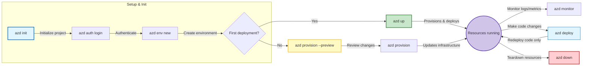
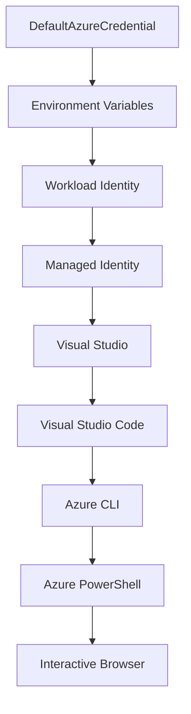

# AZD Perusteet - Keskeiset Käsitteet ja Perusteet

**Luvun navigointi:**
- **📚 Kurssin etusivu**: [AZD Aloittelijoille](../../README.md)
- **📖 Nykyinen luku**: Luku 1 - Perusta & Nopeasti Käyntiin
- **⬅️ Edellinen**: [Kurssin yleiskatsaus](../../README.md#-chapter-1-foundation--quick-start)
- **➡️ Seuraava**: [Asennus & Asetukset](installation.md)
- **🚀 Seuraava luku**: [Luku 2: AI-Ensisijainen Kehitys](../chapter-02-ai-development/microsoft-foundry-integration.md)

## Johdanto

> Tarkasteltu vasten `azd 1.37.2` (marraskuu 2026). Bash-komennot käyttävät lainattuja paikkamerkkejä, jotka sinun tulee korvata. Mallipohjat käyttävät `.` alustaakseen nykyisen hakemiston; ilman hakemistoargumenttia mallipohjan alustus luo alihakemiston eikä muuta komentokehotteesi työskentelyhakemistoa. Edistyneet katkelmat ovat kuvailevia, eivät täydellisiä projekteja.

Tässä oppitunnissa tutustut Azure Developer CLI:hin (azd), tehokkaaseen komentorivityökaluun, joka nopeuttaa matkaasi paikallisesta kehityksestä Azureen käyttöönottoon. Opit keskeiset käsitteet, ydintoiminnot ja ymmärrät, miten azd yksinkertaistaa pilveen perustuvien sovellusten käyttöönottoa.

## Oppimistavoitteet

Oppitunnin lopussa osaat:
- Ymmärtää, mitä Azure Developer CLI on ja sen ensisijaisen tarkoituksen
- Oppia mallipohjien, ympäristöjen ja palveluiden keskeiset käsitteet
- Tutustua keskeisiin ominaisuuksiin, mukaan lukien mallipohjainen kehitys ja Infrastructure as Code
- Ymmärtää azd-projektirakenteen ja työnkulun
- Olla valmis asentamaan ja konfiguroimaan azd kehitysympäristöösi

## Oppimistulokset

Oppitunnin suorittamisen jälkeen osaat:
- Selittää azd:n roolin nykyaikaisissa pilvikehityksen työnkuluissa
- Tunnistaa azd-projektin rakenteen komponentit
- Kuvailla, miten mallipohjat, ympäristöt ja palvelut toimivat yhdessä
- Ymmärtää Infrastructure as Code:n edut azdin kanssa
- Tunnistaa eri azd-komennot ja niiden tarkoitukset

## Mikä on Azure Developer CLI (azd)?

Azure Developer CLI (azd) on komentorivityökalu, joka on suunniteltu nopeuttamaan matkaasi paikallisesta kehityksestä Azureen käyttöönottoon. Se yksinkertaistaa pilveen natiivien sovellusten rakentamista, käyttöönottoa ja hallintaa Azurella.

### Mitä voit ottaa käyttöön azd:llä?

azd tukee laajaa kirjoa työkuormia—ja lista kasvaa jatkuvasti. Tällä hetkellä voit käyttää azd:tä käyttöönottoon:

| Työkuorman tyyppi | Esimerkkejä | Sama työnkulku? |
|---------------|----------|----------------|
| **Perinteiset sovellukset** | Web-sovellukset, REST-rajapinnat, staattiset sivut | ✅ `azd up` |
| **Palvelut ja mikropalvelut** | Konttisovellukset, Funktiosovellukset, monipalvelu-taustat | ✅ `azd up` |
| **Tekoälypohjaiset sovellukset** | Chat-sovellukset Microsoft Foundry -malleilla, RAG-ratkaisut AI-haulla | ✅ `azd up` |
| **Älykkäät agentit** | Foundry-isännöidyt agentit, monen agentin orkestroinnit | ✅ `azd up` |

Keskeinen oivallus on, että **azd:n elinkaari pysyy samana riippumatta siitä, mitä otat käyttöön**. Alustat projektin, varaudut infrastruktuuriin, otat koodisi käyttöön, valvot sovellusta ja siivoat—oli kyse sitten yksinkertaisesta verkkosivustosta tai monimutkaisesta tekoälyagentista.

Tämä jatkuvuus on suunniteltu näin. azd käsittelee tekoälyominaisuuksia toisena palvelutyyppinä, jota sovelluksesi voi käyttää, ei joksikin perustavanlaatuisesti erilaiseksi. Chat-päätepiste, jota tukevat Microsoft Foundry -mallit, on azd:n näkökulmasta vain toinen palvelu, joka konfiguroidaan ja otetaan käyttöön.

### 🎯 Miksi käyttää AZD:tä? Todelliseen maailmaan vertailu

Vertailkaamme yksinkertaisen web-sovelluksen käyttöönottoa tietokannan kanssa:

#### ❌ ILMAN AZD:tä: Manuaalinen Azuren käyttöönotto (yli 30 minuuttia)

**Kuvaileva Bash-vertailu, ei suoritettava sovellusaloitus.** Oletetaan olemassa oleva sovelluskoodi, uniikit resurssinimet, Azuren CLI-todennus ja mahdolliset tarvittavat CLI-laajennukset. Käytä alla olevaa temppuharjoitusta tuettuun päätepistepolkuun.

```bash
# Step 1: Create resource group
az group create --name myapp-rg --location eastus

# Step 2: Create App Service Plan
az appservice plan create --name myapp-plan \
  --resource-group myapp-rg \
  --sku B1 --is-linux

# Step 3: Create Web App
az webapp create --name myapp-web-unique123 \
  --resource-group myapp-rg \
  --plan myapp-plan \
  --runtime "NODE:22-lts"

# Step 4: Create Cosmos DB account (10-15 minutes)
az cosmosdb create --name myapp-cosmos-unique123 \
  --resource-group myapp-rg \
  --kind MongoDB

# Step 5: Create database
az cosmosdb mongodb database create \
  --account-name myapp-cosmos-unique123 \
  --resource-group myapp-rg \
  --name tododb

# Step 6: Create collection
az cosmosdb mongodb collection create \
  --account-name myapp-cosmos-unique123 \
  --resource-group myapp-rg \
  --database-name tododb \
  --name todos

# Step 7: Get connection string
CONN_STR=$(az cosmosdb keys list \
  --name myapp-cosmos-unique123 \
  --resource-group myapp-rg \
  --type connection-strings \
  --query "connectionStrings[0].connectionString" -o tsv)

# Step 8: Configure app settings
az webapp config appsettings set \
  --name myapp-web-unique123 \
  --resource-group myapp-rg \
  --settings MONGODB_URI="$CONN_STR"

# Step 9: Enable logging
az webapp log config --name myapp-web-unique123 \
  --resource-group myapp-rg \
  --application-logging filesystem \
  --detailed-error-messages true

# Step 10: Set up Application Insights
az monitor app-insights component create \
  --app myapp-insights \
  --location eastus \
  --resource-group myapp-rg

# Step 11: Link App Insights to Web App
INSTRUMENTATION_KEY=$(az monitor app-insights component show \
  --app myapp-insights \
  --resource-group myapp-rg \
  --query "instrumentationKey" -o tsv)

az webapp config appsettings set \
  --name myapp-web-unique123 \
  --resource-group myapp-rg \
  --settings APPINSIGHTS_INSTRUMENTATIONKEY="$INSTRUMENTATION_KEY"

# Step 12: Build application locally
npm install
npm run build

# Step 13: Create deployment package
zip -r app.zip . -x "*.git*" "node_modules/*"

# Step 14: Deploy application
az webapp deployment source config-zip \
  --resource-group myapp-rg \
  --name myapp-web-unique123 \
  --src app.zip

# Step 15: Wait and pray it works 🙏
# (No automated validation, manual testing required)
```

**Ongelmia:**
- ❌ 15+ komentoa muistettavaksi ja suoritetavaksi järjestyksessä
- ❌ 30-45 minuuttia manuaalista työtä
- ❌ Helppo tehdä virheitä (kirjoitusvirheet, väärät parametrit)
- ❌ Tunnistetietojen hallinta vaatii erityistä varovaisuutta; virhelokit ja shellin seuranta voivat paljastaa ne
- ❌ Ei automaattista palautusta, jos jokin menee pieleen
- ❌ Vaikea toistaa tiimin jäsenille
- ❌ Eri joka kerta (ei toistettavissa)

#### ✅ AZD:llä: Automaattinen käyttöönotto (5 komentoa, 10-15 minuuttia)

```bash
# Step 1: Initialize from template
azd init --template todo-nodejs-mongo .

# Step 2: Authenticate
azd auth login

# Step 3: Select the environment created during init
azd env select dev

# Step 4: Preview changes (optional but recommended)
azd provision --preview

# Step 5: Deploy everything
azd up

# ✨ Done! Everything is deployed, configured, and monitored
```

**Hyödyt:**
- ✅ **5 komentoa** vs. yli 15 manuaalista vaihetta
- ✅ **10-15 minuuttia** kokonaisaika (pääosin Azurea odotellen)
- ✅ **Vähemmän manuaalisia virheitä** - johdonmukainen, mallipohjainen työnkulku
- ✅ **Turvallinen salaisuuksien hallinta** - monet mallit käyttävät Azure-hallittua salaisuuksien tallennusta
- ✅ **Toistettavat käyttöönotot** - sama työnkulku joka kerta
- ✅ **Toistettavat infrastruktuurin määritelmät** - kohteena kiintiöt, alueiden saatavuus ja malliversiot
- ✅ **Tiimityövalmis** - kuka tahansa voi ottaa käyttöön samoilla komennoilla
- ✅ **Infrastruktuuri koodina** - versiohallitut Bicep-mallit
- ✅ **Mallipohjainen valvonta** - Application Insights, kun se sisältyy malliin

### Aika ja luotettavuus

Edellä mainitut ajat ovat arvioita, eivät vertailuarvoja. azd vähentää komentojen määrää, joita sinun täytyy koordinoida, mutta ei takaa käyttöönoton kestoa, poista virheitä tai tarjoa automaattista sovelluksen/tietokannan palautusta. Pidä toimivat versiot lähdekoodissa ja testaa palautusmenettelyt.

## Ydinkäsitteet

### Mallit
Mallit ovat azd:n perusta. Ne sisältävät:
- **Sovelluskoodi** - lähdekoodisi ja riippuvuudet
- **Infrastruktuurin määritelmät** - Azure-resurssit määritelty Bicepillä tai Terraformilla
- **Konfiguraatiotiedostot** - asetukset ja ympäristömuuttujat
- **Käyttöönotto-skriptit** - automatisoidut käyttöönoton työnkulut

### Ympäristöt
Ympäristöt edustavat eri käyttöönoton kohteita:
- **Kehitys** - testaukseen ja kehitykseen
- **Testaus** - esituotantoympäristö
- **Tuotanto** - live-tuotantoympäristö

Jokainen ympäristö ylläpitää omia:
- Ympäristön nimi ja arvot; resurssieristys riippuu infrastruktuurimallista
- Konfiguraatioasetukset
- Käyttöönottotila

### Palvelut
Palvelut `azure.yaml` kuvaavat otettavia käyttöön sovelluskomponentteja:
- **Frontend** - verkkosovellukset, SPA:t
- **Backend** - API:t, mikropalvelut

Tietokannat ja tallennustilat provisionoidaan yleensä infrastruktuuriresursseina, ei keksittyinä palvelun isäntinä kuten `host: postgres`.

## Keskeiset ominaisuudet

### 1. Mallipohjainen kehitys
```bash
# Browse available templates
azd template list

# Initialize from a template
azd init --template "<template-name>" .
```

### 2. Infrastruktuuri koodina
- **Bicep** - Azuren domain-spesifinen kieli
- **Terraform** - Monipilvi-infrastruktuurityökalu
- Bicep kääntyy ARM-malleiksi; raaka ARM JSON ei ole erillinen sisäänrakennettu `infra.provider`.

### 3. Integroitu työnkulku
```bash
# Complete deployment workflow
azd up            # Provision + Deploy this is hands off for first time setup

# 🧪 NEW: Preview infrastructure changes before deployment (SAFE)
azd provision --preview    # Simulate infrastructure deployment without making changes

azd provision     # Create Azure resources if you update the infrastructure use this
azd deploy        # Deploy application code or redeploy application code once update
azd down          # Clean up resources
```

#### 🛡️ Turvallinen infrastruktuurin suunnittelu esikatselulla
`azd provision --preview`-komento on mullistava turvallisten käyttöönottojen kannalta:
- **Kuivaharjoitusanalyysi** - näyttää, mitä tullaan luomaan, muuttamaan tai poistamaan
- **Ei infrastruktuurin soveltamista** - tarkastelee tarjoajan muutoksia; tarkista ensin projektin koukut, koska koukut voivat suorittaa sivuvaikutuksia aiheuttavia komentoja
- **Tiimiyhteistyö** - jaa esikatselutulokset ennen käyttöönottoa
- **Kustannussuunnittelun apu** - tarkastele ehdotettuja SKUja, sitten hinnoittele ne Azure-hinnoittelulaskurilla; esikatselu ei laske hintoja

```bash
# Example preview workflow
azd provision --preview           # See what will change
# Review the output, discuss with team
azd provision                     # Apply changes with confidence
```

### 📊 Visual: AZD-kehitystyönkulku



**Työnkulun selitys:**
1. **Init** - Aloita mallipohjalla tai uudella projektilla
2. **Auth** - Todentaminen Azuren kanssa
3. **Environment** - Luo eristetty käyttöönottoympäristö
4. **Preview** - 🆕 Esikatsele infrastruktuurin muutokset aina ensin (turvallinen käytäntö)
5. **Provision** - Luo/päivitä Azure-resursseja
6. **Deploy** - Työnnä sovelluskoodisi
7. **Monitor** - Tarkkaile sovelluksen suorituskykyä
8. **Iterate** - Tee muutoksia ja ota koodi uudelleen käyttöön
9. **Cleanup** - Poista resurssit, kun ne eivät enää ole tarpeen

### 4. Ympäristön hallinta
```bash
# Create and manage environments
azd env new "<environment-name>"
azd env select "<environment-name>"
azd env list
```

### 5. Laajennukset ja tekoälykomennot

azd käyttää laajennusjärjestelmää lisätäkseen toimintoja perus-CLI:n ulkopuolelle. Tämä on erityisen hyödyllistä tekoälykuormille:

```bash
# List available extensions
azd extension list

# Install the Foundry agents extension
azd extension install azure.ai.agents

# Initialize an AI agent project interactively
azd ai agent init

# Test a deployed agent (shows latency and time-to-first-byte)
azd ai agent invoke

# Start the MCP server for AI-assisted development (Alpha)
azd mcp start
```

**Agentin elinkaari alusta loppuun.** Käytä `azure.ai.agents` agentin elinkaaritoimintoihin ja asenna `azure.ai.evaluations` erikseen arviointia varten. Käytä `azd >= 1.37.0` yhdistettyä työnkulkua. Kaikkia näitä ei tarvitse heti ensimmäisenä päivänä:

| Vaihe | Komento | Mitä se tekee |
|-------|---------|--------------|
| **Scaffold** | `azd ai agent init --template <path-to-azure.yaml>` | Ota käyttöön nykyinen agenttiprojektipohja |
| **Test** | `azd ai agent invoke` | Kutsu agenttia ja tarkastele vastausaikaa |
| **Measure** | `azd ai eval init`, `generate`, `run start` | Määritä, ota käyttöön ja suorita arvioinnit erillisen laajennuksen avulla |
| **Improve** | `azd ai agent optimize --eval <evaluation-name> --optimize-model <optimizer-deployment>` | Käytä yhteensopivaa arviointia agentin optimointiin |
| **Inspect** | `azd ai agent endpoint show` | Tarkastele aktiivisen pisteen asetuksia |
| **Clean up** | `azd ai agent delete` | Poista isännöity agentti ja kaikki sen versiot |

> Laajennuksia käsitellään yksityiskohtaisesti [Luku 2: AI-First Development](../chapter-02-ai-development/agents.md) ja [AZD AI CLI Commands](../chapter-08-production/production-ai-practices.md#azd-ai-cli-commands-and-extensions) -viiteosiossa.

## 📁 Projektin rakenne

Tyypillinen azd-projektin rakenne:
```
my-app/
├── .azure/                  # Local environments and selected-environment config
│   ├── config.json
│   └── dev/.env
├── .devcontainer/          # Development container config
├── .github/workflows/      # GitHub Actions
├── .vscode/               # VS Code settings
├── infra/                 # Infrastructure code
│   ├── main.bicep        # Main infrastructure template
│   ├── main.parameters.json
│   └── modules/          # Reusable modules
├── src/                  # Application source code
│   ├── api/             # Backend services
│   └── web/             # Frontend application
├── azure.yaml           # azd project configuration
└── README.md
```

## 🔧 Konfiguraatiotiedostot

### azure.yaml
Pääprojektin konfiguraatiotiedosto:
```yaml
name: my-awesome-app
metadata:
  template: my-template@1.0.0

services:
  web:
    project: ./src/web
    language: js
    host: appservice
  api:
    project: ./src/api
    language: js
    host: appservice

hooks:
  preprovision:
    shell: pwsh
    run: echo "Preparing to provision..."
```

### .azure/config.json
Projektikohtainen oletusympäristön valinta (havainnollistava; hallinnoitu azd:n toimesta):
```json
{
  "defaultEnvironment": "dev"
}
```

## 🎪 Yleiset työnkulut käytännön harjoituksilla

> **💡 Oppimisvinkki:** Seuraa näitä harjoituksia järjestyksessä kehittääksesi AZD-taitojasi asteittain.

### 🎯 Harjoitus 1: Alusta ensimmäinen projektisi

**Tavoite:** Luo AZD-projekti ja tutustu sen rakenteeseen

**Vaiheet:**
```bash
# Use a proven template
mkdir azd-basics-practice
cd azd-basics-practice
# Choose "dev" for the environment name when prompted
azd init --template todo-nodejs-mongo .

# Explore the generated files
ls -la  # View all files including hidden ones

# Key files created:
# - azure.yaml (main config)
# - infra/ (infrastructure code)
# - src/ (application code)
```

**✅ Onnistuminen:** Sinulla on azure.yaml, infra/ ja src/ -hakemistot

---

### 🎯 Harjoitus 2: Ota käyttöön Azureen

**Tavoite:** Suorita loppuun asti käyttöönotto

**Vaiheet:**
```bash
# 1. Authenticate
azd auth login

# 2. Select the dev environment created in Exercise 1
azd env select dev
azd env set AZURE_LOCATION eastus

# 3. Preview changes (RECOMMENDED)
azd provision --preview

# 4. Deploy everything
azd up

# 5. Verify deployment
azd show    # View your app URL
```

**Arvioitu aika:** 10-15 minuuttia  
**✅ Onnistuminen:** Sovelluksen URL avautuu selaimessa

---

### 🎯 Harjoitus 3: Useita ympäristöjä

**Tavoite:** Käyttöönotto dev- ja staging-ympäristöihin

**Vaiheet:**
```bash
# Already have dev, create staging
azd env new staging
azd env set AZURE_LOCATION westus2
azd up

# Switch between them
azd env list
azd env select dev
```

**✅ Onnistuminen:** Kaksi erillistä resurssiryhmää Azure-portaalissa

**Siivous:** Harjoitus 3 luo toisen laskutettavan käyttöönoton. Poista molemmat, kun olet valmis:

```bash
azd down --environment dev
azd down --environment staging
```

---

### 🛡️ Tuhoava siivous: `azd down --force --purge`

Kun haluat tarkoituksellisesti poistaa valitun ympäristön Azure-resurssit:

```bash
azd down --force --purge
```

**Mitä se tekee:**
- `--force`: Ei vahvistuskehotteita
- `--purge`: Poistaa myös pysyvästi tuetut pehmeästi poistetut resurssit (esim. Key Vaultit), missä puhdistussuoja sen sallii. Se ei poista paikallista `.azure/`-kansiota.

**Käyttötilanne:** käytä, kun olet valmis kertakäyttöisen ympäristön kanssa. Älä käytä tuhoavaa siivousta ensimmäisenä ratkaisuna todennukseen, kiintiöön tai kokoonpano-ongelmaan.

---

## 🎪 Alkuperäisen työnkulun viite

### Uuden projektin aloittaminen
```bash
# Method 1: Use existing template
azd init --template todo-nodejs-mongo .

# Method 2: Start from scratch
azd init

# Method 3: Use current directory
azd init .
```

### Kehityssykli
```bash
# Set up development environment
azd auth login
azd env new dev
azd env select dev

# Deploy everything
azd up

# Make changes and redeploy
azd deploy

# Clean up when done
azd down --force --purge # Deletes this environment's discovered Azure resources; review before forcing deletion.
```

## `azd down --force --purge` ymmärtäminen
`azd down --force --purge`-komento on tehokas tapa purkaa azd-ympäristösi ja kaikki siihen liittyvät resurssit kokonaan. Tässä erittely siitä, mitä kukin lippu tekee:
```
--force
```
- Ohittaa vahvistuskehotteet.
- Hyödyllinen automaatiossa tai skriptauksessa, kun manuaalinen syöttö ei ole mahdollista.
- Ei ohita käyttöoikeuksia, puhdistussuojaa tai poistovirheitä.

```
--purge
```
Poistaa pysyvästi tuetut pehmeästi poistetut Azure-resurssit ilman lisävahvistusta. Puhdistussuoja ja käyttöoikeudet ovat edelleen voimassa. Se ei **poista** paikallisia ympäristöjä tai `.azure/`-kansiota.


### Miksi käyttää molempia?
Käytä molempia vain, kun aiot poistaa valitun ympäristön Azure-resurssit ja puhdistaa palautettavat resurssit. Tämä on tuhoava siivous, ei yleinen korjaus tai paikallisen tilan nollaus.

Se on erityisen hyödyllinen manuaalisten resurssien poistojen jälkeen Azure-portaalissa tai mallien, ympäristöjen tai resurssiryhmien nimeämiskäytäntöjen vaihtamisen yhteydessä.


### Useiden ympäristöjen hallinta
```bash
# Create staging environment
azd env new staging
azd env select staging
azd up

# Switch back to dev
azd env select dev

# Compare environments
azd env list
```

## 🔐 Todennus ja tunnistetiedot

Erota käyttöönoton todennus (`azd auth login`) sovelluksen SDK:n todennuksesta (`DefaultAzureCredential`). Ne ovat erillisiä. azd ei käytä oletuksena Azure CLI -tunnistetietoja.

### Azure CLI -todennus (`az login`)

Suorita `azd auth login` azd:lle. Seuraavat Azure CLI -komennot ovat valinnaisia ja todennuttavat `az`-komennot erikseen:

```bash
# Interactive login (opens browser)
az login

# Login with specific tenant
az login --tenant "<tenant-id>"

# Login with service principal
az login --service-principal -u "<app-id>" -p "<password>" --tenant "<tenant-id>"

# Check current login status
az account show

# List available subscriptions
az account list --output table

# Set default subscription
az account set --subscription "<subscription-id>"
```

### Todennusprosessi
1. **Interaktiivinen kirjautuminen**: Avaa oletusselaimesi todennusta varten
2. **Laitetodistustila**: Ympäristöille ilman selaimen käyttöoikeutta
3. **Palvelutunnus**: Automaatio- ja CI/CD-skenaarioita varten
4. **Hallittu identiteetti**: Azure-isännöidyille sovelluksille

### DefaultAzureCredential-ketju

`DefaultAzureCredential` on tunnistetietotyyppi, joka tarjoaa yksinkertaistetun todennuskokemuksen yrittämällä automaattisesti useita tunnistetietolähteitä tietyssä järjestyksessä:

#### Sovelluksen SDK:n tunnistetietoketju

Tarkka ketju riippuu Azure Identity SDK:n kielestä, versiosta, asennetuista laajennuksista ja asetuksista. Tämä kaavio on konseptuaalinen, ei kiinteä azd-todennusjärjestys; uusimmat SDK:t voivat sisältää myös Azure Developer CLI -tunnistetiedot.


#### 1. Ympäristömuuttujat
```bash
# Set environment variables for service principal
export AZURE_CLIENT_ID="<app-id>"
export AZURE_CLIENT_SECRET="<password>"
export AZURE_TENANT_ID="<tenant-id>"
```

#### 2. Workload Identity (Kubernetes/GitHub Actions)
Käytetään automaattisesti:
- Azure Kubernetes Service (AKS) Workload Identity -toiminnon kanssa
- GitHub Actions OIDC-liittoutuman kanssa
- Muissa liittoutuneen identiteetin skenaarioissa

#### 3. Hallittu identiteetti
Azure-resursseille, kuten:
- Virtuaalikoneet
- App Service
- Azure Functions
- Container Instances

```bash
# Inspect a deployed Container App's configured identity (requires az login)
az containerapp show --name "<app-name>" --resource-group "<rg-name>" --query identity
```

#### 4. Kehitystyökalujen integrointi
- **Visual Studio**: Käyttää automaattisesti sisäänkirjautunutta tiliä
- **VS Code**: Tuki riippuu SDK:sta ja sen tuetusta välittäjä-/laajennusasetuksesta
- **Azure CLI**: Käyttää `az login` tunnistetietoja (yleisin paikallisessa kehityksessä)

### AZD-todennuksen asetukset

```bash
# Method 1: Direct azd authentication (recommended)
azd auth login

# Method 2: Direct azd authentication
azd auth login --use-device-code  # For headless environments

# Method 3: Check authentication status
azd auth login --check-status

# Method 4: Logout and re-authenticate
azd auth logout
azd auth login
```

### Parhaat käytännöt todennukseen

#### Paikalliseen kehitykseen
```bash
# 1. Log in to azd
azd auth login

# 2. Select the subscription for this initialized environment
azd env set AZURE_SUBSCRIPTION_ID "<subscription-id>"

# 3. Check azd sign-in details (read the status message)
azd auth login --check-status
```

#### CI/CD-putkistoille
```yaml
# Partial GitHub Actions steps: assumes checkout, azd installation,
# required AZURE_* environment values, and pipeline secret configuration.
- name: Deploy with azd
  run: |
    azd auth login --client-id ${{ secrets.AZURE_CLIENT_ID }} \
                    --client-secret ${{ secrets.AZURE_CLIENT_SECRET }} \
                    --tenant-id ${{ secrets.AZURE_TENANT_ID }}
    azd up --no-prompt
```

#### Tuotantoympäristöihin
- Käytä **Managed Identityä** Azure-resursseilla ajamiseen
- Käytä **Service Principalia** automaatioskenaarioissa
- Vältä tunnistetietojen tallentamista koodiin tai konfiguraatiotiedostoihin
- Käytä **Azure Key Vaultia** arkaluonteisille asetuksille

### Yleisiä ongelmia todennuksessa ja ratkaisuja

#### Ongelma: "Ei tilausta löytynyt"
```bash
# Solution: Set default subscription
az account list --output table
az account set --subscription "<subscription-id>"
azd env set AZURE_SUBSCRIPTION_ID "<subscription-id>"
```

#### Ongelma: "Epäriittävät käyttöoikeudet"
```bash
# Solution: Check and assign required roles
az role assignment list --assignee $(az account show --query user.name --output tsv)

# Common required roles:
# - Contributor (for resource management)
# - User Access Administrator (for role assignments)
```

#### Ongelma: "Token on vanhentunut"
```bash
# Solution: Re-authenticate
az logout
az login
azd auth logout
azd auth login
```

### Todennus eri skenaarioissa

#### Paikallinen kehitys
```bash
# Personal development account
az login
azd auth login
```

#### Tiimikehitys
```bash
# Use specific tenant for organization
az login --tenant contoso.onmicrosoft.com
azd auth login --tenant-id "<tenant-id>"
```

#### Monivuokralais-skenaariot
```bash
# Switch between tenants
az login --tenant tenant1.onmicrosoft.com
azd auth login --tenant-id "<tenant-1-id>"
# Select an environment configured with tenant 1's subscription
azd env select tenant1-dev
# Deploy to tenant 1
azd up

az login --tenant tenant2.onmicrosoft.com  
azd auth login --tenant-id "<tenant-2-id>"
azd env select tenant2-dev
# Deploy to tenant 2
azd up
```

### Turvallisuusnäkökohdat

1. **Tunnistetietojen tallennus**: Älä koskaan tallenna tunnistetietoja lähdekoodiin
2. **Kattavuuden rajoitus**: Käytä vähimpiä tarpeellisia käyttöoikeuksia palvelutileille
3. **Tokenin kierto**: Kierrätä säännöllisesti palvelutilien salaisuudet
4. **Tarkastuskirjanpito**: Seuraa todennus- ja käyttöönottoaktiviteetteja
5. **Verkkoturvallisuus**: Käytä yksityisiä päätepisteitä mahdollisuuksien mukaan

### Todennuksen vianetsintä

```bash
# Debug authentication issues
azd auth login --check-status
az account show
az account get-access-token

# Common diagnostic commands
whoami                          # Current user context
az ad signed-in-user show      # Microsoft Entra ID user details
az group list                  # Test resource access
```

## Komentojen löytäminen

### Löytäminen
```bash
azd template list              # Browse templates
azd template list --help       # Template discovery options
azd init --help               # Initialization options
```

### Projektinhallinta
```bash
azd show                     # Project overview
azd env list                # Available environments and selected default
azd config show            # Configuration settings
```

### Valvonta
```bash
azd monitor                  # Open Azure portal monitoring
azd monitor --logs           # View application logs
azd monitor --live           # View live metrics
azd pipeline config          # Set up CI/CD
```

## Parhaat käytännöt

### 1. Käytä merkityksellisiä nimiä
```bash
# Good
azd env new production-east
azd init --template todo-nodejs-mongo .

# Avoid
azd env new env1
azd init --template template1 .
```

### 2. Hyödynnä malleja
- Aloita olemassa olevilla malleilla
- Mukauta tarpeidesi mukaan
- Luo uudelleenkäytettäviä malleja organisaatiollesi

### 3. Ympäristön eristäminen
- Käytä erillisiä ympäristöjä kehitykseen/testaukseen/tuotantoon
- Älä koskaan käyttöön ota suoraan paikalliselta koneelta tuotantoon
- Käytä CI/CD-putkistoja tuotantokäyttöönotossa

### 4. Konfiguraation hallinta
- Käytä hallittua identiteettiä ja Key Vaultia salaisuuksille; tavalliset `azd env set` arvot ovat paikallisia avoimia tekstitiedostoja
- Pidä konfiguraatio versionhallinnassa
- Dokumentoi ympäristökohtaiset asetukset

## Oppimisen eteneminen

### Aloittelija (viikot 1-2)
1. Asenna azd ja todennu
2. Käytä yksinkertaista mallia
3. Ymmärrä projektirakenne
4. Opi peruskomennot (up, down, deploy)

### Keskitaso (viikot 3-4)
1. Mukauta malleja
2. Hallitse useita ympäristöjä
3. Ymmärrä infrastruktuurikoodi
4. Ota käyttöön CI/CD-putkistot

### Edistynyt (viikot 5+)
1. Luo omia mukautettuja malleja
2. Edistyneet infrastruktuurikuviot
3. Monialueiden käyttöönotot
4. Yritystason konfiguraatiot

## Seuraavat askeleet

**📖 Jatka luvun 1 oppimista:**
- [Asennus ja asetukset](installation.md) - Hanki azd asennettuna ja konfiguroituna
- [Ensimmäinen projektisi](first-project.md) - Suorita käytännön opastus
- [Konfiguraatio-opas](../chapter-03-configuration/configuration.md) - Edistyneet konfiguraatioasetukset

**🎯 Valmis seuraavaan lukuun?**
- [Luku 2: AI-ensimmäinen kehitys](../chapter-02-ai-development/microsoft-foundry-integration.md) - Aloita tekoälysovellusten rakentaminen

## Lisäresurssit

- [Azure Developer CLI yleiskatsaus](https://learn.microsoft.com/en-us/azure/developer/azure-developer-cli/)
- [Malligalleria](https://azure.github.io/awesome-azd/)
- [Yhteisön esimerkit](https://github.com/Azure-Samples)

---

## 🙋 Usein kysytyt kysymykset

### Yleiset kysymykset

**K: Mikä on ero AZD:n ja Azure CLI:n välillä?**

V: Azure CLI (`az`) hallitsee yksittäisiä Azure-resursseja. AZD (`azd`) hallitsee koko sovelluksia:

```bash
# Azure CLI - Low-level resource management
az webapp create --name myapp --resource-group rg
az sql server create --name myserver --resource-group rg
# ...many more commands needed

# AZD - Application-level management
azd up  # Deploys entire app with all resources
```

**Ajattele näin:**
- `az` = Työskentely yksittäisten Lego-palikoiden kanssa
- `azd` = Työskentely valmiiden Lego-settien kanssa

---

**K: Tarvitsenko Bicepin tai Terraformin käyttämiseen AZD:n kanssa?**

V: Ei! Aloita malleista:
```bash
# Use existing template - no IaC knowledge needed
azd init --template todo-nodejs-mongo .
azd up
```

Voit oppia Bicepin myöhemmin infrastruktuurin mukautukseen. Mallit tarjoavat toimivia esimerkkejä oppimista varten.

---

**K: Paljonko AZD-mallien ajaminen maksaa?**

V: Kustannukset vaihtelevat alueen, SKU:n, käytettävyyden, tietokantatilan ja mallin käytön mukaan. Kehitysympäristö voi aiheuttaa merkittäviä kuukausikuluja jopa käyttämättömänä; älä oletusarvoisesti käytä 50–150 dollarin vaihteluväliä:

```bash
# Preview resource changes (not prices)
azd provision --preview

# Always cleanup when not using
azd down --force --purge  # Removes all resources
```

**Vinkki ammattilaisille:** Käytä vapaita tasoja, kun saatavilla:
- App Service: F1 (ilmainen) taso
- Azure OpenAI: ei yleistä takuuta kuukausittaisista ilmaistokeneista; tarkista nykyinen malli ja hintatarjous
- Cosmos DB: kelpaavat provisioned-throughput-tilit voivat valita ilmaistason; serverless-mallit eivät automaattisesti kelpaa

---

**K: Voinko käyttää AZD:tä olemassa olevien Azure-resurssien kanssa?**

V: Kyllä, mutta on helpompaa aloittaa alusta. AZD toimii parhaiten, kun se hallitsee koko elinkaaren. Olemassa oleville resursseille:

```bash
# Option 1: Import existing resources (advanced)
azd init
# Then modify infra/ to reference existing resources

# Option 2: Start fresh (recommended)
azd init --template "<verified-template-name>" .
azd up  # Creates new environment
```

---

**K: Miten jaan projektini tiimikavereiden kanssa?**

V: Tee AZD-projektista Git-kommit (mutta EI .azure-kansiota):

```bash
# Already in .gitignore by default
.azure/        # Contains secrets and environment data
*.env          # Environment variables

# Team members then:
git clone "<your-repo>"
# Change into the cloned repository before running the remaining commands.
azd auth login
azd env new "<their-name>-dev"
azd up
```

Kaikki saavat identtisen infrastruktuurin samoista malleista.

---

### Vianetsintäkysymykset

**K: "azd up" epäonnistui puolivälissä. Mitä teen?**

V: Tarkista virhe, korjaa se ja yritä uudelleen:

```bash
# Capture detailed diagnostics (redact sensitive values before sharing)
azd up --debug

# Common fixes:

# 1. If quota exceeded:
azd env set AZURE_LOCATION "westus2"  # Try different region

# 2. If resource name conflict:
azd down --force --purge  # Clean slate
azd up  # Retry

# 3. If auth expired:
az login
azd auth login
azd up
```

**Yleisin ongelma:** Väärä Azure-tilaus valittuna
```bash
az account list --output table
az account set --subscription "<correct-subscription>"
azd env set AZURE_SUBSCRIPTION_ID "<correct-subscription-id>"
```

---

**K: Miten otan käyttöön vain koodimuutokset ilman uudelleenasetuksia?**

V: Käytä `azd deploy` eikä `azd up`:

```bash
azd up          # First time: provision + deploy (slow)

# Make code changes...

azd deploy      # Subsequent times: deploy only (fast)
```

Nopeusvertailu:
- `azd up`: 10-15 minuuttia (ottaa infrastruktuurin käyttöön)
- `azd deploy`: 2-5 minuuttia (vain koodi)

---

**K: Voinko mukauttaa infrastruktuurimalleja?**

V: Kyllä! Muokkaa `infra/` kansiossa olevia Bicep-tiedostoja:

```bash
# After azd init
cd infra/
code main.bicep  # Edit in VS Code

# Preview changes
azd provision --preview

# Apply changes
azd provision
```

**Vinkki:** Aloita pienestä - muuta ensin SKUja:
```bicep
// infra/main.bicep
sku: {
  name: 'B1'  // Change to 'P1V2' for production
}
```

---

**K: Miten poistan kaiken, mitä AZD loi?**

V: Yksi komento poistaa kaikki resurssit:

```bash
azd down --force --purge

# This deletes:
# - Azure resources/resource groups discovered for the selected environment
# - Supported soft-deleted resources, if purge protection allows
# Local .azure files remain; shared/external resources may remain too.
```

**Aja tämä aina, kun:**
- Olet valmis testaamaan mallia
- Vaihdat toiseen projektiin
- Haluat aloittaa alusta

**Kustannustarkistus:** Varmista poisto Azuresta ja tarkista säilytetyt/jakavat resurssit. Aiemmin aiheutuneet kulut pysyvät voimassa.

---

**K: Entä jos vahingossa poistin resursseja Azure-portaalissa?**

V: AZD-tila saattaa olla epäyhtenäinen. Puhdas aloitus:

```bash
# 1. Delete remaining resources only if that is your intent
azd down --force --purge

# 2. Start fresh
azd up

# Alternative: Let AZD detect and fix
azd provision  # Will create missing resources
```

---

### Edistyneet kysymykset

**K: Voinko käyttää AZD:tä CI/CD-putkistoissa?**

V: Kyllä! GitHub Actions -esimerkki:

```yaml
# .github/workflows/deploy.yml
name: Deploy with AZD

on:
  push:
    branches: [main]

jobs:
  deploy:
    runs-on: ubuntu-latest
    steps:
      - uses: actions/checkout@v4
      
      - name: Install azd
        run: curl -fsSL https://aka.ms/install-azd.sh | bash
      
      - name: Azure Login
        run: |
          azd auth login \
            --client-id ${{ secrets.AZURE_CLIENT_ID }} \
            --client-secret ${{ secrets.AZURE_CLIENT_SECRET }} \
            --tenant-id ${{ secrets.AZURE_TENANT_ID }}
      
      - name: Deploy
        env:
          AZURE_ENV_NAME: dev
          AZURE_LOCATION: ${{ vars.AZURE_LOCATION }}
          AZURE_SUBSCRIPTION_ID: ${{ vars.AZURE_SUBSCRIPTION_ID }}
        run: azd up --no-prompt
```

---

**K: Miten käsittelen salaisuuksia ja arkaluontoisia tietoja?**

V: Käytä Key Vaultia nimenomaisesti. `azd env set` kirjoittaa tavalliset arvot paikalliseen ympäristötiedostoon; se ei automaattisesti luo vaultia, myönnä rooleja tai ruiskuta salaisuuksia sovellukseesi.

```bash
# Interactive: create/select a Key Vault secret and save its reference
azd env set-secret DATABASE_PASSWORD
```

Tarvitset asianmukaiset käyttöoikeudet vaultiin. Infrastruktuurin/sovelluksen pitää silti yhdistää salaisuus sen kuluttajalle ja antaa ajonaikaiselle identiteetille pääsy. Älä tulosta ratkaistuja salaisuuksia lokissa.

**Älä koskaan commitoi:**
- `.azure/` kansiota (sisältää ympäristötietoja)
- `.env` tiedostoja (paikalliset salaisuudet)
- Yhteysmerkkijonoja

---

**K: Voinko ottaa käyttöön useita alueita?**

V: Kyllä, luo ympäristö jokaiselle alueelle:

```bash
# East US environment
azd env new prod-eastus
azd env set AZURE_LOCATION eastus
azd up

# West Europe environment
azd env new prod-westeurope
azd env set AZURE_LOCATION westeurope
azd up

# Each environment is independent
azd env list
```

Todellisissa monialueisissa sovelluksissa mukauta Bicep-malleja käyttöönottoon useille alueille samanaikaisesti.

---

**K: Mistä saan apua, jos jumitan?**

1. **AZD-dokumentaatio:** https://learn.microsoft.com/azure/developer/azure-developer-cli/
2. **GitHub-ongelmat:** https://github.com/Azure/azure-dev/issues
3. **Discord:** [Azure Discord](https://discord.gg/microsoft-azure) - #azure-developer-cli-kanava
4. **Stack Overflow:** Tagi `azure-developer-cli`
5. **Tämä kurssi:** [Vianetsintäopas](../chapter-07-troubleshooting/common-issues.md)

**Vinkki ammattilaisille:** Ennen kysymistä aja:
```bash
azd show       # Shows current state
azd version    # Shows your version
```
Sisällytä nämä tiedot kysymykseesi nopeamman avun saamiseksi.

---

## 🎓 Mitä seuraavaksi?

Ymmärrät nyt AZD:n perusteet. Valitse polkusi:

### 🎯 Aloittelijoille:
1. **Seuraavaksi:** [Asennus ja asetukset](installation.md) - Asenna AZD koneellesi
2. **Sitten:** [Ensimmäinen projektisi](first-project.md) - Ota ensimmäinen sovellus käyttöön
3. **Harjoittele:** Suorita kaikki 3 harjoitusta tässä oppitunnissa

### 🚀 Tekoälykehittäjille:
1. **Siirry:** [Luku 2: AI-ensimmäinen kehitys](../chapter-02-ai-development/microsoft-foundry-integration.md)
2. **Ota käyttöön:** Tyhjässä projektihakemistossa aloita `azd init --template get-started-with-ai-chat .`
3. **Opiskele:** Rakenna samaan aikaan kun otat käyttöön

### 🏗️ Kokeneille kehittäjille:
1. **Käy läpi:** [Konfiguraatio-opas](../chapter-03-configuration/configuration.md) - Edistyneet asetukset
2. **Tutki:** [Infrastruktuuri koodina](../chapter-04-infrastructure/provisioning.md) - Bicepin syväsukellus
3. **Rakenna:** Luo omia malleja työpinoosi

---

**Luvun navigaatio:**
- **📚 Kurssin etusivu**: [AZD aloittelijoille](../../README.md)
- **📖 Nykyinen luku**: Luku 1 - Perusteet ja pikakäyttö  
- **⬅️ Edellinen**: [Kurssin yleiskatsaus](../../README.md#-chapter-1-foundation--quick-start)
- **➡️ Seuraava**: [Asennus ja asetukset](installation.md)
- **🚀 Seuraava luku**: [Luku 2: AI-ensimmäinen kehitys](../chapter-02-ai-development/microsoft-foundry-integration.md)

---

<!-- CO-OP TRANSLATOR DISCLAIMER START -->
**Vastuuvapauslauseke**:
Tämä asiakirja on käännetty käyttämällä tekoälypohjaista käännöspalvelua [Co-op Translator](https://github.com/Azure/co-op-translator). Vaikka pyrimme tarkkuuteen, otathan huomioon, että automaattiset käännökset saattavat sisältää virheitä tai epätarkkuuksia. Alkuperäinen asiakirja sen alkuperäiskielellä on virallinen lähde. Tärkeissä asioissa suositellaan ammattimaista ihmiskäännöstä. Emme ole vastuussa tämän käännöksen käytöstä aiheutuvista väärinymmärryksistä tai tulkinnoista.
<!-- CO-OP TRANSLATOR DISCLAIMER END -->