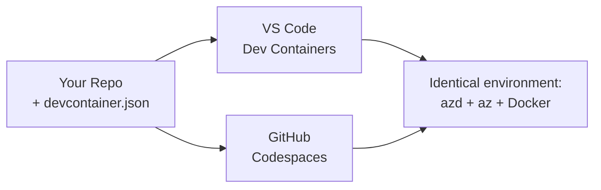

# Kehityssäiliöt & GitHub Codespaces azdia varten

**Luvun navigointi:**
- **📚 Kurssin etusivu**: [AZD Aloittelijoille](../../README.md)
- **📖 Nykyinen luku**: Luku 1 - Perusteet & Nopea aloitus
- **⬅️ Edellinen**: [Tuo oma sovellus](bring-your-own-app.md)
- **🚀 Seuraava luku**: [Luku 2: AI-ensimmäinen kehitys](../chapter-02-ai-development/README.md)

> Komento- ja konfiguraatiokatsauksen kohde: `azd 1.37.2` (marraskuu 2026). Säiliörakennuksia ja Azure-julkaisuja ei suoritettu tämän katsauksen yhteydessä.

## Johdanto

azdin, oikean kieliajurin, Dockerin ja Azure CLI:n asentaminen jokaiselle koneelle on vaivalloista – ja se on ykkössyy siihen, miksi opas, joka "toimii koneellani", epäonnistuu toisella. **Kehityssäiliö** ratkaisee tämän kuvaamalla koko työkaluketjusi tiedostossa. Jokainen, joka avaa projektin VS Codessa tai GitHub Codespacessa, saa täsmälleen saman ympäristön, jossa azd on jo asennettu. Tämä oppitunti näyttää, miten sellainen lisätään.

## Oppimistavoitteet

Oppitunnin lopussa sinä:
- Ymmärrät, mikä kehityssäiliö on ja miksi se auttaa azdin kanssa
- Lisäät projektin minimissä `.devcontainer/devcontainer.json`
- Sisällytät azdin, Azure CLI:n ja Dockerin Dev Container *ominaisuuksien* avulla
- Avata projektin GitHub Codespacessa tai VS Codessa

## Oppimistulokset

Oppitunnin suorittamisen jälkeen osaat:
- Tekee `devcontainer.json` azd-projektille
- Lisätä azdin ja Azure-työkalut ilman manuaalisia asennuksia
- Suorittaa `azd up` säiliön tai Codespacen sisältä

---

## Mikä on kehityssäiliö?

Kehityssäiliö on Docker-pohjainen kehitysympäristö, joka määritellään `.devcontainer/devcontainer.json` -tiedostossa repositoriossasi. Kun avaat projektin:

- **VS Code** (Dev Containers -laajennuksen kanssa) rakentaa säiliön ja liittää siihen.
- **GitHub Codespaces** rakentaa saman säiliön pilvessä ja antaa sinulle selaimessa toimivan editorin.

Joka tapauksessa jokainen osallistuja saa samat työkalut – ei ole "asensitko azdin?" -vikaetsintää.



---

## Vaihe 1: Luo devcontainer-tiedosto

Luo `.devcontainer/devcontainer.json` projektisi juureen:

```json
{
  "name": "azd-project",
  "image": "mcr.microsoft.com/devcontainers/base:bookworm",
  "features": {
    "ghcr.io/devcontainers/features/azure-cli:1": {},
    "ghcr.io/azure/azure-dev/azd:0": { "version": "1.37.2" },
    "ghcr.io/devcontainers/features/docker-in-docker:2": {},
    "ghcr.io/devcontainers/features/node:1": {}
  },
  "customizations": {
    "vscode": {
      "extensions": [
        "ms-azuretools.azure-dev",
        "ms-azuretools.vscode-bicep"
      ]
    }
  },
  "forwardPorts": [3000],
  "postCreateCommand": "azd version"
}
```

Mitä kukin osa tekee:

| Avain | Tarkoitus |
|-----|---------|
| `image` | Säiliön perus-OS |
| `features` | Esiasennetut asennukset—tässä: Azure CLI, **azd**, Docker ja Node.js |
| `customizations.vscode.extensions` | Asentaa automaattisesti azdin ja Bicep VS Code -laajennukset |
| `forwardPorts` | Altistaa sovelluksesi portin selaimellesi |
| `postCreateCommand` | Ajetaan kerran säiliön rakentamisen jälkeen (tässä tarkistus) |

> Ominaisuuden versio (`azd:0`) ja asennetun CLI-version versio eroavat. Aseta ominaisuuden `version` -vaihtoehto arvoon `"1.37.2"` lukitaksesi CLI-version; älä käytä CLI-versiota ominaisuuden tunnisteena.

---

## Vaihe 2: Sovi ominaisuus sovelluksesi kieleen

Vaihda `node` ominaisuus siihen, mitä sovelluksesi käyttää:

```jsonc
// Python project
"ghcr.io/devcontainers/features/python:1": {},

// .NET project
"ghcr.io/devcontainers/features/dotnet:2": {},

// Java project
"ghcr.io/devcontainers/features/java:1": {},

// Go project
"ghcr.io/devcontainers/features/go:1": {}
```

Säilytä `docker-in-docker` kuvia rakennettaessa paikallisesti. Konfiguroitu etä-ACR-rakennus (`docker.remoteBuild: true`) on vaihtoehto; isäntätyyppi yksinään ei välttämättä aina vaadi paikallista Dockeria.

---

## Vaihe 3: Avaa se

**VS Codessa:**
1. Asenna **Dev Containers** -laajennus.
2. Avaa projektikansio.
3. Klikkaa **Avaa uudelleen säiliössä** kun saat kehotteen (tai aja *Dev Containers: Reopen in Container*).

**GitHub Codespacessa:**
1. Työnnä repo GitHubiin.
2. Klikkaa **Code → Codespaces → Create codespace on main**.
3. Odota säiliön rakentumista—azd on valmis terminaalissa.

---

## Vaihe 4: Julkaise säiliön sisältä

Säiliössä on azd valmiina, joten normaali työnkulku toimii:

```bash
azd auth login --use-device-code   # device code is handy inside Codespaces
azd up
```

> **Miksi `--use-device-code`?** Etäisäiliössä tai Codespacessa ei ole paikallista selainta uudelleenohjaukseen, joten laitteen koodilla kirjautuminen on luotettava tapa. Liityt selaimen välilehdellä koodin avulla.

---

## Yleiset sudenkuopat

| Sudenkuoppa | Korjaus |
|---------|-----|
| `azd up` ei voi rakentaa kuvaa | Lisää `docker-in-docker` ominaisuus |
| Selaimen kirjautuminen jumissa Codespacesissa | Käytä `azd auth login --use-device-code` |
| Työkalut eroavat tiimin jäsenten välillä | Lukitse CLI azd-ominaisuuden `version`-vaihtoehdolla ja lukitse kieliajurit |
| Sovellus ei ole saavutettavissa selaimella | Lisää portti `forwardPorts` |

---

## Yhteenveto

- Kehityssäiliö tekee azd-työkaluketjustasi toistettavan kaikille.
- Lisää azd, Azure CLI ja Docker Dev Container *ominaisuuksien* kautta.
- Sovi kieliominaisuus sovellukseesi ja pidä `docker-in-docker` säiliön isännille.
- Käytä laitteen koodilla kirjautumista silloin, kun ajat Codespacessa.

---

## 🔗 Navigointi

| Suunta | Resurssi |
|-----------|----------|
| **Edellinen** | [Tuo oma sovellus](bring-your-own-app.md) |
| **Luvun etusivu** | [Luku 1: Perusteet & Nopea aloitus](README.md) |
| **Seuraava luku** | [Luku 2: AI-ensimmäinen kehitys](../chapter-02-ai-development/README.md) |

## 📖 Aiheeseen liittyvät resurssit

- [Asennus & Asetukset](installation.md)
- [Komentovihko](../../resources/cheat-sheet.md)
- [Virallinen Dev Containers -määrittely](https://containers.dev/)
- [azd Dev Container -ominaisuus](https://github.com/Azure/azure-dev/tree/main/ext/devcontainer)

---

<!-- CO-OP TRANSLATOR DISCLAIMER START -->
**Vastuuvapauslauseke**:
Tämä asiakirja on käännetty käyttämällä tekoälypohjaista käännöspalvelua [Co-op Translator](https://github.com/Azure/co-op-translator). Vaikka pyrimme tarkkuuteen, otathan huomioon, että automaattiset käännökset saattavat sisältää virheitä tai epätarkkuuksia. Alkuperäinen asiakirja sen alkuperäiskielellä on virallinen lähde. Tärkeissä asioissa suositellaan ammattimaista ihmiskäännöstä. Emme ole vastuussa tämän käännöksen käytöstä aiheutuvista väärinymmärryksistä tai tulkinnoista.
<!-- CO-OP TRANSLATOR DISCLAIMER END -->