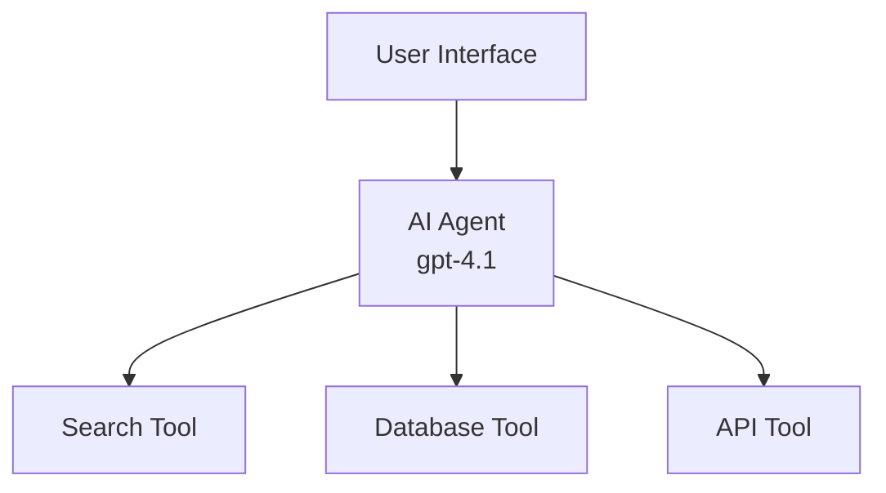
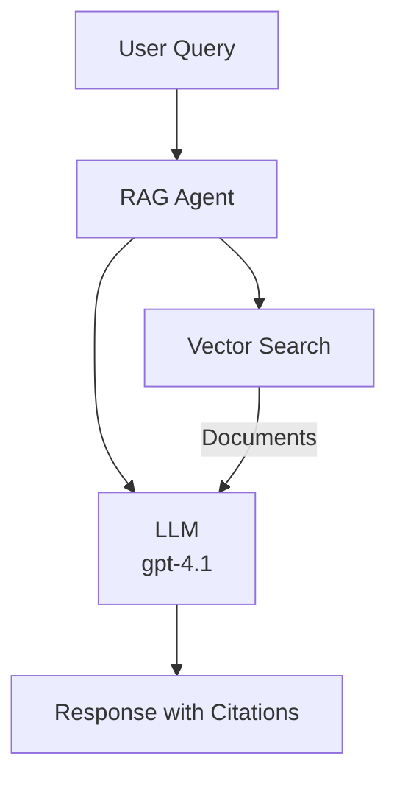
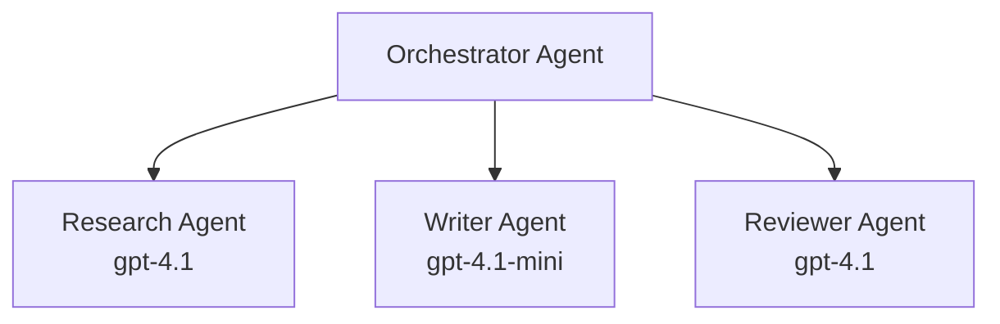

# Tekoälyagentit Azure Developer CLI:llä

**Lukuvalikko:**
- **📚 Kurssin etusivu**: [AZD Aloittelijoille](../../README.md)
- **📖 Nykyinen luku**: Luku 2 - AI-Ensisijainen Kehitys
- **⬅️ Edellinen**: [Microsoft Foundry -integraatio](microsoft-foundry-integration.md)
- **➡️ Seuraava**: [AI-mallin käyttöönotto](ai-model-deployment.md)
- **🚀 Edistynyt**: [Moniagenttiset ratkaisut](../../examples/retail-scenario.md)

---

## Johdanto

Tekoälyagentit ovat autonomisia ohjelmia, jotka pystyvät havainnoimaan ympäristöään, tekemään päätöksiä ja suorittamaan toimenpiteitä tiettyjen tavoitteiden saavuttamiseksi. Toisin kuin yksinkertaiset chatbotit, jotka vastaavat kehotteisiin, agentit voivat:

- **Käyttää työkaluja** - Kutsua rajapintoja, hakea tietokannoista, suorittaa koodia
- **Suunnitella ja päättellä** - Jakaa monimutkaiset tehtävät vaiheisiin
- **Oppia kontekstista** - Ylläpitää muistia ja mukauttaa käyttäytymistään
- **Tehdä yhteistyötä** - Työskennellä muiden agenttien kanssa (moniagenttijärjestelmät)

Tässä ohjeessa näytetään, miten tekoälyagentteja otetaan käyttöön Azureen Azure Developer CLI:n (azd) avulla.

Keskustelukontekstin käyttö ei ole mallin koulutusta: pysyvän muistin, pääsynhallinnan ja säilytyksen on oltava sovelluksessa toteutettuja/määritettyjä.

> **Julkaisukatsaus (2026-11-04):** CLI-esimerkit on tarkistettu `azd` `1.37.2`, `azure.ai.agents` `1.0.0-beta.23`, ja `azure.ai.evaluations` `1.0.0-beta.2` dokumentaation/lähteen mukaisesti, ei live Azure -käyttöönotolla. Käytä `azd >= 1.37.0` yhdistettyyn työnkulkuun. Katso [viimeisimmät muutokset ja korjaukset](../chapter-08-production/production-ai-practices.md#recent-release-changes-and-fixes) ennen vanhempien projektien päivittämistä.

## Oppimistavoitteet

Tämän ohjeen suorittamisen jälkeen:
- Ymmärrät, mitä tekoälyagentit ovat ja miten ne eroavat chatboteista
- Otat käyttöön valmiita tekoälyagenttimalleja käyttämällä AZD:tä
- Määrität Foundry-agentit mukautetuille agenteille
- Toteutat perusagenttimallit (työkalujen käyttö, RAG, moniagenttisuus)
- Valvot ja debuggaat käyttöön otettuja agenteja

## Oppimistulokset

Suorituksen jälkeen osaat:
- Ota tekoälyagenttisovellukset käyttöön Azureen yhdellä komennolla
- Määritä agenttien työkalut ja kyvyt
- Toteuta hakua täydentävä generaattori (RAG) agenttien kanssa
- Suunnittele moniagenttiarkkitehtuurit monimutkaisiin työnkulkuihin
- Ratkaise yleisiä agenttien käyttöönotto-ongelmia

---

## 🤖 Mikä erottaa agentin chatbotista?

| Ominaisuus | Chatbot | Tekoälyagentti |
|---------|---------|----------|
| **Käyttäytyminen** | Vastaa kehotteisiin | Toimii autonomisesti |
| **Työkalut** | Voi käyttää hakua tai työkaluja | Käyttää työkaluja tavoitteellisesti silmukassa |
| **Muisti** | Sovellusriippuvainen | Pysyvä muisti vain, jos erikseen toteutettu |
| **Suunnittelu** | Yhden vastauksen | Monivaiheinen päättely |
| **Yhteistyö** | Yksi yksikkö | Voi työskennellä muiden agenttien kanssa |

### Yksinkertainen vertaus

- **Chatbot** = Avulias henkilö, joka vastaa kysymyksiin infopisteessä
- **Tekoälyagentti** = Henkilökohtainen assistentti, joka voi soittaa, varata tapaamisia ja hoitaa tehtäviä puolestasi

---

## 🚀 Pikakäynnistys: Ota ensimäinen agenttisi käyttöön

Valitse yksi vaihtoehto **uudessa tyhjässä työskentelyhakemistossa**. Jäljessä oleva `.` alustaa sinne; ilman erillistä kohdetta nykyinen AZD voi luoda mallin nimisen alihakemiston eikä vaihda kuoren hakemistoa. Pidä eri mallit/ympäristöt erillisissä hakemistoissa.

Alla olevat aika-/kustannushaarukat ovat suuntaa-antavia, eivät vahvistettuja tarjouksia. Tarkista kunkin esimerkin ajantasaiset vaatimukset, hinnoittelu, mallin kiintiö ja valinnaiset palvelut ennen käyttöönottoa.

### Vaihtoehto 1: Foundry Agents -malli (Suositeltu)

```bash
# Initialize the AI agents template
azd init --template get-started-with-ai-agents .

# Deploy to Azure
azd up
```

**Mitä otetaan käyttöön:** Esimerkin nykyinen infrastruktuuri ja valitut vaihtoehdot määräävät mallin, työkalut, hostingin ja valvontaresurssit. Tarkista README ja `infra/` ennen provisiointia; älä oleta, että jokaisessa agenttimallissa on Haku tai web-käyttöliittymä.

**Aika:** ~15-20 minuuttia
**Kustannus:** ~100-150 $/kuukausi (kehitys)

### Vaihtoehto 2: Luova kirjoittaminen Promptyllä

```bash
# Initialize the Prompty-based agent template
azd init --template https://github.com/Azure-Samples/contoso-creative-writer .

# Deploy to Azure
azd up
```

**Mitä otetaan käyttöön:** FastAPI/Prompty-mon-agenttinen kirjoittajaesimerkki Azure OpenAI:lla, Bing Groundingilla ja Azure AI Hakulla. Entinen `agent-openai-python-prompty` repositorio ohjaa tänne; se ei ole minimia Azure Functions sääsovellusmallina. Noudata sen ajankohtaista README:tä hostingin, mallin kiintiön ja Bing Groundingin vaatimuksiin.

**Aika:** ~10-15 minuuttia
**Kustannus:** ~50-100 $/kuukausi (kehitys)

### Vaihtoehto 3: RAG Chat Agentti

```bash
# Initialize RAG chat template
azd init --template azure-search-openai-demo .

# Deploy to Azure
azd up
```

**Mitä otetaan käyttöön:**
- ✅ Microsoft Foundry -mallit
- ✅ Azure AI Haku esimerkkidatalla
- ✅ Asiakirjojen käsittelyputki
- ✅ Keskusteluliittymä viitteineen

**Aika:** ~15-25 minuuttia
**Kustannus:** ~80-150 $/kuukausi (kehitys)

### Vaihtoehto 4: AZD AI Agent Init (Projektimalliesikatselu)

Käytä `azd ai agent init` vuorovaikutteisesti tai ota käyttöön nykyinen `azure.yaml` agenttiprojekti `--template`/`-t` avulla. Vanha `--manifest`/`-m` vaihtoehto on vanhentunut alias, ei muunnin vanhoille manifesteille.

```bash
# Install the AI agents extension
azd extension install azure.ai.agents

# Optional: verify the installed preview version
azd extension show azure.ai.agents

# Initialize from a current agent project template (supply your template path)
azd ai agent init --template ./templates/support-agent/azure.yaml

# Deploy to Azure
azd up

# Test the deployed agent (shows latency + time-to-first-byte)
azd ai agent invoke
```

**Milloin käyttää `azd ai agent init` vs `azd init --template`:**

| Lähestymistapa | Paras käyttöön | Kuinka se toimii |
|----------|----------|------|
| `azd init --template` | Aloita toimivasta esimerkkisovelluksesta | Kloonaa koko mallirepositorio koodin + infrastruktuurin kanssa |
| `azd ai agent init --template` | Ota käyttöön nykyinen Foundry-agenttiprojekti | Käyttää `azure.yaml` projekti- dokumenttia ja sen määritelmiä |

> **Vinkki:** Käytä `azd init --template` oppimisessa (vaihtoehdot 1-3 yllä). Käytä `azd ai agent init` Foundry-agenttien työnkulussa. Lisätäksesi suoran agenttimääritelmän olemassa olevaan projektiin, katso [aloitus- ja migraatio-ohjeet](../chapter-08-production/production-ai-practices.md#initializing-agent-projects-with-azd-ai-agent-init).

Efter `azd up`, käytä `azd ai agent invoke` testaamiseen, erillistä `azure.ai.evaluations` laajennusta (`azd ai eval init`, `generate` ja `run start`) laadun mittaamiseen ja `azd ai agent optimize` sen parantamiseen uuden arviointimäärityksen avulla. Agents beta.22 korvasi perinteisen arviointiprosessin ja muutti optimoinnin `--config`-muotoa. Katso [evaluation migration](../chapter-08-production/production-ai-practices.md#evaluation-migration-and-quality-checks) ja [optimization migration](../chapter-08-production/production-ai-practices.md#optimization-configuration-migration) ennen vanhempien esimerkkien uudelleenkäyttöä.

---

## 🏗️ Agenttiarkkitehtuurimallit

### Malli 1: Yksittäinen agentti työkaluilla

Yksinkertaisin agenttimalli – yksi agentti, joka voi käyttää useita työkaluja.



**Parhaiten sopii:**
- Asiakastukibotit
- Tutkimusapulaiset
- Data-analyysivälittäjät

**Suhteellinen sovellusnäyte:** `azure-search-openai-demo` havainnollistaa RAG-mallia, ei yleistä mielivaltaisen työkalun agenttiketjua.

### Malli 2: RAG-agentti (hakua täydentävä generointi)

Agentti, joka hakee asiaankuuluvia asiakirjoja ennen vastausten luomista.



**Parhaiten sopii:**
- Yrityksen tietopankit
- Asiakirjojen kysymys-vastausjärjestelmät
- Säännösten ja oikeustutkimusten tekeminen

**AZD-malli:** `azure-search-openai-demo`

### Malli 3: Moniagenttijärjestelmä

Useita erikoistuneita agentteja toimimassa yhdessä monimutkaisissa tehtävissä.



**Parhaiten sopii:**
- Monimutkaisten sisältöjen luomiseen
- Monivaiheiset työnkulut
- Tehtävät, jotka vaativat erilaista asiantuntemusta

**Lisätietoja:** [Moniagenttien koordinointimallit](../chapter-06-pre-deployment/coordination-patterns.md)

---

## ⚙️ Agenttien työkalujen määritys

Agentit ovat tehokkaita, kun ne voivat käyttää työkaluja. Tässä miten määritellä yleisiä työkaluja:

### Työkalun määritys Foundry-agenteissa

Tämä **klassinen Agent Service SDK -katkelma** kohdistuu `azure-ai-projects==1.0.0` ja `azure-ai-agents==1.1.0` :ään `azure-identity`:n kanssa. Se ei ole uudempi version-agentti/Responses-API, jota jotkin nykyiset Foundry-mallit käyttävät, eikä `azure.ai.agents` AZD-laajennus (eri paketti). Älä sekoita näitä API-sukupolvia. Aseta `PROJECT_ENDPOINT` klassisen Foundry-projektin päätepisteeksi ja `MODEL_DEPLOYMENT_NAME` olemassa olevaksi tuetuksi mallin käyttöönotoksi; varmista paikallinen todennus `az login`:lla ja myönnä vaaditut projektin käyttöoikeudet.

```python
# agent_config.py
import os
from azure.ai.projects import AIProjectClient
from azure.ai.agents.models import FunctionTool
from azure.identity import DefaultAzureCredential

def search_knowledge_base(query: str) -> str:
    """Search the demonstration knowledge base.

    :param query: Search text.
    :return: Matching demonstration information.
    """
    # Local fixture only, not a production search implementation.
    return "Demo policy: returns are accepted within 30 days."

project_client = AIProjectClient(
    endpoint=os.environ["PROJECT_ENDPOINT"],
    credential=DefaultAzureCredential(),
)
search_tool = FunctionTool(functions={search_knowledge_base})
project_client.agents.enable_auto_function_calls(search_tool)
agent = project_client.agents.create_agent(
    model=os.environ["MODEL_DEPLOYMENT_NAME"],
    name="Support Agent",
    instructions="Use search_knowledge_base for policy questions. Label results as demo data.",
    tools=search_tool.definitions,
)
```

Funktioskeeman rekisteröinti ei suorita Pythonia palvelimella. Tässä SDK:ssa rekisteröidyt palautukset ajetaan asiakasprosessissa `enable_auto_function_calls` ja `agents.runs.create_and_process(...)` avulla. Katso [julkaistu SDK-esimerkki](https://github.com/Azure/azure-sdk-for-python/blob/azure-ai-agents_1.1.0/sdk/ai/azure-ai-agents/samples/agents_tools/sample_agents_auto_function_call.py). Sulje asiakas ja poista esittelyagentit/ketjut käytön jälkeen.

### Ympäristön määritys

Seuraavat nimet ovat **kuvitteellisia mukautetun mallin syötteitä**, eivät sisäänrakennettuja AZD-kytkimiä. Johdata kukin arvo ensin `infra/main.parameters.json`:n, infrastruktuurin ja sovelluskoodin kautta. Pelkkä `azd env set` ei muuta agentin työkaluja tai ohjeita.

```bash
# Set up agent-specific environment variables
azd env set AZURE_OPENAI_MODEL "gpt-4.1"
azd env set AGENT_INSTRUCTIONS "You are a helpful assistant..."
azd env set ENABLE_CODE_INTERPRETER "true"
azd env set ENABLE_FILE_SEARCH "true"

# Apply wired infrastructure and application changes
azd up
```

---

## 📊 Agenttien valvonta

### Application Insights -integraatio

Jos valitsemasi malli ottaa käyttöön Application Insights -työkalun ja konfiguroi mittaamisen:

```bash
# Open monitoring dashboard
azd monitor --overview

# Open the Application Insights logs view (not a streaming log tail)
azd monitor --logs

# View live metrics
azd monitor --live
```

### Seurattavat keskeiset mittarit

| Mittari | Kuvaus | Tavoite |
|--------|-------------|--------|
| Vasteviive | Aika vastauksen tuottamiseen | < 5 sekuntia |
| Tokenien käyttö | Tokenit per pyyntö | Seuraa kustannuksia |
| Työkalukutsujen onnistumisprosentti | % onnistuneista työkalutoiminnoista | > 95% |
| Virheprosentti | Epäonnistuneet agenttipyynnöt | < 1% |
| Käyttäjätyytyväisyys | Palautepisteet | > 4.0/5.0 |

### Räätälöity lokitus agenteille

```python
import os
from azure.monitor.opentelemetry import configure_azure_monitor
from opentelemetry import trace

# Configure Azure Monitor with OpenTelemetry
configure_azure_monitor(
    connection_string=os.environ["APPLICATIONINSIGHTS_CONNECTION_STRING"]
)

tracer = trace.get_tracer(__name__)

def log_agent_interaction(user_query, agent_response, tools_used, latency_ms):
    with tracer.start_as_current_span("agent_interaction") as span:
        span.set_attributes({
            "query_length": len(user_query),  # Do not log raw prompts or personal data
            "response_length": len(agent_response),
            "tools_used": tools_used,
            "latency_ms": latency_ms
        })
```

> **Huom:** Asenna vaadittu paketti: `pip install azure-monitor-opentelemetry`. Se tuo mukanaan OpenTelemetry-riippuvuudet; tuontinimiavaruus ei ole vaatimus paketin nimeltä `opentelemetry` asentamiseen.

---

## 💰 Kustannusnäkökohdat

### Arvioidut kuukausikustannukset mallin mukaan

Nämä ovat kuvaavia suunnitteluvälejä, eivät tarjouksia tai kulurajoja. Alue, mallin tokenit, Search/laskenta-SKU:t, työkalusessiot, tallennus ja liikenne voivat ylittää ne. Tarkista esimerkin kustannusohjeistus ja Azure-hinnat ennen `azd up`.

| Malli | Kehitysympäristö | Tuotanto |
|---------|-----------------|------------|
| Yksittäinen agentti | $50-100 | $200-500 |
| RAG-agentti | $80-150 | $300-800 |
| Moniagentti (2-3 agenttia) | $150-300 | $500-1,500 |
| Yritysmoniagentti | $300-500 | $1,500-5,000+ |

### Kustannusten optimointivinkit

1. **Käytä gpt-4.1-miniä yksinkertaisiin tehtäviin** (vain jos mallipohjasi käyttää tätä syötettä)
   ```bash
   azd env set AZURE_OPENAI_MODEL "gpt-4.1-mini"
   ```

2. **Toteuta rajattu välimuisti turvallisille, toistuville kyselyille.** Sisällytä vuokralaisen/käyttäjän valtuutus, mallin käyttöönotto, ohjeet ja hakuversionumero välimuistin avaimessa; määritä vanhenemisaika. Älä jaa yksityisten keskustelujen vastauksia prosessikohtaisen vain-kyselyvälimuistin kautta. SDK-agentti-oliolla ei ole yleistä `agent.run()`-metodia.

3. **Aseta token-raja per suoritus**
   ```python
   # Set max_completion_tokens when running the agent, not during creation
   run = project_client.agents.runs.create_and_process(
       thread_id=thread.id,
       agent_id=agent.id,
       max_completion_tokens=1000  # Budget across the run; may finish as incomplete
   )
   ```

4. **Skaalaa kelvolliset Container Appsit nollaan, kun niitä ei käytetä**
   ```bash
   # Custom-template input: must map to template.scale.minReplicas
   azd env set MIN_REPLICAS "0"
   ```
   Ota infrastruktuurimuutos käyttöön `azd provision` tai `azd up` avulla. Skaalaus nollaan tarvitsee sopivan laukaisevan tapahtuman eikä pysäytä Search-, tallennus- tai malli/työkalumaksuja.

---

## 🔧 Ongelmien ratkaisu agenteille

### Yleiset ongelmat ja ratkaisut

<details>
<summary><strong>❌ Agentti ei vastaa työkalukutsuihin</strong></summary>

```bash
# Inspect the application deployment (not the agent's registered tools)
azd show

# Verify OpenAI deployment
az cognitiveservices account deployment list \
  --name $AZURE_OPENAI_NAME \
  --resource-group $RG_NAME

# Check agent logs
azd monitor --logs
```

**Yleiset syyt:**
- Työkalufunktion allekirjoitus ei vastaa
- Puuttuvat vaaditut käyttöoikeudet
- API-päätepistettä ei ole saatavilla
</details>

<details>
<summary><strong>❌ Pitkät vasteajat agenteilla</strong></summary>

```bash
# Check Application Insights for bottlenecks
azd monitor --live

# Consider using a faster model
azd env set AZURE_OPENAI_MODEL "gpt-4.1-mini"
azd up
```

**Optimointivinkit:**
- Käytä suoravirtaista vastausta
- Toteuta vasteiden välimuisti
- Pienennä konteksti-ikkunan kokoa
</details>

<details>
<summary><strong>❌ Agentti palauttaa virheellistä tai kuvitteellista tietoa</strong></summary>

```python
# Improve with better system prompts
instructions = """
You are a helpful assistant. IMPORTANT:
- Only answer based on provided context
- If you don't know, say "I don't know"
- Always cite your sources
- Never make up information
"""

# Use these instructions in the agent definition.
# For classic file search, first upload/index documents in a vector store,
# then use FileSearchTool(vector_store_ids=[...]) and pass both its
# .definitions and .resources when creating the agent.
```
Ohjeet ja tiedonhaku vähentävät riskiä; kumpikaan ei takaa tosiasiallisia vastauksia. Arvioi perustuetut ja kontekstin ulkopuoliset kysymykset tunnettuja vastauksia vastaan.
</details>

<details>
<summary><strong>❌ Token-rajan ylityserrorit</strong></summary>

```python
# Implement context window management
def truncate_context(messages, max_tokens=8000, model="gpt-4.1"):
    """Approximate content-only budget for objects with .content strings."""
    import tiktoken
    encoding = tiktoken.encoding_for_model(model)
    total_tokens = 0
    truncated = []
    
    for msg in reversed(messages):
        msg_tokens = len(encoding.encode(msg.content))
        if total_tokens + msg_tokens > max_tokens:
            break
        truncated.insert(0, msg)
        total_tokens += msg_tokens
    
    return truncated
```
Tämä apuohjelma sulkee pois rooli/työkalu-skeemat, järjestelmän ohjeet, kuvatunnisteet ja protokollan ylikuorman. Varaa tila niille ja valmiille; älä jaa työkutsu/tulos-pareja tai hylkää vaadittuja järjestelmän ohjeita. Asenna `tiktoken` erikseen. Se ei ole yleinen kontekstin ikkuna-validaattori.
</details>

---

## 🎓 Käytännön harjoitukset

### Harjoitus 1: Ota käyttöön perusagentti (20 minuuttia)

**Tavoite:** Ota ensimmäinen tekoälyagenttisi käyttöön AZD:n avulla

```bash
# Step 1: Initialize template
azd init --template get-started-with-ai-agents .

# Step 2: Login to Azure
azd auth login
# If you work across tenants, add --tenant-id <tenant-id>

# Step 3: Deploy
azd up

# Step 4: Test the agent
# Expected output after deployment:
#   Deployment Complete!
#   Endpoint: https://<app-name>.<region>.azurecontainerapps.io
# Open the URL shown in the output and try asking a question

# Step 5: View monitoring
azd monitor --overview

# Step 6: Clean up
azd down --force --purge
```

**Onnistumiskriteerit:**
- [ ] Agentti vastaa kysymyksiin
- [ ] Pääsee käsiksi valvontapaneeliin käyttämällä `azd monitor`
- [ ] Resurssit siivottu onnistuneesti

### Harjoitus 2: Lisää oma työkalu (30 minuuttia)

**Tavoite:** Laajenna agenttia omalla työkalulla

**Lähtötilanne:** Käytä klassista SDK-asiakasta kohdasta [Työkalun määritys](#tool-configuration-in-foundry-agents), älä satunnaista mallipohjaa eri SDK-generoinnilla.

1. Lisää tämä deterministinen kiinnike `agent_config.py`:
   ```python
   def get_weather(location: str) -> str:
       """Return demonstration weather, not live conditions.

       :param location: City name.
       :return: A clearly labelled fixture.
       """
       print(f"TOOL_CALLED: {location}")
       return f"Demo weather in {location}: Sunny, 72°F (fixture, not live)"
   ```
2. Korvaa hakutyökalun rekisteröinti- ja luontilohko seuraavalla:
   ```python
   weather_tool = FunctionTool(functions={get_weather})
   project_client.agents.enable_auto_function_calls(weather_tool)
   agent = project_client.agents.create_agent(
       model=os.environ["MODEL_DEPLOYMENT_NAME"],
       name="Weather Agent",
       instructions="Call get_weather for weather questions; explain that it returns demo data.",
       tools=weather_tool.definitions,
   )
   thread = project_client.agents.threads.create()
   try:
       project_client.agents.messages.create(
           thread_id=thread.id, role="user", content="Use get_weather for Seattle."
       )
       run = project_client.agents.runs.create_and_process(
           thread_id=thread.id, agent_id=agent.id
       )
       if run.status != "completed":
           raise RuntimeError(f"Run status: {run.status}; error: {run.last_error}")
       for message in project_client.agents.messages.list(thread_id=thread.id):
           for text in message.text_messages:
               print(text.text.value)
   finally:
       project_client.agents.threads.delete(thread.id)
       project_client.agents.delete_agent(agent.id)
       project_client.close()
   ```
3. Suorita paikallisesti (tämä kutsuu olemassa olevaa Azure-projektia ja aiheuttaa mallimaksuja):
   ```bash
   python agent_config.py
   # Expected: TOOL_CALLED: Seattle, then a completed answer labelled demo data.
   ```

**Onnistumiskriteerit:**
- [ ] Agentti tunnistaa säähän liittyvät kyselyt
- [ ] Työkalua kutsutaan oikein
- [ ] Vastaus sisältää säätietoja

### Harjoitus 3: RAG-agentin rakentaminen (45 minuuttia)

**Tavoite:** Luo agentti, joka vastaa kysymyksiin dokumenteistasi

```bash
# Step 1: Deploy RAG template
azd init --template azure-search-openai-demo .
azd up

# Step 2: Upload your documents
# For the sample's local ingestion path, place supported files in data/.
# Run from the sample root after following its Python environment setup:
./scripts/prepdocs.sh
# Windows PowerShell equivalent: .\\scripts\\prepdocs.ps1

# Step 3: Test with domain-specific questions
# Open the web app URL from the azd up output
# Ask questions about your uploaded documents
# Responses should include citation references like [doc.pdf]
```

**Onnistumiskriteerit:**
- [ ] Agentti vastaa ladatuista dokumenteista
- [ ] Vastauksiin sisältyy lähdeviitteet
- [ ] Rajojen ulkopuoliset testikysymykset käsitellään ilman tuettuja väitteitä (ei takuu jokaiselle tulevalle kysymykselle)

Jos `USE_CLOUD_INGESTION=true`, käytä sen sijaan näytteen pilven syöttö-/lataustyönkulkua; paikallinen kääre ohittaa tarkoituksella syötön. Testauksen jälkeen suorita `azd down` RAG-ympäristössä ja tarkista poistettavat resurssit.

---

## 📚 Seuraavat askeleet

Nyt kun ymmärrät AI-agentit, tutustu näihin edistyneisiin aiheisiin:

| Aihe | Kuvaus | Linkki |
|-------|-------------|------|
| **Moni-agenttijärjestelmät** | Rakenna järjestelmiä, joissa on useita yhteistyössä toimivia agentteja | [Retail Multi-Agent Example](../../examples/retail-scenario.md) |
| **Koordinointimallit** | Opettele orkestrointi- ja viestintämalleja | [Coordination Patterns](../chapter-06-pre-deployment/coordination-patterns.md) |
| **Tuotantoon käyttöönotto** | Yritystason agenttien käyttöönotto | [Production AI Practices](../chapter-08-production/production-ai-practices.md) |
| **Agentin arviointi** | Testaa ja arvioi agentin suorituskykyä | [AI Troubleshooting](../chapter-07-troubleshooting/ai-troubleshooting.md) |
| **AI-työpajalaki** | Käytännön harjoitus: tee AI-ratkaisustasi AZD-valmis | [AI Workshop Lab](ai-workshop-lab.md) |

---

## 📖 Lisäresurssit

### Viralliset dokumentit
- [Microsoft Foundry Agent Service](https://learn.microsoft.com/azure/ai-services/agents/)
- [Microsoft Foundry Agent Service Quickstart](https://learn.microsoft.com/azure/ai-services/agents/quickstart)
- [Semantic Kernel Agent Framework](https://learn.microsoft.com/semantic-kernel/)

### AZD-mallit agenteille
- [Aloita AI-agenttien kanssa](https://github.com/Azure-Samples/get-started-with-ai-agents)
- [Luovat kirjoitusagentit Promptyllä](https://github.com/Azure-Samples/contoso-creative-writer)
- [Azure Search OpenAI -demo](https://github.com/Azure-Samples/azure-search-openai-demo)

### Yhteisön resurssit
- [Awesome AZD - Agenttimallit](https://azure.github.io/awesome-azd/?tags=ai-agents)
- [Azure AI Discord](https://discord.gg/microsoft-azure)
- [Microsoft Foundry Discord](https://discord.gg/nTYy5BXMWG)

### Agentin taidot editoriisi
- [**Microsoft Azure Agent Skills**](https://skills.sh/microsoft/github-copilot-for-azure) - Asenna uudelleenkäytettäviä AI-agenttien taitoja Azure-kehitykseen GitHub Copilotissa, Cursorssa tai missä tahansa tuetussa agentissa. Sisältää taitoja [Azure AI](https://skills.sh/microsoft/github-copilot-for-azure/azure-ai), [Microsoft Foundry](https://skills.sh/microsoft/github-copilot-for-azure/microsoft-foundry), [käyttöönotto](https://skills.sh/microsoft/github-copilot-for-azure/azure-deploy) ja [diagnostiikka](https://skills.sh/microsoft/github-copilot-for-azure/azure-diagnostics):
  ```bash
  npx skills add microsoft/github-copilot-for-azure
  ```

---

**Navigointi**
- **Edellinen oppitunti**: [Microsoft Foundry Integration](microsoft-foundry-integration.md)
- **Seuraava oppitunti**: [AI-mallin käyttöönotto](ai-model-deployment.md)

---

<!-- CO-OP TRANSLATOR DISCLAIMER START -->
**Vastuuvapauslauseke**:
Tämä asiakirja on käännetty käyttämällä tekoälypohjaista käännöspalvelua [Co-op Translator](https://github.com/Azure/co-op-translator). Vaikka pyrimme tarkkuuteen, otathan huomioon, että automaattiset käännökset saattavat sisältää virheitä tai epätarkkuuksia. Alkuperäinen asiakirja sen alkuperäiskielellä on virallinen lähde. Tärkeissä asioissa suositellaan ammattimaista ihmiskäännöstä. Emme ole vastuussa tämän käännöksen käytöstä aiheutuvista väärinymmärryksistä tai tulkinnoista.
<!-- CO-OP TRANSLATOR DISCLAIMER END -->