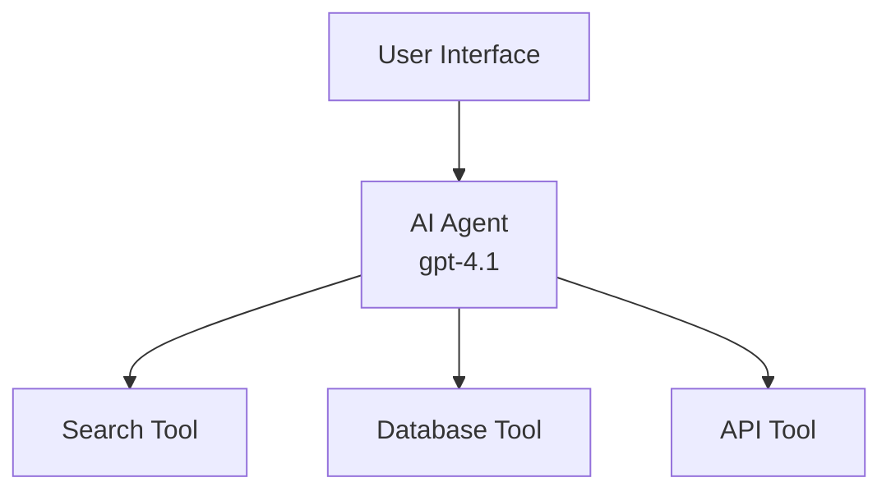
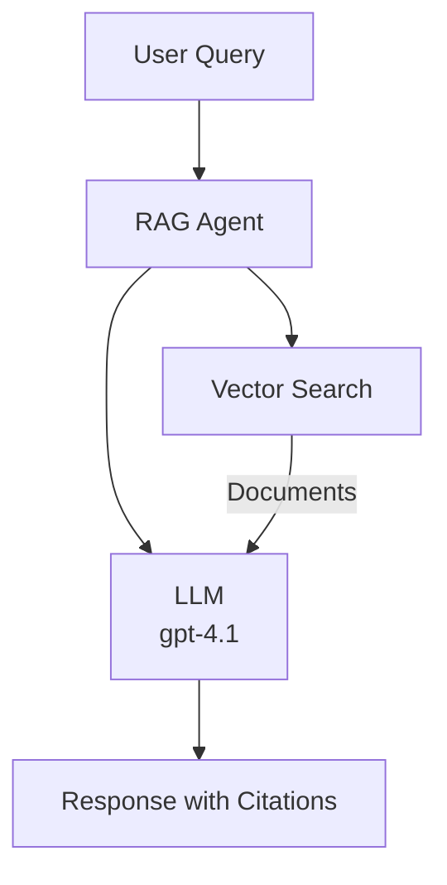
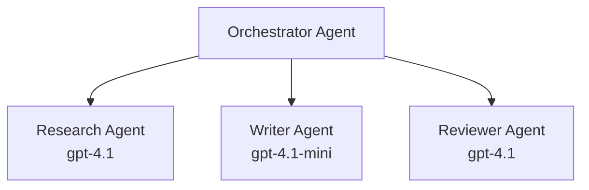

# AI-agentit Azure Developer CLI:llä

**Luvun navigaatio:**
- **📚 Kurssin etusivu**: [AZD Aloittelijoille](../../README.md)
- **📖 Nykyinen luku**: Luku 2 - AI-Ensisijainen Kehitys
- **⬅️ Edellinen**: [Microsoft Foundry -integraatio](microsoft-foundry-integration.md)
- **➡️ Seuraava**: [AI-mallin käyttöönotto](ai-model-deployment.md)
- **🚀 Edistyneet**: [Moniagenttiratkaisut](../../examples/retail-scenario.md)

---

## Johdanto

AI-agentit ovat itsenäisiä ohjelmia, jotka voivat havaita ympäristönsä, tehdä päätöksiä ja suorittaa toimintoja saavuttaakseen tiettyjä tavoitteita. Toisin kuin yksinkertaiset chatbotit, jotka vastaavat kehotteisiin, agentit voivat:

- **Käyttää työkaluja** - Kutsua API-rajapintoja, etsiä tietokannoista, suorittaa koodia
- **Suunnitella ja järkeillä** - Jakaa monimutkaisia tehtäviä osiin
- **Oppia kontekstista** - Säilyttää muistin ja mukauttaa käyttäytymistään
- **Tehdä yhteistyötä** - Työskennellä muiden agenttien kanssa (moniagenttijärjestelmät)

Tämä opas näyttää, miten AI-agentit otetaan käyttöön Azureen Azure Developer CLI:llä (azd).

Keskustelukontekstin käyttö ei ole mallin koulutusta: pysyvän muistin, käyttöoikeuksien ja säilytyksen on oltava sovelluksen toteuttamia/määritettyjä.

> **Foundry GA -päivitys (2026-11-09):** Asenna yleisesti saatavilla oleva `microsoft.foundry` 1.0 paketti `azd >= 1.37.0` avulla. Arvioinnit asennetaan erikseen; valinnaiset esikatseluominaisuudet ja alla oleva klassinen SDK-fragmentti eivät kuulu GA:han paketin julkaisun perusteella. Tämä ohje perustuu [GA-ilmoitukseen](https://devblogs.microsoft.com/azure-sdk/microsoft-foundry-azure-developer-cli-ga/) ja dokumentaatioon, ei suoraan Azure-sovellukseen.

## Oppimistavoitteet

Suoritettuasi tämän oppaan osaat:
- Ymmärtää, mitä AI-agentit ovat ja miten ne eroavat chatbotista
- Ottaa käyttöön valmiita AI-agenttimalleja AZD:llä
- Määrittää Foundry-agentit mukautetuille agenteille
- Toteuttaa perustason agenttimallit (työkalujen käyttö, RAG, moni-agentti)
- Valvoa ja virheenkorjata otettuja agentteja

## Oppimistulokset

Valmiina osaat:
- Ottaa AI-agenttisovellukset käyttöön Azureen yhdellä komennolla
- Määrittää agenttien työkalut ja ominaisuudet
- Toteuttaa hakuun perustuvan generoinnin (RAG) agenttien kanssa
- Suunnitella moniagenttiarkkitehtuureja monimutkaisiin työnkulkuihin
- Ratkaista yleisiä agenttien käyttöönoton ongelmia

---

## 🤖 Mikä erottaa agentin chatbotista?

| Ominaisuus | Chatbot | AI-agentti |
|---------|---------|----------|
| **Käyttäytyminen** | Vastaa kehotteisiin | Suorittaa itsenäisiä toimia |
| **Työkalut** | Voi käyttää hakua tai työkaluja | Tyypillisesti käyttää työkaluja tavoiteohjatussa silmukassa |
| **Muisti** | Sovelluskohtainen | Pysyvä muisti vain, jos erikseen toteutettu |
| **Suunnittelu** | Yhden vastauksen mallit | Monivaiheinen järkeily |
| **Yhteistyö** | Yksi yksikkö | Voi työskennellä muiden agenttien kanssa |

### Yksinkertainen vertauskuva

- **Chatbot** = Avulias henkilö vastaamassa kysymyksiin tiedotuspisteellä
- **AI-agentti** = Henkilökohtainen avustaja, joka voi soittaa, varata ajan ja hoitaa tehtäviä puolestasi

---

## 🚀 Nopeasti alkuun: ota ensimmäinen agenttisi käyttöön

Valitse yksi vaihtoehto **uudessa tyhjässä työskentelyhakemistossa**. Perässä oleva `.` alustaa sinne; ilman selkeää kohdetta nykyinen AZD voi luoda mallin nimellä alimappihakemiston eikä vaihda kuoren hakemistoa. Pidä erilliset mallit/ympäristöt erillisissä hakemistoissa.

Alla olevat aika/kustannusalueet ovat havainnollistavia, eivät validoituja tarjouksia. Tarkista kunkin mallin tämänhetkiset edellytykset, hinnat, mallikiintiö ja valinnaiset palvelut ennen käyttöönottoa.

### Vaihtoehto 1: Foundry Agents -malli (suositeltu)

```bash
# Initialize the AI agents template
azd init --template get-started-with-ai-agents .

# Deploy to Azure
azd up
```

**Mikä otetaan käyttöön:** Mallin nykyinen infrastruktuuri ja valitut asetukset määrittävät mallin, työkalut, isännöinnin ja valvontaresurssit. Tarkista sen README ja `infra/` ennen käyttöönottoa; älä oleta, että jokainen agenttimalli sisältää Haun tai web-käyttöliittymän.

**Aika:** ~15-20 minuuttia
**Kustannus:** ~$100-150/kuukausi (kehitys)

### Vaihtoehto 2: Luova kirjoittaminen Promptyllä

```bash
# Initialize the Prompty-based agent template
azd init --template https://github.com/Azure-Samples/contoso-creative-writer .

# Deploy to Azure
azd up
```

**Mikä otetaan käyttöön:** FastAPI/Prompty-moniagenttikirjoitusmalli käyttäen Azure OpenAI:ta, Bing Groundingia ja Azure AI Searchia. Entinen `agent-openai-python-prompty` repositorio ohjaa tänne; se ei ole minimal Azure Functions -sääagenttimalli. Noudata sen nykyistä README:tä isännöintiin, mallikiintiöön ja Bing Groundingin vaatimuksiin.

**Aika:** ~10-15 minuuttia
**Kustannus:** ~$50-100/kuukausi (kehitys)

### Vaihtoehto 3: RAG-chat-agentti

```bash
# Initialize RAG chat template
azd init --template azure-search-openai-demo .

# Deploy to Azure
azd up
```

**Mikä otetaan käyttöön:**
- ✅ Microsoft Foundry -mallit
- ✅ Azure AI Search esimerkkidatalla
- ✅ Asiakirjojen käsittelyputki
- ✅ Chat-käyttöliittymä viitteineen

**Aika:** ~15-25 minuuttia
**Kustannus:** ~$80-150/kuukausi (kehitys)

### Vaihtoehto 4: Isännöity agentti GA Foundry -paketilla

Käytä [täydellistä isännöidyn agentin opasta](microsoft-foundry-integration.md#hosted-agent-walkthrough-ga) perustason Python Agent Framework Responses API -näytteeseen. Tämä koodin käyttöönotto vaatii Python 3.13+, nykyisen uv:n, Foundry-luvat ja alueellisen mallikiintiön. Todentaa paikalliset SDK-kutsut erikseen Azure CLI -tunnistetiedoilla.

```bash
azd auth login
azd ext install microsoft.foundry
```

Tyhjässä hakemistossa alusta malli:

```text
azd ai agent init --template https://github.com/microsoft-foundry/foundry-samples/blob/main/samples/python/hosted-agents/agent-framework/responses/01-basic/azure.yaml --deploy-mode code --src .
```

Valitse uusi tai olemassa oleva projekti, tarkista `azure.yaml`, ja suorita `azd provision`. Käytä `azd ai agent run` avataksesi Agent Inspectorin ja toisesta terminaalista tässä hakemistossa suorita `azd ai agent invoke --local "Explain how this agent is hosted."`. Paikallisen tarkistuksen jälkeen käytä `azd deploy` ja `azd ai agent invoke "Explain how this agent is hosted."` vertailuun otetun vastauksen kanssa. Foundry rakentaa ladatun lähteen etänä; paikallista konttirakennusta ei vaadita.

**Milloin käyttää `azd ai agent init` vs `azd init --template`:**

| Menetelmä | Parhaiten sopii | Miten toimii |
|----------|-----------------|--------------|
| `azd init --template` | Aloittaessa toimiva näytesovellus | Kloonaa koko mallin repositorion koodin + infrastruktuurin |
| `azd ai agent init --template` | Ottamaan käyttöön nykyisen Foundry-agenttiprojektin | Käyttää `azure.yaml` -projektidokumenttia ja sen määritelmiä |

> **Vinkki:** Vaihtoehdot 1-3 alkavat valmiista sovellusmalleista; Vaihtoehto 4 opettaa GA-isännöidyn agentin työnkulun. Kumpikaan alustuskäsky ei siirrä automaattisesti vanhoja agenttimanifesteja. Olemassa olevaan projektiin suoran agenttimääritelmän lisäämiseksi katso [aloitus- ja siirtymisohjeet](../chapter-08-production/production-ai-practices.md#initializing-agent-projects-with-azd-ai-agent-init).

Asenna `azure.ai.evaluations` erikseen testidatan/luokitusten generointiin ja tarkistamiseen, arvioinnin konfigurointiin ja sen suorittamiseen `azd ai eval`:llä. Optimointi voi uudelleenkäyttää yhteensopivaa arviointia; tarkista ehdokkaat ennen eksplisiittistä käyttöönottoa. Seuraa [arviointityönkulkua](../chapter-08-production/production-ai-practices.md#evaluation-migration-and-quality-checks) ja [optimoinnin siirtymäohjeita](../chapter-08-production/production-ai-practices.md#optimization-configuration-migration) ennen vanhempien esimerkkien uudelleenkäyttöä. Siivouksessa käytetyn Foundry-projektin resurssit säilyvät `azd down` jälkeen; uudelleen luodun projektin resurssiryhmä poistetaan. Katso [opas siivoukseen](microsoft-foundry-integration.md#7-clean-up-deliberately).

---

## 🏗️ Agenttiarkkitehtuurimallit

### Malli 1: Yksi agentti ja työkalut

Yksinkertaisin agenttimalli – yksi agentti, joka voi käyttää useita työkaluja.



**Parhaiten soveltuu:**
- Asiakastukirobotit
- Tutkimusavustajat
- Data-analyysin agentit

**Asiaankuuluva sovellusnäyte:** `azure-search-openai-demo` demonstroi RAG:ia, ei yleistä mielivaltaista työkalusilmukkaa.

### Malli 2: RAG-agentti (hakuun perustuva generointi)

Agentti, joka hakee aiheeseen liittyviä asiakirjoja ennen vastausten generointia.



**Parhaiten soveltuu:**
- Yritys- ja tietopankit
- Asiakirjoihin perustuvat kysymys-vastausjärjestelmät
- Säädösten ja oikeudellisen tutkimuksen tarpeisiin

**AZD-malli:** `azure-search-openai-demo`

### Malli 3: Moniagenttijärjestelmä

Useita erikoistuneita agentteja työskentelemässä yhdessä monimutkaisten tehtävien parissa.



**Parhaiten soveltuu:**
- Monimutkaiseen sisällöntuotantoon
- Monivaiheisiin työnkulkuihin
- Tehtäviin, joissa tarvitaan erilaista asiantuntemusta

**Lisätietoa:** [Moniagenttien koordinaatiomallit](../chapter-06-pre-deployment/coordination-patterns.md)

---

## ⚙️ Agenttityökalujen määrittäminen

Agentit ovat tehokkaita, kun ne voivat käyttää työkaluja. Näin määrität yleisimmät työkalut:

### Työkalujen määritys Foundry-agentteihin

Tämä **klassinen Agent Service SDK -fragmentti** kohdistuu `azure-ai-projects==1.0.0` ja `azure-ai-agents==1.1.0` käyttäen `azure-identity`. Se ei ole uusimman version versiovirheagentin/Responses API, jota jotkin nykyiset Foundry-mallit käyttävät, eikä myöskään `azure.ai.agents` AZD-laajennus (eri paketti). Älä sekoita näitä API-versioita. Aseta `PROJECT_ENDPOINT` klassisen Foundry-projektin päätepisteeksi ja `MODEL_DEPLOYMENT_NAME` olemassa olevan tuetun mallin käyttöönotoksi; varmista paikallinen todennus `az login`:llä ja anna tarvittavat projektin käyttöoikeudet.

```python
# agent_config.py
import os
from azure.ai.projects import AIProjectClient
from azure.ai.agents.models import FunctionTool
from azure.identity import DefaultAzureCredential

def search_knowledge_base(query: str) -> str:
    """Search the demonstration knowledge base.

    :param query: Search text.
    :return: Matching demonstration information.
    """
    # Local fixture only, not a production search implementation.
    return "Demo policy: returns are accepted within 30 days."

project_client = AIProjectClient(
    endpoint=os.environ["PROJECT_ENDPOINT"],
    credential=DefaultAzureCredential(),
)
search_tool = FunctionTool(functions={search_knowledge_base})
project_client.agents.enable_auto_function_calls(search_tool)
agent = project_client.agents.create_agent(
    model=os.environ["MODEL_DEPLOYMENT_NAME"],
    name="Support Agent",
    instructions="Use search_knowledge_base for policy questions. Label results as demo data.",
    tools=search_tool.definitions,
)
```

Toimintakaavion rekisteröinti ei suorita Python-koodia palvelimella. Tässä SDK:ssa `enable_auto_function_calls` plus `agents.runs.create_and_process(...)` suorittavat rekisteröidyt callbackit paikallisessa asiakasprosessissa. Katso [julkaistu SDK-esimerkki](https://github.com/Azure/azure-sdk-for-python/blob/azure-ai-agents_1.1.0/sdk/ai/azure-ai-agents/samples/agents_tools/sample_agents_auto_function_call.py). Sulje asiakasohjelma ja poista demonstrointiin luodut agentit/säikeet, kun lopetat.

### Ympäristöasetukset

Alla olevat nimet ovat **havainnollistavia mallipohjan syötteitä**, eivät AZD:n sisäänrakennettuja kytkimiä. Kytke arvot ensin `infra/main.parameters.json`, infrastruktuurin ja sovelluskoodin läpi. Pelkkä `azd env set` ei muuta agentin työkaluja tai ohjeita.

```bash
# Set up agent-specific environment variables
azd env set AZURE_OPENAI_MODEL "gpt-4.1"
azd env set AGENT_INSTRUCTIONS "You are a helpful assistant..."
azd env set ENABLE_CODE_INTERPRETER "true"
azd env set ENABLE_FILE_SEARCH "true"

# Apply wired infrastructure and application changes
azd up
```

---

## 📊 Agenttien valvonta

### Application Insights -integraatio

Jos valittu malli ottaa Application Insightsin käyttöön ja määrittää instrumentoinnin:

```bash
# Open monitoring dashboard
azd monitor --overview

# Open the Application Insights logs view (not a streaming log tail)
azd monitor --logs

# View live metrics
azd monitor --live
```

### Tärkeimmät seurattavat mittarit

| Mittari | Kuvaus | Tavoite |
|--------|---------|---------|
| Vasteviive | Vastausajan kesto | < 5 sekuntia |
| Token-käyttö | Tokenit per pyyntö | Seuraa kustannuksia |
| Työkalukutsujen onnistumisprosentti | % onnistuneista työkalukutsuista | > 95% |
| Virheprosentti | Epäonnistuneet agenttipyynnöt | < 1% |
| Käyttäjätyytyväisyys | Palautearviot | > 4,0/5,0 |

### Mukautettu lokitus agenteille

```python
import os
from azure.monitor.opentelemetry import configure_azure_monitor
from opentelemetry import trace

# Configure Azure Monitor with OpenTelemetry
configure_azure_monitor(
    connection_string=os.environ["APPLICATIONINSIGHTS_CONNECTION_STRING"]
)

tracer = trace.get_tracer(__name__)

def log_agent_interaction(user_query, agent_response, tools_used, latency_ms):
    with tracer.start_as_current_span("agent_interaction") as span:
        span.set_attributes({
            "query_length": len(user_query),  # Do not log raw prompts or personal data
            "response_length": len(agent_response),
            "tools_used": tools_used,
            "latency_ms": latency_ms
        })
```

> **Huom:** Asenna tarvittava paketti: `pip install azure-monitor-opentelemetry`. Se tuo OpenTelemetry-riippuvuudet; tuonnin nimeämistila ei ole vaade paketin nimeltä `opentelemetry` asentamiselle.

---

## 💰 Kustannusnäkökohdat

### Kuukausittaiset arvioidut kustannukset mallien mukaan

Nämä ovat havainnollistavia suunnittelualueita, eivät tarjouksia tai menorajoja. Alue, mallin tokenit, Haku/laskenta SKU:t, työkalujen käytön eri jaksot, tallennustila ja liikenne voivat ylittää nämä. Tarkista mallin kustannusohjeet ja Azuren hinnasto ennen `azd up`.

| Malli | Kehitys | Tuotanto |
|---------|---------|---------|
| Yksittäinen agentti | $50-100 | $200-500 |
| RAG-agentti | $80-150 | $300-800 |
| Moni-agenttijärjestelmä (2-3 agenttia) | $150-300 | $500-1,500 |
| Yritysmoniagentti | $300-500 | $1,500-5,000+ |

### Kustannusten optimointivinkit

1. **Käytä gpt-4.1-miniä yksinkertaisiin tehtäviin** (vain jos mallisi käyttää tätä syötettä)
   ```bash
   azd env set AZURE_OPENAI_MODEL "gpt-4.1-mini"
   ```

2. **Toteuta rajattu välimuisti turvallisiin, toistuviin kyselyihin.** Sisällytä vuokralainen/käyttäjän valtuutus, mallin käyttöönottoversio, ohjeet ja hakuversio välimuistiavaimeen; aseta vanhenemisaika. Älä jaa yksityisiä keskusteluvastauksia prosessikohtaisen vain-hakuloki-välimuistin kautta. SDK-agenttilla ei ole yleistä `agent.run()` -menetelmää.

3. **Aseta token-rajoitukset suorituskerralla**
   ```python
   # Set max_completion_tokens when running the agent, not during creation
   run = project_client.agents.runs.create_and_process(
       thread_id=thread.id,
       agent_id=agent.id,
       max_completion_tokens=1000  # Budget across the run; may finish as incomplete
   )
   ```

4. **Skaalaa kelvolliset Container Appsit nollaan, kun niitä ei käytetä**
   ```bash
   # Custom-template input: must map to template.scale.minReplicas
   azd env set MIN_REPLICAS "0"
   ```
 Tapahtuma muutos toteutetaan `azd provision` tai `azd up` avulla. Nollaan skaalaaminen tarvitsee sopivan laukaisimen eikä pysäytä Hakua, tallennusta tai mallin/työkalun maksuja.

---

## 🔧 Agenttien vianmääritys

### Yleisiä ongelmia ja ratkaisuja

<details>
<summary><strong>❌ Agentti ei vastaa työkalukutsuihin</strong></summary>

```bash
# Inspect the application deployment (not the agent's registered tools)
azd show

# Verify OpenAI deployment
az cognitiveservices account deployment list \
  --name $AZURE_OPENAI_NAME \
  --resource-group $RG_NAME

# Check agent logs
azd monitor --logs
```

**Yleisiä syitä:**
- Työkalutoimintojen allekirjoitus ei vastaa odotettua
- Puuttuvat vaaditut oikeudet
- API-päätepiste ei ole saavutettavissa
</details>

<details>
<summary><strong>❌ Korkea viive agentin vastauksissa</strong></summary>

```bash
# Check Application Insights for bottlenecks
azd monitor --live

# Consider using a faster model
azd env set AZURE_OPENAI_MODEL "gpt-4.1-mini"
azd up
```

**Optimointivinkit:**
- Käytä suoratoistovastauksia
- Toteuta vastausvälimuisti
- Vähennä kontekstinikkunan kokoa
</details>

<details>
<summary><strong>❌ Agentti palauttaa virheellistä tai harhaista tietoa</strong></summary>

```python
# Improve with better system prompts
instructions = """
You are a helpful assistant. IMPORTANT:
- Only answer based on provided context
- If you don't know, say "I don't know"
- Always cite your sources
- Never make up information
"""

# Use these instructions in the agent definition.
# For classic file search, first upload/index documents in a vector store,
# then use FileSearchTool(vector_store_ids=[...]) and pass both its
# .definitions and .resources when creating the agent.
```
Ohjeet ja haku vähentävät riskiä; kumpikaan ei takaa tosiasiallisia vastauksia. Arvioi maadoitetut ja aihealueen ulkopuoliset kysymykset tunnettuja vastauksia vastaan.
</details>

<details>
<summary><strong>❌ Token-rajan ylitykseen liittyvät virheet</strong></summary>

```python
# Implement context window management
def truncate_context(messages, max_tokens=8000, model="gpt-4.1"):
    """Approximate content-only budget for objects with .content strings."""
    import tiktoken
    encoding = tiktoken.encoding_for_model(model)
    total_tokens = 0
    truncated = []
    
    for msg in reversed(messages):
        msg_tokens = len(encoding.encode(msg.content))
        if total_tokens + msg_tokens > max_tokens:
            break
        truncated.insert(0, msg)
        total_tokens += msg_tokens
    
    return truncated
```
Tämä apuri sulkee pois rooli-/työkalu-kaaviot, järjestelmäohjeet, kuvatokenit ja protokollan overheadin. Varaa tilaa niille ja täydentämiselle; älä jaa työkalu-kutsu/tulos-pareja tai hylkää tarvittavia järjestelmäohjeita. Asenna `tiktoken` erikseen. Se ei ole yleinen kontekstinikkunan validointityökalu.
</details>

---

## 🎓 Käytännön harjoituksia

### Harjoitus 1: Perusagentin käyttöönotto (20 minuuttia)

**Tavoite:** Ota ensimmäinen AI-agenttisi käyttöön AZD:llä

```bash
# Step 1: Initialize template
azd init --template get-started-with-ai-agents .

# Step 2: Login to Azure
azd auth login
# If you work across tenants, add --tenant-id <tenant-id>

# Step 3: Deploy
azd up

# Step 4: Test the agent
# Expected output after deployment:
#   Deployment Complete!
#   Endpoint: https://<app-name>.<region>.azurecontainerapps.io
# Open the URL shown in the output and try asking a question

# Step 5: View monitoring
azd monitor --overview

# Step 6: Review the listed resources and confirm cleanup
azd down
```

**Onnistumiskriteerit:**
- [ ] Agentti vastaa kysymyksiin
- [ ] Pääsee käyttämään valvontapaneelia `azd monitor` kautta
- [ ] Resurssit puhdistetaan onnistuneesti

### Harjoitus 2: Lisää mukautettu työkalu (30 minuuttia)

**Tavoite:** Laajenna agenttia mukautetulla työkalulla

**Alkupiste:** Käytä klassista SDK-asiakasta [Tool Configuration](#tool-configuration-in-foundry-agents) -osiosta, älä satunnaista mallipohjaa eri SDK-version kanssa.

1. Lisää tämä deterministinen kiinnike `agent_config.py`:
   ```python
   def get_weather(location: str) -> str:
       """Return demonstration weather, not live conditions.

       :param location: City name.
       :return: A clearly labelled fixture.
       """
       print(f"TOOL_CALLED: {location}")
       return f"Demo weather in {location}: Sunny, 72°F (fixture, not live)"
   ```
2. Korvaa search-tool -rekisteröinti- ja luontilohko seuraavalla:
   ```python
   weather_tool = FunctionTool(functions={get_weather})
   project_client.agents.enable_auto_function_calls(weather_tool)
   agent = project_client.agents.create_agent(
       model=os.environ["MODEL_DEPLOYMENT_NAME"],
       name="Weather Agent",
       instructions="Call get_weather for weather questions; explain that it returns demo data.",
       tools=weather_tool.definitions,
   )
   thread = project_client.agents.threads.create()
   try:
       project_client.agents.messages.create(
           thread_id=thread.id, role="user", content="Use get_weather for Seattle."
       )
       run = project_client.agents.runs.create_and_process(
           thread_id=thread.id, agent_id=agent.id
       )
       if run.status != "completed":
           raise RuntimeError(f"Run status: {run.status}; error: {run.last_error}")
       for message in project_client.agents.messages.list(thread_id=thread.id):
           for text in message.text_messages:
               print(text.text.value)
   finally:
       project_client.agents.threads.delete(thread.id)
       project_client.agents.delete_agent(agent.id)
       project_client.close()
   ```
3. Suorita paikallisesti (tämä kutsuu olemassa olevaa Azure-projektia ja aiheuttaa mallikuluja):
   ```bash
   python agent_config.py
   # Expected: TOOL_CALLED: Seattle, then a completed answer labelled demo data.
   ```

**Onnistumiskriteerit:**
- [ ] Agentti tunnistaa säähän liittyvät kysymykset
- [ ] Työkalu kutsutaan oikein
- [ ] Vastaus sisältää säätiedot

### Harjoitus 3: Rakenna RAG-agentti (45 minuuttia)

**Tavoite:** Luo agentti, joka vastaa kysymyksiin dokumenteistasi

```bash
# Step 1: Deploy RAG template
azd init --template azure-search-openai-demo .
azd up

# Step 2: Upload your documents
# For the sample's local ingestion path, place supported files in data/.
# Run from the sample root after following its Python environment setup:
./scripts/prepdocs.sh
# Windows PowerShell equivalent: .\\scripts\\prepdocs.ps1

# Step 3: Test with domain-specific questions
# Open the web app URL from the azd up output
# Ask questions about your uploaded documents
# Responses should include citation references like [doc.pdf]
```

**Onnistumiskriteerit:**
- [ ] Agentti vastaa ladattujen dokumenttien perusteella
- [ ] Vastaukset sisältävät lähdeviitteet
- [ ] Rajauksen ulkopuoliset testikysymykset käsitellään ilman tuettuja väitteitä (ei takuu kaikille tuleville kysymyksille)

Jos `USE_CLOUD_INGESTION=true`, käytä mallin pilvi-integrointi-/latausprosessia sen sijaan; paikallinen kääre ohittaa tietoisesti latauksen. Testauksen jälkeen suorita `azd down` RAG-ympäristössä ja tarkista poistettavat resurssit.

---

## 📚 Seuraavat vaiheet

Nyt kun ymmärrät tekoälyagentit, tutustu näihin edistyneisiin aiheisiin:

| Aihe | Kuvaus | Linkki |
|-------|-------------|------|
| **Moni-agenttijärjestelmät** | Rakenna järjestelmiä, joissa toimii useita yhteistyössä olevia agentteja | [Retail Multi-Agent Example](../../examples/retail-scenario.md) |
| **Koordinointimallit** | Opi orkestrointi- ja viestintäkuviot | [Coordination Patterns](../chapter-06-pre-deployment/coordination-patterns.md) |
| **Tuotantoon käyttöönotto** | Yritysvalmis agentin käyttöönotto | [Production AI Practices](../chapter-08-production/production-ai-practices.md) |
| **Agentin arviointi** | Testaa ja arvioi agentin suorituskykyä | [AI Troubleshooting](../chapter-07-troubleshooting/ai-troubleshooting.md) |
| **AI-työpajan laboratorio** | Käytännön harjoitus: Tee tekoälyratkaisustasi AZD-valmis | [AI Workshop Lab](ai-workshop-lab.md) |

---

## 📖 Lisäresurssit

### Virallinen dokumentaatio
- [Microsoft Foundry Agent Service](https://learn.microsoft.com/azure/ai-services/agents/)
- [Microsoft Foundry Agent Service Quickstart](https://learn.microsoft.com/azure/ai-services/agents/quickstart)
- [Semantic Kernel Agent Framework](https://learn.microsoft.com/semantic-kernel/)

### AZD-mallipohjat agenteille
- [Aloita tekoälyagenteilla](https://github.com/Azure-Samples/get-started-with-ai-agents)
- [Luovat kirjoitusagentit Promptylla](https://github.com/Azure-Samples/contoso-creative-writer)
- [Azure Search OpenAI -demo](https://github.com/Azure-Samples/azure-search-openai-demo)

### Yhteisön resurssit
- [Awesome AZD - Agenttipohjat](https://azure.github.io/awesome-azd/?tags=ai-agents)
- [Azure AI Discord](https://discord.gg/microsoft-azure)
- [Microsoft Foundry Discord](https://discord.gg/nTYy5BXMWG)

### Agenttitaidot editoriisi
- [**Microsoft Azure Agent Skills**](https://skills.sh/microsoft/github-copilot-for-azure) - Asenna uudelleenkäytettäviä tekoälyagentin taitoja Azure-kehitykseen GitHub Copilotissa, Cursorssa tai millä tahansa tuetulla agentilla. Sisältää taitoja [Azure AI:lle](https://skills.sh/microsoft/github-copilot-for-azure/azure-ai), [Microsoft Foundrylle](https://skills.sh/microsoft/github-copilot-for-azure/microsoft-foundry), [käyttöönotolle](https://skills.sh/microsoft/github-copilot-for-azure/azure-deploy) ja [diagnostiikalle](https://skills.sh/microsoft/github-copilot-for-azure/azure-diagnostics):
  ```bash
  npx skills add microsoft/github-copilot-for-azure
  ```

---

**Navigointi**
- **Edellinen oppitunti**: [Microsoft Foundry Integration](microsoft-foundry-integration.md)
- **Seuraava oppitunti**: [AI Model Deployment](ai-model-deployment.md)

---

<!-- CO-OP TRANSLATOR DISCLAIMER START -->
**Vastuuvapauslauseke**:
Tämä asiakirja on käännetty käyttämällä tekoälypohjaista käännöspalvelua [Co-op Translator](https://github.com/Azure/co-op-translator). Vaikka pyrimme tarkkuuteen, otathan huomioon, että automaattiset käännökset saattavat sisältää virheitä tai epätarkkuuksia. Alkuperäinen asiakirja sen alkuperäiskielellä on virallinen lähde. Tärkeissä asioissa suositellaan ammattimaista ihmiskäännöstä. Emme ole vastuussa tämän käännöksen käytöstä aiheutuvista väärinymmärryksistä tai tulkinnoista.
<!-- CO-OP TRANSLATOR DISCLAIMER END -->