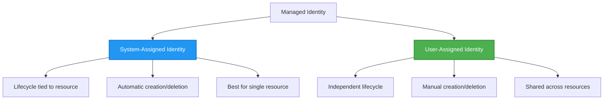

# Todennusmallit ja hallittu identiteetti

⏱️ **Arvioitu aika**: 45-60 minuuttia lukua; varaa lisäaikaa harjoitusten liittämiseen | 💰 **Kustannusvaikutus**: Identity/RBAC ovat ilmaisia; käytössä oleva laskenta, tallennustila ja Key Vault ovat laskutettavia | ⭐ **Vaativuus**: Keskitaso

> Tarkistettu `azd 1.37.2` (marraskuu 2026) mukaan. Tämä oppitunti sisältää **havainnollistavia integrointikatkelmia, ei täydellistä ladattavaa `secure-app`-mallia**. Luo viitatut tiedostot, tarjoa vastaava infrastruktuuri ja korvaa paikkamerkit ennen käyttöönottoa. Tarkistuksen aikana ei luotu Azure-resursseja.

**📚 Oppimispolku:**
- ← Edellinen: [Konfiguraation hallinta](configuration.md) - Ympäristömuuttujien ja salaustietojen hallinta
- 🎯 **Olet tässä**: Todennus ja turvallisuus (Hallittu identiteetti, Key Vault, turvalliset mallit)
- → Seuraava: [Infrastruktuuri koodina](../chapter-04-infrastructure/README.md) - Resurssien valmistelu ja käyttöönotto
- 🏠 [Kurssin etusivu](../../README.md)

---

## Mitä opit

Tässä oppitunnissa opit:
- Ymmärtämään Azure-todennusmalleja (avaimet, yhteysmerkkijonot, hallittu identiteetti)
- Toteuttamaan **hallittu identiteetti** salasanattomaan todennukseen
- Suojaamaan salaisuuksia **Azure Key Vault** -integraatiolla
- Konfiguroimaan **roolipohjainen käyttöoikeuksien hallinta (RBAC)** AZD-käyttöönottoihin
- Soveltamaan turvallisuuden parhaita käytäntöjä Container Appsissa ja Azure-palveluissa
- Siirtymään avainpohjaisesta todennuksesta identiteettipohjaiseen

## Miksi hallittu identiteetti on tärkeä

### Ongelma: Perinteinen todennus

**Ennen hallittua identiteettiä:**
```javascript
// ❌ SECURITY RISK: Hardcoded secrets in code
const connectionString = "Server=mydb.database.windows.net;User=admin;Password=P@ssw0rd123";
const storageKey = "xK7mN9pQ2wR5tY8uI0oP3aS6dF1gH4jK...";
const cosmosKey = "C2x7B9n4M1p8Q5w3E6r0T2y5U8i1O4p7...";
```

**Ongelmia:**
- 🔴 **Salaisten tietojen paljastuminen** koodissa, konfiguraatiotiedostoissa, ympäristömuuttujissa
- 🔴 **Tunnistetietojen kierrätys** vaatii koodin muutoksia ja uudelleenasennuksen
- 🔴 **Auditointiyritykset** - kuka pääsi käsiksi mihinkin ja milloin?
- 🔴 **Hajautuminen** - salaisuudet hajallaan useissa järjestelmissä
- 🔴 **Noudattamisriskit** - epäonnistuu turvallisuusauditoinnissa

### Ratkaisu: Hallittu identiteetti

**Hallinnon jälkeen:**
```javascript
// ✅ SECURE: No secrets in code
const credential = new DefaultAzureCredential();
const client = new BlobServiceClient(
  "https://mystorageaccount.blob.core.windows.net",
  credential  // Azure automatically handles authentication
);
```

**Hyödyt:**
- ✅ **Ei lainkaan salaisuuksia** koodissa tai konfiguraatiossa
- ✅ **Automaattinen kierrätys** - Azure hoitaa sen
- ✅ **Täysi auditointiloki** Microsoft Entra ID -lokeissa
- ✅ **Keskitetty turvallisuus** - hallinta Azure-portaalissa
- ✅ **Valmiina vaatimustenmukaisuuteen** - täyttää turvallisuusstandardit

**Vertauskuva**: Perinteinen todennus on kuin kantaisit fyysisiä avaimia moniin oviin. Hallittu identiteetti on kuin kulkulupa, joka automaattisesti myöntää pääsyn henkilöperusteisesti — ei avaimia, joita voisi kadottaa, kopioida tai kierrättää.

---

## Arkkitehtuurin yleiskuva

### Todennusprosessi hallitulla identiteetillä

```mermaid
sequenceDiagram
    participant App as Your Application<br/>(Container App)
    participant MI as Managed Identity<br/>(Microsoft Entra ID)
    participant KV as Key Vault
    participant Storage as Azure Storage
    participant DB as Azure SQL
    
    App->>MI: Request access token<br/>(automatic)
    MI->>MI: Verify identity<br/>(no password needed)
    MI-->>App: Return token for requested audience<br/>(lifetime varies)
    
    App->>KV: Get secret<br/>(using token)
    KV->>KV: Check RBAC permissions
    KV-->>App: Return secret value
    
    App->>Storage: Upload blob<br/>(using token)
    Storage->>Storage: Check RBAC permissions
    Storage-->>App: Success
    
    App->>DB: Query data<br/>(using token)
    DB->>DB: Check SQL permissions
    DB-->>App: Return results
    
    Note over App,DB: Request a separate token for each service audience;<br/>SDK credentials handle caching and renewal
```

### Hallittujen identiteettien tyypit



| Ominaisuus | Järjestelmän määrittämä | Käyttäjän määrittämä |
|---------|----------------|---------------|
| **Elinkaari** | Sidottu resurssiin | Riippumaton |
| **Luonti** | Automaattinen resurssin kanssa | Manuaalinen luonti |
| **Poisto** | Poistetaan resurssin kanssa | Pysyy resurssin poistamisen jälkeen |
| **Jakaminen** | Yksi resurssi | Useita resursseja |
| **Käyttötapaus** | Yksinkertaiset tilanteet | Monimutkaiset moni-resurssitilanteet |
| **Mallin valinta** | Määritetty infrastruktuurissa | Määritetty infrastruktuurissa |

---

## Esivaatimukset

### Tarvittavat työkalut

Sinulla tulisi jo olla nämä asennettuna aiemmista oppitunneista:

```bash
# Verify Azure Developer CLI
azd version
# ✅ Expected: azd version 1.0.0 or higher

# Verify Azure CLI
az --version
# ✅ Expected: azure-cli 2.50.0 or higher
```

### Azure-vaatimukset

- Aktiivinen Azure-tilaus
- Oikeudet:
  - Luoda hallittuja identiteettejä
  - Määrittää RBAC-rooleja
  - Luoda Key Vault -resursseja
  - Ottaa Container Apps käyttöön

### Tietämyksen esivaatimukset

Sinun tulisi olla suorittanut:
- [Asennusopas](../chapter-01-foundation/installation.md) - AZD:n asennus
- [AZD perusteet](../chapter-01-foundation/azd-basics.md) - Keskeiset käsitteet
- [Konfiguraation hallinta](configuration.md) - Ympäristömuuttujat

---

## Oppitunti 1: Todennusmallien ymmärtäminen

### Malli 1: Yhteysmerkkijonot (vanhentunut – vältä)

**Toimintaperiaate:**
```bash
# Connection string contains credentials
STORAGE_CONNECTION_STRING="DefaultEndpointsProtocol=https;AccountName=myaccount;AccountKey=xK7mN9pQ2wR5..."
COSMOS_CONNECTION_STRING="AccountEndpoint=https://myaccount.documents.azure.com:443/;AccountKey=C2x7..."
SQL_CONNECTION_STRING="Server=myserver.database.windows.net;User=admin;Password=P@ssw0rd..."
```

**Ongelmia:**
- ❌ Salaisuudet näkyvissä ympäristömuuttujissa
- ❌ Kirjattu käyttöönottojärjestelmiin
- ❌ Vaikea kierrättää
- ❌ Ei auditointilokia pääsystä

**Milloin käyttää:** Kun kohdepalvelu vaatii avainpohjaisen todennuksen. Suosi identiteettiä, jos se on tuettu; muuten säilytä avaimet turvallisesti ja kierrätä niitä myös tuotannossa.

---

### Malli 2: Key Vault -viitteet (parempi)

**Toimintaperiaate:**
**Osittaiset Bicep-palaset:** vaaditut Key Vault -kentät, Container App -identiteetti ja sen `configuration.secrets` sisääntulo on jätetty pois. `secretRef` nimeää Container Appin salaisuuden; se ei ole **itse** Key Vaultin URI. Käyttääksesi Key Vaultia, määritä nimetty salaisuus `keyVaultUrl` ja valtuutetulla `identity`.

```bicep
// Store secret in Key Vault
resource keyVault 'Microsoft.KeyVault/vaults@2023-02-01' = {
  name: 'mykv'
  properties: {
    enableRbacAuthorization: true
  }
}

// Reference in Container App
env: [
  {
    name: 'STORAGE_KEY'
    secretRef: 'storage-key'  // References Key Vault
  }
]
```

**Edut:**
- ✅ Salaisuudet tallennetaan turvallisesti Key Vaultiin
- ✅ Keskitetty salaisuuksien hallinta
- ✅ Pyöritys ilman koodimuutoksia

**Rajoitukset:**
- ⚠️ Käytössä edelleen avaimia/salasanoja
- ⚠️ Key Vault -käytön hallinta tarpeen

**Milloin käyttää:** Välikäynti yhteysmerkkijonoista hallittuun identiteettiin.

---

### Malli 3: Hallittu identiteetti (Paras käytäntö)

**Toimintaperiaate:**
**Osittainen Bicep:** yhdistä identity-lohko kokonaiseksi Container Appiksi ja anna `storageAccount` sekä roolimääritelmä. Roolin myöntäminen vaatii myös deterministisen `name`.

```bicep
// Enable managed identity
resource containerApp 'Microsoft.App/containerApps@2023-05-01' = {
  name: 'myapp'
  identity: {
    type: 'SystemAssigned'  // Automatically creates identity
  }
}

// Grant permissions
resource roleAssignment 'Microsoft.Authorization/roleAssignments@2022-04-01' = {
  name: guid(storageAccount.id, containerApp.id, storageBlobDataContributorRole)
  scope: storageAccount
  properties: {
    roleDefinitionId: storageBlobDataContributorRole
    principalId: containerApp.identity.principalId
    principalType: 'ServicePrincipal'
  }
}
```

**Sovelluskoodi:**
```javascript
// No secrets needed!
const { DefaultAzureCredential } = require('@azure/identity');
const { BlobServiceClient } = require('@azure/storage-blob');

const credential = new DefaultAzureCredential();
const blobServiceClient = new BlobServiceClient(
  'https://mystorageaccount.blob.core.windows.net',
  credential
);
```

**Edut:**
- ✅ Ei salaisuuksia koodissa/konfiguraatiossa
- ✅ Automaattinen tunnistetietojen pyöritys
- ✅ Täysi auditointiloki
- ✅ RBAC-pohjaiset käyttöoikeudet
- ✅ Valmis vaatimustenmukaiseen käyttöön

**Milloin käyttää:** Suositeltava Azureen isännöidyissä sovelluksissa, jotka käyttävät Microsoft Entra -todennusta.

---

### Malli 4: Palveluperiaatteet (CI/CD & automaatio)

Hallittu identiteetti on kullanarvoinen *Azure-resurssien sisällä ajettaville*. Mutta entä asiat, jotka toimivat **Azureen ulkopuolella**—kuten CI/CD-putki build-agentilla tai skripti läppärilläsi, joka ei voi käyttää interaktiivista kirjautumista? Tässä tulee kuvaan **palveluperiaate**: ei-ihmisen identiteetti omilla tunnistetiedoillaan, joilla automaattinen prosessi voi kirjautua sisään.

**Toimintaperiaate:**

Luo palveluperiaate resurssiryhmään rajattuna (minimioikeudet):

```bash
az ad sp create-for-rbac \
  --name "myapp-cicd" \
  --role contributor \
  --scopes "/subscriptions/<sub-id>/resourceGroups/<rg-name>"
```

Tämä tulostaa käyttöliittymän tunnuksen, salaisuuden ja vuokranantajan tunnuksen. azd voi kirjautua sisään niiden avulla ei-interaktiivisesti:

```bash
azd auth login \
  --client-id "<appId>" \
  --client-secret "<password>" \
  --tenant-id "<tenant>"
```

**Suosi liitettyjä tunnistetietoja (OIDC) salaisuuksien sijaan.** Pitkäkestoisen asiakassalaisuuden sijaan määritä liitetty tunnistetieto, jolloin putkisto vaihtaa lyhytkestoisen tokenin—ei salaisuuden vuoto- tai pyöritysriskiä:

```bash
azd auth login \
  --client-id "<appId>" \
  --federated-credential-provider "github" \
  --tenant-id "<tenant>"
```

> `azd pipeline config` määrittää tämän automaattisesti puolestasi. Katso CI/CD-kävelyt läpi [Luku 8](../chapter-08-production/production-ai-practices.md).

**Edut:**
- ✅ Toimii Azuren ulkopuolella (build-agentit, paikalliset ympäristöt, muut pilvet)
- ✅ Voidaan rajata yksittäiseen resurssiryhmään yhdellä roolilla
- ✅ Liitetty (OIDC) versio ei säilytä salaisuutta

**Kompromissit:**
- ⚠️ Salaisuuksiin perustuva versio vaatii huolellista säilytystä ja pyöritystä
- ⚠️ Vuotanut salaisuus antaa kaikki SP:n oikeudet—pidä rajaukset tiukkoina

**Milloin käyttää:** CI/CD-putkistot ja automaatio, joka ei voi käyttää hallittua identiteettiä. Suosi aina **liitettyä/OIDC** versiota asiakassalaisuuden sijaan ja hallittua identiteettiä kun työkuorma pyörii Azuren sisällä.

**Tunnistetietojen turvallinen säilytys:**
- Älä koskaan tallenna salaisuuksia lähdekoodiin—käytä putkistosi salaisuuskauppaa (GitHub Actions secrets, Azure DevOpsin muuttujiin liittyvät ryhmät / Key Vault).
- Rajaa SP pienimpään tarvittavaan rooliin ja resurssiryhmään.
- Aseta vanhentumisaika ja pyöritä, tai poista salaisuus kokonaan OIDC:llä.

---

## Oppitunti 2: Hallitun identiteetin toteutus AZD:llä

### Askel askeleelta toteutus

Seuraavat palaset näyttävät, miten hallittu identiteetti integroidaan Container App -projektiin. Ne eivät ole **valmis kopioitava aloituspaketti**: Storage-moduuli, täysi hallittu ympäristö/rekisteri-infrastruktuuri, Dockerfile ja parametriluokat eivät kaikki kuulu tähän. Aloita toimivasta Container Apps -mallista ja yhdistä nämä kuviot pitäen sen rekisterikonfiguraatio ja palvelutunnisteet.

### Projektin rakenne

```
secure-app/
├── azure.yaml                 # AZD configuration
├── infra/
│   ├── main.bicep            # Main infrastructure
│   ├── core/
│   │   ├── identity.bicep    # Managed identity setup
│   │   ├── keyvault.bicep    # Key Vault configuration
│   │   └── storage.bicep     # Storage with RBAC
│   └── app/
│       └── container-app.bicep
└── src/
    ├── app.js                # Application code
    ├── package.json
    └── Dockerfile
```

### 1. Määritä AZD (azure.yaml)

```yaml
name: secure-app
metadata:
  template: secure-app@1.0.0

services:
  api:
    project: ./src
    language: js
    host: containerapp

# Managed identity must be enabled in the infrastructure, not by this YAML.
```

### 2. Infrastruktuuri: Ota hallittu identiteetti käyttöön

**Tiedosto: `infra/main.bicep`**

```bicep
targetScope = 'subscription'

param environmentName string
param location string = 'eastus'
param containerAppsEnvironmentId string
param containerImage string

var tags = { 'azd-env-name': environmentName }

// Resource group
resource rg 'Microsoft.Resources/resourceGroups@2021-04-01' = {
  name: 'rg-${environmentName}'
  location: location
  tags: tags
}

// Storage Account
module storage './core/storage.bicep' = {
  name: 'storage'
  scope: rg
  params: {
    name: 'st${uniqueString(rg.id)}'
    location: location
    tags: tags
  }
}

// Key Vault
module keyVault './core/keyvault.bicep' = {
  name: 'keyvault'
  scope: rg
  params: {
    name: 'kv-${uniqueString(rg.id)}'
    location: location
    tags: tags
  }
}

// Container App with Managed Identity
module containerApp './app/container-app.bicep' = {
  name: 'container-app'
  scope: rg
  params: {
    name: 'ca-${environmentName}'
    location: location
    tags: tags
    storageAccountName: storage.outputs.name
    keyVaultName: keyVault.outputs.name
    containerAppsEnvironmentId: containerAppsEnvironmentId
    containerImage: containerImage
  }
}

// Grant Container App access to Storage
module storageRoleAssignment './core/role-assignment.bicep' = {
  name: 'storage-role'
  scope: rg
  params: {
    principalId: containerApp.outputs.identityPrincipalId
    roleDefinitionId: 'ba92f5b4-2d11-453d-a403-e96b0029c9fe'  // Storage Blob Data Contributor
    targetResourceType: 'storage'
    targetResourceName: storage.outputs.name
  }
}

// Grant Container App access to Key Vault
module kvRoleAssignment './core/role-assignment.bicep' = {
  name: 'kv-role'
  scope: rg
  params: {
    principalId: containerApp.outputs.identityPrincipalId
    roleDefinitionId: '4633458b-17de-408a-b874-0445c86b69e6'  // Key Vault Secrets User
    targetResourceType: 'keyvault'
    targetResourceName: keyVault.outputs.name
  }
}

// Outputs
output AZURE_STORAGE_ACCOUNT_NAME string = storage.outputs.name
output AZURE_KEY_VAULT_NAME string = keyVault.outputs.name
output APP_URL string = containerApp.outputs.url
```

### 3. Container App järjestelmän määritetyllä identiteetillä

**Tiedosto: `infra/app/container-app.bicep`**

```bicep
param name string
param location string
param tags object = {}
param storageAccountName string
param keyVaultName string
param containerAppsEnvironmentId string
param containerImage string

resource containerApp 'Microsoft.App/containerApps@2023-05-01' = {
  name: name
  location: location
  tags: union(tags, { 'azd-service-name': 'api' })
  identity: {
    type: 'SystemAssigned'  // 🔑 Enable managed identity
  }
  properties: {
    managedEnvironmentId: containerAppsEnvironmentId
    configuration: {
      ingress: {
        external: true
        targetPort: 3000
      }
    }
    template: {
      containers: [
        {
          name: 'api'
          image: containerImage // Must exist; configure registry credentials for private images
          resources: {
            cpu: json('0.5')
            memory: '1Gi'
          }
          env: [
            {
              name: 'AZURE_STORAGE_ACCOUNT_NAME'
              value: storageAccountName
            }
            {
              name: 'AZURE_KEY_VAULT_NAME'
              value: keyVaultName
            }
            // 🔑 No secrets - managed identity handles authentication!
          ]
        }
      ]
    }
  }
}

// Output the identity for RBAC assignments
output identityPrincipalId string = containerApp.identity.principalId
output id string = containerApp.id
output url string = 'https://${containerApp.properties.configuration.ingress.fqdn}'
```

### 4. RBAC-rooliasetusmoduuli

**Tiedosto: `infra/core/role-assignment.bicep`**

```bicep
param principalId string
param roleDefinitionId string  // Azure built-in role ID
@allowed(['storage', 'keyvault'])
param targetResourceType string
param targetResourceName string

// Typed existing resources give Bicep a valid resource scope, not a string ID.
resource storageTarget 'Microsoft.Storage/storageAccounts@2023-01-01' existing = {
  name: targetResourceName
}
resource vaultTarget 'Microsoft.KeyVault/vaults@2023-02-01' existing = {
  name: targetResourceName
}

resource storageAssignment 'Microsoft.Authorization/roleAssignments@2022-04-01' = if (targetResourceType == 'storage') {
  name: guid(storageTarget.id, principalId, roleDefinitionId)
  scope: storageTarget
  properties: {
    roleDefinitionId: subscriptionResourceId('Microsoft.Authorization/roleDefinitions', roleDefinitionId)
    principalId: principalId
    principalType: 'ServicePrincipal'
  }
}

resource vaultAssignment 'Microsoft.Authorization/roleAssignments@2022-04-01' = if (targetResourceType == 'keyvault') {
  name: guid(vaultTarget.id, principalId, roleDefinitionId)
  scope: vaultTarget
  properties: {
    roleDefinitionId: subscriptionResourceId('Microsoft.Authorization/roleDefinitions', roleDefinitionId)
    principalId: principalId
    principalType: 'ServicePrincipal'
  }
}

// This module assigns at the target resource scope, not the whole resource group.
```

### 5. Sovelluskoodi hallituilla tunnuksilla

**Tiedosto: `src/app.js`**

```javascript
const express = require('express');
const { DefaultAzureCredential } = require('@azure/identity');
const { BlobServiceClient } = require('@azure/storage-blob');
const { SecretClient } = require('@azure/keyvault-secrets');

const app = express();
const PORT = process.env.PORT || 3000;

// 🔑 Initialize credential (works automatically with managed identity)
const credential = new DefaultAzureCredential();

// Azure Storage setup
const storageAccountName = process.env.AZURE_STORAGE_ACCOUNT_NAME;
const blobServiceClient = new BlobServiceClient(
  `https://${storageAccountName}.blob.core.windows.net`,
  credential  // No keys needed!
);

// Key Vault setup
const keyVaultName = process.env.AZURE_KEY_VAULT_NAME;
const secretClient = new SecretClient(
  `https://${keyVaultName}.vault.azure.net`,
  credential  // No keys needed!
);

// Health check
app.get('/health', (req, res) => {
  res.json({ status: 'healthy', authentication: 'managed-identity' });
});

// Upload file to blob storage
app.post('/upload', async (req, res) => {
  try {
    const containerClient = blobServiceClient.getContainerClient('uploads');
    await containerClient.createIfNotExists();
    
    const blobName = `file-${Date.now()}.txt`;
    const blockBlobClient = containerClient.getBlockBlobClient(blobName);
    
    const content = 'Hello from managed identity!';
    await blockBlobClient.upload(content, Buffer.byteLength(content));
    
    res.json({
      success: true,
      blobName: blobName,
      message: 'File uploaded using managed identity!'
    });
  } catch (error) {
    console.error('Upload error:', error);
    res.status(500).json({ error: error.message });
  }
});

// Get secret from Key Vault
app.get('/secret/:name', async (req, res) => {
  try {
    const secretName = req.params.name;
    const secret = await secretClient.getSecret(secretName);
    
    res.json({
      name: secretName,
      retrieved: secret.value !== undefined, // Never return the secret value to callers
      message: 'Secret retrieved using managed identity!'
    });
  } catch (error) {
    console.error('Secret error:', error);
    res.status(500).json({ error: error.message });
  }
});

// List blob containers (demonstrates read access)
app.get('/containers', async (req, res) => {
  try {
    const containers = [];
    for await (const container of blobServiceClient.listContainers()) {
      containers.push(container.name);
    }
    
    res.json({
      containers: containers,
      count: containers.length,
      message: 'Containers listed using managed identity!'
    });
  } catch (error) {
    console.error('List error:', error);
    res.status(500).json({ error: error.message });
  }
});

app.listen(PORT, () => {
  console.log(`Secure API listening on port ${PORT}`);
  console.log('Authentication: Managed Identity (passwordless)');
});
```

**Tiedosto: `src/package.json`**

```json
{
  "name": "secure-app",
  "version": "1.0.0",
  "dependencies": {
    "express": "^4.18.2",
    "@azure/identity": "^4.0.0",
    "@azure/storage-blob": "^12.17.0",
    "@azure/keyvault-secrets": "^4.7.0"
  },
  "scripts": {
    "start": "node app.js"
  }
}
```

### 6. Julkaise ja testaa

Suorita nämä komennot **vasta** kun olet toteuttanut puuttuvan infrastruktuurin, Dockerfilen ja vastaavan `main.parameters.json` omaan projektiisi. Kirjaudu sisään azd:llä `azd auth login`; kirjaudu erikseen `az login` Azuren CLI-tarkistuksia varten myöhemmin. Näytetyt päätelaitteet ovat demonstraatioita ja vaativat asianmukaiset käyttöoikeudet ennen julkista käyttöä.

```bash
# Initialize AZD environment
azd init

# Deploy infrastructure and application
azd up

# Get the app URL
APP_URL=$(azd env get-value APP_URL)

# Test health check
curl $APP_URL/health
```

**✅ Odotettu tulos:**
```json
{
  "status": "healthy",
  "authentication": "managed-identity"
}
```

**Testaa blobin lataus:**
```bash
curl -X POST $APP_URL/upload
```

**✅ Odotettu tulos:**
```json
{
  "success": true,
  "blobName": "file-1700404800000.txt",
  "message": "File uploaded using managed identity!"
}
```

**Testaa konttien listaus:**
```bash
curl $APP_URL/containers
```

**✅ Odotettu tulos:**
```json
{
  "containers": ["uploads"],
  "count": 1,
  "message": "Containers listed using managed identity!"
}
```

---

## Yleiset Azure RBAC -roolit

### Valmiit roolitunnukset hallitulle identiteetille

| Palvelu | Roolin nimi | Roolin tunnus | Käyttöoikeudet |
|---------|-------------|---------------|---------------|
| **Storage** | Storage Blob Data Reader | `2a2b9908-6ea1-4ae2-8e65-a410df84e7d1` | Lukee blopeja ja kontteja |
| **Storage** | Storage Blob Data Contributor | `ba92f5b4-2d11-453d-a403-e96b0029c9fe` | Lukee, kirjoittaa, poistaa blopeja |
| **Storage** | Storage Queue Data Contributor | `974c5e8b-45b9-4653-ba55-5f855dd0fb88` | Lukee, kirjoittaa, poistaa jonoja/viestejä |
| **Key Vault** | Key Vault Salaisuuksien Käyttäjä | `4633458b-17de-408a-b874-0445c86b69e6` | Lukee salaisuuksia |
| **Key Vault** | Key Vault Salaisuuksien Hoitaja | `b86a8fe4-44ce-4948-aee5-eccb2c155cd7` | Lukee, kirjoittaa, poistaa salaisuuksia |
| **Cosmos DB** | Cosmos DB Sisäänrakennettu Data Reader | `00000000-0000-0000-0000-000000000001` | Lukee Cosmos DB:n dataa |
| **Cosmos DB** | Cosmos DB Sisäänrakennettu Data Contributor | `00000000-0000-0000-0000-000000000002` | Lukee, kirjoittaa Cosmos DB:n dataa |
| **SQL-tietokanta** | SQL DB Contributor | `9b7fa17d-e63e-47b0-bb0a-15c516ac86ec` | Hallinnoi tietokantaresursseja; ei anna SQL-datan käyttöoikeutta |
| **Service Bus** | Azure Service Bus Data Owner | `090c5cfd-751d-490a-894a-3ce6f1109419` | Lähettää, vastaanottaa, hallitsee viestejä |

### Miten roolitunnukset löytää

Cosmos DB NoSQL:n kaksi yllä olevaa ID:tä ovat **natiivien Cosmos data-plane -roolien määritelmiä**, eivät Azure RBAC -tilauskohtaisia roolitunnuksia. Määritä ne `az cosmosdb sql role assignment create` (tai `Microsoft.DocumentDB/databaseAccounts/sqlRoleAssignments`) avulla, ei `az role assignment create`. SQL-datan käyttöoikeus vaatii Entra-tietokantakäyttäjän ja SQL-oikeudet.

```bash
# List all built-in roles
az role definition list --query "[].{Name:roleName, ID:name}" --output table

# Search for specific role
az role definition list --query "[?contains(roleName, 'Storage Blob')].{Name:roleName, ID:name}" --output table

# Get role details
az role definition list --name "Storage Blob Data Contributor"
```

---

## Käytännön harjoituksia

**Kaikkien kolmen harjoituksen integrointiedellytykset:** toimiva Container App -malli omassa projektissa, vastaavat Bicep-resurssit, Azure CLI/azd-kirjautuminen, ja valtuudet vaadittujen roolien määrittämiseen. Nämä ovat ohjattuja mukautuksia, eivät erillisiä paikallisia aloituspaketteja; korvaa esimerkkiresurssin nimet omilla käyttöönotetuilla nimilläsi.

### Harjoitus 1: Hallitun identiteetin käyttöönotto olemassa olevalle sovellukselle ⭐⭐ (Keskitaso)

**Tavoite**: Lisää hallittu identiteetti olemassa olevaan Container App -asennukseen

**Tilanne:** Sinulla on Container App, joka käyttää yhteysmerkkijonoja. Muunna se hallituksi identiteetiksi.

**Lähtötilanne:** Container App tällä konfiguraatiolla:

```bicep
// ❌ Current: Using connection string
env: [
  {
    name: 'STORAGE_CONNECTION_STRING'
    secretRef: 'storage-connection'
  }
]
```

**Vaiheet:**

1. **Ota hallittu identiteetti käyttöön Bicepissä:**

```bicep
resource containerApp 'Microsoft.App/containerApps@2023-05-01' = {
  name: 'myapp'
  identity: {
    type: 'SystemAssigned'  // Add this
  }
  // ... rest of configuration
}
```

2. **Myönnä Storage-käyttöoikeus:**

```bicep
// Get storage account reference
resource storageAccount 'Microsoft.Storage/storageAccounts@2023-01-01' existing = {
  name: storageAccountName
}

// Assign role
resource roleAssignment 'Microsoft.Authorization/roleAssignments@2022-04-01' = {
  name: guid(containerApp.id, 'ba92f5b4-2d11-453d-a403-e96b0029c9fe', storageAccount.id)
  scope: storageAccount
  properties: {
    roleDefinitionId: subscriptionResourceId('Microsoft.Authorization/roleDefinitions', 'ba92f5b4-2d11-453d-a403-e96b0029c9fe')
    principalId: containerApp.identity.principalId
    principalType: 'ServicePrincipal'
  }
}
```

3. **Päivitä sovelluskoodi:**

**Ennen (yhteysmerkkijono):**
```javascript
const { BlobServiceClient } = require('@azure/storage-blob');

const blobServiceClient = BlobServiceClient.fromConnectionString(
  process.env.STORAGE_CONNECTION_STRING
);
```

**Jälkeen (hallittu identiteetti):**
```javascript
const { DefaultAzureCredential } = require('@azure/identity');
const { BlobServiceClient } = require('@azure/storage-blob');

const credential = new DefaultAzureCredential();
const blobServiceClient = new BlobServiceClient(
  `https://${process.env.STORAGE_ACCOUNT_NAME}.blob.core.windows.net`,
  credential
);
```

4. **Päivitä ympäristömuuttujat:**

```bicep
env: [
  {
    name: 'STORAGE_ACCOUNT_NAME'
    value: storageAccountName  // Just the name, no secrets!
  }
  // Remove STORAGE_CONNECTION_STRING
]
```

5. **Julkaise ja testaa:**

```bash
# Redeploy
azd up

# Test that it still works
APP_URL=$(azd show --output json | jq -er '.services.api.ingressUrl')
curl --fail -X POST "$APP_URL/upload"
```

**✅ Onnistumiskriteerit:**
- ✅ Sovellus julkaistaan ilman virheitä
- ✅ Storage-toiminnot toimivat (lataa, listaa, lataa uudelleen)
- ✅ Ei yhteysmerkkijonoja ympäristömuuttujissa
- ✅ Identiteetti näkyy Azure-portaalissa "Identity"-välilehdellä

**Varmistus:**

```bash
# Check managed identity is enabled
az containerapp show \
  --name myapp \
  --resource-group rg-myapp \
  --query "identity.type"
# ✅ Expected: "SystemAssigned"

# Check role assignment
az role assignment list \
  --assignee $(az containerapp show --name myapp --resource-group rg-myapp --query "identity.principalId" -o tsv) \
  --scope /subscriptions/{sub-id}/resourceGroups/rg-myapp/providers/Microsoft.Storage/storageAccounts/mystorageaccount
# ✅ Expected: Shows "Storage Blob Data Contributor" role
```

**Aika:** 20-30 minuuttia

---

### Harjoitus 2: Monipalvelun käyttö samankaltaisella käyttäjäkohtaisella identiteetillä ⭐⭐⭐ (Edistynyt)

**Tavoite**: Luo käyttäjäkohtainen identiteetti, jota jaetaan useissa Container Apps -sovelluksissa

**Tilanne:** Sinulla on 3 mikropalvelua, jotka kaikki tarvitsevat pääsyn samaan Storage-tiliin ja Key Vaultiin.

**Vaiheet:**

1. **Luo käyttäjäkohtainen identiteetti:**

**Tiedosto: `infra/core/identity.bicep`**

```bicep
param name string
param location string
param tags object = {}

resource userAssignedIdentity 'Microsoft.ManagedIdentity/userAssignedIdentities@2023-01-31' = {
  name: name
  location: location
  tags: tags
}

output id string = userAssignedIdentity.id
output principalId string = userAssignedIdentity.properties.principalId
output clientId string = userAssignedIdentity.properties.clientId
```

2. **Myönnä roolit käyttäjäkohtaiselle identiteetille:**

```bicep
// In main.bicep
module userIdentity './core/identity.bicep' = {
  name: 'user-identity'
  scope: rg
  params: {
    name: 'id-${environmentName}'
    location: location
    tags: tags
  }
}

// Grant Storage access
resource storageRoleAssignment 'Microsoft.Authorization/roleAssignments@2022-04-01' = {
  name: guid(storageAccount.id, environmentName, 'storage-contributor')
  scope: storageAccount
  properties: {
    roleDefinitionId: subscriptionResourceId('Microsoft.Authorization/roleDefinitions', 'ba92f5b4-2d11-453d-a403-e96b0029c9fe')
    principalId: userIdentity.outputs.principalId
    principalType: 'ServicePrincipal'
  }
}

// Grant Key Vault access
resource kvRoleAssignment 'Microsoft.Authorization/roleAssignments@2022-04-01' = {
  name: guid(keyVault.id, environmentName, 'kv-secrets-user')
  scope: keyVault
  properties: {
    roleDefinitionId: subscriptionResourceId('Microsoft.Authorization/roleDefinitions', '4633458b-17de-408a-b874-0445c86b69e6')
    principalId: userIdentity.outputs.principalId
    principalType: 'ServicePrincipal'
  }
}
```

3. **Määritä identiteetti useille Container Apps -sovelluksille:**

```bicep
resource apiGateway 'Microsoft.App/containerApps@2023-05-01' = {
  name: 'api-gateway'
  identity: {
    type: 'UserAssigned'
    userAssignedIdentities: {
      '${userIdentity.outputs.id}': {}
    }
  }
  // ... rest of config
}

resource productService 'Microsoft.App/containerApps@2023-05-01' = {
  name: 'product-service'
  identity: {
    type: 'UserAssigned'
    userAssignedIdentities: {
      '${userIdentity.outputs.id}': {}
    }
  }
  // ... rest of config
}

resource orderService 'Microsoft.App/containerApps@2023-05-01' = {
  name: 'order-service'
  identity: {
    type: 'UserAssigned'
    userAssignedIdentities: {
      '${userIdentity.outputs.id}': {}
    }
  }
  // ... rest of config
}
```

4. **Sovelluskoodi (kaikki palvelut käyttävät samaa mallia):**

```javascript
const { ManagedIdentityCredential } = require('@azure/identity');
const { BlobServiceClient } = require('@azure/storage-blob');

// For user-assigned identity, specify the client ID
const credential = new ManagedIdentityCredential(
  process.env.AZURE_CLIENT_ID  // User-assigned identity client ID
);

// Alternative (choose ONE credential declaration):
// const { DefaultAzureCredential } = require('@azure/identity');
// const credential = new DefaultAzureCredential({
//   managedIdentityClientId: process.env.AZURE_CLIENT_ID
// });

const blobServiceClient = new BlobServiceClient(
  `https://${process.env.STORAGE_ACCOUNT_NAME}.blob.core.windows.net`,
  credential
);
```

Aseta jokaisen Container Appin ajoajan `AZURE_CLIENT_ID` arvoksi `userIdentity.outputs.clientId` ja `STORAGE_ACCOUNT_NAME` säilytysnimelläsi Bicepissä. Pelkkä identiteetin määrittäminen tai `azd env set` ajaminen ei konfiguroi näitä ajoaikavakioita.

5. **Ota käyttöön ja varmista:**

```bash
azd up

# Test all services can access storage
# Replace with the actual ingress URLs reported for your three services
curl --fail -X POST "$API_GATEWAY_URL/upload"
curl --fail -X POST "$PRODUCT_SERVICE_URL/upload"
curl --fail -X POST "$ORDER_SERVICE_URL/upload"
```

**✅ Onnistumisen kriteerit:**
- ✅ Yksi identiteetti jaettu 3 palvelun kesken
- ✅ Kaikki palvelut voivat käyttää Storagea ja Key Vaultia
- ✅ Identiteetti säilyy, vaikka yksi palvelu poistetaan
- ✅ Keskitetty käyttöoikeuksien hallinta

**Käyttäjäkohtaisen identiteetin edut:**
- Yksi identiteetti hallittavaksi
- Johdonmukaiset käyttöoikeudet palveluiden välillä
- Säilyy palvelun poistamisen yli
- Parempi monimutkaisille arkkitehtuureille

**Aika**: 30-40 minuuttia

---

### Harjoitus 3: Toteuta Key Vault -salaisuuden kierto ⭐⭐⭐ (Edistynyt)

**Tavoite**: Tallenna kolmannen osapuolen API-avaimet Key Vaultiin ja käytä niitä hallitun identiteetin avulla

**Tilanne**: Sovelluksesi tarvitsee kutsua ulkoista APIa (OpenAI, Stripe, SendGrid), joka vaatii API-avaimia.

**Vaiheet**:

1. **Luo Key Vault RBAC:lla:**

**Tiedosto: `infra/core/keyvault.bicep`**

```bicep
param name string
param location string
param tags object = {}

resource keyVault 'Microsoft.KeyVault/vaults@2023-02-01' = {
  name: name
  location: location
  tags: tags
  properties: {
    enableRbacAuthorization: true  // Use RBAC instead of access policies
    sku: {
      family: 'A'
      name: 'standard'
    }
    tenantId: subscription().tenantId
    enableSoftDelete: true
    softDeleteRetentionInDays: 90
  }
}

// Allow Container App to read secrets
output id string = keyVault.id
output name string = keyVault.name
output uri string = keyVault.properties.vaultUri
```

2. **Tallenna salaisuudet Key Vaultiin:**

```bash
# Get Key Vault name
KV_NAME=$(azd env get-value AZURE_KEY_VAULT_NAME)

# Store third-party API keys
az keyvault secret set \
  --vault-name $KV_NAME \
  --name "OpenAI-ApiKey" \
  --value "sk-proj-xxxxxxxxxxxxx"

az keyvault secret set \
  --vault-name $KV_NAME \
  --name "Stripe-ApiKey" \
  --value "sk_live_xxxxxxxxxxxxx"

az keyvault secret set \
  --vault-name $KV_NAME \
  --name "SendGrid-ApiKey" \
  --value "SG.xxxxxxxxxxxxx"
```

3. **Sovelluskoodi salaisuuksien hakemiseen:**

**Tiedosto: `src/config.js`**

```javascript
const { DefaultAzureCredential } = require('@azure/identity');
const { SecretClient } = require('@azure/keyvault-secrets');

class Config {
  constructor() {
    this.credential = new DefaultAzureCredential();
    this.secretClient = new SecretClient(
      `https://${process.env.AZURE_KEY_VAULT_NAME}.vault.azure.net`,
      this.credential
    );
    this.cache = {};
  }

  async getSecret(secretName) {
    // Check cache first
    if (this.cache[secretName]) {
      return this.cache[secretName];
    }

    try {
      const secret = await this.secretClient.getSecret(secretName);
      this.cache[secretName] = secret.value;
      console.log(`✅ Retrieved secret: ${secretName}`);
      return secret.value;
    } catch (error) {
      console.error(`❌ Failed to get secret ${secretName}:`, error.message);
      throw error;
    }
  }

  async getOpenAIKey() {
    return this.getSecret('OpenAI-ApiKey');
  }

  async getStripeKey() {
    return this.getSecret('Stripe-ApiKey');
  }

  async getSendGridKey() {
    return this.getSecret('SendGrid-ApiKey');
  }
}

module.exports = new Config();
```

4. **Käytä salaisuuksia sovelluksessa:**

**Tiedosto: `src/app.js`**

Tämä **korvaava sovellusosa** vaatii `npm install openai`, oikean kolmannen osapuolen avaimen, käytettävissä olevan mallin ja infrastruktuurin työskentelevästä projektistasi. Se kutsuu OpenAI:ta suoraan, ei Azure OpenAI -käyttöönottoa. Alla olevat paikkamerkkiavaimet eivät valtuuta pyyntöjä.

```javascript
const express = require('express');
const config = require('./config');
const { OpenAI } = require('openai');

const app = express();

// Initialize OpenAI with key from Key Vault
let openaiClient;

async function initializeServices() {
  const openaiKey = await config.getOpenAIKey();
  openaiClient = new OpenAI({ apiKey: openaiKey });
  console.log('✅ Services initialized with secrets from Key Vault');
}

app.post('/chat', async (req, res) => {
  try {
    const completion = await openaiClient.chat.completions.create({
      model: 'gpt-4.1',
      messages: [{ role: 'user', content: 'Hello!' }]
    });
    
    res.json({
      response: completion.choices[0].message.content,
      authentication: 'Key from Key Vault via Managed Identity'
    });
  } catch (error) {
    res.status(500).json({ error: error.message });
  }
});

// Start listening only after initialization succeeds.
initializeServices().then(() => {
  app.listen(3000, () => console.log('Key Vault demo running'));
}).catch(error => {
  console.error('Initialization failed:', error.message);
  process.exitCode = 1;
});
```

5. **Ota käyttöön ja testaa:**

```bash
azd up

# Test that API keys work
curl -X POST https://myapp.azurecontainerapps.io/chat \
  -H "Content-Type: application/json" \
  -d '{"message":"Hello AI"}'
```

**✅ Onnistumisen kriteerit:**
- ✅ Ei API-avaimia koodissa tai ympäristömuuttujissa
- ✅ Sovellus hakee avaimet Key Vaultista
- ✅ Kolmannen osapuolen API:t toimivat oikein
- ✅ Avaimia voi kiertää ilman koodimuutoksia

**Kierrä salaisuus:**

```bash
# Update secret in Key Vault
az keyvault secret set \
  --vault-name $KV_NAME \
  --name "OpenAI-ApiKey" \
  --value "sk-proj-NEW_KEY_HERE"

# Find the active revision name, then restart it to clear the in-process cache
az containerapp revision list --name myapp --resource-group rg-myapp --output table
az containerapp revision restart \
  --name myapp \
  --resource-group rg-myapp \
  --revision "<active-revision-name>"
```

**Aika**: 25-35 minuuttia

---

## Tietämyksen tarkistus

### 1. Todennusmallit ✓

Testaa ymmärrystäsi:

- [ ] **K1**: Mitkä ovat kolme pääasiallista todennusmallia? 
  - **V**: Yhteysmerkkijonot (perintö), Key Vault -viitteet (siirtymä), Hallittu identiteetti (paras)

- [ ] **K2**: Miksi hallittu identiteetti on parempi kuin yhteysmerkkijonot?
  - **V**: Ei salaisuuksia koodissa, automaattinen kierto, täydellinen tarkasteluloki, RBAC-oikeudet

- [ ] **K3**: Milloin käyttäjäkohtainen identiteetti kannattaa valita järjestelmäkohtaisen sijaan?
  - **V**: Kun identiteettiä jaetaan useiden resurssien kesken tai identiteetin elinkaari on riippumaton resurssien elinkaaresta

**Käytännön varmennus:**
```bash
# Check what type of identity your app uses
az containerapp show \
  --name myapp \
  --resource-group rg-myapp \
  --query "identity.type"

# List all role assignments for the identity
az role assignment list \
  --assignee $(az containerapp show --name myapp --resource-group rg-myapp --query "identity.principalId" -o tsv)
```

---

### 2. RBAC ja käyttöoikeudet ✓

Testaa ymmärrystäsi:

- [ ] **K1**: Mikä on "Storage Blob Data Contributor" -roolin tunniste?
  - **V**: `ba92f5b4-2d11-453d-a403-e96b0029c9fe`

- [ ] **K2**: Mitä oikeuksia "Key Vault Secrets User" tarjoaa?
  - **V**: Vain lukuoikeus salaisuuksiin (ei voi luoda, päivittää tai poistaa)

- [ ] **K3**: Kuinka annat Container Appille pääsyn Azure SQL:ään?
  - **V**: Määritä Microsoft Entra -todennus, luo identiteetti tietokantakäyttäjäksi ja myönnä tarvittavat SQL-oikeudet. "SQL DB Contributor" hallinnoi vain Azure-resursseja; se ei valtuuta kyselyjä.

**Käytännön varmennus:**
```bash
# Find specific role
az role definition list --name "Storage Blob Data Contributor"

# Check what roles are assigned to your identity
PRINCIPAL_ID=$(az containerapp show --name myapp --resource-group rg-myapp --query "identity.principalId" -o tsv)
az role assignment list --assignee $PRINCIPAL_ID --output table
```

---

### 3. Key Vault -integraatio ✓

Testaa ymmärrystäsi:

- [ ] **K1**: Kuinka otat RBAC:n käyttöön Key Vaultissa access policyjen sijaan?
  - **V**: Aseta `enableRbacAuthorization: true` Bicepissä

- [ ] **K2**: Mikä Azure SDK -kirjasto hoitaa hallitun identiteetin todennuksen?
  - **V**: `@azure/identity` luokan `DefaultAzureCredential` kanssa

- [ ] **K3**: Kuinka kauan Key Vaultin salaisuudet pysyvät välimuistissa?
  - **V**: Riippuu sovelluksesta; implementoi oma välimuististrategiasi

**Käytännön varmennus:**
```bash
# Test Key Vault access
az keyvault secret show \
  --vault-name $KV_NAME \
  --name "OpenAI-ApiKey" \
  --query "{name:name,enabled:attributes.enabled}"

# Check RBAC is enabled
az keyvault show \
  --name $KV_NAME \
  --query "properties.enableRbacAuthorization"
# ✅ Expected: true
```

---

## Turvallisuuden parhaat käytännöt

### ✅ TEKEMÄSI:

1. **Käytä aina hallittua identiteettiä tuotannossa**
   ```bicep
   identity: {
     type: 'SystemAssigned'
   }
   ```

2. **Käytä vähimmän oikeuden RBAC-rooleja**
   - Käytä "Lukija"-rooleja, kun se on mahdollista
   - Vältä "Omistaja" tai "Osallistuja" ellei ole tarpeen

3. **Tallenna kolmannen osapuolen avaimet Key Vaultiin**
   ```javascript
   const apiKey = await secretClient.getSecret('ThirdPartyApiKey');
   ```

4. **Ota käyttöön tarkastuslokitus** (osittainen resurssikappale; yhdistä omaan vault- ja työtilailmoitukseesi)
   ```bicep
   resource vaultDiagnostics 'Microsoft.Insights/diagnosticSettings@2021-05-01-preview' = {
     name: 'vault-audit'
     scope: keyVault
     properties: {
       workspaceId: logAnalytics.id
       logs: [{ category: 'AuditEvent', enabled: true }]
     }
   }
   ```

5. **Käytä eri identiteettejä kehitys/testi/tuotanto**
   ```bash
   azd env new dev
   azd env new staging
   azd env new prod
   ```

6. **Kierrä salaisuuksia säännöllisesti**
   - Aseta vanhentumispäivämäärät Key Vaultin salaisuuksiin
   - Automatisoi kierto Azure Functionseilla

### ❌ ÄLÄ:

1. **Älä koskaan kovakoodaa salaisuuksia**
   ```javascript
   // ❌ BAD
   const apiKey = "sk-proj-xxxxxxxxxxxxx";
   ```

2. **Älä käytä yhteysmerkkijonoja tuotannossa**
   ```javascript
   // ❌ BAD
   BlobServiceClient.fromConnectionString(process.env.STORAGE_CONNECTION_STRING)
   ```

3. **Älä anna liiallisia käyttöoikeuksia**
   ```bicep
   // ❌ BAD - too much access
   roleDefinitionId: subscriptionResourceId('Microsoft.Authorization/roleDefinitions', '8e3af657-a8ff-443c-a75c-2fe8c4bcb635')
   
   // ✅ GOOD - least privilege
   roleDefinitionId: subscriptionResourceId('Microsoft.Authorization/roleDefinitions', '2a2b9908-6ea1-4ae2-8e65-a410df84e7d1')
   ```

4. **Älä kirjaa salaisuuksia**
   ```javascript
   // ❌ BAD
   console.log('API Key:', apiKey);
   
   // ✅ GOOD
   console.log('API Key retrieved successfully');
   ```

5. **Älä jaa tuotantoidentiteettejä ympäristöjen välillä**
   ```bicep
   // ❌ BAD - same identity for dev and prod
   // ✅ GOOD - separate identities per environment
   ```

---

## Vikadiagnostiikkaopas

### Ongelma: "Unauthorized" Azure Storageen pääsyssä

**Oireet:**
```
Error: Unauthorized (403)
AuthorizationPermissionMismatch: This request is not authorized to perform this operation
```

**Diagnoosi:**

```bash
# Check if managed identity is enabled
az containerapp show \
  --name myapp \
  --resource-group rg-myapp \
  --query "identity.type"
# ✅ Expected: "SystemAssigned" or "UserAssigned"

# Check role assignments
PRINCIPAL_ID=$(az containerapp show --name myapp --resource-group rg-myapp --query "identity.principalId" -o tsv)
az role assignment list --assignee $PRINCIPAL_ID

# Expected: Should see "Storage Blob Data Contributor" or similar role
```

**Ratkaisut:**

1. **Myönnä oikea RBAC-rooli:**
```bash
STORAGE_ID=$(az storage account show --name mystorageaccount --resource-group rg-myapp --query "id" -o tsv)
az role assignment create \
  --assignee $PRINCIPAL_ID \
  --role "Storage Blob Data Contributor" \
  --scope $STORAGE_ID
```

2. **Odota muutoksen leviämistä (voi kestää 5-10 minuuttia):**
```bash
# Check role assignment status
az role assignment list --assignee $PRINCIPAL_ID --scope $STORAGE_ID
```

3. **Varmista, että sovelluskoodi käyttää oikeaa tunnistetta:**
```javascript
// Make sure you're using DefaultAzureCredential
const credential = new DefaultAzureCredential();
```

---

### Ongelma: Pääsy Key Vaultiin estetty

**Oireet:**
```
Error: Forbidden (403)
The user, group or application does not have secrets get permission
```

**Diagnoosi:**

```bash
# Check Key Vault RBAC is enabled
az keyvault show \
  --name $KV_NAME \
  --query "properties.enableRbacAuthorization"
# ✅ Expected: true

# Check role assignments
az role assignment list \
  --assignee $PRINCIPAL_ID \
  --scope /subscriptions/{sub-id}/resourceGroups/rg-myapp/providers/Microsoft.KeyVault/vaults/$KV_NAME
```

**Ratkaisut:**

1. **Ota RBAC käyttöön Key Vaultissa:**
```bash
az keyvault update \
  --name $KV_NAME \
  --enable-rbac-authorization true
```

2. **Myönnä Key Vault Secrets User -rooli:**
```bash
KV_ID=$(az keyvault show --name $KV_NAME --query "id" -o tsv)
az role assignment create \
  --assignee $PRINCIPAL_ID \
  --role "Key Vault Secrets User" \
  --scope $KV_ID
```

---

### Ongelma: DefaultAzureCredential epäonnistuu paikallisesti

**Oireet:**
```
Error: DefaultAzureCredential failed to retrieve a token
CredentialUnavailableError: No credential available
```

**Diagnoosi:**

```bash
# Check if you're logged in
az account show

# Check Azure CLI authentication
az ad signed-in-user show
```

**Ratkaisut:**

1. **Kirjaudu Azure CLI:hin:**
```bash
az login
```

2. **Aseta Azure-subscriptio:**
```bash
az account set --subscription "Your Subscription Name"
```

3. **Paikalliseen kehitykseen käytä ympäristömuuttujia:**
```bash
export AZURE_TENANT_ID="your-tenant-id"
export AZURE_CLIENT_ID="your-client-id"
export AZURE_CLIENT_SECRET="your-client-secret"
```

4. **Tai käytä paikallisesti eri tunnistetta:**
```javascript
const { DefaultAzureCredential, AzureCliCredential } = require('@azure/identity');

// Use AzureCliCredential for local dev
const credential = process.env.NODE_ENV === 'production' 
  ? new DefaultAzureCredential()
  : new AzureCliCredential();
```

---

### Ongelma: Roolin määritys leviää liian hitaasti

**Oireet:**
- Rooli määritetty onnistuneesti
- Silti saadaan 403-virheitä
- Satunnaista pääsyä (toimii joskus, joskus ei)

**Selitys:**
Azure RBAC -muutosten globaalinen leviäminen voi kestää 5-10 minuuttia.

**Ratkaisu:**

```bash
# Wait and retry
echo "Waiting for RBAC propagation..."
sleep 300  # Wait 5 minutes

# Test access
curl --fail -X POST "$APP_URL/upload"

# If still failing, restart the app
az containerapp revision restart \
  --name myapp \
  --resource-group rg-myapp \
  --revision "<active-revision-name>"
```

---

## Kustannusnäkökulmat

### Hallitun identiteetin kustannukset

| Resurssi | Kustannus |
|----------|------|
| **Hallittu identiteetti** | 🆓 **MAKSUTON** - Ei veloitusta |
| **RBAC-roolimääritykset** | 🆓 **MAKSUTON** - Ei veloitusta |
| **Microsoft Entra ID -tokenpyynnöt** | 🆓 **MAKSUTON** - Sisältyy |
| **Key Vault -toiminnot** | $0.03 10 000 toiminnon kohdalta |
| **Key Vault -salaisuuksien tallennus** | Tarkista ajantasainen hinnoittelu; älä oleta kuukausittaista maksua per salaisuus |

**Hallittu identiteetti säästää rahaa:**
- ✅ Poistaa Key Vault -operaatiot palveluiden välisessä todennuksessa
- ✅ Vähentää turvallisuusongelmia (ei vuotaneita tunnuksia)
- ✅ Laskee operatiivista kuormaa (ei manuaalista kiertoa)

Sovelluksen pyyntöjen määrä ei vastaa Key Vault -operaatioiden määrää: välimuisti- ja kiertomallit määräävät salaisuuden lukukustannukset. Identiteetti ei poista laskenta-/tallennusmaksuja. Tarkista [Key Vaultin hinnoittelu](https://azure.microsoft.com/pricing/details/key-vault/) ja Azure Hinnoittelulaskuri alueellesi sen sijaan, että arvioisit kuukausittaista säästöä pelkkien pyyntöjen perusteella.

---

## Lisätietoja

### Virallinen dokumentaatio
- [Azure Managed Identity](https://learn.microsoft.com/entra/identity/managed-identities-azure-resources/overview)
- [Azure RBAC](https://learn.microsoft.com/azure/role-based-access-control/overview)
- [Azure Key Vault](https://learn.microsoft.com/azure/key-vault/general/overview)
- [DefaultAzureCredential](https://learn.microsoft.com/dotnet/api/azure.identity.defaultazurecredential)

### SDK-dokumentaatio
- [@azure/identity (Node.js)](https://www.npmjs.com/package/@azure/identity)
- [Azure.Identity (C#)](https://www.nuget.org/packages/Azure.Identity/)
- [azure-identity (Python)](https://pypi.org/project/azure-identity/)

### Seuraavat vaiheet tässä kurssissa
- ← Edellinen: [Konfiguraation hallinta](configuration.md)
- → Seuraava: [Infrastructure as Code](../chapter-04-infrastructure/README.md)
- 🏠 [Kurssin etusivu](../../README.md)

### Aiheeseen liittyviä esimerkkejä
- [Microsoft Foundry Models Chat Example](../../../../examples/azure-openai-chat) - Käyttää hallittua identiteettiä Microsoft Foundry Modelseille
- [Microservices Example](../../../../examples/microservices) - Monipalveluiden todennusmallit

---

## Yhteenveto

**Olet oppinut:**
- ✅ Kolme todennusmallia (yhteysmerkkijonot, Key Vault, hallittu identiteetti)
- ✅ Kuinka ottaa käyttöön ja konfiguroida hallittu identiteetti AZD:ssä
- ✅ RBAC-roolimääritykset Azure-palveluille
- ✅ Key Vault -integraatio kolmannen osapuolen salaisuuksiin
- ✅ Käyttäjäkohtaiset vs. järjestelmäkohtaiset identiteetit
- ✅ Turvallisuuden parhaat käytännöt ja vikadiagnostiikka

**Keskeiset opit:**
1. **Käytä aina hallittua identiteettiä tuotannossa** - Ei lainkaan salaisuuksia, automaattinen kierto
2. **Käytä vähimmän oikeuden RBAC-rooleja** - Myönnä vain tarpeelliset oikeudet
3. **Tallenna kolmannen osapuolen avaimet Key Vaultiin** - Keskitetty salaisuuksien hallinta
4. **Eristä identiteetit ympäristöittäin** - Kehitys, testi, tuotanto erillään
5. **Ota käyttöön tarkastuslokitus** - Seuraa ketkä käyttävät mitä

**Seuraavat vaiheet:**
1. Suorita yllä olevat käytännön harjoitukset
2. Sido olemassa oleva sovellus hallitun identiteetin käyttäjäksi yhteysmerkkijonojen sijaan
3. Käy läpi aloittelijan käyttöönotto: [Ensimmäinen projekti](../chapter-01-foundation/first-project.md)

---

<!-- CO-OP TRANSLATOR DISCLAIMER START -->
**Vastuuvapauslauseke**:
Tämä asiakirja on käännetty käyttämällä tekoälypohjaista käännöspalvelua [Co-op Translator](https://github.com/Azure/co-op-translator). Vaikka pyrimme tarkkuuteen, otathan huomioon, että automaattiset käännökset saattavat sisältää virheitä tai epätarkkuuksia. Alkuperäinen asiakirja sen alkuperäiskielellä on virallinen lähde. Tärkeissä asioissa suositellaan ammattimaista ihmiskäännöstä. Emme ole vastuussa tämän käännöksen käytöstä aiheutuvista väärinymmärryksistä tai tulkinnoista.
<!-- CO-OP TRANSLATOR DISCLAIMER END -->