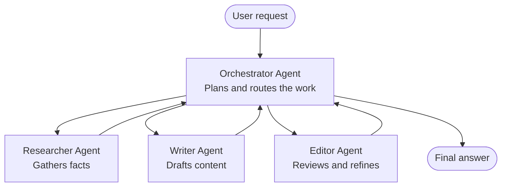

# Moniagenttijärjestelmän perusteet - Ota käyttöön ensimmäinen koordinoitu tekoälyjärjestelmäsi

**Lukuvalikko:**
- **📚 Kurssin kotisivu**: [AZD aloittelijoille](../../README.md)
- **📖 Nykyinen luku**: Luku 5 - Moniagenttiset tekoälyratkaisut
- **⬅️ Edellinen**: [Luku 4: Infrastruktuuri](../chapter-04-infrastructure/README.md)
- **➡️ Seuraava**: [Koordinointimallit](../chapter-06-pre-deployment/coordination-patterns.md)

> Komentojen ohjeistus tarkistettu julkaistuun `azd 1.37.2`-viitteeseen nähden. Pilvipalveluihin kohdistuvia käyttöönottoja ei suoritettu.

## Johdanto

Aiemmissa luvuissa otit käyttöön yhden sovelluksen — ja luvussa 2 otit käyttöön yhden tekoälyagentin. Tämä oppitunti vie askeleen pidemmälle: moniagenttijärjestelmän käyttöönottoon, jossa useat erikoistuneet agentit työskentelevät yhdessä ratkaistakseen ongelman, jota yksittäinen agentti ei voisi hyvin itse ratkaista.

Hyvä uutinen aloittelijoille: **et tarvitse uusia komentoja.** Moniagenttiratkaisu on edelleen azd-projekti. Sinä `azd init`, `azd up`, testaat ja `azd down` — juuri se työprosessi, jonka jo tunnet. Muuttuu vain sovelluksen *rakenne* sisällä.

## Oppimistavoitteet

Tämän oppitunnin jälkeen osaat:
- Ymmärtää, mitä "moniagenttinen" tarkoittaa ja milloin lisäkompleksisuus kannattaa
- Tunnistaa tavalliset roolit moniagenttijärjestelmässä (orkestroija + erikoisasiantuntijat)
- Ottaa käyttöön toimivan moniagenttimallin `azd up` kanssa
- Ymmärtää Azure-resurssit, jotka tukevat moniagenttisovellusta
- Osata varmistaa, räätälöidä ja purkaa ratkaisu turvallisesti

## Oppimistulokset

Oppitunnin suorittamisen jälkeen osaat:
- Selittää eron yksittäisen agentin ja moniagenttijärjestelmän välillä
- Valita yksittäisen agentin työkalujen kera tai todellisen moniagenttisuunnittelun välillä
- Ottaa käyttöön ja testata moniagenttimallin alusta loppuun azd:llä
- Tunnistaa, missä kukin agentti toimii ja miten ne kommunikoivat keskenään
- Siivota kaikki resurssit käyttöönottomaksujen välttämiseksi

---

## Mikä on moniagenttijärjestelmä?

Yksi tekoälyagentti on yksi malli, jolla on joukko ohjeita ja (valinnaisesti) joitain työkaluja. Se toimii hyvin keskittyneissä tehtävissä. Mutta kun tehtävä kasvaa — tutkimus, kirjoittaminen, muokkaus, faktantarkistus — kaiken sullominen yhteen kehotteeseen hidastaa agenttia, tekee siitä epäluotettavamman ja vaikeamman virheenkorjauksen kannalta.

**Moniagenttijärjestelmä** jakaa työn erikoisasiantuntijoihin, jotka tekevät kukin hyvin oman tehtävänsä, ja orkestroijaan, joka koordinoi:



### Kaksi roolia, jotka näet aina

| Rooli | Tehtävä | Esimerkki |
|------|---------|-----------|
| **Orkestroija** | Päätää *mitä seuraavaksi tapahtuu* ja ohjaa työtä agenttien välillä | "Ensiksi tutki, sitten kirjoita, lopuksi muokkaa" |
| **Erikoisasiantuntija** | Tekee yhden keskittyneen työn ja palauttaa tuloksen | "Tutkija", joka vain kerää faktoja |

### Tarvitsetko oikeasti useita agentteja?

Aloita yksinkertaisesti. Moniagenttinen ratkaisu **vain silloin**, kun jokin seuraavista toteutuu:

- ✅ Tehtävässä on **selkeät vaiheet**, jotka hyötyvät erilaisista ohjeista (tutkimus vs. kirjoitus vs. tarkastus)
- ✅ Haluat, että erikoisasiantuntijat toimivat **samanaikaisesti** ajan säästämiseksi
- ✅ Vaiheissa tarvitaan **eri työkaluja tai tietolähteitä**
- ✅ Jokaisen vaiheen pitää olla **itsenäisesti testattavissa ja virheenkorjattavissa**

Jos tehtävä on yksinkertainen kysymys-vastaus tai yksinkertainen työkalukutsu, **yksi agentti työkalujen kanssa** (luku 2) on yksinkertaisempi, halvempi ja helpompi käyttää.

> **Aloittelijan vinkki:** "Enemmän agentteja" ei ole "parempi". Jokainen agentti lisää viivettä, kustannuksia ja uuden seurattavan asian. Lisää agentteja vain, kun ongelma jakautuu selvästi osiin.

---

## Kaksi tapaa rakentaa moniagenttijärjestelmä Azuren päälle

| Lähestymistapa | Mikä se on | Parhaiten soveltuva käyttöön |
|-------------|------------|---------------------|
| **Yksi agentti + työkalut** | Yksi Foundry-agentti, joka kutsuu funktioita/työkaluja | Yksinkertaiset työnkulut, aloittamiseen |
| **Useita koordinoituja agentteja** | Useita agenteja orkestroijan kanssa | Eri vaiheet, rinnakkaistyö, erikoistuminen |

Tämä oppitunti keskittyy toiseen lähestymistapaan käyttäen **valmista mallia**, jotta voit nähdä oikean moniagenttijärjestelmän toiminnassa ennen oman rakentamista.

---

## Käytännössä: Ota käyttöön toimiva moniagenttisovellus

Otamme käyttöön **Contoso Creative Writerin**, virallisen Azuren esimerkin, joka koordinoi tutkimus-, tuote-, kirjoitus- ja muokkausagentit artikkelin tuottamiseksi. Ennen etenemistä tarkista [esimerkin edellytykset ja kustannukset](https://github.com/Azure-Samples/contoso-creative-writer#azure-account-requirements): se tarvitsee mallivolyymin, Azure AI Searchin, Bing Grounding -käytön, Pythonin, Dockerin ja Bash-yhteensopivat koukut. Mallin ja alueen saatavuus riippuvat tilauksestasi; käyttöönottoa ei taata valitsemalla tiettyä aluetta.

### Vaihe 1: Alusta malli

```bash
# Create a working folder
mkdir creative-writer && cd creative-writer

# Initialize from the official multi-agent template
azd init --template Azure-Samples/contoso-creative-writer .
```

> Selaa lisää moniagenttimalleja milloin tahansa [Awesome AZD AI galleryssä](https://azure.github.io/awesome-azd/?tags=ai). Muut aloittelijaystävälliset vaihtoehdot sisältävät `get-started-with-ai-agents` ja `azure-ai-travel-agents`.

### Vaihe 2: Todennus

```bash
# Required for azd workflows
azd auth login

# Also required by this sample's Azure CLI hooks
az login
```

### Vaihe 3: Tarkista ympäristö

```bash
# init normally creates/selects an environment; confirm it before proceeding
azd env list
# Only if you need an additional environment:
# azd env new dev
```

### Vaihe 4: Esikatselu, sitten käyttöönotto

```bash
# See what will be created before spending anything (recommended)
azd provision --preview

# Provision infrastructure and deploy all agents in one step
azd up
```

`azd up` pyytää puuttuvat tilaus- ja aluetiedot, sitten provisioi resurssit ja ottaa sovelluksen käyttöön. Esikatselu ei varaa volyymia eikä takaa onnistumista; mallin koukut voivat edelleen suorittaa provisiointiesikatselun aikana, joten tarkista ne ensin. Pidentääksesi aikaa, jonka azd odottaa kunkin **palvelun käyttöönottoa** (ei mallin provisiointia):

```bash
azd deploy --timeout 1800
```

Aikakatkaisu pysäyttää azdin odottamisen; se ei peruuta käyttöönottoa Azureen. Tarkista resurssin tila ennen uudelleenyritystä.

> **Huomio kustannuksista ja kapasiteetista:** Moniagenttisovellukset ottavat käyttöön tekoälymalleja, jotka kuluttavat volyymia ja aiheuttavat kustannuksia. Jos `azd up` epäonnistuu mallin volyymin takia, katso [tekoälyn vianmääritys](../chapter-07-troubleshooting/ai-troubleshooting.md) alue- ja volyymikorjauksiin sekä luvusta 6 [Kapasiteettisuunnittelu](../chapter-06-pre-deployment/capacity-planning.md).

---

## Ymmärrä, mitä otit käyttöön

Tyypillinen moniagenttisovellus kuten tämä luo joukon Azure-resursseja, jotka vastaavat suoraan yllä olevan kaavion vastuualueita:

| Resurssi | Miksi se on siellä |
|----------|----------------------|
| **Microsoft Foundry / Mallit** | Isännöi kunkin agentin käyttämät kielimallit |
| **Azure AI Search** | Antaa tutkija-agentille maadoitetun datan haulle |
| **Container Apps** (tai App Service) | Isännöi orkestroijan ja agenttien koodin |
| **Cosmos DB** (joissain esimerkeissä) | Tallentaa jaettua tilaa/muistia, jota agentit käyttävät |
| **Application Insights** | Seuraa pyyntöjä *agenttien välillä*, jotta voit virheenkorjata työnkulun |

### Miten agentit keskustelevat keskenään

Useimmissa azd-monitagenttiesimerkeissä **orkestroija toimii sovelluskoodissasi** (esimerkiksi Semantic Kernelin tai Microsoft Agent Frameworkin kaltaisella kirjastolla). Orkestroija kutsuu kukin erikoisagentin vuorollaan, välittää tulokset eteenpäin ja kokoaa lopullisen vastauksen. Agentit jakavat kontekstia seuraavasti:

- **Funktio-/työkalukutsut** — orkestroija kutsuu erikoisasiantuntijaa ja saanut tuloksen takaisin
- **Jaettu muisti** — tietokanta (usein Cosmos DB) pitää yllä tilaa, jota molemmat agentit voivat lukea
- **Viestit/tapahtumat** — löyhemmässä kytkennässä agentit kommunikoivat jonon tai Service Busin kautta

> **Miksi tämä on tärkeää virheenkorjauksessa:** koska jokainen vaihe on erillinen, Application Insights näyttää, *mikä* agentti oli hidas tai epäonnistui. Tämä on merkittävä syy työn jakamiseen agenttien kesken alun perinkin.

---

## Varmista käyttöönotto

Varmista, että järjestelmä todella toimii ennen etenemistä:

```bash
# Show the deployed endpoints
azd show

# Open the app's monitoring dashboard
azd monitor

# Open Application Insights Logs (not a terminal log stream)
azd monitor --logs
```

Avaa sitten sovelluksen URL osoitteesta `azd show` ja pyydä lyhyt artikkeli. Käytä esimerkin debug-näkymää tarkastellaksesi agentin työnkulkua. Application Insights -tapahtumahaku näyttää yksittäiset vaiheet vain, jos esimerkki kirjaa ja korreloi ne; azd ei automaattisesti lisää agentin aikajana-alueita.

**Menestyskriteerit:**
- ✅ `azd show` näyttää saavutettavan päätepisteen
- ✅ Pyyntö tuottaa tuloksen, joka selvästi kulki useiden vaiheiden läpi
- ✅ Debug-näkymässä näkyy useita agenttivaiheita; jos jäljitys on päällä, varmista vastaava telemetria ingestoinnin jälkeen

---

## Räätälöi: Lisää tai säädä agenttia

Koska jokainen agentti on vain ohjeita plus työkaluja, räätälöinti on lähestyttävää:

1. **Etsi agenttien määritelmät** mallista (usein `prompts/`, `agents/` tai `*.prompty` tiedostoja).
2. **Säädä agentin ohjeita** — esimerkiksi kerro muokkausagentille käyttää tiettyä tyyliä tai sanamäärää.
3. **Ota käyttöön pelkkä koodi uudelleen** (infrastruktuuri pysyy samana):

   ```bash
   azd deploy
   ```

Jos haluat edetä *oman* Foundry-agenttiprojektisi kanssa, käytä agenttien laajennuksen interaktiivista alustamista:

```bash
azd extension install azure.ai.agents
azd ai agent init
azd up
azd ai agent invoke      # test, with response timing
```

Katso [Luku 2: Agentit](../chapter-02-ai-development/agents.md) ja [AZD AI CLI -viite](../chapter-08-production/production-ai-practices.md#azd-ai-cli-commands-and-extensions) täydestä elinkaaresta: agenttien `invoke`, erillisen arvion laajennuksen `azd ai eval` työnkulku, agenttien `optimize` ja agenttien `delete`.

---

## Siivous

Moniagenttisovellukset käyttävät useita laskutettavia palveluita. Purka kaikki kun olet valmis:

```bash
# Review the resources and confirm deletion interactively
azd down
```

Poisto on tuhoava toimenpide. Kertakäyttöisessä laboratoriossa `azd down --force --purge` ohittaa poiston ja tuetut soft-delete-puhdistuksen vahvistukset; puhdistus on peruuttamaton, missä se on tuettu, ja purkuprotektio voi estää sen. Soft delete on palautus-/nimenkäyttöhuoli, ei itsessään merkki jatkuvista maksuista. Tarkista jäljellä olevat resurssit ja laskutus siivouksen jälkeen.

---

## Huomio tuotantoympäristön moniagenttijärjestelmistä

Tässä repossa oleva [Retail Multi-Agent Solution](../../examples/retail-scenario.md) on **arkkitehtuurisuunnitelma**, ei yhden komennon mallipohja — se dokumentoi, miten tuotannon vähittäismyyntijärjestelmä *voitaisiin* rakentaa (ja korostaa, että täydellinen rakentaminen on merkittävä ponnistus). Käytä sitä suunnittelun viitteenä *sen jälkeen*, kun olet ottanut käyttöön toimivan mallin täällä. Tuotantoon liittyvissä asioissa (joustavuus, kustannukset, valvonta, hallinnointi) siirry kohtaan [Luku 8: Tuotannon AI-käytännöt](../chapter-08-production/production-ai-practices.md).

---

## Yhteenveto

- Moniagenttijärjestelmä jakaa työn erikoistuneiden asiantuntijoiden kesken, joita koordinoi orkestroija.
- Käytä sitä vain, kun tehtävällä on selkeät vaiheet, rinnakkaisuus tai eri työkalut kussakin vaiheessa—muuten mieluummin yksittäinen agentti.
- Azd-työnkulku pysyy muuttumattomana: `azd init` → `azd up` → test → `azd down`.
- Todellinen malli, kuten `contoso-creative-writer`, antaa sinun nähdä ja mukauttaa toimivan moniagenttisovelluksen jo tänään.
- Application Insightsin jäljitys agenttien välillä on yksi moniagenttisuunnittelun suurimmista käytännön eduista.

---

## 🔗 Navigointi

| Suunta | Oppitunti |
|-----------|--------|
| **Edellinen** | [Luku 4: Infrastruktuuri](../chapter-04-infrastructure/README.md) |
| **Seuraava** | [Koordinointimallit](../chapter-06-pre-deployment/coordination-patterns.md) |

## 📖 Aiheeseen liittyvät resurssit

- [AI-agenttien opas](../chapter-02-ai-development/agents.md)
- [Koordinointimallit](../chapter-06-pre-deployment/coordination-patterns.md)
- [Tuotannon AI-käytännöt](../chapter-08-production/production-ai-practices.md)
- [AI-ongelmien ratkominen](../chapter-07-troubleshooting/ai-troubleshooting.md)

---

<!-- CO-OP TRANSLATOR DISCLAIMER START -->
**Vastuuvapauslauseke**:
Tämä asiakirja on käännetty käyttämällä tekoälypohjaista käännöspalvelua [Co-op Translator](https://github.com/Azure/co-op-translator). Vaikka pyrimme tarkkuuteen, otathan huomioon, että automaattiset käännökset saattavat sisältää virheitä tai epätarkkuuksia. Alkuperäinen asiakirja sen alkuperäiskielellä on virallinen lähde. Tärkeissä asioissa suositellaan ammattimaista ihmiskäännöstä. Emme ole vastuussa tämän käännöksen käytöstä aiheutuvista väärinymmärryksistä tai tulkinnoista.
<!-- CO-OP TRANSLATOR DISCLAIMER END -->