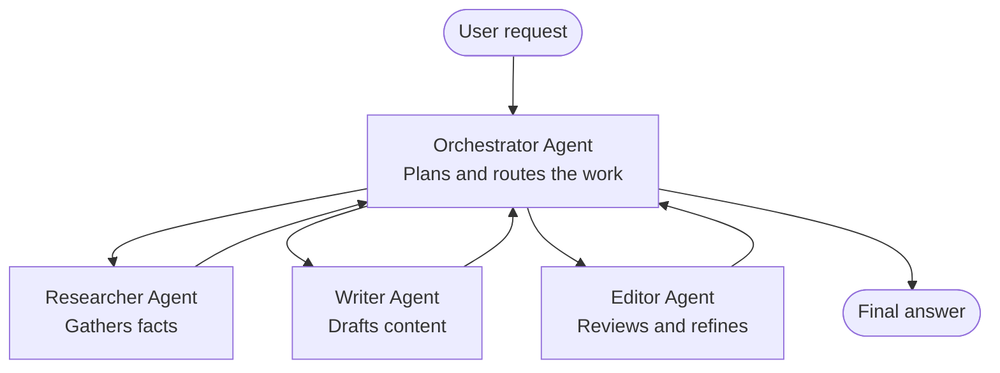

# Moniagenttijärjestelmän perusteet - Ota käyttöön ensimmäinen koordinoitu tekoälyjärjestelmäsi

**Luvun navigointi:**
- **📚 Kurssin etusivu**: [AZD Aloittelijoille](../../README.md)
- **📖 Nykyinen luku**: Luku 5 - Moniagenttisten tekoälyratkaisujen
- **⬅️ Edellinen**: [Luku 4: Infrastrukturit](../chapter-04-infrastructure/README.md)
- **➡️ Seuraava**: [Koordinointimallien](../chapter-06-pre-deployment/coordination-patterns.md)

> Komentojen ohjeistus tarkastettu julkaistua `azd 1.37.2` viitetttä vastaan. Pilvijakeluita ei suoritettu.

## Johdanto

Aiemmissa luvuissa otit käyttöön yhden sovelluksen—ja luvussa 2 otit käyttöön yhden tekoälyagentin. Tämä oppitunti vie sinut seuraavalle tasolle: moniagenttijärjestelmän käyttöönottoon, jossa useat erikoistuneet agentit työskentelevät yhdessä ratkaistakseen ongelman, jota yksittäinen agentti ei pystyisi hyvin ratkaisemaan yksinään.

Hyvä uutinen aloittelijoille: **sinun ei tarvitse uusia komentoja.** Moniagenttiratkaisu on edelleen azd-projekti. Tulet `azd init`, `azd up`, testaamaan ja `azd down`—täsmälleen samalla työnkululla kuin aiemmin. Muutos koskee sovelluksen *muotoa* sisällä.

## Oppimistavoitteet

Tämän oppitunnin lopussa sinä:
- Ymmärrät, mitä "moniagenttinen" tarkoittaa ja milloin se kannattaa lisääntyneen monimutkaisuuden vuoksi
- Tunnistat yleiset roolit moniagenttijärjestelmässä (orkestroija + erikoisasiantuntijat)
- Otat käyttöön toimivan moniagenttimallin `azd up` avulla
- Ymmärrät Azure-resurssit, jotka tukevat moniagenttisovellusta
- Osaat varmistaa, mukauttaa ja purkaa ratkaisun turvallisesti

## Oppimistulokset

Oppitunnin suorittamisen jälkeen osaat:
- Selittää eron yksittäisen agentin ja moniagenttijärjestelmän välillä
- Valita yksittäisen työkalujen kanssa varustetun agentin tai aidon moniagenttisuunnittelun välillä
- Ota käyttöön ja testata moniagenttipohjainen malli kokonaisuudessaan azd:llä
- Tunnistaa, missä kukin agentti toimii ja miten ne kommunikoivat keskenään
- Puhdistaa kaikki resurssit välttääksesi jatkuvat maksut

---

## Mikä on moniagenttijärjestelmä?

Yksi tekoälyagentti on yksi malli joukolla ohjeita ja (valinnaisesti) joitakin työkaluja. Se toimii hyvin kohdennetuissa tehtävissä. Mutta kun tehtävä kasvaa—tutkimus, sitten kirjoittaminen, sitten editointi, sitten faktantarkistus—kaiken sullominen yhteen kehotteeseen tekee agentista hitaamman, epäluotettavamman ja vaikeammin virheenkorjattavan.

**Moniagenttijärjestelmä** jakaa työn erikoisasiantuntijoihin, jotka tekevät kukin yhden työn hyvin, ja orkestroija koordinoi:



### Kaksi roolia, jotka näet aina

| Rooli | Tehtävä | Esimerkki |
|------|---------|----------|
| **Orkestroija** | Päätöksiä *mitä seuraavaksi tapahtuu* ja ohjaa työtä agenttien välillä | "Ensin tutkimus, sitten kirjoitus, sitten editointi" |
| **Erikoisasiantuntija** | Tekee yhden kohdennetun työn ja palauttaa tuloksen | Tutkija, joka kerää vain faktoja |

### Tarvitsetko todella useita agentteja?

Aloita yksinkertaisesti. Käytä moniagenttista **vain** kun jokin seuraavista on totta:

- ✅ Tehtävässä on **selkeitä vaiheita**, jotka hyötyvät erilaisista ohjeista (tutkimus vs. kirjoitus vs. tarkistus)
- ✅ Haluat erikoisasiantuntijoiden toimivan **rinnakkain** ajan säästämiseksi
- ✅ Eri vaiheissa tarvitaan **eri työkaluja tai tietolähteitä**
- ✅ Haluat, että kukin vaihe on **itsenäisesti testattavissa ja virheenjäljityskelpoinen**

Jos tehtäväsi on yksinkertainen kysymys-vastaus tai yksinkertainen työkalukutsu, **yksi agentti työkaluilla** (luku 2) on yksinkertaisempi, halvempi ja helpompi käyttää.

> **Aloittelijan vinkki:** "Enemmän agentteja" ei tarkoita "parempaa." Jokainen agentti lisää viivettä, kustannuksia ja valvottavaa. Lisää agentteja vain, kun ongelma selkeästi jakautuu osiin.

---

## Kaksi tapaa rakentaa moniagentti Azureen

| Lähestymistapa | Mikä se on | Soveltuu parhaiten |
|--------------|-------------|---------------------|
| **Yksi agentti + työkalut** | Yksi Foundry-agentti, joka kutsuu toimintoja/työkaluja | Yksinkertaiset työnkulut, aloitteleville |
| **Useita koordinoituja agentteja** | Useita agentteja orkestroijan kanssa | Selkeät vaiheet, rinnakkainen työ, erikoistuminen |

Tämä oppitunti keskittyy toiseen lähestymistapaan käyttämällä **valmista mallia**, jotta näet toimivan moniagenttijärjestelmän ennen oman rakentamistasi.

---

## Käytännössä: Ota käyttöön toimiva moniagenttisovellus

Otamme käyttöön **Contoso Creative Writerin**, virallisen Azure-esimerkin, joka koordinoi tutkimus-, tuote-, kirjoitus- ja editointikoneita tuottaakseen artikkelin. Ennen etenemistä tarkista [esitysmallin edellytykset ja kustannukset](https://github.com/Azure-Samples/contoso-creative-writer#azure-account-requirements): se tarvitsee mallikvotan, Azure AI Search -palvelun, Bing Grounding -käytön, Pythonin, Dockerin ja Bash-yhteensopivat koukut. Mallin ja alueen saatavuus riippuvat tilauksestasi; käyttöönotto ei ole taattu valitsemalla tietty alue.

### Vaihe 1: Alusta malli

```bash
# Create a working folder
mkdir creative-writer && cd creative-writer

# Initialize from the official multi-agent template
azd init --template Azure-Samples/contoso-creative-writer .
```

> Selaa lisää moniagenttimalleja milloin tahansa [Awesome AZD AI -galleriasta](https://azure.github.io/awesome-azd/?tags=ai). Muita aloittelijaystävällisiä vaihtoehtoja ovat `get-started-with-ai-agents` ja `azure-ai-travel-agents`.

### Vaihe 2: Todennus

```bash
# Required for azd workflows
azd auth login

# Also required by this sample's Azure CLI hooks
az login
```

### Vaihe 3: Ympäristön tarkistus

```bash
# init normally creates/selects an environment; confirm it before proceeding
azd env list
# Only if you need an additional environment:
# azd env new dev
```

### Vaihe 4: Esikatselu ja käyttöönotto

```bash
# See what will be created before spending anything (recommended)
azd provision --preview

# Provision infrastructure and deploy all agents in one step
azd up
```

`azd up` kysyy puuttuvat tilaus- ja alueasetukset, sitten varaa resurssit ja ottaa sovelluksen käyttöön. Esikatselu ei varaa kvottaa tai takaa onnistumista; mallin koukut voivat silti toimia varausesikatselun aikana, joten tarkista ne ensin. Pidentääksesi azd:n odotusaikaa kullakin **palvelun käyttöönotolla** (ei mallin varauksella):

```bash
azd deploy --timeout 1800
```

Aikakatkaisu estää azd:n odottamasta; se ei peruuta käyttöönottoa Azureen. Tarkista resurssien tila ennen uudelleenyritystä.

> **Huomio kustannuksista ja kapasiteetista:** Moniagenttisovellukset ottavat käyttöön tekoälymalleja, jotka käyttävät kvottaa ja aiheuttavat kustannuksia. Jos `azd up` epäonnistuu mallikvotassa, katso [tekoälyn vianmääritys](../chapter-07-troubleshooting/ai-troubleshooting.md) alue- ja kvottakorjauksiin sekä luvun 6 [kapasiteetin suunnittelu](../chapter-06-pre-deployment/capacity-planning.md).

---

## Ymmärrys siitä, mitä otit käyttöön

Tavanomainen moniagenttisovellus varaa joukon Azure-resursseja, jotka vastaavat suoraan yllä olevaa vastuunjakoa:

| Resurssi | Miksi se on siellä |
|----------|--------------------|
| **Microsoft Foundry / Mallit** | Isännöi kieltä käyttävät mallit, joita kukin agentti käyttää |
| **Azure AI Search** | Antaa tutkimusagentille pohjatiedot haettavaksi |
| **Container Apps** (tai App Service) | Isännöi orkestroijaa ja agenttikoodia |
| **Cosmos DB** (joissain esimerkeissä) | Tallentaa jaettua tilaa/muistia, jota agentit käyttävät |
| **Application Insights** | Seuraa pyyntöjä *agenttien välillä* virheenkorjausta varten |

### Miten agentit kommunikoivat keskenään

Useimmissa azd moniagenttiesimerkeissä **orkestroija toimii sovelluskoodissasi** (esimerkiksi Semantic Kernelin tai Microsoft Agent Frameworkin kaltaisen kehyksen avulla). Orkestroija kutsuu kutakin erikoisasiantuntijaa vuorollaan, välittää tulokset ja kokoaa lopullisen vastauksen. Agentit jakavat kontekstin seuraavin tavoin:

- **Funktio-/työkutsut** — orkestroija kutsuu erikoisasiantuntijan ja saa tuloksen takaisin
- **Jaettu muisti** — tietokanta (usein Cosmos DB) säilyttää tilan, jota molemmat agentit voivat lukea
- **Viestit/tapahtumat** — löyhemmälle kytkennälle agentit kommunikoivat jonon tai Service Busin kautta

> **Miksi tällä on merkitystä virheenkorjauksessa:** koska kukin vaihe on erillinen, Application Insights näyttää sinulle, *mikäs* agentti oli hidas tai epäonnistui. Se on tärkeä syy työn jakamiseen agenttien kesken.

---

## Varmista käyttöönotto

Varmista, että järjestelmä toimii todella, ennen kuin jatkat:

```bash
# Show the deployed endpoints
azd show

# Open the app's monitoring dashboard
azd monitor

# Open Application Insights Logs (not a terminal log stream)
azd monitor --logs
```

Avaa sitten sovelluksen URL osoitteesta `azd show` ja pyydä lyhyt artikkeli. Käytä näytteen virheenkorjausnäkymää tarkastellaksesi sen agenttien työnkulkua. Application Insightsin tapahtumahaku näyttää yksittäiset vaiheet vain, jos näyte myös mittaa ja yhdistää niitä; azd ei lisää agenttien ajoja automaattisesti.

**Onnistumisen kriteerit:**
- ✅ `azd show` listaa saavutettavissa olevan päätelaitteen
- ✅ Pyyntö tuottaa tuloksen, joka meni selvästi läpi useita vaiheita
- ✅ Virheenkorjausnäkymä näyttää useita agenttivaiheita; jos jäljitys on käytössä, varmista vastaava telemetria syötön jälkeen

---

## Mukauta: lisää tai säädä agenttia

Koska jokainen agentti on vain ohjeet plus työkalut, mukauttaminen on saavutettavissa:

1. **Löydä agenttien määritelmät** mallista (usein joukko tiedostoja kuten `prompts/`, `agents/` tai `*.prompty`).
2. **Säädä agentin ohjeita** — esimerkiksi kerro editointirooliagentille noudattaa tiettyä sävyä tai sanamäärää.
3. **Ota käyttöön uudelleen pelkkä koodi** (infrastruktuuri jää ennalleen):

   ```bash
   azd deploy
   ```

Jatkaaksesi *oman* Foundry-agenttiprojektisi kanssa, käytä GA-pakettia AZD 1.37.0+ -versiossa erillisessä tyhjässä hakemistossa:

```bash
azd ext install microsoft.foundry
azd ai agent init
azd up
azd ai agent invoke      # test, with response timing
```

Katso [GA-hosted-agent-kävelyopas](../chapter-02-ai-development/microsoft-foundry-integration.md#hosted-agent-walkthrough-ga) paikalliseen Agent Inspector -testaukseen, etäkoodin käyttöönottoon ja korjauksen omistajuuteen. Myös [AZD AI CLI -viite](../chapter-08-production/production-ai-practices.md#azd-ai-cli-commands-and-extensions) käsittelee erillisiä arviointeja, optimointia ja agentin poistoa.

---

## Puhdista jäljet

Moniagenttisovellukset käyttävät useita laskutettavia palveluita. Purka kaikki kun olet valmis:

```bash
# Review the resources and confirm deletion interactively
azd down
```

Poisto on tuhoavaa. Kertaluontoisessa laboratoriossa `azd down --force --purge` ohittaa poiston ja tukee pehmeän poistamisen vahvistuksia; poisto on peruuttamaton, jos se on käytettävissä, ja sen voi estää poistosuojaus. Pehmeä poisto liittyy palautukseen/nimen uudelleenkäyttöön, ei itse maksujen jatkumisen todistamiseen. Tarkista säilytetyt resurssit ja laskutus puhdistuksen jälkeen.

Jos olet myös alustanut hosted-agentin olemassa olevaa Foundry-projektia vastaan, `azd down` jättää kyseisen projektin agentin ja muut resurssit paikalleen. Poista vain haluamasi resurssit, jotka omistat erikseen. Uuden Foundry-projektin AZD-ympäristö luo ja `azd down` poistaa resurssiryhmän ja kaiken sen sisällä.

---

## Huomautus tuotantokäytössä olevista moniagenttijärjestelmistä

Tämä reposta löytyvä [Retail Multi-Agent Solution](../../examples/retail-scenario.md) on **arkkitehtuurisuunnitelma**, ei yhden komennon mallipohja—se dokumentoi, miten tuotannollinen vähittäiskauppajärjestelmä *voitaisiin* rakentaa (ja korostaa, että täysimittainen rakentaminen on merkittävä ponnistus). Käytä sitä suunnittelun viitteenä *sen jälkeen*, kun olet ottanut käyttöön toimivan mallin täällä. Tuotantoon liittyviä asioita (käytettävyys, kustannukset, valvonta, hallinnointi) varten jatka lukemista luvusta [Luku 8: Tuotantotekoälyn käytännöt](../chapter-08-production/production-ai-practices.md).

---

## Yhteenveto

- Moniagenttijärjestelmä jakaa työn asiantuntijoiden kesken, joita koordinoi orkestroija.
- Käytä sitä vain, kun tehtävällä on selkeät vaiheet, rinnakkaisuus tai eri työkalut kussakin vaiheessa—muuten suosii yksittäistä agenttia.
- Azd-työnkulku pysyy ennallaan: `azd init` → `azd up` → test → `azd down`.
- Todellinen malli kuten `contoso-creative-writer` antaa sinun nähdä ja mukauttaa toimivaa moniagenttisovellusta tänään.
- Application Insights -jäljitys agenttien välillä on yksi moniagenttisuunnittelun suurimmista käytännön eduista.

---

## 🔗 Navigointi

| Suunta | Oppitunti |
|-----------|--------|
| **Edellinen** | [Luku 4: Infrastruktuuri](../chapter-04-infrastructure/README.md) |
| **Seuraava** | [Koordinointimallit](../chapter-06-pre-deployment/coordination-patterns.md) |

## 📖 Liittyvät resurssit

- [AI-agenttien opas](../chapter-02-ai-development/agents.md)
- [Koordinointimallit](../chapter-06-pre-deployment/coordination-patterns.md)
- [Tuotannon AI-käytännöt](../chapter-08-production/production-ai-practices.md)
- [AI:n vianmääritys](../chapter-07-troubleshooting/ai-troubleshooting.md)

---

<!-- CO-OP TRANSLATOR DISCLAIMER START -->
**Vastuuvapauslauseke**:
Tämä asiakirja on käännetty käyttämällä tekoälypohjaista käännöspalvelua [Co-op Translator](https://github.com/Azure/co-op-translator). Vaikka pyrimme tarkkuuteen, otathan huomioon, että automaattiset käännökset saattavat sisältää virheitä tai epätarkkuuksia. Alkuperäinen asiakirja sen alkuperäiskielellä on virallinen lähde. Tärkeissä asioissa suositellaan ammattimaista ihmiskäännöstä. Emme ole vastuussa tämän käännöksen käytöstä aiheutuvista väärinymmärryksistä tai tulkinnoista.
<!-- CO-OP TRANSLATOR DISCLAIMER END -->