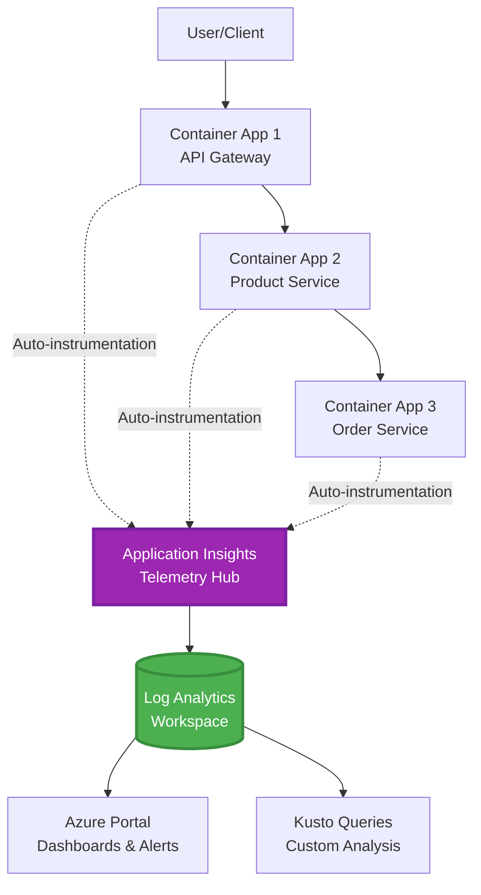
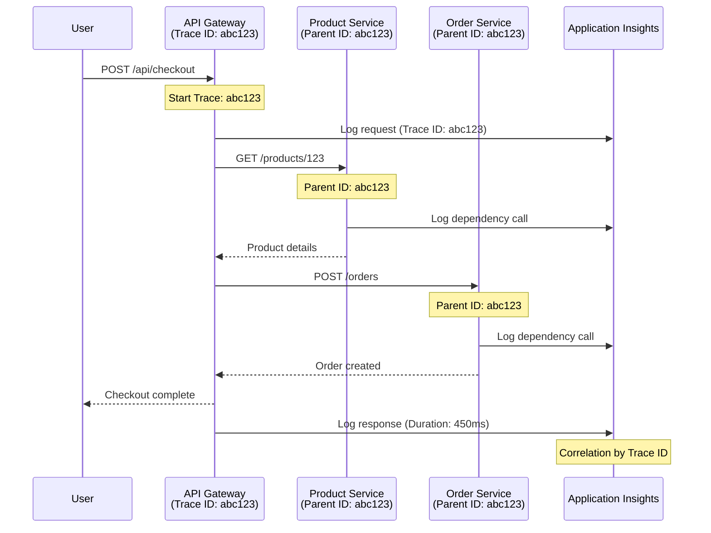

# Application Insights -integrointi AZD:n kanssa

⏱️ **Arvioitu aika**: 40-50 minuuttia | 💰 **Kustannusvaikutus**: ~5-15 $/kk | ⭐ **Vaikeustaso**: Keskitaso

**📚 Oppimispolku:**
- ← Edellinen: [Preflight Checks](preflight-checks.md) - Julkaisua edeltävä validointi
- 🎯 **Olet tässä**: Application Insights -integrointi (Valvonta, telemetria, virheenkorjaus)
- → Seuraava: [Deployment Guide](../chapter-04-infrastructure/deployment-guide.md) - Julkaisu Azureen
- 🏠 [Koulutuksen etusivu](../../README.md)

---

## Mitä opit

Tässä oppitunnissa opit:
- Määrittämään **Application Insightsin** AZD-infrastruktuurissa ja konfiguroimaan SDK-instrumentoinnin
- Konfiguroimaan **hajautetun seurannan** mikropalveluille
- Toteuttamaan **mukautettua telemetriaa** (mittarit, tapahtumat, riippuvuudet)
- Ottamaan käyttöön **reaaliaikaiset mittarit** valvontaan
- Luomaan **hälytyksiä ja kojelautoja** AZD-julkaisuista
- Virheenkorjaamaan tuotantovikoja **telemetriakyselyjen** avulla
- Optimoimaan **kustannus- ja otostus** strategioita
- Valvomaan **AI/LLM-sovelluksia** (tokenit, viiveet, kustannukset)

## Miksi Application Insights ja AZD ovat tärkeitä

### Haaste: Tuotantovalvonta

**Ilman Application Insightsia:**
```
❌ No visibility into production behavior
❌ Manual log aggregation across services
❌ Reactive debugging (wait for customer complaints)
❌ No performance metrics
❌ Cannot trace requests across services
❌ Unknown failure rates and bottlenecks
```

**Application Insightsin ja AZD:n kanssa:**
```
✅ Automatic telemetry collection
✅ Centralized logs from all services
✅ Proactive issue detection
✅ End-to-end request tracing
✅ Performance metrics and insights
✅ Real-time dashboards
✅ AZD provisions the monitoring declared in your templates
```

**Vertauskuva**: Application Insights on kuin sovelluksesi "mustan laatikon" lentoasema ja ohjaamon kojelauta. Näet kaiken reaaliajassa ja voit toistaa minkä tahansa tapauksen.

---

## Arkkitehtuurin yleiskatsaus

### Application Insights AZD-arkkitehtuurissa



### Mitä valvotaan automaattisesti

Tuettu automaattinen instrumentointi kerää pyyntöjä ja riippuvuuksia instrumentoiduista kirjastoista. Mukautetut tapahtumat ja mittarit vaativat sovelluskoodia; saatavuustestit täytyy konfiguroida erikseen. Se ei kerää kaikkea tiedostetta vain resurssin olemassaolon perusteella.

| Telemetriatyyppi | Mitä se kerää | Käyttötarkoitus |
|----------------|--------------|----------------|
| **Pyyntöjä** | HTTP-pyynnöt, tilakoodit, kesto | API-suorituskyvyn valvonta |
| **Riippuvuuksia** | Ulkoiset kutsut (tietokanta, API:t, tallennus) | Pullonkaulojen tunnistus |
| **Poikkeuksia** | Käsittelemättömät virheet pinon seurannalla | Virheiden korjaus |
| **Mukautetut tapahtumat** | Liiketoimintatapahtumat (rekisteröityminen, ostot) | Analytiikka ja suppilot |
| **Mittarit** | Suorituskykylaskurit, mukautetut mittarit | Kapasiteetin suunnittelu |
| **Seurannat** | Lokiviestit vakavuustasolla | Virheenkorjaus ja tarkastus |
| **Saatavuus** | Käytettävyys- ja vasteaikatestit | SLA-valvonta |

---

## Esivaatimukset

### Tarvittavat työkalut

```bash
# Verify Azure Developer CLI
azd version
# Command reference baseline: azd 1.37.2

# Verify Azure CLI
az --version
# ✅ Expected: azure-cli 2.50.0 or higher
```

### Azure-vaatimukset

- Aktiivinen Azure-tilaustili
- Oikeudet luoda:
  - Application Insights -resursseja
  - Log Analytics -työtiloja
  - Container Apps -sovelluksia
  - Resurssiryhmiä

### Tiedolliset esivaatimukset

Sinun tulisi olla suorittanut:
- [AZD Basics](../chapter-01-foundation/azd-basics.md) - AZD:n ydinkonseptit
- [Configuration](../chapter-03-configuration/configuration.md) - Ympäristön määrittäminen
- [Ensimmäinen projekti](../chapter-01-foundation/first-project.md) - Perusjulkaisu

---

## Oppitunti 1: Automaattinen Application Insights AZD:n kanssa

### Miten AZD tarjoaa Application Insightsin

AZD tarjoaa Application Insightsin **vain, kun projektin infrastruktuuri määrittelee sen**. `azure.yaml` yksinään ei luo valvontaa tai instrumentoi sovelluskoodia.

> **Esimerkin laajuus:** Tässä oppitunnissa on integrointipaloja, ei täydellistä `monitored-app`-projektia tässä repossa. Toimita päämalli ja parametrien kartoitus, Container Apps -ympäristö, rekisteri/kuva ja identiteettikonfiguraatio, Dockerfile ja palvelutunnisteet ennen julkaisua. Myöhemmät oppitunnit näyttävät vaihtoehtoisia/lisäpaloja, eivät kaikki kerralla liitettävissä olevia tiedostoja. Aloita toimivasta [mikropalveluesimerkistä](../../../../examples/microservices), jos tarvitset ajettavan pohjan.

### Projektin rakenne

```
monitored-app/
├── azure.yaml                     # AZD configuration
├── infra/
│   ├── main.bicep                # Main infrastructure
│   ├── core/
│   │   └── monitoring.bicep      # Application Insights + Log Analytics
│   └── app/
│       └── api.bicep             # Container App with monitoring
└── src/
    ├── app.py                    # Application with telemetry
    ├── requirements.txt
    └── Dockerfile
```

---

### Vaihe 1: Konfiguroi AZD (azure.yaml)

**Tiedosto: `azure.yaml`**

```yaml
name: monitored-app
metadata:
  template: monitored-app@1.0.0

services:
  api:
    project: ./src
    language: python
    host: containerapp

# Monitoring must be declared in infra/ and enabled in application code.
```

Tämä määrittelee julkaistavan palvelun. Seuraava Bicep- ja SDK-konfiguraatio tarjoaa valvonnan; azd ei lisää niitä automaattisesti.

---

### Vaihe 2: Valvontainfrastruktuuri (Bicep)

**Tiedosto: `infra/core/monitoring.bicep`**

```bicep
param logAnalyticsName string
param applicationInsightsName string
param location string = resourceGroup().location
param tags object = {}

// Log Analytics Workspace (required for Application Insights)
resource logAnalytics 'Microsoft.OperationalInsights/workspaces@2022-10-01' = {
  name: logAnalyticsName
  location: location
  tags: tags
  properties: {
    sku: {
      name: 'PerGB2018'  // Pay-as-you-go pricing
    }
    retentionInDays: 30  // Keep logs for 30 days
    features: {
      enableLogAccessUsingOnlyResourcePermissions: true
    }
  }
}

// Application Insights
resource applicationInsights 'Microsoft.Insights/components@2020-02-02' = {
  name: applicationInsightsName
  location: location
  tags: tags
  kind: 'web'
  properties: {
    Application_Type: 'web'
    WorkspaceResourceId: logAnalytics.id
    IngestionMode: 'LogAnalytics'
    publicNetworkAccessForIngestion: 'Enabled'
    publicNetworkAccessForQuery: 'Enabled'
  }
}

// Outputs for Container Apps
output logAnalyticsWorkspaceId string = logAnalytics.id
output logAnalyticsWorkspaceName string = logAnalytics.name
output applicationInsightsConnectionString string = applicationInsights.properties.ConnectionString
output applicationInsightsInstrumentationKey string = applicationInsights.properties.InstrumentationKey
output applicationInsightsName string = applicationInsights.name
output applicationInsightsId string = applicationInsights.id
```

---

### Vaihe 3: Yhdistä Container App Application Insightsiin

**Tiedosto: `infra/app/api.bicep`**

```bicep
param name string
param location string
param tags object = {}
param containerAppsEnvironmentId string
param containerImage string
param applicationInsightsConnectionString string

resource containerApp 'Microsoft.App/containerApps@2023-05-01' = {
  name: name
  location: location
  tags: tags
  properties: {
    managedEnvironmentId: containerAppsEnvironmentId
    configuration: {
      ingress: {
        external: true
        targetPort: 8000
      }
      secrets: [
        {
          name: 'appinsights-connection-string'
          value: applicationInsightsConnectionString
        }
      ]
    }
    template: {
      containers: [
        {
          name: 'api'
          image: containerImage // Supply an accessible image and registry authentication
          resources: {
            cpu: json('0.5')
            memory: '1Gi'
          }
          env: [
            {
              name: 'APPLICATIONINSIGHTS_CONNECTION_STRING'
              secretRef: 'appinsights-connection-string'
            }
            {
              name: 'APPLICATIONINSIGHTS_ENABLED'
              value: 'true'
            }
          ]
        }
      ]
    }
  }
}

output uri string = 'https://${containerApp.properties.configuration.ingress.fqdn}'
```

---

### Vaihe 4: Sovelluskoodi telemetrialla

**Tiedosto: `src/app.py`**

```python
from flask import Flask, request, jsonify
from azure.monitor.opentelemetry import configure_azure_monitor
import logging
import os

app = Flask(__name__)

# Get Application Insights connection string
connection_string = os.environ.get('APPLICATIONINSIGHTS_CONNECTION_STRING')

if connection_string:
    # Azure Monitor OpenTelemetry instruments supported libraries, including Flask.
    configure_azure_monitor(
        connection_string=connection_string,
        logger_name=__name__,
        enable_live_metrics=True
    )
    logger = logging.getLogger(__name__)
    logger.setLevel(logging.INFO)
    
    print("✅ Application Insights enabled")
else:
    logger = logging.getLogger(__name__)
    logger.setLevel(logging.INFO)
    print("⚠️ Application Insights not configured")

@app.route('/health')
def health():
    logger.info('Health check endpoint called')
    return jsonify({'status': 'healthy', 'monitoring': 'enabled' if connection_string else 'disabled'})

@app.route('/api/products')
def get_products():
    logger.info('Fetching products')
    
    # In-memory fixture: this is not a database dependency call.
    products = [
        {'id': 1, 'name': 'Laptop', 'price': 999.99},
        {'id': 2, 'name': 'Mouse', 'price': 29.99},
        {'id': 3, 'name': 'Keyboard', 'price': 79.99}
    ]
    
    logger.info(f'Returned {len(products)} products')
    return jsonify(products)

@app.route('/api/error-test')
def error_test():
    """Test error tracking"""
    logger.error('Testing error tracking')
    try:
        raise ValueError('This is a test exception')
    except Exception as e:
        logger.exception('Exception occurred in error-test endpoint')
        return jsonify({'error': str(e)}), 500

@app.route('/api/slow')
def slow_endpoint():
    """Test performance tracking"""
    import time
    logger.info('Slow endpoint called')
    time.sleep(3)  # Simulate slow operation
    logger.warning('Endpoint took 3 seconds to respond')
    return jsonify({'message': 'Slow operation completed'})

if __name__ == '__main__':
    app.run(host='0.0.0.0', port=8000)
```

**Tiedosto: `src/requirements.txt`**

```txt
Flask
azure-monitor-opentelemetry
gunicorn
requests
openai
```

Ratkaise nämä riippuvuudet projektissasi, testaa ne yhdessä ja lukitse tuloksena olevat versiot. Uusien projektien tulisi käyttää Azure Monitor OpenTelemetrya, ei eläkkeelle jääneitä OpenCensus Python -viejäosia.

---

### Vaihe 5: Julkaise ja varmista

```bash
# Deploy only after completing and wiring the infrastructure fragments above
azd up

# Get app URL
APP_URL=$(azd env get-value API_URL) # Requires this output in main.bicep

# Generate telemetry
curl $APP_URL/health
curl $APP_URL/api/products
curl $APP_URL/api/error-test
curl $APP_URL/api/slow
```

**✅ Odotettu tulos:**
```json
{
  "status": "healthy",
  "monitoring": "enabled"
}
```

---

### Vaihe 6: Katso telemetriaa Azure-portaalissa

```bash
# Get Application Insights details
azd env get-values | grep APPLICATIONINSIGHTS

# Open in Azure Portal
az monitor app-insights component show \
  --app $(azd env get-values | grep APPLICATIONINSIGHTS_NAME | cut -d '=' -f2 | tr -d '"') \
  --resource-group $(azd env get-values | grep AZURE_RESOURCE_GROUP | cut -d '=' -f2 | tr -d '"') \
  --query "appId" -o tsv
```

**Mene Azure-portaaliin → Application Insights → Transaction Search**

Näet:
- ✅ HTTP-pyynnöt tilakoodeineen
- ✅ Pyynnön kesto (3+ sekuntia `/api/slow`)
- ✅ Poikkeustiedot `/api/error-test`
- ✅ Mukautetut lokiviestit

---

## Oppitunti 2: Mukautettu telemetria ja tapahtumat

### Seuraa liiketoimintatapahtumia

Lisätään mukautettua telemetriaa liiketoiminnalle kriittisistä tapahtumista.

**Tiedosto: `src/telemetry.py`**

```python
from contextlib import contextmanager
from azure.monitor.opentelemetry import configure_azure_monitor
from opentelemetry import metrics, trace
from opentelemetry.trace import SpanKind
import logging
import os

class TelemetryClient:
    """Custom telemetry client for Application Insights"""
    
    def __init__(self, connection_string=None):
        self.connection_string = connection_string or os.environ.get('APPLICATIONINSIGHTS_CONNECTION_STRING')
        
        # Configure once per process. If app.py already calls this, keep only
        # one configure_azure_monitor call and use logger_name='telemetry'.
        if self.connection_string:
            configure_azure_monitor(
                connection_string=self.connection_string,
                logger_name=__name__,
                enable_live_metrics=True
            )
        self.logger = logging.getLogger(__name__)
        self.logger.setLevel(logging.INFO)
        self.tracer = trace.get_tracer(__name__)
        self.meter = metrics.get_meter(__name__)
        self.instruments = {}
    
    def track_event(self, event_name: str, properties: dict = None):
        """Track custom business event"""
        properties = properties or {}
        self.logger.info(
            f"CustomEvent: {event_name}",
            extra={
                # OTel log attributes become customDimensions in App Insights.
                    'event_name': event_name,
                    **properties
            }
        )
    
    def track_metric(self, metric_name: str, value: float, properties: dict = None):
        """Track custom metric"""
        properties = properties or {}
        if metric_name not in self.instruments:
            self.instruments[metric_name] = self.meter.create_histogram(metric_name)
        self.instruments[metric_name].record(value, attributes=properties)
    
    @contextmanager
    def track_dependency(self, name: str):
        """Time the real operation inside a client span; exceptions mark failure."""
        with self.tracer.start_as_current_span(name, kind=SpanKind.CLIENT) as span:
            yield span

# Global telemetry client
telemetry = TelemetryClient()
```

### Päivitä sovellus mukautetuilla tapahtumilla

**Tiedosto: `src/app.py` (parannettu)**

Lisää nämä reitit olemassa olevaan Flask-sovellukseen; pidä aiemmat health/test -reitit. Alla lyhennetty lohko näyttää erillisen sovelluksen selkeyttä varten. Telemetrian alustaminen on nyt `telemetry.py`—älä alusta vientipisteitä kahdesti.

```python
from flask import Flask, request, jsonify
from telemetry import telemetry
import time
import random
import os

app = Flask(__name__)

@app.route('/api/purchase', methods=['POST'])
def purchase():
    """Track purchase event with custom telemetry"""
    data = request.get_json(silent=True) or {}
    product_id = data.get('product_id')
    quantity = data.get('quantity', 1)
    price = data.get('price', 0)
    if not isinstance(quantity, int) or quantity < 1 or \
       not isinstance(price, (int, float)) or price < 0:
        return jsonify({'error': 'quantity and price must be non-negative numbers; quantity >= 1'}), 400
    
    # Track business event
    telemetry.track_event('Purchase', {
        'product_id': product_id,
        'quantity': quantity,
        'total_amount': price * quantity,
        'user_id': request.headers.get('X-User-Id', 'anonymous')
    })
    
    # Track revenue metric
    telemetry.track_metric('Revenue', price * quantity, {
        'product_id': product_id,
        'currency': 'USD'
    })
    
    return jsonify({
        'order_id': f'ORD-{random.randint(1000, 9999)}',
        'status': 'confirmed',
        'total': price * quantity
    })

@app.route('/api/search')
def search():
    """Track search queries"""
    query = request.args.get('q', '')
    
    start_time = time.time()
    
    # Simulate search (would be real database query)
    results = [{'id': 1, 'name': f'Result for {query}'}]
    
    duration = (time.time() - start_time) * 1000  # Convert to ms
    
    # Track search event
    telemetry.track_event('Search', {
        'query': query,
        'results_count': len(results),
        'duration_ms': duration
    })
    
    # Track search performance metric
    telemetry.track_metric('SearchDuration', duration, {
        'query_length': len(query)
    })
    
    return jsonify({'results': results, 'count': len(results)})

@app.route('/api/external-call')
def external_call():
    """Track external API dependency"""
    import requests
    
    try:
        # Set an actual test endpoint; api.example.com is not a working API.
        with telemetry.track_dependency('ExternalAPI'):
            response = requests.get(os.environ['EXTERNAL_API_URL'], timeout=5)
            response.raise_for_status()
            result = response.json()
    except Exception as e:
        return jsonify({'error': 'External dependency failed'}), 502
    
    return jsonify(result)

if __name__ == '__main__':
    app.run(host='0.0.0.0', port=8000)
```

### Testaa mukautettua telemetriaa

```bash
# Track purchase event
curl -X POST $APP_URL/api/purchase \
  -H "Content-Type: application/json" \
  -H "X-User-Id: user123" \
  -d '{"product_id": 1, "quantity": 2, "price": 29.99}'

# Track search event
curl "$APP_URL/api/search?q=laptop"

# Track external dependency
curl $APP_URL/api/external-call
```

**Katso Azure-portaalissa:**

Siirry Application Insights → Lokit, sitten suorita:

```kusto
// View purchase events
traces
| where customDimensions.event_name == "Purchase"
| project 
    timestamp,
    product_id = tostring(customDimensions.product_id),
    total_amount = todouble(customDimensions.total_amount),
    user_id = tostring(customDimensions.user_id)
| order by timestamp desc

// Revenue recorded in Purchase events (not a billing ledger)
traces
| where customDimensions.event_name == "Purchase"
| summarize TotalRevenue = sum(todouble(customDimensions.total_amount)) by bin(timestamp, 1h)
| render timechart

// View search performance
traces
| where customDimensions.event_name == "Search"
| summarize 
    AvgDuration = avg(todouble(customDimensions.duration_ms)),
    SearchCount = count()
  by bin(timestamp, 5m)
| render timechart
```

---

## Oppitunti 3: Hajautettu jäljitys mikropalveluille

### Ota käyttöön eri palveluiden välinen jäljitys

Yhteensopivalla instrumentoinnilla ja W3C trace-context -levityksellä Application Insights yhdistää pyynnöt palveluiden välillä. Yhteyden merkkijonon jakaminen yksinään ei luo vanhempi-lapsi span-suhteita. Seuraava arkkitehtuurin osa viittaa moduuleihin, jotka sinun on toteutettava.

**Tiedosto: `infra/main.bicep`**

```bicep
targetScope = 'subscription'

param environmentName string
param location string = 'eastus'

var tags = { 'azd-env-name': environmentName }

resource rg 'Microsoft.Resources/resourceGroups@2021-04-01' = {
  name: 'rg-${environmentName}'
  location: location
  tags: tags
}

// Monitoring (shared by all services)
module monitoring './core/monitoring.bicep' = {
  name: 'monitoring'
  scope: rg
  params: {
    logAnalyticsName: 'log-${environmentName}'
    applicationInsightsName: 'appi-${environmentName}'
    location: location
    tags: tags
  }
}

// API Gateway
module apiGateway './app/api-gateway.bicep' = {
  name: 'api-gateway'
  scope: rg
  params: {
    name: 'ca-gateway-${environmentName}'
    location: location
    tags: union(tags, { 'azd-service-name': 'gateway' })
    applicationInsightsConnectionString: monitoring.outputs.applicationInsightsConnectionString
  }
}

// Product Service
module productService './app/product-service.bicep' = {
  name: 'product-service'
  scope: rg
  params: {
    name: 'ca-products-${environmentName}'
    location: location
    tags: union(tags, { 'azd-service-name': 'products' })
    applicationInsightsConnectionString: monitoring.outputs.applicationInsightsConnectionString
  }
}

// Order Service
module orderService './app/order-service.bicep' = {
  name: 'order-service'
  scope: rg
  params: {
    name: 'ca-orders-${environmentName}'
    location: location
    tags: union(tags, { 'azd-service-name': 'orders' })
    applicationInsightsConnectionString: monitoring.outputs.applicationInsightsConnectionString
  }
}

output APPLICATIONINSIGHTS_CONNECTION_STRING string = monitoring.outputs.applicationInsightsConnectionString
output GATEWAY_URL string = apiGateway.outputs.uri
```

### Näytä kokonaisvaltainen transaktio



**Kysely koko jäljestä:**

```kusto
// Find complete request flow
let traceId = "abc123...";  // Copy operation_Id from a request in Application Insights
dependencies
| union requests
| where operation_Id == traceId
| project 
    timestamp,
    type = itemType,
    name,
    duration,
    success,
    cloud_RoleName
| order by timestamp asc
```

---

## Oppitunti 4: Live-metriikat ja reaaliaikainen valvonta

### Ota käyttöön Live Metrics -virta

Live Metrics tarjoaa lähes reaaliaikaista telemetriaa, kun SDK tukee ja ominaisuus on käytössä. Se ei ole viiveen SLA. Yllä oleva Python OpenTelemetry -asennus ottaa sen käyttöön käyttämällä `enable_live_metrics=True`.

**Käytä Live Metricsiä:**

```bash
# Get Application Insights resource
APPI_NAME=$(azd env get-values | grep APPLICATIONINSIGHTS_NAME | cut -d '=' -f2 | tr -d '"')

# Get resource group
RG_NAME=$(azd env get-values | grep AZURE_RESOURCE_GROUP | cut -d '=' -f2 | tr -d '"')

echo "Navigate to: Azure Portal → Resource Groups → $RG_NAME → $APPI_NAME → Live Metrics"
```

**Mitä näet reaaliajassa:**
- ✅ Saapuvien pyyntöjen määrä (pyyntöjä/s)
- ✅ Lähtevät riippuvuuskutsut
- ✅ Poikkeusten lukumäärä
- ✅ CPU:n ja muistin käyttö
- ✅ Aktiivisten palvelimien määrä
- ✅ Näyte telemetriasta

### Luo kuormitusta testausta varten

```bash
# Generate load to see live metrics
for i in {1..100}; do
  curl --silent --max-time 10 "$APP_URL/api/products"
  curl --silent --max-time 10 "$APP_URL/api/search?q=test$i"
done

# Watch live metrics in Azure Portal
# You should see request rate spike
```

---

## Käytännön harjoitukset

### Harjoitus 1: Aseta hälytykset ⭐⭐ (Keskitaso)

**Tavoite**: Luo hälytykset korkeille virheiden määrille ja hitaalle vasteelle.

**Vaiheet:**

1. **Luo hälytys virheiden määrälle:**

```bash
# Get Application Insights resource ID
APPI_ID=$(az monitor app-insights component show \
  --app $APPI_NAME \
  --resource-group $RG_NAME \
  --query "id" -o tsv)

# Create metric alert for failed requests
az monitor metrics alert create \
  --name "High-Error-Rate" \
  --resource-group $RG_NAME \
  --scopes $APPI_ID \
  --condition "count requests/failed > 10" \
  --window-size 5m \
  --evaluation-frequency 1m \
  --description "Alert when failed request count exceeds 10 per 5 minutes"
```

2. **Luo hälytys hitaalle vasteajalle:**

```bash
az monitor metrics alert create \
  --name "Slow-Responses" \
  --resource-group $RG_NAME \
  --scopes $APPI_ID \
  --condition "avg requests/duration > 3000" \
  --window-size 5m \
  --evaluation-frequency 1m \
  --description "Alert when average response time exceeds 3 seconds"
```

3. **Luo hälytys Bicepillä (suositeltava AZD:lle):**

**Tiedosto: `infra/core/alerts.bicep`**

```bicep
param applicationInsightsId string
param actionGroupId string = ''
param location string = resourceGroup().location

// High error rate alert
resource errorRateAlert 'Microsoft.Insights/metricAlerts@2018-03-01' = {
  name: 'high-error-rate'
  location: 'global'
  properties: {
    description: 'Alert when error rate exceeds threshold'
    severity: 2
    enabled: true
    scopes: [
      applicationInsightsId
    ]
    evaluationFrequency: 'PT1M'
    windowSize: 'PT5M'
    criteria: {
      'odata.type': 'Microsoft.Azure.Monitor.SingleResourceMultipleMetricCriteria'
      allOf: [
        {
          name: 'Error rate'
          metricName: 'requests/failed'
          operator: 'GreaterThan'
          threshold: 10
          timeAggregation: 'Count'
        }
      ]
    }
    actions: actionGroupId != '' ? [
      {
        actionGroupId: actionGroupId
      }
    ] : []
  }
}

// Slow response alert
resource slowResponseAlert 'Microsoft.Insights/metricAlerts@2018-03-01' = {
  name: 'slow-responses'
  location: 'global'
  properties: {
    description: 'Alert when response time is too high'
    severity: 3
    enabled: true
    scopes: [
      applicationInsightsId
    ]
    evaluationFrequency: 'PT1M'
    windowSize: 'PT5M'
    criteria: {
      'odata.type': 'Microsoft.Azure.Monitor.SingleResourceMultipleMetricCriteria'
      allOf: [
        {
          name: 'Response duration'
          metricName: 'requests/duration'
          operator: 'GreaterThan'
          threshold: 3000
          timeAggregation: 'Average'
        }
      ]
    }
  }
}

output errorAlertId string = errorRateAlert.id
output slowResponseAlertId string = slowResponseAlert.id
```

4. **Testaa hälytykset:**

```bash
# Generate errors
for i in {1..20}; do
  curl $APP_URL/api/error-test
done

# Generate slow responses
for i in {1..10}; do
  curl $APP_URL/api/slow
done

# Check rule configuration (not fired/resolved alert-instance history)
az monitor metrics alert list \
  --resource-group $RG_NAME \
  --query "[].{Name:name, Enabled:enabled}" \
  --output table
```

**✅ Onnistumisen kriteerit:**
- ✅ Hälytykset luotu onnistuneesti
- ✅ Hälytykset laukeavat raja-arvojen ylittyessä
- ✅ Hälytyksen historia näkyvissä Azure-portaalissa
- ✅ Integroitu AZD-julkaisuun

**Aika**: 20-25 minuuttia

---

### Harjoitus 2: Luo mukautettu kojelauta ⭐⭐ (Keskitaso)

**Tavoite**: Rakenna kojelauta, joka näyttää keskeiset sovellusmittarit.

**Vaiheet:**

1. **Luo kojelauta Azure-portaalissa:**

Siirry: Azure Portal → Kojelaudat → Uusi kojelauta

2. **Lisää laatat keskeisille mittareille:**

- Pyynnöt (viimeiset 24 tuntia)
- Keskiarvoinen vasteaika
- Virheiden määrä
- Viisi hituinta operaatiota
- Käyttäjien maantieteellinen jakautuminen

3. **Luo kojelauta Bicepillä:**

**Tiedosto: `infra/core/dashboard.bicep`**

```bicep
param dashboardName string
param applicationInsightsId string
param location string = resourceGroup().location

resource dashboard 'Microsoft.Portal/dashboards@2020-09-01-preview' = {
  name: dashboardName
  location: location
  properties: {
    lenses: [
      {
        order: 0
        parts: [
          // Request count
          {
            position: {
              x: 0
              y: 0
              rowSpan: 4
              colSpan: 6
            }
            metadata: {
              type: 'Extension/Microsoft_OperationsManagementSuite_Workspace/PartType/LogsDashboardPart'
              inputs: [
                {
                  name: 'resourceId'
                  value: applicationInsightsId
                }
                {
                  name: 'query'
                  value: '''
                    requests
                    | summarize RequestCount = count() by bin(timestamp, 1h)
                    | render timechart
                  '''
                }
              ]
            }
          }
          // Error rate
          {
            position: {
              x: 6
              y: 0
              rowSpan: 4
              colSpan: 6
            }
            metadata: {
              type: 'Extension/Microsoft_OperationsManagementSuite_Workspace/PartType/LogsDashboardPart'
              inputs: [
                {
                  name: 'resourceId'
                  value: applicationInsightsId
                }
                {
                  name: 'query'
                  value: '''
                    requests
                    | summarize 
                        Total = count(),
                        Failed = countif(success == false)
                    | extend ErrorRate = (Failed * 100.0) / Total
                    | project ErrorRate
                  '''
                }
              ]
            }
          }
        ]
      }
    ]
  }
}

output dashboardId string = dashboard.id
```

4. **Julkaise kojelauta:**

```bicep
// Add to a subscription-scoped main.bicep with rg and monitoring declared
module dashboard './core/dashboard.bicep' = {
  name: 'dashboard'
  scope: rg
  params: {
    dashboardName: 'dashboard-${environmentName}'
    applicationInsightsId: monitoring.outputs.applicationInsightsId
    location: location
  }
}
```

```bash
# Deploy
azd up
```

**✅ Onnistumisen kriteerit:**
- ✅ Kojelauta näyttää keskeiset mittarit
- ✅ Voidaan kiinnittää Azure-portaalin kotiin
- ✅ Päivittyy reaaliaikaisesti
- ✅ Julkaistavissa AZD:llä

**Aika**: 25-30 minuuttia

---

### Harjoitus 3: Valvo AI/LLM-sovellusta ⭐⭐⭐ (Edistynyt)

**Tavoite**: Seuraa Microsoft Foundry Models -käyttöä (tokenit, kustannukset, viive).

**Vaiheet:**

1. **Luo AI-valvontakääre:**

**Tiedosto: `src/ai_telemetry.py`**

```python
from telemetry import telemetry
from openai import AzureOpenAI
import time

class MonitoredAzureOpenAI:
    """Microsoft Foundry Models client with automatic telemetry"""
    
    def __init__(self, api_key, endpoint, input_usd_per_million,
                 output_usd_per_million, api_version="2024-10-21"):
        self.client = AzureOpenAI(
            api_key=api_key,
            api_version=api_version,
            azure_endpoint=endpoint
        )
        self.input_rate = input_usd_per_million
        self.output_rate = output_usd_per_million
    
    def chat_completion(self, model: str, messages: list, **kwargs):
        """Track chat completion with telemetry"""
        start_time = time.time()
        
        try:
            # Call Microsoft Foundry Models
            response = self.client.chat.completions.create(
                model=model,
                messages=messages,
                **kwargs
            )
            
            duration = (time.time() - start_time) * 1000  # ms
            
            # Extract usage
            usage = response.usage
            prompt_tokens = usage.prompt_tokens
            completion_tokens = usage.completion_tokens
            total_tokens = usage.total_tokens
            
            # Approximation: supply actual deployment/region/contract rates.
            # Cached input, batch, provisioned and other charges need separate accounting.
            prompt_cost = (prompt_tokens / 1_000_000) * self.input_rate
            completion_cost = (completion_tokens / 1_000_000) * self.output_rate
            total_cost = prompt_cost + completion_cost
            
            # Track custom event
            telemetry.track_event('OpenAI_Request', {
                'model': model,
                'prompt_tokens': prompt_tokens,
                'completion_tokens': completion_tokens,
                'total_tokens': total_tokens,
                'duration_ms': duration,
                'cost_usd': total_cost,
                'success': True
            })
            
            # Track metrics
            telemetry.track_metric('OpenAI_Tokens', total_tokens, {
                'model': model,
                'type': 'total'
            })
            
            telemetry.track_metric('OpenAI_Cost', total_cost, {
                'model': model,
                'currency': 'USD'
            })
            
            telemetry.track_metric('OpenAI_Duration', duration, {
                'model': model
            })
            
            return response
            
        except Exception as e:
            duration = (time.time() - start_time) * 1000
            
            telemetry.track_event('OpenAI_Request', {
                'model': model,
                'duration_ms': duration,
                'success': False,
                'error': str(e)
            })
            
            raise
```

2. **Käytä valvottua asiakasta:**

```python
from flask import Flask, request, jsonify
from ai_telemetry import MonitoredAzureOpenAI
import os

app = Flask(__name__)

# Initialize monitored OpenAI client
openai_client = MonitoredAzureOpenAI(
    api_key=os.environ['AZURE_OPENAI_API_KEY'],
    endpoint=os.environ['AZURE_OPENAI_ENDPOINT'],
    input_usd_per_million=float(os.environ['INPUT_USD_PER_MILLION']),
    output_usd_per_million=float(os.environ['OUTPUT_USD_PER_MILLION'])
)

@app.route('/api/chat', methods=['POST'])
def chat():
    data = request.json
    user_message = data.get('message')
    
    # Call with automatic monitoring
    response = openai_client.chat_completion(
        model=os.environ['AZURE_OPENAI_DEPLOYMENT'], # Deployment name, not catalog ID
        messages=[
            {'role': 'user', 'content': user_message}
        ]
    )
    
    return jsonify({
        'response': response.choices[0].message.content,
        'tokens': response.usage.total_tokens
    })
```

3. **Kysy AI-mittarit:**

```kusto
// Total AI spend over time
traces
| where customDimensions.event_name == "OpenAI_Request"
| where tobool(customDimensions.success) == true
| summarize TotalCost = sum(todouble(customDimensions.cost_usd)) by bin(timestamp, 1h)
| render timechart

// Token usage by model
traces
| where customDimensions.event_name == "OpenAI_Request"
| summarize 
    TotalTokens = sum(toint(customDimensions.total_tokens)),
    RequestCount = count()
  by Model = tostring(customDimensions.model)

// Average latency
traces
| where customDimensions.event_name == "OpenAI_Request"
| summarize AvgDuration = avg(todouble(customDimensions.duration_ms))
| project AvgDurationSeconds = AvgDuration / 1000

// Cost per request
traces
| where customDimensions.event_name == "OpenAI_Request"
| extend Cost = todouble(customDimensions.cost_usd)
| summarize 
    TotalCost = sum(Cost),
    RequestCount = count(),
    AvgCostPerRequest = avg(Cost)
```

**✅ Onnistumisen kriteerit:**
- ✅ Jokainen OpenAI-kutsu seurataan automaattisesti
- ✅ Tokenien käyttö ja kustannukset näkyvissä
- ✅ Viive valvottu
- ✅ Budjettihälytykset asetettavissa

**Aika**: 35-45 minuuttia

---

## Kustannusten optimointi

### Näytteenottostrategiat

Hallitse kustannuksia näytteistämällä telemetriaa:

```python
import os

# Configure before the one configure_azure_monitor() call in your process.
os.environ["OTEL_TRACES_SAMPLER"] = "microsoft.fixed_percentage"
os.environ["OTEL_TRACES_SAMPLER_ARG"] = "0.1" # 10% trace sampling
```

Jäljitteen näytteistys ei vähennä kaikkia telemetrian kategorioita 90 %. Mittarit ja itsenäisesti tuotetut lokit tarvitsevat omat määränsäätönsä. Valitse näyteprosentti havaittavuustarpeiden mukaan, ei yleisen tuotantokiellon perusteella.

Aseta SDK:n näytteenotto nimenomaisesti; komponentin `SamplingPercentage`-ominaisuus ei korvaa Python OpenTelemetry -näytteenottajan konfigurointia.

### Datan säilytys

```bicep
resource logAnalytics 'Microsoft.OperationalInsights/workspaces@2022-10-01' = {
  name: logAnalyticsName
  properties: {
    retentionInDays: 30  // Minimum (cheapest)
    // Options: 30, 31, 60, 90, 120, 180, 270, 365, 550, 730
  }
}
```

### Kuukausittaiset kustannusarviot

| Datan määrä | Säilytys | Kuukausikustannus |
|-------------|-----------|-------------------|
| 1 GB/kk | 30 päivää | ~$2-5 |
| 5 GB/kk | 30 päivää | ~$10-15 |
| 10 GB/kk | 90 päivää | ~$25-40 |
| 50 GB/kk | 90 päivää | ~$100-150 |

Nämä luvut ovat suuntaa-antavia, eivät sitovia tarjouksia. Tarkista ingestio-, säilytys-, hälytys- ja testihinnat alueeltasi ja sopimuksestasi; ilmaiskäytöt ovat jaettuja/laajuisia Azure Monitorin hinnoittelun mukaan, eivät takattuja ilmaisia SKUja per Application Insights -resurssi.

---

## Tietovälikoe

### 1. Perusintegraatio ✓

Testaa ymmärrystäsi:

- [ ] **K1**: Miten AZD provisioi Application Insightsin?
  - **V**: Se ottaa käyttöön valvontaresurssit, jotka projekti on selkeästi määritellyt Bicep/Terraform-malleissaan.

- [ ] **K2**: Mikä ympäristömuuttuja ottaa Application Insightsin käyttöön?
  - **V**: `APPLICATIONINSIGHTS_CONNECTION_STRING`

- [ ] **K3**: Mitkä ovat kolme pääasiallista telemetriatyyppiä?
  - **V**: Pyynnöt (HTTP-kutsut), Riippuvuudet (ulkoiset kutsut), Poikkeukset (virheet)

**Käytännön tarkistus:**
```bash
# Check if Application Insights is configured
azd env get-values | grep APPLICATIONINSIGHTS

# Verify telemetry is flowing
az monitor app-insights metrics show \
  --app $APPI_NAME \
  --resource-group $RG_NAME \
  --metric "requests/count"
```

---

### 2. Mukautettu telemetria ✓

Testaa ymmärrystäsi:

- [ ] **K1**: Miten seuraat mukautettuja liiketoimintatapahtumia?
  - **V**: Tämän oppitunnin wrapper kirjoittaa jäsenneltyjä OTel-lokeja `event_name` -attribuuteilla, joita voi kysellä `traces`; näitä ei tallenneta automaattisesti `customEvents`.

- [ ] **K2**: Mikä on ero tapahtumien ja mittareiden välillä?
  - **V**: Tapahtumat ovat yksittäisiä tapahtumia, mittarit ovat numeerisia mittauksia

- [ ] **K3**: Miten yhdistät telemetrian eri palveluiden välillä?
  - **V**: Application Insights käyttää automaattisesti `operation_Id`-menetelmää korrelaatioon

**Käytännön tarkistus:**
```kusto
// Verify custom events
traces
| where customDimensions.event_name != ""
| summarize count() by tostring(customDimensions.event_name)
```

---

### 3. Tuotantovalvonta ✓

Testaa ymmärrystäsi:

- [ ] **K1**: Mikä on näytteistys ja miksi sitä käytetään?
  - **V**: Näytteistys vähentää datamäärää (ja kustannuksia) ottamalla vain osan telemetriasta

- [ ] **K2**: Miten asetat hälytyksiä?
  - **V**: Käytä metriikkahälytyksiä Bicepissä tai Azure-portaalissa Application Insightsin metriikkatietojen perusteella

- [ ] **K3**: Mikä ero on Log Analyticsin ja Application Insightsin välillä?
  - **V**: Application Insights tallentaa datan Log Analytics -tilaan; App Insights tarjoaa sovelluskohtaisia näkymiä

**Käytännön tarkistus:**
```bash
# Check the sampler configured for the running application, not only the ARM component.
az containerapp show --name "$APP_NAME" --resource-group "$RG_NAME" \
  --query "properties.template.containers[].env[?starts_with(name, 'OTEL_TRACES_SAMPLER')]"
```

---

## Parhaat käytännöt

### ✅ TEHDÄÄN:

1. **Käytä korrelaatioID:itä**
   ```python
   logger.info('Processing order', extra={
           'order_id': order_id,
           'user_id': user_id
   })
   ```

2. **Perusta hälytykset kriittisille mittareille**
   ```bicep
   // Error rate, slow responses, availability
   ```

3. **Käytä jäsenneltyä lokitusta**
   ```python
   # ✅ GOOD: Structured
   logger.info('User signup', extra={'user_id': 'pseudonymous-id'})
   
   # ❌ BAD: Unstructured
   logger.info(f'User 123 signed up')
   ```

4. **Valvo riippuvuuksia**
   ```python
   # Automatically track database calls, HTTP requests, etc.
   ```

5. **Käytä Live Metricsejä julkaisujen aikana**

### ❌ EI TEHDÄ:

1. **Älä kirjaa arkaluontoisia tietoja**
   ```python
   # ❌ BAD
   logger.info(f'Login: {username}:{password}')
   
   # ✅ GOOD
   logger.info('Login attempt', extra={'result': 'failed'})
   ```

2. **Älä valitse näytteenottoa mittaamatta määrää ja diagnostiikkatarpeita**
   ```python
   # ❌ Expensive
   # 100% traces may be appropriate for a small workload or investigation.
   
   # ✅ Cost-effective
   # A lower trace rate reduces visibility; validate coverage before enabling.
   ```

3. **Älä sivuuta kuolleiden kirjeiden jonoja**

4. **Älä unohda asettaa tietojen säilytysrajoja**

---

## Vianmääritys

### Ongelma: Telemetria ei näy

**Diagnoosi:**
```bash
# Check connection string is set
azd env get-values | grep APPLICATIONINSIGHTS

# Check application logs via Azure Monitor
azd monitor --logs

# Or use Azure CLI for Container Apps:
az containerapp logs show --name $APP_NAME --resource-group $RG_NAME --tail 50
```

**Ratkaisu:**
```bash
# Verify connection string in Container App
az containerapp show \
  --name $APP_NAME \
  --resource-group $RG_NAME \
  --query "properties.template.containers[0].env" \
  | grep -i applicationinsights
```

---

### Ongelma: Korkeat kustannukset

**Diagnoosi:**
```bash
# Query ingestion volume in the linked Log Analytics workspace.
# WORKSPACE_ID is the workspace customer ID (GUID), not its ARM resource ID.
az monitor log-analytics query --workspace "$WORKSPACE_ID" \
  --analytics-query "Usage | where TimeGenerated > ago(30d) | where IsBillable == true | summarize IngestedMB=sum(Quantity) by DataType"
```

**Ratkaisu:**
- Laske näytteenottotaajuutta
- Lyhennä säilytysaikaa
- Poista laajasanainen lokitus

---

## Lisätietoja

### Virallinen Dokumentaatio
- [Application Insights Overview](https://learn.microsoft.com/azure/azure-monitor/app/app-insights-overview)
- [Azure Monitor OpenTelemetry setup](https://learn.microsoft.com/azure/azure-monitor/app/opentelemetry-enable?tabs=python)
- [Kusto Query Language](https://learn.microsoft.com/azure/data-explorer/kusto/query/)
- [AZD Monitoring](https://learn.microsoft.com/azure/developer/azure-developer-cli/monitor-your-app)

### Seuraavat vaiheet tässä kurssissa
- ← Edellinen: [Preflight Checks](preflight-checks.md)
- → Seuraava: [Deployment Guide](../chapter-04-infrastructure/deployment-guide.md)
- 🏠 [Kurssin koti](../../README.md)

### Aiheeseen liittyvät esimerkit
- [Microsoft Foundry Models Example](../../../../examples/azure-openai-chat) - AI-telemetria
- [Microservices Example](../../../../examples/microservices) - Hajautettu jäljitys

---

## Yhteenveto

**Olet oppinut:**
- ✅ Automaattinen Application Insightsin käyttöönotto AZD:llä
- ✅ Mukautettu telemetria (tapahtumat, mittarit, riippuvuudet)
- ✅ Hajautettu jäljitys mikropalveluissa
- ✅ Live-mittarit ja reaaliaikainen seuranta
- ✅ Hälytykset ja koontinäytöt
- ✅ AI/LLM-sovellusten valvonta
- ✅ Kustannusten optimointistrategiat

**Tärkeimmät opit:**
1. **Määrittele seuranta selkeästi** - AZD ottaa käyttöön mallisi; SDK-instrumentointi lähettää telemetrian
2. **Käytä jäsenneltyä lokitusta** - Helpottaa kyselyitä
3. **Seuraa liiketoimintatapahtumia** - Ei pelkästään teknisiä mittareita
4. **Valvo AI-kustannuksia** - Seuraa tokeneita ja kulutusta
5. **Aseta hälytykset** - Ole ennakoiva, ei reaktiivinen
6. **Optimoi kustannukset** - Käytä näytteenottoa ja säilytysrajoja

**Seuraavat vaiheet:**
1. Suorita käytännön harjoitukset loppuun
2. Lisää Application Insights AZD-projekteihisi
3. Luo mukautettuja koontinäyttöjä tiimillesi
4. Opiskele [Deployment Guide](../chapter-04-infrastructure/deployment-guide.md)

---

<!-- CO-OP TRANSLATOR DISCLAIMER START -->
**Vastuuvapauslauseke**:
Tämä asiakirja on käännetty käyttämällä tekoälypohjaista käännöspalvelua [Co-op Translator](https://github.com/Azure/co-op-translator). Vaikka pyrimme tarkkuuteen, otathan huomioon, että automaattiset käännökset saattavat sisältää virheitä tai epätarkkuuksia. Alkuperäinen asiakirja sen alkuperäiskielellä on virallinen lähde. Tärkeissä asioissa suositellaan ammattimaista ihmiskäännöstä. Emme ole vastuussa tämän käännöksen käytöstä aiheutuvista väärinymmärryksistä tai tulkinnoista.
<!-- CO-OP TRANSLATOR DISCLAIMER END -->