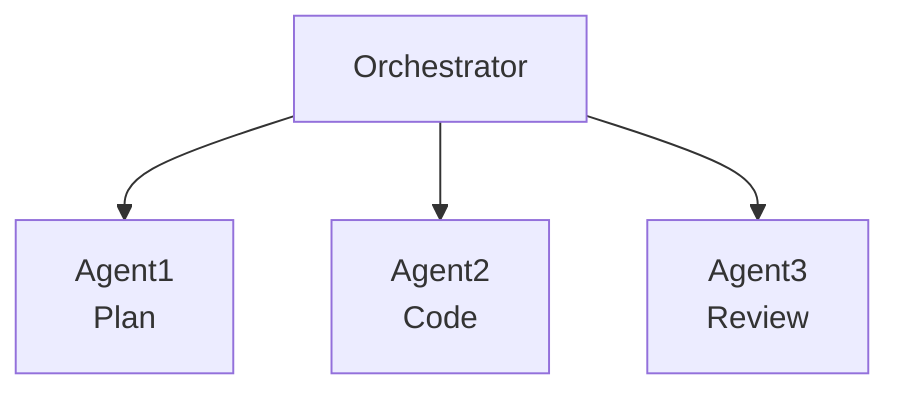
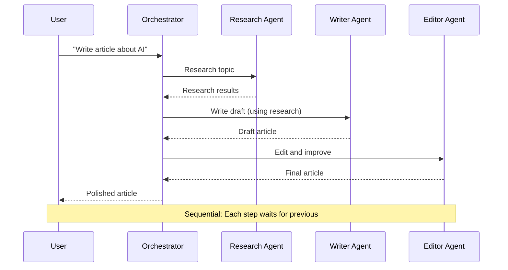
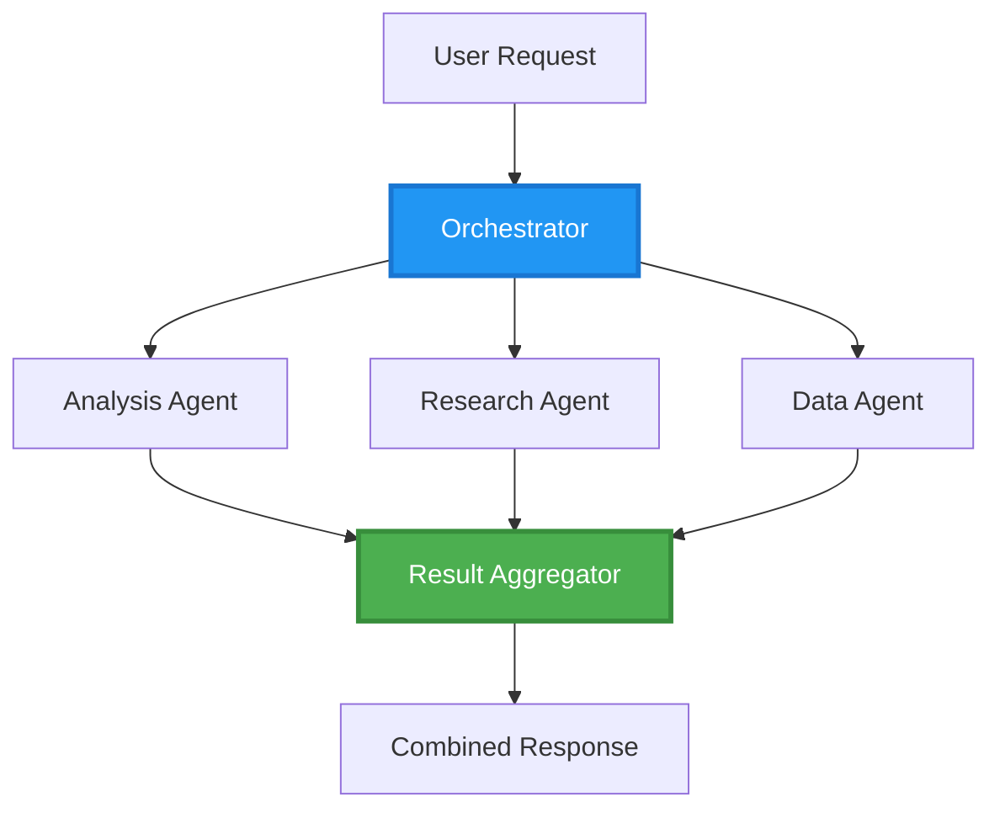
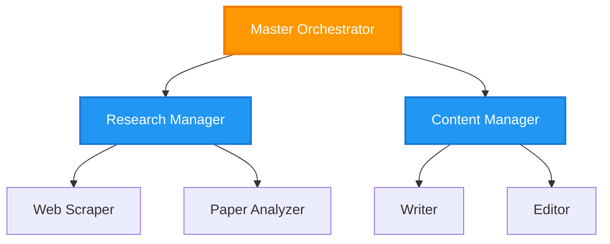
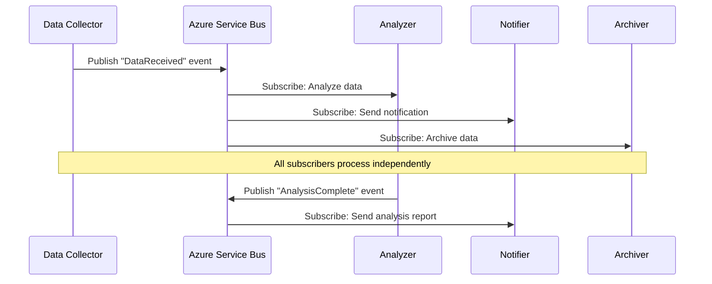
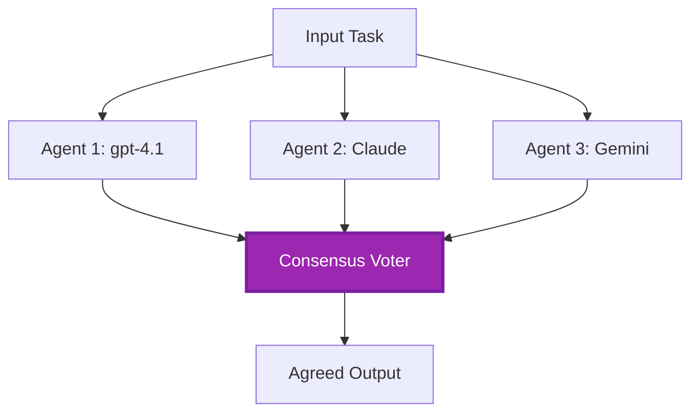
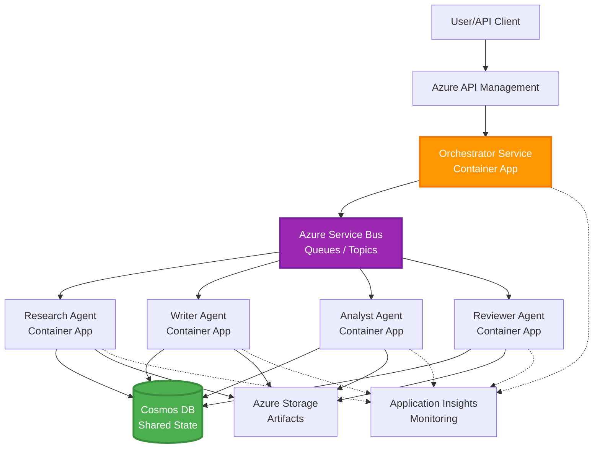

# Moni-agentin koordinointimallit

⏱️ **Arvioitu aika**: 60-75 minuuttia lukemista; useita tunteja toteutukseen | 💰 **Arvioitu kustannus**: työkuormasta riippuva | ⭐ **Monimutkaisuus**: Edistynyt

**📚 Oppimispolku:**
- ← Edellinen: [Capacity Planning](capacity-planning.md) - Resurssien mittakaavaus- ja skaalausstrategiat
- 🎯 **Olet tässä**: Moni-agentin koordinointimallit (orkestrointi, viestintä, tilanhallinta)
- → Seuraava: [SKU Selection](sku-selection.md) - Oikeiden Azure-palveluiden valinta
- 🏠 [Kurssin kotisivu](../../README.md)

---

## Mitä opit

Tässä oppitunnissa opit:
- Ymmärtämään **moni-agenttien arkkitehtuurin** malleja ja käyttötapauksia
- Toteuttamaan **orkestrointimalleja** (keskitetty, hajautettu, hierarkkinen)
- Suunnittelemaan **agenttien viestintästrategioita** (synkroninen, asynkroninen, tapahtumapohjainen)
- Hallitsemaan **jaettua tilaa** hajautettujen agenttien välillä
- Ottamaan käyttöön **moni-agenttijärjestelmiä** Azuressa AZD:n avulla
- Soveltamaan **koordinointimalleja** todellisissa tekoälyskenaarioissa
- Valvomaan ja virheenkorjaamaan hajautettuja agenttijärjestelmiä

## Miksi moni-agenttien koordinointi on tärkeää

### Kehitys: Yhdestä agentista moni-agenttiin

**Yksi agentti (yksinkertainen):**
```
User → Agent → Response
```
- ✅ Helppo ymmärtää ja toteuttaa
- ✅ Nopea yksinkertaisiin tehtäviin
- ❌ Rajoittuu yksittäisen mallin kykyihin
- ❌ Ei voi rinnakkaistaa monimutkaisia tehtäviä
- ❌ Ei erikoistumista

**Moni-agenttijärjestelmä (edistynyt):**

- ✅ Erikoistuneet agentit tiettyihin tehtäviin
- ✅ Rinnakkainen suoritusnopeuden saavuttamiseksi
- ✅ Modulaarinen ja ylläpidettävä
- ✅ Parempi monimutkaisissa työnkuluissa
- ⚠️ Tarvitsee koordinointilogiikan

**Analogiana**: Yksi agentti on kuin yksi henkilö tekemässä kaikkia tehtäviä. Moni-agentti on kuin tiimi, jossa jokaisella jäsenellä on erikoisosaamista (tutkija, koodari, tarkastaja, kirjoittaja), jotka työskentelevät yhdessä.

---

## Keskeiset koordinointimallit

### Malli 1: Peräkkäinen koordinointi (vastuun ketju)

**Milloin käyttää**: Tehtävien on valmistuttava tietyssä järjestyksessä, jokainen agentti jatkaa edellisen tuotosta.



**Hyödyt:**
- ✅ Selkeä tietovirta
- ✅ Helppo virheenkorjaus
- ✅ Ennustettava suoritusjärjestys

**Rajoitukset:**
- ❌ Hitaampi (ei rinnakkaisuutta)
- ❌ Yksi virhe pysäyttää koko ketjun
- ❌ Ei kestä riippuvaisia tehtäviä

**Esimerkkikäyttötapaukset:**
- Sisällöntuotantoprosessi (tutkimus → kirjoita → muokkaa → julkaise)
- Koodin generointi (suunnittele → toteuta → testaa → ota käyttöön)
- Raportin luonti (datan keruu → analyysi → visualisointi → yhteenveto)

---

### Malli 2: Rinnakkainen koordinointi (Fan-Out/Fan-In)

**Milloin käyttää**: Riippumattomat tehtävät voivat tapahtua samanaikaisesti, tulokset yhdistetään lopussa.



**Hyödyt:**
- ✅ Nopea (rinnakkainen suoritus)
- ✅ Vikasietoinen (osittaiset tulokset hyväksyttäviä)
- ✅ Horisontaalisesti skaalautuva

**Rajoitukset:**
- ⚠️ Tulokset voivat saapua eri järjestyksessä
- ⚠️ Tarvitsee yhteenliittämislogiikkaa
- ⚠️ Monimutkainen tilanhallinta

**Esimerkkikäyttötapaukset:**
- Monilähteinen datankeruu (APIt + tietokannat + web-scraping)
- Kilpailuanalyysi (useat mallit tuottavat ratkaisun, paras valitaan)
- Käännöspalvelut (käännä useille kielille samanaikaisesti)

---

### Malli 3: Hierarkkinen koordinointi (Päällikkö-Työntekijä)

**Milloin käyttää**: Monimutkaiset työnkulut alatehtävinä, tarvitaan delegointia.



**Hyödyt:**
- ✅ Käsittelee monimutkaisia työnkulkuja
- ✅ Modulaarinen ja ylläpidettävä
- ✅ Selkeät vastuurajat

**Rajoitukset:**
- ⚠️ Monimutkaisempi arkkitehtuuri
- ⚠️ Korkeampi viive (useita koordinointikerroksia)
- ⚠️ Tarvitsee kehittyneen orkestroinnin

**Esimerkkikäyttötapaukset:**
- Yritysdokumenttien käsittely (luokittelu → reititys → käsittely → arkistointi)
- Monivaiheiset dataputket (tuonti → puhdistus → muunto → analyysi → raportointi)
- Monimutkaiset automaatiotyönkulut (suunnittelu → resurssien allokointi → toteutus → valvonta)

---

### Malli 4: Tapahtumapohjainen koordinointi (Julkaise-Tilaa)

**Milloin käyttää**: Agenttien pitää reagoida tapahtumiin, halutaan löyhää kytkentää.



**Hyödyt:**
- ✅ Löyhä kytkentä agenttien välillä
- ✅ Helppo lisätä uusia agenteja (vain tilaaminen)
- ✅ Asynkroninen käsittely
- ✅ Resilienssi (viestien säilytys)

**Rajoitukset:**
- ⚠️ Lopullinen konsistenssi
- ⚠️ Vaikea virheenkorjaus
- ⚠️ Viestijärjestyksen haasteet

**Esimerkkikäyttötapaukset:**
- Reaaliaikaiset valvontajärjestelmät (hälytykset, kojelaudat, lokit)
- Monikanavaiset ilmoitukset (sähköposti, SMS, push, Slack)
- Datankäsittelyputket (useat kuluttajat samasta datasta)

---

### Malli 5: Konsensuspohjainen koordinointi (Äänestys/Quorum)

**Milloin käyttää**: Tarvitaan useiden agenttien yksimielisyys ennen etenemistä.



**Hyödyt:**
- ✅ Korkeampi tarkkuus (useita mielipiteitä)
- ✅ Vikasietoisuus (vähemmistövirheet hyväksyttyjä)
- ✅ Laadunvarmistus sisäänrakennettuna

**Rajoitukset:**
- ❌ Kallis (useita mallikutsuja)
- ❌ Hitaampi (odottaa kaikkia agenteja)
- ⚠️ Konfliktinratkaisu tarpeen

**Esimerkkikäyttötapaukset:**
- Sisällön moderointi (useat mallit arvioivat sisältöä)
- Koodin tarkastus (useita linteuria/analysoijia)
- Lääketieteellinen diagnosointi (useita tekoälymalleja, asiantuntijan vahvistus)

---

## Arkkitehtuurin yleiskatsaus

### Täysi moni-agenttijärjestelmä Azuren päällä



**Keskeiset komponentit:**

| Komponentti | Tarkoitus | Azure-palvelu |
|-----------|---------|---------------|
| **API-gateway** | Sisäänkäyntipiste, nopeuden rajoitus, todennus | API Management |
| **Orkestroija** | Koordinoi agenttien työnkulut | Container Apps |
| **Viestijono** | Asynkroninen viestintä | Service Bus / Event Hubs |
| **Agentit** | Erikoistuneet tekoälytyöntekijät | Container Apps / Functions |
| **Tilanhallinta** | Jaettu tila, tehtävien seuranta | Cosmos DB |
| **Artefaktin tallennus** | Dokumentit, tulokset, lokit | Blob Storage |
| **Valvonta** | Hajautettu jäljitys, lokit | Application Insights |

Service Bus -jonot/aiheet ja Event Hubs ovat eri palveluita eri toimitus- ja kulutusmalleilla; Event Hubs ei ole suora korvike alla olevalle Service Bus -työntekijäkoodille. Rinnakkaisuus, pysyvät viestit ja mallien äänestys eivät sinänsä takaa vikasietoisuutta tai tarkkuuden parantumista.

---

## Esivaatimukset

### Tarvittavat työkalut

```bash
# Verify Azure Developer CLI
azd version
# Command reference baseline: azd 1.37.2

# Verify Azure CLI
az --version
# ✅ Expected: azure-cli 2.50.0 or higher

# Verify Docker (for local testing)
docker --version
# ✅ Expected: Docker version 20.10 or higher
```

### Azure-vaatimukset

- Aktiivinen Azure-tilaus
- Oikeudet luoda:
  - Container Apps
  - Service Bus -nimialueet
  - Cosmos DB -tilit
  - Tallennustilit
  - Application Insights

### Tietovaatimukset

Sinun tulisi olla suorittanut:
- [Configuration Management](../chapter-03-configuration/configuration.md)
- [Authentication & Security](../chapter-03-configuration/authsecurity.md)
- [Microservices Example](../../../../examples/microservices)

---

## Toteutusopas

> **Suunnittelupalaset, ei käyttöön otettavaa labraa:** Projektipuu ja `File:` -tunnisteet kuvaavat tiedostoja, jotka luodaan omassa projektissasi; tämä arkisto ei sisällä valmista `multi-agent-system` sovellusta. Puuttuvat osat sisältävät pää- ja parametritiedostot, Container Apps -ympäristön/rekisterin, Docker-tiedostot ja riippuvuuksien lukot, Cosmos-tietokannan/kontin asetukset, mallien käyttöönoton, identiteetin/roolien konfiguroinnin, skaalaussäännöt ja rinnakkaiset työntekijät/jonot. Älä odota, että `azd init` generoi nämä tiedostot tai `azd up` ottaa koodin käyttöön muuttumattomana. Käyttökelpoinen aloituspiste löytyy [Multi-Agent Basics](../chapter-05-multi-agent/multi-agent-basics.md).

**Suoritusympäristöoletukset:** Python 3.10+, `azure-servicebus`, `azure-cosmos`, `openai`, Flask ja (valvontaan) `azure-monitor-opentelemetry`; aseta `shared` Python-import-polulle jokaisessa palvelukuvassa. Cosmos `agent-state/tasks` -kontin on oltava jo olemassa osiointiavain `/id` kanssa. Avaimpiin perustuviin yhteyksiin perustamalla helpottaa näitä palasia, mutta tuotantoon suositellaan hallittuja identiteettejä rajatuilla Service Bus / Cosmos / OpenAI data-plane -rooleilla. Älä paljasta avaimia tulosteissa tai lokeissa.

Service Bus -toimitus on **vähintään kerran**. Säilytä idempotenssi per tehtävä **ja vaihe**, käytä optimistista samanaikaisuutta (ETagit) tilan luku/muokkaus/kirjoitus -toiminnossa sekä uusi viestin lukot pitkäkestoisessa käsittelyssä. Alla oleva yksinkertainen tilanhallinta on peräkkäinen eikä takaa tuotantotason vaatimuksia.

### Projektin rakenne

```
multi-agent-system/
├── azure.yaml                    # AZD configuration
├── infra/
│   ├── main.bicep               # Main infrastructure
│   ├── core/
│   │   ├── servicebus.bicep     # Message queue
│   │   ├── cosmos.bicep         # State store
│   │   ├── storage.bicep        # Artifact storage
│   │   └── monitoring.bicep     # Application Insights
│   └── app/
│       ├── orchestrator.bicep   # Orchestrator service
│       └── agent.bicep          # Agent template
└── src/
    ├── orchestrator/            # Orchestration logic
    │   ├── app.py
    │   ├── workflows.py
    │   └── Dockerfile
    ├── agents/
    │   ├── research/            # Research agent
    │   ├── writer/              # Writer agent
    │   ├── analyst/             # Analyst agent
    │   └── reviewer/            # Reviewer agent
    └── shared/
        ├── state_manager.py     # Shared state logic
        └── message_handler.py   # Message handling
```

---

## Oppitunti 1: Peräkkäisen koordinoinnin malli

### Toteutus: Sisällöntuotantoputki

Suunnitellaan peräkkäinen putki: Tutkimus → Kirjoita → Muokkaa. Julkaisu on tämän esimerkin ulkopuolella.

### 1. AZD-konfiguraatio

**Tiedosto: `azure.yaml`**

```yaml
name: content-pipeline
metadata:
  template: multi-agent-sequential@1.0.0

services:
  orchestrator:
    project: ./src/orchestrator
    language: python
    host: containerapp
  
  research-agent:
    project: ./src/agents/research
    language: python
    host: containerapp
  
  writer-agent:
    project: ./src/agents/writer
    language: python
    host: containerapp
  
  editor-agent:
    project: ./src/agents/editor
    language: python
    host: containerapp
```

### 2. Infrastruktuuri: Service Bus koordinointiin

**Tiedosto: `infra/core/servicebus.bicep`**

```bicep
param name string
param location string
param tags object = {}

resource serviceBusNamespace 'Microsoft.ServiceBus/namespaces@2022-10-01-preview' = {
  name: name
  location: location
  tags: tags
  sku: {
    name: 'Standard'
    tier: 'Standard'
  }
  properties: {
    minimumTlsVersion: '1.2'
  }
}

// Queue for orchestrator → research agent
resource researchQueue 'Microsoft.ServiceBus/namespaces/queues@2022-10-01-preview' = {
  parent: serviceBusNamespace
  name: 'research-tasks'
  properties: {
    maxDeliveryCount: 3
    lockDuration: 'PT5M'
    deadLetteringOnMessageExpiration: true
  }
}

// Queue for research agent → writer agent
resource writerQueue 'Microsoft.ServiceBus/namespaces/queues@2022-10-01-preview' = {
  parent: serviceBusNamespace
  name: 'writer-tasks'
  properties: {
    maxDeliveryCount: 3
    lockDuration: 'PT5M'
  }
}

// Queue for writer agent → editor agent
resource editorQueue 'Microsoft.ServiceBus/namespaces/queues@2022-10-01-preview' = {
  parent: serviceBusNamespace
  name: 'editor-tasks'
  properties: {
    maxDeliveryCount: 3
    lockDuration: 'PT5M'
  }
}

output namespace string = serviceBusNamespace.name
// Do not output RootManageSharedAccessKey. Resolve scoped credentials
// securely or use managed identity in the application and scale rules.
```

### 3. Jaetun tilan hallinta

**Tiedosto: `src/shared/state_manager.py`**

```python
from azure.cosmos import CosmosClient, PartitionKey
from datetime import datetime, timezone
import os

class StateManager:
    """Manages shared state across agents using Cosmos DB"""
    
    def __init__(self):
        endpoint = os.environ['COSMOS_ENDPOINT']
        key = os.environ['COSMOS_KEY']
        
        self.client = CosmosClient(endpoint, key)
        self.database = self.client.get_database_client('agent-state')
        self.container = self.database.get_container_client('tasks')
    
    def create_task(self, task_id: str, task_type: str, input_data: dict):
        """Create a new task"""
        task = {
            'id': task_id,
            'type': task_type,
            'status': 'pending',
            'input': input_data,
            'created_at': datetime.now(timezone.utc).isoformat(),
            'steps': []
        }
        self.container.create_item(task)
        return task
    
    def update_task_step(self, task_id: str, step_name: str, result: dict):
        """Update task with completed step"""
        task = self.container.read_item(task_id, partition_key=task_id)
        
        task['steps'].append({
            'name': step_name,
            'completed_at': datetime.now(timezone.utc).isoformat(),
            'result': result
        })
        
        self.container.replace_item(task_id, task)
        return task
    
    def complete_task(self, task_id: str, final_result: dict):
        """Mark task as complete"""
        task = self.container.read_item(task_id, partition_key=task_id)
        task['status'] = 'completed'
        task['result'] = final_result
        task['completed_at'] = datetime.now(timezone.utc).isoformat()
        self.container.replace_item(task_id, task)
        return task
    
    def get_task(self, task_id: str):
        """Retrieve task state"""
        return self.container.read_item(task_id, partition_key=task_id)
```

### 4. Orkestrointipalvelu

**Tiedosto: `src/orchestrator/app.py`**

```python
from flask import Flask, request, jsonify
from azure.servicebus import ServiceBusClient, ServiceBusMessage
import json
import uuid
import os
from shared.state_manager import StateManager

app = Flask(__name__)
state_manager = StateManager()

# Service Bus connection
servicebus_connection_str = os.environ['SERVICEBUS_CONNECTION_STRING']
servicebus_client = ServiceBusClient.from_connection_string(servicebus_connection_str)

@app.route('/health', methods=['GET'])
def health():
    return jsonify({'status': 'healthy', 'service': 'orchestrator'})

@app.route('/create-content', methods=['POST'])
def create_content():
    """
    Sequential workflow: Research → Write → Edit (returns a draft; no publishing)
    """
    data = request.get_json(silent=True) or {}
    topic = data.get('topic')
    
    if not topic:
        return jsonify({'error': 'Topic required'}), 400
    
    # Create task in state store
    task_id = str(uuid.uuid4())
    task = state_manager.create_task(
        task_id=task_id,
        task_type='content_creation',
        input_data={'topic': topic}
    )
    
    # Send message to research agent (first step)
    sender = servicebus_client.get_queue_sender('research-tasks')
    message = ServiceBusMessage(
        body=json.dumps({
            'task_id': task_id,
            'topic': topic,
            'next_queue': 'writer-tasks'  # Where to send results
        }),
        content_type='application/json'
    )
    
    with sender:
        sender.send_messages(message)
    
    return jsonify({
        'task_id': task_id,
        'status': 'started',
        'workflow': 'sequential',
        'steps': ['research', 'write', 'edit'],
        'message': 'Content creation pipeline initiated'
    }), 202

@app.route('/task/<task_id>', methods=['GET'])
def get_task_status(task_id):
    """Check task status"""
    try:
        task = state_manager.get_task(task_id)
        return jsonify(task)
    except Exception as e:
        return jsonify({'error': str(e)}), 404

if __name__ == '__main__':
    app.run(host='0.0.0.0', port=8080)
```

### 5. Tutkimusagentti

**Tiedosto: `src/agents/research/app.py`**

```python
from azure.servicebus import ServiceBusClient, ServiceBusMessage
from openai import AzureOpenAI
import json
import os
import time
from shared.state_manager import StateManager

# Initialize clients
state_manager = StateManager()
servicebus_client = ServiceBusClient.from_connection_string(
    os.environ['SERVICEBUS_CONNECTION_STRING']
)

openai_client = AzureOpenAI(
    api_key=os.environ['AZURE_OPENAI_API_KEY'],
    api_version="2024-10-21",
    azure_endpoint=os.environ['AZURE_OPENAI_ENDPOINT']
)

def process_research_task(message_data):
    """Process research request and pass to writer"""
    task_id = message_data['task_id']
    topic = message_data['topic']
    next_queue = message_data['next_queue']
    
    print(f"🔬 Researching: {topic}")
    
    # Call Microsoft Foundry Models for research
    response = openai_client.chat.completions.create(
        model=os.environ['AZURE_OPENAI_DEPLOYMENT'],
        messages=[
            {"role": "system", "content": "You are a research assistant. Provide comprehensive research on the given topic."},
            {"role": "user", "content": f"Research this topic thoroughly: {topic}"}
        ],
        max_tokens=1500
    )
    
    research_results = response.choices[0].message.content
    
    # Update state
    state_manager.update_task_step(
        task_id=task_id,
        step_name='research',
        result={'research': research_results}
    )
    
    # Send to next agent (writer)
    sender = servicebus_client.get_queue_sender(next_queue)
    message = ServiceBusMessage(
        body=json.dumps({
            'task_id': task_id,
            'topic': topic,
            'research': research_results,
            'next_queue': 'editor-tasks'
        }),
        content_type='application/json'
    )
    
    with sender:
        sender.send_messages(message)
    
    print(f"✅ Research complete for task {task_id}")

def main():
    """Listen to research queue"""
    receiver = servicebus_client.get_queue_receiver('research-tasks')
    
    print("🔬 Research Agent started, listening for tasks...")
    
    with receiver:
        while True:
            messages = receiver.receive_messages(max_wait_time=5)
            for message in messages:
                try:
                    message_data = json.loads(str(message))
                    process_research_task(message_data)
                    receiver.complete_message(message)
                except Exception as e:
                    print(f"❌ Error processing message: {e}")
                    receiver.abandon_message(message)

if __name__ == '__main__':
    main()
```

### 6. Kirjoittaja-agentti

**Tiedosto: `src/agents/writer/app.py`**

```python
from azure.servicebus import ServiceBusClient, ServiceBusMessage
from openai import AzureOpenAI
import json
import os
from shared.state_manager import StateManager

state_manager = StateManager()
servicebus_client = ServiceBusClient.from_connection_string(
    os.environ['SERVICEBUS_CONNECTION_STRING']
)

openai_client = AzureOpenAI(
    api_key=os.environ['AZURE_OPENAI_API_KEY'],
    api_version="2024-10-21",
    azure_endpoint=os.environ['AZURE_OPENAI_ENDPOINT']
)

def process_writing_task(message_data):
    """Write article based on research"""
    task_id = message_data['task_id']
    topic = message_data['topic']
    research = message_data['research']
    next_queue = message_data['next_queue']
    
    print(f"✍️ Writing article: {topic}")
    
    # Call Microsoft Foundry Models to write article
    response = openai_client.chat.completions.create(
        model=os.environ['AZURE_OPENAI_DEPLOYMENT'],
        messages=[
            {"role": "system", "content": "You are a professional writer. Write engaging, well-structured articles."},
            {"role": "user", "content": f"Based on this research:\n\n{research}\n\nWrite a comprehensive article about: {topic}"}
        ],
        max_tokens=2000
    )
    
    article_draft = response.choices[0].message.content
    
    # Update state
    state_manager.update_task_step(
        task_id=task_id,
        step_name='writing',
        result={'draft': article_draft}
    )
    
    # Send to editor
    sender = servicebus_client.get_queue_sender(next_queue)
    message = ServiceBusMessage(
        body=json.dumps({
            'task_id': task_id,
            'topic': topic,
            'draft': article_draft
        }),
        content_type='application/json'
    )
    
    with sender:
        sender.send_messages(message)
    
    print(f"✅ Article draft complete for task {task_id}")

def main():
    """Listen to writer queue"""
    receiver = servicebus_client.get_queue_receiver('writer-tasks')
    
    print("✍️ Writer Agent started, listening for tasks...")
    
    with receiver:
        while True:
            messages = receiver.receive_messages(max_wait_time=5)
            for message in messages:
                try:
                    message_data = json.loads(str(message))
                    process_writing_task(message_data)
                    receiver.complete_message(message)
                except Exception as e:
                    print(f"❌ Error: {e}")
                    receiver.abandon_message(message)

if __name__ == '__main__':
    main()
```

### 7. Editori-agentti

**Tiedosto: `src/agents/editor/app.py`**

```python
from azure.servicebus import ServiceBusClient
from openai import AzureOpenAI
import json
import os
from shared.state_manager import StateManager

state_manager = StateManager()
servicebus_client = ServiceBusClient.from_connection_string(
    os.environ['SERVICEBUS_CONNECTION_STRING']
)

openai_client = AzureOpenAI(
    api_key=os.environ['AZURE_OPENAI_API_KEY'],
    api_version="2024-10-21",
    azure_endpoint=os.environ['AZURE_OPENAI_ENDPOINT']
)

def process_editing_task(message_data):
    """Edit and finalize article"""
    task_id = message_data['task_id']
    topic = message_data['topic']
    draft = message_data['draft']
    
    print(f"📝 Editing article: {topic}")
    
    # Call Microsoft Foundry Models to edit
    response = openai_client.chat.completions.create(
        model=os.environ['AZURE_OPENAI_DEPLOYMENT'],
        messages=[
            {"role": "system", "content": "You are an expert editor. Improve grammar, clarity, and structure."},
            {"role": "user", "content": f"Edit and improve this article:\n\n{draft}"}
        ],
        max_tokens=2000
    )
    
    final_article = response.choices[0].message.content
    
    # Mark task as complete
    state_manager.complete_task(
        task_id=task_id,
        final_result={
            'topic': topic,
            'final_article': final_article,
            'word_count': len(final_article.split())
        }
    )
    
    print(f"✅ Article finalized for task {task_id}")

def main():
    """Listen to editor queue"""
    receiver = servicebus_client.get_queue_receiver('editor-tasks')
    
    print("📝 Editor Agent started, listening for tasks...")
    
    with receiver:
        while True:
            messages = receiver.receive_messages(max_wait_time=5)
            for message in messages:
                try:
                    message_data = json.loads(str(message))
                    process_editing_task(message_data)
                    receiver.complete_message(message)
                except Exception as e:
                    print(f"❌ Error: {e}")
                    receiver.abandon_message(message)

if __name__ == '__main__':
    main()
```

### 8. Julkaisu ja testaus

Nämä komennot toimivat **vain, jos olet toteuttanut puuttuvat projektitiedostot**. Interactive Foundryn agentin alustus on erillinen työnkulku; se ei generoi tätä Service Bus -mallia.

```bash
# In your completed custom project
azd up

# Alternative in a SEPARATE empty folder (agents beta.23 requires azd >= 1.37)
azd extension install azure.ai.agents
azd ai agent init
azd up
```

> Katso [AZD AI CLI Commands](../chapter-08-production/production-ai-practices.md#azd-ai-cli-commands-and-extensions) kaikkiin `azd ai` -lipputunnelmiin ja valintoihin.

```bash
# Get orchestrator URL
ORCHESTRATOR_URL=$(azd env get-values | grep ORCHESTRATOR_URL | cut -d '=' -f2 | tr -d '"')

# Create content
curl -X POST $ORCHESTRATOR_URL/create-content \
  -H "Content-Type: application/json" \
  -d '{"topic": "The Future of AI in Healthcare"}'
```

**✅ Odotettu tulos:**
```json
{
  "task_id": "a1b2c3d4-e5f6-7890-abcd-ef1234567890",
  "status": "started",
  "workflow": "sequential",
  "steps": ["research", "write", "edit"],
  "message": "Content creation pipeline initiated"
}
```

**Tarkista tehtävän eteneminen:**
```bash
TASK_ID="a1b2c3d4-e5f6-7890-abcd-ef1234567890"
curl $ORCHESTRATOR_URL/task/$TASK_ID
```

**✅ Odotettu tulos (valmistunut):**
```json
{
  "id": "a1b2c3d4-e5f6-7890-abcd-ef1234567890",
  "type": "content_creation",
  "status": "completed",
  "steps": [
    {
      "name": "research",
      "completed_at": "2025-11-19T10:30:00Z",
      "result": {"research": "..."}
    },
    {
      "name": "writing",
      "completed_at": "2025-11-19T10:32:00Z",
      "result": {"draft": "..."}
    }
  ],
  "result": {
    "topic": "The Future of AI in Healthcare",
    "final_article": "...",
    "word_count": 1500
  }
}
```

---

## Oppitunti 2: Rinnakkaisen koordinoinnin malli

### Toteutus: Monilähteinen tutkimuksen kerääjä

Rakennetaan rinnakkainen järjestelmä, joka kerää tietoa useista lähteistä samanaikaisesti.

### Rinnakkainen orkestroija

**Tiedosto: `src/orchestrator/parallel_workflow.py`**

```python
from flask import Flask, request, jsonify
from azure.servicebus import ServiceBusClient, ServiceBusMessage
import json
import uuid
import os
from shared.state_manager import StateManager

app = Flask(__name__)
state_manager = StateManager()

servicebus_client = ServiceBusClient.from_connection_string(
    os.environ['SERVICEBUS_CONNECTION_STRING']
)

@app.route('/research-parallel', methods=['POST'])
def research_parallel():
    """
    Parallel workflow: Multiple agents work simultaneously
    """
    data = request.json
    query = data.get('query')
    
    task_id = str(uuid.uuid4())
    task = state_manager.create_task(
        task_id=task_id,
        task_type='parallel_research',
        input_data={
            'query': query,
            'agents': ['web', 'academic', 'news', 'social']
        }
    )
    
    # Fan-out: publish sequentially; workers may process concurrently.
    agents = [
        ('web-research-queue', 'web'),
        ('academic-research-queue', 'academic'),
        ('news-research-queue', 'news'),
        ('social-research-queue', 'social')
    ]
    
    for queue_name, agent_type in agents:
        sender = servicebus_client.get_queue_sender(queue_name)
        message = ServiceBusMessage(
            body=json.dumps({
                'task_id': task_id,
                'query': query,
                'agent_type': agent_type,
                'result_queue': 'aggregation-queue'
            }),
            content_type='application/json'
        )
        
        with sender:
            sender.send_messages(message)
    
    return jsonify({
        'task_id': task_id,
        'status': 'started',
        'workflow': 'parallel',
        'agents_dispatched': 4,
        'message': 'Parallel research initiated'
    }), 202

if __name__ == '__main__':
    app.run(host='0.0.0.0', port=8080)
```

### Yhteenliittämislogiikka

**Tiedosto: `src/agents/aggregator/app.py`**

```python
from azure.servicebus import ServiceBusClient
import json
import os
from collections import defaultdict
from shared.state_manager import StateManager

state_manager = StateManager()
servicebus_client = ServiceBusClient.from_connection_string(
    os.environ['SERVICEBUS_CONNECTION_STRING']
)

# Single-process demo only: not durable or shared across replicas.
# Production: use durable unique (task_id, agent_type) result records.
task_results = defaultdict(dict)
expected_agents = 4  # web, academic, news, social

def process_result(message_data):
    """Aggregate results from parallel agents"""
    task_id = message_data['task_id']
    agent_type = message_data['agent_type']
    result = message_data['result']
    
    # Store result
    task_results[task_id][agent_type] = {
        'agent': agent_type,
        'data': result
    }
    
    print(f"📊 Received result from {agent_type} agent ({len(task_results[task_id])}/{expected_agents})")
    
    # Check if all agents completed (fan-in)
    if len(task_results[task_id]) == expected_agents:
        print(f"✅ All agents completed for task {task_id}. Aggregating...")
        
        # Combine results
        aggregated = {
            'query': message_data['query'],
            'sources': list(task_results[task_id].values()),
            'summary': generate_summary(list(task_results[task_id].values()))
        }
        
        # Mark complete
        state_manager.complete_task(task_id, aggregated)
        
        # Clean up
        del task_results[task_id]
        
        print(f"✅ Aggregation complete for task {task_id}")

def generate_summary(results):
    """Generate summary from all sources"""
    summaries = [r['data'].get('summary', '') for r in results]
    return '\n\n'.join(summaries)

def main():
    """Listen to aggregation queue"""
    receiver = servicebus_client.get_queue_receiver('aggregation-queue')
    
    print("📊 Aggregator started, listening for results...")
    
    with receiver:
        while True:
            messages = receiver.receive_messages(max_wait_time=5)
            for message in messages:
                try:
                    message_data = json.loads(str(message))
                    process_result(message_data)
                    receiver.complete_message(message)
                except Exception as e:
                    print(f"❌ Error: {e}")
                    receiver.abandon_message(message)

if __name__ == '__main__':
    main()
```

**Rinnakkaisen mallin edut:**
- ⚡ **Mahdollisesti pienempi viive** (hitaimman työntekijän + koordinoinnin aikaraja)
- 🔄 **Voi tukea osittaisia tuloksia** eksplisiittisin määräajoilla ja virhepolitiikalla (peruskerääjä ei toteuta)
- 📈 **Skaalautuva** (helppo lisätä agenteja)

---

## Käytännön harjoitukset

### Harjoitus 1: Lisää aikakatkaisu ⭐⭐ (Keskitaso)

**Tavoite**: Toteuta aikakatkaisulogiikka niin, että kerääjä ei odota ikuisesti hitaita agentteja.

**Alku:** Suorita tämä paikallinen määräaikasimulaatio ennen sen integrointia jonotyöntekijään. Aikakatkaisu tarkistetaan vain, kun toinen viesti saapuu; se ei laukea, jos kadonnut työntekijä ei lähetä mitään.

**Vaiheet:**

1. **Lisää aikakatkaisun seuranta kerääjään:**

```python
import asyncio

async def simulated_agent(name, delay):
    await asyncio.sleep(delay)
    return {'agent': name, 'result': 'done'}

async def main():
    tasks = [asyncio.create_task(simulated_agent(name, delay))
             for name, delay in [('web', 0.1), ('academic', 0.2),
                                 ('news', 0.3), ('social', 3)]]
    done, pending = await asyncio.wait(tasks, timeout=1)
    results = [task.result() for task in done]
    for task in pending:
        task.cancel()
    await asyncio.gather(*pending, return_exceptions=True)
    print({'completed_agents': len(results), 'timed_out': bool(pending)})
    assert len(results) == 3 and pending

asyncio.run(main())
```

2. **Odotettu tulos:**

```text
{'completed_agents': 3, 'timed_out': True}
```

3. **Järjestelmän integrointi (suunnittelutehtävä):** Säilytä lähetyksen määräaika ja odotettavissa olevat agentit tehtävää luotaessa, suorita määräaikapuhdistus itsenäisesti saapuvista tuloksista, viimeistele osittaiset tulokset atomisesti ja sivuuta myöhästyneet/kaksoiskappalepostit viimeistellyistä tehtävistä. Paikallinen aikakatkaisu ei peruuta etätyöntekijöitä.

Vain omassa toteuttamassasi projektissa:

```bash
azd deploy aggregator

# Submit task
curl -X POST $ORCHESTRATOR_URL/research-parallel \
  -H "Content-Type: application/json" \
  -d '{"query": "AI safety research"}'

# Check results after 30 seconds
curl $ORCHESTRATOR_URL/task/$TASK_ID
```

**✅ Onnistumiskriteerit:**
- ✅ Paikallinen testi palautuu yhden sekunnin määräajan jälkeen, vaikka agentti olisi keskeneräinen
- ✅ Vastaus osoittaa osittaiset tulokset (`"timed_out": true`)
- ✅ Saatavilla olevat tulokset palautetaan (3/4 agenttia)

**Aika**: 20-25 minuuttia

---

### Harjoitus 2: Toteuta uudelleenyrityslogiikka ⭐⭐⭐ (Edistynyt)

**Tavoite**: Yritä automaattisesti epäonnistuneita agenttitehtäviä uudelleen, ennen kuin luovutat.

**Vaiheet:**

1. **Käytä Service Busin toimituslaskureita oman uudelleenyritysten seurannan sijaan:**

```python
import json
import time
# Integration fragment: use a live peek-lock ServiceBusReceiver.
# Set queue maxDeliveryCount to 4 for one attempt + up to three retries.
```

2. **Lisää uudelleenyritysten käsittelijä agenteille:**

```python
def process_with_retry(message, receiver, process_func):
    """Process message with automatic retry on failure"""
    try:
        message_data = json.loads(str(message))
        
        # Process the message
        process_func(message_data)
        
        # Success - complete
        receiver.complete_message(message)
        
    except Exception as e:
        if message.delivery_count < 4:
            # Bounded exponential delay: 5s, 10s, 20s.
            # Renew the lock if processing + waiting can exceed its duration.
            time.sleep(5 * 2 ** (message.delivery_count - 1))
            receiver.abandon_message(message)
        else:
            # Max retries exceeded - move to dead letter queue
            print(f"❌ Max attempts exceeded for message {message.message_id}")
            receiver.dead_letter_message(
                message,
                reason="MaxRetriesExceeded",
                error_description=str(e)
            )
```

3. **Valvo dead letter -jonoa:**

```python
def monitor_dead_letters():
    """Check dead letter queue for failed messages"""
    receiver = servicebus_client.get_queue_receiver(
        'research-tasks',
        sub_queue='deadletter'
    )
    
    with receiver:
        messages = receiver.receive_messages(max_wait_time=5)
        for message in messages:
            print(f"☠️ Dead letter: {message.message_id}")
            print(f"Reason: {message.dead_letter_reason}")
            print(f"Description: {message.dead_letter_error_description}")
```

**✅ Onnistumiskriteerit:**
- ✅ Epäonnistuneet tehtävät yritetään automaattisesti uudelleen (enintään 3 kertaa)
- ✅ Eksponentiaalinen takaisinkytkentä yritysten välillä (5s, 10s, 20s), viestin lukon uusinta tarvittaessa
- ✅ Maksimiyritysten jälkeen viestit siirtyvät dead letter -jonoon
- ✅ Dead letter -viestit voidaan tarkastella; uudelleensoitto vaatii erillisen idempotentin palautusprosessin

**Aika**: 30-40 minuuttia

---

### Harjoitus 3: Toteuta katkaisija ⭐⭐⭐ (Edistynyt)

**Tavoite**: Estä ketjureaktiot epäonnistuneisiin agenttien pyyntöihin pysäyttämällä niitä.

**Vaiheet:**

1. **Luo katkaisijaluokka:**

```python
from enum import Enum
from datetime import datetime, timedelta, timezone

class CircuitState(Enum):
    CLOSED = "closed"      # Normal operation
    OPEN = "open"          # Failing, reject requests
    HALF_OPEN = "half_open"  # Testing if recovered

class CircuitBreaker:
    def __init__(self, failure_threshold=5, timeout_seconds=60):
        self.failure_threshold = failure_threshold
        self.timeout_seconds = timeout_seconds
        self.failure_count = 0
        self.last_failure_time = None
        self.state = CircuitState.CLOSED
    
    def call(self, func):
        """Execute function with circuit breaker protection"""
        if self.state == CircuitState.OPEN:
            # Check if timeout expired
            if datetime.now(timezone.utc) - self.last_failure_time > timedelta(seconds=self.timeout_seconds):
                self.state = CircuitState.HALF_OPEN
                print("🔄 Circuit breaker: HALF_OPEN (testing)")
            else:
                raise Exception(f"Circuit breaker OPEN for agent. Try again in {self.timeout_seconds}s")
        
        try:
            result = func()
            
            # Success
            self.failure_count = 0 # Count consecutive failures only
            if self.state == CircuitState.HALF_OPEN:
                self.state = CircuitState.CLOSED
                self.failure_count = 0
                print("✅ Circuit breaker: CLOSED (recovered)")
            
            return result
            
        except Exception as e:
            self.failure_count += 1
            self.last_failure_time = datetime.now(timezone.utc)
            
            if self.failure_count >= self.failure_threshold:
                self.state = CircuitState.OPEN
                print(f"🔴 Circuit breaker: OPEN (too many failures)")
            
            raise
```

2. **Käytä agenttikutsuissa:**

```python
# In orchestrator
agent_circuits = {
    'web': CircuitBreaker(failure_threshold=5, timeout_seconds=60),
    'academic': CircuitBreaker(failure_threshold=5, timeout_seconds=60),
    'news': CircuitBreaker(failure_threshold=5, timeout_seconds=60),
    'social': CircuitBreaker(failure_threshold=5, timeout_seconds=60)
}

def send_to_agent(agent_type, message_data):
    """Send with circuit breaker protection"""
    circuit = agent_circuits[agent_type]
    
    try:
        circuit.call(lambda: send_message(agent_type, message_data))
    except Exception as e:
        print(f"⚠️ Skipping {agent_type} agent: {e}")
        # Continue with other agents
```

Tämä piiri suojaa **lähetysoperaatiota**, ei etätyöntekijän suorittamista: viestin onnistunut jonottaminen ei kerro mitään siitä, onko agentti elossa. `send_message` on sovelluksesi lähetysfunktio. Suorituspiireille syötä havaittuja tehtävien virheitä/aikakatkaisuja kestävään koordinaattoriin. Tämä muistissa toimiva luokka on yksisäikeinen demonstraatio, ei hajautettu piirikytkin.

3. **Testaa piirikytkin paikallisesti:**

```python
# Run after the class definition; no Azure changes required.
circuit = CircuitBreaker(failure_threshold=5, timeout_seconds=0)
def fail():
    raise RuntimeError("simulated failure")
for _ in range(5):
    try:
        circuit.call(fail)
    except RuntimeError:
        pass
assert circuit.state == CircuitState.OPEN
assert circuit.call(lambda: "recovered") == "recovered"
assert circuit.state == CircuitState.CLOSED
print("Circuit breaker recovery verified")
```

**✅ Onnistumisen kriteerit:**
- ✅ 5 epäonnistumisen jälkeen piiri avautuu (hylkää pyynnöt)
- ✅ 60 sekunnin kuluttua piiri muuttuu puoliksi avoimeksi (testaa toipumista)
- ✅ Muut agentit jatkavat normaalisti
- ✅ Piiri sulkeutuu automaattisesti, kun agentti toipuu

**Kesto**: 40–50 minuuttia

---

## Valvonta ja vianetsintä

### Hajautettu jäljitys Application Insightsin avulla

**Tiedosto: `src/shared/tracing.py`**

```python
from azure.monitor.opentelemetry import configure_azure_monitor
from opentelemetry import trace
from opentelemetry.trace import SpanKind
import logging
import os

connection_string = os.environ.get('APPLICATIONINSIGHTS_CONNECTION_STRING')

# Configure once per process. Message send/receive trace-context propagation
# and agent attributes on exceptions need explicit instrumentation.
if connection_string:
    configure_azure_monitor(connection_string=connection_string, logger_name=__name__)
tracer = trace.get_tracer(__name__)

# Configure logging
logger = logging.getLogger(__name__)
logger.setLevel(logging.INFO)

def trace_agent_call(agent_name, task_id, operation_name, operation):
    """Trace agent operations"""
    with tracer.start_as_current_span(f'agent.{agent_name}.{operation_name}', kind=SpanKind.CLIENT) as span:
        span.set_attribute('agent', agent_name)
        span.set_attribute('task_id', task_id)
        span.set_attribute('operation', operation_name)
        
        try:
            result = operation()
            span.set_attribute('status', 'success')
            logger.info('Agent operation completed', extra={
                'agent': agent_name, 'task_id': task_id, 'operation': operation_name
            })
            return result
        except Exception as e:
            span.set_attribute('status', 'error')
            logger.exception('Agent operation failed', extra={
                'agent': agent_name, 'task_id': task_id, 'operation': operation_name
            })
            raise
```

### Application Insights -kyselyt

**Seuraa monen agentin työnkulkuja:**

```kusto
// Trace complete workflow for a task
traces
| where customDimensions.task_id == "a1b2c3d4-..."
| project timestamp, message, customDimensions.agent, customDimensions.operation
| order by timestamp asc
```

**Agenttien suorituskyvyn vertailu:**

```kusto
// Compare agent execution times
dependencies
| where name contains "agent"
| summarize 
    avg_duration = avg(duration),
    p95_duration = percentile(duration, 95),
    count = count()
  by agent = tostring(customDimensions.agent)
| order by avg_duration desc
```

**Virheanalyysi:**

```kusto
// Find which agents fail most
exceptions
| where customDimensions.agent != ""
| summarize 
    failure_count = count(),
    unique_errors = dcount(outerMessage)
  by agent = tostring(customDimensions.agent)
| order by failure_count desc
```

---

## Kustannusanalyysi

### Moni-agenttijärjestelmän kuukausikustannukset (arviot)

Kuvitteelliset suunnitteluluvut, eivät hintoja: alla oleva summa on **240–565 $/kk**. Varmista nykyiset alueelliset hinnat, aktiiviset/odottavat kopioiden tunnit, syöte/tuotos token-mix, tallennus ja telemetria. Serverless ei vaadi provisioitua suorituskyvyn minimia, mutta veloittaa pyynnöistä ja tallennuksesta.

| Komponentti | Konfiguraatio | Kustannus |
|-----------|--------------|------|
| **Orchestrator** | 1 Container App (1 vCPU, 2GB) | 30–50 $ |
| **4 agenttia** | 4 Container Appia (0,5 vCPU, 1GB kukin) | 60–120 $ |
| **Service Bus** | Standard-taso, 10M viestiä | 10–20 $ |
| **Cosmos DB** | Serverless, 5GB tallennus, 1M RU:ta | 25–50 $ |
| **Blob Storage** | 10GB tallennus, 100K tapahtumaa | 5–10 $ |
| **Application Insights** | 5GB ingestiota | 10–15 $ |
| **Microsoft Foundry Models** | gpt-4.1, 10M tokenia | 100–300 $ |
| **Yhteensä** | | **240–565 $/kk** |

### Kustannussäästöstrategiat

1. **Käytä serverlessiä aina kun mahdollista:**
   ```bicep
   // Cosmos DB serverless (no minimum cost)
   properties: {
     databaseAccountOfferType: 'Standard'
     capabilities: [{ name: 'EnableServerless' }]
   }
   ```

2. **Skalaa agentit nollaan ollessaan paikalla:**
   ```bicep
   scale: {
     minReplicas: 0  // Requires a Service Bus/KEDA scale rule to wake workers
     maxReplicas: 10
   }
   ```

3. **Käytä eräajoa Service Busille:**
   ```python
   # Send messages in batches (cheaper)
   sender.send_messages([message1, message2, message3])
   ```

4. **Välimuistita usein käytetyt tulokset:**
   ```python
   # Use Azure Cache for Redis
   if cache.exists(query_hash):
       return cache.get(query_hash)
   ```

---

## Parhaat käytännöt

### ✅ Tee näin:

1. **Käytä idempotentteja operaatioita**
   ```python
   # Pseudocode: implement a durable, atomic per-step deduplication claim.
   def process_task(task_id):
       raise NotImplementedError("Claim (task_id, step) atomically, execute, persist outcome")
   ```

2. **Ota käyttöön laaja logging**
   ```python
   logger.info(f"Agent: {agent_name}, Task: {task_id}, Action: {action}")
   ```

3. **Käytä korrelaatio-ID:itä**
   ```python
   # Pass task_id through entire workflow
   message_data = {
       'task_id': task_id,  # Correlation ID
       'timestamp': datetime.utcnow().isoformat()
   }
   ```

4. **Aseta viestin voimassaoloaika (TTL)**
   ```bicep
   properties: {
     defaultMessageTimeToLive: 'PT1H'  // 1 hour max
   }
   ```

5. **Valvo dead letter -jonoja**
   ```python
   # Regular monitoring of failed messages
   monitor_dead_letters()
   ```

### ❌ ÄLÄ tee:

1. **Älä luo syklisiä riippuvuuksia**
   ```python
   # ❌ BAD: Agent A → Agent B → Agent A (infinite loop)
   # ✅ GOOD: Define clear directed acyclic graph (DAG)
   ```

2. **Älä estä agenttisäikeitä**
   ```python
   # ❌ BAD: Synchronous wait
   while not task_complete:
       time.sleep(1)
   
   # ✅ GOOD: Use message queue callbacks
   ```

3. **Älä ohita osittaisia epäonnistumisia**
   ```python
   # ❌ BAD: Fail entire workflow if one agent fails
   # ✅ GOOD: Return partial results with error indicators
   ```

4. **Älä käytä loputtomia uudelleenyrittämisiä**
   ```python
   # ❌ BAD: retry forever
   # ✅ GOOD: max_retries = 3, then dead letter
   ```

---

## Vianetsintäopas

### Ongelma: Viestit jumissa jonossa

**Oireet:**
- Viestit kasaantuvat jonoon
- Agentit eivät käsittele viestejä
- Tehtävän tila jumissa "pending"

**Diagnoosi:**
```bash
# Check queue depth
az servicebus queue show \
  --resource-group "$RG_NAME" \
  --namespace-name mybus \
  --name research-tasks \
  --query "countDetails"

# Check agent logs using Azure CLI
az containerapp logs show --name research-agent --resource-group $RG_NAME --tail 50
```

**Ratkaisut:**

1. **Lisää agenttien kopioita:**
   ```bash
   az containerapp update \
     --resource-group "$RG_NAME" \
     --name research-agent \
     --min-replicas 3 \
     --max-replicas 10
   ```

2. **Tarkista dead letter -jono:**
   ```bash
   az servicebus queue show \
     --resource-group "$RG_NAME" \
     --namespace-name mybus \
     --name research-tasks \
     --query "countDetails.deadLetterMessageCount"
   ```

---

### Ongelma: Tehtävä aikakatkaisee/ei koskaan valmistu

**Oireet:**
- Tehtävän tila pysyy "in_progress"
- Jotkut agentit suorittavat, toiset eivät
- Ei virheilmoituksia

**Diagnoosi:**
```bash
# Check task state
curl $ORCHESTRATOR_URL/task/$TASK_ID

# Check Application Insights
# Run query: traces | where customDimensions.task_id == "..."
```

**Ratkaisut:**

1. **Lisää aikaa rajaukseen kokoajassa (Harjoitus 1)**

2. **Tarkista agenttien virheet Azure Monitorilla:**
   ```bash
   # View logs via azd monitor
   azd monitor --logs
   
   # Or use Azure CLI to check specific container app logs
   az containerapp logs show --name <agent-name> --resource-group $RG_NAME --follow | grep "ERROR\|FAIL"
   ```

3. **Varmista, että kaikki agentit ovat käynnissä:**
   ```bash
   az containerapp list \
     --resource-group rg-agents \
     --query "[].{name:name, status:properties.runningStatus}"
   ```

---

## Lisätietoja

### Virallinen dokumentaatio
- [Azure Service Bus](https://learn.microsoft.com/azure/service-bus-messaging/service-bus-messaging-overview)
- [Cosmos DB](https://learn.microsoft.com/azure/cosmos-db/introduction)
- [Container Apps DAPR](https://learn.microsoft.com/azure/container-apps/dapr-overview)
- [AI Agent Orchestration Patterns](https://learn.microsoft.com/azure/architecture/ai-ml/guide/ai-agent-design-patterns)

### Seuraavat askeleet tässä kurssissa
- ← Edellinen: [Capacity Planning](capacity-planning.md)
- → Seuraava: [SKU Selection](sku-selection.md)
- 🏠 [Kurssin etusivu](../../README.md)

### Aiheeseen liittyvät esimerkit
- [Microservices Example](../../../../examples/microservices) - Palvelukommunikaatiomallit
- [Microsoft Foundry Models Example](../../../../examples/azure-openai-chat) - AI-integraatio

---

## Yhteenveto

**Olet oppinut:**
- ✅ Viisi koordinointimallia (sekvenssi, rinnakkainen, hierarkkinen, tapahtumapohjainen, konsensus)
- ✅ Moni-agenttiarkkitehtuuri Azuren päällä (Service Bus, Cosmos DB, Container Apps)
- ✅ Tilanhallinta hajautettujen agenttien välillä
- ✅ Aikakatkaisut, uudelleenyrittämiset ja piirikytkimet
- ✅ Hajautettujen järjestelmien valvonta ja vianetsintä
- ✅ Kustannusoptimointistrategiat

**Keskeiset opit:**
1. **Valitse oikea malli** - Sekvenssi järjestettyihin työnkulkiin, rinnakkainen suorituskykyyn, tapahtumapohjainen joustavuuteen
2. **Hallinnoi tilaa huolellisesti** - Käytä Cosmos DB:tä tai muuta vastaavaa jaettua tilaa varten
3. **Käsittele virheet siististi** - Aikakatkaisut, uudelleenyrittämiset, piirikytkimet, dead letter -jonot
4. **Valvo kaikkea** - Hajautettu jäljitys on välttämätöntä vianetsinnässä
5. **Optimoi kustannukset** - Skaalaa nollaan, käytä serverlessiä, ota välimuisti käyttöön

**Seuraavat askeleet:**
1. Suorita käytännön harjoitukset loppuun
2. Rakenna moni-agenttijärjestelmä omaan käyttötapaukseesi
3. Tutustu [SKU Selection](sku-selection.md) optimoidaksesi suorituskykyä ja kustannuksia

---

<!-- CO-OP TRANSLATOR DISCLAIMER START -->
**Vastuuvapauslauseke**:
Tämä asiakirja on käännetty käyttämällä tekoälypohjaista käännöspalvelua [Co-op Translator](https://github.com/Azure/co-op-translator). Vaikka pyrimme tarkkuuteen, otathan huomioon, että automaattiset käännökset saattavat sisältää virheitä tai epätarkkuuksia. Alkuperäinen asiakirja sen alkuperäiskielellä on virallinen lähde. Tärkeissä asioissa suositellaan ammattimaista ihmiskäännöstä. Emme ole vastuussa tämän käännöksen käytöstä aiheutuvista väärinymmärryksistä tai tulkinnoista.
<!-- CO-OP TRANSLATOR DISCLAIMER END -->