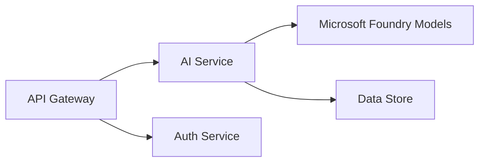
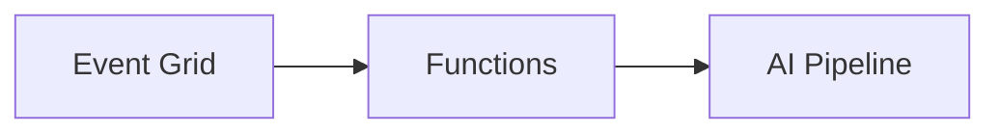

# Luku 8: Tuotanto- ja Yrityskäytännöt

**📚 Kurssi**: [AZD Aloittelijoille](../../README.md) | **⏱️ Kesto**: 2-3 tuntia | **⭐ Vaativuus**: Edistynyt

---

## Yleiskatsaus

Tässä luvussa käsitellään yrityskäyttöön soveltuvia käyttöönotto-malleja, tietoturvan vahvistamista, valvontaa ja kustannusten optimointia tuotannon AI-kuormituksille.

Tämä on arkkitehtoninen viite, ei valmis tuotantoon otettava käyttöönotto-malli. Esimerkit jättävät pois integraatiodetaljit, jotka on lisättävä ja testattava omassa sovelluksessasi; tarkistuslistan lukeminen ei takaa tuotantovalmiutta.

> **Julkaisuarviointi (2026-11-04):** AI CLI -ohjeistus tarkistettiin `azd 1.37.2`, agenttien `1.0.0-beta.23` ja arviointien `1.0.0-beta.2` dokumentaation/lähteen perusteella. Katso [julkaisumuutokset ja korjaukset](production-ai-practices.md#recent-release-changes-and-fixes) yhteensopivuusvaatimuksista ja migraatiotiedoista; tämä ei ole reaaliaikainen käyttöönoton validaatio.

## Oppimistavoitteet

Tämän luvun suorittamisen jälkeen osaat:
- Ottaa käyttöön monialueisia resilienttejä sovelluksia
- Toteuttaa yritystason tietoturvakäytännöt
- Määrittää kattavan valvonnan
- Optimoida kustannuksia suuressa mittakaavassa
- Perustaa CI/CD-putket AZD:llä

---

## 📚 Oppitunnit

| # | Oppitunti | Kuvaus | Aika |
|---|--------|-------------|------|
| 1 | [Tuotannon AI-käytännöt](production-ai-practices.md) | Yrityskäyttöön soveltuvat käyttöönotto-mallit | 90 min |

---

## 🚀 Tuotannon tarkistuslista

- [ ] Monialueinen käyttöönotto resilienttiyttä varten
- [ ] Hallinnoitu identiteetti tunnistautumiseen (ei avaimia)
- [ ] Application Insights valvontaan
- [ ] Kustannusbudjetit ja hälytykset määritetty
- [ ] Tietoturvaskannaus otettu käyttöön
- [ ] CI/CD-putkiston integrointi
- [ ] Katastrofipalautussuunnitelma

---

## 🏗️ Arkkitehtuurimallit

### Malli 1: Mikropalveluiden AI



### Malli 2: Tapahtumapohjainen AI



---

## 🔐 Tietoturvan parhaat käytännöt

```bicep
// Illustrative properties from different resources, NOT a standalone Bicep file.
// Attach identity to the application host:
identity: {
  type: 'SystemAssigned'
}

// AI account properties (also require private endpoints, DNS and app connectivity):
properties: {
  publicNetworkAccess: 'Disabled'
  networkAcls: {
    defaultAction: 'Deny'
  }
}
```

---

## 💰 Kustannusten optimointi

| Strategia | Keskeinen rajoite |
|----------|---------|
| Skaalaus nollaan (Container Apps) | Tarvitsee asianmukaisen laukaisevan tapahtuman; muut palvelut aiheuttavat silti kustannuksia |
| Käytä kulutusluokkia kehitykseen | Vertaa valitun palvelun hinnoittelua ja kuormaa |
| Aikataulutettu skaalaus | Skaalaa tuetun infrastruktuurin/automaation kautta |
| Varaus/varattu kapasiteetti | Vain tuetuissa tapauksissa; sitoumukset voivat lisätä seisokkikustannuksia |

Käytä [täydellistä budjettikuvioresurssia](production-ai-practices.md#2-cost-monitoring-and-budgets) kelvollisella aloituspäivällä, laskutusalueella, vastaanottajilla ja käyttöoikeuksilla. Budjetti lähettää hälytyksiä; se ei rajoita kulutusta. Säästöt riippuvat mitatusta käytöstä, eivätkä ne ole taattuja prosentteja.

---

## 📊 Valvonnan asetukset

```bash
# Open the Application Insights logs view (requires configured monitoring)
azd monitor --logs

# Check Application Insights
azd monitor --overview

# View metrics
az monitor metrics list --resource <resource-id>
```

---

## 🔗 Navigointi

| Suunta | Luku |
|-----------|---------|
| **Edellinen** | [Luku 7: Vianmääritys](../chapter-07-troubleshooting/README.md) |
| **Kurssi valmis** | [Kurssin etusivu](../../README.md) |

---

## 📖 Aiheeseen liittyvät resurssit

- [AI Agenttien opas](../chapter-02-ai-development/agents.md)
- [Application Insights](../chapter-06-pre-deployment/application-insights.md)
- [Moniagenttiratkaisut](../chapter-05-multi-agent/README.md)
- [Mikropalveluesimerkki](../../examples/microservices/README.md)

---

<!-- CO-OP TRANSLATOR DISCLAIMER START -->
**Vastuuvapauslauseke**:
Tämä asiakirja on käännetty käyttämällä tekoälypohjaista käännöspalvelua [Co-op Translator](https://github.com/Azure/co-op-translator). Vaikka pyrimme tarkkuuteen, otathan huomioon, että automaattiset käännökset saattavat sisältää virheitä tai epätarkkuuksia. Alkuperäinen asiakirja sen alkuperäiskielellä on virallinen lähde. Tärkeissä asioissa suositellaan ammattimaista ihmiskäännöstä. Emme ole vastuussa tämän käännöksen käytöstä aiheutuvista väärinymmärryksistä tai tulkinnoista.
<!-- CO-OP TRANSLATOR DISCLAIMER END -->