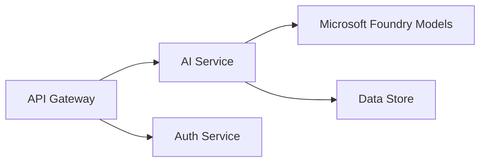
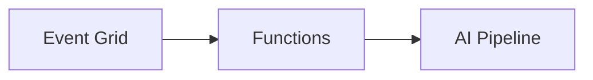

# Luku 8: Tuotanto- ja yrityskäytännöt

**📚 Kurssi**: [AZD Aloittelijoille](../../README.md) | **⏱️ Kesto**: 2-3 tuntia | **⭐ Vaativuus**: Edistynyt

---

## Yleiskatsaus

Tässä luvussa käsitellään yrityskäyttöön soveltuvia käyttöönottoja, turvallisuuden vahvistamista, valvontaa ja kustannusten optimointia tuotannon tekoälytyökuormille.

Tämä on arkkitehtuuriviite, ei täydellinen käyttöön sopiva tuotantomalli. Esimerkit jättävät pois integraatiotiedot, jotka tulee antaa ja testata omassa sovelluksessasi; tarkistuslistan lukeminen ei takaa tuotantovalmiutta.

> **Foundryn GA-päivitys (2026-11-09):** Käytä `azd >= 1.37.0` ja yleisesti saatavilla olevaa `microsoft.foundry` 1.0 -pakettia Foundry-työnkuluille; arvioinnit asennetaan erikseen. Katso [julkaisun laajuus ja migraatio](production-ai-practices.md#recent-release-changes-and-fixes) sekä [valtuutettu putkiesimerkki](production-ai-practices.md#cicd-pipeline-configuration). Tämä on dokumentaation katsaus, ei suoran käyttöönoton vahvistus tai kattava GA-status valinnaisille esikatseluominaisuuksille.

## Oppimistavoitteet

Tässä luvussa opit:
- Ottamaan käyttöön monialueiset vikasietoiset sovellukset
- Toteuttamaan yritysturvallisuusmalleja
- Konfiguroimaan kattava valvonta
- Optimoimaan kustannuksia laajassa mittakaavassa
- Määrittämään CI/CD-putket AZD:llä

---

## 📚 Oppitunnit

| # | Oppitunti | Kuvaus | Aika |
|---|--------|-------------|------|
| 1 | [Tuotannon tekoälykäytännöt](production-ai-practices.md) | Yrityskäyttöön soveltuvat mallit | 90 min |

---

## 🚀 Tuotannon tarkistuslista

- [ ] Monialueinen käyttöönotto vikasietoisuutta varten
- [ ] Hallittu identiteetti todennukseen (ei avaimia)
- [ ] Application Insights valvontaan
- [ ] Kustannusbudjetit ja hälytykset konfiguroituina
- [ ] Turvallisuusskannaus aktivoitu
- [ ] CI/CD-putken integrointi
- [ ] Varmuuskopiointisuunnitelma

---

## 🏗️ Arkkitehtuurimallit

### Malli 1: Mikroserviisit AI



### Malli 2: Tapahtumapohjainen AI



---

## 🔐 Turvallisuuden parhaat käytännöt

```bicep
// Illustrative properties from different resources, NOT a standalone Bicep file.
// Attach identity to the application host:
identity: {
  type: 'SystemAssigned'
}

// AI account properties (also require private endpoints, DNS and app connectivity):
properties: {
  publicNetworkAccess: 'Disabled'
  networkAcls: {
    defaultAction: 'Deny'
  }
}
```

---

## 💰 Kustannusoptimointi

| Strategia | Päärajoitus |
|----------|---------|
| Skaalaa nollaan (Container Apps) | Tarvitsee sopivan laukaisimen; muut palvelut tuottavat edelleen kustannuksia |
| Käytä kulutustasoja kehityksessä | Vertaa valittua palvelun hinnoittelua ja työkuormaa |
| Aikataulutettu skaalaus | Skaalaa tuetun infrastruktuurin/automaation kautta |
| Varaus/provisioitu kapasiteetti | Vain kun tuettu; sitoumukset voivat lisätä käyttämättömiä kustannuksia |

Käytä [täydellistä budjettimallia](production-ai-practices.md#2-cost-monitoring-and-budgets) kelvollisella aloituspäivällä, laskutusalueella, vastaanottajilla ja käyttöoikeuksilla. Budjetti lähettää hälytyksiä; se ei rajoita menoja. Säästöt riippuvat mitatusta käytöstä, eivätkä ole taattuja prosentteja.

---

## 📊 Valvonnan asetukset

```bash
# Open the Application Insights logs view (requires configured monitoring)
azd monitor --logs

# Check Application Insights
azd monitor --overview

# View metrics
az monitor metrics list --resource <resource-id>
```

---

## 🔗 Navigointi

| Suunta | Luku |
|-----------|---------|
| **Edellinen** | [Luku 7: Ongelmien ratkominen](../chapter-07-troubleshooting/README.md) |
| **Kurssi valmis** | [Kurssin koti](../../README.md) |

---

## 📖 Aiheeseen liittyvät resurssit

- [AI-agenttien opas](../chapter-02-ai-development/agents.md)
- [Application Insights](../chapter-06-pre-deployment/application-insights.md)
- [Moniagenttiratkaisut](../chapter-05-multi-agent/README.md)
- [Mikropalveluesimerkki](../../examples/microservices/README.md)

---

<!-- CO-OP TRANSLATOR DISCLAIMER START -->
**Vastuuvapauslauseke**:
Tämä asiakirja on käännetty käyttämällä tekoälypohjaista käännöspalvelua [Co-op Translator](https://github.com/Azure/co-op-translator). Vaikka pyrimme tarkkuuteen, otathan huomioon, että automaattiset käännökset saattavat sisältää virheitä tai epätarkkuuksia. Alkuperäinen asiakirja sen alkuperäiskielellä on virallinen lähde. Tärkeissä asioissa suositellaan ammattimaista ihmiskäännöstä. Emme ole vastuussa tämän käännöksen käytöstä aiheutuvista väärinymmärryksistä tai tulkinnoista.
<!-- CO-OP TRANSLATOR DISCLAIMER END -->